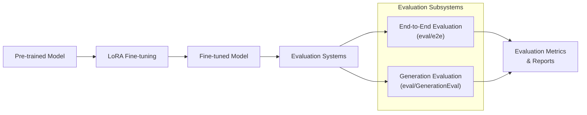
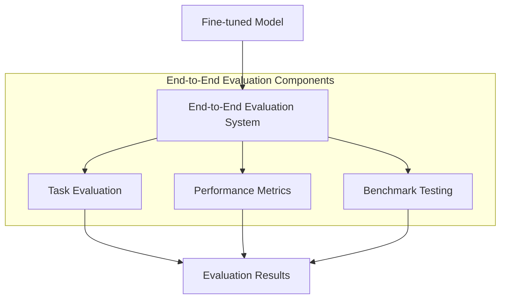
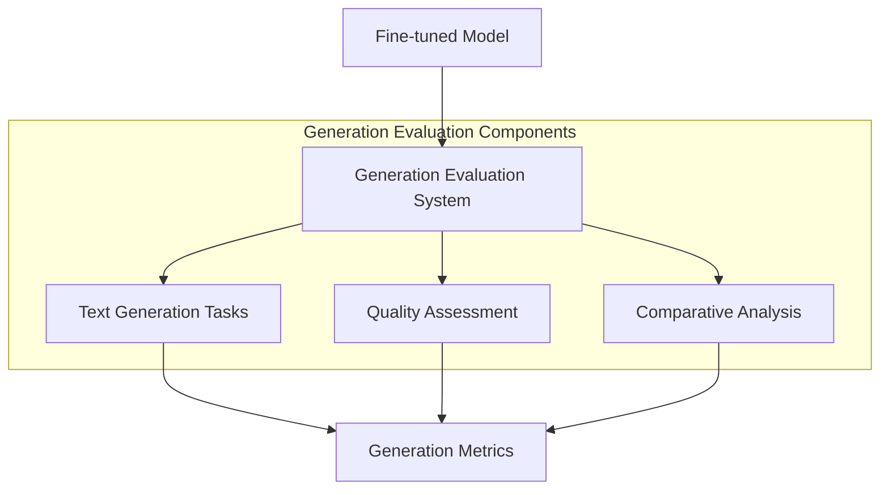
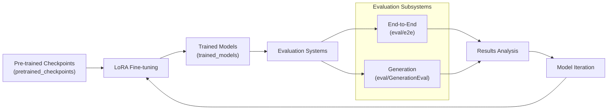

<!-- source: DeepWiki mcp.deepwiki.com · repo microsoft/LoRA · page 3 Evaluation Systems · fetched 2026-10-26 -->

# Evaluation Systems

Relevant source files

The following files were used as context for generating this wiki page:

- [.gitignore](.gitignore)

This document provides an overview of the evaluation systems used in the Microsoft LoRA repository to assess model performance after fine-tuning with Low-Rank Adaptation. These systems are critical for measuring the quality and effectiveness of LoRA-fine-tuned models across various dimensions.

For information about the overall repository structure and purpose, see [LoRA Repository Overview](#1). For details about model management, see [Model Management](#2).

## Evaluation Architecture

The evaluation architecture in the Microsoft LoRA repository consists of two primary subsystems:

1. **End-to-End Evaluation** (`eval/e2e/`) - Comprehensive evaluation of models across multiple tasks and metrics
2. **Generation Evaluation** (`eval/GenerationEval/`) - Focused evaluation of text generation capabilities

These evaluation systems are designed to be used after models have been fine-tuned using LoRA techniques to assess their performance and generate metrics for comparison.

### Evaluation Workflow Diagram

Sources: `.gitignore:5-6`

## End-to-End Evaluation

The End-to-End (e2e) evaluation system provides comprehensive assessment of LoRA-fine-tuned models across multiple dimensions. This system is located in the `eval/e2e` directory and evaluates models on a range of tasks and benchmarks.

For detailed information about the End-to-End evaluation system, see [End-to-End Evaluation](#3.1).

### End-to-End Evaluation Components

Sources: `.gitignore:5`

## Generation Evaluation

The Generation Evaluation system focuses specifically on assessing text generation capabilities of LoRA-fine-tuned models. This system is located in the `eval/GenerationEval` directory and evaluates aspects such as text quality, coherence, relevance, and other generation-specific metrics.

For detailed information about the Generation Evaluation system, see [Generation Evaluation](#3.2).

### Generation Evaluation Components

Sources: `.gitignore:6`

## Integration with Model Training

Evaluation systems in the LoRA repository are designed to work seamlessly with the model training process. After a model is fine-tuned using LoRA techniques, it can be passed to the evaluation systems to assess performance and quality.

### Training and Evaluation Flow

Sources: `.gitignore:3-6`

## Common Evaluation Metrics

The evaluation systems in the LoRA repository likely use a variety of metrics to assess model performance. While the specific metrics would be defined in the implementation code, common evaluation metrics for LoRA-fine-tuned models include:

| Category | Metrics | Description |
|----------|---------|-------------|
| Text Generation | Perplexity | Measure of how well the model predicts text |
| | BLEU, ROUGE | Text similarity metrics comparing to reference texts |
| | Fluency & Coherence | How natural and logically connected the text is |
| Task Performance | Accuracy | Correct predictions in classification tasks |
| | F1 Score | Harmonic mean of precision and recall |
| | Task-specific metrics | Metrics relevant to specific fine-tuning tasks |
| Efficiency | Parameter efficiency | Ratio of trainable parameters to total parameters |
| | Inference latency | Time required for model inference |
| | Memory usage | Memory required for model storage and inference |

Sources: `.gitignore:5-6`

## Evaluation System Outputs

The evaluation systems produce structured results that can be used to:

1. Compare different LoRA configurations
2. Benchmark against non-LoRA fine-tuning approaches
3. Identify optimal rank settings for specific tasks
4. Measure trade-offs between model size and performance
5. Assess generation quality across different domains

These outputs inform decisions about model selection and further fine-tuning approaches.

Sources: `.gitignore:5-6`

## Conclusion

The evaluation systems in the Microsoft LoRA repository provide crucial capabilities for assessing the performance of LoRA-fine-tuned models. Through the End-to-End evaluation and Generation Evaluation subsystems, users can comprehensively evaluate their models and make informed decisions about model selection and further fine-tuning.

For specific implementation details, refer to the detailed documentation in [End-to-End Evaluation](#3.1) and [Generation Evaluation](#3.2).

---

