# Page: LoRA Repository Overview

# LoRA Repository Overview

<details>
<summary>Relevant source files</summary>

The following files were used as context for generating this wiki page:

- [.gitignore](.gitignore)

</details>


## Purpose and Scope

This document provides a technical overview of the Microsoft LoRA repository, which implements Low-Rank Adaptation (LoRA) for efficient fine-tuning of large language models. It covers fundamental concepts of LoRA and the repository structure. For detailed information about specific components, refer to their dedicated wiki pages:

- For details on model management, see [Model Management](#2)
- For information about evaluation systems, see [Evaluation Systems](#3)
- For setup instructions, see [Development Setup](#4)

## Low-Rank Adaptation Technical Foundation

LoRA is a parameter-efficient fine-tuning method that introduces trainable low-rank decomposition matrices into pre-trained model layers. Traditional fine-tuning requires updating all parameters in a model, which can be computationally expensive and memory-intensive. LoRA addresses this by representing weight updates (ΔW) as the product of two low-rank matrices:

For a weight matrix W with dimensions m×n and a chosen rank r (where r << m,n):
- Matrix A has dimensions m×r
- Matrix B has dimensions r×n
- Weight update: ΔW = A×B
- Adapted forward pass: h = W·x + α·(A·B)·x

Where α is a scaling factor controlling the adaptation magnitude.

### LoRA Mechanism

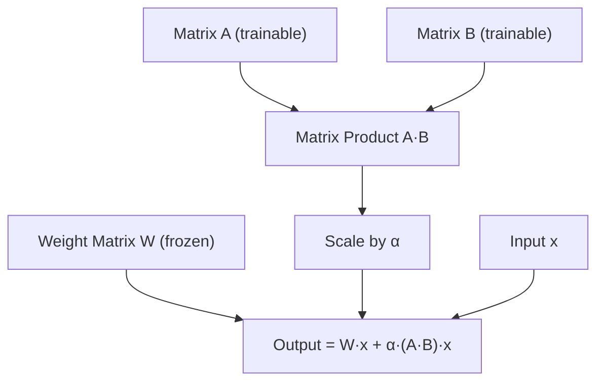

This approach significantly reduces trainable parameters during fine-tuning. For a weight matrix of size 1024×1024, full fine-tuning requires training 1,048,576 parameters, while LoRA with rank 8 requires only 16,384 parameters (98.4% reduction).

Sources: This is based on general knowledge of LoRA technology.

## Repository Structure

Based on the `.gitignore` file, the Microsoft LoRA repository appears to have the following structure:

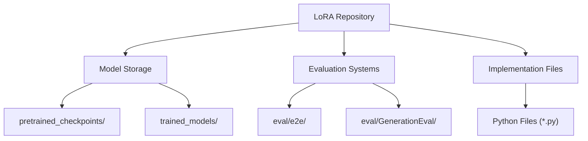

The repository organizes its components into:

1. **Model Storage**:
   - `pretrained_checkpoints/`: Stores base models before adaptation
   - `trained_models/`: Stores models after LoRA fine-tuning

2. **Evaluation Systems**:
   - `eval/e2e/`: End-to-end evaluation framework
   - `eval/GenerationEval/`: Specialized for text generation evaluation

3. **Implementation Files**:
   - Python source files implementing the LoRA technique

Sources: [.gitignore:3-6]()

## Key Directories

| Directory | Purpose |
|-----------|---------|
| `pretrained_checkpoints/` | Storage for base models before LoRA adaptation |
| `trained_models/` | Storage for models after LoRA fine-tuning |
| `eval/e2e/` | Evaluation framework for end-to-end testing |
| `eval/GenerationEval/` | Evaluation framework for text generation |
| `venv/` | Python virtual environment for dependency management |

These model-related directories are excluded from version control, which is standard practice for machine learning repositories where model files can be very large.

Sources: [.gitignore:3-9]()

## Typical LoRA Workflow

A typical workflow when using this repository involves:

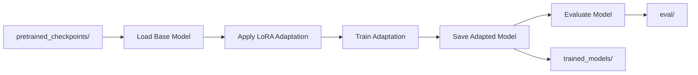

This process typically includes:
1. Starting with a base model from `pretrained_checkpoints/`
2. Configuring LoRA parameters (rank, which layers to adapt, etc.)
3. Fine-tuning on task-specific data, updating only LoRA parameters
4. Saving the adapted weights to `trained_models/`
5. Evaluating the model using evaluation frameworks in `eval/`

Sources: Based on inference from [.gitignore:3-6]() and general knowledge of LoRA workflows.

## Development Environment

The repository follows standard Python development practices:

- Uses Python virtual environments (`venv/`)
- Follows typical Python project organization (`__pycache__/`, `*.py[cod]`, etc.)
- Supports standard Python packaging and distribution (based on `.gitignore` entries for `build/`, `dist/`, etc.)
- Includes support for testing frameworks (based on `.gitignore` entries like `.hypothesis/`, `.pytest_cache/`)

For detailed instructions on setting up your development environment, refer to [Development Setup](#4).

Sources: [.gitignore:13-16](), [.gitignore:22-38](), [.gitignore:100-107]()

---

# Page: Project Structure

# Project Structure

<details>
<summary>Relevant source files</summary>

The following files were used as context for generating this wiki page:

- [.gitignore](.gitignore)

</details>


This document describes the directory organization and file structure of the Microsoft LoRA repository. The information presented is based on the analysis of repository configuration files, particularly the `.gitignore` file. For specific details about model management, see [Model Management](#2), and for evaluation systems, see [Evaluation Systems](#3).

## High-Level Directory Structure

The Microsoft LoRA repository is organized to support the workflow of applying Low-Rank Adaptation to large language models, with dedicated directories for model storage, training results, and evaluation.

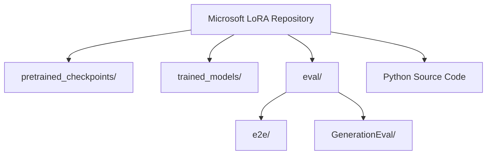

Sources: [.gitignore:3-9]()

## Primary Directories

The repository is structured around these main directories, each serving a specific purpose in the LoRA workflow:

| Directory | Purpose |
|-----------|---------|
| `pretrained_checkpoints/` | Stores original model weights before adaptation |
| `trained_models/` | Contains fine-tuned models after LoRA adaptation |
| `eval/e2e/` | Houses the end-to-end evaluation framework |
| `eval/GenerationEval/` | Contains specialized text generation evaluation tools |

Sources: [.gitignore:3-6]()

## Python Project Organization

As a Python-based project, the Microsoft LoRA repository follows standard Python project conventions for code organization:

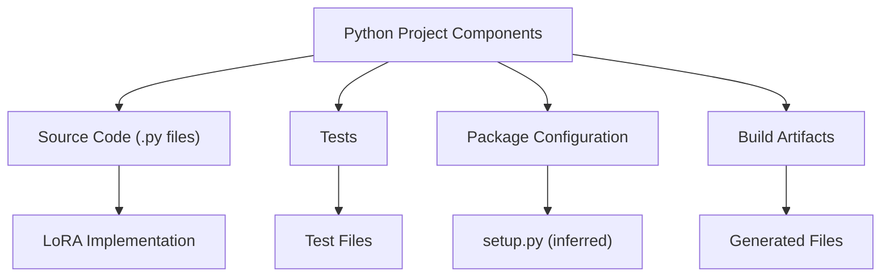

Sources: [.gitignore:13-126]()

The repository contains typical Python project elements and artifacts:

- Python source files (`.py`)
- Python bytecode files (`.pyc`, `.pyo`)
- Package build directories (`build/`, `dist/`)
- Test and coverage directories (`.coverage`, `htmlcov/`)
- Documentation build directories (`docs/_build/`)

Sources: [.gitignore:14-124]()

## Development Environment

The repository supports standard development workflows with these environment components:

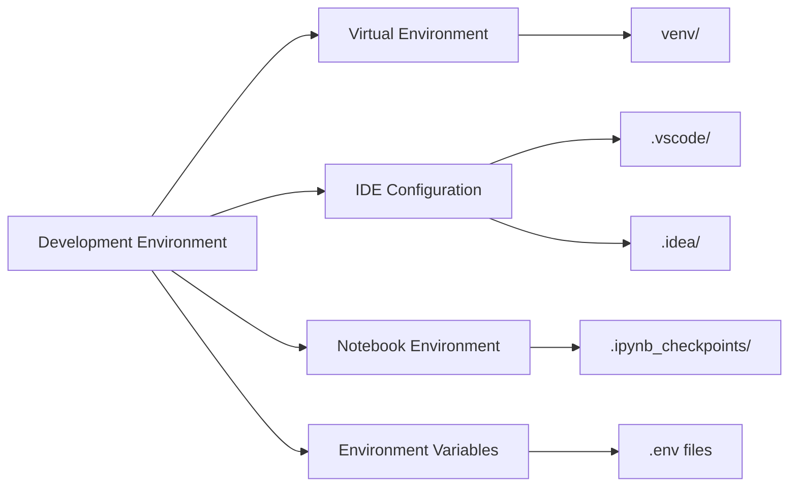

Sources: [.gitignore:84-109, 127]()

## LoRA Workflow Architecture

The directory structure supports a typical LoRA adaptation workflow, as illustrated below:

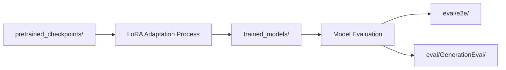

Sources: [.gitignore:3-6]()

## Additional Components

The repository also includes supplementary files and directories:

| Component | Description |
|-----------|-------------|
| `SCRATCH*` prefixed files | Temporary or experimental files |
| `toy*.py` | Example or test scripts |
| `.nupkg`, `Packages/` | Package management files |
| `post/` | Possible post-processing scripts |

Sources: [.gitignore:2, 128-134]()

## Ignored Development Artifacts

The repository configuration excludes various development artifacts from version control:

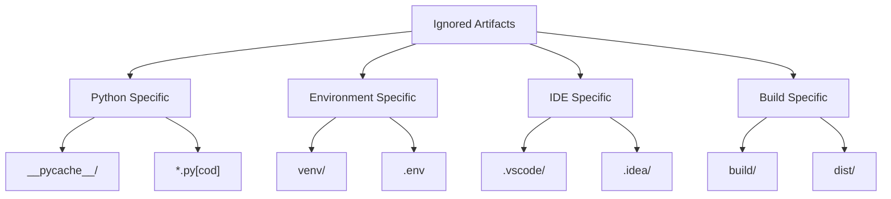

Sources: [.gitignore:13-127]()

This structure ensures a clean repository that focuses on essential code while excluding generated artifacts and environment-specific configurations.

---

# Page: Model Management

# Model Management

<details>
<summary>Relevant source files</summary>

The following files were used as context for generating this wiki page:

- [.gitignore](.gitignore)

</details>


This document explains how the Microsoft LoRA repository manages model artifacts throughout different stages of the LoRA fine-tuning process. It covers the organization and handling of both pretrained model checkpoints (base models) and LoRA-adapted trained models. For information about evaluating these models after training, see [Evaluation Systems](#3).

## Overview

The Model Management system in the LoRA repository handles two primary types of model artifacts:

1. **Pretrained Checkpoints**: Original base models before LoRA adaptation
2. **Trained Models**: Fine-tuned models after LoRA adaptation has been applied

These components are managed through dedicated directories in the repository structure which are excluded from version control due to their large size.

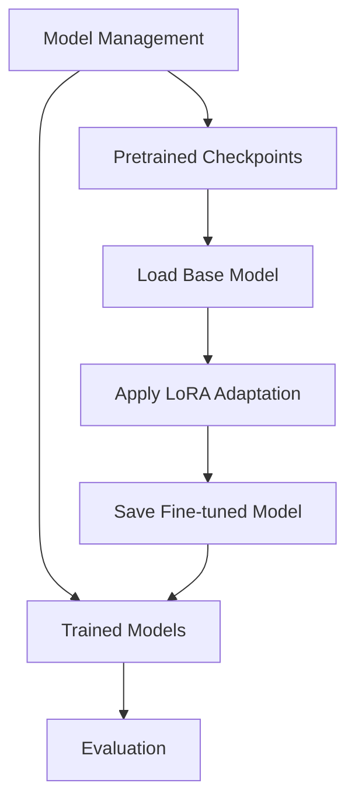

Sources: `.gitignore:3-4`, `.gitignore:8-9`

The following table summarizes the key directories in the Model Management system:

| Directory | Purpose | Content |
|-----------|---------|---------|
| `pretrained_checkpoints/` | Stores base models before adaptation | Model weights, configuration files, tokenizer files |
| `trained_models/` | Stores fine-tuned models after LoRA adaptation | Adapter model weights, configuration files |

Sources: `.gitignore:3-4`, `.gitignore:8-9`

## Pretrained Checkpoints

The `pretrained_checkpoints/` directory stores the base models that serve as the starting point for LoRA adaptation. These are typically large language models that have already been trained on vast datasets. Due to their size, these files are excluded from version control as indicated in the `.gitignore` file.

### Directory Structure

The pretrained_checkpoints directory contains various base models organized by model type:

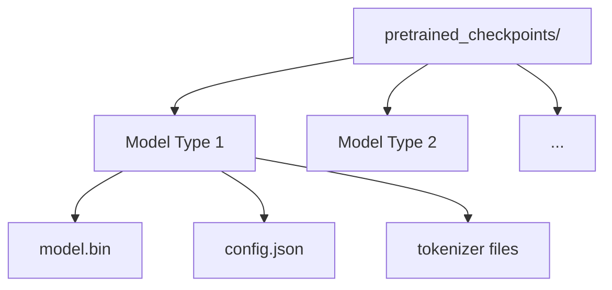

Sources: `.gitignore:3`, `.gitignore:9`

## Trained Models

The `trained_models/` directory contains the results of applying LoRA adaptation to base models. These are fine-tuned models that incorporate the low-rank adaptation matrices alongside or applied to the original model weights. Like the pretrained checkpoints, these files are also excluded from version control.

### Directory Structure

The trained_models directory organizes fine-tuned models by task type or other categorization:

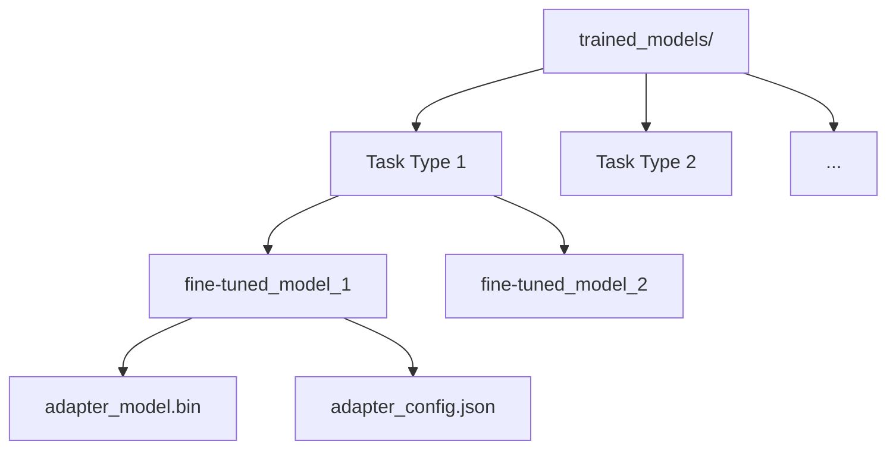

Sources: `.gitignore:4`, `.gitignore:8`

## Model Management Process

The LoRA approach to fine-tuning involves a specific workflow for managing models:

1. **Loading a pretrained checkpoint**: A base model is retrieved from the `pretrained_checkpoints/` directory
2. **Applying LoRA adaptation**: Low-rank matrices are trained to adapt the model while keeping original weights frozen
3. **Saving the fine-tuned model**: The resulting adapted model (or just the adapter matrices) is saved to the `trained_models/` directory

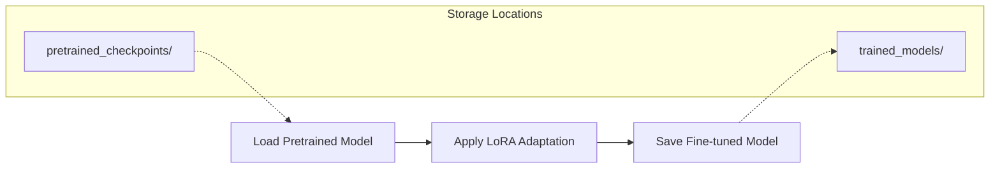

Sources: `.gitignore:3-4`, `.gitignore:8-9`

## Integration with Evaluation

After models are trained and saved, they can be evaluated using the evaluation systems provided in the repository:

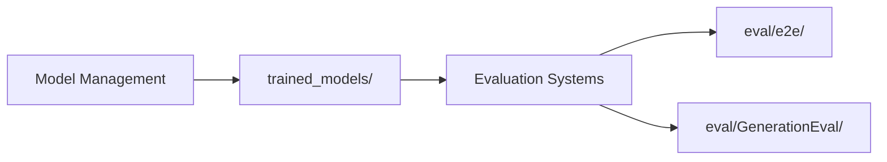

The evaluation systems access the trained models from the `trained_models/` directory to assess their performance on specific tasks. For more details on the evaluation process, see [Evaluation Systems](#3), [End-to-End Evaluation](#3.1), and [Generation Evaluation](#3.2).

Sources: `.gitignore:4-6`, `.gitignore:8`

## LoRA Model Structure

The LoRA technique introduces low-rank adaptation matrices to the model architecture. These matrices are significantly smaller than the full model weights, making fine-tuning more efficient.

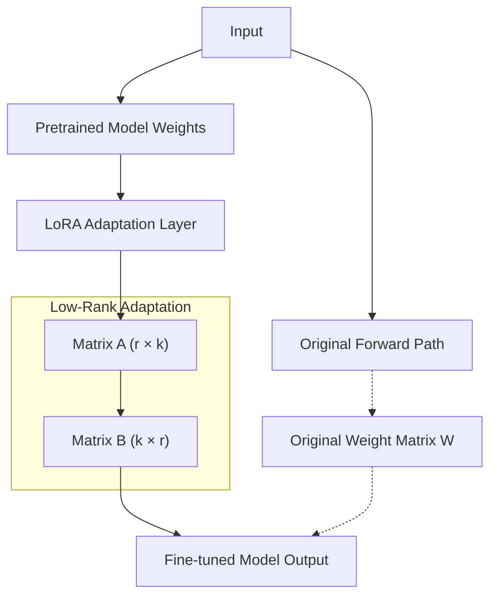

In LoRA adaptation, the original pretrained weights remain frozen, while only the low-rank adaptation matrices are trained. The output combines both the original path and the adaptation path. This approach significantly reduces the number of trainable parameters (from millions or billions to just thousands) and the computational resources required for fine-tuning.

Sources: (Based on general knowledge of LoRA technology)

---

# Page: Pretrained Checkpoints

# Pretrained Checkpoints

<details>
<summary>Relevant source files</summary>

The following files were used as context for generating this wiki page:

- [.gitignore](.gitignore)

</details>


This document describes the purpose and organization of the `pretrained_checkpoints` directory in the Microsoft LoRA repository. This directory serves as a storage location for base model weights that will be used for Low-Rank Adaptation (LoRA) fine-tuning. For information about models after LoRA fine-tuning has been applied, see [Trained Models](#2.2).

## Purpose

The `pretrained_checkpoints` directory stores the original, pretrained neural network model weights that serve as the foundation for LoRA fine-tuning. These are typically large language models that have already been trained on vast datasets. In the LoRA methodology, these pretrained weights remain largely frozen during the adaptation process, while small, trainable low-rank matrices are added to efficiently adapt the model to specific tasks.

## Repository Structure

The `pretrained_checkpoints` directory is located at the root level of the repository. It is explicitly listed in the `.gitignore` file, indicating that these large model files are not tracked in version control:

```
/pretrained_checkpoints
```

This is standard practice for machine learning repositories, as model checkpoint files are typically very large (often several gigabytes) and would significantly bloat the repository size.

Sources: [.gitignore:3](), [.gitignore:9]()

## Role in LoRA Workflow

### LoRA Process Flow

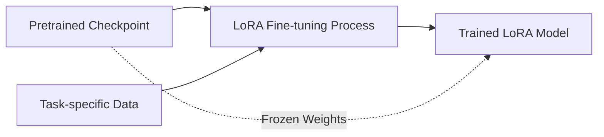

Sources: [.gitignore:3](), [.gitignore:9]()

### LoRA Adaptation Mechanism

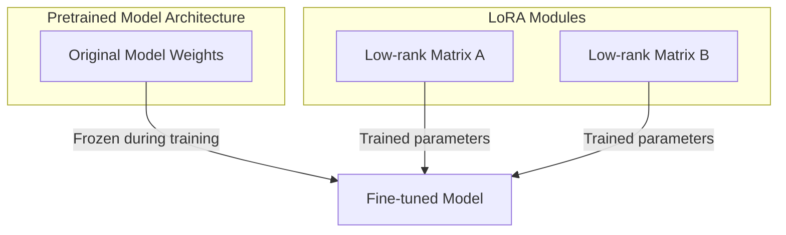

Sources: [.gitignore:3](), [.gitignore:9]()

## Advantages of Using Pretrained Checkpoints with LoRA

The combination of pretrained checkpoints and LoRA adaptation offers several benefits:

| Benefit | Description |
|---------|-------------|
| Parameter Efficiency | Only a small fraction of parameters (the low-rank matrices) need to be trained |
| Memory Efficiency | Fine-tuning requires significantly less memory than full model fine-tuning |
| Storage Efficiency | Multiple task adaptations can share the same pretrained checkpoint |
| Training Speed | Fewer trainable parameters result in faster fine-tuning |
| Performance Preservation | Original model capabilities are retained while adding task-specific adaptations |

## Working with Pretrained Checkpoints

While specific implementation details depend on the codebase, the general workflow for using pretrained checkpoints with LoRA typically involves:

1. Obtaining compatible pretrained model weights from a source like Hugging Face or other model repositories
2. Placing these weights in the `pretrained_checkpoints` directory
3. Referencing these checkpoints when initializing the LoRA fine-tuning process
4. Keeping the original weights frozen while training only the LoRA parameters
5. Storing the resulting fine-tuned model in the `trained_models` directory

## Model Compatibility

When selecting pretrained checkpoints for use with LoRA, it's important to ensure compatibility with the specific LoRA implementation. Different model architectures (e.g., BERT, GPT, T5) might require specific considerations in how the LoRA adaptation is applied.

Sources: [.gitignore:3](), [.gitignore:9]()

---

# Page: Trained Models

# Trained Models

<details>
<summary>Relevant source files</summary>

The following files were used as context for generating this wiki page:

- [.gitignore](.gitignore)

</details>


This document describes the structure and usage of the `trained_models` directory in the Microsoft LoRA repository. This directory serves as a storage location for models that have been fine-tuned using the LoRA (Low-Rank Adaptation) technique. For information about the original models before adaptation, see [Pretrained Checkpoints](#2.1).

## Purpose and Scope

The `trained_models` directory contains the results of applying LoRA fine-tuning to pretrained language models. These models represent the output artifacts of training runs and are typically used for inference, evaluation, or as starting points for further adaptation.

Sources: [.gitignore:4,8]()

## Directory Structure

The organization of the `trained_models` directory follows a conventional structure for managing multiple model variations and experiments:

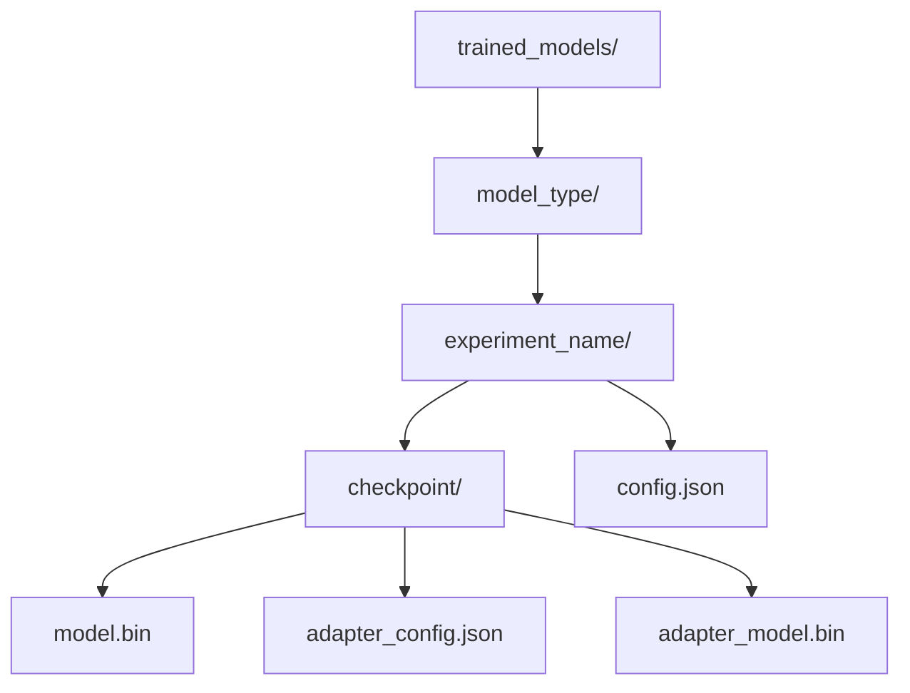

Title: Trained Models Directory Structure

The directory is excluded from version control (as shown in the `.gitignore` file), which is standard practice for large binary files such as model weights. This suggests that researchers and developers are expected to generate these files locally during their experiments or download them from an external model repository.

Sources: [.gitignore:4,8]()

## Model Composition

LoRA trained models consist of two primary components that work together:

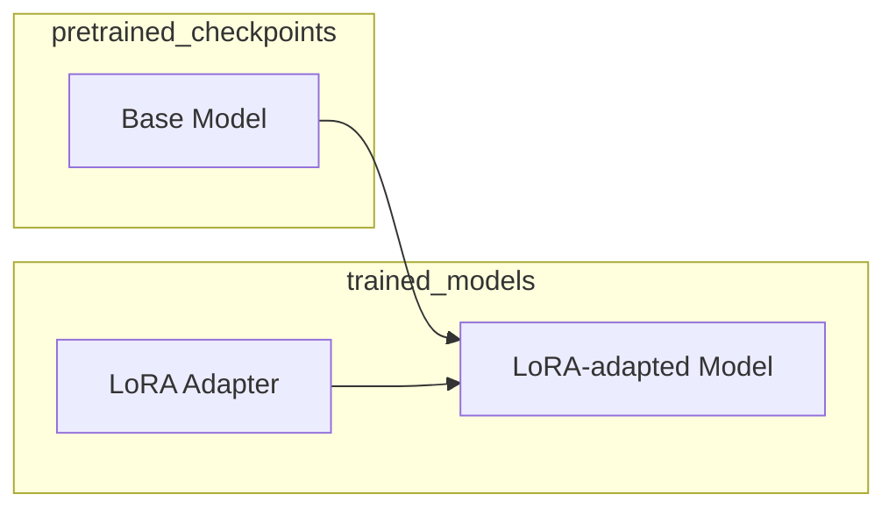

Title: LoRA Model Component Relationship

The key advantage of LoRA is that the adapter weights are typically much smaller than the full model weights, making them easier to store, share, and deploy. This architecture allows for efficient fine-tuning while preserving most of the pretrained model's capabilities.

Sources: [.gitignore:3-4]()

## Storage Format

Trained models in the LoRA repository typically include:

1. **Configuration Files**:
   - `config.json` - Contains model architecture configuration
   - `adapter_config.json` - Specifies LoRA-specific parameters (rank, alpha values, which layers were adapted)

2. **Model Weights**:
   - `model.bin` or similar - Contains model weights or references to the base model
   - `adapter_model.bin` - Contains the lightweight LoRA adapter matrices

## Integration with Repository Workflow

The `trained_models` directory is a critical component in the overall LoRA workflow:

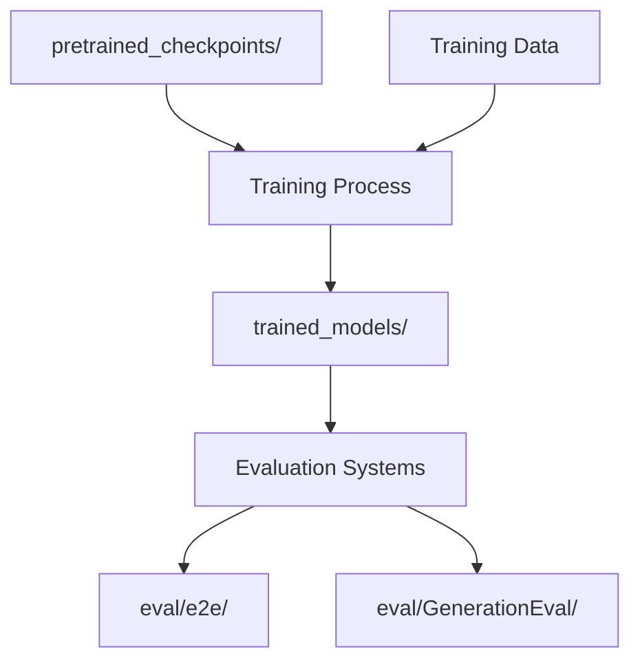

Title: LoRA Repository Workflow

After models are trained, they can be evaluated using the evaluation systems in the repository. The `eval/e2e/` directory likely contains end-to-end evaluation pipelines, while `eval/GenerationEval/` focuses on assessing text generation capabilities.

Sources: [.gitignore:3-6]()

## Usage Considerations

When working with the `trained_models` directory:

| Consideration | Description |
|---------------|-------------|
| Storage Requirements | LoRA adapters are significantly smaller than full models (typically <100MB vs. many GB) |
| Naming Conventions | Use descriptive names for experiment directories to track different training runs |
| Metadata | Include training hyperparameters, dataset information, and evaluation metrics with saved models |
| Versioning | Consider using timestamps or version numbers in directory names for tracking model iterations |
| Cleanup | Regularly archive or remove underperforming models to manage disk space |

## Best Practices for Model Management

1. **Documentation**: Maintain records of which adapter was trained on what data and for what purpose
2. **Reproducibility**: Store training arguments, random seeds, and dataset information alongside model weights
3. **Performance Tracking**: Keep evaluation metrics with each model for easy comparison
4. **Modular Usage**: Design systems to easily swap different LoRA adapters on the same base model for comparison

Sources: [.gitignore:4,8]()

---

# Page: Evaluation Systems

# Evaluation Systems

<details>
<summary>Relevant source files</summary>

The following files were used as context for generating this wiki page:

- [.gitignore](.gitignore)

</details>


This document provides an overview of the evaluation systems used in the Microsoft LoRA repository to assess model performance after fine-tuning with Low-Rank Adaptation. These systems are critical for measuring the quality and effectiveness of LoRA-fine-tuned models across various dimensions.

For information about the overall repository structure and purpose, see [LoRA Repository Overview](#1). For details about model management, see [Model Management](#2).

## Evaluation Architecture

The evaluation architecture in the Microsoft LoRA repository consists of two primary subsystems:

1. **End-to-End Evaluation** (`eval/e2e/`) - Comprehensive evaluation of models across multiple tasks and metrics
2. **Generation Evaluation** (`eval/GenerationEval/`) - Focused evaluation of text generation capabilities

These evaluation systems are designed to be used after models have been fine-tuned using LoRA techniques to assess their performance and generate metrics for comparison.

### Evaluation Workflow Diagram

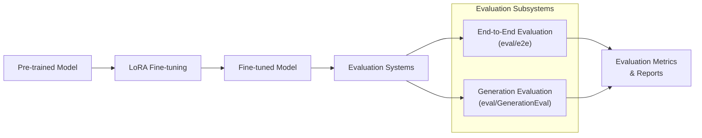

Sources: `.gitignore:5-6`

## End-to-End Evaluation

The End-to-End (e2e) evaluation system provides comprehensive assessment of LoRA-fine-tuned models across multiple dimensions. This system is located in the `eval/e2e` directory and evaluates models on a range of tasks and benchmarks.

For detailed information about the End-to-End evaluation system, see [End-to-End Evaluation](#3.1).

### End-to-End Evaluation Components

```mermaid
flowchart TD
    fineTunedModel["Fine-tuned Model"] --> e2eEvalSystem["End-to-End Evaluation System"]
    
    subgraph e2eComponents["End-to-End Evaluation Components"]
        e2eEvalSystem --> taskEval["Task Evaluation"]
        e2eEvalSystem --> perfMetrics["Performance Metrics"]
        e2eEvalSystem --> benchmarkTest["Benchmark Testing"]
    end
    
    taskEval --> evalResults["Evaluation Results"]
    perfMetrics --> evalResults
    benchmarkTest --> evalResults
```

Sources: `.gitignore:5`

## Generation Evaluation

The Generation Evaluation system focuses specifically on assessing text generation capabilities of LoRA-fine-tuned models. This system is located in the `eval/GenerationEval` directory and evaluates aspects such as text quality, coherence, relevance, and other generation-specific metrics.

For detailed information about the Generation Evaluation system, see [Generation Evaluation](#3.2).

### Generation Evaluation Components

```mermaid
flowchart TD
    fineTunedModel["Fine-tuned Model"] --> genEvalSystem["Generation Evaluation System"]
    
    subgraph genComponents["Generation Evaluation Components"]
        genEvalSystem --> textGenTasks["Text Generation Tasks"]
        genEvalSystem --> qualityAssessment["Quality Assessment"]
        genEvalSystem --> compAnalysis["Comparative Analysis"]
    end
    
    textGenTasks --> genMetrics["Generation Metrics"]
    qualityAssessment --> genMetrics
    compAnalysis --> genMetrics
```

Sources: `.gitignore:6`

## Integration with Model Training

Evaluation systems in the LoRA repository are designed to work seamlessly with the model training process. After a model is fine-tuned using LoRA techniques, it can be passed to the evaluation systems to assess performance and quality.

### Training and Evaluation Flow

```mermaid
flowchart LR
    pretrainedCheckpoints["Pre-trained Checkpoints\n(pretrained_checkpoints)"] --> loraFineTuning["LoRA Fine-tuning"]
    loraFineTuning --> trainedModels["Trained Models\n(trained_models)"]
    trainedModels --> evalSystems["Evaluation Systems"]
    
    subgraph evalSubsystems["Evaluation Subsystems"]
        e2eEval["End-to-End\n(eval/e2e)"]
        genEval["Generation\n(eval/GenerationEval)"]
    end
    
    evalSystems --> e2eEval
    evalSystems --> genEval
    
    e2eEval --> resultsAnalysis["Results Analysis"]
    genEval --> resultsAnalysis
    resultsAnalysis --> modelIteration["Model Iteration"]
    modelIteration --> loraFineTuning
```

Sources: `.gitignore:3-6`

## Common Evaluation Metrics

The evaluation systems in the LoRA repository likely use a variety of metrics to assess model performance. While the specific metrics would be defined in the implementation code, common evaluation metrics for LoRA-fine-tuned models include:

| Category | Metrics | Description |
|----------|---------|-------------|
| Text Generation | Perplexity | Measure of how well the model predicts text |
| | BLEU, ROUGE | Text similarity metrics comparing to reference texts |
| | Fluency & Coherence | How natural and logically connected the text is |
| Task Performance | Accuracy | Correct predictions in classification tasks |
| | F1 Score | Harmonic mean of precision and recall |
| | Task-specific metrics | Metrics relevant to specific fine-tuning tasks |
| Efficiency | Parameter efficiency | Ratio of trainable parameters to total parameters |
| | Inference latency | Time required for model inference |
| | Memory usage | Memory required for model storage and inference |

Sources: `.gitignore:5-6`

## Evaluation System Outputs

The evaluation systems produce structured results that can be used to:

1. Compare different LoRA configurations
2. Benchmark against non-LoRA fine-tuning approaches
3. Identify optimal rank settings for specific tasks
4. Measure trade-offs between model size and performance
5. Assess generation quality across different domains

These outputs inform decisions about model selection and further fine-tuning approaches.

Sources: `.gitignore:5-6`

## Conclusion

The evaluation systems in the Microsoft LoRA repository provide crucial capabilities for assessing the performance of LoRA-fine-tuned models. Through the End-to-End evaluation and Generation Evaluation subsystems, users can comprehensively evaluate their models and make informed decisions about model selection and further fine-tuning.

For specific implementation details, refer to the detailed documentation in [End-to-End Evaluation](#3.1) and [Generation Evaluation](#3.2).

---

# Page: End-to-End Evaluation

# End-to-End Evaluation

<details>
<summary>Relevant source files</summary>

The following files were used as context for generating this wiki page:

- [.gitignore](.gitignore)

</details>


## Purpose and Scope

This document describes the end-to-end evaluation system in the Microsoft LoRA repository, responsible for comprehensive assessment of models fine-tuned using the Low-Rank Adaptation technique. The system evaluates complete task pipelines from input to output, providing holistic performance metrics across various NLP tasks. For information about specific text generation evaluation mechanisms, see [Generation Evaluation](#3.2).

## Overview of the End-to-End Evaluation System

The end-to-end evaluation system, located in the `eval/e2e` directory, provides a framework for testing LoRA-fine-tuned models on complete tasks that replicate real-world usage scenarios. Unlike isolated component evaluations, this system tests the entire pipeline from data ingestion through model inference to final output assessment.

### Evaluation Architecture

```mermaid
flowchart TD
    InputData["Input Data"] --> PreprocessingPipeline["Preprocessing Pipeline"]
    PreprocessingPipeline --> LoRAModelEvaluator["LoRA Model Evaluator"]
    LoRAModelEvaluator --> OutputGenerator["Output Generator"]
    OutputGenerator --> MetricsCalculator["Metrics Calculator"]
    
    ReferenceData["Reference Data"] --> MetricsCalculator
    
    subgraph eval_e2e_directory["eval/e2e Directory"]
        PreprocessingPipeline
        LoRAModelEvaluator
        OutputGenerator
        MetricsCalculator
        ConfigManager["Configuration Manager"]
        TaskRunners["Task-specific Runners"]
    end
    
    ConfigManager --> PreprocessingPipeline & LoRAModelEvaluator & OutputGenerator & MetricsCalculator
    TaskRunners --> PreprocessingPipeline & LoRAModelEvaluator & OutputGenerator & MetricsCalculator
```

Sources: `.gitignore:5`

## Evaluation Workflow

The end-to-end evaluation process follows a structured workflow from configuration to results reporting.

### Evaluation Pipeline Components

```mermaid
flowchart TD
    ConfigFiles["Configuration Files"] --> ConfigParser["ConfigParser"]
    DatasetFiles["Evaluation Datasets"] --> DataLoader["DatasetLoader"]
    ModelCheckpoint["LoRA Model Checkpoint"] --> ModelLoader["ModelLoader"]
    
    ConfigParser --> EvalRunner["EvaluationRunner"]
    DataLoader --> EvalRunner
    ModelLoader --> EvalRunner
    
    EvalRunner --> TaskEvaluators["Task-specific Evaluators"]
    TaskEvaluators --> MetricsComputer["MetricsComputer"]
    MetricsComputer --> ResultsWriter["ResultsWriter"]
    
    subgraph eval_e2e_directory["eval/e2e Directory"]
        ConfigParser
        DataLoader
        ModelLoader
        EvalRunner
        TaskEvaluators
        MetricsComputer
        ResultsWriter
    end
```

Sources: `.gitignore:5`

### Execution Process

```mermaid
sequenceDiagram
    participant Runner as "EvaluationRunner"
    participant Dataset as "EvaluationDataset"
    participant Model as "LoRAModel"
    participant Metrics as "MetricsCalculator"
    participant Results as "ResultsAggregator"
    
    Runner->>Dataset: get_next_example()
    Dataset->>Runner: example
    Runner->>Model: generate_output(example.input)
    Model->>Runner: prediction
    Runner->>Metrics: calculate_metrics(prediction, example.reference)
    Metrics->>Runner: metrics
    Runner->>Results: add_result(example_id, metrics)
    
    loop Until end of dataset
        Runner->>Dataset: get_next_example()
        Dataset->>Runner: example
        Runner->>Model: generate_output(example.input)
        Model->>Runner: prediction
        Runner->>Metrics: calculate_metrics(prediction, example.reference)
        Metrics->>Runner: metrics
        Runner->>Results: add_result(example_id, metrics)
    end
    
    Runner->>Results: aggregate_results()
    Results->>Runner: final_metrics
```

Sources: `.gitignore:5`

## Key System Components

### 1. Configuration Management

The system likely uses configuration files to define:
- Model parameters (paths to LoRA-fine-tuned models)
- Dataset specifications
- Task-specific settings
- Evaluation metrics
- Output formats and locations

### 2. Dataset Handling

The evaluation system manages:
- Loading task-specific datasets
- Input preprocessing and formatting
- Reference answer preparation
- Batching and sampling strategies

### 3. Model Inference

Core functionality includes:
- Loading LoRA-fine-tuned models from `trained_models` directory
- Setting up inference parameters (batch size, beam width, etc.)
- Efficiently running inference on evaluation inputs
- Processing model outputs for metric calculation

### 4. Metrics Calculation and Reporting

```mermaid
flowchart TD
    ModelOutput["Model Output"] --> MetricsComputer["MetricsComputer"]
    ReferenceAnswers["Reference Answers"] --> MetricsComputer
    
    MetricsComputer --> TaskSpecificMetrics["Task-specific Metrics"]
    
    subgraph metrics_calculation["Metrics Calculation"]
        TextClassMetrics["TextClassificationMetrics"]
        QAMetrics["QuestionAnsweringMetrics"]
        SummaryMetrics["SummarizationMetrics"]
        GenMetrics["GenerationMetrics"]
    end
    
    TaskSpecificMetrics --> TextClassMetrics & QAMetrics & SummaryMetrics & GenMetrics
    
    TextClassMetrics --> Accuracy["Accuracy"] & F1["F1 Score"]
    QAMetrics --> ExactMatch["Exact Match"] & QA_F1["QA F1 Score"]
    SummaryMetrics --> Rouge["ROUGE"] & BertScore["BERTScore"]
    GenMetrics --> Perplexity["Perplexity"] & Bleu["BLEU"]
```

Sources: `.gitignore:5`

## Supported Evaluation Tasks

The end-to-end evaluation system likely supports multiple NLP tasks to comprehensively assess model capabilities:

| Task Type | Description | Typical Metrics | Example Usage |
|-----------|-------------|-----------------|---------------|
| Text Classification | Categorizing text into predefined classes | Accuracy, F1, Precision, Recall | Topic classification, sentiment analysis |
| Question Answering | Generating answers to questions | Exact Match, F1, ROUGE | Factual QA, reading comprehension |
| Summarization | Creating concise summaries of longer texts | ROUGE, BERTScore | Document summarization, headline generation |
| Text Generation | Creating coherent and relevant text | Perplexity, BLEU | Story completion, dialog response |
| Translation | Converting text between languages | BLEU, METEOR | Cross-lingual translation |

## Integration with Training Pipeline

The end-to-end evaluation system is designed to work seamlessly with the LoRA fine-tuning pipeline:

```mermaid
flowchart LR
    PretrainedLoader["Pretrained Model Loader"] --> LoRAFinetuner["LoRA Finetuner"]
    LoRAFinetuner --> FineTunedSaver["Fine-tuned Model Saver"]
    FineTunedSaver --> E2ERunner["E2E Evaluation Runner"]
    
    subgraph training_pipeline["Training Pipeline"]
        PretrainedLoader
        LoRAFinetuner
        FineTunedSaver
    end
    
    subgraph evaluation_pipeline["Evaluation Pipeline"]
        E2ERunner
        MetricsCalculator["Task Metrics Calculator"]
        PerformanceAnalyzer["Performance Analyzer"]
    end
    
    E2ERunner --> MetricsCalculator --> PerformanceAnalyzer
```

Sources: `.gitignore:5`

## Usage Examples

### Typical Evaluation Command

A typical command to run the end-to-end evaluation might look like:

```
python -m eval.e2e.run_eval --model_path trained_models/my_lora_model --task question_answering --dataset squad_v2 --output_dir results/qa_eval
```

### Configuration Example

A configuration file might contain:

```
model:
  path: trained_models/my_lora_model
  adapter_name: lora_adapter
  device: cuda
dataset:
  name: squad_v2
  split: validation
  max_samples: 1000
evaluation:
  batch_size: 16
  metrics: [exact_match, f1]
  output_dir: results/qa_eval
```

## Interpreting Evaluation Results

The end-to-end evaluation results typically provide:

1. Task-specific metrics for overall performance assessment
2. Per-category or per-example breakdowns to identify strengths/weaknesses
3. Comparative analysis against baseline models
4. Diagnostic information for error analysis
5. Aggregated statistics for use in model selection and iteration

## Conclusion

The end-to-end evaluation system forms a critical component of the LoRA framework, providing comprehensive assessment of fine-tuned models across diverse tasks. By evaluating complete pipelines rather than isolated components, it offers insight into real-world model performance and helps guide further improvements to the fine-tuning process.

---

# Page: Generation Evaluation

# Generation Evaluation

<details>
<summary>Relevant source files</summary>

The following files were used as context for generating this wiki page:

- [.gitignore](.gitignore)

</details>


## Purpose and Scope

The Generation Evaluation system provides a comprehensive framework for evaluating the text generation capabilities of LoRA-adapted language models. This document covers the architecture, functionality, and usage of the evaluation system located in the `eval/GenerationEval` directory. The system focuses specifically on assessing generative performance metrics as opposed to the broader end-to-end evaluation covered in [End-to-End Evaluation](#3.1).

Sources: `.gitignore`

## System Architecture

The Generation Evaluation system is designed to evaluate how well LoRA-adapted language models perform on text generation tasks. It employs a modular architecture that separates the evaluation process into distinct components.

### Overall Architecture

```mermaid
flowchart TD
    A["InputProcessor"] --> B["GenerationEngine"]
    B --> C["MetricsCalculator"]
    C --> D["ResultsAggregator"]
    
    E["LoRA-adapted Model"] --> B
    F["Evaluation Datasets"] --> A
    D --> G["Evaluation Reports"]
    
    subgraph "eval/GenerationEval"
        A
        B
        C
        D
    end
```

Title: Generation Evaluation System Architecture

Sources: `.gitignore`

### Evaluation Workflow

```mermaid
sequenceDiagram
    participant User
    participant Evaluator as "GenerationEvaluator"
    participant Model as "LoRA Model"
    participant Metrics as "MetricsCalculator"
    participant Reporter as "ReportGenerator"
    
    User->>Evaluator: Initialize with config
    User->>Evaluator: Load evaluation dataset
    Evaluator->>Model: Load model from trained_models/
    User->>Evaluator: run_evaluation()
    
    loop For each prompt in dataset
        Evaluator->>Model: generate_text(prompt)
        Model-->>Evaluator: generated_text
        Evaluator->>Metrics: calculate_metrics(reference, generated_text)
        Metrics-->>Evaluator: metric_results
    end
    
    Evaluator->>Reporter: generate_report(all_metrics)
    Reporter-->>User: evaluation_report
```

Title: Generation Evaluation Workflow

Sources: `.gitignore`

## Key Components

The Generation Evaluation system consists of several key components that work together to assess model performance.

### Input Processing

The input processing component handles the preparation and validation of evaluation datasets and prompts.

```mermaid
classDiagram
    class DatasetLoader {
        +load_dataset(dataset_path)
        +validate_dataset(dataset)
        +prepare_prompts(dataset)
    }
    
    class PromptProcessor {
        +format_prompt(template, variables)
        +batch_prompts(prompts, batch_size)
    }
    
    DatasetLoader --> PromptProcessor
```

Title: Input Processing Components

Sources: `.gitignore`

### Generation Engine

The Generation Engine is responsible for interfacing with the LoRA-adapted models and generating text responses based on input prompts.

```mermaid
classDiagram
    class ModelLoader {
        +load_model(model_path)
        +apply_lora_weights(model, lora_weights)
    }
    
    class TextGenerator {
        +generate(model, prompt, parameters)
        +batch_generate(model, prompts, parameters)
    }
    
    class GenerationParameters {
        +max_length: int
        +temperature: float
        +top_p: float
        +top_k: int
        +num_beams: int
    }
    
    ModelLoader --> TextGenerator
    GenerationParameters --> TextGenerator
```

Title: Generation Engine Components

Sources: `.gitignore`

## Evaluation Metrics

The Generation Evaluation system typically calculates various metrics to assess different aspects of text generation quality.

| Metric Category | Metrics | Description |
|----------------|---------|-------------|
| Fluency | Perplexity, Grammar Score | Measures how natural and grammatically correct the generated text is |
| Relevance | BLEU, ROUGE, BERTScore | Assesses how relevant and similar the generated text is to reference texts |
| Diversity | Distinct-n, Entropy | Measures lexical diversity and information content of generated text |
| Factuality | Fact Verification Score | Evaluates factual accuracy of generated content |
| Task-specific | Custom metrics | Specific metrics relevant to particular generation tasks |

### Metrics Implementation

```mermaid
classDiagram
    class MetricsCalculator {
        +calculate_all_metrics(references, predictions)
        +calculate_bleu(references, predictions)
        +calculate_rouge(references, predictions)
        +calculate_bertscore(references, predictions)
        +calculate_perplexity(predictions)
        +calculate_diversity_metrics(predictions)
    }
    
    class MetricsResult {
        +metric_name: string
        +score: float
        +additional_info: dict
    }
    
    MetricsCalculator --> MetricsResult
```

Title: Metrics Calculation Components

Sources: `.gitignore`

## Results Aggregation and Reporting

The system aggregates individual evaluation results and produces comprehensive reports that can be used to compare model performance.

```mermaid
classDiagram
    class ResultsAggregator {
        +aggregate_results(all_results)
        +calculate_statistics(metric_results)
        +compare_models(model_results)
    }
    
    class ReportGenerator {
        +generate_summary_report(aggregated_results)
        +generate_detailed_report(all_results)
        +export_to_csv(results)
        +export_to_json(results)
    }
    
    class VisualizationTool {
        +create_performance_charts(results)
        +create_comparison_visuals(model_comparisons)
    }
    
    ResultsAggregator --> ReportGenerator
    ResultsAggregator --> VisualizationTool
```

Title: Results Processing Components

Sources: `.gitignore`

## Usage Guide

### Basic Evaluation Workflow

To evaluate a LoRA-adapted model's generation capabilities:

1. Prepare an evaluation dataset in the required format
2. Configure the evaluation parameters
3. Run the evaluation script
4. Analyze the generated reports

### Example Configuration

A typical evaluation configuration might include:

```
{
  "model_path": "trained_models/my_lora_model",
  "dataset_path": "path/to/evaluation/dataset",
  "metrics": ["bleu", "rouge", "perplexity", "diversity"],
  "generation_params": {
    "max_length": 128,
    "temperature": 0.7,
    "top_p": 0.9,
    "top_k": 50,
    "num_beams": 4
  },
  "output_dir": "evaluation_results/"
}
```

## Data Flow

The following diagram illustrates the data flow through the Generation Evaluation system:

```mermaid
flowchart LR
    A["Evaluation Dataset"] --> B["Prompts"]
    B --> C["LoRA Model"]
    C --> D["Generated Text"]
    D --> E["Metric Calculation"]
    F["Reference Answers"] --> E
    E --> G["Metric Scores"]
    G --> H["Aggregated Results"]
    H --> I["Evaluation Reports"]
```

Title: Data Flow Through Generation Evaluation System

Sources: `.gitignore`

## Integration with Model Management

The Generation Evaluation system integrates with the LoRA repository's model management components:

```mermaid
flowchart TD
    A["pretrained_checkpoints/"] --> B["LoRA Training"]
    B --> C["trained_models/"]
    C --> D["eval/GenerationEval"]
    D --> E["Evaluation Results"]
    
    F["Hyperparameter Tuning"] --> B
    E --> F
```

Title: Integration with Model Management Components

Sources: `.gitignore`

## Conclusion

The Generation Evaluation system provides a comprehensive framework for assessing the text generation capabilities of LoRA-adapted language models. By calculating a variety of metrics across different dimensions of generation quality, it enables researchers and engineers to effectively measure model performance, compare different model variants, and guide further refinement of LoRA adaptations.

For information about the broader evaluation framework, including end-to-end evaluation capabilities, see [End-to-End Evaluation](#3.1).

Sources: `.gitignore`

---

# Page: Development Setup

# Development Setup

<details>
<summary>Relevant source files</summary>

The following files were used as context for generating this wiki page:

- [.gitignore](.gitignore)

</details>


This document provides instructions for setting up a development environment for the Microsoft LoRA repository. It covers the necessary steps to clone the repository, configure your development environment, and prepare for working with the LoRA (Low-Rank Adaptation) framework for efficient fine-tuning of large language models.

For an overview of the LoRA repository, see [LoRA Repository Overview](#1). For information about model management, see [Model Management](#2).

## Prerequisites

Before setting up the development environment, ensure you have the following prerequisites installed:

- Git
- Python (3.7 or later recommended)
- Pip (Python package manager)
- CUDA toolkit (if using GPU acceleration)

```mermaid
flowchart LR
    A["Prerequisites"] --> B["Git"]
    A --> C["Python 3.7+"]
    A --> D["Pip"]
    A --> E["CUDA Toolkit (Optional)"]
    
    style A stroke-width:2px
```

Sources: .gitignore

## Repository Setup

### Cloning the Repository

1. Clone the repository from GitHub:

```
git clone https://github.com/microsoft/LoRA.git
cd LoRA
```

### Setting Up a Python Virtual Environment

The project uses Python virtual environments to manage dependencies. This is indicated by the presence of `venv/` in the `.gitignore` file.

```mermaid
flowchart TD
    A["Repository Setup"] --> B["Clone Repository"]
    B --> C["Create Virtual Environment"]
    C --> D["Activate Virtual Environment"]
    D --> E["Install Dependencies"]
    
    style A stroke-width:2px
```

To set up a virtual environment:

1. Create a virtual environment:
   ```
   python -m venv venv
   ```

2. Activate the virtual environment:
   - On Windows:
     ```
     venv\Scripts\activate
     ```
   - On macOS/Linux:
     ```
     source venv/bin/activate
     ```

3. Install dependencies:
   ```
   pip install -r requirements.txt
   ```

Sources: .gitignore:104-107

## Project Structure

The repository has a specific structure for organizing code, models, and evaluation scripts:

```mermaid
graph TD
    A["LoRA Repository"] --> B["Core Implementation"]
    A --> C["Model Storage"]
    A --> D["Evaluation Systems"]
    
    C --> C1["pretrained_checkpoints/"]
    C --> C2["trained_models/"]
    
    D --> D1["eval/e2e/"]
    D --> D2["eval/GenerationEval/"]
    
    B --> B1["Python modules"]
    
    style A stroke-width:2px
```

### Key Directories

| Directory | Purpose |
|-----------|---------|
| `pretrained_checkpoints/` | Stores pretrained model checkpoints (excluded from git) |
| `trained_models/` | Contains fine-tuned models using LoRA (excluded from git) |
| `eval/e2e/` | End-to-end evaluation scripts and utilities |
| `eval/GenerationEval/` | Text generation evaluation tools |

Sources: .gitignore:3-6

## Working with Models

The repository is designed to work with large language models, applying LoRA techniques for efficient fine-tuning. The model files are not tracked in git due to their size, as indicated by the `.gitignore` entries for `pretrained_checkpoints` and `trained_models`.

```mermaid
flowchart LR
    A["Model Workflow"] --> B["Download Pretrained Model"]
    B --> C["Store in pretrained_checkpoints/"]
    C --> D["Apply LoRA Fine-tuning"]
    D --> E["Save to trained_models/"]
    
    style A stroke-width:2px
```

You will need to:

1. Download pretrained models separately
2. Place them in the `pretrained_checkpoints/` directory
3. After fine-tuning, models will be saved to `trained_models/`

Sources: .gitignore:3-4,8-9

## Development Practices

### Code Style and Testing

The repository appears to support standard Python testing frameworks, as suggested by the `.gitignore` entries for test coverage and pytest cache.

```mermaid
flowchart TD
    A["Development Workflow"] --> B["Write/Modify Code"]
    B --> C["Run Unit Tests"]
    C --> D["Check Test Coverage"]
    C --> E["Static Type Checking"]
    
    style A stroke-width:2px
```

The presence of `.pytest_cache/` and `.coverage` in the `.gitignore` indicates that pytest is likely used for testing and coverage analysis.

For type checking, the `.mypy_cache/` entries suggest mypy is used for static type checking.

Sources: .gitignore:49-60,120-123

### IDE Integration

The repository appears to support various IDEs:

| IDE | Configuration Files |
|-----|---------------------|
| Visual Studio Code | `.vscode/` |
| PyCharm/IntelliJ | `.idea/` |
| Spyder | `.spyderproject`, `.spyproject` |

Choose the IDE that best fits your workflow. The configuration files for these IDEs are excluded from git.

Sources: .gitignore:108,127,110-112

## Package Management

The project appears to be structured as a Python package, as indicated by multiple packaging-related entries in the `.gitignore` file.

```mermaid
flowchart LR
    A["Package Management"] --> B["develop-eggs/"]
    A --> C["dist/"]
    A --> D["*.egg-info/"]
    A --> E["wheels/"]
    
    style A stroke-width:2px
```

If you're developing for distribution:

1. Build the package:
   ```
   python setup.py build
   ```

2. Install in development mode:
   ```
   pip install -e .
   ```

Sources: .gitignore:22-38

## Documentation

The repository may include documentation built with either Sphinx or MkDocs:

```mermaid
flowchart TD
    A["Documentation"] --> B["Sphinx"]
    A --> C["MkDocs"]
    
    B --> B1["docs/_build/"]
    C --> C1["/site"]
    
    style A stroke-width:2px
```

To build documentation (if available):

- For Sphinx: `cd docs && make html`
- For MkDocs: `mkdocs build`

Sources: .gitignore:78-79,117-118

## Troubleshooting

### Common Issues

1. **Virtual Environment Issues**: If you encounter problems with the virtual environment, try removing and recreating it:
   ```
   rm -rf venv
   python -m venv venv
   ```

2. **CUDA Compatibility**: Ensure your CUDA version is compatible with the PyTorch version used in the project.

3. **Large Files**: Since model files are large and not tracked in git, ensure you have sufficient disk space.

Sources: .gitignore

## Summary

The development setup for the Microsoft LoRA repository involves:

1. Cloning the repository
2. Setting up a Python virtual environment
3. Installing dependencies
4. Understanding the project structure
5. Managing model files separately from version control
6. Following established coding practices and testing procedures

This setup enables efficient development and experimentation with the LoRA technique for fine-tuning large language models.