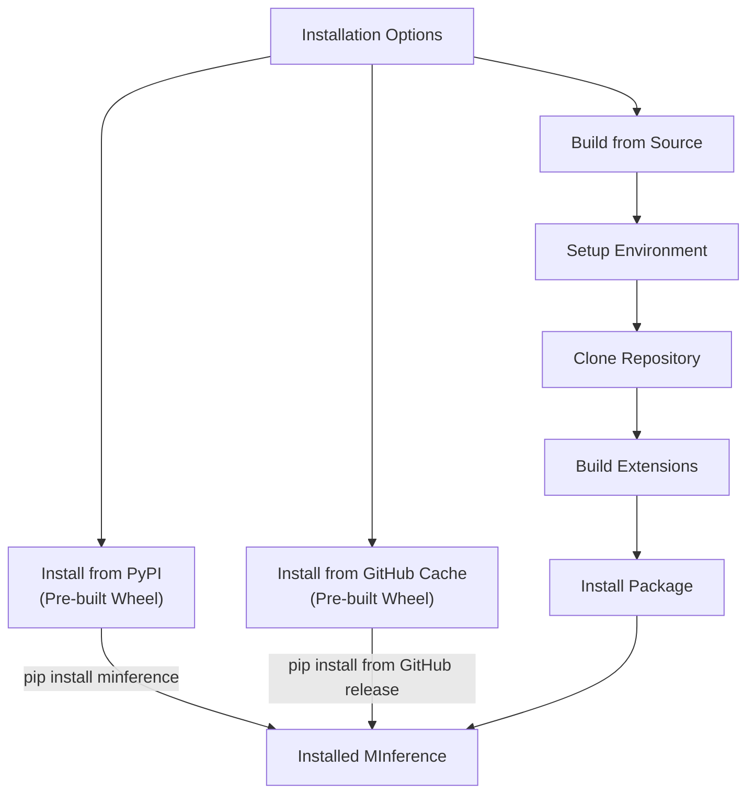
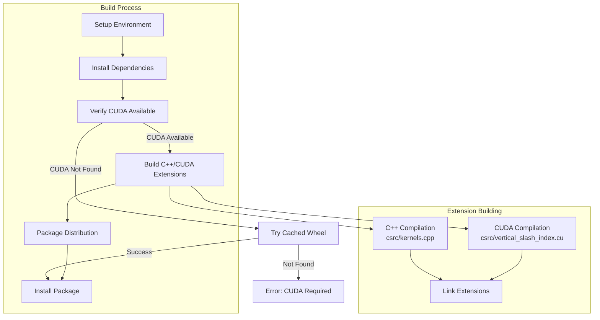
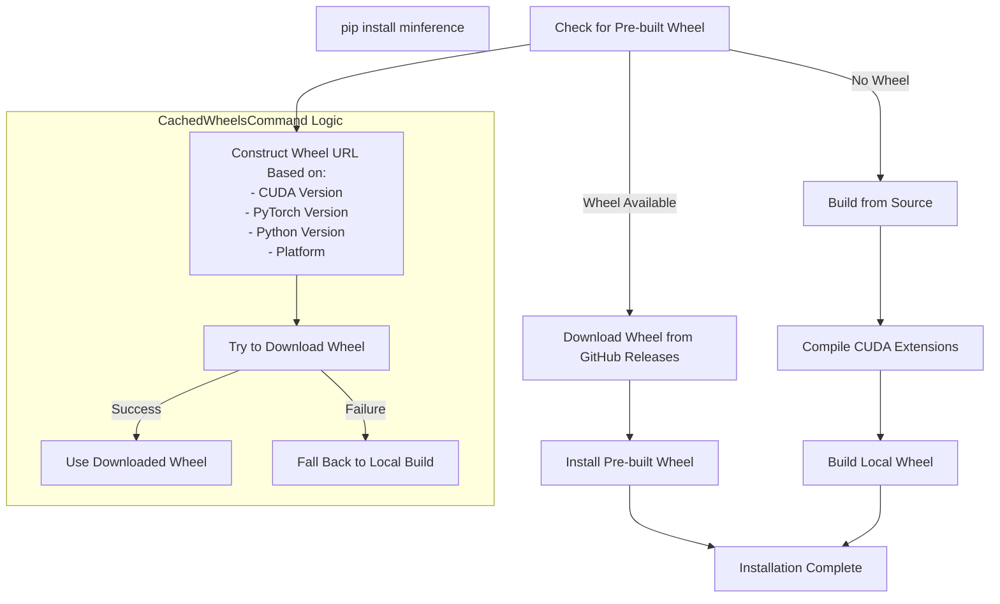

<!-- source: DeepWiki mcp.deepwiki.com · repo microsoft/MInference · page 7.1 Building and Installation · fetched 2026-10-26 -->

# Building and Installation

<details>
<summary>Relevant source files</summary>

The following files were used as context for generating this wiki page:

- [.github/workflows/release.yml](.github/workflows/release.yml)
- [.github/workflows/scripts/pytorch-install.sh](.github/workflows/scripts/pytorch-install.sh)
- [.pre-commit-config.yaml](.pre-commit-config.yaml)
- [MANIFEST.in](MANIFEST.in)
- [minference/modules/flexprefill.py](minference/modules/flexprefill.py)
- [setup.py](setup.py)

</details>


This document provides detailed instructions for building and installing MInference from source. For information about configuring models after installation, refer to [Model Configuration](#5.2).

## Prerequisites

Before building or installing MInference, ensure your system meets the following requirements:

### Python Requirements

MInference supports Python 3.8 or newer. The project has been tested with Python versions 3.9, 3.10, 3.11, 3.12, and 3.13.

### CUDA Requirements

MInference requires CUDA for its optimized sparse attention kernels. The build system is compatible with CUDA 11.8+ and has been tested extensively with CUDA 12.4.0.

### PyTorch Requirements

MInference is designed to work with PyTorch 2.2.0 or newer. The following PyTorch versions are officially supported:

| PyTorch Version | Python Compatibility |
|-----------------|----------------------|
| 2.2.2           | 3.9, 3.10, 3.11, 3.12 |
| 2.3.1           | 3.9, 3.10, 3.11, 3.12 |
| 2.4.0           | 3.9, 3.10, 3.11, 3.12 |
| 2.5.1           | 3.9, 3.10, 3.11, 3.12, 3.13 |
| 2.6.0           | 3.9, 3.10, 3.11, 3.12, 3.13 |

### Other Dependencies

MInference requires the following Python packages:
- transformers (≥ 4.37.0)
- accelerate
- triton
- einops

Sources: [setup.py:36-42](), [.github/workflows/release.yml:52-55]()

## Installation Options



### Installing from PyPI

The simplest way to install MInference is directly from PyPI:

```bash
pip install minference
```

This will attempt to download a pre-built wheel that matches your Python version, PyTorch version, and CUDA environment. If a matching wheel is not available, pip will build the package from source.

### Building from Source

For development or to use the latest features, you can build MInference from source:

1. Clone the repository:
   ```bash
   git clone https://github.com/microsoft/MInference.git
   cd MInference
   ```

2. Set up your Python environment:
   ```bash
   # Create a virtual environment (optional)
   python -m venv venv
   source venv/bin/activate  # On Windows, use: venv\Scripts\activate
   
   # Install build dependencies
   pip install --upgrade pip
   pip install setuptools wheel ninja packaging psutil
   ```

3. Install PyTorch:
   ```bash
   # For CUDA 12.x with PyTorch 2.3+
   pip install torch==2.3.1 --index-url https://download.pytorch.org/whl/cu121
   ```

4. Build and install MInference:
   ```bash
   pip install -e .
   ```

Sources: [setup.py:161-194](), [.github/workflows/scripts/pytorch-install.sh:10-31]()

## Build Process Details



### Environment Variables

MInference's build process can be controlled with the following environment variables:

| Environment Variable | Purpose | Default |
|----------------------|---------|---------|
| `MINFERENCE_FORCE_BUILD` | Force building from source instead of using cached wheels | FALSE |
| `MINFERENCE_SKIP_CUDA_BUILD` | Skip CUDA compilation (for CI/CD purposes) | FALSE |
| `MINFERENCE_LOCAL_VERSION` | Add a local version identifier to the package | None |
| `MAX_JOBS` | Control parallel compilation jobs | Auto-detected |

Sources: [setup.py:65-66](), [setup.py:197-218]()

### Extension Building

MInference includes CUDA extensions that are built during installation. The key extension files are:
- `csrc/kernels.cpp` - C++ interface to CUDA kernels
- `csrc/vertical_slash_index.cu` - CUDA kernels for vertical/slash sparse attention patterns

The build system uses [PyTorch's C++ Extension](https://pytorch.org/docs/stable/cpp_extension.html) mechanism and requires a compatible CUDA toolkit.

Sources: [setup.py:100-109](), [MANIFEST.in:1-2]()

### Custom Build Optimization

The build system automatically determines the optimal number of parallel jobs based on your system's CPU cores and available memory to prevent out-of-memory issues during compilation:

```python
# calculate the maximum allowed NUM_JOBS based on cores
max_num_jobs_cores = max(1, os.cpu_count() // 2)

# calculate the maximum allowed NUM_JOBS based on free memory
free_memory_gb = psutil.virtual_memory().available / (1024**3)  # free memory in GB
max_num_jobs_memory = int(free_memory_gb / 9)  # each JOB peak memory cost is ~8-9GB when threads = 4

# pick lower value of jobs based on cores vs memory metric to minimize oom and swap usage during compilation
max_jobs = max(1, min(max_num_jobs_cores, max_num_jobs_memory))
```

Sources: [setup.py:197-218]()

## Wheel Caching System

MInference implements a smart wheel caching system that attempts to download pre-built wheels before compiling from source:



The wheel URL is constructed based on:
- MInference version
- CUDA version (derived from PyTorch's CUDA version)
- PyTorch version
- Python version
- Platform (Linux, Windows, macOS)

For example: `minference-1.0.0+cu121torch2.0-cp310-cp310-linux_x86_64.whl`

Sources: [setup.py:137-160](), [setup.py:163-194]()

## Development Installation

For contributors and developers, you can install MInference with development dependencies:

```bash
pip install -e ".[dev]"  # Install with development dependencies
```

This installs additional packages for code quality and testing:
- black (code formatter)
- flake8 (linter)
- isort (import sorter)
- pre-commit (git hooks)
- pytest and pytest-xdist (testing tools)

Sources: [setup.py:43-51](), [.pre-commit-config.yaml:10-58]()

## Verification

To verify your installation, you can run a simple test:

```python
import torch
import minference

# Check version
print(f"MInference version: {minference.__version__}")

# Check CUDA availability
print(f"CUDA available: {torch.cuda.is_available()}")
print(f"CUDA version: {torch.version.cuda}")
```

## Troubleshooting

### Common Issues

1. **Missing CUDA**: If you encounter `"nvcc not found"` errors, ensure that CUDA is installed and visible to PyTorch. Check with:
   ```python
   from torch.utils import cpp_extension
   print(cpp_extension.CUDA_HOME)
   ```

2. **Incompatible PyTorch/CUDA**: Ensure you're using a compatible combination of PyTorch and CUDA versions. Refer to the [PyTorch compatibility matrix](https://pytorch.org/get-started/locally).

3. **Compilation Errors**: Make sure you have a C++ compiler installed:
   - Linux: `sudo apt-get install build-essential`
   - Windows: Install Visual Studio with C++ build tools
   - macOS: Install Xcode command-line tools

4. **Out of Memory During Build**: Set `MAX_JOBS` environment variable to a lower value to reduce parallel compilation jobs:
   ```bash
   MAX_JOBS=2 pip install -e .
   ```

Sources: [setup.py:69-78](), [.github/workflows/scripts/pytorch-install.sh:32-36]()

---

