# Page: Overview

# Overview

<details>
<summary>Relevant source files</summary>

The following files were used as context for generating this wiki page:

- [README.md](README.md)
- [minference/version.py](minference/version.py)

</details>


This document provides a comprehensive introduction to the MInference repository, which contains two primary components designed to accelerate and evaluate large language models (LLMs) with long contexts.

## Purpose and Scope

MInference is a framework that significantly accelerates inference for large language models, particularly when processing long contexts (up to 1 million tokens). It achieves this through dynamic sparse attention patterns and KV cache optimization techniques. This overview explains the system architecture, key components, and how they interact to provide up to 10x faster processing while maintaining accuracy.

For more detailed information about usage examples, see [Usage Examples](#6). For instructions on contributing to the project, see [Contributing and Development](#7).

## System Architecture

The MInference repository consists of two main components: the MInference framework (the acceleration system) and SCBench (the evaluation benchmark).

### High-Level Architecture

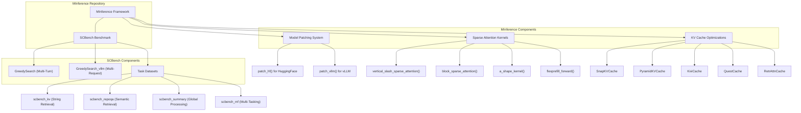

Sources: [README.md:40-55]()

## MInference Framework

The core of the repository is the MInference framework, which leverages dynamic sparse attention patterns to accelerate LLM inference. The framework identifies that attention in LLMs naturally exhibits sparse patterns and exploits this characteristic to reduce computation while maintaining model accuracy.

### MInference Workflow

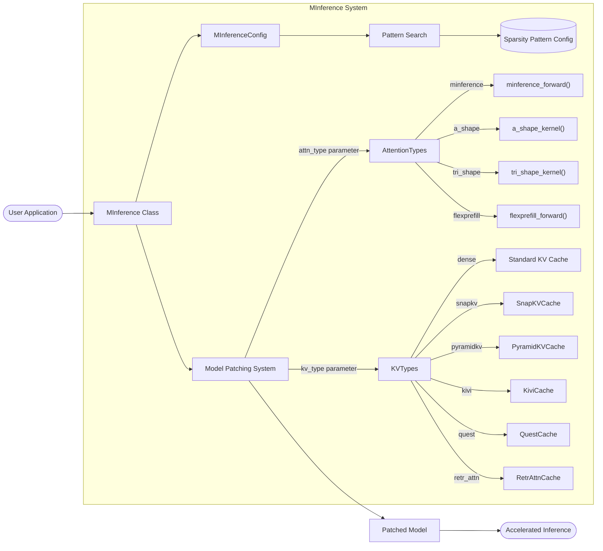

Sources: [README.md:110-168]()

The workflow diagram illustrates how MInference integrates with existing models:

1. Users initialize MInference with specific attention and KV cache types
2. MInference patches the model architecture with the optimized modules
3. The patched model performs accelerated inference with the selected optimizations

### Dynamic Sparse Attention Mechanism

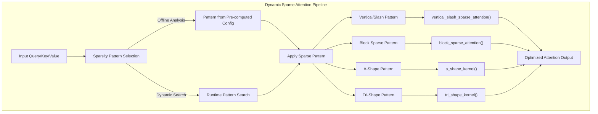

Sources: [README.md:80-87]()

MInference's primary innovation is its approach to sparse attention:

1. **Offline Analysis**: Pre-determines which sparse pattern each attention head belongs to
2. **Dynamic Computation**: Approximates sparse indices at runtime
3. **Optimized Kernels**: Uses custom kernels for each pattern type to maximize efficiency

## KV Cache Lifecycle

A key concept in MInference is the KV cache lifecycle, which consists of four stages:

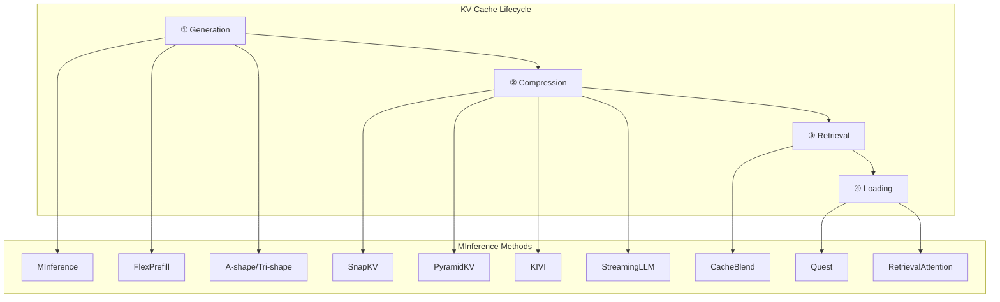

Sources: [README.md:80-87]()

MInference provides optimizations for each stage:

1. **Generation**: Creating KV cache during initial processing (using dynamic sparse attention)
2. **Compression**: Reducing the size of KV cache for efficiency
3. **Retrieval**: Selecting relevant KV cache entries
4. **Loading**: Utilizing retrieved KV cache for inference

## SCBench Benchmark Suite

SCBench (SharedContextBench) is a benchmark suite specifically designed to evaluate long-context methods from a KV cache-centric perspective. It provides a comprehensive framework for assessing the performance of different optimization techniques.

### Evaluation Modes

SCBench implements two primary evaluation modes:

1. **Multi-Turn Mode**: Simulates conversations where context builds up over multiple interactions
2. **Multi-Request Mode**: Evaluates handling of shared context across multiple separate requests

### Task Categories

SCBench includes tasks across four categories of long-context capabilities:

| Category | Description | Example Dataset |
|----------|-------------|-----------------|
| String Retrieval | Finding exact matches in long contexts | scbench_kv |
| Semantic Retrieval | Finding conceptually related information | scbench_repoqa |
| Global Processing | Understanding information across the entire context | scbench_summary |
| Multi-Tasking | Handling multiple tasks with the same context | scbench_mf |

Sources: [README.md:191-217]()

## Supported Features

### Supported Models

MInference supports a wide range of LLMs, including:

| Model Family | Supported Variants |
|--------------|-------------------|
| Qwen2.5 | 7B, 32B, 72B, and 1M versions |
| LLaMA-3.1 | 8B, 70B |
| LLaMA-3 | 8B, 70B with various context lengths |
| GLM-4 | 9B with 1M context |
| Yi | 9B with 200K context |
| Phi-3 | mini with 128K context |
| Qwen2 | 7B |

Sources: [README.md:101-109]()

### Efficient Methods

MInference supports various efficient methods categorized by KV cache lifecycle stage:

| Lifecycle Stage | Supported Methods |
|-----------------|-------------------|
| KV Cache Generation | MInference, FlexPrefill, A-shape, Tri-shape, MInference w/ static, Dilated, Strided |
| KV Cache Compression | StreamingLLM, SnapKV, PyramidKV, KIVI |
| KV Cache Retrieval | CacheBlend |
| KV Cache Loading | Quest, RetrievalAttention |

Sources: [README.md:80-87]()

## Integration Architecture

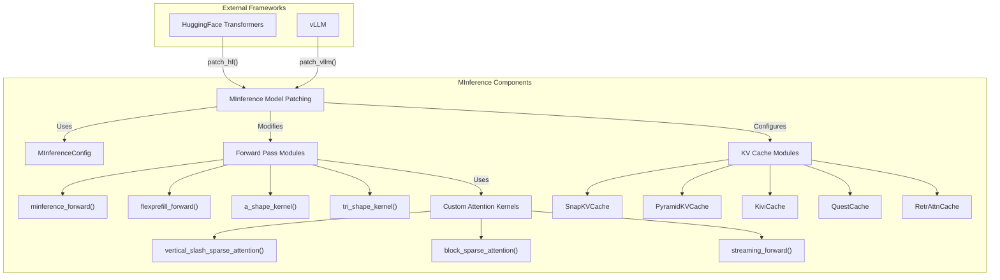

Sources: [README.md:110-168]()

This diagram illustrates how MInference integrates with external LLM frameworks:

1. MInference provides patching methods for both HuggingFace and vLLM frameworks
2. The patching system modifies the model's forward pass and KV cache implementations
3. Custom attention kernels provide the core optimization functionality

## Current Version

MInference is currently at version 0.1.6 as indicated in the version file.

Sources: [minference/version.py:4-14]()

---

# Page: MInference Introduction

# MInference Introduction

<details>
<summary>Relevant source files</summary>

The following files were used as context for generating this wiki page:

- [README.md](README.md)
- [minference/minference_configuration.py](minference/minference_configuration.py)
- [minference/models_patch.py](minference/models_patch.py)
- [minference/version.py](minference/version.py)

</details>


## Purpose and Scope

This document provides a comprehensive introduction to MInference, an acceleration framework designed specifically for long-context LLMs (Large Language Models). MInference enables efficient processing of very long contexts (up to 1 million tokens) through dynamic sparse attention and KV cache optimization techniques. This page focuses on the core concepts, architecture, and functionality of MInference itself. For information about SCBench, the companion benchmark suite, see [SCBench Introduction](#1.2).

## What is MInference?

MInference is a framework that leverages the dynamic sparse nature of attention in LLMs to significantly accelerate inference, particularly during the pre-filling phase when processing long contexts. It can process 1 million tokens approximately 10x faster on a single A100 GPU while maintaining or even improving model accuracy.

The core insight behind MInference is that attention in LLMs naturally exhibits sparse patterns - not all tokens need to attend to all other tokens. By identifying and exploiting these patterns, MInference can dramatically reduce computation without sacrificing model performance.

Sources: [README.md:7-18]()

## Core Concepts

MInference operates on two key observations:

1. **Dynamic Sparse Attention**: Attention in LLMs is naturally sparse - different attention heads exhibit distinct sparse patterns.
2. **Pattern-Based Optimization**: These sparse patterns can be identified offline and then used to accelerate inference dynamically.

MInference first analyzes model attention heads offline to categorize them into different pattern types (vertical, slash, block, etc.), then applies optimized computational kernels for each pattern during inference.

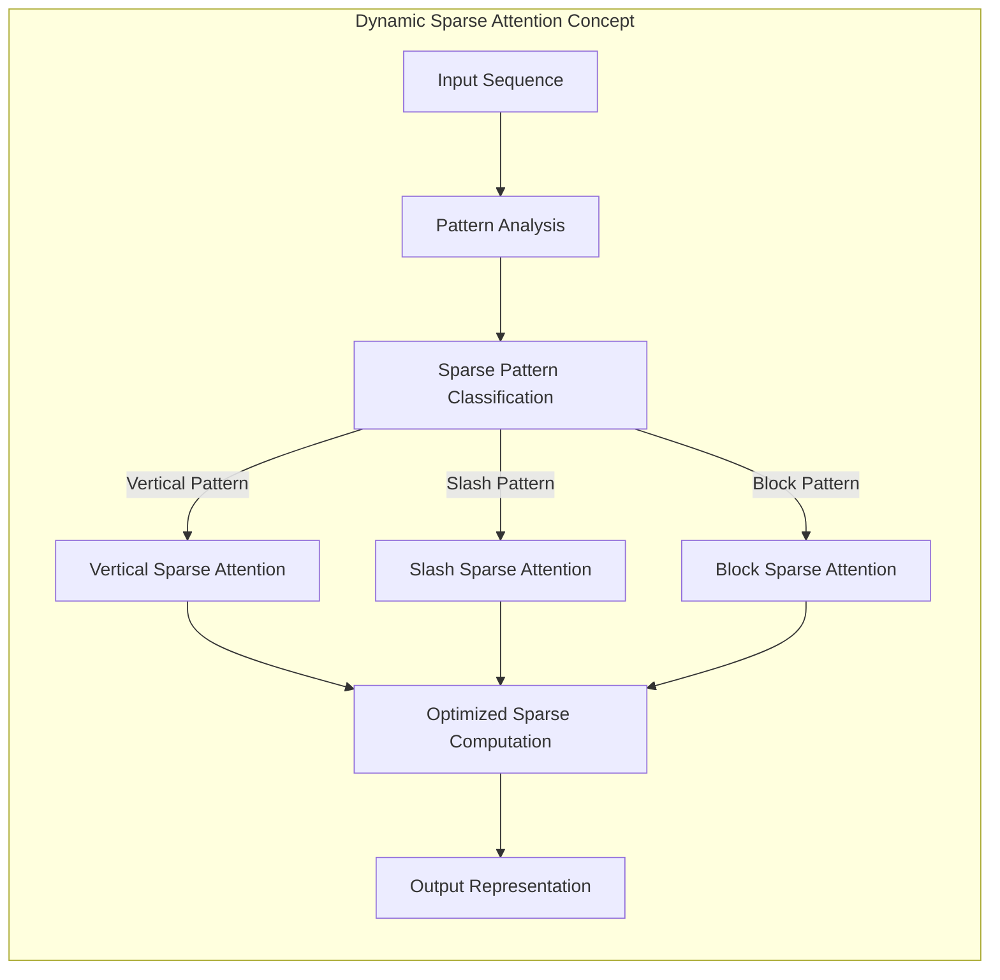

Sources: [README.md:40-43]()

## MInference Architecture

MInference provides a patching system that modifies existing LLM implementations to use sparse attention and optimized KV cache techniques.

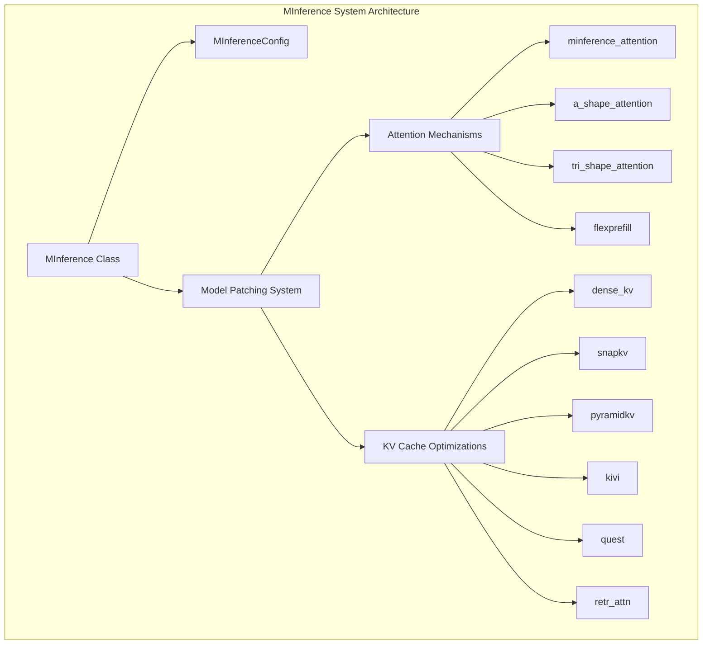

Sources: [minference/models_patch.py:13-176](), [minference/minference_configuration.py:9-101]()

### MInferenceConfig

The `MInferenceConfig` class manages configuration settings for MInference including:

- `attn_type`: Specifies the attention mechanism to use
- `kv_type`: Specifies the KV cache implementation to use
- `model_name`: Target model identifier
- `config_path`: Path to configuration file with sparse pattern information
- Additional parameters for specific mechanisms

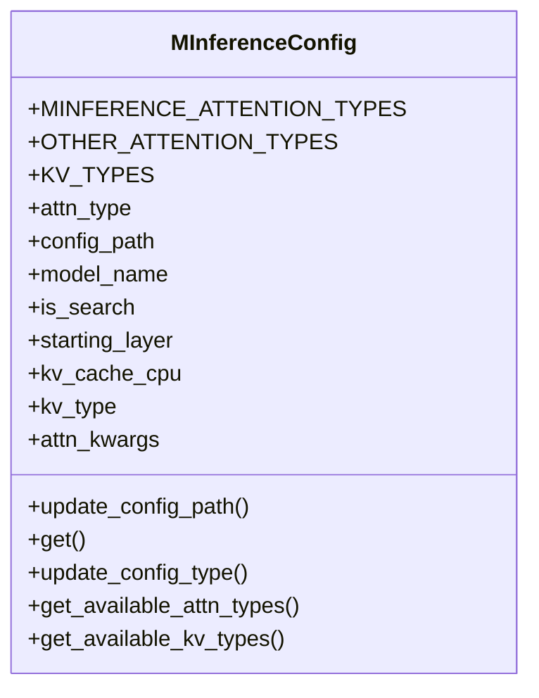

Sources: [minference/minference_configuration.py:9-101]()

## Key Components

### Attention Types

MInference supports multiple attention types:

1. **minference**: The primary dynamic sparse attention implementation
2. **a_shape**: A-shape attention pattern combining local and global attention
3. **tri_shape**: Tri-shape attention pattern (three-part attention)
4. **flexprefill**: Flexible prefill mechanism that optimizes token budget
5. **static**: Static sparse pattern version of minference
6. **dilated**: Dilated attention patterns

Sources: [minference/minference_configuration.py:10-30]()

### KV Cache Types

MInference offers several KV cache implementations:

1. **dense**: Standard dense KV cache
2. **streamingllm**: StreamingLLM's window-based KV cache
3. **snapkv**: SnapKV compression technique
4. **pyramidkv**: Pyramid compression technique
5. **quest**: Quest attention for KV cache optimization
6. **retr_attn**: Retrieval-augmented attention
7. **kivi**: KIVI quantization technique

Sources: [minference/minference_configuration.py:31-39]()

## Workflow

MInference follows a straightforward workflow for accelerating LLM inference:

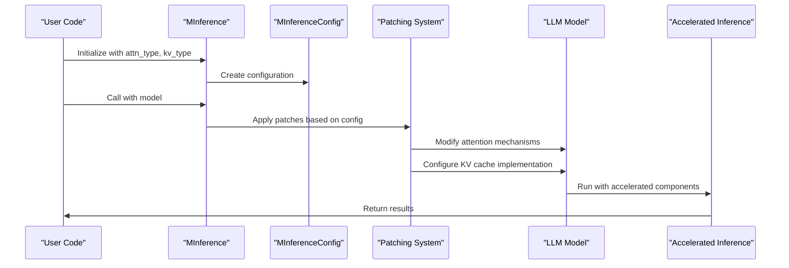

Sources: [minference/models_patch.py:13-176]()

## The MInference Class

The main entry point for using MInference is the `MInference` class, which is responsible for:

1. Initializing the configuration based on provided parameters
2. Applying the appropriate patches to the target model
3. Configuring attention mechanisms and KV cache implementations

```python
# Example initialization
minference_patch = MInference(
    attn_type="minference",  # Attention mechanism
    model_name="meta-llama/Meta-Llama-3.1-8B-Instruct",  # Target model
    kv_type="snapkv"  # KV cache implementation
)
model = minference_patch(model)  # Apply patches to model
```

Sources: [minference/models_patch.py:13-176](), [README.md:120-122]()

## Supported Models

MInference supports a wide range of long-context LLMs including:

- LLaMA-3 and LLaMA-3.1 (8B, 70B)
- Qwen2 and Qwen2.5 (7B, 14B, 32B, 72B)
- GLM-4 (9B)
- Yi (9B)
- Phi-3 (mini-128k)

A complete list of supported models can be obtained programmatically:

```python
from minference import get_support_models
supported_models = get_support_models()
```

Sources: [README.md:101-109]()

## Dynamic Sparse Attention Mechanism

The core innovation of MInference is its dynamic sparse attention mechanism:

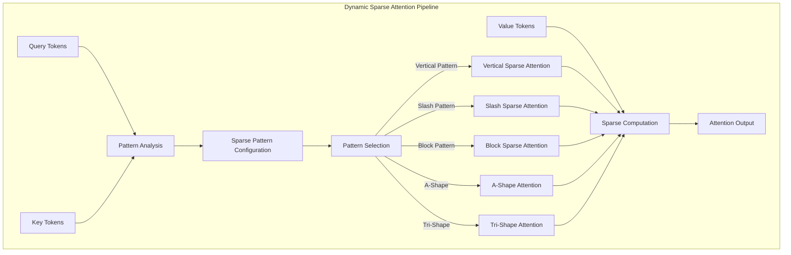

The process involves:
1. Determining sparse patterns for each attention head (offline)
2. Applying custom kernels optimized for each pattern type
3. Dynamically computing attention only for relevant token pairs

Sources: [README.md:40-43]()

## Integration with MInference

MInference can be integrated with models from Hugging Face Transformers and vLLM:

### Hugging Face Integration

```python
from transformers import pipeline
from minference import MInference

# Initialize pipeline with model
pipe = pipeline("text-generation", model=model_name, torch_dtype="auto", device_map="auto")

# Patch with MInference
minference_patch = MInference("minference", model_name)
pipe.model = minference_patch(pipe.model)

# Generate text with accelerated inference
pipe(prompt, max_length=10)
```

### vLLM Integration

```python
from vllm import LLM, SamplingParams
from minference import MInference

# Initialize vLLM
llm = LLM(model_name, enforce_eager=True, max_model_len=128_000, enable_chunked_prefill=False)

# Patch with MInference
minference_patch = MInference("vllm", model_name)
llm = minference_patch(llm)

# Generate text with accelerated inference
outputs = llm.generate(prompts, sampling_params)
```

Sources: [README.md:113-168]()

## Performance and Benefits

MInference delivers significant performance improvements:
- Up to 10x faster pre-filling on an A100 GPU
- Ability to process contexts up to 1 million tokens in length
- Maintained or improved accuracy compared to dense attention
- Reduced memory usage through optimized KV cache techniques

Sources: [README.md:18-40]()

## Conclusion

MInference provides a powerful framework for accelerating long-context LLM inference through dynamic sparse attention and KV cache optimizations. By leveraging the inherent sparsity in attention mechanisms, it enables efficient processing of very long contexts while maintaining model quality.

The following pages provide more detailed information about specific components:
- [Model Patching System](#2.1) - Details on how MInference patches existing model architectures
- [Sparse Attention Mechanisms](#2.2) - Documentation of various sparse attention mechanisms
- [KV Cache Optimizations](#3) - Overview of KV cache optimization techniques

---

# Page: SCBench Introduction

# SCBench Introduction

<details>
<summary>Relevant source files</summary>

The following files were used as context for generating this wiki page:

- [README.md](README.md)
- [images/SCBench_onepage.png](images/SCBench_onepage.png)
- [minference/version.py](minference/version.py)
- [scbench/readme.md](scbench/readme.md)

</details>


## Purpose and Scope

SCBench (SharedContextBench) is a comprehensive benchmark suite designed to evaluate long-context methods for large language models (LLMs) from a KV (key-value) cache-centric perspective. It specifically targets the assessment of various optimization techniques across the full KV cache lifecycle: generation, compression, retrieval, and loading. This document introduces SCBench, its architecture, evaluation methodology, and key components. For an introduction to MInference, which provides the optimization techniques that SCBench evaluates, see [MInference Introduction](#1.1).

Sources: [README.md:12-14](), [README.md:45-47](), [scbench/readme.md:1-9]()

## KV Cache Lifecycle Evaluation Framework

SCBench uniquely evaluates methods from a KV cache-centric perspective, analyzing the full lifecycle of KV caches in long-context LLM processing. This approach provides a more comprehensive assessment than traditional benchmarks that focus only on accuracy metrics.

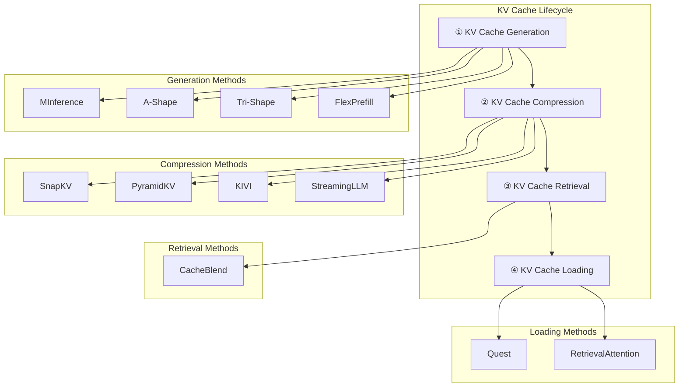

Sources: [README.md:80-85](), [scbench/readme.md:118-123]()

## Evaluation Modes

SCBench evaluates long-context methods in two distinct operational modes to comprehensively assess their performance in different usage scenarios.

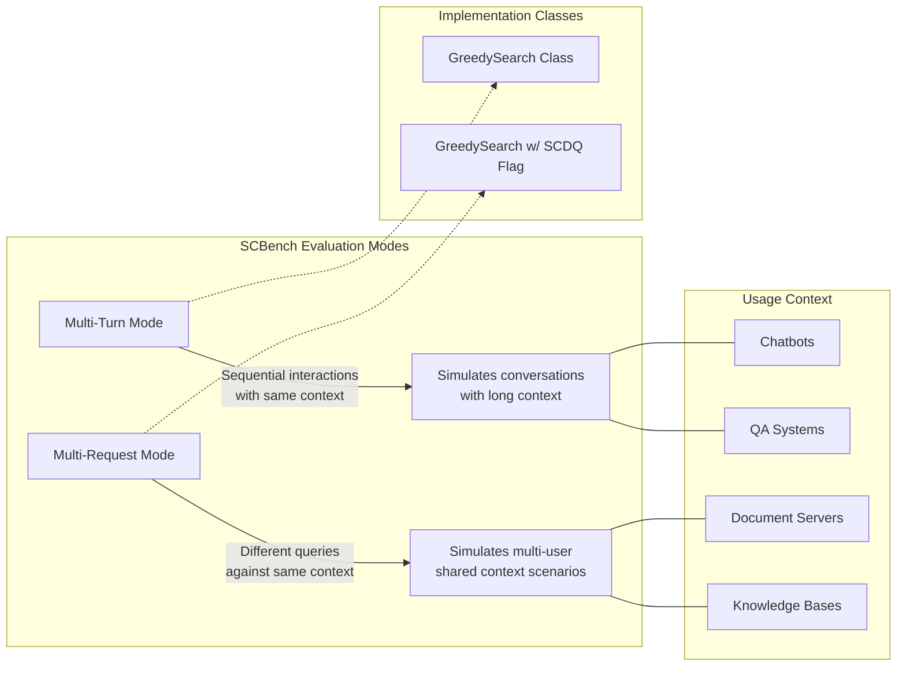

Sources: [scbench/readme.md:145-148](), [README.md:38-39]()

## Task Categories

SCBench includes 12 diverse tasks across four categories, each designed to evaluate specific long-context capabilities of LLMs.

| Category | Description | Tasks | Capability Tested |
|----------|-------------|-------|-------------------|
| **String Retrieval** | Tests ability to find exact strings in long contexts | `scbench_kv`, `scbench_prefix_suffix`, `scbench_vt` | Direct string retrieval, pattern matching |
| **Semantic Retrieval** | Tests understanding and retrieval based on meaning | `scbench_repoqa`, `scbench_qa_eng`, `scbench_qa_chn`, `scbench_choice_eng` | Semantic comprehension, knowledge distillation |
| **Global Information Processing** | Tests analysis of entire documents | `scbench_many_shot`, `scbench_mf`, `scbench_summary` | Global context processing, statistical analysis |
| **Multi-Tasking** | Tests performing multiple tasks simultaneously | `scbench_summary_with_needles`, `scbench_repoqa_and_kv` | Task switching, complex reasoning |

Sources: [scbench/readme.md:118-144](), [README.md:198-205]()

## Data Structure and Format

SCBench uses a standardized data format across all tasks to ensure consistency and ease of integration.

```mermaid
classDiagram
    class "SCBenchDataPoint" {
        +string id
        +string context
        +array multi_turns
    }
    
    class "MultiTurn" {
        +string input
        +string answer
    }
    
    "SCBenchDataPoint" "1" --> "*" "MultiTurn"
```

Each data point in SCBench contains:
- A unique identifier
- A long context (repository code, documents, many-shot examples, etc.)
- A series of multi-turn interactions with input questions and reference answers

Sources: [scbench/readme.md:25-35](), [README.md:208-217]()

## System Integration

SCBench is designed to work with multiple frameworks and evaluation methodologies, with particular optimization for the MInference framework.

```mermaid
flowchart TD
    subgraph "External Frameworks"
        HF["HuggingFace Transformers"]
        VLLM["vLLM"]
    end
    
    subgraph "SCBench Components"
        Data["SCBench Datasets\n(HF Datasets Format)"]
        Eval["Evaluation Utilities"]
        Tasks["12 Task Categories"]
        
        Eval --> HFEval["GreedySearch Class"]
        Eval --> VLLMEval["GreedySearch_vllm Class"]
        
        Tasks --> StringR["String Retrieval Tasks"]
        Tasks --> SemanticR["Semantic Retrieval Tasks"]
        Tasks --> GlobalP["Global Processing Tasks"]
        Tasks --> MultiT["Multi-Tasking Tasks"]
    end
    
    subgraph "MInference Methods"
        AttnTypes["Attention Types"]
        KVTypes["KV Cache Types"]
        
        AttnTypes --> MATTN["minference"]
        AttnTypes --> AATTN["a_shape"]
        AttnTypes --> TATTN["tri_shape"]
        
        KVTypes --> DKVCACHE["dense"]
        KVTypes --> SNKVCACHE["snapkv"]
        KVTypes --> PYKVCACHE["pyramidkv"]
        KVTypes --> KIVIKVCACHE["kivi"]
        KVTypes --> QUESTKVCACHE["quest"]
    end
    
    Data --> Tasks
    HF --> HFEval
    VLLM --> VLLMEval
    HFEval --> Results["Benchmark Results"]
    VLLMEval --> Results
    AttnTypes --> HFEval
    KVTypes --> HFEval
    AttnTypes --> VLLMEval
    KVTypes --> VLLMEval
```

Sources: [scbench/readme.md:38-63](), [README.md:221-243]()

## Using SCBench

SCBench data can be loaded using the Hugging Face datasets library and evaluated using the provided utilities.

To load SCBench data:

```python
from datasets import load_dataset

datasets = [
    "scbench_kv", "scbench_prefix_suffix", "scbench_vt", 
    "scbench_repoqa", "scbench_qa_eng", "scbench_qa_chn", 
    "scbench_choice_eng", "scbench_many_shot", "scbench_summary", 
    "scbench_mf", "scbench_summary_with_needles", "scbench_repoqa_and_kv"
]

for dataset in datasets:
    data = load_dataset("microsoft/SCBench", dataset, split="test")
```

The benchmark supports various evaluation configurations:

| Configuration | Description |
|---------------|-------------|
| `--max_seq_length` | Maximum sequence length for the test |
| `--max_turns` | Maximum number of turns for the test |
| `--num_eval_examples` | Number of test examples to use |
| `--attn_type` | Attention type to use (e.g., `dense`, `minference`, `a_shape`, `tri_shape`) |
| `--kv_type` | KV cache type to use (e.g., `dense`, `kivi`, `snapkv`, `quest`, `pyramidkv`) |
| `--same_context_different_query` | Enable Multi-Request Mode evaluation |

Sources: [scbench/readme.md:14-23](), [scbench/readme.md:67-91](), [scbench/readme.md:98-115]()

## Configuring Efficient Long-Context Methods

SCBench allows detailed configuration of various long-context methods to evaluate their performance:

| Method Type | Available Options | Key Parameters |
|-------------|-------------------|----------------|
| Attention Types | `dense`, `minference`, `a_shape`, `tri_shape` | `n_local`, `n_init`, `n_last`, pattern config |
| KV Cache Types | `dense`, `kivi`, `snapkv`, `pyramidkv`, `quest`, `streamingllm` | `bits`, `group_size`, `window_size`, `chunk_size` |

Custom hyperparameters can be specified through the `--hyper_param` argument:

```
python run_multiturnbench.py ... --hyper_param '{"n_local": 4096}'
```

Sources: [scbench/readme.md:173-214]()

## Comparison with Other Benchmarks

SCBench differentiates itself from previous long-context benchmarks by offering:

1. Comprehensive evaluation across single-turn, multi-turn, and multi-request scenarios
2. Focus on the full KV cache lifecycle (generation, compression, retrieval, loading)
3. KV cache reuse techniques evaluation
4. Standardized data format and evaluation methodology

While other benchmarks may focus on accuracy or specialized tasks, SCBench provides a more holistic assessment framework for evaluating efficient long-context methods from a KV cache-centric perspective.

Sources: [scbench/readme.md:218-221]()

---

# Page: System Architecture

# System Architecture

<details>
<summary>Relevant source files</summary>

The following files were used as context for generating this wiki page:

- [README.md](README.md)
- [minference/__init__.py](minference/__init__.py)
- [minference/configs/Qwen2.5_14B_Instruct_1M.json](minference/configs/Qwen2.5_14B_Instruct_1M.json)
- [minference/configs/Qwen2.5_7B_Instruct_128k_instruct_kv_out_v32_fit_o_best_pattern.json](minference/configs/Qwen2.5_7B_Instruct_128k_instruct_kv_out_v32_fit_o_best_pattern.json)
- [minference/configs/Qwen2.5_7B_Instruct_1M.json](minference/configs/Qwen2.5_7B_Instruct_1M.json)
- [minference/configs/model2path.py](minference/configs/model2path.py)
- [minference/version.py](minference/version.py)

</details>


This document provides a comprehensive overview of the MInference system architecture, explaining how its components interact to accelerate inference for large language models (LLMs) with long contexts. It focuses on the structural design and relationships between core components, explaining how dynamic sparse attention and KV cache optimizations are implemented. For specific details about MInference's capabilities, see [MInference Introduction](#1.1), and for information about the SCBench benchmark suite, see [SCBench Introduction](#1.2).

## 1. High-Level Architecture Overview

MInference is structured around two primary components: the core acceleration framework (MInference) and the evaluation benchmark suite (SCBench). The system is designed to optimize LLM inference through dynamic sparse attention and various KV cache optimizations.

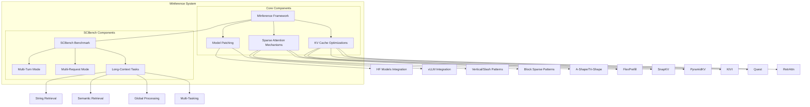

Sources: [README.md:1-326]()

## 2. System Core Components

MInference consists of three primary core components that work together to accelerate LLM inference:

### 2.1 Configuration System

The `MInferenceConfig` class serves as the central configuration hub, managing settings for sparse attention patterns and KV cache optimizations. It provides available attention types and KV cache types through static methods.

```mermaid
classDiagram
    class MInferenceConfig {
        +get_available_attn_types()
        +get_available_kv_types()
        -model2path mapping
        -config handling
    }
    
    MInferenceConfig --> "ModelConfigMap" : uses
    
    class ModelConfigMap {
        +MODEL2PATH
        +get_support_models()
        +check_path()
    }
```

Sources: [minference/configs/model2path.py:1-79](), [minference/__init__.py:1-32]()

### 2.2 Model Patching System

The patching system modifies existing model architectures to incorporate MInference's optimizations without requiring model retraining. It works with both HuggingFace Transformers and vLLM.

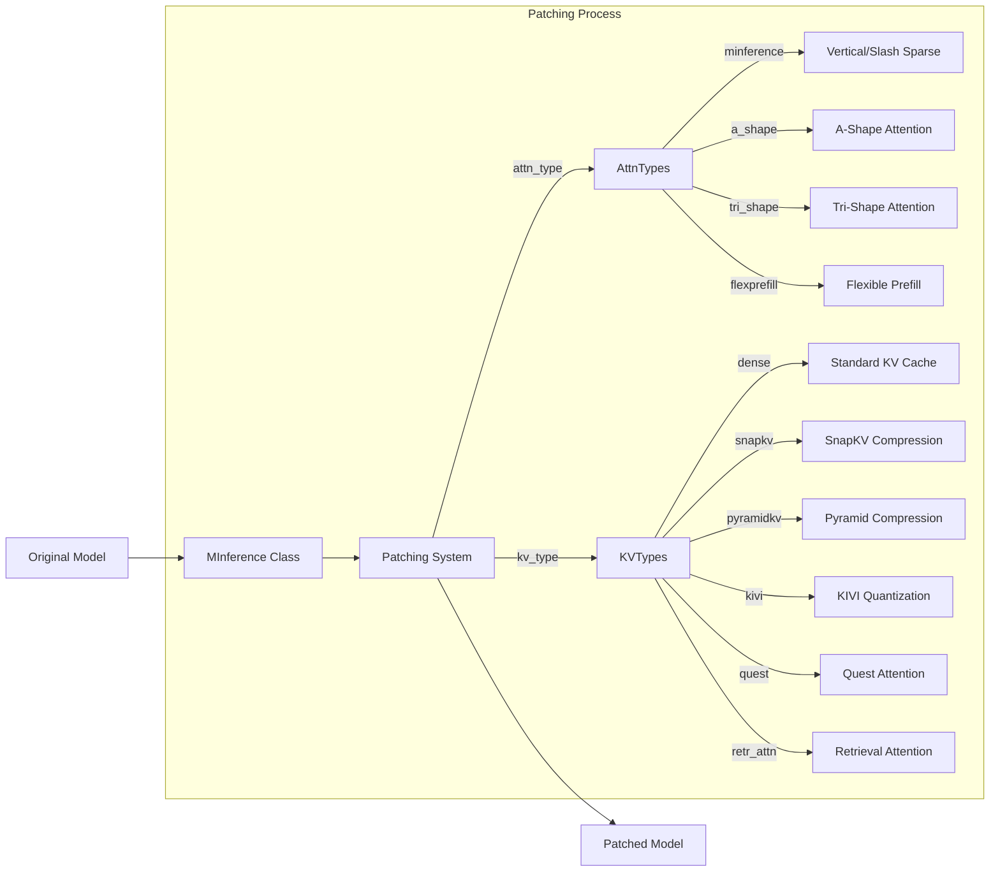

Sources: [README.md:110-168]()

### 2.3 Sparse Attention Mechanisms

MInference implements multiple sparse attention mechanisms to optimize LLM inference. These include:

1. **Vertical/Slash Sparse Attention**: Focuses on specific tokens (vertical) and nearby context (slash)
2. **Block Sparse Attention**: Groups tokens into dense blocks for efficient computation
3. **A-Shape Attention**: Combines local and global attention patterns
4. **Tri-Shape Attention**: Three-part attention pattern for different token relationships
5. **FlexPrefill**: Flexible prefill mechanism for optimized token processing

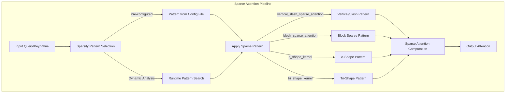

Sources: [minference/__init__.py:9-11](), [README.md:72-82]()

### 2.4 KV Cache Optimizations

MInference implements several KV cache optimization techniques to improve memory efficiency and performance:

1. **SnapKV**: Compresses the KV cache through selective token retention
2. **PyramidKV**: Hierarchical compression of KV cache
3. **KIVI**: Quantization-based KV cache optimization
4. **Quest**: Query-based selective token caching
5. **RetrievalAttention**: Vector retrieval augmented attention

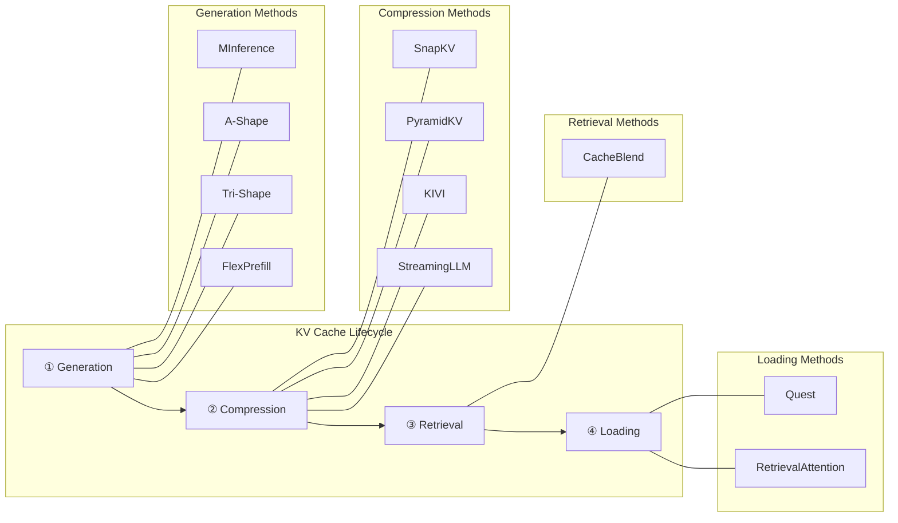

Sources: [README.md:80-87]()

## 3. System Integration Architecture

MInference is designed to integrate with existing LLM frameworks, primarily HuggingFace Transformers and vLLM, through a patching mechanism.

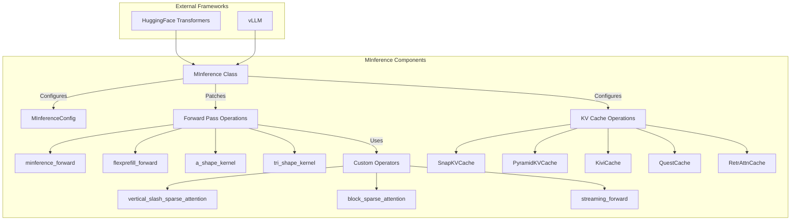

Sources: [minference/__init__.py:7-18](), [README.md:110-168]()

## 4. Models and Compatibility

MInference supports a wide range of LLMs. Each model has a preconfigured sparse attention pattern configuration stored in JSON files.

### 4.1 Supported Model Architecture

```mermaid
flowchart TD
    MInf["MInference"] --> |"Supported Models"| Models
    
    subgraph "Models" 
        Models --> Qwen["Qwen Models"]
        Models --> Llama["LLaMA Models"]
        Models --> GLM["GLM Models"]
        Models --> Yi["Yi Models"]
        Models --> Phi["Phi Models"]
        
        Qwen --> Q1["Qwen2.5-7B-Instruct"]
        Qwen --> Q2["Qwen2.5-32B-Instruct"]
        Qwen --> Q3["Qwen2.5-72B-Instruct"]
        Qwen --> Q4["Qwen2.5-7B-Instruct-1M"]
        Qwen --> Q5["Qwen2.5-14B-Instruct-1M"]
        
        Llama --> L1["Meta-Llama-3.1-8B-Instruct"]
        Llama --> L2["Meta-Llama-3.1-70B-Instruct"]
        Llama --> L3["Llama-3-8B-Instruct-262k"]
        Llama --> L4["Llama-3-8B-Instruct-Gradient-1048k"]
        
        GLM --> G1["glm-4-9b-chat-1m"]
        
        Yi --> Y1["Yi-9B-200K"]
        
        Phi --> P1["Phi-3-mini-128k-instruct"]
    end
    
    MInf --> |"Model Config Mapping"| ConfigMap["MODEL2PATH Mapping"]
    ConfigMap --> |"Loads"| SparsityConfig["Sparsity Pattern Configs"]
    SparsityConfig --> |"Example: vertical_and_slash"| PC["Pattern Configurations"]
```

The model configuration mapping system loads pre-determined optimal sparsity patterns for each supported model from configuration files.

Sources: [minference/configs/model2path.py:7-65](), [minference/configs/Qwen2.5_7B_Instruct_1M.json:1-2](), [minference/configs/Qwen2.5_14B_Instruct_1M.json:1-2]()

## 5. Execution Workflow

The following diagram illustrates the execution workflow when using MInference to accelerate LLM inference.

```mermaid
sequenceDiagram
    participant App as Application
    participant MI as MInference
    participant Patch as Patching System
    participant Model as LLM Model
    participant Attn as Attention Module
    participant KV as KV Cache Module
    
    App->>MI: Initialize with model_name,<br/>attn_type, kv_type
    MI->>MI: Load configuration for model
    App->>MI: Apply to model
    MI->>Patch: Patch model architecture
    Patch->>Model: Replace attention modules
    Patch->>Model: Replace KV cache handling
    App->>Model: Generate text
    Model->>Attn: Compute attention (sparse)
    Attn->>KV: Store/retrieve KV cache
    KV->>KV: Apply optimizations (if any)
    Attn->>Model: Return attention outputs
    Model->>App: Return generated tokens
```

### Integration Methods

MInference offers different integration methods:

#### 1. For Hugging Face models:

```python
from transformers import pipeline
from minference import MInference

pipe = pipeline("text-generation", model=model_name, torch_dtype="auto", device_map="auto")
minference_patch = MInference("minference", model_name)
pipe.model = minference_patch(pipe.model)
```

#### 2. For vLLM integration:

```python
from vllm import LLM, SamplingParams
from minference import MInference

llm = LLM(model_name, enforce_eager=True, max_model_len=128_000, enable_chunked_prefill=False)
minference_patch = MInference("vllm", model_name)
llm = minference_patch(llm)
```

Sources: [README.md:110-168]()

## 6. SCBench Integration

SCBench (SharedContextBench) is tightly integrated with MInference to evaluate long-context methods from a KV cache-centric perspective.

```mermaid
flowchart TD
    subgraph "SCBench Benchmark"
        SCB["SCBench Core"]
        
        subgraph "Evaluation Modes"
            EM1["Multi-Turn Mode"]
            EM2["Multi-Request Mode"]
        end
        
        subgraph "Task Categories"
            TC1["String Retrieval"]
            TC2["Semantic Retrieval"]
            TC3["Global Processing"]
            TC4["Multi-Tasking"]
        end
        
        subgraph "KV Cache Lifecycle Evaluation"
            KVE1["Generation Methods"]
            KVE2["Compression Methods"]
            KVE3["Retrieval Methods"]
            KVE4["Loading Methods"]
        end
        
        SCB --- EM1
        SCB --- EM2
        SCB --- TC1
        SCB --- TC2
        SCB --- TC3
        SCB --- TC4
        SCB --- KVE1
        SCB --- KVE2
        SCB --- KVE3
        SCB --- KVE4
    end
    
    MInf["MInference"] <--> SCB
    
    KVE1 --> |"Evaluates"| MInf
    KVE2 --> |"Evaluates"| MInf
    KVE3 --> |"Evaluates"| MInf
    KVE4 --> |"Evaluates"| MInf
```

SCBench evaluates MInference across different stages of the KV cache lifecycle. It offers two evaluation modes:

1. **Multi-Turn Mode**: Simulates conversation-like interactions with long contexts
2. **Multi-Request Mode**: Evaluates shared context processing capabilities

Sources: [README.md:189-245]()

## 7. Performance and Scalability

MInference is designed to accelerate LLM inference significantly, particularly for models with long contexts. It provides up to 10x speedup for pre-filling operations on an A100 GPU while maintaining accuracy.

Key performance characteristics:

| Feature | Benefit |
|---------|---------|
| Dynamic Sparse Attention | Reduces computational complexity from O(n²) to O(n) |
| KV Cache Optimization | Reduces memory requirements for long sequences |
| Pattern Adaptation | Automatically selects optimal sparse patterns |
| Framework Integration | Works with existing models without retraining |

The system scales with model size and context length, providing greater relative speedups as context length increases.

Sources: [README.md:38-50]()

## 8. System Requirements and Dependencies

MInference has the following dependencies:

- PyTorch
- Transformers >= 4.46.0
- FlashAttention-2 (Optional)
- Triton

For SCBench, additional requirements include:
- datasets >= 2.15.0

Sources: [README.md:58-63](), [README.md:193-195]()

---

# Page: MInference Core

# MInference Core

<details>
<summary>Relevant source files</summary>

The following files were used as context for generating this wiki page:

- [minference/minference_configuration.py](minference/minference_configuration.py)
- [minference/models_patch.py](minference/models_patch.py)
- [minference/patch.py](minference/patch.py)

</details>


## Overview

MInference Core provides the fundamental components and mechanisms for accelerating inference in large language models (LLMs), particularly when processing long contexts. It acts as the central hub of the MInference framework, handling model patching, sparse attention implementations, and forward pass optimizations that enable efficient processing of long sequences.

For information about KV Cache optimizations specifically, see [KV Cache Optimizations](#3).

Sources: [minference/models_patch.py:13-41](), [minference/minference_configuration.py:9-40]()

```mermaid
flowchart TD
    subgraph "MInference Core Components"
        direction TB
        MInference["MInference Class"] --> Config["MInferenceConfig"]
        MInference --> Patching["Model Patching System"]
        
        Patching --> |"configures"| AttentionMechanisms["Attention Mechanisms"]
        Patching --> |"modifies"| ForwardPass["Forward Pass"]
        
        AttentionMechanisms --> MinferenceAttn["minference\n(vertical/slash)"]
        AttentionMechanisms --> AShape["a_shape"]
        AttentionMechanisms --> TriShape["tri_shape"]
        AttentionMechanisms --> FlexPrefill["flexprefill"]
        
        ForwardPass --> Prefill["Prefill Phase"]
        ForwardPass --> Decoding["Decoding Phase"]
    end
```

Sources: [minference/patch.py:25-39](), [minference/models_patch.py:13-40]()

## Core Architecture

MInference Core follows a modular design that allows for flexible configuration of different attention mechanisms and optimizations. The central entry point is the `MInference` class, which configures and applies patches to transform standard model architectures into more efficient versions.

```mermaid
classDiagram
    class MInference {
        +MInferenceConfig config
        +__init__(attn_type, model_name, config_path, etc)
        +__call__(model) 
        +patch_model(model)
    }
    
    class MInferenceConfig {
        +MINFERENCE_ATTENTION_TYPES
        +OTHER_ATTENTION_TYPES
        +KV_TYPES
        +attn_type
        +config_path
        +kv_type
        +attn_kwargs
        +update_config_path()
        +update_config_type()
    }
    
    MInference --> MInferenceConfig : contains
    
    class patch_functions {
        +minference_patch()
        +new_patch()
        +patch_hf()
        +minference_patch_vllm()
    }
    
    MInference --> patch_functions : uses
```

Sources: [minference/models_patch.py:13-176](), [minference/minference_configuration.py:9-102]()

## Configuration System

The `MInferenceConfig` class defines the available configuration options for MInference. It validates and processes user-provided configuration to ensure that the selected attention mechanisms and KV cache types are supported.

### Supported Attention Types

| Category | Attention Types |
|----------|----------------|
| MInference | minference, vllm_minference |
| Other | hf, vllm, dense, static, dilated1, dilated2, a_shape, tri_shape, vllm_a_shape, vllm_tri_shape, inf_llm, flexprefill, vllm_flexprefill |

### Supported KV Cache Types

| KV Cache Types |
|----------------|
| dense |
| streamingllm |
| snapkv |
| pyramidkv |
| quest |
| retr_attn |
| kivi |

Sources: [minference/minference_configuration.py:10-39]()

## Model Patching System

The model patching system is responsible for modifying existing model architectures to incorporate MInference optimizations. It replaces standard attention mechanisms with optimized versions and adds necessary functionality for KV cache management.

```mermaid
flowchart TD
    subgraph "Model Patching Process"
        direction TB
        ModelInput["Input Model"] --> DetectType["Detect Model Type"]
        DetectType --> ConfigurePatch["Configure Patch\nBased on attn_type & kv_type"]
        ConfigurePatch --> ModifyAttention["Modify Attention\nMechanisms"]
        ModifyAttention --> ModifyForward["Modify Forward\nPass Functions"]
        ModifyForward --> PatchedModel["Patched Model"]
    end
    
    subgraph "Patch Types"
        direction TB
        Patches["Patch Functions"] --> MinferencePatch["minference_patch()"]
        Patches --> NewPatch["new_patch()"]
        Patches --> PatchHF["patch_hf()"]
        Patches --> PatchVLLM["minference_patch_vllm()"]
    end

    ConfigurePatch --> Patches
```

Sources: [minference/patch.py:800-986](), [minference/models_patch.py:42-176]()

### Patching Process

1. The patching process begins with the `MInference.patch_model()` method, which determines the appropriate patching function based on the provided configuration.
2. Different patching functions are used depending on the model type and requested attention mechanism:
   - `minference_patch()`: Used for the original MInference sparse attention
   - `new_patch()`: Used for newer attention types like a_shape, tri_shape, flexprefill
   - `patch_hf()`: Used for patching HuggingFace models
   - `minference_patch_vllm()`: Used for patching vLLM models

Sources: [minference/patch.py:800-1040](), [minference/models_patch.py:42-176]()

### Modification Points

The patching system modifies several key components of the model:

1. **Attention Forward Method**: Replaces the standard attention computation with optimized versions
2. **Layer Forward Method**: Modifies how decoder layers process inputs
3. **Model Forward Method**: Updates the overall model forward pass
4. **Generation Preparation**: Modifies how inputs are prepared for generation
5. **Cache Handling**: Adds specialized KV cache management

Sources: [minference/patch.py:43-193](), [minference/patch.py:800-986]()

## Sparse Attention Mechanisms

MInference Core implements several sparse attention mechanisms to reduce the computational complexity of processing long sequences.

```mermaid
flowchart TD
    subgraph "Sparse Attention Mechanisms"
        direction TB
        Input["Input Query/Key/Value"] --> Pattern["Select Attention Pattern"]
        Pattern --> ComputeAttention["Compute Sparse Attention"]
        ComputeAttention --> Output["Output"]
        
        Pattern --> Minference["Vertical/Slash\nPattern"]
        Pattern --> AShape["A-Shape\nPattern"]
        Pattern --> TriShape["Tri-Shape\nPattern"]
        Pattern --> FlexPrefill["FlexPrefill\nAdaptive Pattern"]
        
        subgraph "Pattern Selection"
            direction TB
            ConfigBased["Config-based\nSelection"]
            Dynamic["Dynamic\nSelection"]
        end
        
        Pattern --> Pattern.Selection
    end
```

Sources: [minference/patch.py:209-214](), [minference/patch.py:25-39]()

### Minference (Vertical/Slash)

The core sparse attention mechanism in MInference combines vertical attention (which focuses on specific tokens throughout the sequence) with diagonal or "slash" attention (which captures local context).

Key implementation functions:
- `minference_forward()`: Implements the core sparse attention forward pass
- `gather_last_q_vertical_slash_topk_v4()`: Selects tokens for sparse attention

Sources: [minference/patch.py:31-37](), [minference/patch.py:910-922]()

### A-Shape Attention

A-Shape attention implements a pattern that combines global attention for initial tokens with local attention for recent tokens. This can be visualized as an "A" shape in the attention matrix.

The key implementation is in `stream_llm_forward()` which is specialized for this pattern.

Sources: [minference/patch.py:38](), [minference/models_patch.py:89-92]()

### Tri-Shape Attention

Tri-Shape attention extends A-Shape by adding a third component that focuses on the most recent tokens, creating a three-part attention pattern.

Key configuration parameters:
- `n_local`: Number of recent tokens to attend to
- `n_init`: Number of initial tokens to attend to
- `n_last`: Number of most recent tokens to attend to

Sources: [minference/models_patch.py:94-98]()

### FlexPrefill

FlexPrefill implements an adaptive attention mechanism that dynamically adjusts token budgets during the prefill phase based on sequence characteristics.

Key configuration parameters:
- `gamma`: Weighting parameter for token importance
- `tau`: Temperature parameter for token selection
- `block_size`: Size of token blocks for processing

Sources: [minference/models_patch.py:73-79](), [minference/patch.py:25]()

## Forward Pass Implementation

The forward pass implementation in MInference Core is divided into two main phases: prefill and decoding. Different optimizations are applied to each phase.

```mermaid
flowchart LR
    subgraph "Forward Pass Phases"
        direction TB
        Input["Input Sequence"] --> Prefill["Prefill Phase\n(Process Full Sequence)"]
        Prefill --> |"Generate KV Cache"| KVCache["KV Cache"]
        Input --> |"Next Token Only"| Decoding["Decoding Phase\n(Process One Token)"]
        KVCache --> Decoding
        Decoding --> Output["Output Token"]
        Output --> |"Append to Sequence"| Decoding
    end
    
    subgraph "Forward Pass Implementations"
        direction TB
        ForwardImpls["Forward Implementations"] --> PrefillForwards["prefill_forwards"]
        ForwardImpls --> DecodingForwards["decoding_forwards"]
        ForwardImpls --> AttnForward["attn_forward"]
    end
    
    Prefill --> PrefillForwards
    Decoding --> DecodingForwards
```

Sources: [minference/patch.py:25-26](), [minference/patch.py:858-869]()

### Prefill Phase

The prefill phase processes the entire input sequence and generates the initial key-value cache. In MInference, this phase benefits from:

1. **Sparse attention patterns** that reduce computational complexity
2. **Optimized processing** for different attention types (minference, a_shape, tri_shape, flexprefill)

The prefill implementations are configured via `prefill_forwards` dictionary that maps attention types to their specific implementations.

Sources: [minference/patch.py:25](), [minference/patch.py:858-869]()

### Decoding Phase

The decoding phase processes one token at a time using the previously generated KV cache. This phase benefits from:

1. **Efficient KV cache access** patterns
2. **Specialized forward functions** for different KV cache types

The decoding implementations are configured via `decoding_forwards` dictionary that maps KV cache types to their specific implementations.

Sources: [minference/patch.py:26](), [minference/patch.py:858-869]()

## Integration with External Systems

MInference Core provides integration with other frameworks like HuggingFace Transformers and vLLM through specialized patching functions.

```mermaid
flowchart TD
    subgraph "External Integration"
        direction TB
        MInference["MInference Core"] --> HFIntegration["HuggingFace Integration"]
        MInference --> VLLMIntegration["vLLM Integration"]
        
        HFIntegration --> PatchHF["patch_hf()"]
        VLLMIntegration --> PatchVLLM["minference_patch_vllm()"]
        
        VLLMIntegration --> TPSupport["Tensor Parallel Support"]
        HFIntegration --> ModelSupport["Model Support"]
        
        ModelSupport --> LLaMA["LLaMA"]
        ModelSupport --> Mistral["Mistral"]
        ModelSupport --> Qwen2["Qwen2"]
        ModelSupport --> GLM["ChatGLM"]
    end
```

Sources: [minference/patch.py:1288-1305](), [minference/patch.py:1308-1501]()

### HuggingFace Integration

MInference Core integrates with HuggingFace Transformers through the `patch_hf()` function, which supports:

- LlamaForCausalLM
- MistralForCausalLM
- Qwen2ForCausalLM
- ChatGLMForConditionalGeneration
- And other compatible models

The integration modifies the model's forward pass, attention mechanism, and generation process to incorporate MInference optimizations.

Sources: [minference/patch.py:1308-1501]()

### vLLM Integration

MInference Core integrates with vLLM through the `minference_patch_vllm()` function, which supports:

- Tensor parallel processing
- Custom attention implementations in the vLLM framework
- Support for A-Shape, Tri-Shape, and FlexPrefill attention patterns

The integration modifies the vLLM model executor to use MInference's optimized attention mechanisms.

Sources: [minference/patch.py:1043-1305]()

## Usage Example

To use MInference Core, you create an instance of the `MInference` class with the desired configuration and apply it to a model:

```python
from minference import MInference

# Create a MInference configuration
minference = MInference(
    attn_type="minference",         # Type of attention mechanism
    model_name="llama-7b",          # Model name for predefined configurations
    kv_type="dense",                # Type of KV cache
    attn_kwargs={                   # Additional attention-specific arguments
        "topk": 512                 # Number of tokens to select for sparse attention
    }
)

# Apply to a model
patched_model = minference(model)
```

Sources: [minference/models_patch.py:13-41]()

## Summary

MInference Core provides the foundation for accelerating inference in large language models through:

1. A flexible model patching system that modifies existing architectures
2. Multiple sparse attention mechanisms that reduce computational complexity
3. Optimized forward pass implementations for prefill and decoding phases
4. Integration with popular frameworks like HuggingFace and vLLM

These capabilities enable efficient processing of long sequences, making it possible to work with larger contexts while maintaining reasonable computational requirements.

---

# Page: Model Patching System

# Model Patching System

<details>
<summary>Relevant source files</summary>

The following files were used as context for generating this wiki page:

- [minference/minference_configuration.py](minference/minference_configuration.py)
- [minference/models_patch.py](minference/models_patch.py)
- [minference/patch.py](minference/patch.py)

</details>


## Purpose and Scope

The Model Patching System is the core mechanism within MInference that dynamically modifies LLM architectures to incorporate optimized attention mechanisms and KV cache strategies. This page documents how MInference intercepts and replaces key components of Transformer-based models to improve inference efficiency, particularly for long contexts. For information about specific sparse attention mechanisms, see [Sparse Attention Mechanisms](#2.2). For KV cache optimizations, see [KV Cache Optimizations](#3).

## Overview

The patching system serves as the bridge between standard model implementations (from HuggingFace Transformers or vLLM) and MInference's optimization techniques. Rather than requiring custom model training, it dynamically replaces critical functions in existing model architectures at runtime.

```mermaid
flowchart LR
    subgraph "Model Patching System"
        direction TB
        config["MInferenceConfig"]
        patchers["Patching Functions"]
        patchers --> |"Model-specific"| hf_patch["HF Patcher"]
        patchers --> |"Runtime-specific"| vllm_patch["vLLM Patcher"]
    end

    model["Original LLM"] --> patchers
    hf_patch --> |"Replace attention\nforward pass"| attention["New Attention"]
    hf_patch --> |"Replace KV cache"| kv["New KV Cache"]
    hf_patch --> |"Replace preparation methods"| prep["New Input Preparation"]
    vllm_patch --> attention
    vllm_patch --> kv
    
    config --> patchers
    
    attention --> patched["Patched Model"]
    kv --> patched
    prep --> patched
```

*Model Patching System High-Level Overview*

Sources: [minference/patch.py:798-892](), [minference/models_patch.py:13-40]()

## Core Components

### MInference Class

The `MInference` class serves as the primary entry point for accessing the patching system. It provides a clean interface for specifying which optimizations to apply to a model.

```python
# Example usage
from minference import MInference
from transformers import AutoModelForCausalLM

model = AutoModelForCausalLM.from_pretrained("meta-llama/Llama-2-7b-hf")
minference = MInference(
    attn_type="minference",  # Use MInference sparse attention
    model_name="llama2-7b",  # Pre-configured model
    kv_type="snapkv"         # Use SnapKV compression
)
patched_model = minference(model)  # Apply patches
```

Sources: [minference/models_patch.py:13-40]()

### MInferenceConfig

The `MInferenceConfig` class manages the configuration options for patching models, supporting various attention and KV cache optimization types.

```mermaid
classDiagram
    class "MInferenceConfig" {
        +MINFERENCE_ATTENTION_TYPES: list
        +OTHER_ATTENTION_TYPES: list
        +KV_TYPES: list
        +attn_type: str
        +config_path: str
        +model_name: str
        +is_search: bool
        +starting_layer: int
        +kv_cache_cpu: bool
        +kv_type: str
        +attn_kwargs: dict
        +update_config_path()
        +update_config_type()
        +get_available_attn_types()
        +get_available_kv_types()
    }
```

*Configuration Options Structure*

Sources: [minference/minference_configuration.py:9-101]()

## Patching Process

The model patching process follows a specific workflow to transform the original model architecture.

```mermaid
flowchart TD
    minference["MInference.__call__()"] --> patch_model["patch_model()"]
    
    patch_model --> |"attn_type=='minference'"| new_patch["new_patch()"]
    patch_model --> |"attn_type=='a_shape'"| new_patch
    patch_model --> |"attn_type=='tri_shape'"| new_patch
    patch_model --> |"attn_type=='flexprefill'"| new_patch
    patch_model --> |"attn_type=='vllm_*'"| minference_patch_vllm["minference_patch_vllm()"]
    
    new_patch --> update_module["update_module()"]
    minference_patch_vllm --> vllm_update["minference_patch_vllm_executor()"]
    
    update_module --> replace_attn["Replace Attention.forward"]
    update_module --> replace_decoder["Replace DecoderLayer.forward"]
    
    update_module --> prep_cache["Replace prepare_cache"]
    update_module --> prep_inputs["Replace prepare_inputs_for_generation"]
    
    replace_attn --> patched_model["Patched Model"]
    replace_decoder --> patched_model
    prep_cache --> patched_model
    prep_inputs --> patched_model
    
    vllm_update --> patched_model
```

*Model Patching Workflow*

Sources: [minference/models_patch.py:39-176](), [minference/patch.py:848-893](), [minference/patch.py:1042-1305]()

## Supported Patching Strategies

MInference provides several patching strategies, each specialized for different model architectures or optimizations.

### Attention Type Variants

```mermaid
graph LR
    subgraph "Attention Types"
        minference["minference"]
        a_shape["a_shape"]
        tri_shape["tri_shape"]
        flexprefill["flexprefill"]
        dense["dense"]
        inf_llm["inf_llm"]
    end
    
    minference --> |"Vertical/Slash\nSparse Pattern"| vs_pattern
    a_shape --> |"Local-Global\nPattern"| a_pattern
    tri_shape --> |"Three-Part\nPattern"| tri_pattern
    flexprefill --> |"Dynamic\nBudgeting"| flex_pattern
    
    subgraph "Pattern Types"
        vs_pattern["Vertical/Slash Pattern"]
        a_pattern["A-Shape Pattern"]
        tri_pattern["Tri-Shape Pattern"] 
        flex_pattern["FlexPrefill Pattern"]
    end
```

*Supported Attention Patterns*

Sources: [minference/minference_configuration.py:10-30](), [minference/models_patch.py:84-140]()

### KV Cache Optimization Variants

```mermaid
graph LR
    subgraph "KV Cache Types"
        dense["dense"]
        snapkv["snapkv"]
        pyramidkv["pyramidkv"]
        kivi["kivi"]
        quest["quest"]
        retr_attn["retr_attn"]
    end
    
    dense --> |"Standard\nImplementation"| std
    snapkv --> |"Window-based\nCompression"| snap
    pyramidkv --> |"Progressive\nCompression"| pyramid
    kivi --> |"Quantization-based\nCompression"| kivi_comp
    quest --> |"Token Selection"| quest_sel
    retr_attn --> |"Retrieval-based"| retr
    
    subgraph "Implementation"
        std["No Compression"]
        snap["SnapKV"]
        pyramid["PyramidKV"]
        kivi_comp["KIVI"]
        quest_sel["Quest"]
        retr["RetrAttn"]
    end
```

*Supported KV Cache Optimizations*

Sources: [minference/minference_configuration.py:31-39](), [minference/models_patch.py:43-68]()

## Technical Implementation

### Patching HuggingFace Models

For HuggingFace models, the patching process involves:

1. Replacing the attention forward pass with optimized implementations
2. Updating the model's preparation functions for generation
3. Modifying KV cache handling for optimized memory usage

```mermaid
flowchart TD
    subgraph "HF Model Patching"
        direction TB
        new_patch["new_patch()"] --> identify["Identify Model\nComponents"]
        identify --> |"Find Attention\nClass"| attn_class["model.layers[0].self_attn.__class__"]
        identify --> |"Find Model\nClass"| model_class["model.model.__class__"]
        identify --> |"Find DecoderLayer\nClass"| decoder_class["model.layers[0].__class__"]
        
        attn_class --> update_attn["Replace\nAttention.forward"]
        decoder_class --> update_decoder["Replace\nDecoderLayer.forward"]
        model_class --> update_model["Update Model\npreparation methods"]
        
        update_attn --> apply["model.apply(update_module)"]
        update_decoder --> apply
        
        apply --> replace_prepare["Replace prepare_inputs_for_generation"]
        apply --> replace_cache["Replace _prepare_cache_for_generation"]
    end
```

*HuggingFace Model Patching Process*

Sources: [minference/patch.py:850-892](), [minference/patch.py:1308-1502]()

### Patching vLLM Models

For vLLM models, the patching process involves special handling due to vLLM's tensor-parallel implementation:

```mermaid
flowchart TD
    subgraph "vLLM Model Patching"
        direction TB
        minference_patch_vllm["minference_patch_vllm()"] --> check_workers["Check for Workers"]
        
        check_workers --> |"Multiple Workers"| run_workers["_run_workers()"]
        check_workers --> |"Single Worker"| apply_direct["Apply Directly"]
        
        run_workers --> patch_tp["minference_patch_vllm_tp()"]
        apply_direct --> patch_exec["minference_patch_vllm_executor()"]
        
        patch_tp --> update_attn["Replace vLLM\nAttention Implementation"]
        patch_exec --> update_attn
        
        update_attn --> update_model["Update Model\nForward Pass"]
    end
```

*vLLM Model Patching Process*

Sources: [minference/patch.py:1043-1305](), [minference/models_patch.py:142-171]()

## Patching Functions

The patching system uses several specialized functions to handle different model architectures and optimization strategies:

| Function | Purpose | Applied To |
|----------|---------|------------|
| `new_patch()` | Core patching function for HF models | General HF models |
| `patch_glm_4_1m()` | Specialized for GLM models | GLM-4 models |
| `minference_patch()` | Original MInference patching | Specialized cases |
| `minference_patch_vllm()` | Patches vLLM models | vLLM models |
| `patch_hf()` | Lower-level HF patching | Internal use |

Sources: [minference/patch.py:800-1304]()

## Attention Forward Pass Modification

A critical aspect of the patching system is how it modifies the attention forward pass. The system supports different forward pass implementations for different attention types:

```mermaid
flowchart LR
    subgraph "ATTN_FORWRAD Dictionary"
        a_shape_fwd["'a_shape': stream_llm_forward"]
        minf_fwd["'minference': minference_forward"]
        inf_llm_fwd["'inf_llm': inf_llm_forward"]
    end
    
    a_shape_fwd --> attn_forward
    minf_fwd --> attn_forward
    inf_llm_fwd --> attn_forward
    
    subgraph "Attention Forward Pass"
        attn_forward["attn_forward()"] --> |"Prefill phase"| prefill["prefill_forward"]
        attn_forward --> |"Decoding phase"| decode["decoding_forward"]
    end
    
    attn_forward --> model["Patched Model's\nAttention Mechanism"]
```

*Attention Forward Pass Modification*

Sources: [minference/patch.py:209-213](), [minference/patch.py:863-868]()

## Implementation Details

### KV Cache Handling

The patching system implements special handling for KV cache operations:

```mermaid
flowchart TD
    subgraph "KV Cache Patching"
        prepare_cache["prepare_cache()"] --> cache_obj["method_to_cache_obj[method]"]
        cache_obj --> model["Model's Cache Generation"]
        
        kvcompress_forward["kvcompress_forward()"] --> |"Method-specific\nhandling"| method_handling
        
        subgraph "Method-specific Handling"
            method_handling["Method Dispatch"] --> |"snapkv"| snapkv["SnapKV Compression"]
            method_handling --> |"pyramidkv"| pyramidkv["Pyramid Compression"]
            method_handling --> |"kivi"| kivi["KIVI Quantization"]
            method_handling --> |"quest"| quest["Quest Selection"]
            method_handling --> |"retr_attn"| retr["Retrieval Attention"]
        end
    end
```

*KV Cache Configuration Flow*

Sources: [minference/patch.py:460-473](), [minference/patch.py:995-1003]()

### Custom Rope Embeddings

The patching system also provides a custom implementation of rotary position embeddings:

```mermaid
classDiagram
    class "RotaryEmbeddingESM" {
        +dim: int
        +base: Union[int, float]
        +distance_scale: Union[int, float]
        +is_glm4: bool
        +inv_freq: Tensor
        +rotate_half()
        +apply_rotary_pos_emb()
        +_update_cos_sin_tables()
        +apply_rotary_pos_emb_one_angle()
        +forward()
    }
```

*Custom Rotary Embeddings Implementation*

Sources: [minference/patch.py:44-183]()

## Integration with Generation Process

The patching system modifies how models prepare inputs for text generation by replacing critical functions:

```mermaid
flowchart TD
    subgraph "Generation Preparation"
        original["Original prepare_inputs_for_generation"] --> patched["Patched prepare_inputs_for_generation"]
        patched --> |"KV Cache\nOptimizations"| kvcompress["prepare_inputs_for_generation_kvcompression()"]
        
        patched --> handle_past["Handle past_key_values"]
        patched --> create_pos_ids["Create position_ids"]
        patched --> manage_cache["Manage cache_position"]
        
        handle_past --> inputs["Model Inputs"]
        create_pos_ids --> inputs
        manage_cache --> inputs
    end
```

*Generation Input Preparation Flow*

Sources: [minference/patch.py:294-457](), [minference/patch.py:885-890]()

## Usage Examples

Here's a complete example of how to use the Model Patching System with different configurations:

```python
# Standard MInference patching
from minference import MInference
from transformers import AutoModelForCausalLM

# Load original model
model = AutoModelForCausalLM.from_pretrained("meta-llama/Llama-2-7b-hf")

# Apply MInference vertical/slash pattern with default settings
minf_model = MInference(
    attn_type="minference",
    model_name="llama2-7b",
)(model)

# Apply A-Shape attention with SnapKV compression
ashape_snapkv_model = MInference(
    attn_type="a_shape",
    kv_type="snapkv",
    attn_kwargs={
        "n_local": 3968,
        "n_init": 128,
        "window_size": 32,
    }
)(model)

# Apply FlexPrefill with PyramidKV
flex_pyramidkv_model = MInference(
    attn_type="flexprefill",
    kv_type="pyramidkv",
    attn_kwargs={
        "gamma": 0.95,
        "tau": 0.1,
        "block_size": 128,
        "window_size": 32,
        "kernel_size": 5,
    }
)(model)

# Patch vLLM model
from vllm import LLM
llm = LLM(model="meta-llama/Llama-2-7b-hf")
patched_llm = MInference(
    attn_type="vllm_minference",
    config_path="configs/llama2-7b.json"
)(llm)
```

## Conclusion

The Model Patching System is the core enabler of MInference's ability to accelerate LLM inference. By dynamically replacing critical components of existing model architectures, it allows for optimized attention and KV cache handling without requiring model retraining or modification. This system supports a wide range of attention mechanisms and KV cache optimizations, enabling users to select the appropriate strategy for their specific use case.

---

# Page: Sparse Attention Mechanisms

# Sparse Attention Mechanisms

<details>
<summary>Relevant source files</summary>

The following files were used as context for generating this wiki page:

- [assets/license_header.txt](assets/license_header.txt)
- [minference/modules/minference_forward.py](minference/modules/minference_forward.py)
- [minference/ops/streaming_kernel.py](minference/ops/streaming_kernel.py)
- [minference/utils.py](minference/utils.py)

</details>


## Purpose and Scope

This document describes the sparse attention mechanisms implemented in MInference to accelerate inference for large language models (LLMs), particularly when processing long contexts. These mechanisms reduce the computational complexity of attention calculations by focusing only on the most relevant tokens, rather than computing full attention which scales quadratically with sequence length.

The page focuses on the implementation details of various sparse attention patterns, their selection mechanisms, and how they integrate with the model architecture. For information about optimizing KV caches through compression, quantization, and retrieval, see [KV Cache Optimizations](#3).

## Overview of Sparse Attention

Traditional attention mechanisms in LLMs compute attention scores between all pairs of tokens, which leads to quadratic complexity O(n²) with respect to sequence length. MInference addresses this challenge by implementing sparse attention patterns that focus computation on a subset of token interactions that are most relevant for model performance.

```mermaid
flowchart TD
    subgraph "Attention Computation"
        QKV["Query, Key, Value\nMatrices"] --> |"Full Attention\nO(n²)"| FA["Full Attention\nMatrix"]
        QKV --> |"Sparse Attention\nO(k*n) where k<<n"| SA["Sparse Attention\nMatrix"]
    end
    
    subgraph "Pattern Selection"
        PS["Pattern Search"] --> PC["Pattern Configuration"]
        PC --> SP["Selected Pattern"]
    end
    
    SP --> SAM["Sparse Attention\nMechanism"]
    QKV --> SAM
    SAM --> SAO["Attention Output"]
```

Sources: [minference/modules/minference_forward.py:224-225](), [minference/modules/minference_forward.py:242-250]()

## Sparse Attention Pattern Types

MInference implements several sparse attention patterns, each with different characteristics and use cases:

### 1. Vertical/Slash Pattern

This pattern combines two attention mechanisms:
- **Vertical attention**: Focuses on specific tokens throughout the sequence
- **Slash attention**: Focuses on diagonal patterns, capturing local context

```mermaid
flowchart LR
    subgraph "Vertical/Slash Pattern"
        direction TB
        subgraph "Token Sequence"
            T1["Token 1"] --- T2["Token 2"] --- T3["..."] --- T4["Token n"]
        end
        
        subgraph "Attention Matrix"
            direction TB
            AM[["n×n Matrix"]]
            
            subgraph "Vertical Component"
                VC[["Select important\ntokens across sequence"]]
            end
            
            subgraph "Slash Component"
                SC[["Diagonal attention\npatterns"]]
            end
            
            VC --- AM
            SC --- AM
        end
    end
    
    subgraph "Selection Process"
        QK["QK Product"] --> |"Sum across rows"| VS["Vertical Scores"]
        VS --> |"TopK"| VST["Vertical Token Selection"]
        
        QK --> |"Sum diagonals"| SS["Slash Scores"] 
        SS --> |"TopK"| SST["Slash Pattern Selection"]
        
        VST --> CP["Combined Pattern"]
        SST --> CP
    end
```

The implementation calculates importance scores for both components:
- For vertical patterns, it sums attention scores across rows
- For slash patterns, it sums attention scores along diagonals
- Both patterns are combined using a mask that prioritizes the most relevant tokens

Sources: [minference/modules/minference_forward.py:296-326](), [minference/ops/pit_sparse_flash_attention_v2.py]() (referenced in imports)

### 2. Block Sparse Pattern

Block sparse attention divides the attention matrix into blocks and only computes attention for the most important blocks:

```mermaid
flowchart TD
    subgraph "Block Sparse Attention"
        direction TB
        subgraph "Attention Matrix"
            AM[["n×n Matrix"]]
            
            subgraph "Block Division"
                B1["Block 1,1"] --- B2["Block 1,2"] --- B3["..."]
                B4["Block 2,1"] --- B5["Block 2,2"] --- B6["..."]
                B7["..."] --- B8["..."] --- B9["..."]
                
                B1 --- B4 --- B7
                B2 --- B5 --- B8
                B3 --- B6 --- B9
            end
        end
        
        subgraph "Block Selection"
            BS["Block Scores"] --> |"TopK"| SB["Selected Blocks"]
            SB --> |"Keep causal\nstructure"| FM["Final Mask"]
        end
    end
```

Key characteristics:
- Divides the attention matrix into fixed-size blocks (typically 32×32 or 64×64)
- Computes importance scores for each block based on query-key interactions
- Selects top-k most important blocks for computation
- Preserves the causal structure required for autoregressive generation

Sources: [minference/modules/minference_forward.py:342-361](), [minference/ops/block_sparse_flash_attention.py]() (referenced in imports)

### 3. A-Shape Attention

A-Shape attention provides a balance between global and local attention by forming a pattern resembling the letter "A":

```mermaid
flowchart LR
    subgraph "A-Shape Attention Pattern"
        direction TB
        subgraph "Token Sequence" 
            T1["Token 1"] --- T2["Token 2"] --- T3["..."] --- T4["Token n"]
        end
        
        subgraph "Pattern Components"
            I["Initial Global\nAttention (n_init)"] 
            L["Local Window\nAttention (n_local)"]
        end
        
        subgraph "Attention Matrix View"
            direction TB
            Matrix[["n×n Matrix with A-Shape Pattern"]]
            
            Init["Initial tokens\n(global)"]
            Local["Recent tokens\n(local window)"]
            Blank["Ignored\ntokens"]
            
            Init --- Local
            Local --- Blank
        end
    end
```

Key characteristics:
- Attends to an initial window of tokens (n_init) for global context
- Attends to the most recent tokens in a local sliding window (n_local)
- Ignores tokens in the middle, forming an "A" shape
- Very effective for long context processing with minimal performance degradation

Sources: [minference/ops/streaming_kernel.py:611-647](), [minference/modules/minference_forward.py:468-470]()

### 4. Tri-Shape Attention

Tri-Shape attention extends the A-Shape pattern by adding a dense attention window at the end:

```mermaid
flowchart LR
    subgraph "Tri-Shape Attention Pattern"
        direction TB
        subgraph "Token Sequence" 
            T1["Token 1"] --- T2["Token 2"] --- T3["..."] --- T4["Token n"]
        end
        
        subgraph "Pattern Components"
            I["Initial Global\nAttention (n_init)"] 
            L["Local Window\nAttention (n_local)"]
            D["Dense Attention\n(n_last)"]
        end
        
        subgraph "Attention Matrix View"
            direction TB
            Matrix[["n×n Matrix with Tri-Shape Pattern"]]
            
            Init["Initial tokens\n(global)"]
            Local["Middle tokens\n(local window)"]
            Dense["Last tokens\n(dense attention)"]
            Blank["Ignored\ntokens"]
            
            Init --- Local --- Dense
            Blank --- Dense
        end
    end
```

Key characteristics:
- Uses A-Shape attention for the majority of tokens
- Adds a dense attention computation for the final n_last tokens
- Provides better handling of recent context through full attention
- Especially useful for tasks requiring detailed comprehension of the most recent context

Sources: [minference/ops/streaming_kernel.py:797-834](), [minference/modules/minference_forward.py:442-454]()

### 5. FlexPrefill

FlexPrefill provides a flexible framework for implementing different sparse attention patterns:

```mermaid
flowchart TD
    subgraph "FlexPrefill Framework"
        FP["FlexPrefill\nForward"]
        
        subgraph "Configuration"
            Config["FlexPrefill\nConfig"]
            Config --> BP["Best Pattern\nSelection"]
        end
        
        subgraph "Pattern Types"
            VS["Vertical/Slash"]
            BS["Block Sparse"]
            AS["A-Shape"]
            TS["Tri-Shape"]
        end
        
        BP --> |"Choose"| PatternType["Selected\nPattern Type"]
        PatternType --> |"Implement via"| FP
        
        VS --- PatternType
        BS --- PatternType
        AS --- PatternType
        TS --- PatternType
    end
```

Key characteristics:
- Provides a unified interface for different pattern types
- Can be configured at runtime
- Supports prefill phase optimization for long contexts
- Allows for dynamic pattern selection based on sequence characteristics

Sources: [minference/modules/minference_forward.py:29](), [minference/modules/minference_forward.py:820-831]()

## Pattern Search and Selection

MInference can dynamically search for the optimal sparse pattern for each attention head:

```mermaid
flowchart TD
    subgraph "Pattern Search Process"
        direction LR
        Q["Query"] --> QK["QK Product"]
        K["Key"] --> QK
        
        QK --> |"Analyze"| PS["Pattern Scores"]
        
        PS --> |"Score each\npattern type"| PSB["Pattern Score\nBy Type"]
        
        PSB --> |"Select best"| BP["Best Pattern"]
        
        BP --> SC["Store in\nConfiguration"]
    end
    
    subgraph "Pattern Types Evaluated"
        direction TB
        VS["Vertical/Slash\nPatterns"]
        BS["Block Sparse\nPatterns"] 
        SL["StreamLLM-like\nPatterns"]
    end
    
    PS --> VS
    PS --> BS
    PS --> SL
    
    VS --> PSB
    BS --> PSB
    SL --> PSB
```

The pattern search algorithm:
1. Computes attention scores for a sample of tokens
2. Evaluates different pattern types and configurations
3. Selects the pattern with the highest score (lowest error compared to full attention)
4. Stores the configuration for future use

Sources: [minference/modules/minference_forward.py:127-225](), [minference/modules/minference_forward.py:552-580]()

## Implementation Architecture

The sparse attention mechanisms are implemented through a patching system that modifies the model's attention computation:

```mermaid
flowchart TD
    subgraph "Sparse Attention Implementation"
        direction TB
        MF["minference_forward()"]
        
        subgraph "Initialization"
            IP["init_minference_parameters()"]
            PC["Load Pattern Config"]
        end
        
        subgraph "Forward Pass"
            QKV["Compute QKV"]
            RoPE["Apply RoPE"]
            SA["Select Attention Type"]
            
            QKV --> RoPE --> SA
            
            SA --> |"q_len == 1\n(Decoding)"| FA["Flash Attention"]
            SA --> |"q_len > 1\n(Prefill)"| SparseAttn["Sparse Attention"]
            
            SparseAttn --> |"Per Head"| SAH["Select Attention\nHead by Head"]
        end
        
        subgraph "Pattern Application"
            VSA["vertical_slash_sparse_attention()"]
            BSA["block_sparse_attention()"]
            SF["streaming_forward()"]
            FPF["flexprefill_forward()"]
        end
        
        SAH --> |"vertical_and_slash"| VSA
        SAH --> |"block_sparse"| BSA
        SAH --> |"stream_llm"| SF
        SAH --> |"flexprefill"| FPF
        
        Output["Attention Output"]
    end
    
    IP --> MF
    PC --> MF
    MF --> QKV
    FA --> Output
    VSA --> Output
    BSA --> Output
    SF --> Output
    FPF --> Output
```

Key components:
- `minference_forward()` replaces the model's native attention forward pass
- Pattern selection is done per attention head
- The system can fall back to standard flash attention for decoding (q_len=1)
- A config file stores pre-computed optimal patterns for each attention head
- The implementation supports both HuggingFace models and vLLM

Sources: [minference/modules/minference_forward.py:496-589](), [minference/modules/minference_forward.py:833-987]()

## Detailed Pattern Implementation

### Vertical/Slash Implementation

The vertical/slash pattern identifies important tokens and diagonal patterns using the following process:

```mermaid
flowchart TD
    subgraph "Vertical/Slash Pattern Implementation"
        Q["Query\n(q)"] --> |"Sample last tokens"| SQ["Sampled Queries"]
        K["Key\n(k)"] --> QK["QK Product"]
        SQ --> QK
        
        QK --> |"Sum across queries"| VS["Vertical Scores"]
        VS --> |"Select topK"| VTK["Vertical TopK Indices"]
        
        QK --> |"Sum diagonals"| SS["Slash Scores"]
        SS --> |"Select topK"| STK["Slash TopK Indices"]
        
        VTK --> VSA["vertical_slash_sparse_attention()"]
        STK --> VSA
        Q --> VSA
        K --> VSA
        V["Value\n(v)"] --> VSA
        
        VSA --> Output["Sparse Attention Output"]
    end
```

Key implementation details:
- Uses only the last `last_q` (typically 64) tokens from the query for pattern selection
- Computes vertical importance by summing attention scores across query tokens
- Computes slash importance by summing attention scores along diagonals
- Selects top-k tokens for vertical attention and top-k diagonals for slash attention
- Applies the combined pattern using a custom CUDA kernel

Sources: [minference/modules/minference_forward.py:379-394](), [minference/modules/minference_forward.py:773-788]()

### A-Shape/Tri-Shape Implementation

The streaming-based patterns (A-Shape and Tri-Shape) are implemented using a multi-stage attention approach:

```mermaid
flowchart TD
    subgraph "A-Shape/Tri-Shape Implementation"
        Q["Query\n(q)"] --> MA["Multi-Stage\nAttention"]
        K["Key\n(k)"] --> MA
        V["Value\n(v)"] --> MA
        
        Config["Configuration\n(n_init, n_local)"] --> MA
        
        subgraph "A-Shape Pattern"
            MA --> |"First Stage"| AS1["Local Window\nAttention (n_local)"]
            MA --> |"Second Stage"| AS2["Global Initial\nAttention (n_init)"]
            
            AS1 --> ASO["A-Shape Output"]
            AS2 --> ASO
        end
        
        subgraph "Tri-Shape Extension"
            Split["Split Query"] --> Q1["Query Part 1"]
            Split --> Q2["Query Part 2\n(Last n_last tokens)"]
            
            Q1 --> |"A-Shape\nAttention"| TS1["A-Shape for\nFirst Part"]
            
            Q2 --> |"Full Attention"| TS2["Dense Attention\nfor Last Part"]
            
            TS1 --> TSO["Tri-Shape Output"]
            TS2 --> TSO
        end
    end
```

Key implementation details:
- Implemented using the `TritonMultiStageDotProductionAttention` class
- Uses efficient Triton kernels for attention computation
- For A-Shape: 
  - First applies a sliding window attention with window size `n_local`
  - Then adds global attention for the first `n_init` tokens
- For Tri-Shape:
  - Applies A-Shape attention for the first part of the sequence
  - Applies full attention for the last `n_last` tokens
  - Concatenates both outputs

Sources: [minference/ops/streaming_kernel.py:611-647](), [minference/ops/streaming_kernel.py:797-834]()

## Configuration and Usage

MInference sparse attention can be configured through a configuration file or dynamically at runtime:

```mermaid
flowchart TD
    subgraph "Configuration Options"
        direction TB
        SC["MInferenceConfig"]
        
        SC --> |"Static Config"| CF["Config File\n(JSON)"]
        SC --> |"Dynamic Config"| DS["Dynamic Search"]
        
        subgraph "Pattern Config Per Layer"
            PL["Layer 0 Patterns"] --> |"Head 0"| PH0["Pattern Type\nVertical Size\nSlash Size"]
            PL --> |"Head 1"| PH1["Pattern Type\nVertical Size\nSlash Size"]
            PL --> |"..."| PH2["..."]
        end
        
        CF --> PL
        DS --> |"Generate"| PL
    end
    
    subgraph "Usage Options"
        UM["Use MInference"]
        
        UM --> |"Hugging Face"| HF["Patch HF Model"]
        UM --> |"vLLM"| VL["Patch vLLM Model"]
        
        HF --> |"minference_forward()"| MF["MInference Forward"]
        VL --> |"minference_vllm_forward()"| MVF["MInference vLLM Forward"]
    end
```

Key configuration parameters:
- `attn_type`: The attention mechanism to use (minference, a_shape, tri_shape, flexprefill)
- `starting_layer`: Layer from which to apply sparse attention
- `is_search`: Whether to dynamically search for optimal patterns
- `config_path`: Path to a JSON file with pre-computed patterns
- Per-pattern configurations:
  - `vertical_size`: Number of tokens for vertical attention
  - `slash_size`: Number of diagonals for slash attention
  - `n_init`: Number of initial tokens for global attention (A-Shape/Tri-Shape)
  - `n_local`: Local window size for A-Shape/Tri-Shape
  - `n_last`: Number of final tokens for dense attention in Tri-Shape

Sources: [minference/modules/minference_forward.py:84-98](), [minference/modules/minference_forward.py:552-580]()

## Performance Considerations

Different sparse attention patterns offer different trade-offs between speed, memory usage, and accuracy:

| Pattern | Speed | Memory | Accuracy | Use Case |
|---------|-------|--------|----------|----------|
| Vertical/Slash | High | Low | Good | General purpose, adapts to different attention patterns |
| Block Sparse | Medium | Medium | Very Good | Structured data with block-like patterns |
| A-Shape | Very High | Very Low | Good | Long context with important information at beginning |
| Tri-Shape | High | Low | Very Good | Long context with important recent information |
| FlexPrefill | Variable | Variable | Configurable | Flexible configuration for specific needs |

Key factors affecting performance:
- Sequence length: Sparse patterns show greater benefits with longer contexts
- Sparsity ratio: More aggressive sparsity leads to faster inference but potential accuracy loss
- Model architecture: Some models are more robust to sparsity than others
- Task requirements: Different tasks may benefit from different sparse patterns

Sources: [minference/modules/minference_forward.py:127-225](), [minference/ops/streaming_kernel.py:611-647]()

## Integration with Other MInference Components

Sparse attention mechanisms can be combined with KV cache optimizations for enhanced performance:

```mermaid
flowchart TD
    subgraph "MInference Integration"
        direction TB
        subgraph "Sparse Attention"
            SA["Sparse Attention\nMechanisms"]
            SA --> VSA["Vertical/Slash"]
            SA --> BSA["Block Sparse"]
            SA --> ASA["A-Shape"]
            SA --> TSA["Tri-Shape"]
        end
        
        subgraph "KV Cache Optimizations"
            KV["KV Cache\nOptimizations"]
            KV --> SKV["SnapKV"]
            KV --> PKV["PyramidKV"]
            KV --> KIVI["KIVI"]
            KV --> Quest["Quest"]
            KV --> RA["RetrAttn"]
        end
        
        MI["MInference\nSystem"]
        MI --> SA
        MI --> KV
        
        SA --> |"Reduce computation"| Perf["Performance\nImprovement"]
        KV --> |"Reduce memory"| Perf
    end
```

Key integration points:
- Sparse attention reduces computation complexity
- KV cache optimizations reduce memory requirements
- Both can be combined for optimal performance
- Pattern search can take into account KV cache compression

Sources: [minference/modules/minference_forward.py:749-767](), [minference/modules/minference_forward.py:631-649]()

## Conclusion

MInference's sparse attention mechanisms provide effective solutions for accelerating LLM inference, particularly for long contexts. By intelligently focusing computation on the most relevant token interactions, these mechanisms significantly reduce computational requirements while maintaining model quality. The modular design allows for flexible configuration and integration with other optimization techniques such as KV cache compression.

---

# Page: Forward Pass Implementation

# Forward Pass Implementation

<details>
<summary>Relevant source files</summary>

The following files were used as context for generating this wiki page:

- [minference/modules/forward.py](minference/modules/forward.py)
- [minference/modules/minference_forward.py](minference/modules/minference_forward.py)

</details>


This page documents how the forward pass is implemented in MInference, focusing on the optimized attention mechanisms used to accelerate inference for large language models (LLMs). The forward pass is where the model processes input tokens and generates output representations, with attention being a significant computational bottleneck, especially for long sequences.

For information about model patching, see [Model Patching System](#2.1). For sparse attention mechanisms theory, see [Sparse Attention Mechanisms](#2.2).

## Overview of the Forward Pass

MInference provides several optimized implementations of the attention forward pass, designed to accelerate inference while maintaining accuracy. These implementations focus on reducing the computational complexity of attention calculations through sparse patterns, efficient prefilling strategies, and optimized decoding.

```mermaid
flowchart TD
    subgraph "Forward Pass Types"
        A["Input Query, Key, Value Tensors"] --> B["Attention Type Selection"]
        B --> C1["Dense Attention"]
        B --> C2["Sparse Attention"]
        
        C1 --> D1["Standard Flash Attention"]
        
        C2 --> D2["Vertical/Slash Pattern"]
        C2 --> D3["Block Sparse Pattern"]
        C2 --> D4["A-Shape Pattern"]
        C2 --> D5["Tri-Shape Pattern"]
        C2 --> D6["FlexPrefill"]
        
        D1 --> E["Output Attention"]
        D2 --> E
        D3 --> E
        D4 --> E
        D5 --> E
        D6 --> E
    end
```

Sources: [minference/modules/forward.py:19-181](), [minference/modules/minference_forward.py:495-589]()

## Core Forward Pass Architecture

MInference distinguishes between two key phases of inference:

1. **Prefill Phase**: Processing the entire input sequence at once
2. **Decoding Phase**: Generating tokens one by one

Different attention strategies are employed for each phase, with the primary goal of reducing computational complexity while maintaining model quality.

```mermaid
flowchart LR
    subgraph "Forward Pass Pipeline"
        A["Model Input"] --> B["Project to Q/K/V"]
        B --> C["Apply Rotary Positional Embeddings"]
        
        C --> D1["Prefill Phase"]
        C --> D2["Decoding Phase"]
        
        D1 --> E1["MInference\nSparse Attention"]
        D1 --> E2["A-Shape/Tri-Shape\nKernel"]
        D1 --> E3["FlexPrefill\nKernel"]
        D1 --> E4["Flash Attention\n(Default)"]
        
        D2 --> F1["KV Cache\nRetrieval"]
        D2 --> F2["Quest Decoding"]
        D2 --> F3["Retrieval\nAttention"]
        D2 --> F4["KIVI\nQuantization"]
        D2 --> F5["Flash Attention\n(Default)"]
        
        E1 --> G["Output Projection"]
        E2 --> G
        E3 --> G
        E4 --> G
        F1 --> G
        F2 --> G
        F3 --> G
        F4 --> G
        F5 --> G
        
        G --> H["Forward Pass Output"]
    end
```

Sources: [minference/modules/forward.py:19-181](), [minference/modules/minference_forward.py:45-81]()

## Main Attention Forward Function

The main `attn_forward` function serves as the central dispatcher for different attention implementations. It handles:

1. Projecting input hidden states to query, key, and value representations
2. Applying rotary positional embeddings
3. Interacting with the KV cache
4. Dispatching to appropriate prefill or decoding implementation
5. Processing the attention output

The function supports different configurations through the `prefill_forward` and `decoding_forward` parameters, which can be set to specific attention implementations.

```mermaid
sequenceDiagram
    participant Model as "LLM Model"
    participant Attn as "attn_forward()"
    participant Prefill as "Prefill Forward"
    participant Decode as "Decoding Forward"
    participant KVCache as "KV Cache"
    
    Model->>Attn: hidden_states, position_ids, etc.
    Attn->>Attn: Project to Q/K/V
    Attn->>Attn: Apply rotary embeddings
    
    alt Past KV exists
        Attn->>KVCache: Update with new K/V
        KVCache-->>Attn: Return updated K/V
    end
    
    alt Prefilling (processing full sequence)
        Attn->>Prefill: query_states, key_states, value_states
        Prefill-->>Attn: attn_output
    else Decoding (single token generation)
        Attn->>Decode: query_states, key_states, value_states
        Decode-->>Attn: attn_output
    end
    
    Attn->>Attn: Project output
    Attn-->>Model: Return attention output
```

Sources: [minference/modules/forward.py:19-181]()

## Prefill Forward Implementations

During prefill, MInference provides several specialized implementations to optimize attention computation:

| Implementation | Description | Function |
|----------------|-------------|----------|
| `dense` | Standard dense attention using Flash Attention | Default Flash Attention |
| `a_shape` | A-Shape pattern focusing on initial and recent tokens | `a_shape_kernel` |
| `tri_shape` | Tri-Shape pattern with three distinct regions | `tri_shape_kernel` |
| `minference` | Dynamic sparse attention with vertical/slash patterns | `minference_prefill_forward` |
| `flexprefill` | Flexible prefill with adaptable attention patterns | `flexprefill_forward` |

Sources: [minference/modules/forward.py:184-190]()

### MInference Prefill Forward

The MInference prefill implementation processes each attention head individually, applying the appropriate sparse pattern for each head. This implementation significantly reduces the computational cost of attention while maintaining model quality.

```mermaid
flowchart TD
    A["minference_prefill_forward"] --> B["Process each head separately"]
    B --> C["For each head:"]
    C --> D["Extract query, key, value for this head"]
    D --> E["Apply sparse pattern kernel"]
    E --> F1["vertical_slash_sparse_attention"]
    E --> F2["streaming_forward"]
    E --> F3["block_sparse_attention"]
    
    F1 --> G["Combine outputs from all heads"]
    F2 --> G
    F3 --> G
    G --> H["Return combined attention output"]
```

Sources: [minference/modules/minference_forward.py:631-649]()

## Sparse Attention Pattern Kernels

MInference implements several sparse attention pattern kernels that reduce the computational complexity of attention:

### Vertical/Slash Pattern

The vertical/slash pattern combines:
- **Vertical attention**: Focusing on specific important tokens throughout the sequence
- **Slash attention**: Attending to diagonal patterns that capture local context

This pattern is implemented in the `vertical_and_slash_kernel` function, which:
1. Identifies important tokens using the last few query tokens
2. Computes attention scores for these tokens
3. Selects the top-k most important vertical tokens
4. Identifies important diagonal (slash) patterns
5. Combines them into a sparse attention pattern

Sources: [minference/modules/minference_forward.py:597-612]()

### A-Shape Pattern

The A-Shape attention pattern creates an "A" shape in the attention matrix by:
- Attending to all tokens in an initial window (global attention)
- Attending to a sliding window around the current token (local attention)

```mermaid
flowchart LR
    subgraph "A-Shape Pattern"
        A["streaming_forward"] --> B["Split into regions"]
        B --> C1["Initial n_init tokens\n(Dense Attention)"]
        B --> C2["Middle region\n(Sliding Window)"]
        B --> C3["Recent tokens\n(Dense Attention)"]
        
        C1 --> D["Combine outputs"]
        C2 --> D
        C3 --> D
    end
```

Sources: [minference/modules/minference_forward.py:468-470]()

### Tri-Shape Pattern

The Tri-Shape pattern extends the A-Shape pattern with three distinct regions:
1. Initial tokens with full attention
2. Middle section with sliding window attention
3. Final tokens with full causal attention

```mermaid
flowchart TD
    A["tri_shape_kernel"] --> B["Split query into two parts"]
    B --> C1["Process early part with streaming_forward"]
    B --> C2["Process final n_last tokens with dense attention"]
    
    C1 --> D["Concatenate results"]
    C2 --> D
```

Sources: [minference/modules/minference_forward.py:442-453](), [minference/modules/minference_forward.py:470-471]()

### Block Sparse Pattern

The block sparse pattern divides the attention matrix into blocks and only computes attention for the most important blocks:
1. Divides sequence into blocks (typically 32 tokens)
2. Computes block-level attention scores
3. Selects top-k most important blocks
4. Computes full attention only for selected blocks

```mermaid
flowchart TD
    A["block_sparse_kernel"] --> B["Divide into blocks"]
    B --> C["Compute block-level scores"]
    C --> D["Select top-k blocks"]
    D --> E["Use block_sparse_attention operator"]
```

Sources: [minference/modules/minference_forward.py:342-361](), [minference/modules/minference_forward.py:614-616]()

## Pattern Selection

MInference can select sparse attention patterns in two ways:

1. **Static Configuration**: Using patterns specified in a configuration file
2. **Dynamic Pattern Search**: Automatically finding the best pattern for each attention head

### Dynamic Pattern Search

The dynamic pattern search process:
1. Evaluates different sparse pattern candidates (vertical/slash, stream_llm, block_sparse)
2. Compares their results against dense attention
3. Selects the pattern with the best performance
4. Saves the optimal pattern configuration for future use

```mermaid
flowchart TD
    A["search_pattern_v2"] --> B["Define reference using dense attention"]
    B --> C["Evaluate candidate patterns"]
    
    C --> D1["Evaluate vertical/slash pattern"]
    C --> D2["Evaluate stream_llm pattern"]
    C --> D3["Evaluate block sparse pattern"]
    
    D1 --> E["Compare with reference"]
    D2 --> E
    D3 --> E
    
    E --> F["Select pattern with smallest error"]
    F --> G["Save pattern to config"]
```

Sources: [minference/modules/minference_forward.py:227-274](), [minference/modules/minference_forward.py:568-580]()

## Decoding Forward Implementations

During decoding (generating tokens one by one), MInference supports several specialized implementations:

| Implementation | Description | Function |
|----------------|-------------|----------|
| `dense` | Standard dense attention | Default Flash Attention |
| `snapkv` | Uses SnapKV cache compression | Default with SnapKV cache |
| `pyramidkv` | Uses PyramidKV cache compression | Default with PyramidKV cache |
| `quest` | Query-Efficient STreaming | `quest_decode_kernel` |
| `retr_attn` | Retrieval-augmented attention | `retr_attn` |
| `kivi` | Quantized KV cache | `kivi_forward` |

Sources: [minference/modules/forward.py:192-200]()

## Integration with vLLM

MInference integrates with vLLM to provide accelerated inference in production environments. The integration replaces vLLM's attention mechanism with MInference's sparse attention patterns.

```mermaid
flowchart TD
    subgraph "vLLM Integration"
        A["vLLM PagedAttention"] --> B["minference_vllm_forward"]
        B --> C["Process input Q/K/V"]
        
        C --> D1["Prefill Phase"]
        C --> D2["Decoding Phase"]
        
        D1 --> E["minference_prefill_func"]
        E --> F["gather_last_q_vertical_slash_topk_vllm"]
        
        D2 --> G["PagedAttention.forward_decode"]
        
        F --> H["Return attention output"]
        G --> H
    end
```

Sources: [minference/modules/minference_forward.py:833-1318]()

## Forward Pass Implementation Classes

The forward pass implementation is organized into several key functions and classes that work together:

```mermaid
classDiagram
    class attn_forward {
        +Process input hidden states
        +Project to Q/K/V
        +Apply rotary embeddings
        +Interact with KV cache
        +Dispatch to appropriate implementation
    }
    
    class prefill_forwards {
        +dense: None
        +a_shape: a_shape_kernel
        +tri_shape: tri_shape_kernel
        +minference: minference_prefill_forward
        +flexprefill: flexprefill_forward
    }
    
    class decoding_forwards {
        +dense: None
        +snapkv: None
        +pyramidkv: None
        +quest: quest_decode_kernel
        +retr_attn: retr_attn
        +kivi: kivi_forward
    }
    
    class minference_forward {
        +Process each head separately
        +Apply sparse patterns
        +Search for optimal patterns
        +Combine head outputs
    }
    
    attn_forward --> prefill_forwards: uses
    attn_forward --> decoding_forwards: uses
    prefill_forwards --> minference_forward: includes
```

Sources: [minference/modules/forward.py:19-200](), [minference/modules/minference_forward.py:495-589]()

## Summary

The forward pass implementation in MInference provides a range of optimized attention mechanisms that significantly accelerate inference for large language models, especially for long contexts. By selectively computing attention using sparse patterns tailored to each attention head, MInference reduces the computational complexity while maintaining model quality.

The implementation is flexible, supporting both:
1. Different sparse attention patterns (vertical/slash, block sparse, A-shape, tri-shape)
2. Different inference phases (prefill and decoding)
3. Integration with other frameworks like vLLM

This architecture allows MInference to deliver substantial performance improvements for long-context inference while maintaining compatibility with existing model architectures.

---

# Page: KV Cache Optimizations

# KV Cache Optimizations

<details>
<summary>Relevant source files</summary>

The following files were used as context for generating this wiki page:

- [minference/modules/kivi.py](minference/modules/kivi.py)
- [minference/modules/kvcompression.py](minference/modules/kvcompression.py)
- [minference/modules/retr_attn.py](minference/modules/retr_attn.py)

</details>


This page provides a comprehensive overview of Key-Value (KV) cache optimization techniques implemented in MInference for accelerating LLM inference with long contexts. KV cache optimizations focus on reducing memory usage and improving computational efficiency during text generation while maintaining model performance.

For detailed information about sparse attention mechanisms that complement these KV cache optimizations, see [Sparse Attention Mechanisms](#2.2).

## Introduction

The KV cache stores previously computed key and value tensors in transformer attention layers, eliminating the need to recompute them for each new token during autoregressive generation. As context lengths increase, KV cache memory requirements grow linearly, becoming a major bottleneck. MInference implements several optimization techniques to address this challenge:

```mermaid
flowchart TD
    subgraph "KV Cache Optimizations in MInference"
        KVCache["Base KV Cache"] --> Compression["Compression Techniques"]
        KVCache --> Quantization["Quantization Techniques"]
        KVCache --> Retrieval["Retrieval-Augmented Techniques"]
        
        Compression --> SnapKV["SnapKV"]
        Compression --> PyramidKV["PyramidKV"]
        Compression --> StreamingLLM["StreamingLLM KV"]
        
        Quantization --> KIVI["KIVI (Kernel Injected Vector Instructions)"]
        
        Retrieval --> RetrAttn["Retrieval Attention (RetrAttn)"]
        
        SnapKV -- "Layer-uniform compression" --> |"Windowing + Pooling"|CompressedKV
        PyramidKV -- "Layer-adaptive compression" --> |"Hierarchical Compression"|CompressedKV
        StreamingLLM -- "Fixed memory streaming" --> |"Sliding Window"|CompressedKV
        
        KIVI -- "Low-bit representation" --> |"Group-wise Quantization"|QuantizedKV
        
        RetrAttn -- "Vector DB storage" --> |"Similarity Search"|RetrievedKV
    end
    
    CompressedKV["Compressed KV Cache"]
    QuantizedKV["Quantized KV Cache"]
    RetrievedKV["Retrieved KV Cache"]
    
    CompressedKV --> ReducedMemory["Reduced Memory Usage"]
    QuantizedKV --> ReducedMemory
    RetrievedKV --> ReducedMemory
    
    ReducedMemory --> LongerContext["Longer Context Processing"]
```

Sources: [minference/modules/kvcompression.py:1-462]()

## Base KV Cache Implementation

MInference's KV cache system is built on a flexible base class that handles storage and retrieval of key-value tensors during inference.

### BaseKVCache

The `BaseKVCache` class serves as the foundation for all KV cache implementations in MInference:

```mermaid
classDiagram
    class Cache {
        <<Transformers>>
        +update(key_states, value_states, layer_idx, cache_kwargs)
        +get_seq_length(layer_idx)
    }
    
    class BaseKVCache {
        +key_cache: List[Tensor]
        +value_cache: List[Tensor]
        +temp_key_cache: List[Tensor]
        +temp_value_cache: List[Tensor]
        +kv_clusters: Dict
        +kv_cluster_granularity: str
        +_seen_tokens: int
        +update(key_states, value_states, layer_idx, cache_kwargs)
        +get_kv_cluster_class(layer_idx, head_idx)
        +compresssed_kv(key_states, query_states, value_states, attention_mask, num_key_value_groups, layer_idx)
        +get_seq_length(layer_idx)
        +to_legacy_cache()
        +from_legacy_cache(past_key_values)
        +clear_temp_kv_cache()
    }
    
    class DynamicCacheWithRepeat {
        +temp_key_cache: List[Tensor]
        +temp_value_cache: List[Tensor]
        +update(key_states, value_states, layer_idx, cache_kwargs)
        +get_seq_length(layer_idx)
        +clear_temp_kv_cache()
    }
    
    Cache <|-- BaseKVCache
    Cache <|-- DynamicCacheWithRepeat
```

The `BaseKVCache` provides essential functionality:

- Storing key-value pairs for each transformer layer
- Tracking the total number of processed tokens
- Supporting both global caching and temporary caching (for multi-turn conversations)
- Handling compression through KV cluster classes
- Converting between different cache formats

Sources: [minference/modules/kvcompression.py:155-309](), [minference/modules/kvcompression.py:369-449]()

### KV Cache Update Flow

The KV cache update process is a critical part of the inference pipeline:

```mermaid
sequenceDiagram
    participant Model as "LLM Forward Pass"
    participant Cache as "KV Cache Implementation"
    participant Cluster as "KV Cluster (Compression)"
    
    Model->>Cache: update(key_states, value_states, layer_idx, cache_kwargs)
    
    alt First update for layer (prefill)
        Cache->>Cluster: get_kv_cluster_class(layer_idx)
        Cache->>Cluster: update_kv(key_states, query_states, value_states, attention_mask, num_key_value_groups)
        Cluster-->>Cache: key_compress, value_compress
        Cache->>Cache: Store in key_cache/value_cache
    else Subsequent update (decode/extension)
        alt update_global_past_kv = True
            Cache->>Cache: Append to key_cache/value_cache
        else update_global_past_kv = False
            Cache->>Cache: Append to temp_key_cache/temp_value_cache
        end
    end
    
    alt Temporary cache exists
        Cache->>Cache: Concatenate main cache with temp cache
    end
    
    Cache-->>Model: Return processed key_states, value_states
```

The system supports two operational modes:
1. **Global Update Mode**: Updates permanent KV cache (for context that should persist)
2. **Temporary Update Mode**: Updates temporary KV cache (for follow-up requests that shouldn't affect the main context)

Sources: [minference/modules/kvcompression.py:208-281]()

## KV Compression Techniques

MInference implements several KV cache compression techniques to reduce memory usage.

### SnapKV

SnapKV implements a window-based compression approach that maintains both recent context and compressed history:

```mermaid
flowchart LR
    subgraph "SnapKV Compression"
        Input["Input KV Sequence\n(length N)"] --> Split["Split Sequence"]
        Split --> Recent["Recent Window\n(length window_size)"]
        Split --> ToCompress["Earlier Context\n(length N-window_size)"]
        
        ToCompress --> Pooling["Pooling Operation\n(kernel_size)"]
        Pooling --> Compressed["Compressed KVs"]
        
        Recent --> Concat["Concatenate"]
        Compressed --> Concat
        
        Concat --> CompressedCache["SnapKV Cache\n(Reduced Size)"]
    end
```

Key parameters:
- `window_size`: Number of recent tokens to retain in full fidelity
- `max_capacity_prompt`: Maximum length of the prompt to handle
- `kernel_size`: Size of the pooling window for compression
- `pooling`: Type of pooling operation (e.g., "avgpool")

Sources: [minference/modules/kvcompression.py:311-328]()

### PyramidKV

PyramidKV extends SnapKV by implementing layer-specific compression rates, forming a pyramid structure:

```mermaid
flowchart TD
    subgraph "PyramidKV Layer-Adaptive Compression"
        Input["Input KV Sequence"] --> L0["Layer 0\n(Highest Compression)"]
        Input --> L1["Layer 1"]
        Input --> L2["Layer 2"]
        Input --> L3["..."]
        Input --> LN["Layer N\n(Lowest Compression)"]
        
        L0 --> C0["Compressed KVs"]
        L1 --> C1["Compressed KVs"]
        L2 --> C2["Compressed KVs"]
        L3 --> C3["..."]
        LN --> CN["Compressed KVs"]
        
        C0 --> Out["Pyramid-Structured KV Cache"]
        C1 --> Out
        C2 --> Out
        C3 --> Out
        CN --> Out
    end
```

PyramidKV applies higher compression rates to early layers and lower compression to later layers, based on the observation that later transformer layers often need more precise context information.

Sources: [minference/modules/kvcompression.py:330-347]()

### StreamingLLM

StreamingLLM KV cache optimization focuses on fixed-memory streaming for very long documents:

```mermaid
flowchart LR
    subgraph "StreamingLLM KV Cache"
        Input["Input Stream"] --> Split["Split Context"]
        Split --> Initial["Initial Context\n(n_init tokens)"]
        Split --> Local["Local Window\n(n_local tokens)"]
        
        Initial --> Store["Store in Cache"]
        Local --> Store
        
        Store --> FixedCache["Fixed-Size KV Cache\n(n_init + n_local tokens)"]
        
        NewToken["New Token"] --> Update["Update Cache"]
        Update --> Evict["Evict Oldest Local Token"]
        Evict --> FixedCache
    end
```

Key parameters:
- `n_local`: Size of the sliding window for recent tokens (default: 3968)
- `n_init`: Size of the initial context to preserve (default: 128)

This approach ensures constant memory usage regardless of the total sequence length.

Sources: [minference/modules/kvcompression.py:350-366]()

## Quantized KV Cache with KIVI

KIVI (Kernel Injected Vector Instructions) implements quantization techniques to reduce KV cache memory usage through low-bit representation.

### KiviCache Operation

```mermaid
flowchart TD
    subgraph "KIVI Quantization Process"
        Input["Input KV Sequence"] --> Split["Split Sequence"]
        Split --> ToQuantize["Portion to Quantize"]
        Split --> ToPreserve["Residual Portion\n(residual_length tokens)"]
        
        ToQuantize --> QuantK["Quantize Keys\n(to k_bits bits)"]
        ToQuantize --> QuantV["Quantize Values\n(to v_bits bits)"]
        
        QuantK --> Scales1["Calculate Scales & Zero Points"]
        QuantV --> Scales2["Calculate Scales & Zero Points"]
        
        Scales1 --> Pack1["Pack Quantized Values"]
        Scales2 --> Pack2["Pack Quantized Values"]
        
        Pack1 --> KCache["Quantized Key Cache"]
        Pack2 --> VCache["Quantized Value Cache"]
        ToPreserve --> FullKV["Full-Precision KV Cache"]
        
        KCache --> Output["Complete KV Cache"]
        VCache --> Output
        FullKV --> Output
    end
```

The quantization process:
1. Divides the sequence into portions for quantization and full-precision preservation
2. Groups values for quantization (controlled by `group_size` parameter)
3. Computes scaling factors and zero points for each group
4. Packs multiple low-bit values into single integers
5. Stores both quantized and full-precision portions for efficient retrieval

Key parameters:
- `bits`: Quantization bit-width (typically 2 or 4)
- `group_size`: Number of values in each quantization group
- `residual_length`: Number of recent tokens to keep in full precision

Sources: [minference/modules/kivi.py:560-952]()

### Matrix Multiplication with Quantized Values

KIVI implements specialized CUDA kernels for efficient matrix multiplication with quantized values:

```mermaid
flowchart LR
    subgraph "KIVI Matrix Multiplication"
        Query["Query Tensor\nfloat16"] --> MatMul1["cuda_bmm_fA_qB_outer()"]
        KQuantized["Quantized Key Tensor\nint2/4/8"] --> MatMul1
        KScales["Key Scales"] --> MatMul1
        KZeros["Key Zero Points"] --> MatMul1
        
        MatMul1 --> QKQuant["Quantized Attention Scores"]
        
        Query --> MatMul2["torch.matmul()"]
        KFull["Full-Precision Key Tensor"] --> MatMul2
        
        MatMul2 --> QKFull["Full-Precision Attention Scores"]
        
        QKQuant --> Combine["Combine & Scale"]
        QKFull --> Combine
        
        Combine --> Softmax["Softmax"]
        
        Softmax --> MatMul3["cuda_bmm_fA_qB_outer()"]
        VQuantized["Quantized Value Tensor\nint2/4/8"] --> MatMul3
        VScales["Value Scales"] --> MatMul3
        VZeros["Value Zero Points"] --> MatMul3
        
        Softmax --> MatMul4["torch.matmul()"]
        VFull["Full-Precision Value Tensor"] --> MatMul4
        
        MatMul3 --> OutQuant["Quantized Output"]
        MatMul4 --> OutFull["Full-Precision Output"]
        
        OutQuant --> Combine2["Combine Outputs"]
        OutFull --> Combine2
        
        Combine2 --> FinalOutput["Final Attention Output"]
    end
```

The specialized CUDA kernels:
- Efficiently unpack quantized values during computation
- Apply scaling and zero-point adjustments on-the-fly
- Enable computation with mixed precision (quantized and full-precision)
- Support batch operations for multiple attention heads simultaneously

Sources: [minference/modules/kivi.py:394-574](), [minference/modules/kivi.py:954-1075]()

## Retrieval-Augmented KV Cache

The Retrieval-Augmented KV cache (RetrAttn) leverages vector databases to store and retrieve KV pairs, enabling efficient processing of extremely long contexts.

### RetrAttn Architecture

```mermaid
flowchart TD
    subgraph "RetrAttn System"
        Input["Input KV Sequence"] --> GPUCache["GPU KV Cache\n(start_size + recent_size tokens)"]
        Input --> VectorDB["Vector Database\n(FAISS/papyfaiss)"]
        
        Query["Query Vector"] --> Retrieve["Vector Similarity Search"]
        VectorDB --> Retrieve
        
        Retrieve --> TopK["Top-k Retrieved KV Pairs"]
        GPUCache --> LocalAttn["Local Attention"]
        
        TopK --> CombineAttn["Combine Attention Outputs"]
        LocalAttn --> CombineAttn
        
        CombineAttn --> Output["Final Attention Output"]
    end
```

The RetrAttn system:
1. Stores KV pairs in both GPU memory and a vector database
2. Uses vector similarity search to retrieve relevant KV pairs
3. Computes attention scores over both local and retrieved KV pairs
4. Combines the results weighted by their respective attention scores

Key components:
- `VectorDB_KV_Cache`: Manages storage and retrieval of KV pairs
- `RetrAttnCache`: Extends the Cache interface for retrieval-augmented operations
- `retr_attn()`: Core function that performs retrieval and attention computation

Sources: [minference/modules/retr_attn.py:24-264](), [minference/modules/retr_attn.py:267-348](), [minference/modules/retr_attn.py:350-442]()

### RetrAttn Operation Flow

```mermaid
sequenceDiagram
    participant Model as "LLM Forward Pass"
    participant Cache as "RetrAttnCache"
    participant VectorDB as "VectorDB_KV_Cache"
    participant FAISS as "FAISS/papyfaiss"
    
    Model->>Cache: update(key_states, value_states, layer_idx, cache_kwargs)
    
    alt Prefill phase
        Cache->>VectorDB: async_update(key_states, value_states, layer_idx, do_strllm_until_layer, core)
        VectorDB->>VectorDB: Split keys/values for GPU and vector DB
        VectorDB-->>FAISS: Store KV pairs (background thread)
        VectorDB-->>Cache: Return processed key_states, value_states
    else Decode phase
        Cache->>VectorDB: sync_key_update(key_states, layer_idx, do_strllm_until_layer, core, insert_db)
        Cache->>VectorDB: sync_value_update(value_states, layer_idx, do_strllm_until_layer, insert_db)
        VectorDB->>FAISS: Search for similar keys
        FAISS-->>VectorDB: Return top-k matches with distances
        VectorDB->>VectorDB: Compute combined attention with GPU cache
        VectorDB-->>Cache: Return processed attention output
    end
    
    Cache-->>Model: Return final output
```

Key parameters:
- `top_k`: Number of KV pairs to retrieve from the vector database
- `from_layer`: Layer from which to start using retrieval (earlier layers may use standard attention)
- `start_size`: Number of initial tokens to retain in GPU memory
- `recent_size`: Number of recent tokens to retain in GPU memory

Sources: [minference/modules/retr_attn.py:350-442](), [minference/modules/retr_attn.py:444-545]()

## Comparison and Usage Guidelines

The following table summarizes the key characteristics of each KV cache optimization technique:

| Technique | Memory Efficiency | Computational Overhead | Context Length | Implementation Complexity | Key Use Cases |
|-----------|-------------------|------------------------|----------------|--------------------------|--------------|
| SnapKV | Medium | Low | Long | Low | General-purpose, balanced approach |
| PyramidKV | High | Low | Very Long | Medium | When layer-specific compression is beneficial |
| StreamingLLM | High (Fixed) | Low | Unlimited | Low | Streaming documents, fixed memory budgets |
| KIVI | Very High | Medium | Very Long | High | Memory-constrained environments |
| RetrAttn | Extremely High | High | Extremely Long | Very High | Document retrieval, semantic search |

### Selection Guidance

1. **For general use cases**:
   - Start with SnapKV as it provides a good balance of memory efficiency and performance

2. **For very long contexts with limited memory**:
   - Consider PyramidKV to efficiently allocate memory across layers

3. **For unbounded streaming contexts**:
   - Use StreamingLLM to maintain fixed memory usage regardless of sequence length

4. **For extreme memory constraints**:
   - Apply KIVI with appropriate quantization bits (2-4) based on acceptable quality loss

5. **For document retrieval and semantic search applications**:
   - Implement RetrAttn to leverage vector similarity search for efficient retrieval

Sources: [minference/modules/kvcompression.py:452-461]()

## Integration with MInference

The KV cache optimizations are integrated with MInference through the patching system:

```mermaid
flowchart TD
    subgraph "MInference Integration"
        Config["MInferenceConfig"] --> KVConfig["KV Cache Configuration"]
        
        KVConfig --> KVType["kv_type Parameter"]
        
        KVType -->|"dense"| DenseKV["Standard KV Cache\n(DynamicCacheWithRepeat)"]
        KVType -->|"snapkv"| SnapKV["SnapKV Compression"]
        KVType -->|"pyramidkv"| PyramidKV["PyramidKV Compression"] 
        KVType -->|"streamingllm"| StreamingLLM["StreamingLLM Cache"]
        KVType -->|"kivi"| KIVI["KIVI Quantization"]
        KVType -->|"retr_attn"| RetrAttn["Retrieval Attention"]
        
        DenseKV --> Patching["Model Patching System"]
        SnapKV --> Patching
        PyramidKV --> Patching
        StreamingLLM --> Patching
        KIVI --> Patching
        RetrAttn --> Patching
        
        Patching --> ModelInference["Optimized Model Inference"]
    end
```

The `method_to_cache_obj` dictionary maps configuration parameters to the appropriate KV cache implementation, making it easy to switch between different optimization techniques.

Sources: [minference/modules/kvcompression.py:452-461](), [minference/modules/kvcompression.py:20-45]()

## Conclusion

KV cache optimization techniques in MInference provide a comprehensive set of tools for efficient LLM inference with long contexts. By selecting the appropriate technique based on your specific requirements, you can significantly reduce memory usage and improve inference performance while maintaining model quality.

---

# Page: KV Compression Techniques

# KV Compression Techniques

<details>
<summary>Relevant source files</summary>

The following files were used as context for generating this wiki page:

- [minference/modules/kvcompression.py](minference/modules/kvcompression.py)
- [minference/modules/pyramidkv.py](minference/modules/pyramidkv.py)
- [minference/modules/snapkv.py](minference/modules/snapkv.py)

</details>


## Purpose and Scope

This page documents the Key-Value (KV) cache compression techniques implemented in MInference. These techniques reduce memory usage and improve inference efficiency for large language models (LLMs) when processing long contexts. For information about quantized and retrieval-augmented attention methods, see [Quantized and Retrieval-Augmented Attention](#3.2). For details on Quest and other specialized KV cache implementations, see [Quest and Other KV Cache Types](#3.3).

## Overview of KV Cache in LLMs

KV caches store the key and value tensors computed during attention operations, enabling transformer models to avoid redundant computations when generating tokens sequentially. However, these caches grow linearly with sequence length, creating a memory bottleneck for long-context processing.

MInference implements several compression techniques that significantly reduce the memory requirements while preserving model performance.

```mermaid
flowchart TD
    subgraph "KV Cache Challenges"
        A["Memory Consumption"] --> |"Grows with"| B["Sequence Length"]
        B --> |"Limits"| C["Context Size"]
        C --> |"Impacts"| D["Model Capability"]
    end
    
    subgraph "Compression Solutions"
        S1["SnapKV"] --> |"Retains important tokens"| R1["Memory Reduction"]
        S2["PyramidKV"] --> |"Layer-specific compression"| R1
        S3["StreamingLLM"] --> |"Fixed memory window"| R1
        R1 --> |"Enables"| R2["Longer Contexts"]
        R1 --> |"Preserves"| R3["Performance"]
    end
```

Sources: [minference/modules/kvcompression.py:1-461]()

## KV Cache Architecture in MInference

MInference implements a flexible KV cache architecture based on a class hierarchy that enables various compression techniques to be easily integrated and configured.

```mermaid
classDiagram
    class "Cache" {
        update()
        get_seq_length()
    }
    
    class "BaseKVCache" {
        key_cache
        value_cache
        kv_clusters
        temp_key_cache
        temp_value_cache
        update()
        get_kv_cluster_class()
        compresssed_kv()
    }
    
    class "SnapKVCache" {
        window_size
        max_capacity_prompt
        kernel_size
        pooling
        get_kv_cluster_class_config()
    }
    
    class "PyramidKVCache" {
        num_layers
        get_kv_cluster_class_config()
    }
    
    class "StreamingLLMKVCache" {
        get_kv_cluster_class_config()
    }
    
    class "DynamicCacheWithRepeat" {
        update()
        get_seq_length()
        clear_temp_kv_cache()
    }
    
    Cache <|-- BaseKVCache
    BaseKVCache <|-- SnapKVCache
    SnapKVCache <|-- PyramidKVCache
    SnapKVCache <|-- StreamingLLMKVCache
    Cache <|-- DynamicCacheWithRepeat
```

Sources: [minference/modules/kvcompression.py:155-301](), [minference/modules/kvcompression.py:311-366]()

## BaseKVCache Implementation

The `BaseKVCache` class serves as the foundation for all compression techniques in MInference. It extends the `Cache` class from the Transformers library and manages both global and temporary KV caches.

Key functionalities include:

- Maintaining separate lists for key and value caches
- Managing KV cluster objects that implement the actual compression logic
- Handling temporary KV caches for scenarios requiring independent contexts
- Supporting both prefill and decode operations with the same interface

### Key Components:

| Component | Purpose |
|-----------|---------|
| `key_cache` | Stores compressed key tensors across layers |
| `value_cache` | Stores compressed value tensors across layers |
| `kv_clusters` | Dictionary of compression strategy objects |
| `temp_key_cache` | Temporary storage for key tensors (e.g., for multi-request scenarios) |
| `temp_value_cache` | Temporary storage for value tensors |
| `compresssed_kv()` | Core method that applies compression to KV tensors |
| `update()` | Interface method called during model forward pass |

Sources: [minference/modules/kvcompression.py:155-310]()

## SnapKV Compression Technique

SnapKV identifies and retains the most important KV tokens based on attention patterns, significantly reducing memory requirements while maintaining model performance.

### How SnapKV Works:

```mermaid
flowchart TD
    subgraph "SnapKV Compression Process"
        A["Input Key-Value Tensors"] --> B["Check Sequence Length"]
        B --> |"< max_capacity_prompt"| C["Skip Compression"]
        B --> |">= max_capacity_prompt"| D["Calculate Attention Weights"]
        D --> E["Pool Attention Weights"]
        E --> F["Identify Important Tokens"]
        F --> G["Gather Selected Key-Value Tokens"]
        H["Retain Recent Window"] --> I["Concatenate Important\nand Recent Tokens"]
        G --> I
        I --> J["Compressed Key-Value Tensors"]
    end
```

The `SnapKVCache` class in MInference uses the `SnapKVCluster` to implement this compression. Key parameters include:

- `window_size`: Number of most recent tokens to retain unchanged
- `max_capacity_prompt`: Maximum number of tokens to keep after compression
- `kernel_size`: Size of the pooling kernel for attention weights
- `pooling`: Method for pooling attention weights ("avgpool" or "maxpool")

### Implementation Details:

1. For sequences shorter than `max_capacity_prompt`, no compression is applied
2. For longer sequences:
   - Compute attention weights from recent queries to all keys
   - Apply causal mask to attention weights
   - Softmax and sum the attention weights across queries
   - Pool attention weights using averaging or max pooling
   - Select tokens with highest pooled attention weights
   - Gather corresponding key and value tensors
   - Concatenate with the most recent `window_size` tokens

Sources: [minference/modules/kvcompression.py:311-328](), [minference/modules/snapkv.py:13-107]()

## PyramidKV Compression Technique

PyramidKV extends the SnapKV approach by applying layer-specific compression rates, creating a "pyramid" structure where higher layers retain fewer tokens than lower layers.

### Layer-Specific Compression:

```mermaid
flowchart LR
    subgraph "PyramidKV Structure"
        L0["Layer 0"] --> |"Max Tokens"| C0["Compressed KV"]
        L1["Layer 1"] --> |"Fewer Tokens"| C1["Compressed KV"]
        L2["Layer 2"] --> |"Even Fewer Tokens"| C2["Compressed KV"]
        
        LN["Layer N"] --> |"Minimum Tokens"| CN["Compressed KV"]
    end
    
    C0 -.- |"Decreasing\nCompression\nRatio"| C1
    C1 -.- C2
    C2 -.- |"..."| CN
```

PyramidKV calculates the compression rate for each layer using:

```
min_num = (max_capacity_prompt - window_size) // beta
max_num = (max_capacity_prompt - window_size) * 2 - min_num
steps = (max_num - min_num) // (num_hidden_layers - 1)
max_capacity_prompt = max_num - layer_idx * steps
```

This creates a decreasing capacity from lower to higher layers, optimizing memory while preserving model capability.

Sources: [minference/modules/kvcompression.py:330-347](), [minference/modules/pyramidkv.py:12-183]()

## StreamingLLM Compression Technique

StreamingLLMKVCache implements StreamingLLM's approach to memory-efficient inference, which simply keeps a fixed number of initial tokens and recent tokens.

### Key Parameters:

- `n_local`: Size of the recent window (default: 3968)
- `n_init`: Number of initial tokens to preserve (default: 128)

Unlike SnapKV and PyramidKV, StreamingLLM doesn't compute attention weights to select important tokens, making it computationally more efficient but potentially less selective.

```mermaid
flowchart TD
    subgraph "StreamingLLM Compression"
        A["Original KV Cache"] --> B["Check Sequence Length"]
        B --> |"< max_capacity"| C["Skip Compression"]
        B --> |">= max_capacity"| D["Split KV Cache"]
        D --> E["Initial n_init Tokens"]
        D --> F["Last n_local Tokens"]
        E --> G["Concatenate"]
        F --> G
        G --> H["Compressed KV Cache"]
    end
```

Sources: [minference/modules/kvcompression.py:350-366](), [minference/modules/snapkv.py:110-172]()

## Using KV Compression in MInference

To use KV compression techniques in MInference, the system provides a mapping between method names and cache implementations:

```python
method_to_cache_obj = {
    "": DynamicCacheWithRepeat,
    "dense": DynamicCacheWithRepeat,
    "snapkv": SnapKVCache,
    "pyramidkv": PyramidKVCache,
    "streamingllm": StreamingLLMKVCache,
    "quest": DynamicCacheWithRepeat,
    "retr_attn": RetrAttnCache,
    "kivi": KiviCache,
}
```

The `prepare_inputs_for_generation_kvcompression` function ensures that the appropriate cache object is created during generation.

### Integration with Forward Pass

KV compression integrates with the model's forward pass through patching mechanisms. The `snapkv_forward` function demonstrates how MInference patches attention modules to work with compressed KV caches.

Key integration points:
1. Model's prepare_inputs_for_generation method is patched to use the appropriate cache type
2. During the forward pass, the cache's update method is called to apply compression
3. The compressed KV cache is used for attention computation

Sources: [minference/modules/kvcompression.py:20-152](), [minference/modules/kvcompression.py:452-461]()

## Configuration Options

Each compression technique can be configured through MInferenceConfig's attn_kwargs. Common parameters include:

| Parameter | Description | Default |
|-----------|-------------|---------|
| `window_size` | Number of recent tokens to preserve | 32 (SnapKV), 64 (PyramidKV) |
| `max_capacity_prompt` | Maximum tokens to keep after compression | 4096 (SnapKV) |
| `kernel_size` | Size of pooling kernel for attention weights | 5 |
| `pooling` | Method for pooling attention weights | "avgpool" |
| `beta` | Pyramid ratio parameter (PyramidKV only) | 20 |
| `n_local` | Local window size (StreamingLLM only) | 3968 |
| `n_init` | Initial tokens to preserve (StreamingLLM only) | 128 |

Sources: [minference/modules/kvcompression.py:312-328](), [minference/modules/kvcompression.py:330-347](), [minference/modules/kvcompression.py:350-366]()

## KV Compression Lifecycle

The following diagram illustrates how KV compression fits into the overall inference process:

```mermaid
sequenceDiagram
    participant Model as "LLM Model"
    participant Cache as "KV Cache"
    participant Cluster as "KV Cluster"
    
    Model->>Cache: generate(prompt)
    activate Cache
    
    Note over Cache: prefill phase
    
    loop For each layer
        Model->>Cache: update(key_states, value_states, layer_idx)
        Cache->>Cluster: get_kv_cluster_class(layer_idx)
        Cache->>Cluster: update_kv(key, query, value, mask)
        Cluster-->>Cache: compressed_key, compressed_value
        Cache-->>Model: Return compressed KV
    end
    
    Note over Cache: decode phase
    
    loop For each new token
        Model->>Cache: update(key_states, value_states, layer_idx)
        Cache->>Cache: Append to existing cache
        Cache-->>Model: Return updated KV
    end
    
    deactivate Cache
```

Sources: [minference/modules/kvcompression.py:208-281]()

---

# Page: Quantized and Retrieval-Augmented Attention

# Quantized and Retrieval-Augmented Attention

<details>
<summary>Relevant source files</summary>

The following files were used as context for generating this wiki page:

- [minference/modules/kivi.py](minference/modules/kivi.py)
- [minference/modules/retr_attn.py](minference/modules/retr_attn.py)

</details>


This document details two advanced KV cache optimization techniques in MInference: KIVI (Knowledge Infused Vector Integration) for quantization and RetrAttn for retrieval-augmented attention. Both methods are designed to overcome memory limitations when handling long contexts, but they use different approaches - quantization reduces the precision of stored values, while retrieval selectively accesses the most relevant context.

For information on other KV cache optimization techniques like SnapKV and PyramidKV, see [KV Compression Techniques](#3.1). For details on Quest and other specialized KV cache implementations, see [Quest and Other KV Cache Types](#3.3).

## 1. Overview

KV cache optimization is crucial for efficient long-context inference in LLMs. This page documents two specialized techniques:

1. **KIVI (Knowledge Infused Vector Integration)**: Implements memory-efficient quantized KV caches that reduce the precision of stored keys and values from 16 bits to as few as 2 bits per element.

2. **RetrAttn (Retrieval-Augmented Attention)**: Uses vector database technology to store and retrieve the most relevant tokens from long contexts, enabling efficient processing of very long sequences.

```mermaid
flowchart TD
    subgraph "KV Cache Optimization Techniques"
        A["Standard KV Cache"] --> B["Quantization (KIVI)"]
        A --> C["Retrieval-Augmentation (RetrAttn)"]
        
        B --> B1["Low-bit Representation<br>(2-4 bits per element)"]
        B --> B2["Group-wise Quantization"]
        B --> B3["Hybrid Precision<br>(recent tokens in full precision)"]
        
        C --> C1["Vector Database Storage"]
        C --> C2["Similarity-based Retrieval"]
        C --> C3["Hybrid Attention<br>(flash + retrieval)"]
    end
    
    B1 -.-> D["Memory Reduction"]
    B2 -.-> D
    B3 -.-> E["Quality Preservation"]
    
    C1 -.-> F["Unlimited Context Length"]
    C2 -.-> G["Focus on Relevant Context"]
    C3 -.-> E
```

Sources: [minference/modules/kivi.py](), [minference/modules/retr_attn.py]()

## 2. KIVI: Quantized KV Cache

KIVI implements a memory-efficient quantized KV cache that dramatically reduces the memory footprint of the attention mechanism by quantizing the key and value tensors to low-bit representations.

### 2.1 Core Concepts

- **Low-bit Quantization**: Reduces precision from 16-bit floating point to as few as 2-4 bits per value
- **Group-wise Quantization**: Applies quantization to groups of tokens for better quality preservation
- **Hybrid Precision**: Keeps recent tokens in full precision while older tokens are quantized
- **Optimized Matrix Operations**: Performs matrix multiplications directly on quantized data

```mermaid
flowchart LR
    subgraph "KIVI Architecture"
        direction TB
        Q["Query<br>(Full Precision)"] --> QK["Query-Key<br>Multiplication"]
        
        subgraph "Key Cache"
            K_quant["Quantized Keys<br>(2-4 bits)"]
            K_full["Recent Keys<br>(Full Precision)"]
        end
        
        subgraph "Value Cache"
            V_quant["Quantized Values<br>(2-4 bits)"]
            V_full["Recent Values<br>(Full Precision)"]
        end
        
        K_quant --> QK
        K_full --> QK
        
        QK --> ATT["Attention Weights"]
        ATT --> AV["Attention-Value<br>Multiplication"]
        
        V_quant --> AV
        V_full --> AV
        
        AV --> OUT["Output<br>(Full Precision)"]
    end
```

Sources: [minference/modules/kivi.py:560-576]()

### 2.2 Quantization Process

The quantization process consists of these key steps:

1. **Grouping**: Values are grouped into blocks (controlled by `group_size` parameter)
2. **Scale and Zero-point Calculation**: Per-group minimum and maximum values are computed
3. **Quantization**: Values are mapped to the target bit range (e.g., 0-3 for 2-bit quantization)
4. **Packing**: Multiple quantized values are packed into a single 32-bit integer

```mermaid
flowchart TB
    subgraph "Quantization Pipeline"
        A["Full Precision<br>KV Cache"] --> B["Group Values"]
        B --> C["Calculate Min/Max<br>Per Group"]
        C --> D["Scale and Offset<br>Calculation"]
        D --> E["Quantize to<br>Target Bit Width"]
        E --> F["Pack Multiple Values<br>into 32-bit Integers"]
        F --> G["Quantized<br>KV Cache"]
    end
    
    subgraph "Dequantization Pipeline"
        G --> H["Unpack Values"]
        H --> I["Dequantize Using<br>Scale and Offset"]
        I --> J["Reconstructed<br>Full-Precision Values"]
    end
```

Sources: [minference/modules/kivi.py:19-61](), [minference/modules/kivi.py:214-275]()

### 2.3 KiviCache Implementation

The `KiviCache` class manages both quantized and full-precision versions of the key and value states:

| Component | Description |
|-----------|-------------|
| `group_size` | Number of elements in each quantization group |
| `bits` | Bit width for quantization (typically 2 or 4) |
| `residual_length` | Number of recent tokens to keep in full precision |
| `kv_cache` | List containing tuple of (quantized keys, full keys, key scales, key mins, quantized values, full values, value scales, value mins) |

Key operations:
- During **prefill**: Initial processing of prompt, quantizing all tokens except the last `residual_length` tokens
- During **decoding**: New tokens are accumulated in full precision, with periodic quantization of older tokens

Sources: [minference/modules/kivi.py:560-728]()

### 2.4 Matrix Operations on Quantized Data

The system performs matrix multiplications directly on quantized data using custom CUDA/Triton kernels:

1. **Query-Key Multiplication**: `cuda_bmm_fA_qB_outer` performs matrix multiplication between full-precision queries and quantized keys
2. **Attention-Value Multiplication**: Similar operation for the attention-value product

This direct operation on quantized data avoids the need to dequantize the entire KV cache for every token generated.

Sources: [minference/modules/kivi.py:411-557](), [minference/modules/kivi.py:954-1075]()

## 3. RetrAttn: Retrieval-Augmented Attention

RetrAttn uses vector database technology to store and retrieve the most relevant key-value pairs for attention computation, enabling efficient processing of very long sequences.

### 3.1 Core Concepts

- **Vector Database Storage**: Keys and values are stored in a vector database (using papyfaiss)
- **Top-k Retrieval**: Only the most relevant tokens are retrieved for attention computation
- **Hybrid Attention**: Combines retrieval-based attention with standard attention on recent tokens
- **Asynchronous Processing**: Updates to the vector database happen asynchronously for better throughput

```mermaid
flowchart TD
    subgraph "RetrAttn Architecture"
        Q["Query"] --> |"Search"| VDB["Vector Database<br>(papyfaiss)"]
        Q --> |"Standard Attention"| RK["Recent Keys<br>(GPU Memory)"]
        
        VDB --> |"Top-k"| RT["Retrieved Tokens"]
        RK --> |"Flash Attention"| FA["Flash Attention<br>Output"]
        
        RT --> |"Compute Attention"| RO["Retrieval<br>Output"]
        
        RO --> |"Log-Sum-Exp<br>Combination"| CO["Combined Output"]
        FA --> |"Log-Sum-Exp<br>Combination"| CO
    end
```

Sources: [minference/modules/retr_attn.py:267-344](), [minference/modules/retr_attn.py:350-441]()

### 3.2 Vector Database KV Cache

The `VectorDB_KV_Cache` class manages both GPU memory and vector database storage:

| Component | Description |
|-----------|-------------|
| `key_cache` | List of vector indices for keys |
| `value_cache` | List of CPU tensors for values |
| `gpu_key_cache` | Recent keys kept in GPU memory |
| `gpu_value_cache` | Recent values kept in GPU memory |
| `start_size` | Number of tokens from beginning of context to keep |
| `recent_size` | Number of recent tokens to keep |

The vector database stores historical tokens and supports efficient similarity search to retrieve the most relevant tokens during inference.

Sources: [minference/modules/retr_attn.py:24-264]()

### 3.3 Retrieval-Augmented Attention Process

The retrieval-augmented attention process works as follows:

1. **Similarity Search**: Query vectors are used to search the vector database for similar keys
2. **Top-k Selection**: The k most similar keys and their corresponding values are retrieved
3. **Attention Computation**: Standard attention is computed on both retrieved tokens and recent tokens
4. **Output Combination**: The two attention outputs are combined using a log-sum-exp operation

```mermaid
sequenceDiagram
    participant Query
    participant RetrAttn
    participant VectorDB
    participant FlashAttn
    
    Query->>RetrAttn: Generate query vectors
    RetrAttn->>VectorDB: Search for similar keys
    VectorDB-->>RetrAttn: Return top-k keys and indices
    RetrAttn->>RetrAttn: Compute attention with retrieved values
    
    Query->>FlashAttn: Compute attention with recent tokens
    FlashAttn-->>RetrAttn: Return flash attention output
    
    RetrAttn->>RetrAttn: Combine outputs (log-sum-exp)
    RetrAttn-->>Query: Return final attention output
```

Sources: [minference/modules/retr_attn.py:350-441]()

### 3.4 Asynchronous Operation

RetrAttn uses asynchronous updates to improve performance:

1. **Prefill Phase**: During initial processing, updates to the vector database happen asynchronously
2. **Decoding Phase**: Retrieval operations happen synchronously during token generation
3. **Threading**: Background threads handle vector database updates while the main thread continues processing

This asynchronous operation minimizes latency during inference.

Sources: [minference/modules/retr_attn.py:42-120]()

## 4. Integration with MInference

Both KIVI and RetrAttn integrate with the MInference framework through the model patching system.

```mermaid
flowchart TD
    subgraph "MInference Model Patching"
        MP["Model Patching"]
        MP --> AC["Attention Configurations"]
        MP --> KC["KV Cache Implementations"]
        
        KC --> KC1["DenseKV"]
        KC --> KC2["SnapKV"]
        KC --> KC3["PyramidKV"]
        KC --> KC4["KiviCache"]
        KC --> KC5["RetrAttnCache"]
        
        AC --> AT1["Flash Attention"]
        AC --> AT2["Sparse Attention"]
        AC --> AT3["kivi_forward"]
        AC --> AT4["retr_attn"]
    end
    
    KC4 --> AT3
    KC5 --> AT4
    
    subgraph "Patched Model"
        PM["Forward Pass"] --> |"Uses"| KS["KV Cache Strategy"]
        PM --> |"Uses"| AS["Attention Strategy"] 
    end
    
    KC4 -.-> KS
    KC5 -.-> KS
    AT3 -.-> AS
    AT4 -.-> AS
```

Sources: [minference/modules/kivi.py:954-1075](), [minference/modules/retr_attn.py:350-441]()

### 4.1 Configuration Parameters

Key configuration parameters for both methods:

#### KIVI Configuration:
- `bits`: Bit width for quantization (typically 2 or 4)
- `group_size`: Number of elements in each quantization group
- `residual_length`: Number of recent tokens to keep in full precision

#### RetrAttn Configuration:
- `max_seq_length`: Maximum sequence length supported
- `max_new_tokens`: Maximum number of new tokens to generate
- `num_layers`: Number of layers in the model
- `top_k`: Number of tokens to retrieve from the vector database
- `from_layer`: Layer from which to start using retrieval-augmented attention

Sources: [minference/modules/kivi.py:560-576](), [minference/modules/retr_attn.py:267-282]()

## 5. Comparative Analysis

| Aspect | KIVI | RetrAttn |
|--------|------|----------|
| **Primary Focus** | Memory efficiency | Unlimited context |
| **Technique** | Quantization | Similarity-based retrieval |
| **Memory Reduction** | 4-8x | Variable (depends on top-k) |
| **Quality Impact** | Slight degradation | Potential improvement for retrieval tasks |
| **External Dependencies** | Optional CUDA kernel | papyfaiss |
| **Computational Overhead** | Low | Moderate (search overhead) |
| **Context Length** | Same as standard KV cache | Virtually unlimited |

Sources: [minference/modules/kivi.py](), [minference/modules/retr_attn.py]()

## 6. Usage Examples

### 6.1 Using KIVI Cache

To use KIVI in MInference, specify the appropriate KV cache type in your configuration:

```python
config = MInferenceConfig(
    attn_type="minference",
    kv_type="kivi",
    attn_kwargs={
        "bits": 2,           # Bit width for quantization
        "group_size": 32,    # Number of elements per quantization group
        "residual_length": 64  # Number of tokens to keep in full precision
    }
)
```

### 6.2 Using RetrAttn Cache

To use RetrAttn in MInference, specify the retrieval-augmented attention in your configuration:

```python
config = MInferenceConfig(
    attn_type="minference",
    kv_type="retr_attn",
    attn_kwargs={
        "max_seq_length": 100000,  # Maximum sequence length supported
        "max_new_tokens": 2000,    # Maximum new tokens to generate
        "num_layers": 32,          # Number of model layers
        "top_k": 2000              # Number of tokens to retrieve
    }
)
```

Sources: [minference/modules/kivi.py:560-576](), [minference/modules/retr_attn.py:267-282]()

---

# Page: Quest and Other KV Cache Types

# Quest and Other KV Cache Types

<details>
<summary>Relevant source files</summary>

The following files were used as context for generating this wiki page:

- [minference/modules/pyramidkv.py](minference/modules/pyramidkv.py)
- [minference/modules/quest.py](minference/modules/quest.py)
- [minference/modules/snapkv.py](minference/modules/snapkv.py)

</details>


## Purpose and Scope

This document provides technical details about Quest and other specialized KV cache implementations available in MInference. These implementations aim to optimize memory usage and computation during inference with long contexts by employing various techniques to manage the key-value (KV) cache efficiently. For information about general KV compression techniques like SnapKV and PyramidKV, see [KV Compression Techniques](#3.1).

## KV Cache Types Overview

The KV cache is a critical component in transformer-based language models that stores key and value tensors from previous tokens to avoid redundant computation. As context length increases, memory requirements grow significantly. MInference implements several specialized KV cache types to address this challenge.

```mermaid
flowchart TD
    subgraph "KV Cache Optimization Techniques"
        StandardKV["Standard KV Cache"]
        Quest["Quest\n(Token selection based on\nheavy hitters)"]
        PyramidKV["PyramidKV\n(Layer-dependent compression)"]
        SnapKV["SnapKV\n(Attention-guided compression)"]
        StreamingLLM["StreamingLLM\n(Fixed window retention)"]
    end

    StandardKV -->|"Memory issues with\nlong contexts"| OptimizedKV
    
    subgraph "OptimizedKV"
        Quest
        PyramidKV
        SnapKV
        StreamingLLM
    end
    
    OptimizedKV -->|"Reduced memory\nfootprint"| Benefits
    
    subgraph "Benefits"
        MemoryReduction["Reduced Memory Usage"]
        LongerContext["Support for Longer Contexts"]
        FasterDecoding["Faster Decoding"]
    end
```

Sources: [minference/modules/quest.py](), [minference/modules/pyramidkv.py](), [minference/modules/snapkv.py]()

## Quest Attention Mechanism

Quest (Query-Efficient Sparse Transformer) is an innovative approach that selectively attends to only the most important tokens from the KV cache during decoding, reducing computational overhead and memory usage.

### Key Concepts of Quest

- **Heavy Hitter Detection**: Identifies the most important tokens in each attention head
- **Chunked Processing**: Groups tokens into chunks for more efficient selection
- **Selective Attention**: Only computes full attention for the selected tokens

```mermaid
sequenceDiagram
    participant Query as "Query State"
    participant Key as "Key State"
    participant Value as "Value State"
    participant Attn as "Attention Weights"
    
    Note over Query, Value: Quest Forward Pass
    
    Query->>Key: Compute initial attention weights
    Note right of Key: attn_weights = matmul(query, key.transpose()) / sqrt(head_dim)
    
    Query->>Key: Apply sign-based approximation
    Note right of Key: sign = (query > 0) + (~(query > 0)) * -1<br/>max_key = key * sign<br/>positive_query = query * sign
    
    Key->>Key: Chunk keys for efficient processing
    Note right of Key: Group keys into chunks of size chunk_size
    
    Query->>Key: Compute quantized attention weights
    Note right of Key: quantized_weight = matmul(positive_query, chunked_max_key.transpose())
    
    Attn->>Attn: Apply local heavy hitter mask
    Note right of Attn: Identify top-k chunks with highest attention weights
    
    Attn->>Attn: Convert mask to sparse attention
    Note right of Attn: Set non-selected tokens to negative infinity
    
    Attn->>Attn: Apply softmax to get final attention distribution
    
    Attn->>Value: Compute weighted sum with value states
    Note right of Value: attn_output = matmul(attn_weights, value_states)
```

Sources: [minference/modules/quest.py:70-226](), [minference/modules/quest.py:229-323]()

### Implementation Details

Quest implements a custom forward pass that works in two modes:

1. **Prefill Mode**: Uses standard attention for the initial tokens (q_len > 1 or early layers)
2. **Decoding Mode**: Applies Quest's selective attention mechanism for subsequent tokens

In decoding mode, Quest:

1. Computes initial attention weights between the query and all key states
2. Approximates these weights using a sign-based approach (`sign = (query > 0) + (~(query > 0)) * -1`)
3. Chunks the key states for more efficient processing
4. Identifies the most important chunks using the `local_heavy_hitter_mask` function
5. Applies sparse attention by masking out less important tokens
6. Computes the final attention output only using the selected tokens

The `token_budget` parameter controls how many tokens are retained in the sparse attention calculation, effectively determining the memory-performance tradeoff.

Sources: [minference/modules/quest.py:21-67](), [minference/modules/quest.py:70-226]()

### Integration with Models

Quest can be integrated with existing transformer models through a patching mechanism:

```mermaid
flowchart LR
    subgraph "Model Integration Process"
        Model["Original Model"] --> Patching["enable_quest_attention_eval()"]
        Patching --> PatchedModel["Quest-Enabled Model"]
    end
    
    subgraph "Forward Pass Modification"
        OrigForward["Original Attention.forward()"]
        QuestForward["quest_forward()"]
        FlashForward["Flash Attention (for prefill)"]
        
        OrigForward -->|"Replace with"| QuestForward
        QuestForward -->|"Prefill fallback"| FlashForward
    end
    
    Patching -->|"Replaces forward method"| OrigForward
    
    subgraph "Configuration"
        chunkSize["chunk_size\n(Default: 16)"]
        tokenBudget["token_budget\n(Default: 1024)"]
    end
    
    Configuration --> Patching
    chunkSize --> Configuration
    tokenBudget --> Configuration
```

Sources: [minference/modules/quest.py:559-589]()

## PyramidKV Compression

PyramidKV implements a layer-dependent compression strategy for KV caches, where different transformer layers retain different numbers of tokens in a pyramid-like structure.

### Key Features of PyramidKV

- **Layer-Dependent Retention**: Earlier layers retain fewer tokens while later layers retain more
- **Attention-Based Selection**: Uses attention patterns to select the most important tokens
- **Sliding Window**: Always retains the most recent tokens in a fixed-size window

```mermaid
flowchart TD
    subgraph "PyramidKV Architecture"
        Input["Input Sequence\n(Length: q_len)"]
        
        subgraph "Layer-Dependent Compression"
            L1["Layer 1: min_num Tokens"]
            L2["Layer 2: min_num + step Tokens"]
            L3["..."]
            Ln["Layer n: max_num Tokens"]
        end
        
        Window["Sliding Window\n(Most Recent window_size Tokens)"]
        
        Input --> Compress["Compress KV Cache"]
        Compress --> Selection["Token Selection by Attention"]
        Selection --> LayerAlloc["Layer-Specific Allocation"]
        
        LayerAlloc --> L1
        LayerAlloc --> L2
        LayerAlloc --> L3
        LayerAlloc --> Ln
        
        Input --> Window
        
        L1 --> Result["Compressed KV Cache"]
        L2 --> Result
        L3 --> Result
        Ln --> Result
        Window --> Result
    end
```

Sources: [minference/modules/pyramidkv.py:12-183]()

### Implementation Details

PyramidKV uses the `PyramidKVCluster` class to manage KV cache compression. The key parameters are:

- `window_size`: Number of recent tokens to always retain
- `max_capacity_prompt`: Maximum total tokens to retain
- `kernel_size`: Size of the pooling kernel for token importance calculation
- `pooling`: Method for pooling attention weights ("avgpool" or "maxpool")
- `beta`: Controls the distribution of tokens across layers

The main algorithm:

1. Calculates a layer-specific token budget based on the layer index
2. Computes attention weights between the most recent tokens and all previous tokens
3. Applies a causal mask to ensure proper attention patterns
4. Uses pooling to compute token importance scores
5. Selects the top-k most important tokens based on the layer's budget
6. Concatenates these important tokens with the most recent window

Sources: [minference/modules/pyramidkv.py:49-183]()

## SnapKV Compression

SnapKV provides efficient KV cache compression by selecting important tokens based on attention patterns.

### Key Features of SnapKV

- **Attention-Based Selection**: Uses attention patterns to identify important tokens
- **Fixed Compression Rate**: Maintains a consistent number of tokens across all layers
- **Sliding Window**: Always retains the most recent tokens in a fixed window

```mermaid
flowchart TD
    subgraph "SnapKV Workflow"
        Input["Input KV Cache\n(key_states, value_states)"]
        Check{"q_len < max_capacity?"}
        NoAction["No Compression Needed"]
        
        subgraph "Compression Process"
            AttentionCalc["Calculate Attention Weights"]
            ApplyCausal["Apply Causal Mask"]
            Softmax["Softmax Normalization"]
            Pool["Apply Pooling (avg/max)"]
            TopK["Select Top-k Important Tokens"]
            Concat["Concatenate with Recent Window"]
        end
        
        Output["Compressed KV Cache"]
        
        Input --> Check
        Check -->|"Yes"| NoAction
        Check -->|"No"| AttentionCalc
        
        AttentionCalc --> ApplyCausal
        ApplyCausal --> Softmax
        Softmax --> Pool
        Pool --> TopK
        TopK --> Concat
        
        NoAction --> Output
        Concat --> Output
    end
```

Sources: [minference/modules/snapkv.py:13-107]()

### Implementation Details

SnapKV uses the `SnapKVCluster` class with these parameters:

- `window_size`: Number of recent tokens to always retain
- `max_capacity_prompt`: Maximum total tokens to retain
- `kernel_size`: Size of the pooling kernel for token importance calculation
- `pooling`: Method for pooling attention weights ("avgpool" or "maxpool")

The compression algorithm:

1. If the sequence length is less than the maximum capacity, no compression is performed
2. Otherwise, compute attention weights between the most recent tokens and all previous tokens
3. Apply a causal mask to ensure proper attention patterns
4. Use pooling to compute token importance scores
5. Select the top-k most important tokens based on the configured budget
6. Concatenate these important tokens with the most recent window

SnapKV also provides an alternative implementation, `StreamingLLMKVCluster`, which uses a simpler approach that just keeps the first `max_capacity_prompt - window_size` tokens plus the most recent `window_size` tokens, without sophisticated token selection.

Sources: [minference/modules/snapkv.py:40-107](), [minference/modules/snapkv.py:110-172]()

## Comparison of KV Cache Optimization Techniques

| Technique | Key Features | Best Use Case | Memory Efficiency | Computation Overhead |
|-----------|--------------|---------------|-------------------|----------------------|
| Quest | Selects important tokens using heavy hitters detection | Decoding with very long contexts | High | Medium |
| PyramidKV | Layer-dependent compression with attention-based selection | Models with varying layer importance | High | Low |
| SnapKV | Fixed compression rate with attention-based selection | General-purpose compression | Medium | Low |
| StreamingLLM | Simple window-based token retention | Streaming scenarios with recency bias | Medium | Very Low |

Sources: [minference/modules/quest.py](), [minference/modules/pyramidkv.py](), [minference/modules/snapkv.py]()

## Integration with MInference

These KV cache optimization techniques are integrated into the MInference framework and can be selected based on specific use cases and requirements.

```mermaid
flowchart LR
    subgraph "MInference Integration"
        Config["MInferenceConfig"]
        Patch["Patching System"]
        
        Config -->|"Configures"| Patch
        
        subgraph "KV Cache Types"
            Standard["StandardKVCache"]
            Quest["QuestCache"]
            PyramidKV["PyramidKVCache"]
            SnapKV["SnapKVCache"]
            Streaming["StreamingLLMCache"]
        end
        
        Patch -->|"kv_type=standard"| Standard
        Patch -->|"kv_type=quest"| Quest
        Patch -->|"kv_type=pyramidkv"| PyramidKV
        Patch -->|"kv_type=snapkv"| SnapKV
        Patch -->|"kv_type=streaming"| Streaming
        
        Standard --> Model["Patched Model"]
        Quest --> Model
        PyramidKV --> Model
        SnapKV --> Model
        Streaming --> Model
    end
```

Sources: [minference/modules/quest.py:559-589](), [minference/modules/pyramidkv.py](), [minference/modules/snapkv.py]()

## Conclusion

Quest and other specialized KV cache implementations in MInference provide powerful techniques for optimizing memory usage and computation during inference with long contexts. By selectively retaining important tokens and using efficient compression strategies, these techniques enable models to handle much longer contexts than would otherwise be possible within memory constraints.

For practical usage, the choice between these techniques depends on specific requirements regarding memory efficiency, computational overhead, and the nature of the task. The MInference framework allows for easy integration and configuration of these different KV cache types to best suit the needs of each application.

---

# Page: SCBench Benchmark

# SCBench Benchmark

<details>
<summary>Relevant source files</summary>

The following files were used as context for generating this wiki page:

- [images/SCBench_onepage.png](images/SCBench_onepage.png)
- [scbench/readme.md](scbench/readme.md)

</details>


## Purpose and Scope

This document provides a comprehensive overview of SCBench (SharedContextBench), a benchmark suite specifically designed to evaluate long-context methods from a KV cache-centric perspective. SCBench focuses on analyzing performance across the full KV cache lifecycle including generation, compression, retrieval, and loading.

For information about MInference's core components, see [MInference Core](#2) and for KV cache optimization techniques, see [KV Cache Optimizations](#3).

## Overview

SCBench is a comprehensive benchmark suite that evaluates efficient long-context methods through both multi-turn and multi-request interactions. It is specifically designed to test how different methods handle shared context scenarios, which are common in real-world applications but often overlooked in existing benchmarks.

```mermaid
flowchart TD
    subgraph "SCBench Benchmark System"
        Benchmark["SCBench Benchmark"]
        
        Benchmark --> Modes["Evaluation Modes"]
        Modes --> MultiTurn["Multi-Turn Mode"]
        Modes --> MultiRequest["Multi-Request Mode"]
        
        Benchmark --> TaskTypes["Task Categories"]
        TaskTypes --> StringRetrieval["String Retrieval"]
        TaskTypes --> SemanticRetrieval["Semantic Retrieval"]
        TaskTypes --> GlobalProcessing["Global Information Processing"]
        TaskTypes --> MultiTasking["Multi-Tasking"]
        
        Benchmark --> Lifecycle["KV Cache Lifecycle"]
        Lifecycle --> Generation["Generation"]
        Lifecycle --> Compression["Compression"]
        Lifecycle --> Retrieval["Retrieval"]
        Lifecycle --> Loading["Loading"]
        
        Benchmark --> Evaluation["Evaluation System"]
        Evaluation --> HF["HuggingFace Integration"]
        Evaluation --> VLLM["vLLM Integration"]
    end
```

Sources: [scbench/readme.md:8-9](), [scbench/readme.md:120-123](), [scbench/readme.md:146-149]()

## Task Categories

SCBench includes 12 diverse tasks organized into four categories, each designed to test specific long-context capabilities:

```mermaid
flowchart LR
    SCBench["SCBench Tasks"] --> StringRet["String Retrieval"]
    SCBench --> SemanticRet["Semantic Retrieval"]
    SCBench --> GlobalProc["Global Processing"]
    SCBench --> MultiTask["Multi-Tasking"]
    
    StringRet --> KV["scbench_kv\nKey-value lookup in large JSONs"]
    StringRet --> PrefixSuffix["scbench_prefix_suffix\nFinding strings with specific patterns"]
    StringRet --> VT["scbench_vt\nMulti-hop variable tracing"]
    
    SemanticRet --> RepoQA["scbench_repoqa\nFunction retrieval from codebases"]
    SemanticRet --> QAEng["scbench_qa_eng\nEnglish QA on long texts"]
    SemanticRet --> QAChn["scbench_qa_chn\nChinese QA on long texts"]
    SemanticRet --> Choice["scbench_choice_eng\nMulti-choice questions"]
    
    GlobalProc --> ManyShot["scbench_many_shot\nIn-context learning with many examples"]
    GlobalProc --> MF["scbench_mf\nStatistical tasks on large arrays"]
    GlobalProc --> Summary["scbench_summary\nDocument summarization"]
    
    MultiTask --> SummaryNeedles["scbench_summary_with_needles\nSummarization + needle search"]
    MultiTask --> RepoQAKV["scbench_repoqa_and_kv\nCode retrieval + key-value lookup"]
```

Sources: [scbench/readme.md:120-143]()

### String Retrieval Tasks

These tasks test the model's ability to find and retrieve specific strings from long contexts:

- **scbench_kv**: Tests key-value lookup in large JSON objects with random, incompressible content
- **scbench_prefix_suffix**: Evaluates finding strings with specific prefix and suffix patterns
- **scbench_vt**: Assesses multi-hop variable tracing capabilities in long inputs

Sources: [scbench/readme.md:125-128]()

### Semantic Retrieval Tasks

These tasks require deeper understanding of content:

- **scbench_repoqa**: Function retrieval from large codebases based on natural language descriptions
- **scbench_qa_eng/scbench_qa_chn**: Question answering in English and Chinese on long documents
- **scbench_choice_eng**: Multi-choice questions requiring comprehension of long texts

Sources: [scbench/readme.md:130-133]()

### Global Information Processing Tasks

These tasks require processing information across the entire context:

- **scbench_many_shot**: Tests in-context learning with hundreds of examples
- **scbench_mf**: Statistical tasks on large arrays
- **scbench_summary**: Summarization of long documents

Sources: [scbench/readme.md:135-139]()

### Multi-Tasking Tasks

These tasks require handling multiple objectives simultaneously:

- **scbench_summary_with_needles**: Combines summarization with needle-in-haystack search
- **scbench_repoqa_and_kv**: Integrates code function retrieval with key-value lookup

Sources: [scbench/readme.md:141-143]()

## Evaluation Modes

SCBench supports two distinct evaluation modes that simulate different real-world scenarios:

```mermaid
flowchart TD
    subgraph "SCBench Evaluation Modes"
        Modes["Evaluation Modes"]
        
        Modes --> MultiTurn["Multi-Turn Mode"]
        Modes --> MultiRequest["Multi-Request Mode"]
        
        subgraph "Multi-Turn Implementation"
            MultiTurn --> MT_Process["Process one query at a time"]
            MT_Process --> MT_Reuse["Reuse KV cache between turns"]
            MT_Reuse --> MT_Eval["Measure performance across conversation"]
        end
        
        subgraph "Multi-Request Implementation"
            MultiRequest --> MR_Process["Process multiple queries with same context"]
            MR_Process --> MR_Reuse["Share context KV cache across queries"]
            MR_Reuse --> MR_Eval["Measure efficiency of context reuse"]
        end
    end
```

Sources: [scbench/readme.md:146-149](), [scbench/readme.md:39-40]()

### Multi-Turn Mode

This is the default mode of SCBench. It simulates a conversation-like interaction where:
- Multiple queries are processed sequentially
- KV cache from previous turns is reused
- Performance is evaluated across the entire conversation

In code, this mode is implemented in the `GreedySearch` and `GreedySearch_vllm` classes in the evaluation utilities.

Sources: [scbench/readme.md:39-40](), [scbench/readme.md:147]()

### Multi-Request Mode

This mode is enabled with the `--same_context_different_query` flag. It simulates scenarios where:
- Multiple different queries share the same context
- The context KV cache is generated once and reused across queries
- Performance is evaluated on the efficiency of context reuse

This mode is particularly relevant for applications where multiple users might ask different questions about the same document or codebase.

Sources: [scbench/readme.md:39-40](), [scbench/readme.md:148]()

## KV Cache Lifecycle Evaluation

A unique aspect of SCBench is its focus on evaluating methods across the full KV cache lifecycle:

```mermaid
flowchart LR
    subgraph "KV Cache Lifecycle Evaluation"
        Generation["Generation"] --> Compression["Compression"]
        Compression --> Retrieval["Retrieval"]
        Retrieval --> Loading["Loading"]
    end
    
    subgraph "Generation Methods"
        Generation --> GenMethods["Methods:\n- MInference\n- A-Shape\n- Tri-Shape\n- FlexPrefill"]
    end
    
    subgraph "Compression Methods"
        Compression --> CompMethods["Methods:\n- SnapKV\n- PyramidKV\n- KIVI\n- StreamingLLM"]
    end
    
    subgraph "Retrieval Methods"
        Retrieval --> RetrMethods["Methods:\n- CacheBlend"]
    end
    
    subgraph "Loading Methods"
        Loading --> LoadMethods["Methods:\n- Quest\n- RetrievalAttention"]
    end
```

Sources: [scbench/readme.md:8-9]()

This comprehensive evaluation approach allows SCBench to assess how different methods perform across each stage of the KV cache lifecycle, providing insights into their strengths and weaknesses in different scenarios.

## Data Format and Loading

SCBench uses a standardized data format across all tasks:

```json
{
    "id": "Random id for each piece of data.",
    "context": "The long context required for the task, such as repo-code, long-document, and many-shot.",
    "multi_turns": [{"input": "multi-turn question.", "answer": "multi-turn reference answer."}],
}
```

The benchmark data can be loaded through the Hugging Face datasets library:

```python
from datasets import load_dataset

datasets = ["scbench_kv", "scbench_prefix_suffix", "scbench_vt", "scbench_repoqa", 
            "scbench_qa_eng", "scbench_qa_chn", "scbench_choice_eng", "scbench_many_shot", 
            "scbench_summary", "scbench_mf", "scbench_summary_with_needles", 
            "scbench_repoqa_and_kv"]

for dataset in datasets:
    data = load_dataset("microsoft/SCBench", dataset, split="test")
```

Sources: [scbench/readme.md:14-23](), [scbench/readme.md:25-35]()

## Running Benchmarks

SCBench supports running benchmarks with various configurations and methods:

```mermaid
flowchart TD
    subgraph "SCBench Benchmark Execution"
        Config["Configuration"] --> Method["Method Selection"]
        Method --> AttentionType["Attention Type"]
        Method --> KVType["KV Cache Type"]
        
        Config --> Mode["Evaluation Mode"]
        Mode --> MultiTurn["Multi-Turn Mode"]
        Mode --> MultiRequest["Multi-Request (SCDQ) Mode"]
        
        Config --> Hardware["Hardware Config"]
        Hardware --> SingleGPU["Single-GPU Setup"]
        Hardware --> MultiGPU["Multi-GPU Setup"]
        
        Runner["Benchmark Runner"] --> Tasks["Task Selection"]
        Tasks --> AllTasks["All Tasks"]
        Tasks --> SingleTask["Single Task"]
        
        Runner --> Execution["Execution Script"]
        Execution --> RunAllScript["run_all_tasks.sh"]
        Execution --> RunSingleScript["run_single_method.sh"]
    end
```

Sources: [scbench/readme.md:38-63](), [scbench/readme.md:65-85]()

### Running All Methods

To run all methods on a specific model:

```bash
# Single-GPU, in Multi-Turn Mode
bash scripts/run_all_tasks.sh meta-llama/Llama-3.1-8B-Instruct 1 multi-turn

# Multi-GPU, in Multi-Turn Mode
bash scripts/run_all_tasks.sh meta-llama/Llama-3.1-8B-Instruct 2 multi-turn

# Multi-GPU, in Multi-Request Mode
bash scripts/run_all_tasks.sh meta-llama/Llama-3.1-8B-Instruct 2 scdq
```

Sources: [scbench/readme.md:42-50]()

### Running Single Method

To run a specific method on a model:

```bash
# Single-GPU, in Multi-Turn Mode, using attn_type: vllm, kv_type: dense
bash scripts/run_single_method.sh meta-llama/Llama-3.1-8B-Instruct 1 multi-turn vllm dense

# Multi-GPU, in Multi-Turn Mode, using attn_type: vllm, kv_type: dense
bash scripts/run_single_method.sh meta-llama/Llama-3.1-8B-Instruct 2 multi-turn vllm dense

# Multi-GPU, in Multi-Request Mode, using attn_type: vllm, kv_type: dense
bash scripts/run_single_method.sh meta-llama/Llama-3.1-8B-Instruct 2 scdq vllm dense
```

Sources: [scbench/readme.md:53-61]()

## Supported Methods

SCBench supports evaluation of various attention and KV cache types:

### Attention Types

| Attention Type | Description | Key Parameters |
|----------------|-------------|----------------|
| `dense` | Standard dense attention | N/A |
| `minference` | MInference sparse attention | `best_pattern` (loaded from config) |
| `a_shape` | A-Shape sparse attention | `n_local` (default: 3968), `n_init` (default: 128) |
| `tri_shape` | Tri-Shape sparse attention | `n_local` (default: 3968), `n_init` (default: 128), `n_last` (default: 100) |

Sources: [scbench/readme.md:100-106](), [scbench/readme.md:176-188]()

### KV Cache Types

| KV Cache Type | Description | Key Parameters |
|---------------|-------------|----------------|
| `dense` | Standard KV cache | N/A |
| `kivi` | KIVI quantization | `bits` (default: 2), `group_size` (default: 32), `residual_length` (default: 32) |
| `snapkv` | SnapKV compression | `window_size` (default: 32), `max_capacity_prompt` (default: 4096), `kernel_size` (default: 5), `pooling` (default: "avgpool") |
| `pyramidkv` | Pyramid compression | Same as SnapKV |
| `quest` | Quest attention | `chunk_size` (default: 16), `token_budget` (default: 1024) |
| `streamingllm` | StreamingLLM | `n_local` (default: 3968), `n_init` (default: 128) |

Sources: [scbench/readme.md:108-115](), [scbench/readme.md:191-209]()

## Environment Setup

Setting up the environment for SCBench involves installing basic dependencies and, optionally, additional packages for specific efficient long-context methods:

### Basic Dependencies

```bash
conda create -n scbench python=3.10 -y && conda activate scbench
pip install torch
pip install minference
pip install flash-attn --no-build-isolation
git clone https://github.com/microsoft/MInference.git && cd MInference/scbench
pip install -r requirements.txt
```

Sources: [scbench/readme.md:152-161]()

### Optional Dependencies for Specific Methods

For KIVI:

```bash
bash setup/setup_kivi.sh
```

Sources: [scbench/readme.md:163-171]()

## Comparison to Other Benchmarks

SCBench differentiates itself from existing long-context benchmarks by being the first to comprehensively cover:

1. Single-turn, multi-turn, and multi-request scenarios
2. The full KV cache lifecycle (generation, compression, retrieval, and loading)
3. A focus on KV cache reuse techniques

This holistic approach provides a more complete picture of how different methods perform in real-world shared context scenarios.

Sources: [scbench/readme.md:218-222]()

## Customizing Benchmark Parameters

SCBench allows customization of various parameters:

- `--max_seq_length`: Maximum sequence length for the test
- `--max_turns`: Maximum number of turns for the test
- `--num_eval_examples`: Number of test examples to use (default: all)
- `--hyper_param`: JSON string to override method-specific parameters

Example of overriding parameters:
```bash
python run_multiturnbench.py ... --hyper_param '{"n_local": 4096}'
```

Sources: [scbench/readme.md:81-85](), [scbench/readme.md:210-214]()

---

# Page: Tasks and Datasets

# Tasks and Datasets

<details>
<summary>Relevant source files</summary>

The following files were used as context for generating this wiki page:

- [images/SCBench_onepage.png](images/SCBench_onepage.png)
- [scbench/readme.md](scbench/readme.md)

</details>


This page documents the tasks and datasets included in SCBench (SharedContextBench), focusing on how they are structured, categorized, and used for evaluating long-context methods. For information about how to run benchmarks with these tasks, see [Running Benchmarks](#4.3).

## 1. Overview

SCBench includes 12 diverse tasks specifically designed to evaluate different aspects of LLM long-context processing capabilities. These tasks are categorized into four fundamental capability areas, allowing for targeted assessment of how well models handle different types of information processing in long contexts.

```mermaid
flowchart TD
    subgraph "SCBench Tasks & Capabilities"
        Root["SCBench Dataset Suite"]
        Root --> StringRet["String Retrieval"]
        Root --> SemanticRet["Semantic Retrieval"]
        Root --> Global["Global Information Processing"]
        Root --> MultiTask["Multi-Tasking"]
        
        StringRet --> KVTask["scbench_kv<br>(Key-Value lookup)"]
        StringRet --> PrefixSuffix["scbench_prefix_suffix<br>(Pattern matching)"]
        StringRet --> VT["scbench_vt<br>(Variable tracing)"]
        
        SemanticRet --> RepoQA["scbench_repoqa<br>(Function retrieval)"]
        SemanticRet --> QAEng["scbench_qa_eng<br>(English QA)"]
        SemanticRet --> QAChn["scbench_qa_chn<br>(Chinese QA)"]
        SemanticRet --> Choice["scbench_choice_eng<br>(Multiple choice)"]
        
        Global --> ManyShot["scbench_many_shot<br>(In-context learning)"]
        Global --> MF["scbench_mf<br>(Statistical tasks)"]
        Global --> Summary["scbench_summary<br>(Document summarization)"]
        
        MultiTask --> SummaryNeedles["scbench_summary_with_needles<br>(Summarization + search)"]
        MultiTask --> RepoQAKV["scbench_repoqa_and_kv<br>(Function retrieval + KV lookup)"]
    end
```

Sources: [scbench/readme.md:118-143]()

## 2. Data Format

All datasets in SCBench follow a standardized format to ensure consistency across tasks and evaluation modes. The data is structured as JSON with the following schema:

```json
{
    "id": "Random id for each piece of data.",
    "context": "The long context required for the task, such as repo-code, long-document, and many-shot.",
    "multi_turns": [{"input": "multi-turn question.", "answer": "multi-turn reference answer."}],
}
```

This format enables both multi-turn and multi-request evaluation modes, with the `context` field containing the long-context information and the `multi_turns` field containing questions and reference answers for evaluation.

Sources: [scbench/readme.md:25-35]()

## 3. Loading Datasets

SCBench datasets are available through the Hugging Face datasets library. You can load them using the following code:

```python
from datasets import load_dataset

datasets = [
    "scbench_kv", "scbench_prefix_suffix", "scbench_vt", 
    "scbench_repoqa", "scbench_qa_eng", "scbench_qa_chn", "scbench_choice_eng", 
    "scbench_many_shot", "scbench_summary", "scbench_mf", 
    "scbench_summary_with_needles", "scbench_repoqa_and_kv"
]

for dataset in datasets:
    data = load_dataset("microsoft/SCBench", dataset, split="test")
```

Note that SCBench requires datasets library version 2.15.0 or higher.

Sources: [scbench/readme.md:14-23]()

## 4. Task Categories and Datasets

SCBench tasks are divided into four main categories based on the type of long-context capability they test. Each dataset is designed to evaluate specific aspects of these capabilities.

```mermaid
graph TD
    subgraph "Task Categories and Evaluation Targets"
        StringRet["String Retrieval"] --> StringTarget["Targets:<br>- Exact string matching<br>- Pattern recognition<br>- Sequential tracking"]
        
        SemanticRet["Semantic Retrieval"] --> SemanticTarget["Targets:<br>- Understanding content<br>- Natural language comprehension<br>- Cross-language understanding<br>- Multi-choice reasoning"]
        
        Global["Global Information Processing"] --> GlobalTarget["Targets:<br>- Aggregating information<br>- Learning from many examples<br>- Statistical analysis<br>- Comprehensive summarization"]
        
        MultiTask["Multi-Tasking"] --> MultiTaskTarget["Targets:<br>- Multiple simultaneous tasks<br>- Task switching<br>- Complex reasoning"]
    end
```

Sources: [scbench/readme.md:118-143]()

### 4.1 String Retrieval Tasks

String retrieval tasks test the model's ability to locate and extract specific strings or patterns within long contexts:

| Dataset | Description | Challenge |
|---------|-------------|-----------|
| `scbench_kv` | Key-value lookup in large JSON objects | Finding specific values in random, incompressible content |
| `scbench_prefix_suffix` | Finding strings with specific patterns | Identifying strings with particular prefix and suffix patterns |
| `scbench_vt` | Variable tracing across large codebases | Multi-hop tracking of variables in long inputs |

Sources: [scbench/readme.md:124-128]()

### 4.2 Semantic Retrieval Tasks

Semantic retrieval tasks evaluate the model's ability to understand and extract relevant information based on meaning:

| Dataset | Description | Challenge |
|---------|-------------|-----------|
| `scbench_repoqa` | Function retrieval from large codebases | Finding functions based on natural language descriptions |
| `scbench_qa_eng` | English question answering on long texts | Comprehending and answering queries about lengthy English content |
| `scbench_qa_chn` | Chinese question answering on long texts | Cross-lingual understanding of lengthy Chinese content |
| `scbench_choice_eng` | Multi-choice questions on long texts | Selecting correct answers based on lengthy context |

Sources: [scbench/readme.md:129-133]()

### 4.3 Global Information Processing Tasks

Global information processing tasks test the model's ability to process and synthesize information across the entire context:

| Dataset | Description | Challenge |
|---------|-------------|-----------|
| `scbench_many_shot` | In-context learning with hundreds of examples | Learning patterns from many examples |
| `scbench_mf` | Statistical tasks on large arrays | Performing calculations and analysis on extensive data |
| `scbench_summary` | Document summarization | Creating concise summaries of lengthy documents |

Sources: [scbench/readme.md:134-139]()

### 4.4 Multi-Tasking Tasks

Multi-tasking tasks evaluate the model's ability to handle multiple types of reasoning simultaneously:

| Dataset | Description | Challenge |
|---------|-------------|-----------|
| `scbench_summary_with_needles` | Summarization with needle-in-haystack search | Combining document summarization with precise information retrieval |
| `scbench_repoqa_and_kv` | Code function retrieval with key-value lookup | Integrating multiple types of information retrieval |

Sources: [scbench/readme.md:140-143]()

## 5. Evaluation Modes

SCBench implements two distinct evaluation modes to comprehensively assess the performance of long-context methods:

```mermaid
flowchart LR
    subgraph "SCBench Evaluation Modes"
        Root["Evaluation Modes"]
        
        Root --> MultiTurn["Multi-Turn Mode"]
        Root --> MultiRequest["Multi-Request Mode"]
        
        MultiTurn --> MT_Desc["- Sequential interaction<br>- Stateful conversation<br>- KV cache grows over turns<br>- Default SCBench mode"]
        
        MultiRequest --> MR_Desc["- Shared context, different queries<br>- Enabled with --same_context_different_query<br>- Tests KV cache reuse efficiency"]
    end
```

### 5.1 Multi-Turn Mode

In Multi-Turn Mode, the model maintains a conversation across multiple turns, with the context preserved throughout the interaction. This mode evaluates how well the model can maintain and utilize information from previous turns while processing new queries.

### 5.2 Multi-Request Mode

In Multi-Request Mode (activated with the `--same_context_different_query` flag), the model processes multiple different queries against the same shared context. This is particularly valuable for evaluating KV cache reuse techniques and testing how efficiently models can process different questions about the same long context.

Sources: [scbench/readme.md:145-149]()

## 6. KV Cache Lifecycle Evaluation

A unique aspect of SCBench is its focus on evaluating methods across the full KV cache lifecycle. This provides insights into how different long-context methods perform at various stages of handling large contexts.

```mermaid
flowchart TD
    subgraph "SCBench KV Cache Lifecycle Analysis"
        Context["Long Context"] --> Generation["1. Generation Phase"]
        Generation --> Compression["2. Compression Phase"]
        Compression --> Retrieval["3. Retrieval Phase"]
        Retrieval --> Loading["4. Loading Phase"]
        
        Generation --> Methods1["Evaluated Methods:<br>- MInference<br>- A-Shape<br>- Tri-Shape<br>- FlexPrefill"]
        
        Compression --> Methods2["Evaluated Methods:<br>- SnapKV<br>- PyramidKV<br>- KIVI<br>- StreamingLLM"]
        
        Retrieval --> Methods3["Evaluated Methods:<br>- CacheBlend"]
        
        Loading --> Methods4["Evaluated Methods:<br>- Quest<br>- RetrievalAttention"]
    end
```

This comprehensive approach makes SCBench particularly valuable for comparing different efficiency techniques for long-context processing.

Sources: [scbench/readme.md:9](), [scbench/readme.md:216-221]()

## 7. Comparison with Other Benchmarks

SCBench distinguishes itself from previous long-context benchmarks by covering a broader range of scenarios and focusing specifically on KV cache evaluation:

| Feature | SCBench | Previous Benchmarks |
|---------|---------|---------------------|
| Single-turn evaluation | ✓ | ✓ |
| Multi-turn evaluation | ✓ | Limited |
| Multi-request evaluation | ✓ | ✗ |
| KV cache reuse analysis | ✓ | ✗ |
| Full KV cache lifecycle | ✓ | ✗ |
| Diverse task categories | ✓ | Varies |

This makes SCBench particularly well-suited for evaluating and comparing long-context methods from a KV cache-centric perspective.

Sources: [scbench/readme.md:216-221]()

---

# Page: Evaluation Modes

# Evaluation Modes

<details>
<summary>Relevant source files</summary>

The following files were used as context for generating this wiki page:

- [images/SCBench_onepage.png](images/SCBench_onepage.png)
- [scbench/compute_scores.py](scbench/compute_scores.py)
- [scbench/readme.md](scbench/readme.md)
- [scbench/run_scbench.py](scbench/run_scbench.py)

</details>


## Purpose and Scope

This document describes the evaluation modes in SCBench (SharedContextBench), focusing on how different modes test efficient long-context methods. We cover the design and implementation of the Multi-Turn Mode and Multi-Request Mode, explaining how they evaluate model performance across the KV cache lifecycle.

For information about specific tasks and datasets used in the benchmark, see [Tasks and Datasets](#4.1).

## Overview of Evaluation Modes

SCBench provides two distinct evaluation modes that simulate different real-world scenarios where models process long contexts:

```mermaid
flowchart TD
    A["SCBench Evaluation Modes"] --> B["Multi-Turn Mode"]
    A --> C["Multi-Request Mode"]
    
    B --> B1["Simulates conversation with<br>shared context across turns"]
    B --> B2["Measures performance<br>degradation over turns"]
    B --> B3["Default mode"]
    
    C --> C1["Simulates multiple different queries<br>against same context"]
    C --> C2["Tests cache reuse/retrieval<br>capabilities"]
    C --> C3["Enabled with --same_context_different_query flag"]
```

Sources: [scbench/readme.md:146-148](), [scbench/run_scbench.py:98-129]()

## Multi-Turn Mode

The Multi-Turn Mode simulates a conversational scenario where a long context is shared across multiple interaction turns. This is the default evaluation mode in SCBench.

### Design and Purpose

In Multi-Turn Mode, SCBench evaluates how effectively a model:
- Retains information from a long context across multiple turns
- Maintains performance over successive queries about the same context
- Handles KV cache management over an extended interaction

```mermaid
sequenceDiagram
    participant User
    participant Model
    participant "KV Cache"
    
    Note over User,Model: "Long Context (e.g., document, code)"
    User->>Model: "Initial context + Query 1"
    Model->>+"KV Cache": "Store KV for context"
    Model->>-Model: "Process query"
    Model->>User: "Response 1"
    
    User->>Model: "Query 2 (no context repetition)"
    Model->>+"KV Cache": "Reuse existing KV cache"
    Model->>-Model: "Process query"
    Model->>User: "Response 2"
    
    User->>Model: "Query 3 (no context repetition)"
    Model->>+"KV Cache": "Reuse existing KV cache"
    Model->>-Model: "Process query"
    Model->>User: "Response 3"
    
    Note over User,Model: "Performance measured per turn"
```

Sources: [scbench/readme.md:39-40](), [scbench/compute_scores.py:546-663]()

### Implementation Details

The Multi-Turn Mode is implemented in SCBench through the following components:

1. **Prompt Creation**: Using `create_multiturn_prompt()` function, which formats the context and turns into appropriate prompts for the model
2. **Model Execution**: Through the `model.test()` method, which handles processing the multi-turn interaction
3. **Scoring**: Accuracy is calculated per turn, allowing analysis of performance degradation over successive turns

The code path for Multi-Turn evaluation:

```mermaid
flowchart TD
    A["get_pred() function"] --> B{"scdq_mode?"}
    B -->|"No (Multi-Turn)"| C["create_multiturn_prompt()"]
    C --> D["model.test()"]
    D --> E["Calculate score per turn<br>in compute_scores()"]
    
    subgraph "GreedySearch Class"
        F["test() method"] --> G["Process turns<br>sequentially"]
        G --> H["Reuse KV cache<br>across turns"]
    end
```

Sources: [scbench/run_scbench.py:108-114](), [scbench/run_scbench.py:125-129](), [scbench/compute_scores.py:546-663]()

## Multi-Request Mode

The Multi-Request Mode (also called "same context, different query" or "scdq" mode) simulates a scenario where multiple different queries are executed against the same context, similar to how multiple users might query the same document or codebase.

### Design and Purpose

In Multi-Request Mode, SCBench evaluates:
- A model's ability to efficiently reuse a cached context across different queries
- KV cache retrieval and loading capabilities 
- Performance for disparate queries on the same context

```mermaid
sequenceDiagram
    participant System
    participant Model
    participant "KV Cache"
    
    Note over System,Model: "Long Context (e.g., document, code)"
    
    System->>Model: "Context + Query A"
    Model->>+"KV Cache": "Generate and store KV"
    Model->>-Model: "Process Query A"
    Model->>System: "Response for Query A"
    
    System->>Model: "Context + Query B"
    Model->>+"KV Cache": "Retrieve existing KV"
    Model->>-Model: "Process Query B"
    Model->>System: "Response for Query B"
    
    System->>Model: "Context + Query C" 
    Model->>+"KV Cache": "Retrieve existing KV"
    Model->>-Model: "Process Query C"
    Model->>System: "Response for Query C"
    
    Note over System,Model: "Performance measured across all queries"
```

Sources: [scbench/readme.md:146-148](), [scbench/run_scbench.py:98-103]()

### Implementation Details

The Multi-Request Mode is enabled via the `--same_context_different_query` flag and implemented through:

1. **Prompt Creation**: Using `create_scdq_prompt()` function, which formats the context differently for the SCDQ scenario
2. **Model Execution**: Through the `model.test_scdq()` method, specifically designed for handling same-context different-query interactions
3. **Scoring**: Accuracy is calculated across all queries rather than per turn

The code path for Multi-Request evaluation:

```mermaid
flowchart TD
    A["get_pred() function"] --> B{"scdq_mode?"}
    B -->|"Yes (Multi-Request)"| C["create_scdq_prompt()"]
    C --> D["model.test_scdq()"]
    D --> E["Calculate aggregate score<br>in compute_scores()"]
    
    subgraph "GreedySearch Class"
        F["test_scdq() method"] --> G["Cache context KV<br>representation"]
        G --> H["Process different queries<br>with shared KV cache"]
    end
```

Sources: [scbench/run_scbench.py:98-103](), [scbench/run_scbench.py:120-123](), [scbench/compute_scores.py:455-544]()

## Running Evaluations in Different Modes

SCBench allows running evaluations in both modes using the following command-line options:

### Multi-Turn Mode (Default)
```bash
# Single-GPU, in Multi-Turn Mode
VLLM_ALLOW_LONG_MAX_MODEL_LEN=1 CUDA_VISIBLE_DEVICES=0 VLLM_WORKER_MULTIPROC_METHOD=spawn bash scripts/run_all_tasks.sh meta-llama/Llama-3.1-8B-Instruct 1 multi-turn

# For a specific method
VLLM_ALLOW_LONG_MAX_MODEL_LEN=1 CUDA_VISIBLE_DEVICES=0 VLLM_WORKER_MULTIPROC_METHOD=spawn bash scripts/run_single_method.sh meta-llama/Llama-3.1-8B-Instruct 1 multi-turn vllm dense
```

### Multi-Request Mode
```bash
# Multi-GPU, in Multi-Request Mode
VLLM_ALLOW_LONG_MAX_MODEL_LEN=1 CUDA_VISIBLE_DEVICES=0,1 VLLM_WORKER_MULTIPROC_METHOD=spawn bash scripts/run_all_tasks.sh meta-llama/Llama-3.1-8B-Instruct 2 scdq

# For a specific method
VLLM_ALLOW_LONG_MAX_MODEL_LEN=1 CUDA_VISIBLE_DEVICES=0,1 VLLM_WORKER_MULTIPROC_METHOD=spawn bash scripts/run_single_method.sh meta-llama/Llama-3.1-8B-Instruct 2 scdq vllm dense
```

Sources: [scbench/readme.md:44-49](), [scbench/readme.md:52-61]()

## Relationship to KV Cache Lifecycle

The evaluation modes interact with different stages of the KV cache lifecycle:

```mermaid
flowchart LR
    subgraph "KV Cache Lifecycle"
        direction LR
        A["Generation"] --> B["Compression"]
        B --> C["Retrieval"]
        C --> D["Loading"]
    end
    
    subgraph "Multi-Turn Mode"
        MT1["Evaluates prolonged usage<br>of same KV cache"]
        MT2["Focuses on Generation<br>& Compression stages"]
        MT3["Tests performance<br>degradation over time"]
    end
    
    subgraph "Multi-Request Mode"
        MR1["Evaluates cache reuse<br>across different queries"]
        MR2["Focuses on Retrieval<br>& Loading stages"]
        MR3["Tests context sharing<br>efficiency"]
    end
    
    A --- MT1
    B --- MT2
    C --- MR1
    D --- MR2
```

Together, these modes provide a comprehensive evaluation framework for analyzing how different long-context techniques perform across the full KV cache lifecycle.

Sources: [scbench/readme.md:9](), [scbench/readme.md:146-148]()

## Scoring Differences Between Modes

The scoring mechanisms differ between the two evaluation modes:

| Aspect | Multi-Turn Mode | Multi-Request Mode |
|--------|----------------|-------------------|
| Score Calculation | Computed per turn | Computed across all queries |
| Performance Analysis | Shows degradation over turns | Shows efficiency of context reuse |
| Result Format | Lists scores for each turn | Single aggregate score |
| Output Example | `turn1:95.3,turn2:92.1,turn3:88.7` | `90.2` |

For multi-task evaluations like `scbench_summary_with_needles` or `scbench_repoqa_and_kv`, the scoring system computes individual scores for each subtask under both modes.

Sources: [scbench/compute_scores.py:455-544](), [scbench/compute_scores.py:546-663]()

## Memory and Computational Efficiency Considerations

The choice between Multi-Turn and Multi-Request modes has significant implications for memory usage and computational efficiency:

```mermaid
flowchart TD
    subgraph "Multi-Turn Mode"
        MT1["Single KV cache instance<br>maintained throughout all turns"]
        MT2["Sequential query processing"]
        MT3["Memory grows with context + responses"]
    end
    
    subgraph "Multi-Request Mode"
        MR1["KV cache generated once<br>and reused for different queries"]
        MR2["Potential for parallel processing"]
        MR3["Memory requirement more predictable"]
    end
    
    MT1 --> MT_Advantage["Advantages:<br>- Simulates realistic conversations<br>- Tests temporal robustness"]
    MT1 --> MT_Disadvantage["Disadvantages:<br>- Memory grows with conversation length<br>- Later turns may be affected by earlier responses"]
    
    MR1 --> MR_Advantage["Advantages:<br>- Tests effective context sharing<br>- Better isolates context vs. query effects"]
    MR1 --> MR_Disadvantage["Disadvantages:<br>- Less realistic for conversational use<br>- Doesn't test temporal effects"]
```

Sources: [scbench/run_scbench.py:98-129](), [scbench/readme.md:146-148]()

## Integration with Efficient Long-Context Methods

Both evaluation modes can be used with any of the efficient long-context methods supported by MInference:

| Attention Type (`--attn_type`) | KV Cache Type (`--kv_type`) | Evaluation Modes |
|-------------------------------|----------------------------|-----------------|
| `dense`, `minference`, `a_shape`, `tri_shape` | `dense`, `kivi`, `snapkv`, `quest`, `pyramidkv`, `streamingllm` | Multi-Turn & Multi-Request |

This comprehensive evaluation approach allows researchers to understand how different methods perform in various practical scenarios.

Sources: [scbench/readme.md:96-115]()

---

# Page: Running Benchmarks

# Running Benchmarks

<details>
<summary>Relevant source files</summary>

The following files were used as context for generating this wiki page:

- [images/SCBench_onepage.png](images/SCBench_onepage.png)
- [scbench/compute_scores.py](scbench/compute_scores.py)
- [scbench/readme.md](scbench/readme.md)
- [scbench/run_scbench.py](scbench/run_scbench.py)

</details>


This document provides detailed instructions for running benchmarks using SCBench (SharedContextBench) to evaluate the performance of various efficient long-context methods. For more detailed information about SCBench itself, see [SCBench Introduction](#1.2). For specific experimental setup details, see [Experimental Setup](#5).

## Benchmark Overview

SCBench is designed to evaluate efficient long-context methods across the full KV cache lifecycle, from generation through compression, retrieval, and loading. The benchmark supports two key evaluation modes:

1. **Multi-Turn Mode**: Evaluates a conversation-like interaction where the context is reused across multiple turns
2. **Multi-Request Mode**: Tests serving different queries against the same context (enabled with `--same_context_different_query`)

```mermaid
flowchart TD
    subgraph "SCBench Execution Flow"
        A["Load Dataset"] --> |"load_dataset()"| B["Prepare Examples"]
        B --> |"create_multiturn_prompt() or\ncreate_scdq_prompt()"| C["Generate Predictions"]
        C --> |"get_pred()"| D["Compute Scores"]
        D --> |"compute_scores()"| E["Output Results"]
    end

    subgraph "Model Loading"
        M1["Parse Args"] --> |"parse_args()"| M2["Load Model"]
        M2 --> |"load_model()"| M3["Configure Model"]
        M3 --> |"MInference()"| M4["Patch Model"]
        M4 --> C
    end

    subgraph "Benchmark Configuration"
        P1["Set Task"] --> |"--task"| C
        P2["Set Mode"] --> |"--same_context_different_query"| C
        P3["Set Attn Type"] --> |"--attn_type"| M3
        P4["Set KV Type"] --> |"--kv_type"| M3
        P5["Set Hyper-params"] --> |"--hyper_param"| M3
    end
```

Sources: [scbench/run_scbench.py:270-447]()

## Environment Setup

Before running benchmarks, you need to set up the required environment with the necessary dependencies.

### Basic Environment

```bash
conda create -n scbench python=3.10 -y && conda activate scbench
pip install torch
pip install minference
pip install flash-attn --no-build-isolation
git clone https://github.com/microsoft/MInference.git && cd MInference/scbench
pip install -r requirements.txt
```

### Optional Dependencies for Specific Methods

Some efficient long-context methods require additional setup. For example, to use KIVI:

```bash
bash setup/setup_kivi.sh
```

Sources: [scbench/readme.md:152-172]()

## Running Benchmarks

SCBench provides several scripts for running benchmarks with different configurations.

### Running All Tasks

To run all tasks with a specific model:

```bash
cd scbench
# Single-GPU, in Multi-Turn Mode
VLLM_ALLOW_LONG_MAX_MODEL_LEN=1 CUDA_VISIBLE_DEVICES=0 VLLM_WORKER_MULTIPROC_METHOD=spawn bash scripts/run_all_tasks.sh meta-llama/Llama-3.1-8B-Instruct 1 multi-turn

# Multi-GPU, in Multi-Turn Mode
VLLM_ALLOW_LONG_MAX_MODEL_LEN=1 CUDA_VISIBLE_DEVICES=0,1 VLLM_WORKER_MULTIPROC_METHOD=spawn bash scripts/run_all_tasks.sh meta-llama/Llama-3.1-8B-Instruct 2 multi-turn

# Multi-GPU, in Multi-Request Mode
VLLM_ALLOW_LONG_MAX_MODEL_LEN=1 CUDA_VISIBLE_DEVICES=0,1 VLLM_WORKER_MULTIPROC_METHOD=spawn bash scripts/run_all_tasks.sh meta-llama/Llama-3.1-8B-Instruct 2 scdq
```

### Running a Specific Method

To run a single method with specific configurations:

```bash
cd scbench
# Single-GPU, Multi-Turn Mode, using attn_type: vllm, kv_type: dense
VLLM_ALLOW_LONG_MAX_MODEL_LEN=1 CUDA_VISIBLE_DEVICES=0 VLLM_WORKER_MULTIPROC_METHOD=spawn bash scripts/run_single_method.sh meta-llama/Llama-3.1-8B-Instruct 1 multi-turn vllm dense

# Multi-GPU, Multi-Turn Mode, using attn_type: vllm, kv_type: dense
VLLM_ALLOW_LONG_MAX_MODEL_LEN=1 CUDA_VISIBLE_DEVICES=0,1 VLLM_WORKER_MULTIPROC_METHOD=spawn bash scripts/run_single_method.sh meta-llama/Llama-3.1-8B-Instruct 2 multi-turn vllm dense

# Multi-GPU, Multi-Request Mode, using attn_type: vllm, kv_type: dense
VLLM_ALLOW_LONG_MAX_MODEL_LEN=1 CUDA_VISIBLE_DEVICES=0,1 VLLM_WORKER_MULTIPROC_METHOD=spawn bash scripts/run_single_method.sh meta-llama/Llama-3.1-8B-Instruct 2 scdq vllm dense
```

Sources: [scbench/readme.md:38-63]()

### Using the Python API Directly

You can also run benchmarks directly using the Python API. The main script is `run_scbench.py`, which provides detailed command-line options:

```bash
python run_scbench.py \
    --model_name_or_path meta-llama/Llama-3.1-8B-Instruct \
    --task scbench_kv \
    --max_seq_length 32768 \
    --attn_type minference \
    --kv_type snapkv \
    --hyper_param '{"window_size": 64}'
```

Sources: [scbench/run_scbench.py:270-447]()

## Benchmark Configuration

```mermaid
graph TD
    subgraph "SCBench Benchmark Configuration"
        C["run_scbench.py"] --- T["Tasks"]
        C --- M["Modes"]
        C --- EM["Methods"]
    end
    
    subgraph "Tasks"
        T --> T1["String Retrieval"]
        T --> T2["Semantic Retrieval"]
        T --> T3["Global Processing"]
        T --> T4["Multi-Tasking"]
        
        T1 --> T1_1["--task scbench_kv"]
        T1 --> T1_2["--task scbench_prefix_suffix"]
        T1 --> T1_3["--task scbench_vt"]
        
        T2 --> T2_1["--task scbench_repoqa"]
        T2 --> T2_2["--task scbench_qa_eng"]
        T2 --> T2_3["--task scbench_qa_chn"]
        T2 --> T2_4["--task scbench_choice_eng"]
        
        T3 --> T3_1["--task scbench_many_shot"]
        T3 --> T3_2["--task scbench_mf"]
        T3 --> T3_3["--task scbench_summary"]
        
        T4 --> T4_1["--task scbench_summary_with_needles"]
        T4 --> T4_2["--task scbench_repoqa_and_kv"]
    end
    
    subgraph "Modes"
        M --> M1["Multi-Turn (default)"]
        M --> M2["--same_context_different_query"]
    end
    
    subgraph "Methods"
        EM --> EM1["--attn_type"]
        EM --> EM2["--kv_type"]
        
        EM1 --> EM1_1["dense"]
        EM1 --> EM1_2["minference"]
        EM1 --> EM1_3["a_shape"]
        EM1 --> EM1_4["tri_shape"]
        
        EM2 --> EM2_1["dense"]
        EM2 --> EM2_2["kivi"]
        EM2 --> EM2_3["snapkv"]
        EM2 --> EM2_4["quest"]
        EM2 --> EM2_5["pyramidkv"]
        EM2 --> EM2_6["streamingllm"]
    end
```

Sources: [scbench/readme.md:118-143]()

### Common Parameters

The following table lists the key command-line parameters for running benchmarks:

| Parameter | Description | Default | Example |
|-----------|-------------|---------|---------|
| `--model_name_or_path` | HuggingFace model name or local path | - | `meta-llama/Llama-3.1-8B-Instruct` |
| `--task` | Benchmark task to run | - | `scbench_kv` |
| `--max_seq_length` | Maximum sequence length | 160,000 | `32768` |
| `--max_turns` | Maximum number of turns | All | `3` |
| `--num_eval_examples` | Number of evaluation examples | All | `10` |
| `--attn_type` | Attention type | `dense` | `minference` |
| `--kv_type` | KV cache type | `dense` | `snapkv` |
| `--same_context_different_query` | Use multi-request mode | `False` | - |
| `--output_dir` | Output directory for results | - | `results` |
| `--hyper_param` | Hyperparameters as JSON | `{}` | `'{"n_local": 4096}'` |
| `--tensor_parallel_size` | Number of GPUs for tensor parallelism | `1` | `2` |

Sources: [scbench/run_scbench.py:272-318]()

### Hyperparameters for Efficient Methods

Different efficient long-context methods have specific hyperparameters that can be configured:

| Method | Parameter | Default | Description |
|--------|-----------|---------|-------------|
| **a_shape** | `n_local` | 3968 | Number of local tokens |
| **a_shape** | `n_init` | 128 | Number of initial tokens |
| **tri_shape** | `n_local` | 3968 | Number of local tokens |
| **tri_shape** | `n_init` | 128 | Number of initial tokens |
| **tri_shape** | `n_last` | 100 | Number of last tokens |
| **kivi** | `bits` | 2 | Quantization bits |
| **kivi** | `group_size` | 32 | Group size for quantization |
| **kivi** | `residual_length` | 32 | Residual length |
| **snapkv/pyramidkv** | `window_size` | 32 | Window size |
| **snapkv/pyramidkv** | `max_capacity_prompt` | 4096 | Maximum capacity for prompt |
| **snapkv/pyramidkv** | `kernel_size` | 5 | Kernel size |
| **snapkv/pyramidkv** | `pooling` | "avgpool" | Pooling type |
| **quest** | `chunk_size` | 16 | Chunk size |
| **quest** | `token_budget` | 1024 | Token budget |
| **streamingllm** | `n_local` | 3968 | Number of local tokens |
| **streamingllm** | `n_init` | 128 | Number of initial tokens |

These parameters can be specified using the `--hyper_param` argument as a JSON string:

```bash
python run_scbench.py ... --hyper_param '{"n_local": 4096, "n_init": 256}'
```

Sources: [scbench/readme.md:176-216]()

## Prediction Process

When running a benchmark, SCBench follows these steps:

1. **Load the dataset**: SCBench loads the specified dataset from the Hugging Face hub
2. **Load and configure the model**: The model is loaded with the specified attention and KV cache types
3. **Generate predictions**: For each example in the dataset, the model generates predictions
4. **Compute scores**: Scores are computed based on the task type

The prediction process is handled by the `get_pred()` function in `run_scbench.py`:

```mermaid
flowchart TD
    A["Start get_pred()"] --> B{"Check Mode"}
    B -->|"Multi-Request\n(scdq_mode=True)"| C1["Create SCDQ Prompt"]
    B -->|"Multi-Turn\n(scdq_mode=False)"| C2["Create Multi-Turn Prompt"]
    C1 --> D["Truncate Context to max_input_length"]
    C2 --> D
    D --> E{"Check Mode Again"}
    E -->|"Multi-Request"| F1["model.test_scdq()"]
    E -->|"Multi-Turn"| F2["model.test()"]
    F1 --> G["Return Outputs"]
    F2 --> G
```

Sources: [scbench/run_scbench.py:83-132]()

## Interpreting Results

After running a benchmark, the results are saved to the specified output directory. Results include both predictions and computed scores.

### Output Structure

For each benchmark run, SCBench generates:

1. A JSONL file containing predictions for each example and turn: `prediction_{task}{mode}.jsonl`
2. A summary text file with computed scores: `{model_name}_summary.txt`

### Score Calculation

The `compute_scores()` function in `compute_scores.py` calculates scores based on the task type. Different tasks use different scoring metrics:

| Task Type | Scoring Method |
|-----------|----------------|
| String Retrieval (e.g., `scbench_kv`) | String match accuracy |
| Semantic Retrieval (e.g., `scbench_qa_eng`) | QA F1 score |
| Code-related tasks (e.g., `scbench_repoqa`) | Custom code evaluation metrics |
| Summarization tasks (e.g., `scbench_summary`) | ROUGE-L score |

For Multi-Turn mode, scores are reported for each turn separately. For Multi-Request mode, an overall score is reported.

Example output format:

```
{model_name},{task_name},{max_seq_length},{turn1_score},{turn2_score},...
```

Sources: [scbench/compute_scores.py:430-664]()

## Example Workflow

Here's a complete example of running a benchmark with SCBench:

1. **Set up environment**:
   ```bash
   conda create -n scbench python=3.10 -y && conda activate scbench
   pip install torch minference flash-attn --no-build-isolation
   git clone https://github.com/microsoft/MInference.git && cd MInference/scbench
   pip install -r requirements.txt
   ```

2. **Run a benchmark**:
   ```bash
   # Run with MInference and SnapKV in multi-turn mode
   CUDA_VISIBLE_DEVICES=0 python run_scbench.py \
       --model_name_or_path meta-llama/Llama-3.1-8B-Instruct \
       --task scbench_kv \
       --max_seq_length 32768 \
       --num_eval_examples 10 \
       --attn_type minference \
       --kv_type snapkv \
       --output_dir results
   ```

3. **Check results**:
   ```bash
   cat results/Llama-3.1-8B-Instruct_minference_snapkv/Llama-3.1-8B-Instruct_minference_multi_turn_snapkv_summary.txt
   ```

Sources: [scbench/readme.md:64-96](), [scbench/run_scbench.py:270-447]()

## Troubleshooting

Here are some common issues and their solutions:

1. **Memory errors**: Reduce `max_seq_length` or use more GPUs with `tensor_parallel_size`
2. **Missing datasets**: Ensure you have datasets >= 2.15.0 installed
3. **CUDA errors**: Set `VLLM_ALLOW_LONG_MAX_MODEL_LEN=1` for long sequences
4. **Missing predictions**: Use `--rewrite` to force regeneration of predictions

For more complex experimental setups, see [Running Experiments](#5.3).

Sources: [scbench/readme.md:11-13](), [scbench/run_scbench.py:369-376]()

---

# Page: Experimental Setup

# Experimental Setup

<details>
<summary>Relevant source files</summary>

The following files were used as context for generating this wiki page:

- [experiments/benchmarks/benchmark_e2e.py](experiments/benchmarks/benchmark_e2e.py)
- [experiments/infinite_bench/run_infinitebench.sh](experiments/infinite_bench/run_infinitebench.sh)
- [experiments/needle_in_a_haystack/needle_test.py](experiments/needle_in_a_haystack/needle_test.py)
- [experiments/needle_in_a_haystack/needle_tools.py](experiments/needle_in_a_haystack/needle_tools.py)
- [experiments/needle_in_a_haystack/run_needle.sh](experiments/needle_in_a_haystack/run_needle.sh)
- [experiments/ppl/run_ppl.py](experiments/ppl/run_ppl.py)
- [experiments/ppl/run_ppl.sh](experiments/ppl/run_ppl.sh)
- [experiments/ruler/requirements.txt](experiments/ruler/requirements.txt)
- [images/benchmarks/needle_viz_LLaMA-3-8B-1M_ours_1K_1000K.png](images/benchmarks/needle_viz_LLaMA-3-8B-1M_ours_1K_1000K.png)
- [images/benchmarks/ppl-LLaMA-3-262k.png](images/benchmarks/ppl-LLaMA-3-262k.png)

</details>


This page describes the experimental setup and evaluation methodologies used to assess MInference performance across various dimensions. It covers the tools, scripts, and configurations for testing different aspects of MInference, including end-to-end benchmarks, retrieval tests, and perplexity evaluations.

For specific benchmark tasks and datasets, see [SCBench Benchmark](#4). For detailed information about model configuration, see [Model Configuration](#5.2).

## Benchmark Architecture

MInference's experimental framework consists of several complementary evaluation methodologies designed to assess different aspects of model performance with long contexts. Each evaluation type targets specific capabilities of the system.

```mermaid
flowchart TD
    subgraph "MInference Experimental Framework"
        direction TB
        A["Experimental Setup"] --> B["End-to-End Benchmarks"]
        A --> C["Needle in a Haystack Tests"]
        A --> D["Perplexity Evaluation"]
        A --> E["InfiniteBench Tasks"]
        
        B --> B1["Context Length Scaling"]
        B --> B2["Attention Pattern Comparison"]
        B --> B3["GPU Memory Usage"]
        
        C --> C1["Information Retrieval"]
        C --> C2["Depth Position Analysis"]
        C --> C3["Context Length Robustness"]
        
        D --> D1["Language Modeling Quality"]
        D --> D2["Context Length Impact"]
        
        E --> E10["Various Long-Context Tasks"]
    end
```

Sources: [experiments/benchmarks/benchmark_e2e.py:1-146](), [experiments/needle_in_a_haystack/needle_test.py:1-138](), [experiments/ppl/run_ppl.py:1-276](), [experiments/infinite_bench/run_infinitebench.sh:1-22]()

## End-to-End Benchmarking

The end-to-end benchmarking evaluates MInference's latency performance across different attention mechanisms and context lengths. This test focuses on real-world inference speed.

```mermaid
sequenceDiagram
    participant User as "Benchmark Script"
    participant Model as "Model (w/ MInference)"
    participant Test as "Target Length Test"
    participant Results as "Results Collection"
    
    User->>Model: Initialize with attention type
    Note over Model: Load with Flash Attention 2
    
    loop For each attention type
        User->>Model: Apply MInference patch
        Note over Model: Configure with specified attention type
        
        loop For each context length
            User->>Test: Run target length test
            Test->>Model: Forward pass with fixed context
            Model-->>Test: Return computation time
            Test-->>Results: Log latency results
        end
    end
    
    Results->>User: Return formatted benchmark results
```

The benchmark measures inference time on a complex prompt replicated to reach target context lengths ranging from 10K to 1M tokens. It supports comparing multiple attention mechanisms:
- FlashAttention-2 (dense)
- A-Shape
- MInference
- InfLLM

Each test is run multiple times and averaged to ensure reliable measurement.

Sources: [experiments/benchmarks/benchmark_e2e.py:14-46](), [experiments/benchmarks/benchmark_e2e.py:49-93]()

## Needle in a Haystack Testing

This evaluation methodology tests a model's ability to retrieve specific information embedded deep within a long context. It simulates real-world scenarios where critical information might be located anywhere in a lengthy document.

```mermaid
flowchart TD
    subgraph "LLMNeedleHaystackTester"
        direction TB
        A["Initialize Test"] --> B["Prepare Context"]
        B --> C["Insert Needle"]
        C --> D["Generate Queries"]
        D --> E["Test Retrieval"]
        E --> F["Analyze Results"]
        
        subgraph "Needle Insertion"
            C1["Random Number Generation"]
            C2["Position Selection by Depth %"]
            C3["Insert at Sentence Boundary"]
            C1 --> C2 --> C3
        end
        
        subgraph "Test Parameters"
            P1["Context Lengths (1K-1M)"]
            P2["Depth Positions (0-100%)"] 
            P3["Model Types"]
            P4["Attention Mechanisms"]
        end
    end
```

The test works by:
1. Taking a large text corpus (typically PG19)
2. Inserting a unique random number at varying depths (positions) in the document
3. Asking the model to find and report this number
4. Measuring success rates across different context lengths and insertion positions

This methodology specifically evaluates a model's capability to:
- Process long contexts effectively
- Attend to information regardless of its position
- Maintain performance as context length increases

The test produces a retrieval accuracy matrix across context lengths and depths, providing insights into where MInference excels or struggles with information retrieval.

Sources: [experiments/needle_in_a_haystack/needle_tools.py:23-429](), [experiments/needle_in_a_haystack/needle_test.py:15-137](), [experiments/needle_in_a_haystack/run_needle.sh:1-38]()

## Perplexity Evaluation

The perplexity evaluation assesses the language modeling quality of MInference across varying context lengths. Lower perplexity scores indicate better prediction capability.

```mermaid
flowchart TD
    subgraph "Long Context Perplexity Evaluation"
        direction TB
        A["Initialize LongPPL"] --> B["Load Model"]
        A --> C["Prepare PG19 Data"]
        B --> D["Apply MInference Patch"]
        C --> E["Generate Test Samples"]
        D --> F["Run Perplexity Tests"]
        E --> F
        F --> G["Compute & Log Results"]
        G --> H["Visualize PPL vs Context Length"]
        
        subgraph "Test Configuration"
            TC1["Context Lengths (1K-100K+)"]
            TC2["Attention Types"]
            TC3["KV Cache Types"]
            TC4["Sample Count"]
        end
    end
```

Key characteristics of this evaluation:
- Uses PG19 dataset for consistent language modeling evaluation
- Tests contexts from 1K to 100K+ tokens in configurable intervals
- Computes token-level perplexity with appropriate chunking for very long sequences
- Supports different attention mechanisms and KV cache implementations
- Produces visualizations showing how perplexity scales with context length

This test is crucial for determining whether MInference's optimizations preserve language modeling quality while extending context length.

Sources: [experiments/ppl/run_ppl.py:24-276](), [experiments/ppl/run_ppl.sh:1-13]()

## Hardware and Environment Configuration

The experimental setup is designed to evaluate performance across different hardware configurations and memory constraints.

```mermaid
flowchart LR
    subgraph "Hardware Configuration Options"
        direction TB
        A["GPU Configuration"] --> A1["Standard GPU Memory"]
        A --> A2["CPU Offloaded KV Cache"]
        
        B["Memory Management"] --> B1["GPU Memory Utilization Setting"]
        B --> B2["Swap Space Configuration"]
        
        C["Model Configuration"] --> C1["Attention Type Selection"]
        C --> C2["KV Cache Implementation"]
        C --> C3["Pattern Configuration"]
        
        D["Context Scaling"] --> D1["Min/Max Context Length"]
        D --> D2["Context Length Intervals"]
    end
```

Several common configuration parameters across experiments:
- `kv_cache_cpu`: Enables offloading KV cache to CPU for handling extremely long contexts
- `kv_cache_cpu_device`: Specifies device for CPU offloading ("cpu" by default)
- `attn_type`: Selects attention mechanism ("dense", "minference", "a_shape", etc.)
- `kv_type`: Selects KV cache implementation ("dense", "snapkv", "pyramidkv", etc.)
- `pattern_path`: Path to pre-computed attention pattern configuration
- Hardware utilization settings (GPU memory utilization, swap space)

Sources: [experiments/needle_in_a_haystack/needle_tools.py:205-216](), [experiments/ppl/run_ppl.py:58-84](), [experiments/needle_in_a_haystack/needle_test.py:74-78]()

## Running Experiments

This section outlines how to run the various experiments in the MInference repository.

### End-to-End Benchmarking

To run end-to-end latency benchmarks:

```bash
python experiments/benchmarks/benchmark_e2e.py \
    --model_name gradientai/Llama-3-8B-Instruct-Gradient-1048k \
    --attn_type minference \
    --context_window 100000 \
    --run_benchmark
```

Configuration options include:
- `model_name`: HuggingFace model ID
- `attn_type`: Attention mechanism to test
- `context_window`: Context length to evaluate
- `kv_cache_cpu`: Enable KV cache CPU offloading
- `run_benchmark`: Run full benchmark across multiple context lengths

Sources: [experiments/benchmarks/benchmark_e2e.py:96-146]()

### Needle in a Haystack Testing

To run the needle retrieval test:

```bash
python experiments/needle_in_a_haystack/needle_test.py \
    --model_name gradientai/Llama-3-8B-Instruct-Gradient-1048k \
    --max_length 1000000 \
    --min_length 1000 \
    --rounds 5 \
    --attn_type minference \
    --output_path ./needle \
    --run_name minference_test
```

A convenience script is also provided:

```bash
bash experiments/needle_in_a_haystack/run_needle.sh
```

Configuration options include:
- `model_name`: HuggingFace model ID
- `max_length`/`min_length`: Maximum/minimum context lengths to test
- `rounds`: Number of test iterations
- `attn_type`: Attention mechanism
- `kv_type`: KV cache implementation 
- `kv_cache_cpu`: Enable CPU offloading
- `pattern_path`: Path to predefined attention pattern configuration

Sources: [experiments/needle_in_a_haystack/needle_test.py:97-121](), [experiments/needle_in_a_haystack/run_needle.sh:1-38]()

### Perplexity Testing

To run perplexity evaluation:

```bash
python experiments/ppl/run_ppl.py \
    --model_name gradientai/Llama-3-8B-Instruct-262k \
    --attn_type minference \
    --intervals 19 \
    --num_eval_examples 500
```

Or use the convenience script:

```bash
bash experiments/ppl/run_ppl.sh
```

Configuration options include:
- `model_name`: HuggingFace model ID
- `attn_type`: Attention mechanism
- `kv_type`: KV cache implementation
- `intervals`: Number of context length intervals to test
- `min_seq_length`/`max_seq_length`: Min/max context lengths
- `num_eval_examples`: Number of examples to evaluate
- `do_plot`: Generate visualization of results

Sources: [experiments/ppl/run_ppl.py:229-271](), [experiments/ppl/run_ppl.sh:1-13]()

### InfiniteBench Evaluation

To run InfiniteBench tasks:

```bash
bash experiments/infinite_bench/run_infinitebench.sh MODEL_NAME MAX_SEQ_LENGTH NUM_EXAMPLES ATTN_TYPE
```

For example:
```bash
bash experiments/infinite_bench/run_infinitebench.sh \
    gradientai/Llama-3-8B-Instruct-262k 160000 -1 minference
```

This runs 10 long-context tasks including:
- KV retrieval
- Longbook choice/QA/summarization
- Math problems
- Long dialogue QA
- Code debugging
- Number string manipulation
- Passkey retrieval

Sources: [experiments/infinite_bench/run_infinitebench.sh:1-22]()

## Result Interpretation

Each experimental methodology produces different types of results that evaluate MInference from complementary perspectives.

| Experiment Type | Key Metrics | Results Format | What It Evaluates |
|----------------|-------------|----------------|-------------------|
| End-to-End Benchmarking | Latency (seconds) | CSV table of latency by context length | Raw computational efficiency |
| Needle in a Haystack | Retrieval accuracy (%) | JSON file + visualization with accuracy matrix | Information retrieval capability |
| Perplexity Evaluation | Perplexity (lower is better) | JSON file + visualization showing PPL vs context | Language modeling quality |
| InfiniteBench | Task-specific accuracy | Task-specific output files | Functional capabilities on specific tasks |

When interpreting results:

1. **End-to-End Benchmarks**: Compare latency between different attention mechanisms at each context length. Lower latency indicates better computational efficiency.

2. **Needle in a Haystack**: Examine the heatmap/matrix showing retrieval accuracy by context length and needle position. Better performance at greater depths and longer contexts indicates more robust attention.

3. **Perplexity**: Look for stable perplexity across increasing context lengths. Rapidly increasing perplexity at longer contexts indicates degrading language modeling quality.

4. **InfiniteBench**: Compare task-specific performance metrics against baselines to determine functional effectiveness on practical tasks.

Collectively, these experiments provide a comprehensive evaluation of MInference's performance trade-offs across efficiency, accuracy, and functionality dimensions.

Sources: [experiments/benchmarks/benchmark_e2e.py:83-92](), [experiments/needle_in_a_haystack/needle_tools.py:397-408](), [experiments/ppl/run_ppl.py:194-199]()

---

# Page: Benchmarking Methods

# Benchmarking Methods

<details>
<summary>Relevant source files</summary>

The following files were used as context for generating this wiki page:

- [experiments/benchmarks/benchmark_e2e.py](experiments/benchmarks/benchmark_e2e.py)
- [experiments/infinite_bench/run_infinitebench.py](experiments/infinite_bench/run_infinitebench.py)
- [experiments/needle_in_a_haystack/needle_test.py](experiments/needle_in_a_haystack/needle_test.py)
- [experiments/needle_in_a_haystack/needle_tools.py](experiments/needle_in_a_haystack/needle_tools.py)
- [experiments/ppl/run_ppl.py](experiments/ppl/run_ppl.py)

</details>


## Purpose and Scope

This document outlines the benchmarking methodologies used to evaluate MInference's performance and capabilities across different configurations. It covers the various benchmarking tools, metrics, and procedures implemented in the codebase for assessing inference speed, memory usage, and accuracy in long-context scenarios. For information about running experiments with these benchmarks, see [Running Experiments](#5.3).

## Overview of Benchmarking Architecture

MInference employs multiple complementary benchmarking approaches to comprehensively evaluate different aspects of model performance with long contexts.

```mermaid
flowchart TD
    subgraph "MInference Benchmarking Framework"
        A["Performance Benchmarks"] --> A1["Latency Measurement"]
        A --> A2["Memory Usage"]
        
        B["Task Evaluation Benchmarks"] --> B1["InfiniteBench"]
        B --> B2["SCBench"]
        
        C["Capability Tests"] --> C1["Needle-in-Haystack"]
        C --> C2["Perplexity Scaling"]
        
        D["Configuration Dimensions"]
        D --> D1["Context Length"]
        D --> D2["Sparsity Pattern"]
        D --> D3["KV Cache Implementation"]
        D --> D4["Attention Mechanism"]
    end
    
    A1 --> E["Benchmark Results"]
    A2 --> E
    B1 --> E
    B2 --> E
    C1 --> E
    C2 --> E
    
    E --> F["Analysis & Visualization"]
```

Sources: [experiments/benchmarks/benchmark_e2e.py:14-93](), [experiments/infinite_bench/run_infinitebench.py:39-296](), [experiments/needle_in_a_haystack/needle_tools.py:23-428](), [experiments/ppl/run_ppl.py:24-226]()

## Performance Benchmarking

Performance benchmarks evaluate the computational efficiency of MInference across different models, attention types, and context lengths.

### Latency Measurement

The primary performance benchmark measures forward pass latency for different attention mechanisms across various context lengths.

```mermaid
sequenceDiagram
    participant User as "Benchmark Runner"
    participant Model as "Model with Patched Attention"
    participant Tokenizer as "Tokenizer"
    participant Timer as "Performance Timer"
    
    User ->> Tokenizer: Prepare input of target length
    Tokenizer ->> User: input_ids, attention_mask
    
    User ->> Timer: Start timer
    User ->> Model: Forward pass with input 
    Note over Model: run_target_length function
    Model ->> User: Output logits
    User ->> Timer: Stop timer
    
    User ->> User: Record average latency
    User ->> User: Compare across attention types
```

The benchmark evaluates multiple attention mechanisms:

- **Dense Attention**: Standard attention using FlashAttention-2
- **A-Shape Attention**: Attention focusing on both local context and global tokens
- **MInference**: Dynamic sparse attention with optimized patterns
- **Other mechanisms**: Various sparse attention implementations

Sources: [experiments/benchmarks/benchmark_e2e.py:14-46](), [experiments/benchmarks/benchmark_e2e.py:49-93]()

### End-to-End Performance Testing

The `benchmark_e2e.py` script provides a comprehensive framework for measuring performance across multiple dimensions:

| Parameter | Description |
|-----------|-------------|
| `model_name` | Model to benchmark |
| `attn_type` | Attention mechanism to evaluate |
| `context_window` | Size of context to test with |
| `run_benchmark` | Flag to run full benchmark across context lengths |
| `kv_cache_cpu` | Option to offload KV cache to CPU |

The script automatically tracks performance across a range of predefined context lengths (10K to 1000K tokens) to evaluate how each attention mechanism scales.

Sources: [experiments/benchmarks/benchmark_e2e.py:94-145]()

## Task-Based Evaluation: InfiniteBench

InfiniteBench is integrated as a benchmark to evaluate the model's ability to understand and process long contexts. The implementation allows testing across various tasks with different long-context requirements.

### InfiniteBench Workflow

```mermaid
flowchart TD
    subgraph "InfiniteBench Evaluation"
        A["Data Loading"] --> B["Model Preparation"]
        B --> C["Pattern Configuration"]
        C --> D["Task Evaluation"]
        D --> E["Prediction Generation"]
        E --> F["Score Computation"]
    end
    
    subgraph "Model Configuration"
        G["Model Type"] --> G1["HuggingFace Model"]
        G --> G2["vLLM Model"]
        G1 --> H["Patching with MInference"]
        G2 --> H
        H --> I["Generation Configuration"]
    end
    
    subgraph "Data Processing"
        J["Text Truncation"] --> K["Token Management"]
        K --> L["Context Creation"]
    end
    
    A --> J
    L --> E
    I --> E
```

Key components in the InfiniteBench implementation:

1. **Model Loading**: Configurable to use either HuggingFace models or vLLM backends
2. **Task Configuration**: Supports multiple data tasks with appropriate generation parameters
3. **Context Handling**: Includes utilities for handling very long contexts, including truncation
4. **Performance Tracking**: Measures generation speed and quality across tasks

Sources: [experiments/infinite_bench/run_infinitebench.py:39-62](), [experiments/infinite_bench/run_infinitebench.py:63-109](), [experiments/infinite_bench/run_infinitebench.py:111-182](), [experiments/infinite_bench/run_infinitebench.py:184-296]()

## Needle-in-Haystack Test

The Needle-in-Haystack test is a specialized benchmark designed to evaluate the model's ability to access and retrieve information embedded at different positions within a long context.

### Test Design

```mermaid
flowchart TD
    subgraph "Needle-in-Haystack"
        A["Context Generation"] --> B["Needle Insertion"]
        B --> C["Model Query"]
        C --> D["Response Evaluation"]
        D --> E["Accuracy Computation"]
    end
    
    subgraph "Dimensions"
        F["Context Length"] --> A
        G["Needle Position"] --> B
        H["Needle Content"] --> B
    end
    
    subgraph "Implementation"
        I["LLMNeedleHaystackTester"]
        I --> I1["create_contexts()"]
        I --> I2["insert_needle()"]
        I --> I3["run_test()"]
        I --> I4["start_test()"]
    end
    
    A --> I1
    B --> I2
    C --> I3
    D --> I3
```

The test operates by:

1. Preparing a long context from a source document
2. Inserting a specific piece of information (the "needle") at a controlled position
3. Asking the model a question that requires retrieving the needle
4. Measuring whether the model accurately retrieves the information

The test systematically varies:
- Context length (from 30K to 100K+ tokens)
- Needle position (expressed as percentage depth in the document)
- Number of test rounds for statistical significance

Sources: [experiments/needle_in_a_haystack/needle_tools.py:23-243](), [experiments/needle_in_a_haystack/needle_tools.py:245-429](), [experiments/needle_in_a_haystack/needle_test.py:15-94]()

### Implementation Details

The `LLMNeedleHaystackTester` class implements this benchmark with configurable parameters:

| Parameter | Description |
|-----------|-------------|
| `context_lengths_min/max` | Range of context lengths to test |
| `n_context_length_intervals` | Number of different context lengths |
| `n_document_depth_intervals` | Number of different needle positions |
| `n_rounds` | Number of test iterations |
| `attn_type` | Attention mechanism to evaluate |
| `kv_type` | KV cache implementation to use |

Results are captured in a structured format that enables visualization of retrieval accuracy across different dimensions.

Sources: [experiments/needle_in_a_haystack/needle_tools.py:128-196](), [experiments/needle_in_a_haystack/needle_tools.py:335-409]()

## Perplexity Testing

Perplexity (PPL) is used as a metric to evaluate how well models maintain coherence as context length increases. The perplexity benchmark systematically tests models across a range of context lengths.

```mermaid
flowchart TD
    subgraph "Perplexity Testing Flow"
        A["Data Preparation"] --> B["Model Configuration"]
        B --> C["Context Length Selection"]
        C --> D["PPL Computation"]
        D --> E["Result Aggregation"]
        E --> F["Visualization"]
    end
    
    subgraph "LongPPL Class"
        G["__init__"] --> H["load_model()"]
        G --> I["prepare_data()"]
        G --> J["start_test()"]
        J --> K["ppl()"]
        J --> L["chunk_ppl()"]
        J --> M["save_results()"]
    end
    
    A --> I
    B --> H
    C --> J
    D --> K
    D --> L
    E --> M
    F --> F1["viz_results()"]
```

The perplexity benchmark:

1. Processes input texts from a dataset (typically pg19-4k)
2. Truncates them to different context lengths
3. Measures the perplexity for each length
4. Compares perplexity across attention mechanisms

For very long contexts, the implementation uses chunked perplexity computation to manage memory efficiently.

Sources: [experiments/ppl/run_ppl.py:24-106](), [experiments/ppl/run_ppl.py:132-164](), [experiments/ppl/run_ppl.py:165-226]()

### PPL Scaling Analysis

The benchmark provides tools to visualize how perplexity scales with context length across different model configurations:

```python
# Results are stored as:
# {
#   "1K": 3.45,
#   "10K": 3.52,
#   "50K": 3.78,
#   ...
# }
```

This enables analysis of:
- How different attention mechanisms affect perplexity at scale
- Whether sparse attention patterns maintain coherence compared to dense attention
- The effect of KV cache optimizations on model coherence

Sources: [experiments/ppl/run_ppl.py:202-226]()

## Running Benchmarks

The benchmarking system is designed to be easily configurable through command-line arguments. Each benchmark script shares a common pattern for configuration:

```mermaid
flowchart LR
    subgraph "Command Line Interface"
        A["argparse Configuration"] --> B["Benchmark Configuration"]
        B --> C["Model Loading"]
        C --> D["Benchmark Execution"]
        D --> E["Result Processing"]
    end
    
    A --> A1["--model_name"]
    A --> A2["--attn_type"]
    A --> A3["--kv_type"]
    A --> A4["Task-specific Parameters"]
    
    B --> B1["MInference Configuration"]
    C --> C1["MInference Patching"]
    
    E --> E1["Result Storage"]
    E --> E2["Visualization"]
```

Common parameters across benchmarks:

| Parameter | Description | Used In |
|-----------|-------------|---------|
| `model_name` | Model to evaluate | All benchmarks |
| `attn_type` | Attention mechanism | All benchmarks |
| `kv_type` | KV cache implementation | All benchmarks |
| `max_seq_length` | Maximum context length | All benchmarks |
| `pattern_path` | Path to sparsity pattern config | Needle-in-Haystack, InfiniteBench |
| `output_file/output_path` | Where to save results | All benchmarks |

Sources: [experiments/benchmarks/benchmark_e2e.py:96-119](), [experiments/infinite_bench/run_infinitebench.py:186-293](), [experiments/needle_in_a_haystack/needle_test.py:97-121](), [experiments/ppl/run_ppl.py:230-271]()

## Results Analysis and Interpretation

The benchmarking methods produce structured results that enable comprehensive analysis of MInference's performance:

1. **Latency vs. Context Length**: Shows how different attention mechanisms scale with increasing context
2. **Retrieval Accuracy vs. Position**: Demonstrates how well the model accesses information at different positions
3. **Perplexity vs. Context Length**: Reveals how model coherence changes with context size
4. **Accuracy vs. Method**: Compares effectiveness of different sparse attention patterns

These results provide insights into:
- Optimal configurations for different use cases
- Trade-offs between performance and quality
- Scaling behaviors of different attention mechanisms

For detailed instructions on interpreting benchmark results, see [Running Experiments](#5.3).

---

# Page: Model Configuration

# Model Configuration

<details>
<summary>Relevant source files</summary>

The following files were used as context for generating this wiki page:

- [.pre-commit-config.yaml](.pre-commit-config.yaml)
- [minference/__init__.py](minference/__init__.py)
- [minference/configs/Qwen2.5_14B_Instruct_1M.json](minference/configs/Qwen2.5_14B_Instruct_1M.json)
- [minference/configs/Qwen2.5_7B_Instruct_128k_instruct_kv_out_v32_fit_o_best_pattern.json](minference/configs/Qwen2.5_7B_Instruct_128k_instruct_kv_out_v32_fit_o_best_pattern.json)
- [minference/configs/Qwen2.5_7B_Instruct_1M.json](minference/configs/Qwen2.5_7B_Instruct_1M.json)
- [minference/configs/model2path.py](minference/configs/model2path.py)
- [minference/modules/flexprefill.py](minference/modules/flexprefill.py)
- [setup.py](setup.py)

</details>


Model Configuration in MInference defines how sparse attention patterns and other optimizations are applied to supported language models. This documentation explains the configuration file structure, model-to-configuration mapping, installation process, and how to use model configurations effectively. For information about running experiments with these configurations, see [Running Experiments](#5.3).

## Configuration File Structure

MInference configuration files are JSON files containing arrays of objects that map attention head indices to specific sparse attention parameters. Each configuration specifies the optimal attention patterns for different model heads:

```json
[
  {
    "0": ["vertical_and_slash", 9192, 14288, 0.6920984983444214],
    "1": ["vertical_and_slash", 1000, 6096, 0.9862403869628906],
    // More head configurations
  },
  // More layer configurations
]
```

Each entry specifies:
1. The sparsity pattern type (e.g., "vertical_and_slash")
2. Two numeric parameters controlling the pattern's dimensions
3. A threshold value determining attention coverage

Sources: [minference/configs/Qwen2.5_7B_Instruct_1M.json](), [minference/configs/Qwen2.5_14B_Instruct_1M.json]()

## Model-to-Configuration Mapping

MInference maintains a dictionary mapping between model identifiers and their corresponding configuration files in the `MODEL2PATH` dictionary. This enables automatic selection of the appropriate configuration for each supported model.

```python
MODEL2PATH = {
    "gradientai/Llama-3-8B-Instruct-262k": os.path.join(
        BASE_DIR, "Llama_3_8B_Instruct_262k_kv_out_v32_fit_o_best_pattern.json"
    ),
    "microsoft/Phi-3-mini-128k-instruct": os.path.join(
        BASE_DIR, "Phi_3_mini_128k_instruct_kv_out_v32_fit_o_best_pattern.json"
    ),
    # More model mappings
}
```

The list of supported models can be obtained programmatically:

```python
from minference import get_support_models
supported_models = get_support_models()
```

Currently supported models include:
- Llama-3 and Llama-3.1 models (8B and 70B variants)
- Phi-3-mini-128k
- Qwen2, Qwen2.5 models (various sizes)
- Yi-9B-200K
- GLM-4-9B

Sources: [minference/configs/model2path.py:6-65](), [minference/configs/model2path.py:68-69]()

## Model Configuration Flow

```mermaid
flowchart TD
    ModelIdentifier["Model Identifier"] -->|Lookup in| MODEL2PATH["MODEL2PATH dictionary"]
    MODEL2PATH -->|Resolves to| ConfigPath["Configuration File Path"]
    ConfigPath -->|Loads| ConfigFile["JSON Configuration File"]
    ConfigFile -->|Parsed into| HeadConfig["Head-specific Configurations"]
    
    subgraph "Configuration Components"
        HeadConfig -->|Contains| PatternType["Pattern Type (vertical_and_slash)"]
        HeadConfig -->|Contains| Dimensions["Pattern Dimensions"]
        HeadConfig -->|Contains| Threshold["Coverage Threshold"]
    end
    
    HeadConfig -->|Applied by| PatternSearch["Pattern Search System"]
    PatternSearch -->|Configures| SparsityPattern["Dynamic Sparse Attention"]
    SparsityPattern -->|Enables| Acceleration["Accelerated Inference"]
```

Sources: [minference/configs/model2path.py](), [minference/configs/Qwen2.5_7B_Instruct_1M.json]()

## Installation Process

MInference can be installed using pip:

```bash
pip install minference
```

The package has the following dependencies:
- `transformers` (>=4.37.0)
- `accelerate`
- `torch`
- `triton`
- `einops`

The installation process includes a custom wheel installation mechanism (`CachedWheelsCommand`) that tries to download pre-built wheels for your environment before falling back to building from source:

```mermaid
flowchart TD
    Start["pip install minference"] --> FindWheel["Check for pre-built wheel"]
    FindWheel -->|Found| DownloadWheel["Download pre-built wheel"]
    FindWheel -->|Not found| BuildSource["Build from source"]
    
    BuildSource --> CheckCUDA["Check CUDA availability"]
    CheckCUDA -->|Available| BuildCUDA["Build CUDA extensions"]
    CheckCUDA -->|Not available| WarnUser["Warn user about missing CUDA"]
    
    DownloadWheel --> Complete["Installation complete"]
    BuildCUDA --> Complete
    WarnUser --> Complete
```

Sources: [setup.py:36-52](), [setup.py:163-194](), [setup.py:221-268]()

## Using Model Configurations

MInference provides two main ways to apply model configurations:

1. Using the `MInference` class directly:
```python
from minference import MInference

# Initialize with model and model name
minference = MInference(model, model_name="meta-llama/Llama-3.1-8B-Instruct")
```

2. Using the patching functions:
```python
from minference import minference_patch

# Patch existing model with MInference optimizations
model = minference_patch(model, model_name="meta-llama/Llama-3.1-8B-Instruct")
```

When a model is specified, MInference automatically:
1. Looks up the model in the `MODEL2PATH` dictionary
2. Loads the corresponding configuration file
3. Applies the optimized sparse attention patterns to the model

```mermaid
flowchart LR
    UserCode["User Code"] --> MInference["MInference Class/Functions"]
    
    subgraph "MInference Configuration System"
        MInference -->|Provides model name| ModelLookup["Model Name Lookup"]
        ModelLookup -->|Maps to config in| MODEL2PATH["MODEL2PATH dictionary"]
        MODEL2PATH -->|Points to| ConfigFile["Configuration File"]
        ConfigFile -->|Loaded by| ConfigParser["Configuration Parser"]
        ConfigParser -->|Configures| PatchingSystem["Patching System"]
        PatchingSystem -->|Applies patterns to| ModelArch["Model Architecture"]
    end
    
    ModelArch -->|Results in| OptimizedModel["Optimized Model"]
    OptimizedModel -->|Enables| FastInference["Accelerated Inference"]
```

Sources: [minference/__init__.py:12-17](), [minference/__init__.py:20-31]()

## Vertical-Slash Pattern Configuration

The most commonly used pattern in MInference configurations is the "vertical_and_slash" pattern, which combines two attention patterns:

1. **Vertical attention**: Focuses on specific important tokens throughout the sequence
2. **Slash attention**: Captures diagonal patterns (local context around each token)

The parameters in the configuration files control:
- The number of activated blocks in the vertical dimension
- The number of activated blocks in the slash (diagonal) dimension
- The threshold determining how much of the attention coverage to maintain

```mermaid
flowchart TD
    Config["Configuration File"] -->|Specifies for each head| PatternType["Pattern Type (vertical_and_slash)"]
    PatternType -->|Configures| PatternModule["MinferenceAttn Module"]
    
    subgraph "Vertical/Slash Pattern Components"
        PatternModule -->|Calculates| VerticalIdx["Vertical Block Indices"]
        PatternModule -->|Calculates| SlashIdx["Slash Block Indices"]
        VerticalIdx --> MergedIndices["Merged Block Indices"]
        SlashIdx --> MergedIndices
    end
    
    MergedIndices -->|Fed to| SparseAttn["Sparse Attention Kernel"]
    SparseAttn -->|Calculates only on| ActivedBlocks["Activated Attention Blocks"]
    ActivedBlocks -->|Reduces| ComputationCost["Computation Cost"]
```

Sources: [minference/modules/flexprefill.py:930-938](), [minference/modules/flexprefill.py:944-950]()

## Table of Supported Models and Configurations

Here's a summary of some key models supported by MInference:

| Model Family | Model Variants | Context Length | Configuration File |
|-------------|----------------|----------------|-------------------|
| Llama 3     | 8B, 70B        | 262K, 1048K, 4194K | Llama_3_*_Instruct_*_kv_out_v32_fit_o_best_pattern.json |
| Llama 3.1   | 8B, 70B        | 128K           | Llama_3.1_*_Instruct_128k_kv_out_v32_fit_o_best_pattern_v2.json |
| Phi-3       | mini           | 128K           | Phi_3_mini_128k_instruct_kv_out_v32_fit_o_best_pattern.json |
| Qwen2       | 7B             | 128K           | Qwen2_7B_Instruct_128k_instruct_kv_out_v32_fit_o_best_pattern.json |
| Qwen2.5     | 7B, 14B, 32B, 72B | 128K, 1M     | Qwen2.5_*_Instruct_*_kv_out_v32_fit_o_best_pattern.json |
| Yi          | 9B             | 200K           | Yi_9B_200k_kv_out_v32_fit_o_best_pattern.json |
| GLM-4       | 9B             | 1M             | GLM_4_9B_1M_instruct_kv_out_v32_fit_o_best_pattern.json |

Sources: [minference/configs/model2path.py:7-64]()

---

# Page: Running Experiments

# Running Experiments

<details>
<summary>Relevant source files</summary>

The following files were used as context for generating this wiki page:

- [experiments/infinite_bench/run_infinitebench.sh](experiments/infinite_bench/run_infinitebench.sh)
- [experiments/needle_in_a_haystack/run_needle.sh](experiments/needle_in_a_haystack/run_needle.sh)
- [experiments/ppl/run_ppl.sh](experiments/ppl/run_ppl.sh)
- [experiments/ruler/pred/call_api.py](experiments/ruler/pred/call_api.py)
- [experiments/ruler/pred/model_wrappers.py](experiments/ruler/pred/model_wrappers.py)
- [experiments/ruler/requirements.txt](experiments/ruler/requirements.txt)
- [images/benchmarks/needle_viz_LLaMA-3-8B-1M_ours_1K_1000K.png](images/benchmarks/needle_viz_LLaMA-3-8B-1M_ours_1K_1000K.png)
- [images/benchmarks/ppl-LLaMA-3-262k.png](images/benchmarks/ppl-LLaMA-3-262k.png)

</details>


This page provides comprehensive instructions for setting up and running experiments with MInference and SCBench. It covers the process of configuring models, running various types of experiments, and analyzing experimental results. For information about model configuration options, see [Model Configuration](#5.2), and for benchmark-specific details, see [Running Benchmarks](#4.3).

## Experiment Types and Capabilities

MInference supports several types of experiments to evaluate different aspects of long-context language models:

1. **Benchmark Evaluations** - Using SCBench to evaluate models on various tasks
2. **Needle in a Haystack** - Testing information retrieval in very long contexts
3. **Perplexity Evaluations** - Measuring model perplexity across different context lengths
4. **InfiniteBench** - Running the InfiniteBench suite of long-context tasks

```mermaid
flowchart TD
    subgraph "Experiment Types"
        A["SCBench<br>Benchmarks"] --> A1["Multi-turn Mode"]
        A --> A2["Multi-request Mode"]
        B["Needle in<br>a Haystack"] --> B1["Information<br>Retrieval Test"]
        C["Perplexity<br>Evaluation"] --> C1["Context Length<br>Scaling Analysis"]
        D["InfiniteBench"] --> D1["Long Context<br>Task Suite"]
    end

    subgraph "MInference Components"
        MA["Model<br>Adapters"]
        MA --> MA1["HuggingFaceModel"]
        MA --> MA2["MInferenceModel"]
        MA --> MA3["InfLLM"]
        MA --> MA4["Streaming"]

        MC["Configuration"]
        MC --> MC1["Attention Type"]
        MC --> MC2["KV Cache Type"]
        MC --> MC3["Generation Params"]
    end

    A -.-> MA
    B -.-> MA
    C -.-> MA
    D -.-> MA
```

Sources: [experiments/ruler/pred/model_wrappers.py:12-272]()(experiments/ruler/pred/call_api.py:38-256)()

## Model Wrappers for Experiments

MInference provides several model wrapper classes that adapt different model types for experiments:

| Wrapper Class | Description | Attention Types | Use Case |
|---------------|-------------|----------------|----------|
| `HuggingFaceModel` | Standard HF model adapter | Flash Attention 2 | Baseline comparisons |
| `MInferenceModel` | MInference-optimized models | minference, a_shape, tri_shape | Main experimental model |
| `InfLLM` | Special optimization for Inf-LLM | inf_llm | Specialized inference |
| `Streaming` | Streaming inference with A-shape attention | a_shape | Efficient streaming |

```mermaid
classDiagram
    class "HuggingFaceModel" {
        +tokenizer
        +pipeline
        +model
        +generation_kwargs
        +__call__(prompt) Dict
    }
    
    class "MInferenceModel" {
        +tokenizer
        +model
        +generation_config
        +stop
        +__call__(prompt) Dict
    }
    
    class "InfLLM" {
        +tokenizer
        +model
        +generation_kwargs
        +stop
        +__call__(prompt) Dict
    }
    
    class "Streaming" {
        +tokenizer
        +model
        +generation_config
        +stop
    }
    
    MInferenceModel <|-- InfLLM
    MInferenceModel <|-- Streaming
```

Sources: [experiments/ruler/pred/model_wrappers.py:12-271]()

## Experiment Configuration Workflow

The experiment configuration process involves setting up the model, defining experiment parameters, and executing the experiment script:

```mermaid
flowchart LR
    subgraph "Experiment Setup"
        A["Select Model"] --> B["Configure<br>Parameters"]
        B --> C["Choose Experiment<br>Type"]
        C --> D["Run Experiment<br>Script"]
    end
    
    subgraph "Model Configuration"
        B1["model_name_or_path"] 
        B2["attn_type<br>(minference/a_shape/tri_shape)"]
        B3["config_path"]
        B4["kv_type"]
        B5["kv_cache_cpu"]
        
        B --> B1 & B2 & B3 & B4 & B5
    end
    
    subgraph "Generation Parameters"
        G1["temperature"]
        G2["top_k/top_p"]
        G3["max_new_tokens"]
        G4["stop_words"]
        
        B --> G1 & G2 & G3 & G4
    end
    
    D --> E["Process Results"]
    E --> F["Visualize Data"]
```

Sources: [experiments/ruler/pred/call_api.py:126-257]()

## Running SCBench Experiments

SCBench experiments are run using the `call_api.py` script, which provides a standardized way to run models on benchmark tasks:

### Command Structure

```bash
python experiments/ruler/pred/call_api.py \
    --data_dir PATH_TO_DATASET \
    --save_dir PATH_TO_SAVE_RESULTS \
    --benchmark BENCHMARK_NAME \
    --task TASK_NAME \
    --server_type minference \
    --model_name_or_path MODEL_PATH \
    --config_path CONFIG_PATH \
    --temperature TEMPERATURE \
    --top_k TOP_K \
    --top_p TOP_P \
    --stop_words STOP_WORDS \
    --starting_layer STARTING_LAYER \
    --kv_type KV_TYPE
```

The `call_api.py` script handles:
1. Loading the task configuration
2. Processing the dataset
3. Initializing the appropriate model
4. Running inference and saving predictions

Sources: [experiments/ruler/pred/call_api.py:260-341]()

## Running Needle in a Haystack Experiments

The Needle in a Haystack experiment tests a model's ability to recall specific information in very long contexts:

### Experiment Flow

```mermaid
flowchart TD
    A["Load Haystack Data<br>(PG19 Dataset)"] --> B["Insert 'Needle'<br>Information"]
    B --> C["Run Inference<br>with MInference"]
    C --> D["Analyze Recall<br>Performance"]
    D --> E["Generate Summary<br>and Visualizations"]
    
    subgraph "Experiment Parameters"
        P1["model_name"]
        P2["max_length"]
        P3["min_length"]
        P4["rounds"]
        P5["attn_type"]
        P6["kv_cache_cpu"]
    end
    
    P1 & P2 & P3 & P4 & P5 & P6 -.-> C
```

### Example Command

```bash
# Run experiment
python experiments/needle_in_a_haystack/needle_test.py \
    --model_name MODEL_NAME \
    --max_length 1000000 \
    --min_length 1000 \
    --rounds 5 \
    --attn_type minference \
    --output_path ./needle \
    --run_name EXPERIMENT_NAME \
    --jobs 0-4

# Generate summary
python experiments/needle_in_a_haystack/needle_summary.py \
    --output_path ./needle \
    --run_name EXPERIMENT_NAME

# Create visualization
python experiments/needle_in_a_haystack/needle_viz.py \
    --res_file ./needle/EXPERIMENT_NAME.json \
    --model_name MODEL_DISPLAY_NAME \
    --mode ours
```

Sources: [experiments/needle_in_a_haystack/run_needle.sh:1-38]()

## Running Perplexity Evaluations

Perplexity evaluations measure a model's performance across different context lengths:

### Example Command

```bash
python experiments/ppl/run_ppl.py \
    --model_name MODEL_NAME \
    --attn_type minference \
    --intervals 19 \
    --num_eval_examples 500 \
    --output_path results/long-ppl/
```

Sources: [experiments/ppl/run_ppl.sh:1-13]()

## Running InfiniteBench Experiments

InfiniteBench provides a suite of tasks designed to evaluate long-context understanding:

### Tasks Available

- kv_retrieval
- longbook_choice_eng
- math_find
- longbook_qa_chn
- longbook_qa_eng
- longdialogue_qa_eng
- code_debug
- longbook_sum_eng
- number_string
- passkey

### Example Command

```bash
# Run all InfiniteBench tasks
bash experiments/infinite_bench/run_infinitebench.sh \
    MODEL_NAME_OR_PATH \
    MAX_SEQ_LENGTH \
    NUM_EVAL_EXAMPLES \
    ATTENTION_TYPE

# Example
bash experiments/infinite_bench/run_infinitebench.sh \
    gradientai/Llama-3-8B-Instruct-262k \
    160000 \
    -1 \
    minference
```

Sources: [experiments/infinite_bench/run_infinitebench.sh:1-22]()

## Experiment Parameters Reference

The following table provides a reference for common parameters used across MInference experiments:

| Parameter | Description | Example Values |
|-----------|-------------|----------------|
| `model_name_or_path` | Path to model or model identifier | `gradientai/Llama-3-8B-Instruct-262k` |
| `attn_type` | Attention mechanism type | `minference`, `a_shape`, `tri_shape` |
| `config_path` | Path to MInference configuration | Path to config JSON file |
| `starting_layer` | First layer to apply optimization | `-1` (all), `0` (from start) |
| `kv_type` | KV cache implementation type | `dense`, `snapkv`, `pyramidkv`, `kivi`, `quest` |
| `kv_cache_cpu` | Whether to offload KV cache to CPU | `true`/`false` |
| `temperature` | Sampling temperature | `0.0` (deterministic) to `1.0` (more random) |
| `top_k` | Top-k sampling parameter | `32` (common default) |
| `top_p` | Top-p (nucleus) sampling parameter | `0.9` (common default) |
| `max_new_tokens` | Maximum tokens to generate | `100` to `1000+` |

Sources: [experiments/ruler/pred/call_api.py:96-110](), [experiments/ruler/pred/model_wrappers.py:74-91]()

## Experiment Workflow

This diagram illustrates the complete workflow for running experiments with MInference:

```mermaid
flowchart TD
    subgraph "1. Experiment Selection"
        ES["Choose Experiment Type"]
        ES --> ES1["SCBench"]
        ES --> ES2["Needle in a Haystack"]
        ES --> ES3["Perplexity"]
        ES --> ES4["InfiniteBench"]
    end
    
    subgraph "2. Model Configuration"
        MC["Configure MInference Model"]
        MC --> MC1["Select Base Model"]
        MC --> MC2["Set Attention Type"]
        MC --> MC3["Configure KV Cache"]
        MC --> MC4["Set Generation Parameters"]
    end
    
    subgraph "3. Run Experiment"
        RE["Execute Experiment Script"]
        RE --> RE1["Load Dataset"]
        RE --> RE2["Initialize Model"]
        RE --> RE3["Run Inference"]
        RE --> RE4["Save Results"]
    end
    
    subgraph "4. Analysis"
        AN["Analyze Results"]
        AN --> AN1["Generate Summaries"]
        AN --> AN2["Create Visualizations"]
        AN --> AN3["Compare with Baselines"]
    end
    
    ES --> MC --> RE --> AN
    
    class ES1,ES2,ES3,ES4,MC1,MC2,MC3,MC4,RE1,RE2,RE3,RE4,AN1,AN2,AN3 implementation
```

Sources: [experiments/ruler/pred/call_api.py:39-257](), [experiments/needle_in_a_haystack/run_needle.sh:1-38](), [experiments/ppl/run_ppl.sh:1-13](), [experiments/infinite_bench/run_infinitebench.sh:1-22]()

## Experiment Output and Data Processing

Experiment outputs are typically saved as JSON or JSONL files, which contain:
1. Model inputs and configurations
2. Generated outputs
3. Metrics and performance data

For most experiments, supplementary scripts are provided to:
1. Summarize results across experimental runs
2. Generate visualizations of model performance
3. Compare different model configurations

Refer to the specific experiment directory for detailed information on data processing scripts for each experiment type.

Sources: [experiments/ruler/pred/call_api.py:284-341](), [experiments/needle_in_a_haystack/run_needle.sh:32-38]()

---

# Page: Usage Examples

# Usage Examples

<details>
<summary>Relevant source files</summary>

The following files were used as context for generating this wiki page:

- [examples/run_hf.py](examples/run_hf.py)
- [examples/run_hf_streaming.py](examples/run_hf_streaming.py)
- [experiments/ruler/pred/call_api.py](experiments/ruler/pred/call_api.py)
- [experiments/ruler/pred/model_wrappers.py](experiments/ruler/pred/model_wrappers.py)
- [tests/test_e2e.py](tests/test_e2e.py)

</details>


This page provides practical examples of how to use MInference in various scenarios. MInference is a framework for accelerating inference for large language models (LLMs), particularly when processing long contexts, through dynamic sparse attention and KV cache optimization techniques. For a general overview of the system, see [Overview](#1).

## Basic Usage with HuggingFace Models

The simplest way to use MInference is to patch an existing HuggingFace model to use MInference's optimized attention mechanisms. Below is a basic example:

```python
from transformers import AutoModelForCausalLM, AutoTokenizer
from minference import MInference

# Load model and tokenizer
model_name = "gradientai/Llama-3-8B-Instruct-262k"
tokenizer = AutoTokenizer.from_pretrained(model_name)
model = AutoModelForCausalLM.from_pretrained(
    model_name,
    torch_dtype="auto",
    device_map="cuda",
    _attn_implementation="flash_attention_2",
)

# Patch MInference Module
minference_patch = MInference(
    attn_type="minference", model_name=model_name, kv_type="dense"
)
model = minference_patch(model)

# Generate text
prompt = "Hello, my name is"
batch_inputs = tokenizer(prompt, return_tensors="pt").to("cuda")
outputs = model.generate(**batch_inputs, max_length=10)
generated_text = tokenizer.decode(
    outputs[0][batch_inputs["input_ids"].shape[1]:], skip_special_tokens=True
)
print(f"Prompt: {prompt!r}, Generated text: {generated_text!r}")
```

The key components in this example:
1. Initialize an `MInference` object with the desired `attn_type` and `kv_type`
2. Call the `MInference` object with the model to patch it
3. Use the patched model for generation as you would with a regular HuggingFace model

Sources: [examples/run_hf.py:1-31]()

## MInference Patching Flow

The following diagram illustrates how MInference patches a model:

```mermaid
flowchart LR
    User["User Code"] --> HF["HuggingFace Model"]
    HF --> Patch["MInference(...)"]
    Patch --> |"Applies patches to"| Model["Patched Model"]
    Model --> Generate["model.generate()"]
    
    subgraph "MInference Configuration"
        Config["MInference Constructor"] --> AttnType["attn_type Selection"]
        Config --> KVType["kv_type Selection"]
        Config --> OtherParams["Other Parameters"]
        
        AttnType --> |"dense"| Dense["Standard Attention"]
        AttnType --> |"minference"| MInf["Vertical/Slash Patterns"]
        AttnType --> |"a_shape"| AShape["A-Shape Attention"]
        AttnType --> |"tri_shape"| TriShape["Tri-Shape Attention"]
        AttnType --> |"flexprefill"| FlexPrefill["FlexPrefill Attention"]
        
        KVType --> |"dense"| DenseKV["Standard KV Cache"]
        KVType --> |"snapkv"| SnapKV["SnapKV Compression"]
        KVType --> |"pyramidkv"| PyramidKV["Pyramid Compression"]
        KVType --> |"kivi"| KIVI["KIVI Quantization"]
        KVType --> |"quest"| Quest["Quest Attention"]
        KVType --> |"retr_attn"| RetrAttn["Retrieval Attention"]
    end
```

Sources: [examples/run_hf.py:18-23](), [tests/test_e2e.py:49-57]()

## Streaming Inference

MInference supports streaming inference, where tokens are generated one by one and displayed immediately, which is useful for interactive applications. Here's an example:

```python
from transformers import AutoModelForCausalLM, AutoTokenizer
from minference import MInference
import torch

# Load and patch model
model_name = "gradientai/Llama-3-8B-Instruct-Gradient-1048k"
tokenizer = AutoTokenizer.from_pretrained(model_name)
model = AutoModelForCausalLM.from_pretrained(
    model_name,
    torch_dtype="auto",
    device_map="cuda",
    _attn_implementation="flash_attention_2",
)

# Patch with MInference, using a_shape attention and CPU KV cache for long contexts
minference_patch = MInference(
    "a_shape",
    model_name,
    kv_cache_cpu=True,
)
model = minference_patch(model)

# Your streaming inference function
@torch.no_grad()
def greedy_generate(model, tokenizer, input_ids, past_key_values, max_gen_len):
    # Initial forward pass
    outputs = model(
        input_ids=input_ids,
        past_key_values=past_key_values,
        use_cache=True,
    )
    
    past_key_values = outputs.past_key_values
    pred_token_idx = outputs.logits[:, -1, :].argmax(dim=-1).unsqueeze(1)
    generated_ids = [pred_token_idx.item()]
    pos = 0
    
    # Generate tokens one by one
    for _ in range(max_gen_len - 1):
        outputs = model(
            input_ids=pred_token_idx,
            past_key_values=past_key_values,
            use_cache=True,
        )
        
        past_key_values = outputs.past_key_values
        pred_token_idx = outputs.logits[:, -1, :].argmax(dim=-1).unsqueeze(1)
        generated_ids.append(pred_token_idx.item())
        
        # Display tokens as they're generated
        generated_text = tokenizer.decode(
            generated_ids,
            skip_special_tokens=True,
        ).strip().split(" ")
        
        now = len(generated_text) - 1
        if now > pos:
            print(" ".join(generated_text[pos:now]), end=" ", flush=True)
            pos = now
            
        if pred_token_idx == tokenizer.eos_token_id:
            break
            
    print(" ".join(generated_text[pos:]), flush=True)
    return past_key_values
```

The streaming inference example demonstrates how to:
1. Generate tokens one at a time
2. Update the display incrementally as tokens are generated
3. Reuse past key/value caches for efficient generation

Sources: [examples/run_hf_streaming.py:17-66](), [examples/run_hf_streaming.py:109-114]()

## Streaming Inference Flow

```mermaid
sequenceDiagram
    participant User as "User"
    participant Model as "Patched Model"
    participant KVCache as "KV Cache"
    participant Display as "Display"
    
    User->>Model: Initialize with prompt
    Model->>Model: Process full prompt
    Model->>KVCache: Store KV pairs
    Model->>Model: Get next token
    
    loop Token generation
        Model->>KVCache: Read previous KV cache
        Model->>Model: Generate next token
        Model->>KVCache: Update KV cache
        Model->>Display: Stream new token
        alt End of generation
            Model->>Model: Detect EOS token
            Model->>User: End generation
        end
    end
```

Sources: [examples/run_hf_streaming.py:68-95]()

## Using Different Attention Types

MInference supports multiple attention types to optimize for different use cases:

| Attention Type | Description | Best For |
|----------------|-------------|----------|
| `dense` | Standard attention with no sparsity | Shorter contexts, high accuracy requirements |
| `minference` | Vertical/slash sparse attention patterns | Long contexts, general purpose |
| `a_shape` | A-Shape attention (combining local and global) | Streaming inference, document processing |
| `tri_shape` | Three-part attention pattern | Complex reasoning tasks |
| `flexprefill` | Flexible prefill attention | Very long context prefilling |

Example of using different attention types:

```python
# For general long context processing
minference_patch = MInference(
    attn_type="minference", 
    model_name=model_name, 
    kv_type="dense"
)

# For streaming inference
minference_patch = MInference(
    attn_type="a_shape", 
    model_name=model_name, 
    kv_type="dense"
)

# For very long context processing
minference_patch = MInference(
    attn_type="tri_shape", 
    model_name=model_name, 
    kv_type="snapkv"  # Combine with KV cache optimization
)
```

Sources: [tests/test_e2e.py:11](), [tests/test_e2e.py:105-110](), [examples/run_hf_streaming.py:143-154]()

## Using Different KV Cache Types

MInference provides various KV cache optimization techniques:

| KV Cache Type | Description | Best For |
|---------------|-------------|----------|
| `dense` | Standard KV cache with no optimization | Default option, medium-length contexts |
| `snapkv` | SnapKV compression technique | Memory optimization, long contexts |
| `pyramidkv` | Pyramid compression | Very long contexts, hierarchical processing |
| `kivi` | KIVI quantization | Memory efficiency, precision trade-off |
| `quest` | Query-specific attention | Efficient retrieval of information |
| `retr_attn` | Retrieval-augmented attention | Knowledge-intensive tasks |
| `streamingllm` | StreamingLLM compatible caching | Stream processing of long documents |

Example of combining attention types with KV cache optimizations:

```python
# Optimize for memory efficiency
minference_patch = MInference(
    attn_type="minference", 
    model_name=model_name, 
    kv_type="snapkv"
)

# Optimize for very long contexts
minference_patch = MInference(
    attn_type="tri_shape", 
    model_name=model_name, 
    kv_type="pyramidkv"
)

# Optimize for knowledge-intensive tasks
minference_patch = MInference(
    attn_type="minference", 
    model_name=model_name, 
    kv_type="retr_attn"
)
```

Sources: [tests/test_e2e.py:12-20](), [tests/test_e2e.py:95-103]()

## Attention Types and KV Cache Types Compatibility Matrix

The following diagram illustrates how different attention types can be combined with different KV cache types:

```mermaid
graph TD
    subgraph "Attention Types"
        A1["dense"] 
        A2["minference"]
        A3["a_shape"]
        A4["tri_shape"]
        A5["flexprefill"]
    end
    
    subgraph "KV Cache Types"
        K1["dense"]
        K2["snapkv"]
        K3["pyramidkv"]
        K4["kivi"]
        K5["quest"]
        K6["retr_attn"]
        K7["streamingllm"]
    end
    
    A1 --- K1
    A1 --- K2
    A1 --- K3
    A1 --- K4
    A1 --- K5
    A1 --- K6
    A1 --- K7
    
    A2 --- K1
    A2 --- K2
    A2 --- K3
    A2 --- K4
    A2 --- K5
    A2 --- K6
    A2 --- K7
    
    A3 --- K1
    A3 --- K2
    A3 --- K3
    
    A4 --- K1
    A4 --- K2
    A4 --- K3
    
    A5 --- K1
```

Sources: [tests/test_e2e.py:49-57](), [tests/test_e2e.py:93-103]()

## Advanced Configuration

MInference provides several advanced configuration options for fine-tuning performance:

```python
# CPU KV cache for handling very long contexts
minference_patch = MInference(
    attn_type="minference",
    model_name=model_name,
    kv_type="dense",
    kv_cache_cpu=True,           # Store KV cache on CPU
    kv_cache_cpu_device="cpu",   # Specify CPU device
)

# Starting from specific layers
minference_patch = MInference(
    attn_type="minference",
    model_name=model_name,
    kv_type="dense",
    starting_layer=20,           # Only apply MInference to layers >= 20
)

# Using custom configuration file
minference_patch = MInference(
    attn_type="minference",
    model_name=model_name,
    config_path="path/to/config.json",  # Custom configuration
)
```

Sources: [experiments/ruler/pred/model_wrappers.py:73-91](), [experiments/ruler/pred/call_api.py:105-109]()

## Integration with Evaluation Frameworks

MInference can be integrated with evaluation frameworks through wrapper classes:

```mermaid
flowchart TD
    subgraph "Model Wrappers"
        HF["HuggingFaceModel"]
        MI["MInferenceModel"]
        IL["InfLLM"]
        ST["Streaming"]
    end
    
    subgraph "Evaluation API"
        API["call_api.py"]
        BENCH["Benchmarking System"]
    end
    
    subgraph "Model Types"
        HFM["HuggingFace Models"]
        MIM["MInference Models"]
        ILM["InfLLM Models"]
        STM["Streaming Models"]
    end
    
    HF -->|"wraps"| HFM
    MI -->|"wraps"| MIM
    IL -->|"wraps"| ILM
    ST -->|"wraps"| STM
    
    API -->|"uses"| HF
    API -->|"uses"| MI
    API -->|"uses"| IL
    API -->|"uses"| ST
    
    BENCH -->|"calls"| API
```

The `MInferenceModel` class provides a wrapper for using MInference in evaluation contexts:

```python
from model_wrappers import MInferenceModel

# Create a MInferenceModel instance
model = MInferenceModel(
    name_or_path="gradientai/Llama-3-8B-Instruct-Gradient-1048k",
    config_path="configs/llama3_8b.json",
    do_sample=True,
    temperature=0.7,
    top_k=50,
    top_p=0.95,
    stop=["</s>", "\n\n"],
    max_new_tokens=100,
    attn_type="minference",
    kv_type="snapkv",
    kv_cache_cpu=True,
)

# Use the model for generation
response = model("Tell me a short story about a robot.")
generated_text = response["text"][0]
```

Sources: [experiments/ruler/pred/model_wrappers.py:73-158](), [experiments/ruler/pred/call_api.py:200-217]()

## Comprehensive Usage Example for Benchmarking

The following example demonstrates how to use MInference with different configurations for benchmarking purposes:

```python
def benchmark_inference(model_name, attn_types, kv_types, input_text, max_tokens=100):
    tokenizer = AutoTokenizer.from_pretrained(model_name)
    base_model = AutoModelForCausalLM.from_pretrained(
        model_name,
        torch_dtype="auto",
        device_map="cuda",
        _attn_implementation="flash_attention_2",
    )
    
    results = {}
    
    # Benchmark all combinations
    for attn_type in attn_types:
        for kv_type in kv_types:
            config_name = f"{attn_type}_{kv_type}"
            print(f"Testing configuration: {config_name}")
            
            # Create patched model
            minference_patch = MInference(
                attn_type=attn_type,
                model_name=model_name,
                kv_type=kv_type,
            )
            model = minference_patch(base_model.clone())
            
            # Measure performance
            start_time = time.time()
            inputs = tokenizer(input_text, return_tensors="pt").to(model.device)
            outputs = model.generate(
                **inputs, 
                max_new_tokens=max_tokens,
                do_sample=False
            )
            end_time = time.time()
            
            # Extract results
            generated_text = tokenizer.decode(
                outputs[0][inputs.input_ids.shape[1]:], 
                skip_special_tokens=True
            )
            
            results[config_name] = {
                "time": end_time - start_time,
                "text": generated_text
            }
            
            # Clean up
            del model
            torch.cuda.empty_cache()
    
    return results
```

This benchmarking function demonstrates how you can systematically test different combinations of attention types and KV cache types to find the optimal configuration for your specific use case.

Sources: [tests/test_e2e.py:49-88]()

## E2E Test Suite Usage

MInference provides an end-to-end test suite that demonstrates how to use different configuration combinations:

```python
# Test all attention types with dense KV cache
for attn_type in ["dense", "a_shape", "tri_shape", "minference", "flexprefill"]:
    minference_patch = MInference(
        attn_type=attn_type,
        model_name=model_name,
        kv_type="dense",
    )
    model = minference_patch(base_model)
    # Run inference tests...

# Test minference attention with all KV cache types
for kv_type in ["dense", "snapkv", "pyramidkv", "quest", "streamingllm", "retr_attn", "kivi"]:
    minference_patch = MInference(
        attn_type="minference",
        model_name=model_name,
        kv_type=kv_type,
    )
    model = minference_patch(base_model)
    # Run inference tests...
```

Sources: [tests/test_e2e.py:95-110]()

## Troubleshooting and Best Practices

Here are some best practices when using MInference:

1. **Memory Management**: Use `torch.cuda.empty_cache()` after inference to free up GPU memory, especially when working with large models or long contexts.

2. **Attention Type Selection**:
   - Use `minference` for general-purpose long context processing
   - Use `a_shape` for streaming inference applications
   - Use `tri_shape` for complex reasoning with long contexts
   - Use `flexprefill` when prefilling very long contexts

3. **KV Cache Optimization**:
   - Use `snapkv` or `pyramidkv` when memory is a constraint
   - Use `kivi` for quantization-based memory optimization
   - Use `retr_attn` for knowledge-intensive tasks requiring retrieval of information

4. **Performance Optimization**:
   - For very long contexts, enable CPU KV cache with `kv_cache_cpu=True`
   - When using CPU KV cache, specify the device with `kv_cache_cpu_device`
   - Use `starting_layer` to apply optimizations only to specific layers

Sources: [experiments/ruler/pred/model_wrappers.py:141-142](), [examples/run_hf_streaming.py:112-114]()

---

# Page: Streaming Inference

# Streaming Inference

<details>
<summary>Relevant source files</summary>

The following files were used as context for generating this wiki page:

- [examples/run_hf.py](examples/run_hf.py)
- [examples/run_hf_streaming.py](examples/run_hf_streaming.py)
- [tests/test_e2e.py](tests/test_e2e.py)

</details>


## Purpose and Scope

This document explains how to use MInference for streaming inference, where generated tokens are displayed to the user as they are produced rather than waiting for the entire response to complete. This approach significantly improves perceived latency for end users, especially in long-context scenarios. The document covers implementation details, configuration options, and practical examples of streaming inference with MInference.

For information about integrating MInference with other frameworks, see [Integration with Other Frameworks](#6.2).

## Introduction to Streaming Inference

Streaming inference refers to the process of generating and returning model outputs incrementally, one token at a time, rather than waiting for the entire sequence to be generated. In MInference, this approach is particularly valuable for:

1. Improving user experience by showing initial responses quickly
2. Enabling real-time, interactive applications like chatbots
3. Efficiently handling multi-turn conversations where context preservation is important
4. Reducing perceived latency when working with large language models on long contexts

MInference implements streaming inference with efficient KV cache management between prompts, allowing for continuous generation across multiple turns while maintaining context.

Sources: [examples/run_hf_streaming.py:69-96]()

## Streaming Inference Architecture

```mermaid
flowchart TD
    subgraph "Streaming Inference Pipeline"
        A["Input Prompt"] --> B["Tokenization"]
        B --> C["Initial Forward Pass"]
        C --> D["KV Cache Generation"]
        D --> E["First Token Generation"]
        E --> F["Token-by-Token Generation Loop"]
        F -->|"New Token"| G["Display Token"]
        G --> H["Update KV Cache"]
        H -->|"Continue Generation"| F
        H -->|"Next Prompt"| I["Preserve KV Cache"]
        I --> J["Process Next Prompt"]
        J -->|"With Previous Context"| C
    end
```

The streaming inference implementation in MInference follows these steps:

1. Process the input prompt through the model's forward pass
2. Measure and report Time To First Token (TTFT)
3. Generate tokens sequentially while displaying them as they become available
4. Preserve the KV cache between different prompts/turns of a conversation
5. Use the preserved cache to maintain context across multiple interactions

This architecture enables both efficient processing and a responsive user experience.

Sources: [examples/run_hf_streaming.py:17-66](), [examples/run_hf_streaming.py:69-96]()

## Implementation Details

```mermaid
classDiagram
    class MInference {
        +__init__(attn_type, model_name, kv_cache_cpu, kv_type)
        +__call__(model)
        +patch_model(model)
    }
    
    class streaming_inference {
        +model
        +tokenizer
        +prompts
        +kv_cache
        +max_gen_len
        +attn_type
    }
    
    class greedy_generate {
        +model
        +tokenizer
        +input_ids
        +past_key_values
        +max_gen_len
        +attn_type
    }
    
    MInference --> streaming_inference: "patched model flows to"
    streaming_inference --> greedy_generate: "handles each prompt"
    greedy_generate --> greedy_generate: "token generation loop"
```

The streaming inference implementation in MInference is composed of two main components:

1. **MInference Configuration**: The `MInference` class patches the model with the specified attention type and KV cache configuration.

2. **Generation Functions**: 
   - `streaming_inference`: Handles multiple prompts, preserving KV cache between them
   - `greedy_generate`: Implements token-by-token generation with real-time display

### Key Implementation Functions

The primary implementation of streaming inference is found in the `greedy_generate` function which:

1. Makes an initial forward pass through the model with the input sequence
2. Measures and reports the Time To First Token (TTFT)
3. Extracts the generated token and its associated updated KV cache
4. Enters a loop to generate additional tokens one by one
5. Displays tokens in a streaming fashion as they are generated
6. Preserves and returns the KV cache for potential use in subsequent prompts

Sources: [examples/run_hf_streaming.py:17-66]()

## Configuration Options

MInference supports various attention and KV cache types for streaming inference:

| Attention Type | Description |
|----------------|-------------|
| `hf` | Standard Hugging Face attention implementation |
| `a_shape` | A-Shape attention pattern for efficient processing |
| `tri_shape` | Tri-Shape attention pattern |
| `minference` | MInference's dynamic sparse attention |
| `inf_llm` | Inference optimized for LLM |
| `dense` | Dense attention (full attention matrix) |
| `flexprefill` | Flexible prefill implementation |

| KV Cache Type | Description |
|---------------|-------------|
| `dense` | Standard dense KV cache |
| `snapkv` | SnapKV compression for memory efficiency |
| `pyramidkv` | Pyramid compression scheme |
| `quest` | Quest attention implementation |
| `streamingllm` | StreamingLLM implementation |
| `retr_attn` | Retrieval augmented attention |
| `kivi` | KIVI quantization implementation |

These options can be configured when initializing the `MInference` instance to optimize for specific use cases.

Sources: [examples/run_hf_streaming.py:144-154](), [tests/test_e2e.py:11-20]()

## Usage Example

### Basic Streaming Inference

The following diagram illustrates how to set up and run streaming inference with MInference:

```mermaid
sequenceDiagram
    participant App as "Application"
    participant MI as "MInference"
    participant Model as "LLM Model"
    participant User as "End User"
    
    App->>MI: "Initialize with attention type"
    MI->>Model: "Patch model"
    App->>Model: "Send prompt"
    Model->>MI: "Process with optimized attention"
    loop Token Generation
        Model->>Model: "Generate next token"
        Model-->>User: "Stream token immediately"
    end
    User->>App: "Send follow-up prompt"
    App->>Model: "Process with preserved KV cache"
```

To implement streaming inference with MInference:

1. Initialize the model and tokenizer from Hugging Face
2. Patch the model with MInference using your chosen attention type
3. Call the streaming_inference function with your prompts

Example code structure:

```python
# Load model and tokenizer
tokenizer = AutoTokenizer.from_pretrained(model_name)
model = AutoModelForCausalLM.from_pretrained(
    model_name,
    torch_dtype="auto",
    device_map="cuda",
    _attn_implementation="flash_attention_2",
)

# Patch with MInference
minference_patch = MInference(
    attn_type="minference",  # Choose from available types
    model_name=model_name,
    kv_cache_cpu=True,  # Store KV cache on CPU for larger contexts
)
model = minference_patch(model)

# Run streaming inference
streaming_inference(
    model,
    tokenizer,
    prompts,  # List of prompts to process sequentially
    kv_cache=None,  # Will be built and preserved during generation
    attn_type="minference",
)
```

Sources: [examples/run_hf_streaming.py:98-131]()

## Performance Considerations

### Time To First Token (TTFT)

MInference measures and reports the Time To First Token (TTFT) during streaming inference, which is a critical metric for user experience. Different attention mechanisms can significantly impact TTFT:

- Dense attention may have higher TTFT for long contexts
- MInference's sparse attention patterns can reduce TTFT for long sequences
- A-Shape and Tri-Shape patterns offer different TTFT/performance trade-offs

### Memory Management

When working with long contexts, memory management is crucial. The streaming inference implementation includes options for efficient memory usage:

- KV cache can be stored on CPU with `kv_cache_cpu=True`
- Different KV cache types (e.g., SnapKV, PyramidKV) provide memory optimization
- The preservation of KV cache between prompts allows for efficient multi-turn processing

### Scaling to Long Contexts

The streaming inference implementation has been tested with contexts up to 100,000 tokens, making it suitable for very long document processing.

Sources: [examples/run_hf_streaming.py:109-113](), [tests/test_e2e.py:85-86]()

## Practical Applications

Streaming inference with MInference is particularly useful for:

1. **Chat Applications**: Providing real-time responses in conversational AI
2. **Document Processing**: Summarizing or analyzing very long documents
3. **Multi-Turn Interactions**: Maintaining context across multiple user interactions
4. **High-Latency Environments**: Improving perceived responsiveness when generation is slow

By combining MInference's efficient attention mechanisms with streaming token generation, applications can provide a more responsive user experience even when working with very large context windows.

Sources: [examples/run_hf_streaming.py:116-121]()

---

# Page: Integration with Other Frameworks

# Integration with Other Frameworks

<details>
<summary>Relevant source files</summary>

The following files were used as context for generating this wiki page:

- [examples/run_hf.py](examples/run_hf.py)
- [examples/run_hf_streaming.py](examples/run_hf_streaming.py)
- [experiments/ruler/pred/call_api.py](experiments/ruler/pred/call_api.py)
- [experiments/ruler/pred/model_wrappers.py](experiments/ruler/pred/model_wrappers.py)
- [tests/test_e2e.py](tests/test_e2e.py)

</details>


This document describes how to integrate MInference with other popular LLM frameworks such as HuggingFace Transformers and vLLM. MInference provides a patching system that can be applied to models from these frameworks to enable sparse attention mechanisms and KV cache optimizations. For information about streaming inference specifically, see [Streaming Inference](#6.1).

## Overview of Integration Architecture

MInference is designed to work with existing model frameworks through a patching mechanism that modifies the model's attention modules to use MInference's optimized implementations. The following diagram illustrates the high-level integration architecture:

```mermaid
graph TD
    subgraph "External Frameworks"
        HF["HuggingFace Transformers"]
        VLLM["vLLM"]
    end
    
    subgraph "MInference System"
        Patch["Patching System"]
        Config["MInferenceConfig"]
        
        subgraph "Attention Types"
            Dense["dense"]
            MinAttn["minference"]
            AShape["a_shape"]
            TriShape["tri_shape"]
            FlexPrefill["flexprefill"]
        end
        
        subgraph "KV Cache Types"
            DenseKV["dense"]
            SnapKV["snapkv"]
            PyramidKV["pyramidkv"]
            KIVI["kivi"]
            Quest["quest"]
            RetrAttn["retr_attn"]
            StreamingLLM["streamingllm"]
        end
    end
    
    HF -->|"patch_model()"| Patch
    VLLM -->|"patch_model()"| Patch
    
    Patch -->|configures| Config
    Config -->|selects| Attention Types
    Config -->|selects| KV Cache Types
    
    Patch -->|returns| PatchedModel["Patched Model"]
```

Sources: [minference/__init__.py](), [tests/test_e2e.py:11-20]()

## Integrating with HuggingFace Transformers

### Basic Integration

The simplest way to integrate MInference with a HuggingFace model is to use the `MInference` class to patch an existing model. The following code demonstrates this basic integration:

```mermaid
sequenceDiagram
    participant User as "User Code"
    participant HF as "HuggingFace"
    participant MI as "MInference"
    participant Model as "Patched Model"
    
    User->>HF: AutoModelForCausalLM.from_pretrained()
    HF-->>User: original_model
    User->>MI: MInference(attn_type, model_name, ...)
    MI-->>User: minference_patch
    User->>MI: minference_patch(original_model)
    MI->>Model: Apply patches
    MI-->>User: patched_model
    User->>Model: model.generate()
    Model-->>User: generated_output
```

Sources: [examples/run_hf.py:10-23]()

The basic integration steps are:

1. Load the model using HuggingFace's `AutoModelForCausalLM.from_pretrained()`
2. Create a `MInference` patch instance with desired configuration
3. Apply the patch to the model
4. Use the patched model for inference

Here's a simple example:

```python
# Import required libraries
from transformers import AutoModelForCausalLM, AutoTokenizer
from minference import MInference

# Load model and tokenizer
model_name = "gradientai/Llama-3-8B-Instruct-262k"
tokenizer = AutoTokenizer.from_pretrained(model_name)
model = AutoModelForCausalLM.from_pretrained(
    model_name,
    torch_dtype="auto",
    device_map="cuda",
    _attn_implementation="flash_attention_2",
)

# Create and apply the MInference patch
minference_patch = MInference(
    attn_type="minference", model_name=model_name, kv_type="dense"
)
model = minference_patch(model)

# Generate text with the patched model
batch_inputs = tokenizer(prompt, return_tensors="pt").to("cuda")
outputs = model.generate(**batch_inputs, max_length=10)
```

Sources: [examples/run_hf.py:4-30]()

### Configuration Options

When integrating MInference with HuggingFace models, you can configure various aspects of the sparse attention and KV cache optimizations:

#### Attention Types

MInference supports multiple attention mechanisms:

| Attention Type | Description |
|----------------|-------------|
| `dense` | Standard dense attention (baseline) |
| `minference` | MInference's vertical/slash sparse attention |
| `a_shape` | A-shape attention pattern |
| `tri_shape` | Tri-shape attention pattern |
| `flexprefill` | Flexible prefill attention |
| `inf_llm` | Infinity LLM-specific attention |

Sources: [tests/test_e2e.py:11-12](), [examples/run_hf_streaming.py:146-155]()

#### KV Cache Types

MInference supports various KV cache implementations:

| KV Cache Type | Description |
|---------------|-------------|
| `dense` | Standard dense KV cache |
| `snapkv` | SnapKV compression |
| `pyramidkv` | Pyramid compression |
| `kivi` | KIVI quantization |
| `quest` | Quest attention |
| `retr_attn` | Retrieval attention |
| `streamingllm` | StreamingLLM compression |

Sources: [tests/test_e2e.py:12-20]()

## Model Wrapper Classes

MInference provides several wrapper classes that simplify integration with different frameworks:

```mermaid
classDiagram
    class HuggingFaceModel {
        +__init__(name_or_path, **generation_kwargs)
        +__call__(prompt, **kwargs)
    }
    
    class MInferenceModel {
        +__init__(name_or_path, config_path, attn_type, kv_type, etc)
        +__call__(prompt, **kwargs)
    }
    
    class Streaming {
        +__init__(name_or_path, config_path, attn_type, kv_type, etc)
    }
    
    class InfLLM {
        +__init__(name_or_path, **generation_kwargs)
        +__call__(prompt, **kwargs)
    }
    
    MInferenceModel <|-- Streaming
    MInferenceModel <|-- InfLLM
```

Sources: [experiments/ruler/pred/model_wrappers.py:12-271]()

### HuggingFaceModel

The `HuggingFaceModel` wrapper provides a simple interface for using HuggingFace models without MInference optimizations. It's useful as a baseline for comparison.

Example usage:

```python
from experiments.ruler.pred.model_wrappers import HuggingFaceModel

model = HuggingFaceModel(
    name_or_path="gradientai/Llama-3-8B-Instruct-262k",
    do_sample=True,
    temperature=0.7,
    top_k=40,
    top_p=0.9,
    stop=["Human:", "\n\n"],
    max_new_tokens=100,
)

response = model("What is the capital of France?")
```

Sources: [experiments/ruler/pred/model_wrappers.py:12-70]()

### MInferenceModel

The `MInferenceModel` wrapper integrates MInference with HuggingFace models, providing a simple interface for using MInference's optimizations.

Example usage:

```python
from experiments.ruler.pred.model_wrappers import MInferenceModel

model = MInferenceModel(
    name_or_path="gradientai/Llama-3-8B-Instruct-262k",
    config_path="configs/minference_config.json",
    do_sample=True,
    temperature=0.7,
    top_k=40,
    top_p=0.9,
    stop=["Human:", "\n\n"],
    max_new_tokens=100,
    attn_type="minference",
    kv_type="snapkv",
    starting_layer=0,
)

response = model("What is the capital of France?")
```

Sources: [experiments/ruler/pred/model_wrappers.py:73-158]()

### Streaming

The `Streaming` wrapper extends `MInferenceModel` to provide streaming inference capabilities with MInference's optimizations. It's particularly useful for long-context applications.

Example usage:

```python
from experiments.ruler.pred.model_wrappers import Streaming

model = Streaming(
    name_or_path="gradientai/Llama-3-8B-Instruct-262k",
    config_path="configs/minference_config.json",
    do_sample=True,
    temperature=0.7,
    top_k=40,
    top_p=0.9,
    stop=["Human:", "\n\n"],
    max_new_tokens=100,
    attn_type="a_shape",
    kv_type="snapkv",
)

response = model("Summarize the following document: [long document text]")
```

Sources: [experiments/ruler/pred/model_wrappers.py:205-271]()

## Streaming Inference with HuggingFace

MInference provides special support for streaming inference with HuggingFace models, which is particularly useful for long-context processing. The following diagram illustrates the streaming inference workflow:

```mermaid
sequenceDiagram
    participant User as "User Code"
    participant MI as "MInference"
    participant Model as "Patched Model"
    participant Tokenizer as "Tokenizer"
    
    User->>MI: MInference("a_shape", model_name, kv_cache_cpu=True)
    MI-->>User: minference_patch
    User->>MI: minference_patch(model)
    MI-->>User: patched_model
    User->>Tokenizer: tokenize(prompt)
    Tokenizer-->>User: input_ids
    User->>Model: greedy_generate(input_ids, past_key_values)
    Model->>Model: model(input_ids, past_key_values)
    Model-->>User: outputs + past_key_values
    User->>Model: generate next token
    Model-->>User: token + updated past_key_values
    Note over User,Model: Repeat for each token
```

Sources: [examples/run_hf_streaming.py:18-66]()

Example code for streaming inference:

```python
import torch
from transformers import AutoModelForCausalLM, AutoTokenizer
from minference import MInference

# Load model and tokenizer
model_name = "gradientai/Llama-3-8B-Instruct-Gradient-1048k"
tokenizer = AutoTokenizer.from_pretrained(model_name)
model = AutoModelForCausalLM.from_pretrained(
    model_name,
    torch_dtype="auto",
    device_map="cuda",
    _attn_implementation="flash_attention_2",
)

# Patch with MInference for streaming
minference_patch = MInference(
    "a_shape",
    model_name,
    kv_cache_cpu=True,
)
model = minference_patch(model)

# Define your prompts
prompts = ["Summarize the following book: [book text]"]

# Use streaming inference
streaming_inference(model, tokenizer, prompts)
```

Sources: [examples/run_hf_streaming.py:99-131]()

## Integration with Server-Based Frameworks

MInference can also be integrated with server-based frameworks through client wrappers that interact with model servers:

```mermaid
graph TD
    subgraph "Client Side"
        App["Application Code"]
        Client["Client Wrappers"]
        MinferenceClient["MInference Client"]
    end
    
    subgraph "Server Side"
        TRTServer["TensorRT-LLM Server"]
        VLLMServer["vLLM Server"]
        OpenAIServer["OpenAI API"]
        GeminiServer["Google Gemini API"]
    end
    
    App -->|"call_api.py"| Client
    Client -->|"get_llm()"| MinferenceClient
    Client -->|"API calls"| TRTServer
    Client -->|"API calls"| VLLMServer
    Client -->|"API calls"| OpenAIServer
    Client -->|"API calls"| GeminiServer
```

Sources: [experiments/ruler/pred/call_api.py:37-47](), [experiments/ruler/pred/call_api.py:126-257]()

### Integrating with vLLM

Although direct vLLM integration is mentioned in the system overview, the provided code files don't show explicit vLLM integration examples. However, there is a client wrapper for vLLM in `call_api.py`:

```python
from client_wrappers import VLLMClient

llm = VLLMClient(
    server_host=args.server_host,
    server_port=args.server_port,
    ssh_server=args.ssh_server,
    ssh_key_path=args.ssh_key_path,
    temperature=args.temperature,
    top_k=args.top_k,
    top_p=args.top_p,
    random_seed=args.random_seed,
    stop=args.stop_words,
    tokens_to_generate=tokens_to_generate,
)
```

Sources: [experiments/ruler/pred/call_api.py:144-158]()

## End-to-End Testing

MInference provides an end-to-end testing framework that can be used to verify integration with different frameworks and configurations:

```mermaid
flowchart TD
    subgraph "Test Setup"
        Model["Load Model"]
        Tokenizer["Load Tokenizer"]
        Prompt["Prepare Prompt"]
    end
    
    subgraph "MInference Integration"
        Patch["Create MInference Patch"]
        ApplyPatch["Apply Patch to Model"]
    end
    
    subgraph "Testing Configurations"
        AttnTypes["Test All Attention Types"]
        KVTypes["Test All KV Cache Types"]
        Combined["Test Combined Configurations"]
    end
    
    Model --> Patch
    Tokenizer --> Model
    Prompt --> Model
    
    Patch --> ApplyPatch
    ApplyPatch --> AttnTypes
    ApplyPatch --> KVTypes
    ApplyPatch --> Combined
```

Sources: [tests/test_e2e.py:23-110]()

Example testing code:

```python
def test_all_attn_types(self):
    attn_kwargs = {}
    for attn_type in ATTN_TYPES:
        for kv_type in ["dense"]:
            with self.subTest(attn_type=attn_type, kv_type=kv_type):
                self.forward(attn_type, kv_type, attn_kwargs)
```

This test iterates through all attention types and tests them with the dense KV cache.

Sources: [tests/test_e2e.py:105-110]()

## Best Practices for Integration

When integrating MInference with other frameworks, consider the following best practices:

1. **Use Flash Attention 2**: When loading HuggingFace models, specify `_attn_implementation="flash_attention_2"` for optimal performance.

2. **Configure KV Cache Location**: For long contexts, use `kv_cache_cpu=True` to store the KV cache in CPU memory.

3. **Select Appropriate Attention Types**:
   - For general use: `minference`
   - For streaming: `a_shape` or `tri_shape`
   - For maximum optimization: test different combinations with your specific workload

4. **Experiment with KV Cache Types**:
   - For memory efficiency: `snapkv` or `pyramidkv`
   - For quantization: `kivi`
   - For retrieval-based approaches: `retr_attn`

5. **Consider Starting Layer**: Use the `starting_layer` parameter to apply MInference optimizations only to specific layers.

Sources: [experiments/ruler/pred/model_wrappers.py:73-158](), [examples/run_hf_streaming.py:109-114]()

---

# Page: Contributing and Development

# Contributing and Development

<details>
<summary>Relevant source files</summary>

The following files were used as context for generating this wiki page:

- [.github/workflows/release.yml](.github/workflows/release.yml)
- [.github/workflows/scripts/pytorch-install.sh](.github/workflows/scripts/pytorch-install.sh)
- [.pre-commit-config.yaml](.pre-commit-config.yaml)
- [MANIFEST.in](MANIFEST.in)
- [minference/modules/flexprefill.py](minference/modules/flexprefill.py)
- [setup.py](setup.py)

</details>


This document provides comprehensive information for developers who want to contribute to MInference. It covers the development setup process, code quality guidelines, and the release workflow. For information about usage examples and integration with other frameworks, see [Usage Examples](#6).

## Development Environment Setup

Setting up your development environment is the first step to contributing to MInference. The project requires specific dependencies and development tools to ensure code quality and compatibility.

### Prerequisites

Before you begin, ensure you have the following installed:

- Python 3.8+
- CUDA Toolkit (for GPU development)
- Git
- C++ compiler (GCC or Clang)

### Development Installation

```bash
# Clone the repository
git clone https://github.com/microsoft/MInference.git
cd MInference

# Create a virtual environment (recommended)
python -m venv venv
source venv/bin/activate  # On Windows: venv\Scripts\activate

# Install development dependencies
pip install -e ".[dev]"
```

The `[dev]` option installs additional packages needed for development, including testing and code quality tools.

```mermaid
flowchart TD
    A["Prerequisites Installation"] --> B["Clone Repository"]
    B --> C["Create Virtual Environment"]
    C --> D["Install Development Dependencies"]
    D --> E["Install Pre-commit Hooks"]
    E --> F["Ready for Development"]
    
    subgraph "Dependencies"
        G["Python 3.8+"]
        H["CUDA Toolkit"]
        I["Git"]
        J["C++ Compiler"]
    end
    
    subgraph "Development Tools"
        K["Testing: pytest"]
        L["Style: black/flake8/isort"]
        M["Pre-commit hooks"]
    end
    
    G --> A
    H --> A
    I --> A
    J --> A
    
    D --> K
    D --> L
    E --> M
```

Sources: [setup.py:249-257](), [.pre-commit-config.yaml:1-34]()

## Building from Source

MInference includes both Python code and C++/CUDA extensions. Building from source requires compiling these extensions.

### Building CUDA Extensions

The project uses PyTorch's extension mechanism to compile CUDA kernels. The build process is managed through `setup.py`:

```bash
# Build only the CUDA extensions
python setup.py build_ext --inplace
```

### Complete Build Process

For a complete build including package creation:

```bash
# Build the package
python setup.py build

# Build wheel package
python setup.py bdist_wheel
```

The build process automatically manages the CUDA extension compilation and can use a cached wheel if available unless `MINFERENCE_FORCE_BUILD=TRUE` is set.

```mermaid
flowchart TD
    A["Source Code"] --> B["Build Process"]
    B --> C["Check for Prebuilt Wheel"]
    
    C -->|"Found"| D["Use Prebuilt Wheel"]
    C -->|"Not Found"| E["Compile from Source"]
    
    E --> F["Compile Python Modules"]
    E --> G["Compile CUDA Extensions"]
    
    F --> H["Package Creation"]
    G --> H
    D --> H
    
    H --> I["Wheel Package"]
    H --> J["Source Distribution"]
    
    subgraph "Source Files"
        K["Python Files"]
        L["CUDA Source (.cu)"]
        M["C++ Source (.cpp)"]
    end
    
    K --> A
    L --> A
    M --> A
```

Sources: [setup.py:81-110](), [setup.py:162-196](), [MANIFEST.in:1-5]()

## Code Quality and Standards

MInference maintains high code quality standards through automated tools and pre-commit hooks.

### Pre-commit Hooks

Pre-commit hooks automatically run before each commit to ensure code quality. To set up pre-commit hooks:

```bash
pre-commit install
```

The pre-commit configuration includes:

- Code formatting with `black`
- Import sorting with `isort`
- Linting with `flake8`
- License header checks
- Various file checks (trailing whitespace, merge conflicts, etc.)

### Coding Standards

- Python code should follow PEP 8 style guidelines
- All new code should include appropriate tests
- Documentation should be clear and follow existing patterns
- CUDA/C++ code should follow the project's C++ style

```mermaid
flowchart LR
    A["Commit Changes"] --> B["Pre-commit Hooks Run"]
    
    B --> C["Code Style Checks"]
    B --> D["Syntax Checks"]
    B --> E["License Header Check"]
    
    C -->|"Pass"| F["Commit Proceeds"]
    D -->|"Pass"| F
    E -->|"Pass"| F
    
    C -->|"Fail"| G["Auto-fix or\nManual Fix Required"]
    D -->|"Fail"| G
    E -->|"Fail"| G
    
    G --> A
```

Sources: [.pre-commit-config.yaml:10-57]()

## Contributing Workflow

The following workflow is recommended for contributing to MInference:

1. **Fork and Clone**: Fork the repository and clone it locally
2. **Create Branch**: Create a feature branch for your changes
3. **Make Changes**: Implement your changes following coding standards
4. **Run Tests**: Ensure all tests pass with your changes
5. **Submit PR**: Create a pull request with a clear description of changes

### Pull Request Guidelines

- Provide a clear, descriptive title
- Reference any related issues
- Include comprehensive test coverage for new features
- Document new functionality
- Ensure all tests and CI checks pass

## Release Process

MInference uses a structured release process managed through GitHub Actions.

### Version Numbering

The project follows semantic versioning (MAJOR.MINOR.PATCH):
- MAJOR: Incompatible API changes
- MINOR: Backward-compatible functionality additions
- PATCH: Backward-compatible bug fixes

### Creating a Release

Releases are triggered by pushing a tag with the format `v*` (e.g., `v0.1.0`).

```mermaid
flowchart TD
    A["Update Version in minference/version.py"] --> B["Create and Push Git Tag\n(v*)"]
    B --> C["GitHub Actions\nRelease Workflow Triggered"]
    
    C --> D["Create GitHub Release"]
    C --> E["Build Wheels for Different\nPython/PyTorch Versions"]
    
    D --> F["Release Created with\nRelease Notes"]
    E --> G["Upload Wheels to\nGitHub Release"]
    
    G --> H["Publish Package to PyPI"]
    
    subgraph "Matrix Build"
        I["Python: 3.9, 3.10, 3.11, 3.12, 3.13"]
        J["PyTorch: 2.2.2, 2.3.1, 2.4.0, 2.5.1, 2.6.0"]
        K["CUDA: 12.4.0"]
    end
    
    E --> I
    E --> J
    E --> K
```

Sources: [.github/workflows/release.yml:1-203]()

### Wheel Building Process

The release workflow automatically builds wheels for various Python and PyTorch versions:

1. The workflow is triggered by a tag push
2. A GitHub release is created
3. Wheels are built for each Python/PyTorch combination in the matrix
4. Wheels are uploaded to the GitHub release
5. The package is published to PyPI

This process ensures compatibility across different Python and PyTorch versions.

```mermaid
flowchart TD
    A["Wheel Build Job"] --> B["Setup CUDA Environment"]
    B --> C["Install PyTorch"]
    C --> D["Build MInference Wheel"]
    D --> E["Upload Wheel to GitHub Release"]
    
    F["Publish to PyPI Job"] --> G["Download Built Wheels"]
    G --> H["Authenticate with PyPI"]
    H --> I["Upload Package to PyPI"]
    
    subgraph "Environment Setup"
        J["Setup ccache"]
        K["Install CUDA Toolkit"]
        L["Set PyTorch Version Variables"]
    end
    
    B --> J
    B --> K
    B --> L
```

Sources: [.github/workflows/release.yml:43-203](), [.github/workflows/scripts/pytorch-install.sh:1-37]()

## Testing

Comprehensive testing is essential for maintaining code quality and preventing regressions.

### Running Tests

The project uses pytest for testing:

```bash
# Run all tests
pytest

# Run specific test file
pytest test/test_specific_file.py

# Run with parallelism
pytest -xvs -n auto
```

### Test Coverage

Aim for high test coverage when implementing new features or fixing bugs. Include:
- Unit tests for functions and methods
- Integration tests for component interactions
- Regression tests for fixed bugs

## Troubleshooting Common Issues

### Build Failures

If you encounter build failures:

1. Ensure you have compatible CUDA and PyTorch versions
2. Check if you need to update your CUDA drivers
3. Try setting `MINFERENCE_FORCE_BUILD=TRUE` to force rebuilding from source
4. Check the error output for specific compiler errors

### Pre-commit Hook Failures

If pre-commit hooks fail:

1. Check the error message for details on what failed
2. For formatting issues, run `black` and `isort` manually
3. For license header issues, check against the template in assets/license_header.txt

Sources: [setup.py:66-78](), [.pre-commit-config.yaml:35-44]()

---

# Page: Building and Installation

# Building and Installation

<details>
<summary>Relevant source files</summary>

The following files were used as context for generating this wiki page:

- [.github/workflows/release.yml](.github/workflows/release.yml)
- [.github/workflows/scripts/pytorch-install.sh](.github/workflows/scripts/pytorch-install.sh)
- [.pre-commit-config.yaml](.pre-commit-config.yaml)
- [MANIFEST.in](MANIFEST.in)
- [minference/modules/flexprefill.py](minference/modules/flexprefill.py)
- [setup.py](setup.py)

</details>


This document provides detailed instructions for building and installing MInference from source. For information about configuring models after installation, refer to [Model Configuration](#5.2).

## Prerequisites

Before building or installing MInference, ensure your system meets the following requirements:

### Python Requirements

MInference supports Python 3.8 or newer. The project has been tested with Python versions 3.9, 3.10, 3.11, 3.12, and 3.13.

### CUDA Requirements

MInference requires CUDA for its optimized sparse attention kernels. The build system is compatible with CUDA 11.8+ and has been tested extensively with CUDA 12.4.0.

### PyTorch Requirements

MInference is designed to work with PyTorch 2.2.0 or newer. The following PyTorch versions are officially supported:

| PyTorch Version | Python Compatibility |
|-----------------|----------------------|
| 2.2.2           | 3.9, 3.10, 3.11, 3.12 |
| 2.3.1           | 3.9, 3.10, 3.11, 3.12 |
| 2.4.0           | 3.9, 3.10, 3.11, 3.12 |
| 2.5.1           | 3.9, 3.10, 3.11, 3.12, 3.13 |
| 2.6.0           | 3.9, 3.10, 3.11, 3.12, 3.13 |

### Other Dependencies

MInference requires the following Python packages:
- transformers (≥ 4.37.0)
- accelerate
- triton
- einops

Sources: [setup.py:36-42](), [.github/workflows/release.yml:52-55]()

## Installation Options

```mermaid
flowchart TD
    Start["Installation Options"]
    PyPI["Install from PyPI\n(Pre-built Wheel)"]
    Cache["Install from GitHub Cache\n(Pre-built Wheel)"]
    Source["Build from Source"]

    Start --> PyPI
    Start --> Cache
    Start --> Source

    PyPI --> |"pip install minference"| End
    Cache --> |"pip install from GitHub release"| End
    Source --> Setup["Setup Environment"]
    Setup --> Clone["Clone Repository"]
    Clone --> BuildExt["Build Extensions"]
    BuildExt --> Install["Install Package"]
    Install --> End

    End["Installed MInference"]
```

### Installing from PyPI

The simplest way to install MInference is directly from PyPI:

```bash
pip install minference
```

This will attempt to download a pre-built wheel that matches your Python version, PyTorch version, and CUDA environment. If a matching wheel is not available, pip will build the package from source.

### Building from Source

For development or to use the latest features, you can build MInference from source:

1. Clone the repository:
   ```bash
   git clone https://github.com/microsoft/MInference.git
   cd MInference
   ```

2. Set up your Python environment:
   ```bash
   # Create a virtual environment (optional)
   python -m venv venv
   source venv/bin/activate  # On Windows, use: venv\Scripts\activate
   
   # Install build dependencies
   pip install --upgrade pip
   pip install setuptools wheel ninja packaging psutil
   ```

3. Install PyTorch:
   ```bash
   # For CUDA 12.x with PyTorch 2.3+
   pip install torch==2.3.1 --index-url https://download.pytorch.org/whl/cu121
   ```

4. Build and install MInference:
   ```bash
   pip install -e .
   ```

Sources: [setup.py:161-194](), [.github/workflows/scripts/pytorch-install.sh:10-31]()

## Build Process Details

```mermaid
flowchart TD
    subgraph "Build Process"
        Setup["Setup Environment"]
        Deps["Install Dependencies"]
        CUDA["Verify CUDA Available"]
        Ext["Build C++/CUDA Extensions"]
        Package["Package Distribution"]
        Install["Install Package"]
    end

    Setup --> Deps
    Deps --> CUDA
    CUDA --> |"CUDA Available"| Ext
    CUDA --> |"CUDA Not Found"| CachedWheel["Try Cached Wheel"]
    Ext --> Package
    CachedWheel --> |"Success"| Install
    CachedWheel --> |"Not Found"| BuildError["Error: CUDA Required"]
    Package --> Install

    subgraph "Extension Building"
        CPP["C++ Compilation\ncsrc/kernels.cpp"]
        CUDA_Src["CUDA Compilation\ncsrc/vertical_slash_index.cu"]
        Link["Link Extensions"]
    end

    Ext --> CPP
    Ext --> CUDA_Src
    CPP --> Link
    CUDA_Src --> Link
```

### Environment Variables

MInference's build process can be controlled with the following environment variables:

| Environment Variable | Purpose | Default |
|----------------------|---------|---------|
| `MINFERENCE_FORCE_BUILD` | Force building from source instead of using cached wheels | FALSE |
| `MINFERENCE_SKIP_CUDA_BUILD` | Skip CUDA compilation (for CI/CD purposes) | FALSE |
| `MINFERENCE_LOCAL_VERSION` | Add a local version identifier to the package | None |
| `MAX_JOBS` | Control parallel compilation jobs | Auto-detected |

Sources: [setup.py:65-66](), [setup.py:197-218]()

### Extension Building

MInference includes CUDA extensions that are built during installation. The key extension files are:
- `csrc/kernels.cpp` - C++ interface to CUDA kernels
- `csrc/vertical_slash_index.cu` - CUDA kernels for vertical/slash sparse attention patterns

The build system uses [PyTorch's C++ Extension](https://pytorch.org/docs/stable/cpp_extension.html) mechanism and requires a compatible CUDA toolkit.

Sources: [setup.py:100-109](), [MANIFEST.in:1-2]()

### Custom Build Optimization

The build system automatically determines the optimal number of parallel jobs based on your system's CPU cores and available memory to prevent out-of-memory issues during compilation:

```python
# calculate the maximum allowed NUM_JOBS based on cores
max_num_jobs_cores = max(1, os.cpu_count() // 2)

# calculate the maximum allowed NUM_JOBS based on free memory
free_memory_gb = psutil.virtual_memory().available / (1024**3)  # free memory in GB
max_num_jobs_memory = int(free_memory_gb / 9)  # each JOB peak memory cost is ~8-9GB when threads = 4

# pick lower value of jobs based on cores vs memory metric to minimize oom and swap usage during compilation
max_jobs = max(1, min(max_num_jobs_cores, max_num_jobs_memory))
```

Sources: [setup.py:197-218]()

## Wheel Caching System

MInference implements a smart wheel caching system that attempts to download pre-built wheels before compiling from source:

```mermaid
flowchart TD
    Start["pip install minference"]
    CheckWheel["Check for Pre-built Wheel"]
    CheckWheel --> |"Wheel Available"| DownloadWheel["Download Wheel from GitHub Releases"]
    CheckWheel --> |"No Wheel"| BuildSource["Build from Source"]
    
    DownloadWheel --> InstallWheel["Install Pre-built Wheel"]
    BuildSource --> CompileExt["Compile CUDA Extensions"]
    CompileExt --> BuildWheel["Build Local Wheel"]
    
    InstallWheel --> End["Installation Complete"]
    BuildWheel --> End
    
    subgraph "CachedWheelsCommand Logic"
        WheelURL["Construct Wheel URL Based on:\n- CUDA Version\n- PyTorch Version\n- Python Version\n- Platform"]
        TryURL["Try to Download Wheel"]
        TryURL --> |"Success"| UseWheel["Use Downloaded Wheel"]
        TryURL --> |"Failure"| CompileLocal["Fall Back to Local Build"]
    end
    
    CheckWheel --> WheelURL
    WheelURL --> TryURL
```

The wheel URL is constructed based on:
- MInference version
- CUDA version (derived from PyTorch's CUDA version)
- PyTorch version
- Python version
- Platform (Linux, Windows, macOS)

For example: `minference-1.0.0+cu121torch2.0-cp310-cp310-linux_x86_64.whl`

Sources: [setup.py:137-160](), [setup.py:163-194]()

## Development Installation

For contributors and developers, you can install MInference with development dependencies:

```bash
pip install -e ".[dev]"  # Install with development dependencies
```

This installs additional packages for code quality and testing:
- black (code formatter)
- flake8 (linter)
- isort (import sorter)
- pre-commit (git hooks)
- pytest and pytest-xdist (testing tools)

Sources: [setup.py:43-51](), [.pre-commit-config.yaml:10-58]()

## Verification

To verify your installation, you can run a simple test:

```python
import torch
import minference

# Check version
print(f"MInference version: {minference.__version__}")

# Check CUDA availability
print(f"CUDA available: {torch.cuda.is_available()}")
print(f"CUDA version: {torch.version.cuda}")
```

## Troubleshooting

### Common Issues

1. **Missing CUDA**: If you encounter `"nvcc not found"` errors, ensure that CUDA is installed and visible to PyTorch. Check with:
   ```python
   from torch.utils import cpp_extension
   print(cpp_extension.CUDA_HOME)
   ```

2. **Incompatible PyTorch/CUDA**: Ensure you're using a compatible combination of PyTorch and CUDA versions. Refer to the [PyTorch compatibility matrix](https://pytorch.org/get-started/locally).

3. **Compilation Errors**: Make sure you have a C++ compiler installed:
   - Linux: `sudo apt-get install build-essential`
   - Windows: Install Visual Studio with C++ build tools
   - macOS: Install Xcode command-line tools

4. **Out of Memory During Build**: Set `MAX_JOBS` environment variable to a lower value to reduce parallel compilation jobs:
   ```bash
   MAX_JOBS=2 pip install -e .
   ```

Sources: [setup.py:69-78](), [.github/workflows/scripts/pytorch-install.sh:32-36]()

---

# Page: Release Process

# Release Process

<details>
<summary>Relevant source files</summary>

The following files were used as context for generating this wiki page:

- [.github/workflows/release.yml](.github/workflows/release.yml)
- [.github/workflows/scripts/pytorch-install.sh](.github/workflows/scripts/pytorch-install.sh)
- [MANIFEST.in](MANIFEST.in)

</details>


This document outlines the automated release process for MInference, including how releases are triggered, what artifacts are generated, and how these are published to users. For information about building and installing MInference from source, see [Building and Installation](#7.1).

## Overview

MInference uses GitHub Actions to automate its release process. When a new version tag is pushed, a workflow automatically builds wheel packages for multiple Python and PyTorch versions, creates a GitHub release, and publishes the packages to PyPI.

```mermaid
flowchart TD
    A["Push Tag (v*)"] --> B["GitHub Actions Workflow"]
    B --> C["Create GitHub Release"]
    B --> D["Build Wheels"]
    D --> E["Upload Wheels to GitHub Release"]
    D --> F["Publish to PyPI"]
    
    subgraph "Wheel Building Matrix"
        G["Python Versions: 3.9-3.13"]
        H["PyTorch Versions: 2.2.2-2.6.0"]
        I["CUDA Version: 12.4.0"]
    end
    
    D --- G
    D --- H
    D --- I
```

Sources: [.github/workflows/release.yml:7-11](), [.github/workflows/release.yml:43-64](), [.github/workflows/release.yml:132-149]()

## Release Triggering

A new release is triggered when a Git tag with the prefix `v` (e.g., `v1.0.0`) is pushed to the repository. This automatically starts the release workflow.

Sources: [.github/workflows/release.yml:7-11]()

## Release Workflow Components

The MInference release process consists of three main jobs that run sequentially:

```mermaid
flowchart LR
    A["release"] --> B["wheel"]
    B --> C["publish_package"]
    
    subgraph "release"
        A1["Checkout Code"]
        A2["Extract Tag Info"]
        A3["Create GitHub Release"]
    end
    
    subgraph "wheel"
        B1["Build Matrix of Wheels"]
        B2["Setup Build Environment"]
        B3["Install CUDA & PyTorch"]
        B4["Build Wheel"]
        B5["Upload to GitHub Release"]
    end
    
    subgraph "publish_package"
        C1["Build Source Distribution"]
        C2["Publish to PyPI"]
    end
    
    A1 --> A2 --> A3
    B1 --> B2 --> B3 --> B4 --> B5
    C1 --> C2
```

Sources: [.github/workflows/release.yml:17-42](), [.github/workflows/release.yml:43-131](), [.github/workflows/release.yml:132-202]()

### 1. Creating a GitHub Release

The first job in the workflow creates a GitHub release associated with the pushed tag. This release will later be populated with built wheel packages.

Sources: [.github/workflows/release.yml:17-42]()

### 2. Building Wheels

The second job builds wheel packages across a compatibility matrix of:

- Python versions: 3.9, 3.10, 3.11, 3.12, 3.13
- PyTorch versions: 2.2.2, 2.3.1, 2.4.0, 2.5.1, 2.6.0
- CUDA version: 12.4.0

Note that Python 3.13 is only supported with PyTorch ≥ 2.5 due to compatibility constraints.

The wheel building process:
1. Sets up the necessary build environment
2. Installs the appropriate CUDA version
3. Installs the specified PyTorch version
4. Builds the wheel package
5. Uploads the wheel as an asset to the GitHub release

Sources: [.github/workflows/release.yml:43-131](), [.github/workflows/scripts/pytorch-install.sh:1-37]()

### 3. Publishing to PyPI

The final job:
1. Builds a source distribution (sdist) package
2. Publishes both the sdist and the previously built wheels to PyPI

This job uses a single configuration (Python 3.10, PyTorch 2.3.0, CUDA 12.2.2) for building the source distribution.

Sources: [.github/workflows/release.yml:132-202]()

## Package Contents

The MInference package includes:

- All Python code from the `minference` directory
- C++ and CUDA source files from the `csrc` directory
- JSON configuration files included in the `minference` directory

Sources: [MANIFEST.in:1-5]()

## Release Compatibility Matrix

The following table shows the compatibility between Python versions and PyTorch versions in the release:

| Python Version | Supported PyTorch Versions |
|----------------|----------------------------|
| 3.9            | 2.2.2, 2.3.1, 2.4.0, 2.5.1, 2.6.0 |
| 3.10           | 2.2.2, 2.3.1, 2.4.0, 2.5.1, 2.6.0 |
| 3.11           | 2.2.2, 2.3.1, 2.4.0, 2.5.1, 2.6.0 |
| 3.12           | 2.2.2, 2.3.1, 2.4.0, 2.5.1, 2.6.0 |
| 3.13           | 2.5.1, 2.6.0 |

Sources: [.github/workflows/release.yml:50-63]()

## Making a New Release

For maintainers who need to trigger a new release, follow these steps:

1. Ensure all changes for the release are merged into the main branch
2. Update version information in relevant files
3. Create and push a new tag with the version number:

```bash
git tag v1.2.3
git push origin v1.2.3
```

4. The GitHub Actions workflow will automatically start upon tag push
5. Monitor the workflow progress in the GitHub Actions tab
6. Verify the release page has been created with all wheel packages
7. Confirm the package is available on PyPI after workflow completion

## Publishing System Architecture

```mermaid
flowchart TD
    subgraph "Release Trigger"
        A["Git Tag Push (v*)"]
    end
    
    subgraph "GitHub Actions"
        B["release.yml Workflow"]
        C["create_release.js Script"]
        D["build.sh Script"]
        E["pytorch-install.sh Script"]
    end
    
    subgraph "Artifacts"
        F["GitHub Release"]
        G["Wheel Packages"]
        H["Source Distribution"]
        I["PyPI Package"]
    end
    
    A --> B
    B --> C
    B --> D
    B --> E
    C --> F
    D --> G
    D --> H
    G --> F
    G --> I
    H --> I
```

Sources: [.github/workflows/release.yml:17-202](), [.github/workflows/scripts/pytorch-install.sh:1-37]()

## Environment Configuration

During the release process, several environment variables are configured to ensure proper building:

- `MATRIX_CUDA_VERSION`: The CUDA version formatted for package naming (e.g., "124" for CUDA 12.4)
- `MATRIX_TORCH_VERSION`: The major.minor PyTorch version (e.g., "2.3")
- `MATRIX_PYTHON_VERSION`: The Python version formatted without dots (e.g., "39" for Python 3.9)

The build process intelligently selects the appropriate CUDA version for each PyTorch version based on compatibility constraints.

Sources: [.github/workflows/release.yml:85-89](), [.github/workflows/scripts/pytorch-install.sh:19-26]()