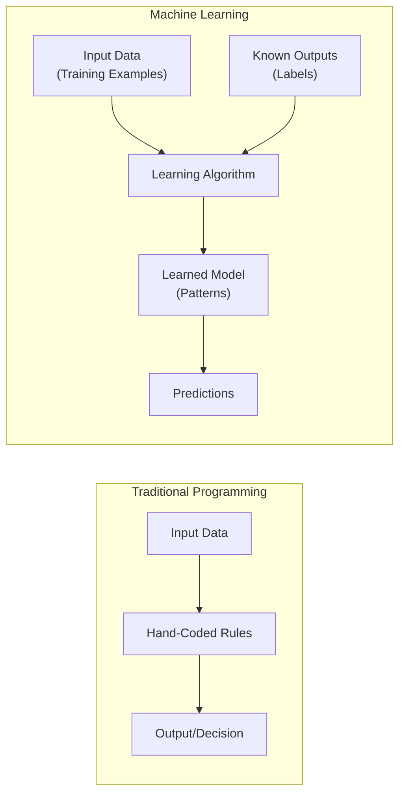
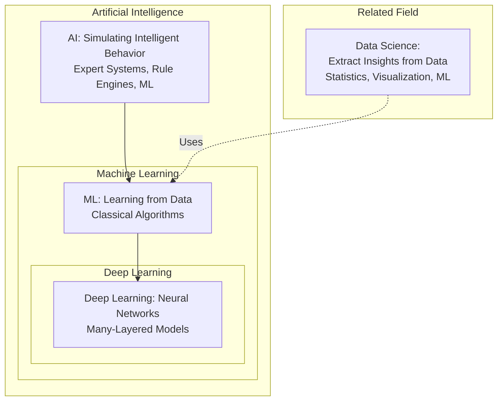
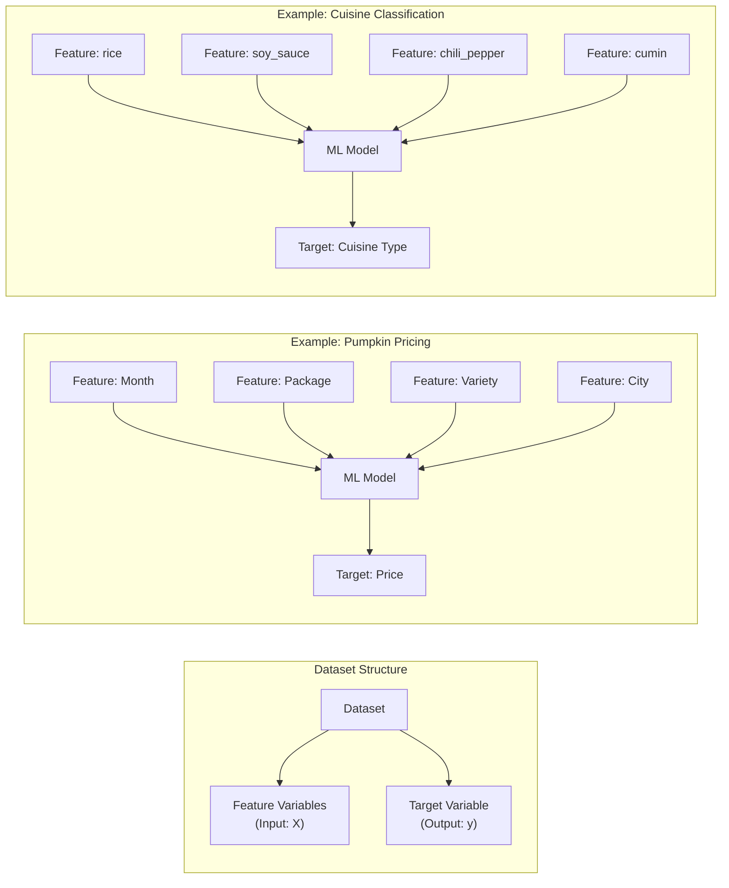
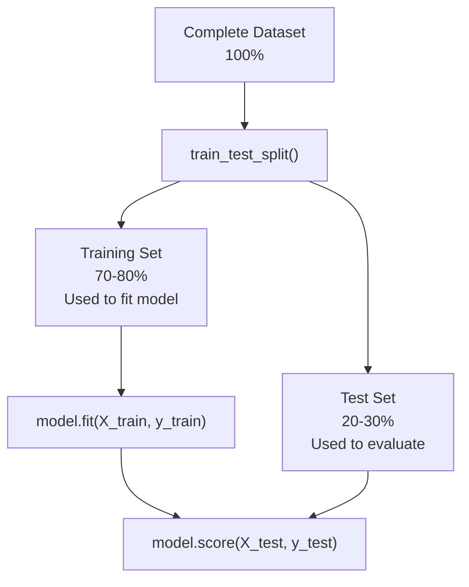
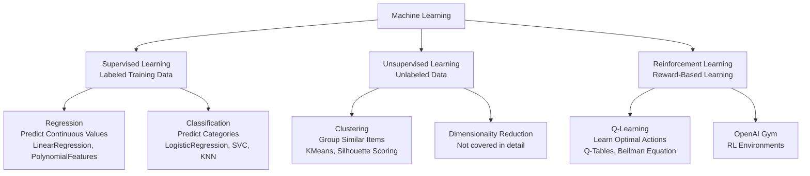
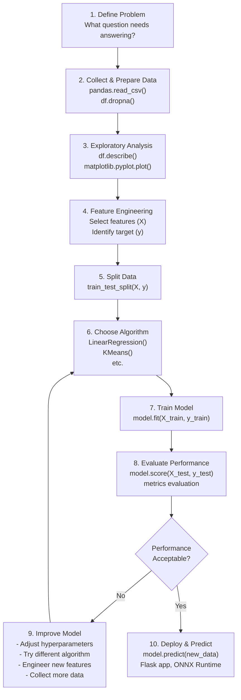
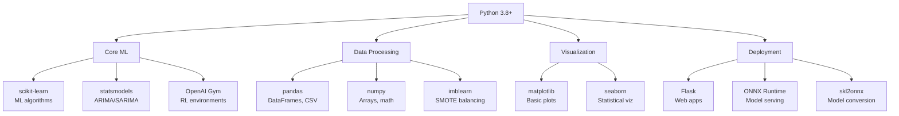

<!-- source: DeepWiki mcp.deepwiki.com · repo microsoft/ML-For-Beginners · page 2.1 Introduction to Machine Learning · fetched 2026-10-26 -->

# Introduction to Machine Learning

<details>
<summary>Relevant source files</summary>

The following files were used as context for generating this wiki page:

- [1-Introduction/1-intro-to-ML/README.md](1-Introduction/1-intro-to-ML/README.md)
- [1-Introduction/2-history-of-ML/README.md](1-Introduction/2-history-of-ML/README.md)
- [1-Introduction/4-techniques-of-ML/README.md](1-Introduction/4-techniques-of-ML/README.md)
- [1-Introduction/4-techniques-of-ML/assignment.md](1-Introduction/4-techniques-of-ML/assignment.md)
- [1-Introduction/4-techniques-of-ML/images/overfitting.png](1-Introduction/4-techniques-of-ML/images/overfitting.png)
- [1-Introduction/README.md](1-Introduction/README.md)
- [1-Introduction/images/globe.jpg](1-Introduction/images/globe.jpg)
- [2-Regression/README.md](2-Regression/README.md)
- [5-Clustering/README.md](5-Clustering/README.md)
- [README.md](README.md)
- [TROUBLESHOOTING.md](TROUBLESHOOTING.md)
- [images/3.png](images/3.png)
- [quiz-app/src/assets/translations/en.json](quiz-app/src/assets/translations/en.json)

</details>


## Purpose and Scope

This document defines machine learning and introduces foundational concepts required to understand the ML-For-Beginners curriculum. It covers the definition of machine learning, core terminology (features, targets, training data), the three main paradigms (supervised, unsupervised, reinforcement learning), and the distinction between ML and deep learning. For information about the historical development of these concepts, see [History of Machine Learning](#2.2). For ethical considerations when applying ML, see [Fairness and Ethics in ML](#2.2). For the practical workflow of building ML systems, see [ML Development Workflow](#2.3).

---

## What is Machine Learning

Machine learning is a subset of artificial intelligence concerned with using specialized algorithms to uncover meaningful information and find hidden patterns from data. Unlike traditional rule-based programming, ML systems learn patterns automatically from examples rather than following explicitly programmed instructions.

The term "machine learning" refers to the automated process of pattern discovery by finding meaningful insights from real-world or generated data. From a systems perspective, ML is defined as the creation of automated systems that can learn hidden patterns from data to aid in making intelligent decisions. This learning process is loosely inspired by how the human brain learns based on perceived data from the external world.

**Key Distinction from Traditional Programming:**



**Machine Learning Definition:**
- **Automated pattern discovery**: Algorithms find patterns without explicit programming
- **Data-driven decisions**: Systems make predictions based on learned patterns
- **Generalization**: Models work on new, unseen data similar to training examples
- **Continuous improvement**: Performance improves with more data and feedback

Sources: [1-Introduction/1-intro-to-ML/README.md:29-59](), [quiz-app/src/assets/translations/en.json:8-58]()

---

## Relationship Between AI, ML, and Deep Learning

Machine learning exists within a hierarchy of related fields. Understanding these relationships clarifies the scope of this curriculum.



**Hierarchy Explanation:**

| Field | Scope | Key Characteristic | This Curriculum |
|-------|-------|-------------------|-----------------|
| **Artificial Intelligence** | Machines exhibiting intelligent behavior | Simulates human decision-making | Background context |
| **Machine Learning** | Subset of AI using data-driven algorithms | Learns patterns from examples | ✓ Primary Focus |
| **Classical ML** | Traditional ML without neural networks | Uses scikit-learn, statsmodels | ✓ Primary Focus |
| **Deep Learning** | Subset of ML using neural networks | Many-layered model architecture | ✗ Not Covered |
| **Data Science** | Extracting insights from data | Statistics, visualization, domain expertise | Related curriculum |

**What This Curriculum Covers:**
- Classical machine learning techniques using `scikit-learn`
- Supervised learning (regression, classification)
- Unsupervised learning (clustering)
- Specialized applications (NLP, time series, reinforcement learning)

**What This Curriculum Does NOT Cover:**
- Neural networks and deep learning architectures
- Frameworks like TensorFlow, PyTorch, Keras
- Computer vision with CNNs
- Advanced NLP with transformers

Sources: [1-Introduction/1-intro-to-ML/README.md:61-93](), [README.md:31]()

---

## Core Terminology and Concepts

### Features and Targets

Machine learning systems work with structured data organized into features and targets:



**Feature (X):**
- A measurable property of the data
- Represented as columns in datasets
- Input variables used to make predictions
- Examples: `date`, `size`, `color`, `temperature`
- In code: typically a pandas DataFrame or numpy array
- Variable name convention: uppercase `X`

**Target (y):**
- The value the model attempts to predict
- Also called "label" or "output variable"
- Examples: `price`, `category`, `color`, `quantity`
- In code: typically a pandas Series or numpy array
- Variable name convention: lowercase `y`

**Examples from Curriculum Datasets:**

| Dataset | Features (X) | Target (y) | Module |
|---------|-------------|-----------|---------|
| US Pumpkins | Date, Package, Variety, City Name | Price | Regression |
| Cuisines | Ingredient columns (rice, garlic, etc.) | Cuisine (Chinese, Indian, etc.) | Classification |
| Nigerian Songs | Danceability, Acousticness, Loudness | Genre clusters | Clustering |
| Hotel Reviews | Review text, reviewer scores | Sentiment score | NLP |
| Energy Usage | Historical usage, date, temperature | Future usage | Time Series |

### Training Data

Training data consists of example input-output pairs used to teach the model patterns:

**Data Split Strategy:**


**Key Concepts:**
- **Training set**: Data used to fit the model via `model.fit()`
- **Test set**: Unseen data used to evaluate performance via `model.score()` or `model.predict()`
- **Validation set**: Optional third split for hyperparameter tuning
- **Data quality**: Both quantity and quality impact model performance

Sources: [1-Introduction/4-techniques-of-ML/README.md:47-67](), [quiz-app/src/assets/translations/en.json:384-457]()

---

## Types of Machine Learning

The curriculum covers three main ML paradigms, each suited to different problem types:



### Supervised Learning

Supervised learning algorithms learn from labeled examples where the correct output is known during training.

**Characteristics:**
- Training data includes both inputs (X) and correct outputs (y)
- Model learns mapping function: f(X) → y
- Goal: predict y for new, unseen X values
- Requires labeled dataset for training

**Two Main Types:**

1. **Regression** - Predicting continuous numerical values
   - Curriculum modules: [2-Regression/](https://github.com/microsoft/ML-For-Beginners/tree/main/2-Regression)
   - Algorithms: `LinearRegression`, `PolynomialFeatures`, `LogisticRegression`
   - Example: Predicting pumpkin prices based on variety and date
   - Evaluation metrics: MSE, R²

2. **Classification** - Predicting discrete categories
   - Curriculum modules: [4-Classification/](https://github.com/microsoft/ML-For-Beginners/tree/main/4-Classification)
   - Algorithms: `LogisticRegression`, `SVC`, `KNeighborsClassifier`, `RandomForestClassifier`
   - Example: Classifying cuisine type from ingredients
   - Evaluation metrics: Accuracy, F1-score, confusion matrix

### Unsupervised Learning

Unsupervised learning finds patterns in data without labeled outputs.

**Characteristics:**
- Training data contains only inputs (X), no labels (y)
- Model discovers hidden structure or groupings
- Goal: understand data organization and relationships
- No "correct answer" during training

**Primary Type in Curriculum:**

**Clustering** - Grouping similar data points
- Curriculum modules: [5-Clustering/](https://github.com/microsoft/ML-For-Beginners/tree/main/5-Clustering)
- Algorithms: `KMeans`, silhouette scoring, elbow method
- Example: Grouping Nigerian songs by musical characteristics
- Evaluation: Silhouette score, cluster visualization

### Reinforcement Learning

Reinforcement learning trains agents to make sequences of decisions by maximizing cumulative rewards.

**Characteristics:**
- Agent interacts with environment through actions
- Receives rewards/penalties based on actions
- Learns optimal policy through trial and error
- Goal: maximize long-term cumulative reward

**Curriculum Implementation:**
- Modules: [8-Reinforcement/](https://github.com/microsoft/ML-For-Beginners/tree/main/8-Reinforcement)
- Algorithms: Q-Learning with Q-Tables
- Environments: Custom Board environment, OpenAI Gym (CartPole)
- Concepts: Bellman equation, exploration vs exploitation, epsilon-greedy

Sources: [README.md:114-141](), [2-Regression/README.md:14-16](), [5-Clustering/README.md:3-13]()

---

## Machine Learning Development Workflow

The process of building ML systems follows an iterative workflow mapped to curriculum lessons:



**Workflow Mapped to Code Patterns:**

| Step | Common Code Pattern | Curriculum Example |
|------|--------------------|--------------------|
| Load Data | `pd.read_csv('data.csv')` | [2-Regression/2-Data/](https://github.com/microsoft/ML-For-Beginners/tree/main/2-Regression/2-Data) |
| Clean Data | `df.dropna()`, `df[df['col'] > 0]` | Data preparation lessons |
| Split Data | `train_test_split(X, y, test_size=0.2)` | All supervised learning lessons |
| Create Model | `model = LinearRegression()` | [2-Regression/3-Linear/](https://github.com/microsoft/ML-For-Beginners/tree/main/2-Regression/3-Linear) |
| Train Model | `model.fit(X_train, y_train)` | All model training lessons |
| Evaluate | `model.score(X_test, y_test)` | All supervised learning lessons |
| Predict | `model.predict(X_new)` | All prediction lessons |
| Deploy | Flask app, ONNX conversion | [3-Web-App/](https://github.com/microsoft/ML-For-Beginners/tree/main/3-Web-App) |

Sources: [1-Introduction/4-techniques-of-ML/README.md:14-103](), [quiz-app/src/assets/translations/en.json:347-457]()

---

## Why Study Machine Learning

### Applications and Use Cases

Machine learning has become ubiquitous across industries, solving problems that traditional rule-based systems cannot handle effectively:

**Business Applications:**
- **Automation**: Solve multi-dimensional problems automatically
- **Personalization**: Customize experiences based on user type/behavior
- **Prediction**: Forecast outcomes from historical patterns
- **Pattern Discovery**: Find insights humans might miss in large datasets

**Domain-Specific Examples from Curriculum:**

| Domain | ML Application | Dataset/Example | Lesson |
|--------|---------------|-----------------|--------|
| Agriculture | Price prediction for crops | US pumpkin pricing data | Regression |
| Food Industry | Cuisine classification from ingredients | Asian/Indian cuisines dataset | Classification |
| Entertainment | Music genre grouping | Nigerian songs metadata | Clustering |
| Hospitality | Sentiment analysis of reviews | 515K hotel reviews | NLP |
| Energy | Electricity demand forecasting | Historical usage data | Time Series |
| Gaming/Robotics | Optimal decision making | CartPole, Board environments | Reinforcement |

**Why Businesses Use ML:**
1. Handle complex, multi-dimensional problems
2. Process large volumes of data efficiently
3. Adapt to changing patterns over time
4. Make predictions on unseen situations
5. Automate decision-making processes

### Classical ML vs Deep Learning Trade-offs

**Why Start with Classical ML (This Curriculum's Approach):**

| Aspect | Classical ML (scikit-learn) | Deep Learning (Neural Networks) |
|--------|----------------------------|--------------------------------|
| **Data Requirements** | Works with smaller datasets | Requires large datasets (10K+ examples) |
| **Training Time** | Minutes to hours | Hours to days/weeks |
| **Interpretability** | Model decisions explainable | "Black box" behavior |
| **Hardware** | Runs on standard CPUs | Often requires GPUs |
| **Learning Curve** | Easier to understand fundamentals | Complex architecture design |
| **Use Cases** | Structured/tabular data, traditional problems | Images, audio, text, complex patterns |

**When to Use Classical ML:**
- Structured/tabular datasets (CSV files, databases)
- Limited training data available (< 10K examples)
- Need explainable predictions (healthcare, finance)
- Fast iteration and prototyping required
- CPU-only computing resources

**When Deep Learning is Better:**
- Image recognition, computer vision tasks
- Natural language understanding (modern transformers)
- Speech recognition, audio processing
- Large datasets available (100K+ examples)
- Complex pattern recognition beyond tabular data

Sources: [1-Introduction/1-intro-to-ML/README.md:96-127](), [quiz-app/src/assets/translations/en.json:25-40]()

---

## Prerequisites and Setup

### Required Knowledge

**Background Needed:**
- **Python programming**: Variables, functions, loops, conditionals
- **Basic mathematics**: Algebra, basic statistics
- **Data structures**: Lists, dictionaries, DataFrames
- **No prior ML experience required**

### Technical Setup

**Core Libraries Used in Curriculum:**



**Installation Command:**
```bash
pip install jupyter scikit-learn pandas numpy matplotlib seaborn
```

**Development Environment:**
- Jupyter notebooks (`.ipynb` files) for interactive learning
- VS Code or JupyterLab for editing
- Git for version control

Sources: [1-Introduction/1-intro-to-ML/README.md:20-27](), [README.md:43-52](), [TROUBLESHOOTING.md:19-93]()

---

## Common Terminology Reference

| Term | Definition | Code Representation | Example |
|------|-----------|-------------------|---------|
| **Feature** | Input variable/property | Column in `X` DataFrame | `pumpkin_variety`, `temperature` |
| **Target** | Output variable to predict | Series `y` | `price`, `cuisine_type` |
| **Training** | Learning patterns from data | `model.fit(X_train, y_train)` | Fitting LinearRegression |
| **Prediction** | Making estimates on new data | `model.predict(X_test)` | Predicting prices |
| **Model** | Learned pattern representation | Scikit-learn estimator object | `LinearRegression()` instance |
| **Algorithm** | Method for learning patterns | Scikit-learn class | `KMeans`, `SVC`, `RandomForest` |
| **Hyperparameter** | Model configuration setting | Constructor arguments | `n_clusters=3`, `max_iter=100` |
| **Overfitting** | Model too specific to training data | High train score, low test score | Model memorizes training examples |
| **Underfitting** | Model too simple for data | Low train and test scores | Linear model for non-linear data |
| **Evaluation** | Measuring model performance | `model.score()`, metrics | R², accuracy, F1-score |

Sources: [1-Introduction/4-techniques-of-ML/README.md:47-55](), [quiz-app/src/assets/translations/en.json:384-399]()

---

## Learning Path Navigation

This document introduces foundational ML concepts. Continue learning through the curriculum in this order:

1. **Current**: Introduction to Machine Learning (you are here)
2. **Next**: [History of Machine Learning](#2.2) - Understand the field's evolution
3. **Then**: [Fairness and Ethics in ML](#2.2) - Learn responsible AI principles
4. **Then**: [ML Development Workflow](#2.3) - Detailed workflow and best practices
5. **Practice**: [Regression](#3.1) - First hands-on ML implementation

**Pre-Lecture Quiz**: Test your understanding before starting at [Quiz ID 1](https://ff-quizzes.netlify.app/en/ml)

**Post-Lecture Quiz**: Verify comprehension after reading at [Quiz ID 2](https://ff-quizzes.netlify.app/en/ml)

Sources: [README.md:114-141](), [quiz-app/src/assets/translations/en.json:7-116]()

---

