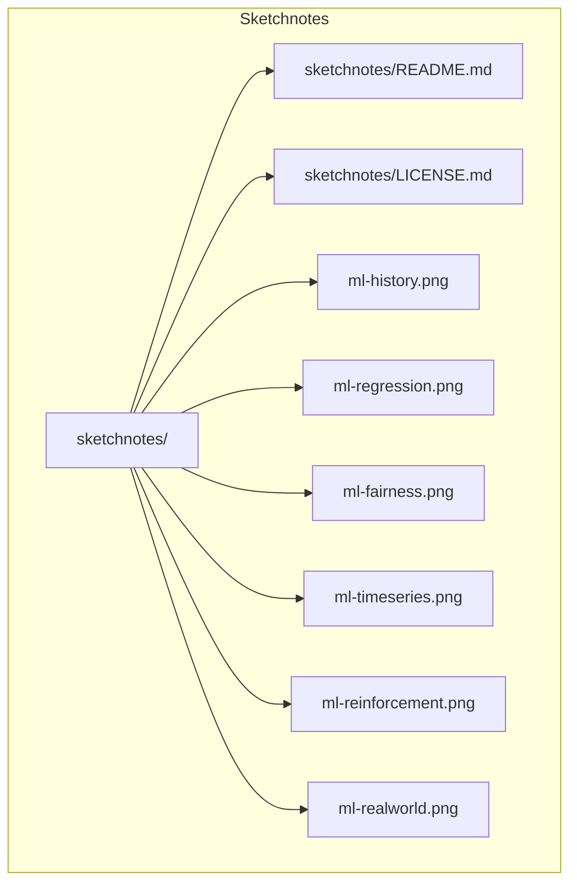
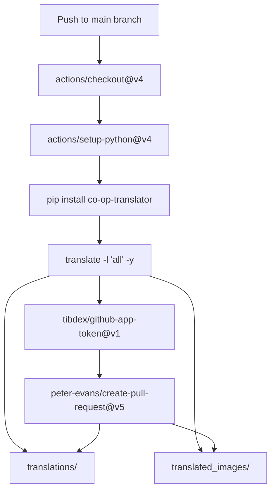
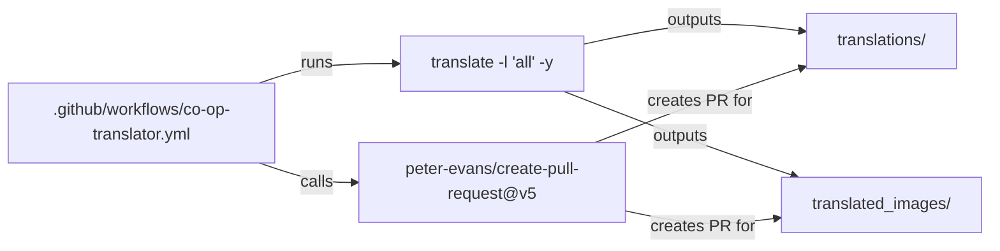

<!-- source: DeepWiki mcp.deepwiki.com · repo microsoft/ML-For-Beginners · page 8 Supporting Resources and Infrastructure · fetched 2026-10-26 -->

# Supporting Resources and Infrastructure

<details>
<summary>Relevant source files</summary>

The following files were used as context for generating this wiki page:

- [.github/workflows/co-op-translator.yml](.github/workflows/co-op-translator.yml)
- [1-Introduction/1-intro-to-ML/README.md](1-Introduction/1-intro-to-ML/README.md)
- [1-Introduction/2-history-of-ML/README.md](1-Introduction/2-history-of-ML/README.md)
- [1-Introduction/README.md](1-Introduction/README.md)
- [1-Introduction/images/globe.jpg](1-Introduction/images/globe.jpg)
- [2-Regression/README.md](2-Regression/README.md)
- [5-Clustering/README.md](5-Clustering/README.md)
- [README.md](README.md)
- [TROUBLESHOOTING.md](TROUBLESHOOTING.md)
- [images/3.png](images/3.png)
- [quiz-app/src/assets/translations/en.json](quiz-app/src/assets/translations/en.json)
- [sketchnotes/LICENSE.md](sketchnotes/LICENSE.md)
- [sketchnotes/README.md](sketchnotes/README.md)
- [sketchnotes/ml-fairness.png](sketchnotes/ml-fairness.png)
- [sketchnotes/ml-history.png](sketchnotes/ml-history.png)
- [sketchnotes/ml-realworld.png](sketchnotes/ml-realworld.png)
- [sketchnotes/ml-regression.png](sketchnotes/ml-regression.png)
- [sketchnotes/ml-reinforcement.png](sketchnotes/ml-reinforcement.png)
- [sketchnotes/ml-timeseries.png](sketchnotes/ml-timeseries.png)

</details>


This document describes the supplementary resources and infrastructure that support the ML-For-Beginners curriculum. It covers visual learning aids (sketchnotes), CI/CD automation, and repository configuration and standards. The focus is on the systems, files, and workflows that enable maintainability, accessibility, and quality assurance for the curriculum and its community.

- For details on the translation and multilingual support system, see [Multilingual Support System](#7).
- For documentation on the quiz application, see [Quiz Application Architecture](#6.3).
- For information about the main curriculum structure and pedagogy, see [Overview](#1).

---

## Purpose and Scope

This page documents:
- The collection and licensing of sketchnotes as visual learning aids.
- The CI/CD and automation workflows, including translation and build automation.
- The repository configuration files and community standards that govern contributions, troubleshooting, and educator resources.

---

## Visual Learning Aids (Sketchnotes)

The curriculum includes a set of sketchnotes designed to provide visual summaries of key machine learning concepts. These are available in both PNG and high-resolution TIFF formats for printing.

### Sketchnotes Collection

- **Location:** All sketchnotes are stored in the `sketchnotes/` directory.
- **Formats:** PNG (for web), TIFF (for high-quality printing).
- **Topics Covered:** History, regression, fairness, time series, reinforcement learning, real-world applications.
- **License:** Creative Commons Attribution-ShareAlike 4.0 International (CC BY-SA 4.0). See [sketchnotes/LICENSE.md]().

#### Sketchnotes Directory Structure

| File Name                      | Topic/Module         | Format   | Example Usage                |
|------------------------------- |---------------------|----------|------------------------------|
| `ml-history.png`               | History             | PNG      | Used in Introduction lessons |
| `ml-regression.png`            | Regression          | PNG      | Used in Regression lessons   |
| `ml-fairness.png`              | Fairness            | PNG      | Used in Fairness lessons     |
| `ml-timeseries.png`            | Time Series         | PNG      | Used in Time Series lessons  |
| `ml-reinforcement.png`         | Reinforcement       | PNG      | Used in RL lessons           |
| `ml-realworld.png`             | Real-World          | PNG      | Used in Real-World lessons   |

#### Sketchnotes Licensing

- All sketchnotes are licensed under [CC BY-SA 4.0](https://creativecommons.org/licenses/by-sa/4.0).
- High-resolution TIFFs for printing are available via a linked external repository.

**Sources:**  
[sketchnotes/README.md](), [sketchnotes/LICENSE.md](), [sketchnotes/ml-history.png](), [sketchnotes/ml-regression.png](), [sketchnotes/ml-fairness.png](), [sketchnotes/ml-timeseries.png](), [sketchnotes/ml-reinforcement.png](), [sketchnotes/ml-realworld.png]()

---

### Diagram: Sketchnotes System and File Mapping


**Sources:**  
[sketchnotes/README.md](), [sketchnotes/LICENSE.md](), [sketchnotes/ml-history.png](), [sketchnotes/ml-regression.png](), [sketchnotes/ml-fairness.png](), [sketchnotes/ml-timeseries.png](), [sketchnotes/ml-reinforcement.png](), [sketchnotes/ml-realworld.png]()

---

## CI/CD and Automation

The repository uses GitHub Actions for continuous integration, automated translation, and build automation. The main workflow for translation is defined in `.github/workflows/co-op-translator.yml`.

### Automated Translation Workflow

- **Workflow File:** `.github/workflows/co-op-translator.yml`
- **Tool:** [co-op-translator](https://github.com/Azure/co-op-translator) (Python package)
- **Trigger:** Runs on every push to the `main` branch.
- **Languages:** Supports "all" (50+ languages) or can be configured for specific languages.
- **Secrets:** Uses Azure AI Service and OpenAI credentials for translation.
- **Output:** Translated markdown files are placed in `translations/` and translated images in `translated_images/`.
- **Pull Requests:** The workflow creates a PR with updated translations and deletes the branch after merging.

#### Key Steps in the Workflow

| Step Name                        | Description                                      |
|-----------------------------------|--------------------------------------------------|
| Checkout repository               | Clones the repo for the workflow                 |
| Set up Python                     | Installs Python 3.10                             |
| Install Co-op Translator          | Installs the translation tool                    |
| Run Co-op Translator              | Executes translation for all or selected langs   |
| Authenticate GitHub App           | Generates a token for PR creation                |
| Create Pull Request with translations | Submits PR with translated files               |

#### Diagram: Translation Automation Workflow


**Sources:**  
[.github/workflows/co-op-translator.yml]()

---

### Bridging Diagram: Translation System to Code Entities


**Sources:**  
[.github/workflows/co-op-translator.yml]()

---

## Repository Configuration and Standards

The repository includes several configuration and documentation files to ensure consistency, quality, and community engagement.

### Key Configuration and Community Files

| File Name                | Purpose                                                                 |
|--------------------------|-------------------------------------------------------------------------|
| `.gitignore`             | Specifies files and directories to be ignored by Git                    |
| `package.json`           | Defines npm scripts for build, Docsify, and PDF generation              |
| `CONTRIBUTING.md`        | Guidelines for contributing to the project                              |
| `CODE_OF_CONDUCT.md`     | Community standards and expected behavior                               |
| `TROUBLESHOOTING.md`     | Solutions for common issues (installation, Jupyter, packages, etc.)     |
| `for-teachers.md`        | Guidance and resources for educators using the curriculum                |
| `README.md`              | Main entry point, links to resources, and community channels            |

#### Table: Example `.gitignore` Patterns

| Pattern                | Purpose                                 |
|------------------------|-----------------------------------------|
| `__pycache__/`         | Ignore Python bytecode cache            |
| `*.ipynb_checkpoints`  | Ignore Jupyter notebook checkpoints     |
| `node_modules/`        | Ignore Node.js dependencies             |
| `*.pdf`                | Ignore generated PDF files              |

#### Table: Example `package.json` Scripts

| Script Name         | Command                        | Purpose                        |
|---------------------|--------------------------------|--------------------------------|
| `docsify:serve`     | `docsify serve .`              | Serve Docsify documentation    |
| `convert`           | `node docsifytopdf.js`         | Generate PDF from Docsify      |

**Sources:**  
[README.md](), [TROUBLESHOOTING.md](), [sketchnotes/README.md]()

---

### Bridging Diagram: Repository Standards to Code Entities

```mermaid
flowchart TD
    GITIGNORE[".gitignore"]
    PKGJSON["package.json"]
    CONTRIB["CONTRIBUTING.md"]
    COC["CODE_OF_CONDUCT.md"]
    TROUBLE["TROUBLESHOOTING.md"]
    TEACHERS["for-teachers.md"]
    DOCSIFY["docsify serve ."]
    PDFGEN["node docsifytopdf.js"]

    PKGJSON -- "defines script" --> DOCSIFY
    PKGJSON -- "defines script" --> PDFGEN
    GITIGNORE -- "excludes files" --> DOCSIFY
    CONTRIB -- "guides" --> "Contributor PRs"
    COC -- "sets" --> "Community Standards"
    TROUBLE -- "assists" --> "Learners"
    TEACHERS -- "guides" --> "Educators"
```
**Sources:**  
[README.md](), [TROUBLESHOOTING.md](), [sketchnotes/README.md]()

---

## Summary

The supporting resources and infrastructure in ML-For-Beginners are designed to ensure a high-quality, accessible, and maintainable learning experience. Visual sketchnotes, robust CI/CD automation, and clear repository standards collectively support both learners and contributors. These systems are tightly integrated with the codebase and are referenced throughout the curriculum and community documentation.

**Sources:**  
[README.md](), [sketchnotes/README.md](), [sketchnotes/LICENSE.md](), [sketchnotes/ml-history.png](), [sketchnotes/ml-regression.png](), [sketchnotes/ml-fairness.png](), [sketchnotes/ml-timeseries.png](), [sketchnotes/ml-reinforcement.png](), [sketchnotes/ml-realworld.png](), [.github/workflows/co-op-translator.yml](), [TROUBLESHOOTING.md]()

---

