# Page: Overview

# Overview

<details>
<summary>Relevant source files</summary>

The following files were used as context for generating this wiki page:

- [README.md](README.md)
- [mmdnn/conversion/caffe/caffe_emitter.py](mmdnn/conversion/caffe/caffe_emitter.py)
- [mmdnn/conversion/cntk/cntk_emitter.py](mmdnn/conversion/cntk/cntk_emitter.py)
- [mmdnn/conversion/keras/keras2_emitter.py](mmdnn/conversion/keras/keras2_emitter.py)
- [mmdnn/conversion/mxnet/mxnet_emitter.py](mmdnn/conversion/mxnet/mxnet_emitter.py)
- [mmdnn/conversion/mxnet/mxnet_parser.py](mmdnn/conversion/mxnet/mxnet_parser.py)
- [mmdnn/conversion/onnx/onnx_emitter.py](mmdnn/conversion/onnx/onnx_emitter.py)
- [mmdnn/conversion/pytorch/pytorch_emitter.py](mmdnn/conversion/pytorch/pytorch_emitter.py)
- [mmdnn/conversion/tensorflow/README.md](mmdnn/conversion/tensorflow/README.md)
- [setup.py](setup.py)

</details>


MMdnn is a comprehensive cross-framework tool for converting, visualizing, and diagnosing deep learning models. The name "MM" stands for model management, and "dnn" is the acronym of deep neural network. This document provides an overview of MMdnn's architecture, components, and workflow.

## Purpose and Scope

MMdnn enables the interoperability of deep learning models across different frameworks by:
1. **Model Conversion**: Transforming models between frameworks (e.g., TensorFlow to PyTorch)
2. **Model Retraining**: Generating code snippets for retraining or inference
3. **Model Visualization**: Displaying network architecture
4. **Model Deployment**: Providing guidance for deployment to various platforms

For details about model deployment, see [Model Deployment](#1.2).

## Core Architecture

MMdnn uses an Intermediate Representation (IR) as a bridge between different deep learning frameworks. This design allows any supported source framework to be converted to any supported target framework through a two-step process.

### Model Conversion Pipeline

```mermaid
flowchart TD
    subgraph "Source Frameworks"
        TF["TensorFlow"]
        Keras["Keras"]
        Caffe["Caffe"]
        MXNet["MXNet"]
        CNTK["CNTK"]
        PyTorch["PyTorch"]
        Darknet["Darknet"]
        CoreML["CoreML"]
    end
    
    subgraph "Intermediate Representation (IR)"
        IRGraph["IR Graph (.pb/.json)"]
        IRWeights["IR Weights (.npy)"]
    end
    
    subgraph "Target Frameworks"
        TF2["TensorFlow"]
        Keras2["Keras"]
        Caffe2["Caffe"]
        MXNet2["MXNet"]
        CNTK2["CNTK"]
        PyTorch2["PyTorch"]
        ONNX["ONNX"]
        CoreML2["CoreML"]
    end
    
    subgraph "Parsers"
        TFParser["TensorFlow Parser"]
        KerasParser["Keras Parser"]
        CaffeParser["Caffe Parser"]
        MXNetParser["MXNet Parser"]
        CNTKParser["CNTK Parser"]
        PyTorchParser["PyTorch Parser"]
        DarknetParser["Darknet Parser"]
        CoreMLParser["CoreML Parser"]
    end
    
    subgraph "Emitters"
        TFEmitter["TensorFlow Emitter"]
        KerasEmitter["Keras Emitter"]
        CaffeEmitter["Caffe Emitter"]
        MXNetEmitter["MXNet Emitter"]
        CNTKEmitter["CNTK Emitter"]
        PyTorchEmitter["PyTorch Emitter"]
        ONNXEmitter["ONNX Emitter"]
        CoreMLEmitter["CoreML Emitter"]
    end
    
    TF --> TFParser
    Keras --> KerasParser
    Caffe --> CaffeParser
    MXNet --> MXNetParser
    CNTK --> CNTKParser
    PyTorch --> PyTorchParser
    Darknet --> DarknetParser
    CoreML --> CoreMLParser
    
    TFParser --> IRGraph
    KerasParser --> IRGraph
    CaffeParser --> IRGraph
    MXNetParser --> IRGraph
    CNTKParser --> IRGraph
    PyTorchParser --> IRGraph
    DarknetParser --> IRGraph
    CoreMLParser --> IRGraph
    
    TFParser --> IRWeights
    KerasParser --> IRWeights
    CaffeParser --> IRWeights
    MXNetParser --> IRWeights
    CNTKParser --> IRWeights
    PyTorchParser --> IRWeights
    DarknetParser --> IRWeights
    CoreMLParser --> IRWeights
    
    IRGraph --> TFEmitter
    IRGraph --> KerasEmitter
    IRGraph --> CaffeEmitter
    IRGraph --> MXNetEmitter
    IRGraph --> CNTKEmitter
    IRGraph --> PyTorchEmitter
    IRGraph --> ONNXEmitter
    IRGraph --> CoreMLEmitter
    
    IRWeights --> TFEmitter
    IRWeights --> KerasEmitter
    IRWeights --> CaffeEmitter
    IRWeights --> MXNetEmitter
    IRWeights --> CNTKEmitter
    IRWeights --> PyTorchEmitter
    IRWeights --> ONNXEmitter
    IRWeights --> CoreMLEmitter
    
    TFEmitter --> TF2
    KerasEmitter --> Keras2
    CaffeEmitter --> Caffe2
    MXNetEmitter --> MXNet2
    CNTKEmitter --> CNTK2
    PyTorchEmitter --> PyTorch2
    ONNXEmitter --> ONNX
    CoreMLEmitter --> CoreML2
```

Sources: [README.md:7-19](), [mmdnn/conversion/caffe/caffe_emitter.py](), [mmdnn/conversion/keras/keras2_emitter.py](), [mmdnn/conversion/pytorch/pytorch_emitter.py](), [mmdnn/conversion/onnx/onnx_emitter.py](), [mmdnn/conversion/mxnet/mxnet_emitter.py](), [mmdnn/conversion/cntk/cntk_emitter.py](), [mmdnn/conversion/mxnet/mxnet_parser.py]()

The conversion process consists of two main components:

1. **Parsers**: Framework-specific modules that convert source models to IR. Each parser understands the format of a specific framework and extracts the network structure and weights to create a standardized IR.

2. **Emitters**: Framework-specific modules that convert IR to target frameworks. Each emitter takes the IR and generates code and weights for a specific target framework.

### Intermediate Representation (IR)

The IR serves as the bridge between frameworks and consists of:

- **IR Graph**: A protobuf binary file (.pb/.json) that stores the network architecture
- **IR Weights**: A NumPy (.npy) file that stores pre-trained weights in NHWC (channel last) format

Sources: [README.md:212-217]()

## Command-Line Tools

MMdnn provides several command-line tools for model conversion and visualization:

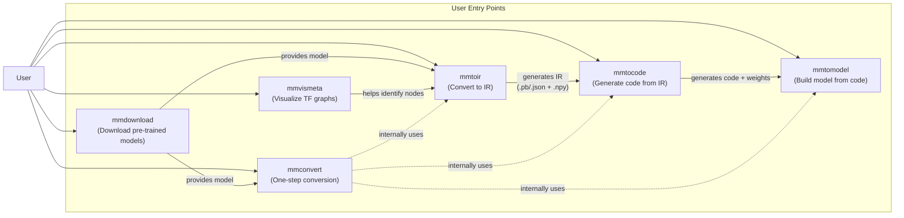

Sources: [setup.py:89-97](), [README.md:84-95](), [README.md:119-147]()

### Tool Descriptions

1. **mmconvert**: One-step conversion from source framework to target framework
   - Usage: `mmconvert -sf [source_framework] -in [input_model] -iw [input_weights] -df [destination_framework] -om [output_model]`

2. **mmdownload**: Download pre-trained models
   - Usage: `mmdownload -f [framework] -n [model_name] -o [output_dir]`

3. **mmtoir**: Convert source model to Intermediate Representation
   - Usage: `mmtoir -f [framework] -in [input_model] -iw [input_weights] -o [output_name]`

4. **mmtocode**: Generate target framework code from IR
   - Usage: `mmtocode -f [framework] -n [IR_model] -w [IR_weights] -o [output_code] -ow [output_weights]`

5. **mmtomodel**: Build model from generated code
   - Usage: `mmtomodel -f [framework] -in [input_code] -iw [input_weights] -o [output_model]`

6. **mmvismeta**: Visualize TensorFlow graph (for TensorFlow models only)
   - Usage: `mmvismeta [meta_file] [log_dir]`

## Framework Support

MMdnn supports conversion between numerous deep learning frameworks:

### Source Frameworks
- Caffe
- CNTK (Microsoft Cognitive Toolkit)
- CoreML
- Keras
- MXNet
- PyTorch
- TensorFlow
- Darknet (Source only, Experimental)

### Target Frameworks
- Caffe
- CNTK
- CoreML
- Keras
- MXNet
- ONNX (Destination only)
- PyTorch
- TensorFlow

### Tested Models

The following table shows which models have been tested for conversion between frameworks:

| Models | Caffe | Keras | TensorFlow | CNTK | MXNet | PyTorch | CoreML | ONNX |
|:-----:|:-----:|:-----:|:----------:|:----:|:-----:|:--------:|:------:|:-----:|
| VGG 19 | ✓ | ✓ | ✓ | ✓ | ✓ | ✓ | ✓ | ✓ |
| Inception V1 | ✓ | ✓ | ✓ | ✓ | ✓ | ✓ | ✓ | ✓ |
| Inception V3 | ✓ | ✓ | ✓ | ✓ | ✓ | ✓ | ✓ | ✓ |
| Inception V4 | ✓ | ✓ | ✓ | o | ✓ | ✓ | ✓ | ✓ |
| ResNet V1 | × | ✓ | ✓ | o | ✓ | ✓ | ✓ | ✓ |
| ResNet V2 | ✓ | ✓ | ✓ | ✓ | ✓ | ✓ | ✓ | ✓ |
| MobileNet V1 | × | ✓ | ✓ | o | ✓ | ✓ | ✓ | ✓ |
| MobileNet V2 | × | ✓ | ✓ | o | ✓ | ✓ | ✓ | ✓ |
| Xception | ✓ | ✓ | ✓ | o | × | ✓ | ✓ | ✓ |
| SqueezeNet | ✓ | ✓ | ✓ | ✓ | ✓ | ✓ | ✓ | ✓ |
| DenseNet | ✓ | ✓ | ✓ | ✓ | ✓ | ✓ | ✓ | ✓ |
| NASNet | × | ✓ | ✓ | o | ✓ | ✓ | ✓ | × |
| ResNext | ✓ | ✓ | ✓ | ✓ | ✓ | ✓ | ✓ | ✓ |

Sources: [README.md:97-108](), [README.md:111-128](), [mmdnn/conversion/tensorflow/README.md:7-17]()

**Legend**:
- ✓: Correctness tested
- o: Some difference after conversion
- ×: Cannot be converted

## Installation

MMdnn can be installed via pip:

```
pip install mmdnn
```

Or for the latest development version:

```
pip install -U git+https://github.com/Microsoft/MMdnn.git@master
```

Docker images are also available:

```
docker pull mmdnn/mmdnn:cpu.small
docker run -it mmdnn/mmdnn:cpu.small
```

Sources: [README.md:47-81](), [setup.py:9-98]()

## Example Usage

Here's a simple example of converting a TensorFlow ResNet V2 152 model to PyTorch:

```bash
# Download the model
mmdownload -f tensorflow -n resnet_v2_152 -o ./

# Convert to PyTorch
mmconvert -sf tensorflow -in imagenet_resnet_v2_152.ckpt.meta -iw imagenet_resnet_v2_152.ckpt --dstNodeName MMdnn_Output -df pytorch -om tf_resnet_to_pth.pth
```

Sources: [README.md:133-139]()

## Detailed IR Conversion Process

```mermaid
flowchart LR
    subgraph "Source Model"
        ModelDef["Model Definition"]
        Weights["Model Weights"]
    end
    
    subgraph "Parser Process"
        GraphBuilder["Graph Builder<br>(framework-specific)"]
        DataInjector["Weight Injector"]
        NodeMapper["Node Mapper"]
    end
    
    subgraph "Intermediate Representation"
        IRGraph["IR Graph (.pb/.json)"]
        IRWeights["IR Weights (.npy)"]
    end
    
    subgraph "Emitter Process"
        CodeGen["Code Generator"]
        WeightTransform["Weight Transformer"]
        LayerHelpers["Layer Helper Functions"]
    end
    
    subgraph "Target Model"
        TargetCode["Model Code"]
        TargetWeights["Model Weights"]
        TargetModel["Final Model"]
    end
    
    ModelDef --> GraphBuilder
    Weights --> DataInjector
    GraphBuilder --> |"framework-specific graph"| NodeMapper
    DataInjector --> |"inject weights"| NodeMapper
    NodeMapper --> |"convert nodes"| IRGraph
    NodeMapper --> |"convert weights"| IRWeights
    
    IRGraph --> |"traverse nodes"| CodeGen
    IRWeights --> WeightTransform
    CodeGen --> |"generate code"| TargetCode
    CodeGen --> |"generate helpers"| LayerHelpers
    WeightTransform --> |"transform weights"| TargetWeights
    
    LayerHelpers --> TargetCode
    TargetCode --> |"combined into"| TargetModel
    TargetWeights --> |"loaded by"| TargetModel
```

Sources: [mmdnn/conversion/caffe/caffe_emitter.py:198-240](), [mmdnn/conversion/keras/keras2_emitter.py:113-146](), [mmdnn/conversion/pytorch/pytorch_emitter.py:148-192](), [mmdnn/conversion/onnx/onnx_emitter.py:146-228](), [mmdnn/conversion/mxnet/mxnet_emitter.py:369-463](), [mmdnn/conversion/cntk/cntk_emitter.py:183-219](), [mmdnn/conversion/mxnet/mxnet_parser.py:427-513]()

This diagram illustrates the detailed conversion process:

1. **Parser Process**:
   - The framework-specific graph builder extracts the model architecture
   - The weight injector loads and prepares weights from the source model
   - The node mapper converts framework-specific nodes to standardized IR nodes

2. **Emitter Process**:
   - The code generator traverses IR nodes to generate target framework code
   - The weight transformer converts weights to the format required by the target framework
   - Helper functions are generated to support layer operations in the target framework

## Conclusion

MMdnn provides a comprehensive solution for cross-framework deep learning model conversion. By using an Intermediate Representation as a bridge, it enables conversion between various deep learning frameworks with minimal loss of information. The tool's command-line utilities make the conversion process straightforward for users, supporting both one-step conversion and step-by-step conversion for more control.

For more detailed information about specific components or frameworks, refer to the other sections of this documentation.

---

# Page: System Architecture

# System Architecture

<details>
<summary>Relevant source files</summary>

The following files were used as context for generating this wiki page:

- [README.md](README.md)
- [mmdnn/conversion/caffe/caffe_emitter.py](mmdnn/conversion/caffe/caffe_emitter.py)
- [mmdnn/conversion/cntk/cntk_emitter.py](mmdnn/conversion/cntk/cntk_emitter.py)
- [mmdnn/conversion/mxnet/mxnet_emitter.py](mmdnn/conversion/mxnet/mxnet_emitter.py)
- [mmdnn/conversion/mxnet/mxnet_parser.py](mmdnn/conversion/mxnet/mxnet_parser.py)
- [mmdnn/conversion/onnx/onnx_emitter.py](mmdnn/conversion/onnx/onnx_emitter.py)
- [mmdnn/conversion/tensorflow/README.md](mmdnn/conversion/tensorflow/README.md)
- [mmdnn/conversion/tensorflow/tensorflow_emitter.py](mmdnn/conversion/tensorflow/tensorflow_emitter.py)
- [mmdnn/conversion/tensorflow/tensorflow_frozenparser.py](mmdnn/conversion/tensorflow/tensorflow_frozenparser.py)
- [mmdnn/conversion/tensorflow/tensorflow_graph.py](mmdnn/conversion/tensorflow/tensorflow_graph.py)
- [mmdnn/conversion/tensorflow/tensorflow_parser.py](mmdnn/conversion/tensorflow/tensorflow_parser.py)
- [setup.py](setup.py)

</details>


This document outlines the system architecture of MMdnn, a cross-framework deep learning model converter. It describes the core components of the system, how they interact to achieve model conversion functionality, and the overall design principles. For information about using specific command-line tools, see [Command-Line Tools](#1.2).

## Overview of MMdnn Architecture

MMdnn uses a hub-and-spoke architecture with a unified Intermediate Representation (IR) at its core. This design enables conversion between any supported frameworks through a two-step process: first converting from source framework to IR, then from IR to target framework.

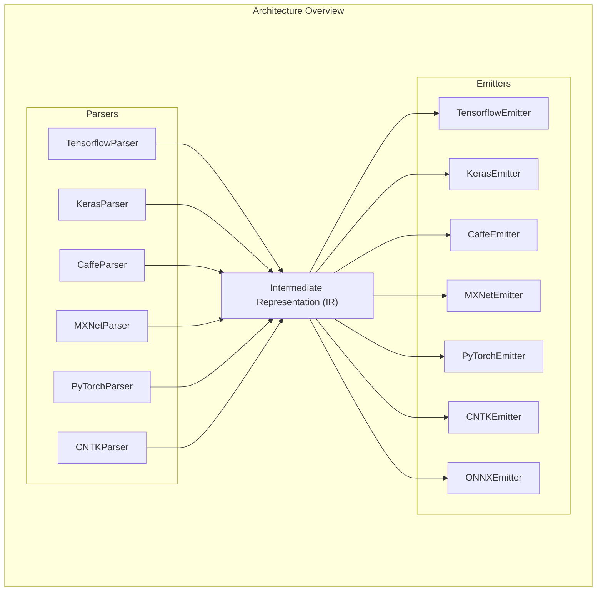

Sources: [README.md:85-106]()

## Model Conversion Pipeline

The conversion process involves multiple steps orchestrated by the command-line tools and implemented by parser and emitter classes.

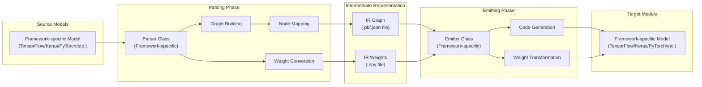

Sources: [README.md:85-106](), [mmdnn/conversion/tensorflow/tensorflow_parser.py:100-145](), [mmdnn/conversion/caffe/caffe_emitter.py:114-140]()

## Core Components

### Parser Base Class

All framework-specific parsers inherit from a common `Parser` base class, implementing methods to extract model structure and weights into the IR format.

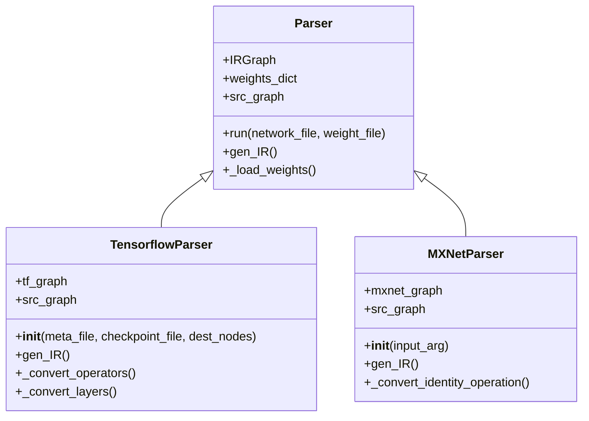

Sources: [mmdnn/conversion/tensorflow/tensorflow_parser.py:22-58](), [mmdnn/conversion/mxnet/mxnet_parser.py:17-40]()

### Emitter Base Class

Framework-specific emitters inherit from a common `Emitter` base class, implementing methods to convert IR to target framework model code and weights.

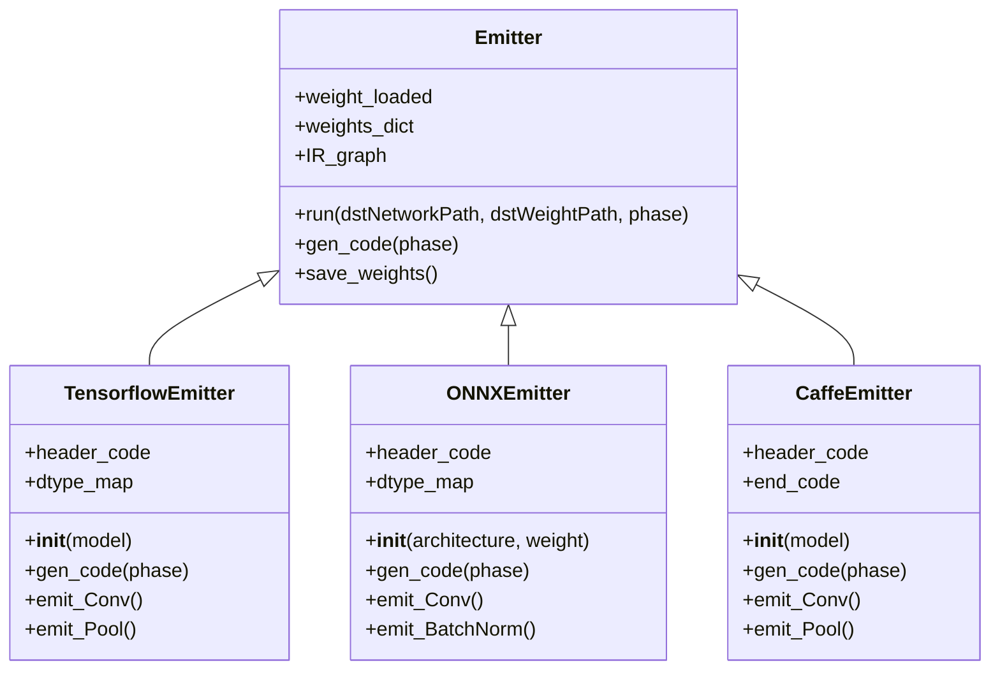

Sources: [mmdnn/conversion/tensorflow/tensorflow_emitter.py:16-35](), [mmdnn/conversion/onnx/onnx_emitter.py:9-35](), [mmdnn/conversion/caffe/caffe_emitter.py:23-112]()

### Intermediate Representation (IR)

The IR format serves as the common language between parsers and emitters. It consists of two main parts:

1. **IR Graph**: Network architecture stored in protobuf (.pb) or JSON format
2. **IR Weights**: Model parameters stored as NumPy arrays (.npy)

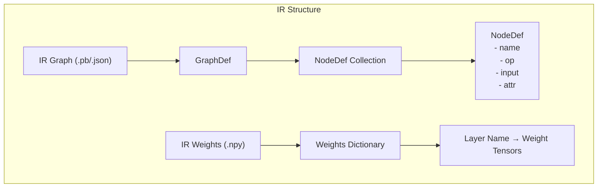

The IR is defined using Protocol Buffers, with the core structure in `graph.proto`. The IR weights are stored in NumPy format, which provides a universal representation for tensors across frameworks.

Sources: [README.md:211-217]()

## Framework-Specific Parsers

### TensorFlow Parser

The TensorFlow parser supports multiple input formats:

1. **Checkpoint files**: Meta (.meta) + checkpoint (.ckpt) files
2. **Frozen graph**: Protobuf (.pb) files
3. **SavedModel**: Directory containing saved model

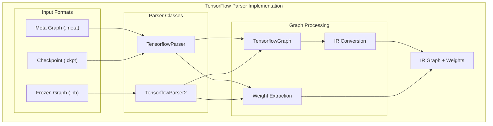

TensorFlow parser handles the complex TensorFlow computation graph by traversing it topologically and converting each operation to the corresponding IR node. The parser uses pattern matching to recognize common neural network layers that may be composed of multiple operations in TensorFlow.

Sources: [mmdnn/conversion/tensorflow/tensorflow_parser.py:22-424](), [mmdnn/conversion/tensorflow/tensorflow_frozenparser.py:16-102](), [mmdnn/conversion/tensorflow/tensorflow_graph.py:11-105]()

### Other Framework Parsers

Each framework parser implements specific logic to extract model architecture and weights from its source format. For example:

- **MXNet Parser**: Handles symbol JSON and parameter files
- **PyTorch Parser**: Uses PyTorch's tracing capability to extract computational graphs
- **Caffe Parser**: Processes prototxt and caffemodel files

## Framework-Specific Emitters

### TensorFlow Emitter

The TensorFlow emitter generates Python code that rebuilds the neural network using TensorFlow APIs:

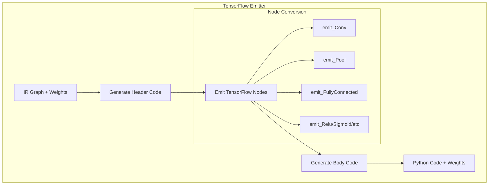

The TensorFlow emitter implements specific methods for each type of layer, such as `emit_Conv`, `emit_Pool`, and `emit_FullyConnected`, which generate the TensorFlow code to recreate these layers.

Sources: [mmdnn/conversion/tensorflow/tensorflow_emitter.py:16-142]()

### ONNX Emitter

The ONNX emitter creates ONNX model files by translating IR nodes to ONNX operators:

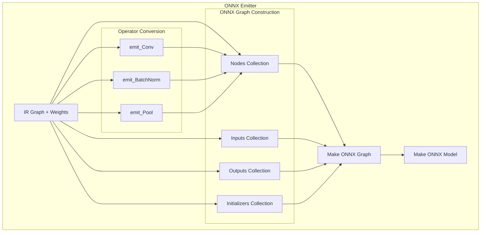

Sources: [mmdnn/conversion/onnx/onnx_emitter.py:9-319]()

### Caffe Emitter

The Caffe emitter generates Python code that constructs Caffe models:

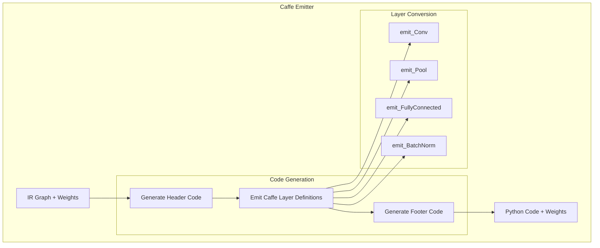

The Caffe emitter processes the IR graph topologically and emits Caffe layer definitions with appropriate parameters.

Sources: [mmdnn/conversion/caffe/caffe_emitter.py:23-668]()

## Command-Line Workflow

The conversion process is exposed through a set of command-line tools that provide a user-friendly interface to the underlying architecture:

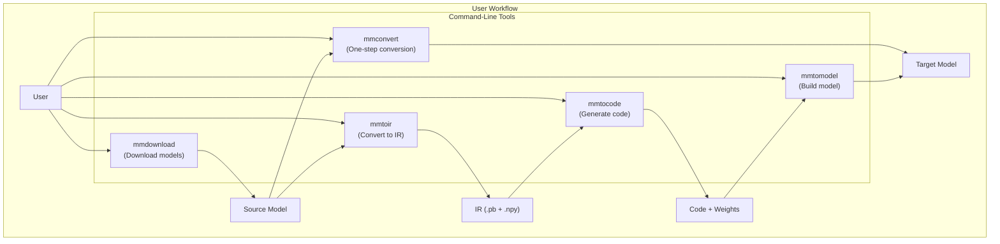

These command-line tools are defined as entry points in `setup.py`, which maps each command to its corresponding implementation script:

Sources: [setup.py:89-96]()

## Testing Infrastructure

MMdnn includes a comprehensive testing infrastructure to validate model conversions:

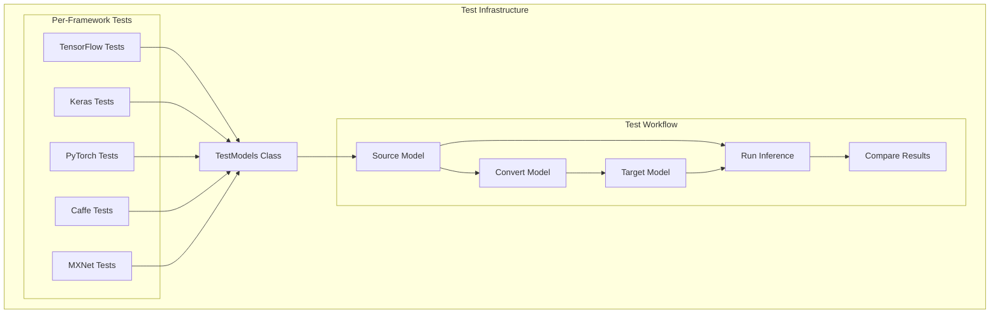

Tests verify conversion accuracy by:
1. Running inference on source models with test inputs
2. Running inference on converted models with the same inputs
3. Comparing outputs to ensure they match within acceptable tolerances

Sources: [README.md:107-127]()

## Cross-Framework Compatibility Table

The table below shows the support status for various frameworks as source and target:

| Model Type | Source | Target |
|------------|--------|--------|
| TensorFlow | ✓ | ✓ |
| Keras | ✓ | ✓ |
| PyTorch | ✓ | ✓ |
| Caffe | ✓ | ✓ |
| MXNet | ✓ | ✓ |
| CNTK | ✓ | ✓ |
| CoreML | ✓ | ✓ |
| ONNX | ✗ | ✓ |
| Darknet | ✓ | ✗ |

Sources: [README.md:94-106]()

## Conclusion

The MMdnn architecture provides a flexible and extensible system for converting deep learning models between frameworks. By using an intermediate representation, it decouples source and target frameworks, making it easier to add support for new frameworks and maintain existing ones.

The system's modular design with separate parsers and emitters, combined with a common IR format, enables a wide range of conversion possibilities while maintaining a clear separation of concerns within the codebase.

---

# Page: Command-Line Tools

# Command-Line Tools

<details>
<summary>Relevant source files</summary>

The following files were used as context for generating this wiki page:

- [README.md](README.md)
- [mmdnn/conversion/_script/convertToIR.py](mmdnn/conversion/_script/convertToIR.py)
- [mmdnn/conversion/_script/extractModel.py](mmdnn/conversion/_script/extractModel.py)
- [mmdnn/conversion/examples/caffe/extractor.py](mmdnn/conversion/examples/caffe/extractor.py)
- [mmdnn/conversion/examples/keras/extractor.py](mmdnn/conversion/examples/keras/extractor.py)
- [mmdnn/conversion/pytorch/pytorch_graph.py](mmdnn/conversion/pytorch/pytorch_graph.py)
- [mmdnn/conversion/pytorch/pytorch_parser.py](mmdnn/conversion/pytorch/pytorch_parser.py)
- [mmdnn/conversion/tensorflow/README.md](mmdnn/conversion/tensorflow/README.md)
- [setup.py](setup.py)

</details>


This page documents the command-line tools provided by MMdnn for model conversion, visualization, and management. The MMdnn framework provides several utility commands that allow users to convert models between different deep learning frameworks via an intermediate representation (IR). For information about the IR format itself, see [Intermediate Representation](#2).

## Overview

MMdnn provides six main command-line tools that can be used individually or in sequence to accomplish model conversion:

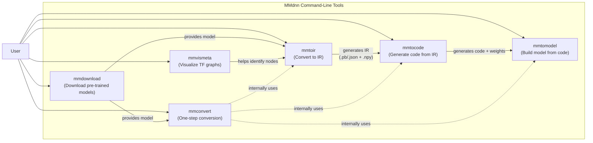

Sources: [setup.py:89-96](), [README.md:132-136]()

## Installation

The MMdnn command-line tools are installed automatically when you install the MMdnn package:

```bash
pip install mmdnn
```

Alternatively, you can install the latest development version from GitHub:

```bash
pip install -U git+https://github.com/Microsoft/MMdnn.git@master
```

Sources: [README.md:47-61]()

## Command-Line Tools in Detail

### mmconvert

The `mmconvert` tool provides one-step conversion from a source framework to a target framework via the IR.

#### Usage

```
mmconvert -sf SOURCE_FRAMEWORK -in NETWORK_FILE -iw WEIGHTS_FILE -df TARGET_FRAMEWORK -om OUTPUT_MODEL_NAME [OPTIONS]
```

#### Key Parameters

| Parameter | Description |
|-----------|-------------|
| `-sf`, `--srcFramework` | Source framework name (caffe, keras, tensorflow, etc.) |
| `-in`, `--inputNetwork` | Path to the model network file of the source framework |
| `-iw`, `--inputWeight` | Path to the model weights file of the source framework |
| `-df`, `--dstFramework` | Target framework name (caffe, keras, tensorflow, etc.) |
| `-om`, `--outputModel` | Output model name |
| `--dstNodeName` | [TensorFlow] Output nodes' name of the graph |
| `--inNodeName` | [TensorFlow] Input nodes' name of the graph |
| `--inputShape` | Input shape of the model (used for some frameworks) |

#### Example

Convert a TensorFlow ResNet V2 152 model to PyTorch:

```bash
mmdownload -f tensorflow -n resnet_v2_152 -o ./
mmconvert -sf tensorflow -in imagenet_resnet_v2_152.ckpt.meta -iw imagenet_resnet_v2_152.ckpt --dstNodeName MMdnn_Output -df pytorch -om tf_resnet_to_pth.pth
```

Sources: [README.md:132-138](), [mmdnn/conversion/tensorflow/README.md:40-44]()

### mmdownload

The `mmdownload` tool downloads pre-trained models from various frameworks.

#### Usage

```
mmdownload -f FRAMEWORK [-n NETWORK_NAME] [-o OUTPUT_PATH]
```

#### Key Parameters

| Parameter | Description |
|-----------|-------------|
| `-f`, `--framework` | Framework name (caffe, keras, tensorflow, etc.) |
| `-n`, `--network` | Network name (optional, shows available models if omitted) |
| `-p`, `-o`, `--path` | Path to save the downloaded model |
| `-i`, `--image` | Test image path (for inference testing) |
| `-l`, `--label` | Path of label file (for classification results) |

#### Example

List available TensorFlow models:

```bash
mmdownload -f tensorflow

Supported models: ['inception_v3_frozen', 'resnet_v2_200', 'inception_v1', 'mobilenet_v1_1.0', 'mobilenet_v2_1.0_224', 'resnet_v2_152', 'vgg16', 'mobilenet_v1_1.0_frozen', 'resnet_v1_50', 'resnet_v2_50', 'inception_v3', 'inception_resnet_v2', 'resnet_v1_152', 'inception_v1_frozen', 'vgg19', 'nasnet-a_large']
```

Download a specific model:

```bash
mmdownload -f tensorflow -n resnet_v2_152 -o ./
```

Sources: [mmdnn/conversion/_script/extractModel.py:24-126](), [mmdnn/conversion/examples/caffe/extractor.py:13-90](), [mmdnn/conversion/examples/keras/extractor.py:15-99]()

### mmtoir

The `mmtoir` tool converts models from their original framework format to the MMdnn Intermediate Representation (IR).

#### Usage

```
mmtoir -f SOURCE_FRAMEWORK [-n NETWORK_FILE] [-w WEIGHTS_FILE] -o OUTPUT_PATH [OPTIONS]
```

#### Key Parameters

| Parameter | Description |
|-----------|-------------|
| `-f`, `--srcFramework` | Source framework name |
| `-n`, `-in`, `--network` | Path to the model network file (not needed for all frameworks) |
| `-w`, `-iw`, `--weights` | Path to the model weights file |
| `-d`, `-o`, `--dstPath` | Output path for IR files (will generate .pb, .json, and .npy files) |
| `--inputShape` | Input shape of the model (required for some frameworks) |
| `--dstNodeName` | [TensorFlow] Output nodes' name of the graph |
| `--inNodeName` | [TensorFlow] Input nodes' name of the graph |

#### Example

Convert a TensorFlow model to IR:

```bash
mmtoir -f tensorflow -w mobilenet_v1_1.0_224/frozen_graph.pb --inNodeName input --inputShape 224,224,3 --dstNodeName MobilenetV1/Predictions/Softmax -o mobilenet_v1
```

Sources: [mmdnn/conversion/_script/convertToIR.py:6-202](), [mmdnn/conversion/tensorflow/README.md:118-123]()

### mmtocode

The `mmtocode` tool generates framework-specific code from the IR.

#### Usage

```
mmtocode -f TARGET_FRAMEWORK -n IR_NETWORK_FILE -w IR_WEIGHTS_FILE -o OUTPUT_CODE_FILE [-ow OUTPUT_WEIGHTS_FILE]
```

#### Key Parameters

| Parameter | Description |
|-----------|-------------|
| `-f`, `--framework` | Target framework name |
| `-n`, `--IRModelPath` | Path to the IR network file (.pb) |
| `-w`, `--IRWeightPath` | Path to the IR weights file (.npy) |
| `-o`, `--dstModelPath` | Output path for generated code |
| `-ow` | Output path for weights |

#### Example

Generate Caffe code from IR:

```bash
mmtocode -f caffe -n mobilenet_v1.pb -w mobilenet_v1.npy -o tf_mobilenet.py -ow tf_mobilenet.npy
```

Sources: [mmdnn/conversion/tensorflow/README.md:125-130](), [mmdnn/conversion/tensorflow/README.md:146-150]()

### mmtomodel

The `mmtomodel` tool uses the generated code and weights to build a framework-specific model.

#### Usage

```
mmtomodel -f TARGET_FRAMEWORK -in CODE_FILE -iw WEIGHTS_FILE -o OUTPUT_MODEL [--dump_tag DUMP_TAG]
```

#### Key Parameters

| Parameter | Description |
|-----------|-------------|
| `-f`, `--framework` | Target framework name |
| `-in`, `--inputModel` | Path to the generated code file |
| `-iw`, `--inputWeight` | Path to the weights file |
| `-o`, `--outputModel` | Output model name |
| `--dump_tag` | [TensorFlow] Specifies the model type (SERVING or TRAINING) |

#### Example

Generate a Caffe model from code and weights:

```bash
mmtomodel -f caffe -in tf_mobilenet.py -iw tf_mobilenet.npy -o tf_mobilenet
```

For TensorFlow:

```bash
mmtomodel -f tensorflow -in tf_resnet152.py -iw resnet152.npy -o tf_resnet152 --dump_tag SERVING
```

Sources: [mmdnn/conversion/tensorflow/README.md:132-138](), [mmdnn/conversion/tensorflow/README.md:157-162]()

### mmvismeta

The `mmvismeta` tool visualizes TensorFlow MetaGraph files to help identify input and output nodes for conversion.

#### Usage

```
mmvismeta META_FILE OUTPUT_LOG_DIR
```

#### Example

```bash
mmvismeta imagenet_resnet_v2_152.ckpt.meta ./logs/
```

This will start a TensorBoard server to visualize the graph.

Sources: [mmdnn/conversion/tensorflow/README.md:99-110]()

## Conversion Workflows

There are two primary workflows for model conversion in MMdnn:

1. **One-step conversion** using `mmconvert`
2. **Step-by-step conversion** using the individual tools: `mmtoir`, `mmtocode`, and `mmtomodel`

### One-Step Conversion Workflow

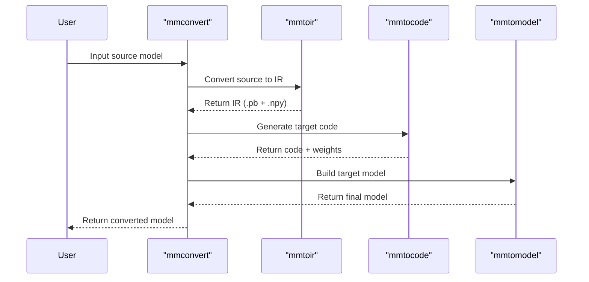

Sources: [README.md:133-138]()

### Step-by-Step Conversion Workflow

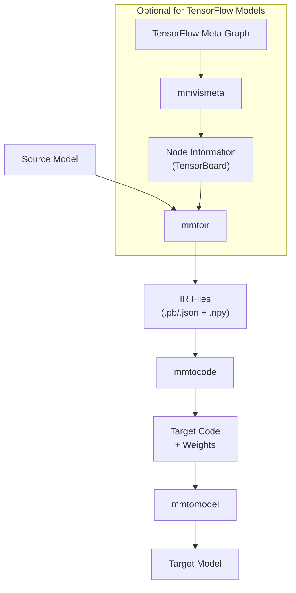

Sources: [mmdnn/conversion/tensorflow/README.md:115-138]()

## Framework Support Matrix

The following table shows the frameworks supported by the MMdnn command-line tools:

| Framework | Source (mmtoir) | Target (mmtocode/mmtomodel) |
|-----------|:---------------:|:---------------------------:|
| Caffe | ✓ | ✓ |
| CNTK | ✓ | ✓ |
| CoreML | ✓ | ✓ |
| Keras | ✓ | ✓ |
| MXNet | ✓ | ✓ |
| ONNX | ✓ | ✓ |
| PyTorch | ✓ | ✓ |
| TensorFlow | ✓ | ✓ |
| Darknet | ✓ | ✗ |

Sources: [README.md:97-105]()

## Implementation Details

The command-line tools are defined as entry points in the MMdnn package:

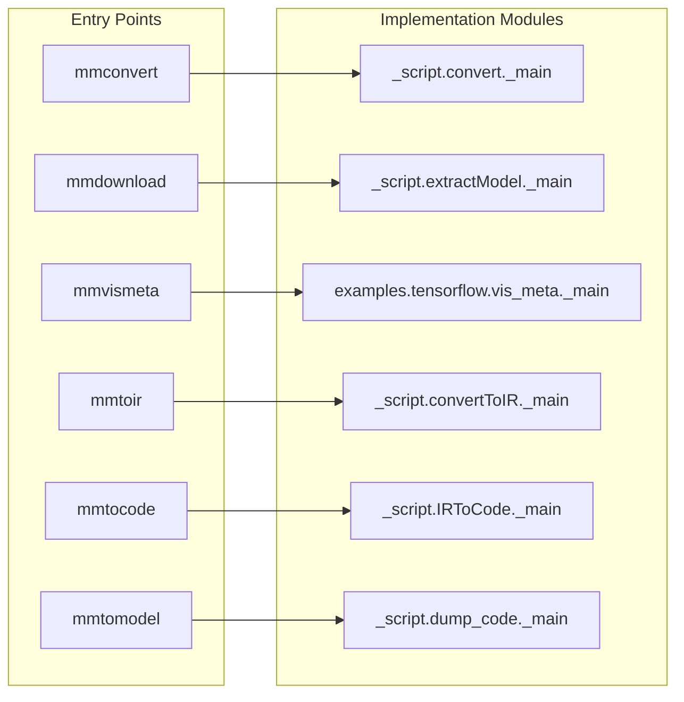

Sources: [setup.py:89-96]()

## Common Usage Patterns

### Converting TensorFlow Models to Caffe

```bash
# One-step conversion
mmconvert -sf tensorflow -iw mobilenet_v1_1.0_224/frozen_graph.pb --inNodeName input --inputShape 224,224,3 --dstNodeName MobilenetV1/Predictions/Softmax -df caffe -om tf_mobilenet

# Step-by-step conversion
mmtoir -f tensorflow -w mobilenet_v1_1.0_224/frozen_graph.pb --inNodeName input --inputShape 224,224,3 --dstNodeName MobilenetV1/Predictions/Softmax -o mobilenet_v1
mmtocode -f caffe -n mobilenet_v1.pb -w mobilenet_v1.npy -o tf_mobilenet.py -ow tf_mobilenet.npy
mmtomodel -f caffe -in tf_mobilenet.py -iw tf_mobilenet.npy -o tf_mobilenet
```

Sources: [mmdnn/conversion/tensorflow/README.md:64-68](), [mmdnn/conversion/tensorflow/README.md:118-138]()

### Converting Keras Models to CNTK

```bash
# Download a Keras model
mmdownload -f keras -n inception_v3 -o ./

# Convert the model to CNTK
mmconvert -sf keras -in imagenet_inception_v3.h5 -df cntk -om keras_inception_v3_cntk
```

Sources: [README.md:166]()

### Converting MXNet Models to TensorFlow

```bash
# Download an MXNet model (example assumes you have the model files)
# Convert the model to TensorFlow
mmconvert -sf mxnet -in resnet-50-symbol.json -iw resnet-50-0000.params -df tensorflow -om mxnet_resnet50_tf
```

Sources: [README.md:170]()

## Conclusion

The MMdnn command-line tools provide a comprehensive suite of utilities for converting deep learning models between different frameworks. Users can choose between a simple one-step conversion using `mmconvert` or a more detailed step-by-step approach using the individual tools (`mmtoir`, `mmtocode`, and `mmtomodel`) for greater control and debugging capabilities.

For more information about the specific frameworks supported and their conversion details, refer to the corresponding framework-specific pages in the MMdnn documentation.

---

# Page: Intermediate Representation

# Intermediate Representation

<details>
<summary>Relevant source files</summary>

The following files were used as context for generating this wiki page:

- [README.md](README.md)
- [mmdnn/conversion/caffe/caffe_emitter.py](mmdnn/conversion/caffe/caffe_emitter.py)
- [mmdnn/conversion/cntk/cntk_emitter.py](mmdnn/conversion/cntk/cntk_emitter.py)
- [mmdnn/conversion/mxnet/mxnet_emitter.py](mmdnn/conversion/mxnet/mxnet_emitter.py)
- [mmdnn/conversion/mxnet/mxnet_parser.py](mmdnn/conversion/mxnet/mxnet_parser.py)
- [mmdnn/conversion/onnx/onnx_emitter.py](mmdnn/conversion/onnx/onnx_emitter.py)
- [mmdnn/conversion/tensorflow/README.md](mmdnn/conversion/tensorflow/README.md)
- [mmdnn/conversion/tensorflow/tensorflow_emitter.py](mmdnn/conversion/tensorflow/tensorflow_emitter.py)
- [mmdnn/conversion/tensorflow/tensorflow_frozenparser.py](mmdnn/conversion/tensorflow/tensorflow_frozenparser.py)
- [mmdnn/conversion/tensorflow/tensorflow_graph.py](mmdnn/conversion/tensorflow/tensorflow_graph.py)
- [mmdnn/conversion/tensorflow/tensorflow_parser.py](mmdnn/conversion/tensorflow/tensorflow_parser.py)
- [setup.py](setup.py)

</details>


The Intermediate Representation (IR) is the core component of MMdnn that serves as a bridge between different deep learning frameworks. It provides a unified format to represent neural network models, enabling seamless conversion between various frameworks like TensorFlow, PyTorch, Caffe, MXNet, CNTK, and others.

## Purpose and Role

The IR functions as the central hub in the MMdnn conversion pipeline. Rather than creating N×(N-1) direct converters between N frameworks, MMdnn uses the IR as an intermediary step, reducing complexity to just N parsers and N emitters. This approach enables MMdnn to support conversion between multiple frameworks while maintaining a modular and extensible architecture.

## IR Structure Overview

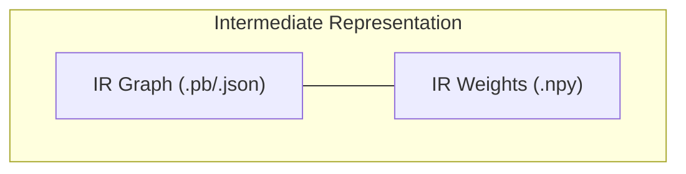

The IR consists of two main components:
1. **IR Graph** - Stores the network architecture in Protocol Buffers format (.pb or .json)
2. **IR Weights** - Stores the model weights in NumPy native format (.npy)

Sources: [README.md:211-215]()

## The IR in the MMdnn Conversion Pipeline

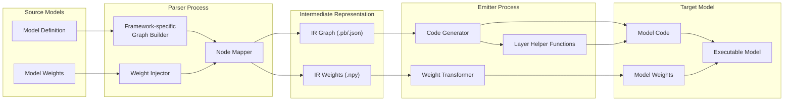

This diagram illustrates the complete conversion pipeline, showing how models move from source frameworks through the IR to target frameworks.

Sources: [README.md:84-106](), [mmdnn/conversion/tensorflow/tensorflow_parser.py:1-300](), [mmdnn/conversion/tensorflow/tensorflow_emitter.py:1-100]()

## IR Data Format

The IR uses the following data formats:

- **Graph Format**: Protocol Buffers (protobuf) for network architecture
- **Weights Format**: NumPy arrays for model parameters
- **Data Layout**: NHWC (channel-last) format
- **File Extensions**: 
  - `.pb` or `.json` for graph structure
  - `.npy` for weights

Sources: [README.md:211-215]()

## IR Components in Detail

### IR Graph

The IR Graph represents the network architecture as a collection of nodes and edges, where:

- **Nodes** represent operations (layers, activations, etc.)
- **Edges** represent tensor connections between operations

Each node in the IR Graph contains:

| Property | Description |
|----------|-------------|
| `name` | Unique identifier for the node |
| `op` | Operation type (e.g., Conv, Pool, FullyConnected) |
| `input` | List of input nodes |
| `attr` | Dictionary of attributes specific to the operation |
| `_output_shapes` | Shape information for the node's outputs |

Sources: [mmdnn/conversion/tensorflow/tensorflow_parser.py:397-435](), [mmdnn/conversion/mxnet/mxnet_parser.py:266-272]()

### IR Weights

IR Weights store all the learnable parameters of the model (e.g., convolutional filters, dense layer weights, batch normalization parameters) as NumPy arrays, organized in a hierarchical dictionary structure:

```
weights_dict = {
    'layer_name_1': {
        'weights': numpy_array,
        'bias': numpy_array
    },
    'layer_name_2': {
        'weights': numpy_array,
        'bias': numpy_array,
        'mean': numpy_array,  # For batch normalization
        'var': numpy_array,   # For batch normalization
        'scale': numpy_array  # For batch normalization
    },
    ...
}
```

Sources: [mmdnn/conversion/tensorflow/tensorflow_parser.py:101-125](), [mmdnn/conversion/mxnet/mxnet_parser.py:152-180]()

## IR Node Structure

```mermaid
classDiagram
    class IRNode {
        +name: string
        +op: string
        +input: List~string~
        +attr: Dict~string,value~
        +get_attr(name, default_value): value
    }
    
    class IRGraphStruct {
        +nodes: Dict~string,IRNode~
        +topological_sort: List~string~
        +input_layers: List~string~
        +output_layers: List~string~
        +get_node(name): IRNode
    }
    
    IRGraphStruct "1" -- "*" IRNode
```

The diagram illustrates the structure of an IR node and its relationship with the overall IR graph.

Sources: [mmdnn/conversion/caffe/caffe_emitter.py:32-36](), [mmdnn/conversion/tensorflow/tensorflow_emitter.py:16-27]()

## Conversion Process

### From Source Model to IR (Parser)

The parser converts a model from its native framework to the IR format:

1. **Graph Building**: Creates a framework-specific graph representation
2. **Weight Extraction**: Extracts weights from the source model
3. **Node Mapping**: Maps framework-specific operations to IR operations
4. **IR Generation**: Builds the IR graph and weights files

Example parser implementation pattern:

```python
def gen_IR(self):
    for layer in self.src_graph.topological_sort:
        current_node = self.src_graph.get_node(layer)
        
        if hasattr(self, "rename_" + current_node.type):
            # Call type-specific conversion function
            func = getattr(self, "rename_" + current_node.type)
            func(current_node)
        else:
            # Handle unknown node type
            self.rename_UNKNOWN(current_node)
```

Sources: [mmdnn/conversion/tensorflow/tensorflow_parser.py:410-424](), [mmdnn/conversion/mxnet/mxnet_parser.py:253-263]()

### From IR to Target Model (Emitter)

The emitter converts the IR to a target framework model:

1. **Code Generation**: Generates framework-specific code from IR nodes
2. **Weight Transformation**: Transforms weights to framework-specific format
3. **Layer Helper Functions**: Creates helper functions for complex operations
4. **Model Building**: Builds an executable model in the target framework

Example emitter implementation pattern:

```python
def gen_code(self, phase):
    self.add_body(0, self.header_code)
    
    for layer in self.IR_graph.topological_sort:
        current_node = self.IR_graph.get_node(layer)
        
        if hasattr(self, "emit_" + current_node.type):
            # Call type-specific emission function
            func = getattr(self, "emit_" + current_node.type)
            line = func(current_node)
            if line != None:
                self.add_body(1, line)
        else:
            # Handle unknown node type
            print("Emitter has not supported operator [%s]." % (current_node.type))
            self.emit_UNKNOWN(current_node)
```

Sources: [mmdnn/conversion/onnx/onnx_emitter.py:59-88](), [mmdnn/conversion/tensorflow/tensorflow_emitter.py:74-89](), [mmdnn/conversion/caffe/caffe_emitter.py:114-140]()

## Framework Support through IR

The following diagram shows how the IR connects various deep learning frameworks in MMdnn:

```mermaid
graph TD
    subgraph "Source Frameworks"
        TF1["TensorFlow"]
        K1["Keras"]
        C1["Caffe"]
        MX1["MXNet"]
        CNTK1["CNTK"]
        PT1["PyTorch"]
        DK1["Darknet"]
        CML1["CoreML"]
    end
    
    subgraph "Intermediate Representation"
        IR["IR Graph + Weights"]
    end
    
    subgraph "Target Frameworks"
        TF2["TensorFlow"]
        K2["Keras"]
        C2["Caffe"]
        MX2["MXNet"]
        CNTK2["CNTK"]
        PT2["PyTorch"]
        ONNX["ONNX"]
        CML2["CoreML"]
    end
    
    TF1 --> IR
    K1 --> IR
    C1 --> IR
    MX1 --> IR
    CNTK1 --> IR
    PT1 --> IR
    DK1 --> IR
    CML1 --> IR
    
    IR --> TF2
    IR --> K2
    IR --> C2
    IR --> MX2
    IR --> CNTK2
    IR --> PT2
    IR --> ONNX
    IR --> CML2
```

Sources: [README.md:84-106](), [setup.py:78-83]()

## Command-Line Usage

The IR is primarily accessed through the following MMdnn command-line tools:

| Command | Description |
|---------|-------------|
| `mmtoir` | Converts source model to IR format |
| `mmtocode` | Generates code from IR for target framework |
| `mmtomodel` | Builds model from generated code and weights |
| `mmconvert` | One-step conversion that combines the above |

Example workflow using IR:

```bash
# Convert from source model to IR
mmtoir -f tensorflow -w mobilenet_v1_1.0_224/frozen_graph.pb --inNodeName input --inputShape 224,224,3 --dstNodeName MobilenetV1/Predictions/Softmax -o mobilenet_v1

# Convert IR to target framework code
mmtocode -f caffe -n mobilenet_v1.pb -w mobilenet_v1.npy -o tf_mobilenet.py -ow tf_mobilenet.npy

# Build model from generated code
mmtomodel -f caffe -in tf_mobilenet.py -iw tf_mobilenet.npy -o tf_mobilenet
```

Sources: [setup.py:89-96](), [README.md:119-138]()

## Implementation Classes

The IR is implemented through several key classes:

1. **IRGraph**: Represents the entire network as a graph
2. **IRGraphNode**: Represents a single node (operation) in the graph
3. **Parser**: Base class for all framework parsers that convert to IR
4. **Emitter**: Base class for all framework emitters that convert from IR

Sources: [mmdnn/conversion/tensorflow/tensorflow_graph.py:11-104](), [mmdnn/conversion/tensorflow/tensorflow_parser.py:22-66]()

## Cross-Framework Data Format Handling

One of the key challenges in model conversion is handling different data formats across frameworks. The IR standardizes on the NHWC (channel-last) format, but many frameworks use NCHW (channel-first). The parsers and emitters handle these conversions:

- **Parsers**: Convert framework-specific formats to NHWC for IR
- **Emitters**: Convert from IR's NHWC to the target framework's format

For example, the transpose operations in various emitters handle this conversion:

```python
# From MXNet Emitter
@staticmethod
def transpose(data, dim):
    if dim == 1:
        data = data.transpose((2, 1, 0))
    elif dim == 2:
        data = data.transpose((3, 2, 0, 1))
    elif dim == 3:
        data = data.transpose((4, 3, 0, 1, 2))
    else:
        raise ValueError("The weight of dim {} cannot transpose" % dim)
    return data
```

Sources: [mmdnn/conversion/mxnet/mxnet_emitter.py:299-310](), [mmdnn/conversion/tensorflow/tensorflow_emitter.py:373-378]()

## Summary

The Intermediate Representation in MMdnn provides a unified format for representing deep learning models, facilitating conversion between different frameworks. By separating the model architecture (IR Graph) from the weights (IR Weights), MMdnn can efficiently handle the conversion process while maintaining the necessary information for accurate model reproduction in the target framework.

---

# Page: Framework Parsers

# Framework Parsers

<details>
<summary>Relevant source files</summary>

The following files were used as context for generating this wiki page:

- [mmdnn/conversion/_script/convertToIR.py](mmdnn/conversion/_script/convertToIR.py)
- [mmdnn/conversion/caffe/graph.py](mmdnn/conversion/caffe/graph.py)
- [mmdnn/conversion/caffe/mapper.py](mmdnn/conversion/caffe/mapper.py)
- [mmdnn/conversion/caffe/network.py](mmdnn/conversion/caffe/network.py)
- [mmdnn/conversion/caffe/resolver.py](mmdnn/conversion/caffe/resolver.py)
- [mmdnn/conversion/caffe/shape.py](mmdnn/conversion/caffe/shape.py)
- [mmdnn/conversion/caffe/transformer.py](mmdnn/conversion/caffe/transformer.py)
- [mmdnn/conversion/common/IR/IR_graph.py](mmdnn/conversion/common/IR/IR_graph.py)
- [mmdnn/conversion/pytorch/pytorch_graph.py](mmdnn/conversion/pytorch/pytorch_graph.py)
- [mmdnn/conversion/pytorch/pytorch_parser.py](mmdnn/conversion/pytorch/pytorch_parser.py)
- [mmdnn/conversion/tensorflow/tensorflow_emitter.py](mmdnn/conversion/tensorflow/tensorflow_emitter.py)
- [mmdnn/conversion/tensorflow/tensorflow_frozenparser.py](mmdnn/conversion/tensorflow/tensorflow_frozenparser.py)
- [mmdnn/conversion/tensorflow/tensorflow_graph.py](mmdnn/conversion/tensorflow/tensorflow_graph.py)
- [mmdnn/conversion/tensorflow/tensorflow_parser.py](mmdnn/conversion/tensorflow/tensorflow_parser.py)

</details>


Framework Parsers are fundamental components in the MMdnn model conversion pipeline. They are responsible for extracting neural network model information from source deep learning frameworks and converting it into MMdnn's Intermediate Representation (IR). This page documents the architecture, implementation, and workflow of these parsers.

For information about the Intermediate Representation format itself, see [Intermediate Representation](#2). For details about converting from IR to target frameworks, see [Framework Emitters](#4).

## Overview

MMdnn uses a three-stage conversion process: 
1. **Parsing** - Convert source framework models to IR
2. **Transformation** - Optimize or modify the IR (optional)
3. **Emitting** - Convert IR to target framework models

Framework Parsers handle the first stage, serving as bridges between source frameworks and the IR format.

```mermaid
flowchart LR
    subgraph "Source Frameworks"
        TF["TensorFlow"]
        Keras["Keras"]
        Caffe["Caffe"]
        PyTorch["PyTorch"]
        MXNet["MXNet"]
        CNTK["CNTK"]
        CoreML["CoreML"]
        Darknet["Darknet"]
    end

    subgraph "Parser Layer"
        TFParser["TensorflowParser\nTensorflowParser2"]
        KerasParser["Keras2Parser"]
        CaffeParser["CaffeTransformer"]
        PyTorchParser["PytorchParser"]
        MXNetParser["MXNetParser"]
        CNTKParser["CntkParser"]
        CoreMLParser["CoremlParser"]
        DarknetParser["DarknetParser"]
    end

    subgraph "Intermediate Representation"
        IR["IR Graph (.pb/.json)\nIR Weights (.npy)"]
    end

    TF --> TFParser
    Keras --> KerasParser
    Caffe --> CaffeParser
    PyTorch --> PyTorchParser
    MXNet --> MXNetParser
    CNTK --> CNTKParser
    CoreML --> CoreMLParser
    Darknet --> DarknetParser

    TFParser --> IR
    KerasParser --> IR
    CaffeParser --> IR
    PyTorchParser --> IR
    MXNetParser --> IR
    CNTKParser --> IR
    CoreMLParser --> IR
    DarknetParser --> IR
```

Sources: [mmdnn/conversion/tensorflow/tensorflow_parser.py:22-32](). [mmdnn/conversion/_script/convertToIR.py:14-116]()

## Common Parser Architecture

All parsers inherit from a base `Parser` class and follow a common pattern:

1. Load the source model
2. Extract model topology (nodes, connections)
3. Extract parameters (weights, biases)
4. Convert framework-specific layer types to IR operations
5. Generate the IR graph and weights files

Each parser implements framework-specific logic while adhering to this common pattern.

```mermaid
classDiagram
    class Parser {
        +weights_dict
        +run(dst_path)
        +gen_IR()
        +set_weight(layer_name, weight_name, weight_value)
    }

    class TensorflowParser {
        +tf_graph
        +__init__(meta_file, checkpoint_file, dest_nodes, inputShape, in_nodes)
        +build()
        +gen_IR()
        -_skip_node(source_node)
        -_convert_identity_operation()
        -rename_* methods
    }

    class CaffeTransformer {
        +model_path
        +phase
        +is_train_proto
        +transform_graph()
        +transform_data()
    }

    class PytorchParser {
        +model
        +state_dict
        +pytorch_graph
        +build_graph(input_shape)
        +gen_IR()
        -rename_* methods
    }

    Parser <|-- TensorflowParser
    Parser <|-- PytorchParser
    Parser <|-- CaffeTransformer
```

Sources: [mmdnn/conversion/tensorflow/tensorflow_parser.py:22-32, 232-424](). [mmdnn/conversion/pytorch/pytorch_parser.py:17-453](). [mmdnn/conversion/caffe/transformer.py:302-368]()

## Parser Workflow

The general workflow of the parsers consists of several key steps:

```mermaid
flowchart TD
    Input["Input Model Files"] --> Load["Load Model\n(framework-specific)"]
    Load --> Extract["Extract Network Topology\n& Parameters"]
    Extract --> Build["Build Internal Graph"]
    Build --> Convert["Convert Nodes to IR Format"]
    Convert --> Generate["Generate IR Files\n(.pb/.json and .npy)"]

    subgraph "Framework-Specific Logic"
        Load
        Extract
        Build
    end

    subgraph "Common Functionality"
        Convert
        Generate
    end
```

### 1. Model Loading

Each parser implements its own method to load the model from framework-specific files:

- **TensorFlow**: Loads `.meta` and checkpoint files, or frozen model (`.pb`) files
- **PyTorch**: Loads `.pth` model files
- **Caffe**: Loads `.prototxt` and `.caffemodel` files
- **Others**: Each has its own loading mechanism based on the framework's format

Sources: [mmdnn/conversion/tensorflow/tensorflow_parser.py:232-319](). [mmdnn/conversion/pytorch/pytorch_parser.py:72-94](). [mmdnn/conversion/caffe/transformer.py:17-44]()

### 2. Graph Extraction

After loading the model, parsers extract the computational graph:

- **TensorFlow**: Extracts graph from TensorFlow's native GraphDef structure
- **PyTorch**: Uses PyTorch's tracing capabilities to extract graph information
- **Caffe**: Constructs a graph from the layer definitions in the prototxt file

This step creates an internal representation of the model as a directed graph.

Sources: [mmdnn/conversion/tensorflow/tensorflow_graph.py:57-104](). [mmdnn/conversion/pytorch/pytorch_graph.py:147-254](). [mmdnn/conversion/caffe/graph.py:217-316]()

### 3. IR Generation

The parsers then traverse this internal graph and convert each node to the corresponding IR node:

```mermaid
flowchart LR
    subgraph "Source Framework Node"
        SrcNode["Node with framework-specific\nattributes and operations"]
    end

    subgraph "IR Node Conversion"
        MapOp["Map operation type\n(e.g., Conv2D → Conv)"]
        ExtractAttrs["Extract relevant attributes\n(e.g., kernel_size, strides)"]
        ConvertWeights["Convert & store weights\nin IR format"]
    end

    subgraph "IR Node"
        IRNode["Node with standardized\nattributes and operations"]
    end

    SrcNode --> MapOp
    MapOp --> ExtractAttrs
    ExtractAttrs --> ConvertWeights
    ConvertWeights --> IRNode
```

Each parser implements a series of `rename_*` methods that handle the conversion of specific operation types:

- `rename_Conv`, `rename_BatchNormalization`, `rename_Relu`, etc.

These methods extract the necessary attributes and convert them to the IR format.

Sources: [mmdnn/conversion/tensorflow/tensorflow_parser.py:521-727](). [mmdnn/conversion/pytorch/pytorch_parser.py:223-452](). [mmdnn/conversion/caffe/mapper.py:95-327]()

## Key Parser Implementations

### TensorFlow Parser

MMdnn provides two TensorFlow parsers:

1. **TensorflowParser**: For `.meta` and checkpoint files
   - Handles graph structure from MetaGraphDef
   - Extracts weights from checkpoint files

2. **TensorflowParser2**: For frozen model files
   - Works with serialized GraphDef format
   - Handles quantized models

Both parsers deal with TensorFlow's graph structure and convert it to IR format.

Sources: [mmdnn/conversion/tensorflow/tensorflow_parser.py:22-509](). [mmdnn/conversion/tensorflow/tensorflow_frozenparser.py:16-971]()

### Caffe Parser

The Caffe parser implementation consists of several key components:

1. **CaffeTransformer**: Main entry point for Caffe model conversion
2. **GraphBuilder**: Builds a graph from Caffe prototxt
3. **DataInjector**: Associates parameters from caffemodel with nodes
4. **NodeMapper**: Maps Caffe layer types to IR operations

The parser handles Caffe's layer-based architecture and converts it to the node-based IR format.

Sources: [mmdnn/conversion/caffe/transformer.py:302-609](). [mmdnn/conversion/caffe/graph.py:217-458](). [mmdnn/conversion/caffe/mapper.py:22-327]()

### PyTorch Parser

The PyTorch parser:

1. Loads a PyTorch model
2. Uses tracing to capture the computational graph
3. Extracts model parameters from state_dict
4. Maps PyTorch operations to IR operations

It has different implementations for different PyTorch versions (0.4.0 and 1.5.1+).

Sources: [mmdnn/conversion/pytorch/pytorch_parser.py:17-452](). [mmdnn/conversion/pytorch/pytorch_graph.py:52-256]()

## Parser Selection and Usage

The parser selection is handled by the `_convert` function in `convertToIR.py`, which:

1. Accepts command-line arguments specifying the source framework and model files
2. Instantiates the appropriate parser based on the source framework
3. Runs the parser to generate IR files

```python
# Example usage (command line):
mmtoir -f tensorflow -in model.pb -o model_ir --inputShape 224,224,3
```

This invokes the TensorFlow parser to convert a model to IR format.

Sources: [mmdnn/conversion/_script/convertToIR.py:6-122]()

## Handling Framework-Specific Features

Each parser addresses unique challenges specific to its framework:

### TensorFlow-specific Handling

- **Skip specific nodes**: TensorFlow graphs often contain nodes that don't affect the model computation (e.g., training operations). The parser filters these out.
  
  ```python
  skip_prefix = [
      "^",
      "train_op",
      "save",
      "gradients",
      "init",
      "global_step",
      "distort_image",
      "Adagrad",
  ]
  ```

- **Padding conversion**: Converts TensorFlow's padding approach to IR's format.

Sources: [mmdnn/conversion/tensorflow/tensorflow_parser.py:24-41, 371-388]()

### Caffe-specific Handling

- **Batch Normalization**: Caffe's BatchNorm is often followed by a Scale layer. The parser fuses these.
- **Layer parameter extraction**: Extracts parameters like kernel_shape, strides from Caffe's layer parameters.

Sources: [mmdnn/conversion/caffe/mapper.py:42-77, 257-265](). [mmdnn/conversion/caffe/transformer.py:221-237]()

### PyTorch-specific Handling

- **Shape inference**: PyTorch's dynamic computation graph requires explicit shape inference.
- **Version compatibility**: Different parsing approaches for different PyTorch versions.

Sources: [mmdnn/conversion/pytorch/pytorch_parser.py:119-160, 147-256]()

## Common Challenges and Solutions

### 1. Different Node Representation

Each framework represents computational nodes differently:
- TensorFlow uses a graph of operations
- Caffe organizes by layers
- PyTorch uses a dynamic computation graph

Solution: Each parser creates its own internal graph representation that maps to the IR format.

### 2. Weight Format Differences

Weight tensors are stored in different formats across frameworks:
- TensorFlow: [filter_height, filter_width, in_channels, out_channels]
- Caffe: [out_channels, in_channels, filter_height, filter_width]

Solution: Parsers reshape and transpose weights to a common format.

Sources: [mmdnn/conversion/tensorflow/tensorflow_parser.py:534-547](). [mmdnn/conversion/caffe/transformer.py:100-159]()

### 3. Operator Mapping

Each framework has unique operators that need mapping to a common IR representation.

Solution: Parsers implement `rename_*` methods for each operator type to standardize the operation.

Sources: [mmdnn/conversion/tensorflow/tensorflow_parser.py:521-727](). [mmdnn/conversion/pytorch/pytorch_parser.py:223-452](). [mmdnn/conversion/caffe/mapper.py:95-327]()

## Extending with New Parsers

To add support for a new framework, you need to:

1. Create a new parser class that inherits from the base `Parser` class
2. Implement the required methods:
   - Model loading
   - Graph extraction
   - Node conversion
   - IR generation
3. Add the parser to the parser selection logic in `convertToIR.py`

The modular design allows for relatively straightforward extension to new frameworks.

Sources: [mmdnn/conversion/_script/convertToIR.py:6-122]()

## Supported Frameworks

MMdnn currently supports the following frameworks as source:

| Framework | Parser Class | Model File Formats |
|-----------|--------------|-------------------|
| TensorFlow | TensorflowParser, TensorflowParser2 | .pb, .meta + checkpoint |
| Keras | Keras2Parser | .h5, .json + .h5 |
| Caffe | CaffeTransformer | .prototxt + .caffemodel |
| PyTorch | PytorchParser | .pth |
| MXNet | MXNetParser | .json + .params |
| CNTK | CntkParser | .model |
| CoreML | CoremlParser | .mlmodel |
| Darknet | DarknetParser | .cfg + .weights |

Sources: [mmdnn/conversion/_script/convertToIR.py:14-116]()

---

# Page: TensorFlow Parser

# TensorFlow Parser

<details>
<summary>Relevant source files</summary>

The following files were used as context for generating this wiki page:

- [mmdnn/conversion/tensorflow/tensorflow_emitter.py](mmdnn/conversion/tensorflow/tensorflow_emitter.py)
- [mmdnn/conversion/tensorflow/tensorflow_frozenparser.py](mmdnn/conversion/tensorflow/tensorflow_frozenparser.py)
- [mmdnn/conversion/tensorflow/tensorflow_graph.py](mmdnn/conversion/tensorflow/tensorflow_graph.py)
- [mmdnn/conversion/tensorflow/tensorflow_parser.py](mmdnn/conversion/tensorflow/tensorflow_parser.py)

</details>


This page provides detailed documentation of the TensorFlow parser in MMdnn. The TensorFlow parser converts TensorFlow models into MMdnn's Intermediate Representation (IR), enabling translation between TensorFlow and other deep learning frameworks. For information about the general IR format, please see [Intermediate Representation](#2).

## Overview

The TensorFlow parser is responsible for extracting the graph structure and weights from TensorFlow models and converting them into MMdnn's standardized IR format. MMdnn provides two parser implementations to handle different types of TensorFlow model formats:

1. `TensorflowParser` - Processes checkpointed models (meta files + checkpoint files)
2. `TensorflowParser2` - Processes frozen graph models (.pb files)

```mermaid
graph TD
    subgraph "TensorFlow Model Formats"
        MetaCheckpoint["Meta + Checkpoint<br>(.meta + .ckpt)"]
        FrozenGraph["Frozen Graph<br>(.pb)"]
    end

    subgraph "TensorFlow Parsers"
        Parser["TensorflowParser"]
        FrozenParser["TensorflowParser2"]
    end

    subgraph "Graph Representation"
        TFGraph["TensorflowGraph"]
    end

    subgraph "Intermediate Representation"
        IR["IR Graph + Weights<br>(.json/.pb + .npy)"]
    end

    MetaCheckpoint --> Parser
    FrozenGraph --> FrozenParser
    Parser --> TFGraph
    FrozenParser --> TFGraph
    TFGraph --> IR
```

Sources: [mmdnn/conversion/tensorflow/tensorflow_parser.py:22-1072](), [mmdnn/conversion/tensorflow/tensorflow_frozenparser.py:16-1188]()

## Parser Types

### TensorflowParser

`TensorflowParser` processes TensorFlow models stored as meta and checkpoint files. It provides capabilities for:

- Loading model architecture from meta files
- Loading weights from checkpoint files
- Extracting subgraphs using specified input and output nodes
- Converting the TensorFlow graph to IR

The parser initializes with:

```python
def __init__(self, meta_file, checkpoint_file, dest_nodes, inputShape=None, in_nodes=None):
    # Loads model and builds graph
```

Sources: [mmdnn/conversion/tensorflow/tensorflow_parser.py:232-319]()

### TensorflowParser2

`TensorflowParser2` processes frozen TensorFlow models (.pb files) which contain both the graph definition and weights in a single file. It provides similar functionality to `TensorflowParser` but is adapted for the frozen model format:

```python
def __init__(self, frozen_file, inputshape, in_nodes, dest_nodes):
    # Loads frozen model and builds graph
```

Sources: [mmdnn/conversion/tensorflow/tensorflow_frozenparser.py:108-180]()

## Graph Representation

Both parsers use a common graph representation through the `TensorflowGraph` class, which provides a structure to represent the TensorFlow computation graph:

```mermaid
classDiagram
    class TensorflowGraph {
        +model
        +layer_map
        +layer_name_map
        +build()
        +get_node(name)
        +tf_make_connection(src, dst)
    }
    
    class TensorflowGraphNode {
        +layer
        +in_nodes
        +out_nodes
        +name
        +type
        +get_attr(name)
    }
    
    TensorflowGraph --* TensorflowGraphNode : contains
```

Key components:
- `TensorflowGraphNode`: Represents a single operation in the TensorFlow graph
- `TensorflowGraph`: Contains the collection of nodes and their connections

Sources: [mmdnn/conversion/tensorflow/tensorflow_graph.py:11-105]()

## Conversion Process

The conversion process from TensorFlow to IR follows these steps:

```mermaid
flowchart TD
    A["Initialize Parser<br>with Model"] --> B["Build TensorFlow Graph"]
    B --> C["Generate IR"]
    C --> D["Save IR to Files"]
    
    subgraph "Generate IR"
        E["Topologically Sort Nodes"] --> F["For Each Node"]
        F --> G{"Node Type?"}
        G -->|"Conv2D"| H["rename_Conv2D()"]
        G -->|"Relu"| I["rename_Relu()"]
        G -->|"MaxPool"| J["rename_MaxPool()"]
        G -->|"Other Types"| K["Other rename_*()"]
        H & I & J & K --> L["Add Node to IR Graph"]
        L --> F
    end
```

The core of the conversion process is in the `gen_IR()` method, which processes each node in the TensorFlow graph:

1. Nodes are processed in topological order
2. For each node type, a specific `rename_*` method is called
3. These methods convert TensorFlow operations to equivalent IR operations
4. Weights and attributes are transferred to the IR

Sources: [mmdnn/conversion/tensorflow/tensorflow_parser.py:410-423](), [mmdnn/conversion/tensorflow/tensorflow_frozenparser.py:381-397]()

## Operation Mapping

The parsers contain numerous specialized methods to convert different TensorFlow operations to IR. Here's a table of common TensorFlow operations and their corresponding IR operations:

| TensorFlow Operation | Parser Method | IR Operation |
|----------------------|---------------|--------------|
| Conv2D | rename_Conv2D | Conv |
| Relu | rename_Relu | Relu |
| MaxPool | rename_MaxPool | Pool (type=MAX) |
| AvgPool | rename_AvgPool | Pool (type=AVG) |
| MatMul | rename_MatMul | FullyConnected |
| FusedBatchNorm | rename_FusedBatchNorm | BatchNorm |
| Placeholder | rename_Placeholder | DataInput |
| Add | rename_Add | Add |
| Concat/ConcatV2 | rename_ConcatV2 | Concat |
| Reshape | rename_Reshape | Reshape |
| Softmax | rename_Softmax | Softmax |

The parser also handles many other operations including:
- Element-wise operations (Add, Mul, Sub)
- Activation functions (Relu, Sigmoid, Tanh)
- Tensor manipulation (Reshape, Squeeze, Transpose)
- And many more specialized operations

Sources: [mmdnn/conversion/tensorflow/tensorflow_parser.py:512-1071](), [mmdnn/conversion/tensorflow/tensorflow_frozenparser.py:538-1188]()

## Handling Node Attributes and Weights

The parsers extract and convert node attributes and weights during the conversion process. Here's how some common attributes are handled:

### Convolution Layers

For Conv2D operations, the parser:
1. Extracts kernel shape, strides, and padding information
2. Converts TensorFlow's padding format to IR's padding format
3. Extracts weights from the checkpoint data
4. Checks for and handles bias addition nodes

```mermaid
graph TD
    Conv2D["TensorFlow: Conv2D"] --> Extract["Extract Attributes<br>(strides, padding)"]
    Extract --> ConvWeights["Extract Weights<br>from checkpoint/constants"]
    ConvWeights --> BiasCheck{"Has Bias Add?"}
    BiasCheck -->|"Yes"| BiasExtract["Extract Bias<br>from Add/BiasAdd node"]
    BiasCheck -->|"No"| NoBias["No bias in IR"]
    BiasExtract & NoBias --> IRConv["IR: Conv Layer"]
```

Sources: [mmdnn/conversion/tensorflow/tensorflow_parser.py:521-549]()

### Batch Normalization

For FusedBatchNorm operations, the parser:
1. Extracts epsilon value
2. Extracts scale (gamma), bias (beta), mean, and variance from the checkpoint data
3. Sets appropriate flags for scale and bias usage

Sources: [mmdnn/conversion/tensorflow/tensorflow_parser.py:774-817]()

## Usage Examples

### Converting a TensorFlow Meta+Checkpoint Model

```python
from mmdnn.conversion.tensorflow.tensorflow_parser import TensorflowParser

# Initialize parser with meta file, checkpoint file, and output node names
parser = TensorflowParser(
    "model.meta",  # Meta file path
    "model.ckpt",  # Checkpoint file path
    ["output_node"],  # Output node names
)

# Generate IR
parser.gen_IR()

# Save IR to files
parser.save_to_proto("ir_model.json")  # Save graph structure
parser.save_weights("ir_weights.npy")  # Save weights
```

### Converting a Frozen TensorFlow Model

```python
from mmdnn.conversion.tensorflow.tensorflow_frozenparser import TensorflowParser2

# Initialize parser with frozen model, input shape, input node names, and output node names
parser = TensorflowParser2(
    "frozen_model.pb",  # Frozen model path
    [224, 224, 3],  # Input shape (excluding batch dimension)
    ["input"],  # Input node names
    ["output"]  # Output node names
)

# Generate IR
parser.gen_IR()

# Save IR to files
parser.save_to_proto("ir_model.json")  # Save graph structure
parser.save_weights("ir_weights.npy")  # Save weights
```

## Summary

The TensorFlow Parser in MMdnn is a sophisticated component that converts TensorFlow models into a framework-agnostic Intermediate Representation. It supports both checkpoint-based models and frozen models, handles a wide variety of TensorFlow operations, and carefully preserves the structure and weights of the original model.

By using specialized methods for each operation type, the parser ensures accurate conversion of TensorFlow-specific attributes and behaviors to the standardized IR format, enabling further conversion to other deep learning frameworks supported by MMdnn.

---

# Page: Keras Parser

# Keras Parser

<details>
<summary>Relevant source files</summary>

The following files were used as context for generating this wiki page:

- [mmdnn/conversion/common/IR/ops.pbtxt](mmdnn/conversion/common/IR/ops.pbtxt)
- [mmdnn/conversion/keras/keras2_parser.py](mmdnn/conversion/keras/keras2_parser.py)

</details>


## Purpose and Scope

The Keras Parser is a component of the MMdnn framework responsible for parsing Keras models and converting them to the Intermediate Representation (IR) format. This component serves as a bridge, enabling Keras models to be converted to other deep learning frameworks supported by MMdnn. 

For information about the overall conversion pipeline, see [System Architecture](#1.1). For details on the Intermediate Representation format, see [Intermediate Representation](#2).

## Overview

The Keras Parser takes a Keras model (in various formats) as input and produces two IR files:
- A graph structure file (`.json` or `.pb`)
- A weights file (`.npy`) 

These files represent the model structure and parameters in a framework-agnostic format that can be used by MMdnn emitters to generate models for target frameworks.

```mermaid
flowchart LR
    subgraph "Keras Model Sources"
        KerasH5[".h5 File"]
        KerasJson[".json + .h5 Files"]
        KerasObj["Keras Model Object"]
    end
    
    subgraph "Keras2Parser"
        LoadModel["_load_model()"]
        BuildGraph["Keras2Graph.build()"]
        GenIR["gen_IR()"]
        ProcessNodes["Layer-specific Handlers"]
    end
    
    subgraph "IR Output"
        IRGraph["IR Graph (.json/.pb)"]
        IRWeights["IR Weights (.npy)"]
    end
    
    KerasH5 --> LoadModel
    KerasJson --> LoadModel
    KerasObj --> LoadModel
    
    LoadModel --> BuildGraph
    BuildGraph --> GenIR
    GenIR --> ProcessNodes
    ProcessNodes --> IRGraph
    ProcessNodes --> IRWeights
```

Sources: [mmdnn/conversion/keras/keras2_parser.py:97-152]()

## Implementation Details

The Keras Parser is implemented in the `Keras2Parser` class which inherits from the base `Parser` class in the MMdnn framework.

```mermaid
classDiagram
    Parser <|-- Keras2Parser
    Keras2Parser -- Keras2Graph
    
    class Parser {
        +IR_graph
        +weights
        +weight_loaded
        +src_graph
        +convert_inedge()
        +set_weight()
    }
    
    class Keras2Parser {
        +dtype_map
        +activation_map
        +keras_graph
        +data_format
        +lambda_layer_count
        +__init__(model)
        +_load_model(model_network_path, model_weight_path)
        +gen_IR()
        +rename_*() methods
        +_convert_convolution()
        +_convert_pooling()
        +_convert_merge()
        +_defuse_activation()
    }
    
    class Keras2Graph {
        +build()
        +get_node()
        +topological_sort
    }
```

Sources: [mmdnn/conversion/keras/keras2_parser.py:18-33](), [mmdnn/conversion/keras/keras2_parser.py:134-136]()

### Key Components

1. **Type Mappings**: Dictionaries that map Keras data types and activations to their IR equivalents
   - `dtype_map`: Maps Keras data types to IR data types
   - `activation_map`: Maps Keras activation functions to IR operations

2. **Model Loading**: Methods to load Keras models in various formats
   - Direct loading of `.h5` files
   - Loading from model definition (`.json`) and weights (`.h5`) files
   - Handling of custom objects (e.g., MobileNet components)

3. **Graph Building**: Uses `Keras2Graph` to construct a graph representation of the model

4. **IR Generation**: Converts the Keras graph to IR format
   - Traverses the graph in topological order
   - Applies layer-specific handlers
   - Manages weights and biases

Sources: [mmdnn/conversion/keras/keras2_parser.py:20-41](), [mmdnn/conversion/keras/keras2_parser.py:44-90](), [mmdnn/conversion/keras/keras2_parser.py:140-152]()

## Model Loading

The Keras Parser supports loading models in multiple formats:

| Format | Description | Implementation |
|--------|-------------|----------------|
| Model file | A `.h5` file containing both model architecture and weights | `_keras.models.load_model()` |
| Model architecture + weights | Separate `.json` (architecture) and `.h5` (weights) files | `model_from_json()` + `load_weights()` |
| Model object | An in-memory Keras model object | Direct use |

The parser handles custom objects that may be present in the model:
- MobileNet's `relu6` activation
- MobileNet's `DepthwiseConv2D` layer

Sources: [mmdnn/conversion/keras/keras2_parser.py:44-90](), [mmdnn/conversion/keras/keras2_parser.py:97-130]()

## IR Conversion Process

The conversion from Keras model to IR follows these steps:

```mermaid
sequenceDiagram
    participant User
    participant Keras2Parser
    participant Keras2Graph
    participant IRGraph
    
    User->>Keras2Parser: Create parser with model
    Keras2Parser->>Keras2Graph: Build graph
    Keras2Graph-->>Keras2Parser: Return graph structure
    User->>Keras2Parser: Call gen_IR()
    
    loop For Each Node in Topological Order
        Keras2Parser->>Keras2Parser: Get node_type
        alt Has rename_node_type method
            Keras2Parser->>Keras2Parser: Call rename_node_type()
            Keras2Parser->>IRGraph: Add node
            Keras2Parser->>IRGraph: Set attributes
            alt Has weights/biases
                Keras2Parser->>IRGraph: Set weights/biases
            end
            alt Has activation
                Keras2Parser->>Keras2Parser: Call _defuse_activation()
                Keras2Parser->>IRGraph: Add activation node
            end
        else Unknown node type
            Keras2Parser->>Keras2Parser: Call rename_UNKNOWN()
        end
    end
    
    Keras2Parser-->>User: Return completed IR
```

The key method is `gen_IR()`, which:
1. Iterates through nodes in topological order
2. Determines the node type
3. Calls the appropriate `rename_X` method based on the node type
4. Adds the node to the IR graph
5. Sets node attributes, weights, and biases
6. Handles activations separately using `_defuse_activation()`

Sources: [mmdnn/conversion/keras/keras2_parser.py:140-152](), [mmdnn/conversion/keras/keras2_parser.py:216-232]()

## Layer Support

The Keras Parser supports a wide range of Keras layer types, mapping them to corresponding IR operations:

| Category | Keras Layers | IR Operations |
|----------|--------------|---------------|
| Input | InputLayer | DataInput |
| Convolution | Conv1D, Conv2D, Conv3D, *Transpose variants | Conv, ConvTranspose |
| Pooling | MaxPooling1D/2D/3D, AveragePooling1D/2D/3D, GlobalPooling variants | Pool |
| Core | Dense | FullyConnected |
| | Flatten | Flatten |
| | Reshape | Reshape |
| Merge | Add, Concatenate, Multiply | Add, Concat, Mul |
| Normalization | BatchNormalization | BatchNorm |
| Recurrent | LSTM, GRU | LSTM, GRU |
| Activation | Activation, ReLU, LeakyReLU | Relu, LeakyRelu, other activations |
| Other | ZeroPadding2D, Dropout, Embedding, UpSampling2D, Lambda | Pad, Dropout, Embedding, etc. |

The parser also supports specialized layers:
- SeparableConv2D
- DepthwiseConv2D
- Cropping layers (Cropping1D/2D/3D)

Sources: [mmdnn/conversion/keras/keras2_parser.py:423-794](), [mmdnn/conversion/common/IR/ops.pbtxt:1-824]()

### Layer-Specific Handlers

For each supported layer type, the parser provides a dedicated `rename_X` method that:
1. Creates a new IR node
2. Copies basic information (name, operation type)
3. Sets layer-specific attributes
4. Handles input edges
5. Manages weights and biases if present
6. Processes any activation function attached to the layer

Common operations are abstracted into helper methods:
- `_convert_convolution()`: Handles all convolution types
- `_convert_pooling()`: Handles all pooling types
- `_convert_merge()`: Handles merge operations
- `_convert_padding_api()`: Handles padding operations
- `_defuse_activation()`: Separates activations from layers

Sources: [mmdnn/conversion/keras/keras2_parser.py:234-307](), [mmdnn/conversion/keras/keras2_parser.py:309-353](), [mmdnn/conversion/keras/keras2_parser.py:355-371]()

## Data Format Handling

The Keras Parser supports both `channels_first` (NCHW) and `channels_last` (NHWC) data formats. The parser:

1. Determines the data format from the Keras backend configuration
2. Sets the appropriate data format attribute in IR nodes
3. Adjusts tensor dimensions based on the data format
4. Handles axis parameters correctly based on the data format

```python
# Example: Detection and conversion of data format
if source_node.keras_layer.data_format == 'channels_last':
    target_node.attr["data_format"].s = "NHWC"
elif source_node.keras_layer.data_format == 'channels_first':
    target_node.attr["data_format"].s = "NCHW"
```

Sources: [mmdnn/conversion/keras/keras2_parser.py:188-194](), [mmdnn/conversion/keras/keras2_parser.py:284-285]()

## Activation Handling

The Keras Parser handles activations in two ways:

1. **Standalone activation layers**: Directly mapped to corresponding IR operations
2. **Integrated activations**: Separated from their parent layers using `_defuse_activation()`

```mermaid
flowchart LR
    subgraph "Keras Model"
        Conv["Conv2D with relu activation"]
    end
    
    subgraph "IR Model"
        Conv2D["Conv IR Node"]
        Relu["Relu IR Node"]
        Conv2D --> Relu
    end
    
    Conv -- "_defuse_activation()" --> Conv2D
    Conv -- "_defuse_activation()" --> Relu
```

The activation mapping dictionary defines corresponding IR operations for Keras activations:

| Keras Activation | IR Operation |
|------------------|--------------|
| relu | Relu |
| softmax | Softmax |
| sigmoid | Sigmoid |
| tanh | Tanh |
| elu | Elu |
| relu6 | Relu6 |
| softplus | Softplus |
| softsign | Softsign |
| hard_sigmoid | HardSigmoid |

Sources: [mmdnn/conversion/keras/keras2_parser.py:31-41](), [mmdnn/conversion/keras/keras2_parser.py:216-232](), [mmdnn/conversion/keras/keras2_parser.py:406-417]()

## Weight Management

For layers with weights and biases, the parser:

1. Extracts weights from the Keras layer
2. Converts them to the appropriate format for the IR
3. Stores them in the IR weights object

This process varies by layer type:
- For convolution layers, weights are stored as `weights` and `bias`
- For separable convolution, weights are stored as `depthwise_filter` and `pointwise_filter`
- For dense layers, weights are stored as `weights` and `bias`
- For batch normalization, weights are stored as `scale`, `bias`, `mean`, and `var`

Sources: [mmdnn/conversion/keras/keras2_parser.py:244-266](), [mmdnn/conversion/keras/keras2_parser.py:535-539](), [mmdnn/conversion/keras/keras2_parser.py:695-713]()

## Error Handling

The parser implements several error handling strategies:

1. For unsupported layer types, it prints a warning and calls `rename_UNKNOWN()`
2. For custom Lambda layers, it attempts to find a corresponding handler by name
3. For model loading issues, it provides detailed error messages

Sources: [mmdnn/conversion/keras/keras2_parser.py:148-150](), [mmdnn/conversion/keras/keras2_parser.py:393-404](), [mmdnn/conversion/keras/keras2_parser.py:667-674]()

## Usage Example

The Keras Parser is typically used via command-line tools, but can also be used programmatically:

```python
# Example usage
from mmdnn.conversion.keras.keras2_parser import Keras2Parser

# Option 1: Load from .h5 file
parser = Keras2Parser('model.h5')

# Option 2: Load from .json and .h5 files
parser = Keras2Parser(('model.json', 'model_weights.h5'))

# Generate IR
parser.gen_IR()

# Access IR graph and weights
ir_graph = parser.IR_graph
ir_weights = parser.weights
```

The parser is most commonly used through the `mmtoir` command-line tool:

```
mmtoir -f keras -w model_weights.h5 -o output_prefix -n model.json
```

Or through the all-in-one `mmconvert` tool:

```
mmconvert -sf keras -iw model_weights.h5 -in model.json -df tensorflow -om output_model.pb
```

---

# Page: Caffe Parser

# Caffe Parser

<details>
<summary>Relevant source files</summary>

The following files were used as context for generating this wiki page:

- [mmdnn/conversion/caffe/graph.py](mmdnn/conversion/caffe/graph.py)
- [mmdnn/conversion/caffe/mapper.py](mmdnn/conversion/caffe/mapper.py)
- [mmdnn/conversion/caffe/network.py](mmdnn/conversion/caffe/network.py)
- [mmdnn/conversion/caffe/resolver.py](mmdnn/conversion/caffe/resolver.py)
- [mmdnn/conversion/caffe/shape.py](mmdnn/conversion/caffe/shape.py)
- [mmdnn/conversion/caffe/transformer.py](mmdnn/conversion/caffe/transformer.py)
- [mmdnn/conversion/common/IR/IR_graph.py](mmdnn/conversion/common/IR/IR_graph.py)

</details>


The Caffe Parser is a component of the MMdnn model conversion system that transforms models from the Caffe framework into MMdnn's Intermediate Representation (IR). This document explains the architecture, workflow, and key components of the Caffe Parser subsystem.

For information about other parsers in the system, see [Framework Parsers](#3). For details about the IR format, see [Intermediate Representation](#2).

## 1. Overview

The Caffe Parser translates Caffe models (defined by .prototxt and .caffemodel files) into the standardized IR format. It handles the conversion of network topology, layer parameters, and weights, enabling interoperability with other deep learning frameworks through MMdnn.

```mermaid
flowchart LR
    subgraph "Input"
        prototxt["Caffe .prototxt\n(Network Definition)"]
        caffemodel["Caffe .caffemodel\n(Weights)"]
    end
    
    subgraph "Caffe Parser"
        GraphBuilder["GraphBuilder"]
        DataInjector["DataInjector"]
        CaffeGraph["CaffeGraph"]
        NodeMapper["NodeMapper"]
        Transformers["Transformers"]
    end
    
    subgraph "Output"
        IR_Graph["IR Graph (.pb/.json)"]
        IR_Weights["IR Weights (.npy)"]
    end
    
    prototxt --> GraphBuilder
    caffemodel --> DataInjector
    
    GraphBuilder --> CaffeGraph
    DataInjector --> CaffeGraph
    
    CaffeGraph --> Transformers
    Transformers --> NodeMapper
    
    NodeMapper --> IR_Graph
    NodeMapper --> IR_Weights
```

Sources: [mmdnn/conversion/caffe/graph.py](), [mmdnn/conversion/caffe/transformer.py](), [mmdnn/conversion/caffe/mapper.py]()

## 2. Key Components

The Caffe Parser consists of several cooperating classes that handle different aspects of the conversion process.

```mermaid
classDiagram
    class CaffeTransformer {
        +graph: CaffeGraph
        +transform_graph()
        +transform_data()
    }
    
    class GraphBuilder {
        +model_path: string
        +input_shape: list
        +is_train_proto: bool
        +build()
        +make_node()
        +filter_layers()
    }
    
    class CaffeGraph {
        +nodes: list
        +node_lut: dict
        +compute_output_shapes()
        +topologically_sorted()
    }
    
    class CaffeNode {
        +name: string
        +kind: NodeKind
        +parameters: object
        +data: list
        +output_shape: TensorShape
        +kernel_parameters: KernelParameters
    }
    
    class NodeMapper {
        +map_node()
        +map_convolution()
        +map_pooling()
        +map_inner_product()
        +... other mapping methods
    }
    
    class DataInjector {
        +def_path: string
        +data_path: string
        +params: list
        +load_using_caffe()
        +load_using_pb()
    }
    
    CaffeTransformer --> GraphBuilder: uses
    CaffeTransformer --> DataInjector: uses
    GraphBuilder --> CaffeGraph: builds
    CaffeGraph *-- CaffeNode: contains
    CaffeTransformer --> NodeMapper: uses
```

Sources: [mmdnn/conversion/caffe/graph.py:217-296](), [mmdnn/conversion/caffe/transformer.py:302-422](), [mmdnn/conversion/caffe/mapper.py:22-327]()

### 2.1 GraphBuilder

The `GraphBuilder` class parses a Caffe model definition (.prototxt) and constructs a graph representation of the network.

Key responsibilities:
- Loading the Caffe model definition
- Filtering layers based on phase (train/test)
- Creating `CaffeNode` instances for each layer
- Building the network topology by connecting nodes
- Computing output shapes for each node

Sources: [mmdnn/conversion/caffe/graph.py:318-455]()

### 2.2 CaffeGraph and CaffeNode

These classes represent the structure of a Caffe model:

- `CaffeGraph`: Contains a collection of nodes and provides methods for traversal and manipulation
- `CaffeNode`: Represents a single layer in the Caffe model, with its parameters, shape information, and connections

`CaffeNode` stores important properties:
- Layer type (kind)
- Parameters and kernel parameters
- Data (weights and biases)
- Output shape
- Connections to parent and child nodes

Sources: [mmdnn/conversion/caffe/graph.py:139-215](), [mmdnn/conversion/caffe/graph.py:217-316]()

### 2.3 DataInjector

The `DataInjector` loads parameters from a Caffe model weights file (.caffemodel) and associates them with the corresponding nodes in the graph.

It supports two loading methods:
1. Using PyCaffe (if available)
2. Falling back to a pure protocol buffer implementation (slower but doesn't require Caffe installation)

Sources: [mmdnn/conversion/caffe/transformer.py:12-89](), [mmdnn/conversion/caffe/resolver.py:6-51]()

### 2.4 NodeMapper

The `NodeMapper` class maps Caffe layer types to IR operations. It contains methods for each supported layer type to extract parameters and convert them to the IR format.

Examples of supported layer types:
- Convolution/Deconvolution
- Pooling/Unpooling
- Inner Product (Fully Connected)
- Batch Normalization
- Activation functions (ReLU, Sigmoid, Tanh)
- Element-wise operations
- And many more

Sources: [mmdnn/conversion/caffe/mapper.py:22-327]()

### 2.5 Shape Inference

The shape inference system predicts the output shape of each layer based on its parameters and input shape.

```mermaid
flowchart LR
    subgraph "Shape Inference System"
        LAYER_DESCRIPTORS["LAYER_DESCRIPTORS Dictionary"]
        shape_convolution["shape_convolution()"]
        shape_pool["shape_pool()"]
        shape_inner_product["shape_inner_product()"]
        shape_identity["shape_identity()"]
        other_shapes["Other shape functions"]
        
        NodeKind.compute_output_shape["NodeKind.compute_output_shape()"]
        
        LAYER_DESCRIPTORS --> NodeKind.compute_output_shape
        NodeKind.compute_output_shape --> shape_convolution
        NodeKind.compute_output_shape --> shape_pool
        NodeKind.compute_output_shape --> shape_inner_product
        NodeKind.compute_output_shape --> shape_identity
        NodeKind.compute_output_shape --> other_shapes
    end
    
    CaffeGraph.compute_output_shapes["CaffeGraph.compute_output_shapes()"] --> NodeKind.compute_output_shape
```

Sources: [mmdnn/conversion/caffe/shape.py:1-142](), [mmdnn/conversion/caffe/graph.py:60-110]()

## 3. Conversion Workflow

The conversion process follows these steps:

1. **Initialization**:
   - Create a `CaffeTransformer` with paths to model definition and weights
   - Determine if using train or test phase
   - Set input shape if required

2. **Graph Building**:
   - `GraphBuilder` loads and parses the .prototxt file
   - Create nodes for each layer and build network topology
   - Compute output shapes for all nodes

3. **Parameter Loading**:
   - `DataInjector` loads parameters from .caffemodel
   - Associate parameters with corresponding nodes

4. **Graph Transformation**:
   - Apply transformers like `BatchNormScaleBiasFuser` to optimize the graph
   - Reshape parameters for compatibility with IR format

5. **Node Mapping**:
   - Map each Caffe node to its IR counterpart using `NodeMapper`
   - Extract and convert parameters to IR format

The final result is an IR graph and associated weights that can be emitted to other frameworks.

Sources: [mmdnn/conversion/caffe/transformer.py:302-422]()

## 4. Supported Layer Types

The Caffe Parser supports a wide range of layer types. The mapping from Caffe layers to IR operations is defined in the `NodeMapper` class.

| Caffe Layer Type | IR Operation | Handler Method |
|------------------|--------------|---------------|
| Convolution | Conv | map_convolution |
| Deconvolution | ConvTranspose | map_deconvolution |
| Pooling | Pool | map_pooling |
| InnerProduct | FullyConnected | map_inner_product |
| BatchNorm | BatchNorm | map_batch_norm |
| Scale | Affine/Mul | map_scale |
| ReLU | Relu | map_relu |
| Sigmoid | Sigmoid | map_sigmoid |
| Tanh | Tanh | map_tanh |
| Softmax | Softmax | map_softmax |
| Concat | Concat | map_concat |
| Eltwise | Add/Mul/Max | map_eltwise |
| Dropout | Dropout | map_dropout |
| LRN | LRN | map_lrn |
| Flatten | Flatten | map_flatten |
| Reshape | Reshape | map_reshape |
| ELU | ELU | map_elu |
| PReLU | PRelu | map_p_re_lu |
| ... | ... | ... |

Sources: [mmdnn/conversion/caffe/mapper.py:80-327](), [mmdnn/conversion/caffe/graph.py:60-110]()

## 5. Handling Special Cases

### 5.1 Train vs Test Protobuf

The Caffe Parser can handle both deployment (.prototxt) and train/val (.prototxt) model definitions. For train/val prototxt, special processing is required:

- Remove loss layers except the last one
- Remove layers that have 'label' in their inputs
- Add a prediction layer if the last layer is a loss layer
- Set input dimensions based on the provided input_shape

Sources: [mmdnn/conversion/caffe/graph.py:326-374]()

### 5.2 Fallback Mechanism

If PyCaffe is not available, the parser falls back to a pure protocol buffer implementation:

```mermaid
flowchart TD
    start["Check PyCaffe availability"]
    has_pycaffe{"PyCaffe\navailable?"}
    use_caffe["Use Caffe API\n(Faster, more reliable)"]
    use_protobuf["Use pure Protocol Buffer\n(Slower, may have limitations)"]
    
    start --> has_pycaffe
    has_pycaffe -->|Yes| use_caffe
    has_pycaffe -->|No| use_protobuf
    
    use_protobuf --> show_warning["Show fallback warning"]
```

Sources: [mmdnn/conversion/caffe/resolver.py:6-51](), [mmdnn/conversion/caffe/transformer.py:12-89]()

### 5.3 Shape Computation

Shape computation uses different approaches depending on PyCaffe availability:

- With PyCaffe: Uses Caffe's built-in shape inference
- Without PyCaffe: Uses custom shape inference functions

The shape computation is essential for correctly converting the model topology and ensuring dimensional compatibility.

Sources: [mmdnn/conversion/caffe/graph.py:255-279](), [mmdnn/conversion/caffe/shape.py:1-142]()

## 6. Common Challenges and Limitations

1. **Layer Support**: Not all Caffe layers have direct equivalents in other frameworks. The parser handles known layers, but custom or obscure layers may require special handling.

2. **Parameter Reshaping**: Different frameworks use different parameter ordering conventions. The Caffe Parser reshapes parameters appropriately for the target framework.

3. **Custom Layers**: User-defined layers in Caffe models may not be properly converted without additional implementation.

4. **Dependency on PyCaffe**: While the parser has a fallback mechanism, performance and reliability are better with PyCaffe installed.

Sources: [mmdnn/conversion/caffe/transformer.py:100-159]()

## 7. Integration with MMdnn

The Caffe Parser is integrated into the broader MMdnn system through the command-line tools, particularly:

- `mmtoir` - Converts a Caffe model to IR
- `mmconvert` - Performs end-to-end conversion from Caffe to other frameworks

When used through these tools, the parser automatically handles the necessary steps to convert a Caffe model to IR, which can then be converted to other frameworks using the appropriate emitter.

---

# Page: PyTorch Parser

# PyTorch Parser

<details>
<summary>Relevant source files</summary>

The following files were used as context for generating this wiki page:

- [mmdnn/conversion/_script/convertToIR.py](mmdnn/conversion/_script/convertToIR.py)
- [mmdnn/conversion/cntk/README.md](mmdnn/conversion/cntk/README.md)
- [mmdnn/conversion/keras/README.md](mmdnn/conversion/keras/README.md)
- [mmdnn/conversion/mxnet/README.md](mmdnn/conversion/mxnet/README.md)
- [mmdnn/conversion/pytorch/README.md](mmdnn/conversion/pytorch/README.md)
- [mmdnn/conversion/pytorch/pytorch_graph.py](mmdnn/conversion/pytorch/pytorch_graph.py)
- [mmdnn/conversion/pytorch/pytorch_parser.py](mmdnn/conversion/pytorch/pytorch_parser.py)

</details>


## Purpose and Scope
The PyTorch Parser is a component within the MMdnn framework that converts PyTorch models into MMdnn's Intermediate Representation (IR). This enables PyTorch models to be converted to other deep learning frameworks supported by MMdnn. For information about converting IR to PyTorch, see the PyTorch Emitter page [PyTorch Emitter](#4.4).

Sources: [mmdnn/conversion/pytorch/pytorch_parser.py:17-54](), [mmdnn/conversion/pytorch/README.md:1-12]()

## Architecture and Workflow

### Parser in the Conversion Pipeline

```mermaid
flowchart LR
    subgraph "PyTorch Source"
        PTModel["PyTorch Model (.pth)"]
    end
    
    subgraph "Conversion Process"
        PyTorch2IR["PyTorch Parser"]
        IRGraph["IR Graph (.pb/.json)"]
        IRWeights["IR Weights (.npy)"]
    end
    
    PTModel --> PyTorch2IR
    PyTorch2IR --> IRGraph
    PyTorch2IR --> IRWeights
    
    subgraph "Emitters"
        TF["TensorFlow\nEmitter"]
        Keras["Keras\nEmitter"]
        Caffe["Caffe\nEmitter"]
        CNTK["CNTK\nEmitter"]
        MXNet["MXNet\nEmitter"]
        ONNX["ONNX\nEmitter"]
    end
    
    IRGraph --> TF
    IRGraph --> Keras
    IRGraph --> Caffe
    IRGraph --> CNTK
    IRGraph --> MXNet
    IRGraph --> ONNX
    
    IRWeights --> TF
    IRWeights --> Keras
    IRWeights --> Caffe
    IRWeights --> CNTK
    IRWeights --> MXNet
    IRWeights --> ONNX
```

The PyTorch Parser extracts the computational graph structure and weights from a PyTorch model and transforms them into MMdnn's Intermediate Representation (IR). This IR can then be consumed by various framework-specific emitters to generate models for target frameworks.

Sources: [mmdnn/conversion/_script/convertToIR.py:87-97]()

## Implementation Details

### Class Hierarchy

```mermaid
classDiagram
    class Parser {
        <<abstract>>
    }
    class PytorchParser {
        +layer_map
        +build_graph()
        +gen_IR()
        +rename_layers()
    }
    class PytorchParser040 {
        +get_weight_name()
    }
    class PytorchParser151 {
        +get_weight_name()
    }
    class PytorchGraph {
        +build()
        +extractgraph()
    }
    class PytorchGraph040 {
        +extractgraph()
    }
    class PytorchGraph151 {
        +extractgraph()
    }
    
    Parser <|-- PytorchParser
    PytorchParser <|-- PytorchParser040
    PytorchParser <|-- PytorchParser151
    PytorchGraph <|-- PytorchGraph040
    PytorchGraph <|-- PytorchGraph151
```

The PyTorch Parser is implemented with version-specific classes to handle different PyTorch versions:
- `PytorchParser040` for PyTorch 0.4.0
- `PytorchParser151` for PyTorch 1.5.1 and later

This design allows the parser to accommodate API changes between PyTorch versions.

Sources: [mmdnn/conversion/pytorch/pytorch_parser.py:17-56](), [mmdnn/conversion/pytorch/pytorch_parser.py:518-536](), [mmdnn/conversion/pytorch/pytorch_graph.py:52-101](), [mmdnn/conversion/pytorch/pytorch_graph.py:147-218](), [mmdnn/conversion/pytorch/pytorch_graph.py:219-256]()

### Conversion Process

The conversion process follows these key steps:

1. **Model Loading**: The parser loads a PyTorch model from a .pth file
2. **Graph Extraction**: The model's computational graph is extracted using PyTorch's JIT tracing
3. **Node Mapping**: Each node in the PyTorch graph is mapped to an equivalent IR node
4. **Weight Extraction**: Weights are extracted from the model's state_dict
5. **IR Generation**: The parser generates the IR graph and weights files

```mermaid
flowchart TD
    LoadModel["Load PyTorch Model"] --> BuildGraph["Build Graph Representation"]
    BuildGraph --> ConvertNodes["Convert Graph Nodes to IR"]
    ConvertNodes --> ExtractWeights["Extract and Convert Weights"]
    ExtractWeights --> GenerateIR["Generate IR Files"]

    subgraph "Graph Extraction"
        TraceModel["Trace Model with Dummy Input"]
        ExtractOp["Extract Operators"]
        CreateGraphNodes["Create Graph Nodes"]
    end

    BuildGraph --> TraceModel
    TraceModel --> ExtractOp
    ExtractOp --> CreateGraphNodes
    CreateGraphNodes --> ConvertNodes
```

Sources: [mmdnn/conversion/pytorch/pytorch_parser.py:72-114](), [mmdnn/conversion/pytorch/pytorch_graph.py:118-144]()

### Layer Mapping

The PyTorch Parser maps PyTorch/ONNX operators to IR operators using a predefined `layer_map`:

| PyTorch/ONNX Operator | IR Operator |
|----------------------|------------|
| onnx::Conv | Conv |
| onnx::Flatten | Flatten |
| onnx::Gemm | FullyConnected |
| onnx::MaxPool | Maxpool |
| onnx::AveragePool | Avgpool |
| onnx::GlobalAveragePool | GAvgpool |
| onnx::Dropout | Dropout |
| onnx::BatchNormalization | BatchNormalization |
| onnx::Add | Add |
| onnx::Concat | Concat |
| onnx::Relu | Relu |
| onnx::Tanh | Tanh |
| onnx::Sigmoid | Sigmoid |
| onnx::Mul | Mul |
| onnx::Pad | Pad |

For each supported operator, there is a corresponding `rename_X` method that handles the conversion logic.

Sources: [mmdnn/conversion/pytorch/pytorch_parser.py:19-54](), [mmdnn/conversion/pytorch/pytorch_parser.py:223-451]()

## Usage

### Command Line Interface

To convert a PyTorch model to IR format using the command line:

```bash
mmtoir -f pytorch -n model.pth --inputShape 3,224,224 -d output_name
```

This will generate:
- `output_name.json`: IR network structure in JSON format
- `output_name.pb`: IR network structure in ProtoBuf format
- `output_name.npy`: IR weights in NumPy format

Note that specifying `--inputShape` is mandatory for PyTorch models since PyTorch is a dynamic framework.

For one-step conversion to another framework (e.g., TensorFlow):

```bash
mmconvert -sf pytorch -iw model.pth -df tensorflow -om tf_model.pb --inputShape 3,224,224
```

Sources: [mmdnn/conversion/pytorch/README.md:39-53](), [mmdnn/conversion/_script/convertToIR.py:87-97]()

## Version Handling

The parser automatically detects PyTorch version and selects the appropriate implementation:

```python
# In convertToIR.py
if torch.__version__ == "0.4.0":
    parser = PytorchParser040(model, inputshape[0])
else:
    parser = PytorchParser151(model, inputshape[0])
```

This approach ensures compatibility with different PyTorch versions without requiring user intervention.

Sources: [mmdnn/conversion/_script/convertToIR.py:92-97]()

## Graph Extraction

The graph extraction process varies by PyTorch version:

- PyTorch 0.4.0: Uses `torch.jit.get_trace_graph()`
- PyTorch 1.5.1+: Uses `torch.onnx.utils._trace()`

```mermaid
flowchart TD
    subgraph "PyTorch 0.4.0"
        Trace040["torch.jit.get_trace_graph()"]
        Optimize040["Optimize Graph"]
    end
    
    subgraph "PyTorch 1.5.1+"
        Trace151["torch.onnx.utils._trace()"]
    end
    
    DummyInput["Create Dummy Input"] --> VersionCheck{"PyTorch Version?"}
    VersionCheck -->|"0.4.0"| Trace040
    VersionCheck -->|"1.5.1+"| Trace151
    
    Trace040 --> Optimize040
    Optimize040 --> BuildGraph["Build IR Graph"]
    Trace151 --> BuildGraph
```

Sources: [mmdnn/conversion/pytorch/pytorch_graph.py:152-161](), [mmdnn/conversion/pytorch/pytorch_graph.py:224-232]()

## Tested Models

The PyTorch Parser has been tested with the following models:

| Model | Status |
|-------|--------|
| Vgg16 | ✓ |
| Inception_v3 | ✓ |
| ResNet 50 | ✓ |
| MobileNet V1 | ✓ |
| Tiny-yolo | ✓ |

Where ✓ indicates correctness has been tested.

Sources: [mmdnn/conversion/pytorch/README.md:5-19]()

## Limitations

The PyTorch Parser has several known limitations:

1. **Data Format Conversions**: The main dataflow in a converted network changes from NHWC (channel last) to NCHW (channel first) format. Some operators (like Concat) with axis may not transform correctly and might need manual correction.

2. **No RNN Support**: Currently, no RNN-related operations are supported.

3. **Model Type Restrictions**: The parser supports models saved with architecture and weights but does not support models saved with only weights.

```python
# Supported models contain architecture and weights
model = torch.load(architecture_weight_file)  # <class 'torchvision.models.alexnet.AlexNet'>

# Unsupported models only contain weights
m = torch.load(only_weight_file)  # <class 'collections.OrderedDict'>
```

Sources: [mmdnn/conversion/pytorch/README.md:96-119]()

## Troubleshooting

If you encounter the error "AttributeError: 'collections.OrderedDict' object has no attribute 'state_dict'", it's because you are trying to convert a PyTorch model that only includes weights. You should save a new model with architecture using:

```python
torch.save(model, filename)
```

To load a converted PyTorch model:

```python
import torch
import imp
import numpy as np
MainModel = imp.load_source('MainModel', "converted_model.py")

the_model = torch.load("converted_model.pth")
the_model.eval()

# Prepare input
x = np.random.random([224,224,3])
x = np.transpose(x, (2, 0, 1))
x = np.expand_dims(x, 0).copy()
data = torch.from_numpy(x)
data = torch.autograd.Variable(data, requires_grad=False).float()

# Run inference
predict = the_model(data)
```

Sources: [mmdnn/conversion/pytorch/README.md:114-141]()

---

# Page: CNTK Parser

# CNTK Parser

<details>
<summary>Relevant source files</summary>

The following files were used as context for generating this wiki page:

- [docs/supported.jpg](docs/supported.jpg)
- [mmdnn/conversion/cntk/cntk_graph.py](mmdnn/conversion/cntk/cntk_graph.py)
- [mmdnn/conversion/cntk/cntk_parser.py](mmdnn/conversion/cntk/cntk_parser.py)
- [mmdnn/conversion/common/DataStructure/graph.py](mmdnn/conversion/common/DataStructure/graph.py)
- [mmdnn/conversion/common/DataStructure/parser.py](mmdnn/conversion/common/DataStructure/parser.py)
- [mmdnn/conversion/keras/keras2_graph.py](mmdnn/conversion/keras/keras2_graph.py)

</details>


## Purpose and Scope

The CNTK Parser is a component in the MMdnn framework responsible for converting models from Microsoft Cognitive Toolkit (CNTK) format to MMdnn's Intermediate Representation (IR). This parser enables CNTK models to be converted to other deep learning frameworks supported by MMdnn, including TensorFlow, Keras, PyTorch, and others. For information about converting models to CNTK format, see CNTK Emitter.

Sources: [mmdnn/conversion/cntk/cntk_parser.py:1-446]()

## CNTK Parser in MMdnn Architecture

The CNTK Parser is one of several framework-specific parsers in the MMdnn architecture. It takes CNTK models as input and transforms them into an IR graph and weights, which can then be used by emitters to generate models in other frameworks.

```mermaid
flowchart LR
    subgraph "CNTK Components"
        CNTKModel["CNTK Model (.model)"]
        CntkGraph["CntkGraph"]
        CNTKParser["CntkParser"]
    end

    subgraph "Intermediate Representation"
        IRGraph["IR Graph (.pb/.json)"]
        IRWeights["IR Weights (.npy)"]
    end

    CNTKModel --> CntkGraph
    CntkGraph --> CNTKParser
    CNTKParser --> IRGraph
    CNTKParser --> IRWeights
```

Sources: [mmdnn/conversion/cntk/cntk_parser.py:17-446](), [mmdnn/conversion/cntk/cntk_graph.py:10-143]()

## Core Components

The CNTK Parser implementation consists of several key components:

### CntkParser Class

The `CntkParser` class is the main entry point for converting CNTK models to IR. It inherits from the base `Parser` class and implements framework-specific functionality for CNTK.

Key responsibilities:
- Load CNTK models
- Build graph representation
- Convert CNTK operations to IR operations
- Extract and transform weights

```mermaid
classDiagram
    class Parser {
        +IR_graph: GraphDef
        +weights: dict
        +run(dest_path)
        +save_to_json(filename)
        +save_to_proto(filename)
        +save_weights(filename)
        +convert_inedge(source_node, IR_node, start_idx, end_idx)
        +channel_first_shape_to_IR(shape)
    }
    
    class CntkParser {
        +dtype_map: dict
        +cntk_graph: CntkGraph
        +weight_loaded: bool
        +__init__(model, dest_nodes)
        +src_graph
        +gen_IR()
        +_convert_padding_to_IR(kernel_shape, auto_pad)
        +_convert_identity_operation(source_node, start_edge, end_edge, new_op)
        +_copy_and_reop(source_node, IR_node, new_op)
        +_fuse_bias_node(source_node)
        +rename_*(source_node)
    }
    
    class CntkGraph {
        +weights: dict
        +visited: set
        +layer_map: dict
        +__init__(model)
        +_traverse_graph(son_node)
        +build()
    }
    
    class GraphNode {
        +in_edges: list
        +out_edges: list
        +layer
        +covered: bool
        +real_name
        +name
        +variable_name
    }
    
    class CntkGraphNode {
        +name
        +type
        +cntk_layer
        +get_attr(name, default_value)
    }
    
    Parser <|-- CntkParser
    CntkParser o-- CntkGraph
    GraphNode <|-- CntkGraphNode
    CntkGraph o-- CntkGraphNode
```

Sources: [mmdnn/conversion/cntk/cntk_parser.py:17-446](), [mmdnn/conversion/common/DataStructure/parser.py:1-105]()

### CntkGraph and CntkGraphNode Classes

The `CntkGraph` class builds a graph representation of the CNTK model. It traverses the model structure, creates `CntkGraphNode` instances for each layer, and establishes connections between nodes.

`CntkGraphNode` extends the base `GraphNode` class to represent CNTK-specific operations and properties.

Sources: [mmdnn/conversion/cntk/cntk_graph.py:10-143](), [mmdnn/conversion/common/DataStructure/graph.py:1-164]()

## Conversion Workflow

The CNTK Parser follows a specific workflow to convert CNTK models to IR:

```mermaid
sequenceDiagram
    participant User
    participant CntkParser
    participant CntkGraph
    participant IR as IR Generation

    User->>CntkParser: Create parser with CNTK model
    CntkParser->>CntkGraph: Create graph representation
    CntkGraph->>CntkGraph: Build graph structure
    CntkGraph-->>CntkParser: Return completed graph
    
    CntkParser->>IR: Generate IR nodes
    loop For Each Node
        CntkParser->>CntkParser: Process node (rename_*)
        CntkParser->>IR: Add node to IR graph
    end
    
    CntkParser->>IR: Save IR graph and weights
    IR-->>User: Return IR files (.json/.pb and .npy)
```

### Initialization

When a `CntkParser` is created, it:
1. Loads the CNTK model
2. Creates a `CntkGraph` instance
3. Builds the graph representation of the model

```python
def __init__(self, model, dest_nodes = None):
    super(CntkParser, self).__init__()

    if not os.path.exists(model):
        raise ValueError('Cntk model [{}] can not be found!'.format(model))
    model = _cntk.Function.load(model)
    self.weight_loaded = True

    # Build network graph
    self.cntk_graph = CntkGraph(model)
    self.cntk_graph.build()
```

Sources: [mmdnn/conversion/cntk/cntk_parser.py:37-47]()

### Graph Building

The `CntkGraph` class traverses the CNTK model structure to build a graph representation:

1. Start from the model output node
2. Traverse backward through inputs
3. Create nodes for each operation
4. Establish connections between nodes

Sources: [mmdnn/conversion/cntk/cntk_graph.py:54-95]()

### IR Generation

The `gen_IR` method iterates through the topologically sorted nodes and converts each node to its IR equivalent:

```python
def gen_IR(self):
    for layer in self.src_graph.topological_sort:
        current_node = self.src_graph.get_node(layer)
        node_type = current_node.type
        if hasattr(self, "rename_" + node_type):
            func = getattr(self, "rename_" + node_type)
            func(current_node)
        else:
            self.rename_UNKNOWN(current_node)
```

For each node, it calls the appropriate `rename_*` method based on the node type, which converts the node to the corresponding IR operation.

Sources: [mmdnn/conversion/cntk/cntk_parser.py:73-81]()

## Supported CNTK Operations

The CNTK Parser supports a wide range of CNTK operations, each handled by a specific `rename_*` method. Here's a summary of supported operations:

| CNTK Operation | IR Operation | Method |
|----------------|--------------|--------|
| Convolution | Conv | rename_Convolution |
| ReLU | Relu | rename_ReLU |
| Plus | Add | rename_Plus |
| Minus | Sub | rename_Minus |
| Times | FullyConnected | rename_Times |
| Reshape | Reshape | rename_Reshape |
| MaxPooling | Pool | rename_MaxPooling |
| AveragePooling | Pool | rename_AveragePooling |
| BatchNormalization | BatchNorm | rename_BatchNormalization |
| ElementTimes | Mul | rename_ElementTimes |
| Splice | Concat | rename_Splice |
| Slice | Slice | rename_Slice |
| DataInput | DataInput | rename_DataInput |
| Dense | FullyConnected | rename_Dense |
| Convolution2D | Conv + Relu | rename_Convolution2D |
| Activation | Relu (or other) | rename_Activation |
| StableSigmoid | Sigmoid | rename_StableSigmoid |
| Dropout | - | rename_Dropout |
| Log | Log | rename_Log |
| Exp | Exp | rename_Exp |
| Reciprocal | Reciprocal | rename_Reciprocal |

Sources: [mmdnn/conversion/cntk/cntk_parser.py:160-456]()

### Layer Conversion Examples

#### Convolution

The `rename_Convolution` method converts CNTK Convolution layers to IR Conv operations:

```python
def rename_Convolution(self, source_node):
    IR_node = self._convert_identity_operation(source_node, new_op="Conv")

    for input in source_node.layer.inputs:
        if input.name.endswith("W"):
            W = self.get_ndarray(input)
            break

    W = self.channel_first_conv_kernel_to_IR(W)
    self.set_weight(source_node.name, 'weights', W)

    attributes = CntkParser._get_attribute(source_node.layer, 'strides')

    kwargs = dict()
    kwargs['strides'] = [1] + list(attributes['strides'])[1:] + [1]
    kwargs['dilations'] = [1] + list(attributes['dilation'])[1:] + [1]
    kwargs['kernel_shape'] = list(W.shape)
    padding = attributes['autoPadding'][1:]

    for pad in padding:
        assert pad == padding[0]

    kwargs['auto_pad'] = 'SAME_LOWER' if padding[0] else 'VALID'
    kwargs['pads'] = self._convert_padding_to_IR(kwargs['kernel_shape'][:-2], padding)

    kwargs['use_bias'] = self._fuse_bias_node(source_node)

    assign_IRnode_values(IR_node, kwargs)
```

Sources: [mmdnn/conversion/cntk/cntk_parser.py:160-187]()

#### Pooling

The `rename_Pooling` method is a generalized method for handling both max and average pooling:

```python
def rename_Pooling(self, source_node):
    IR_node = self._convert_identity_operation(source_node, new_op='Pool')
    dim = len(IR_node.attr['_output_shapes'].list.shape[0].dim)
    kwargs = {}

    # strides
    kwargs['strides'] = list(source_node.get_attr('strides')) + [1]
    if len(kwargs['strides']) < dim:
        kwargs['strides'] = [1] + kwargs['strides']

    # window_shape
    kwargs['kernel_shape'] = list(source_node.get_attr('poolingWindowShape')) + [1]
    if len(kwargs['kernel_shape']) < dim:
        kwargs['kernel_shape'] = [1] + kwargs['kernel_shape']

    # pool type
    pool_type = source_node.get_attr('poolingType')
    if pool_type == _cntk.MAX_POOLING:
        kwargs['pooling_type'] = 'MAX'
    elif pool_type == _cntk.AVG_POOLING:
        kwargs['pooling_type'] = 'AVG'
    else:
        raise ValueError("Unknown pooling type [{}].".format(pool_type))

    # padding
    padding = source_node.get_attr('autoPadding')
    if len(padding) >= dim - 1:
        padding = padding[1:]
    elif len(padding) < dim - 2:
        padding.extend([padding[-1]] * (dim - len(padding) - 2))
    for pad in padding:
        assert pad == padding[-1]
    kwargs['auto_pad'] = 'SAME_LOWER' if padding[0] else 'VALID'
    kwargs['pads'] = self._convert_padding_to_IR(kwargs['kernel_shape'][1:-1], padding)

    assign_IRnode_values(IR_node, kwargs)
```

Sources: [mmdnn/conversion/cntk/cntk_parser.py:266-301]()

## Utility Functions

The CNTK Parser includes several utility functions to facilitate the conversion process:

### Data Type Mapping

The `dtype_map` dictionary maps CNTK data types to their corresponding IR data types:

```python
dtype_map = {
    0 : graph_pb2.DT_UNDEFINED,
    np.float32 : graph_pb2.DT_FLOAT32,
    np.float64 : graph_pb2.DT_FLOAT64,
    3 : graph_pb2.DT_INT32,
    4 : graph_pb2.DT_UINT8,
    5 : graph_pb2.DT_INT16,
    6 : graph_pb2.DT_INT8,
    7 : graph_pb2.DT_STRING,
    9 : graph_pb2.DT_INT64
}
```

Sources: [mmdnn/conversion/cntk/cntk_parser.py:19-29]()

### Converting Padding

The `_convert_padding_to_IR` method converts CNTK padding format to IR padding format:

```python
@staticmethod
def _convert_padding_to_IR(kernel_shape, auto_pad):
    lower = []
    upper = []
    for idx in range(0, len(kernel_shape)):
        if auto_pad[idx] == False:
            lower += [0]
            upper += [0]
        else:
            q = kernel_shape[idx] // 2
            lower += [q] if kernel_shape[idx] % 2 else [q - 1]
            upper += [q]

    return [0] + lower + [0, 0] + upper + [0]
```

Sources: [mmdnn/conversion/cntk/cntk_parser.py:50-63]()

### Handling Weights

The `get_ndarray` method extracts weight values from CNTK parameters or constants:

```python
@staticmethod
def get_ndarray(variable):
    if variable.is_parameter:
        return variable.as_parameter().asarray()
    elif variable.is_constant:
        return variable.as_constant().asarray()
    else:
        raise ValueError("Unknown variable [{}].".format(variable))
```

Sources: [mmdnn/conversion/cntk/cntk_parser.py:136-145]()

## Usage Example

The CNTK Parser is typically used through the MMdnn command-line interfaces, particularly the `mmtoir` tool. Here's an example of how to convert a CNTK model to IR:

```bash
# Convert CNTK model to IR
mmtoir -f cntk -w model.model -o converted_model

# This generates:
# - converted_model.json (IR structure)
# - converted_model.pb (IR structure in protobuf format)
# - converted_model.npy (IR weights)
```

The resulting IR files can then be used with MMdnn emitters to convert to other frameworks.

## Limitations and Known Issues

1. Not all CNTK operations are supported. Unsupported operations will trigger a `rename_UNKNOWN` call, which raises an error.

2. Some complex network structures might not be converted correctly, especially those with custom operations or unusual connections.

3. The `Dropout` layer is effectively ignored in the conversion process, as it's not needed for inference.

Sources: [mmdnn/conversion/cntk/cntk_parser.py:128-133](), [mmdnn/conversion/cntk/cntk_parser.py:371-377]()

---

# Page: Other Parsers

# Other Parsers

<details>
<summary>Relevant source files</summary>

The following files were used as context for generating this wiki page:

- [mmdnn/conversion/examples/paddle/__init__.py](mmdnn/conversion/examples/paddle/__init__.py)
- [mmdnn/conversion/examples/paddle/extract_model.py](mmdnn/conversion/examples/paddle/extract_model.py)
- [mmdnn/conversion/examples/paddle/extractor.py](mmdnn/conversion/examples/paddle/extractor.py)
- [mmdnn/conversion/examples/paddle/imagenet_test.py](mmdnn/conversion/examples/paddle/imagenet_test.py)
- [mmdnn/conversion/paddle/paddle_graph.py](mmdnn/conversion/paddle/paddle_graph.py)
- [mmdnn/conversion/paddle/paddle_parser.py](mmdnn/conversion/paddle/paddle_parser.py)

</details>


This document provides information about additional parsers in MMdnn that convert models from frameworks other than the main ones. While the primary parsers (TensorFlow, Keras, Caffe, PyTorch, and CNTK) are covered in their respective documentation ([TensorFlow Parser](#3.1), [Keras Parser](#3.2), [Caffe Parser](#3.3), [PyTorch Parser](#3.4), and [CNTK Parser](#3.5)), this page focuses on parsers for MXNet, Darknet, PaddlePaddle, and CoreML frameworks.

## 1. Parser Integration in MMdnn Architecture

In the MMdnn conversion pipeline, parsers are responsible for transforming models from their native framework formats into the Intermediate Representation (IR). Each parser is specifically designed to handle the unique characteristics of its source framework.

### Parser Position in Conversion Pipeline

```mermaid
graph TD
    subgraph "Source Models"
        PaddlePaddle["PaddlePaddle"]
        MXNet["MXNet"]
        Darknet["Darknet"]
        CoreML["CoreML"]
    end
    
    subgraph "Parsers"
        PaddleParser["PaddleParser"]
        MXNetParser["MXNetParser"]
        DarknetParser["DarknetParser"]
        CoreMLParser["CoreMLParser"]
    end
    
    subgraph "Intermediate Representation (IR)"
        IRGraph["IR Graph (.pb/.json)"]
        IRWeights["IR Weights (.npy)"]
    end
    
    PaddlePaddle --> PaddleParser
    MXNet --> MXNetParser
    Darknet --> DarknetParser
    CoreML --> CoreMLParser
    
    PaddleParser --> IRGraph
    MXNetParser --> IRGraph
    DarknetParser --> IRGraph
    CoreMLParser --> IRGraph
    
    PaddleParser --> IRWeights
    MXNetParser --> IRWeights
    DarknetParser --> IRWeights
    CoreMLParser --> IRWeights
```

Sources: [mmdnn/conversion/paddle/paddle_parser.py:21-32](), [mmdnn/conversion/paddle/paddle_graph.py:11-53]()

## 2. PaddlePaddle Parser

The PaddlePaddle parser converts models created with the PaddlePaddle framework to the MMdnn IR format. This parser is implemented in the `PaddleParser` class, which inherits from the base `Parser` class.

### PaddlePaddle Parser Architecture

```mermaid
graph TD
    subgraph "PaddlePaddle Model Files"
        ModelDef["Model Definition (.bin)"]
        ModelWeights["Model Weights (.tar.gz)"]
    end
    
    subgraph "PaddleParser Components"
        Parser["PaddleParser Class"]
        GraphBuilder["PaddleGraph Class"]
        LoadModel["_load_model Method"]
        GenIR["gen_IR Method"]
        RenameOps["Layer Handlers (rename_*)"]
    end
    
    subgraph "IR Output"
        IRGraph["IR Graph (.pb/.json)"]
        IRWeights["IR Weights (.npy)"]
    end
    
    ModelDef --> LoadModel
    ModelWeights --> LoadModel
    LoadModel --> Parser
    Parser --> GraphBuilder
    GraphBuilder --> GenIR
    GenIR --> RenameOps
    RenameOps --> IRGraph
    RenameOps --> IRWeights
```

Sources: [mmdnn/conversion/paddle/paddle_parser.py:59-89](), [mmdnn/conversion/paddle/paddle_graph.py:33-53]()

### Conversion Workflow

The PaddlePaddle parser follows these key steps during model conversion:

1. **Model Loading**: The parser loads the model definition and weights from the provided files
2. **Graph Building**: Constructs a graph representation of the model using `PaddleGraph`
3. **IR Generation**: Processes nodes in topological order and converts them to the IR format
4. **Layer Handling**: Applies specific handlers for different layer types

```mermaid
sequenceDiagram
    participant User
    participant PaddleParser
    participant PaddleGraph
    participant IR
    
    User->>PaddleParser: Initialize(model_paths)
    PaddleParser->>PaddleParser: _load_model()
    PaddleParser->>PaddleGraph: build()
    PaddleGraph->>PaddleGraph: Parse topology
    User->>PaddleParser: gen_IR()
    PaddleParser->>PaddleGraph: Get nodes in topological order
    loop For each node
        PaddleParser->>PaddleParser: Apply layer-specific handler
        PaddleParser->>IR: Create IR node and convert weights
    end
```

Sources: [mmdnn/conversion/paddle/paddle_parser.py:113-123](), [mmdnn/conversion/paddle/paddle_graph.py:44-52]()

### Supported Layer Types

The PaddlePaddle parser supports the following layer mappings:

| PaddlePaddle Layer Type | IR Layer Type |
|-------------------------|---------------|
| data                    | InputLayer    |
| exconv                  | Conv          |
| addto                   | Add           |
| batch_norm              | BatchNormalization |
| pool                    | Pooling       |
| fc                      | Dense         |
| norm                    | LRN           |

Sources: [mmdnn/conversion/paddle/paddle_parser.py:46-56]()

### Supported Activation Functions

The parser can convert these activation functions:

| PaddlePaddle Activation | IR Activation |
|-------------------------|---------------|
| relu                    | Relu          |
| softmax                 | Softmax       |
| sigmoid                 | Sigmoid       |
| tanh                    | Tanh          |
| elu                     | Elu           |
| relu6                   | Relu6         |
| softplus                | Softplus      |
| softsign                | Softsign      |
| hard_sigmoid            | HardSigmoid   |

Sources: [mmdnn/conversion/paddle/paddle_parser.py:34-44]()

### Layer-Specific Processing

The parser includes specialized handlers for different layer types. For example:

- `rename_Conv`: Processes convolutional layers, extracting parameters like kernel size, stride, and padding
- `rename_BatchNormalization`: Handles batch normalization, converting parameters like gamma, beta, mean, and variance
- `rename_Pooling`: Converts pooling layers, handling parameters like pool type, kernel size, and stride
- `rename_Dense`: Processes fully connected layers, handling weights and biases

Each handler adds a node to the IR graph and sets its attributes according to the layer's parameters.

Sources: [mmdnn/conversion/paddle/paddle_parser.py:208-267](), [mmdnn/conversion/paddle/paddle_parser.py:309-393](), [mmdnn/conversion/paddle/paddle_parser.py:397-472](), [mmdnn/conversion/paddle/paddle_parser.py:475-535]()

### Pre-trained Model Support

MMdnn includes support for downloading and converting pre-trained PaddlePaddle models through the `paddle_extractor` class. Currently supported architectures include:

- ResNet50
- ResNet101
- VGG16

Sources: [mmdnn/conversion/examples/paddle/extractor.py:16-36]()

## 3. Other Framework Parsers

### MXNet Parser

The MXNet parser converts models from the MXNet deep learning framework to MMdnn IR. Similar to other parsers, it loads the model definition and weights, builds a graph representation, and generates the IR by processing each node.

### Darknet Parser

The Darknet parser is specialized for converting models from the Darknet framework, which is commonly used for YOLO object detection models. It handles the specific format of Darknet configuration files and weights.

### CoreML Parser

The CoreML parser converts models created for Apple's CoreML framework to the MMdnn IR format. This enables CoreML models to be converted to other frameworks supported by MMdnn.

## 4. Usage Examples

### Command-line Usage

To convert a PaddlePaddle model to IR using the command-line interface:

```bash
mmtoir -f paddle --inputWeight model.tar.gz --inputNetwork model.bin -o output_prefix
```

This generates `output_prefix.json` (or `.pb`) and `output_prefix.npy` files representing the model in IR format.

### Downloading Pre-trained Models

Pre-trained PaddlePaddle models can be downloaded using the `paddle_extractor`:

```python
from mmdnn.conversion.examples.paddle.extractor import paddle_extractor

# Download a pre-trained ResNet50 model
model_files = paddle_extractor.download('resnet50', './models')
```

Sources: [mmdnn/conversion/examples/paddle/extractor.py:76-106]()

### Model Inference

The extractor also provides methods for model inference:

```python
from mmdnn.conversion.examples.paddle.extractor import paddle_extractor

# Run inference on an image using a pre-trained model
result = paddle_extractor.inference('resnet50', model_files, './', 'image.jpg')
```

Sources: [mmdnn/conversion/examples/paddle/extractor.py:113-155]()

---

# Page: Framework Emitters

# Framework Emitters

<details>
<summary>Relevant source files</summary>

The following files were used as context for generating this wiki page:

- [mmdnn/conversion/caffe/caffe_emitter.py](mmdnn/conversion/caffe/caffe_emitter.py)
- [mmdnn/conversion/cntk/cntk_emitter.py](mmdnn/conversion/cntk/cntk_emitter.py)
- [mmdnn/conversion/keras/keras2_emitter.py](mmdnn/conversion/keras/keras2_emitter.py)
- [mmdnn/conversion/mxnet/mxnet_emitter.py](mmdnn/conversion/mxnet/mxnet_emitter.py)
- [mmdnn/conversion/mxnet/mxnet_parser.py](mmdnn/conversion/mxnet/mxnet_parser.py)
- [mmdnn/conversion/onnx/onnx_emitter.py](mmdnn/conversion/onnx/onnx_emitter.py)
- [mmdnn/conversion/pytorch/pytorch_emitter.py](mmdnn/conversion/pytorch/pytorch_emitter.py)

</details>


Framework Emitters are a core component of the MMdnn model conversion pipeline. They transform the Intermediate Representation (IR) of neural network models into target framework-specific code and weights. This page documents the architecture, implementation, and usage of emitters in MMdnn.

For information about converting models to Intermediate Representation, see [Framework Parsers](#3).

## Overview

Framework Emitters are responsible for generating executable code and model weights that reproduce the original model's functionality in a target deep learning framework. Each supported framework has a dedicated emitter that understands the target framework's API and conventions.

The diagram below illustrates the role of emitters in the MMdnn conversion pipeline:

```mermaid
flowchart LR
    subgraph "Intermediate Representation"
        IRGraph["IR Graph (.pb/.json)"]
        IRWeights["IR Weights (.npy)"]
    end
    
    subgraph "Emitter Process"
        CodeGen["Code Generator"]
        WeightTransform["Weight Transformer"]
        LayerHelpers["Layer Helper Functions"]
    end
    
    subgraph "Target Model"
        TargetCode["Model Code"]
        TargetWeights["Model Weights"]
        TargetModel["Running Model"]
    end
    
    IRGraph --> |"traverse nodes"| CodeGen
    IRWeights --> WeightTransform
    CodeGen --> |"generate code"| TargetCode
    CodeGen --> |"generate helpers"| LayerHelpers
    WeightTransform --> |"transform weights"| TargetWeights
    
    LayerHelpers --> TargetCode
    TargetCode --> |"combined into"| TargetModel
    TargetWeights --> |"loaded by"| TargetModel
```

Sources: [mmdnn/conversion/common/DataStructure/emitter.py](https://github.com/microsoft/MMdnn), [mmdnn/conversion/pytorch/pytorch_emitter.py:89-116](), [mmdnn/conversion/keras/keras2_emitter.py:115-134]()

## Emitter Architecture

All framework-specific emitters inherit from a base `Emitter` class, which provides common functionality for traversing the IR graph, handling weights, and generating code structure.

```mermaid
classDiagram
    class Emitter {
        +IR_graph
        +weights_dict
        +run(dstNetworkPath, dstWeightPath, phase)
        +gen_code(phase)
        +save_weights(weights_dict, weight_path)
    }
    
    Emitter <|-- CaffeEmitter
    Emitter <|-- Keras2Emitter
    Emitter <|-- PytorchEmitter
    Emitter <|-- OnnxEmitter
    Emitter <|-- MXNetEmitter
    Emitter <|-- CntkEmitter
    
    class PytorchEmitter {
        +header_code
        +gen_code(phase)
        +emit_Conv(IR_node)
        +emit_Pool(IR_node)
        +emit_BatchNorm(IR_node)
        +...()
    }
```

Sources: [mmdnn/conversion/pytorch/pytorch_emitter.py:16-28](), [mmdnn/conversion/keras/keras2_emitter.py:18-29](), [mmdnn/conversion/caffe/caffe_emitter.py:23-36](), [mmdnn/conversion/onnx/onnx_emitter.py:9-19](), [mmdnn/conversion/mxnet/mxnet_emitter.py:18-43](), [mmdnn/conversion/cntk/cntk_emitter.py:21-36]()

### Common Emitter Structure

Each framework-specific emitter implements:

1. **Constructor** - Initializes the emitter with the IR model and loads weights if provided
2. **Header code** - Defines imports and utility functions needed for the target framework
3. **Code generation** - Traverses the IR graph and generates code for each node
4. **Layer emitters** - Methods to emit framework-specific code for each layer type
5. **Weight transformation** - Functions to transform weights from IR format to target format

Framework-specific emitters typically follow this pattern:

```python
class FrameworkEmitter(Emitter):
    def __init__(self, model):
        # Initialize with IR model
        super(FrameworkEmitter, self).__init__()
        self.IR_graph = IRGraph(model[0])
        self._load_weights(model[1])
        
    def gen_code(self, phase):
        # Generate code header
        self.add_body(0, self.header_code)
        
        # Process each node in topological order
        for layer in self.IR_graph.topological_sort:
            current_node = self.IR_graph.get_node(layer)
            node_type = current_node.type
            
            if hasattr(self, "emit_" + node_type):
                func = getattr(self, "emit_" + node_type)
                line = func(current_node)
                if line:
                    self.add_body(1, line)
            else:
                print("Emitter does not support [%s]." % node_type)
                
        # Generate model creation code
        self.add_body(1, "return model")
        
        return self.body_code
    
    def emit_Conv(self, IR_node):
        # Framework-specific code to create a convolution layer
        pass
```

Sources: [mmdnn/conversion/pytorch/pytorch_emitter.py:90-126](), [mmdnn/conversion/keras/keras2_emitter.py:115-146](), [mmdnn/conversion/mxnet/mxnet_emitter.py:80-160]()

## Code Generation Process

The process of generating code from IR follows these steps:

1. **Initialize** - Create the emitter with IR graph and weights
2. **Generate header** - Add framework imports and utility functions
3. **Traverse nodes** - For each node in topological order:
   - Identify node type
   - Call corresponding `emit_X` method
   - Add generated code to body
4. **Finalize model** - Generate code to construct the final model
5. **Return code** - Return the complete model code

```mermaid
flowchart TB
    A["Load IR Graph<br/>and Weights"] --> B["Generate<br/>Header Code"]
    B --> C["Traverse Nodes<br/>in Topological Order"]
    C --> D["For Each Node"]
    D --> E{"Has emit_X<br/>method?"}
    E -- Yes --> F["Call emit_X<br/>method"]
    E -- No --> G["Emit UNKNOWN<br/>warning"]
    F --> H["Add code<br/>to body"]
    G --> H
    H --> I{"More<br/>nodes?"}
    I -- Yes --> D
    I -- No --> J["Generate<br/>model creation code"]
    J --> K["Return<br/>complete code"]
```

Sources: [mmdnn/conversion/pytorch/pytorch_emitter.py:90-126](), [mmdnn/conversion/keras/keras2_emitter.py:115-145](), [mmdnn/conversion/caffe/caffe_emitter.py:114-139]()

## Supported Target Frameworks

MMdnn provides emitters for the following frameworks:

| Framework | Emitter Class | Key Features | Limitations |
|-----------|--------------|--------------|-------------|
| Caffe | `CaffeEmitter` | Supports most common layers | Limited RNN support |
| Keras | `Keras2Emitter` | Comprehensive layer support | Some custom layers may require additional code |
| PyTorch | `PytorchEmitter` | Good support for CNN architectures | Limited RNN support |
| ONNX | `OnnxEmitter` | Enables interoperability with many frameworks | - |
| MXNet | `MXNetEmitter` | Supports both symbolic and imperative APIs | - |
| CNTK | `CntkEmitter` | - | Limited maintenance |

Sources: [mmdnn/conversion/caffe/caffe_emitter.py:23](), [mmdnn/conversion/keras/keras2_emitter.py:18](), [mmdnn/conversion/pytorch/pytorch_emitter.py:16](), [mmdnn/conversion/onnx/onnx_emitter.py:9](), [mmdnn/conversion/mxnet/mxnet_emitter.py:18](), [mmdnn/conversion/cntk/cntk_emitter.py:21]()

## Layer Emission

Each emitter contains specialized methods for emitting code for different layer types. These methods have the naming pattern `emit_X` where X is the layer type in the IR. For example, `emit_Conv`, `emit_Pool`, etc.

Layer emission methods typically:

1. Extract layer parameters from the IR node
2. Generate code for creating the layer using the target framework's API
3. Connect the layer to its inputs
4. Handle framework-specific quirks or requirements

Example of a layer emission method (PyTorch Conv layer):

```python
def emit_Conv(self, IR_node):
    self.used_layers.add('Conv')
    
    # Get parameters from IR node
    dim = len(IR_node.get_attr('strides')) - 2
    in_channels = IR_node.get_attr('kernel_shape')[-2]
    filter = IR_node.get_attr('kernel_shape')[-1]
    kernel = IR_node.get_attr('kernel_shape')[:-2]
    strides = IR_node.get_attr('strides')[1:-1]
    group = IR_node.get_attr('group', 1)
    
    # Generate layer initialization code
    self.add_init(2, "self.{} = self.__conv({}, name='{}', in_channels={}, out_channels={}, kernel_size={}, stride={}, groups={}, bias={})".format(
        IR_node.variable_name,
        dim,
        IR_node.name,
        in_channels,
        filter,
        tuple(kernel),
        tuple(strides),
        group,
        IR_node.get_attr('use_bias')))
    
    # Generate forward pass code
    code = "{:<15} = self.{}({})".format(
        IR_node.variable_name,
        IR_node.variable_name,
        self._defuse_padding(IR_node))
    
    # Transform weights if needed
    if self.weight_loaded:
        if IR_node.type == 'DepthwiseConv':
            self.weights_dict[IR_node.name]['weights'] = np.swapaxes(self.weights_dict[IR_node.name]['weights'], -1, -2)
        self.weights_dict[IR_node.name]['weights'] = np.transpose(self.weights_dict[IR_node.name]['weights'], [dim + 1, dim] + list(range(0, dim)))
    
    return code
```

Sources: [mmdnn/conversion/pytorch/pytorch_emitter.py:149-190](), [mmdnn/conversion/keras/keras2_emitter.py:230-265](), [mmdnn/conversion/caffe/caffe_emitter.py:198-230]()

## Weight Handling

Emitters need to transform weights from the IR format to the target framework's format. This often involves:

1. Transposing weight matrices to match framework-specific tensor layouts
2. Reshaping weights to match expected dimensions
3. Splitting or combining weights for certain layer types

Different frameworks use different tensor layouts, requiring various transformations:

```python
# Example of weight transformation for Conv layers in PyTorch
if self.weight_loaded:
    if IR_node.type == 'DepthwiseConv':
        self.weights_dict[IR_node.name]['weights'] = np.swapaxes(self.weights_dict[IR_node.name]['weights'], -1, -2)
    self.weights_dict[IR_node.name]['weights'] = np.transpose(self.weights_dict[IR_node.name]['weights'], [dim + 1, dim] + list(range(0, dim)))
```

Sources: [mmdnn/conversion/pytorch/pytorch_emitter.py:185-188](), [mmdnn/conversion/keras/keras2_emitter.py:396-399](), [mmdnn/conversion/caffe/caffe_emitter.py:224-228]()

## Special Considerations

### Framework-Specific APIs

Each emitter must account for the unique APIs and conventions of the target framework:

```python
# PyTorch example
"{:<15} = F.relu({})".format(IR_node.variable_name, self.parent_variable_name(IR_node))

# Keras example
"{:<15} = layers.Activation(name='{}', activation='{}')({})".format(
    IR_node.variable_name, IR_node.name, 'relu', self.parent_variable_name(IR_node))

# Caffe example
"{:<15} = L.ReLU(n.{}, in_place={}, ntop=1)".format(
    IR_node.variable_name, self.parent_variable_name(IR_node), in_place)
```

Sources: [mmdnn/conversion/pytorch/pytorch_emitter.py:381-385](), [mmdnn/conversion/keras/keras2_emitter.py:159-166](), [mmdnn/conversion/caffe/caffe_emitter.py:530-535]()

### Layer Compatibility

Not all layers are supported across all frameworks. Emitters must handle unsupported layers by:

1. Providing alternative implementations
2. Emitting warnings or errors
3. Using custom implementations when available

```python
def emit_UNKNOWN(self, IR_node):
    print("FrameworkEmitter has not supported operator [%s]." % (IR_node.type))
```

Sources: [mmdnn/conversion/pytorch/pytorch_emitter.py:294-295](), [mmdnn/conversion/keras/keras2_emitter.py:282-283](), [mmdnn/conversion/caffe/caffe_emitter.py:369-370]()

### Data Format Differences

Frameworks use different default data formats (channels-first vs. channels-last). Emitters must handle these differences:

```python
# Convert from IR format to target framework format
if not self.data_format in MXNetEmitter.channels_last:
    weights = MXNetEmitter.transpose(weights, dim)
```

Sources: [mmdnn/conversion/mxnet/mxnet_emitter.py:428-430](), [mmdnn/conversion/caffe/caffe_emitter.py:224-228](), [mmdnn/conversion/mxnet/mxnet_parser.py:283-286]()

## Usage Example

Framework emitters are typically used through the MMdnn command-line interface:

```bash
# Convert from IR to target framework
mmtocode -f [TARGET_FRAMEWORK] -i model.pb -w model.npy -o converted_model.py

# Then build the model in the target framework
mmtomodel -f [TARGET_FRAMEWORK] -in converted_model.py -iw model.npy -o target_model
```

For direct API usage:

```python
from mmdnn.conversion.pytorch.pytorch_emitter import PytorchEmitter

# Create emitter with IR model and weights
emitter = PytorchEmitter(["model.pb", "model.npy"])

# Generate code
pytorch_code = emitter.gen_code()

# Save the generated code to a file
with open("model.py", "w") as f:
    f.write(pytorch_code)
    
# Save weights
emitter.run("model.py", "model_weights.npy")
```

Sources: [mmdnn/conversion/pytorch/pytorch_emitter.py:46-49](), [mmdnn/conversion/keras/keras2_emitter.py:32-50]()

## Conclusion

Framework Emitters are a key component of MMdnn, enabling the conversion of models between different deep learning frameworks. Each emitter handles the complexity of translating from the Intermediate Representation to a specific framework's conventions and APIs, accounting for differences in layer implementations, weight formats, and data layouts.

Understanding the architecture and functionality of Framework Emitters is essential for extending MMdnn to support new frameworks or layer types, as well as for troubleshooting conversion issues.

---

# Page: TensorFlow Emitter

# TensorFlow Emitter

<details>
<summary>Relevant source files</summary>

The following files were used as context for generating this wiki page:

- [mmdnn/conversion/tensorflow/tensorflow_emitter.py](mmdnn/conversion/tensorflow/tensorflow_emitter.py)
- [mmdnn/conversion/tensorflow/tensorflow_frozenparser.py](mmdnn/conversion/tensorflow/tensorflow_frozenparser.py)
- [mmdnn/conversion/tensorflow/tensorflow_graph.py](mmdnn/conversion/tensorflow/tensorflow_graph.py)
- [mmdnn/conversion/tensorflow/tensorflow_parser.py](mmdnn/conversion/tensorflow/tensorflow_parser.py)

</details>


The TensorFlow Emitter is a component in the MMdnn framework responsible for converting models from the Intermediate Representation (IR) to executable TensorFlow code. This document details how the emitter works, its implementation, and its role in the model conversion pipeline. For information about the broader conversion process, see [Intermediate Representation](#2) and [Framework Emitters](#4).

## Purpose and Role

The TensorFlow Emitter takes IR format model files (protobuf files for graph structure and numpy files for weights) and generates:

1. Python code containing a complete TensorFlow model implementation
2. Weight loading mechanism for the converted model

This enables interoperability between different deep learning frameworks by allowing models from other frameworks to be used in TensorFlow.

```mermaid
flowchart LR
    subgraph "Intermediate Representation"
        IR_Graph["IR Graph (.pb/.json)"]
        IR_Weights["IR Weights (.npy)"]
    end
    
    subgraph "TensorFlow Emitter"
        Emitter["TensorflowEmitter"]
    end
    
    subgraph "Output"
        TF_Code["TensorFlow Code (.py)"]
    end
    
    IR_Graph --> Emitter
    IR_Weights --> Emitter
    Emitter --> TF_Code
```

Sources: [mmdnn/conversion/tensorflow/tensorflow_emitter.py:16-17](), [mmdnn/conversion/tensorflow/tensorflow_emitter.py:58-73]()

## Architecture and Implementation

### Class Structure

The TensorFlow Emitter is implemented as the `TensorflowEmitter` class that inherits from the base `Emitter` class in the MMdnn framework.

```mermaid
classDiagram
    class Emitter {
        +IR_graph: IRGraph
        +weights_dict: Dict
        +body_code: String
        +used_layers: Set
        +_build()
        +gen_code(phase): String
        +add_body(indent, text)
        +parent_variable_name(IR_node, path): String
    }
    
    class TensorflowEmitter {
        +dtype_map: Dict
        +header_code: String
        +__init__(model)
        +gen_code(phase): String
        +emit_Conv(IR_node): String
        +emit_Pool(IR_node): String
        +emit_BatchNorm(IR_node): String
        +emit_FullyConnected(IR_node): String
        +_defuse_padding(IR_node): Tuple
        +_layer_Conv()
        +_layer_BatchNorm()
        +_layer_PRelu()
        +_layer_Scale()
        +_layer_SeparableConv()
        +_layer_DepthwiseConv()
        +_layer_ConvTranspose()
    }
    
    Emitter <|-- TensorflowEmitter
```

Sources: [mmdnn/conversion/tensorflow/tensorflow_emitter.py:16-108]()

### Key Components

1. **dtype_map**: Maps IR data types to TensorFlow data types
2. **header_code**: Template for the generated code's header (imports, weight loading function)
3. **used_layers**: Tracks which layer types are used in the model
4. **layers_codes**: Stores implementation code for layer functions

Sources: [mmdnn/conversion/tensorflow/tensorflow_emitter.py:18-27](), [mmdnn/conversion/tensorflow/tensorflow_emitter.py:30-55]()

## Code Generation Process

The code generation process follows a systematic approach to convert the IR graph to executable TensorFlow code:

```mermaid
flowchart TD
    A["Initialize TensorflowEmitter"] --> B["Load IR Graph and Weights"]
    B --> C["Generate Header Code"]
    C --> D["Process IR Nodes in Topological Order"]
    D --> E{{"For each node"}}
    E --> F["Get node type"]
    F --> G["Call emit_X method for node type"]
    G --> H["Add generated code to body_code"]
    H --> I{{"More nodes?"}}
    I -- Yes --> E
    I -- No --> J["Generate Implementation Functions for Used Layers"]
    J --> K["Return Complete TensorFlow Code"]
```

The main code generation function is `gen_code()`, which:

1. Adds the header code to the output
2. Processes each node in the IR graph topologically
3. Calls the appropriate `emit_X` method for each node based on its type
4. Adds helper function implementations for the layers used in the model
5. Returns the complete TensorFlow code

Sources: [mmdnn/conversion/tensorflow/tensorflow_emitter.py:74-107]()

### Structure of Generated Code

The generated TensorFlow code has the following structure:

```
1. Import statements (tensorflow, numpy)
2. Weight dictionary initialization
3. Weight loading function
4. KitModel function that:
   - Loads weights
   - Defines the model architecture
   - Returns input and output tensors
5. Layer implementation functions (for Conv, BatchNorm, etc.)
```

Sources: [mmdnn/conversion/tensorflow/tensorflow_emitter.py:30-55](), [mmdnn/conversion/tensorflow/tensorflow_emitter.py:92-105]()

## Layer Handling

The TensorFlow Emitter handles various layer types through specialized `emit_X` methods. Each method takes an IR node and returns a string containing the TensorFlow code for that node.

### Common Layer Types

#### Convolution Layers

Handled by `emit_Conv` which:
- Processes input and padding
- Configures strides, groups, and other parameters
- Adds weights and biases
- Uses the `convolution` helper function for implementation

```python
# Simplified example of generated code for Conv layer
conv_layer = convolution(input_tensor, group=1, strides=[1, 1], padding='SAME', name='conv1')
```

Sources: [mmdnn/conversion/tensorflow/tensorflow_emitter.py:124-136](), [mmdnn/conversion/tensorflow/tensorflow_emitter.py:780-795]()

#### Pooling Layers

Handled by `emit_Pool` which:
- Determines pooling type (MAX or AVG)
- Handles global pooling if necessary
- Configures kernel shape, strides, and padding
- Returns appropriate TensorFlow pooling function

```python
# Simplified example of generated code for Pool layer
pool_layer = tf.nn.max_pool(input_tensor, [1, 2, 2, 1], [1, 2, 2, 1], padding='VALID', name='pool1')
```

Sources: [mmdnn/conversion/tensorflow/tensorflow_emitter.py:182-243]()

#### BatchNorm Layers

Handled by `emit_BatchNorm` which:
- Uses a helper function for implementation
- Handles mean, variance, scale, and bias parameters

```python
# Simplified example of generated code for BatchNorm layer
bn_layer = batch_normalization(input_tensor, variance_epsilon=0.001, name='bn1')
```

Sources: [mmdnn/conversion/tensorflow/tensorflow_emitter.py:507-514](), [mmdnn/conversion/tensorflow/tensorflow_emitter.py:807-814]()

#### Fully Connected Layers

Handled by `emit_FullyConnected` which:
- Initializes weights and biases
- Flattens input if needed
- Uses tf.layers.dense for implementation

```python
# Simplified example of generated code for FullyConnected layer
fc_flatten = tf.contrib.layers.flatten(input_tensor)
fc_layer = tf.layers.dense(fc_flatten, 1000, use_bias=True)
```

Sources: [mmdnn/conversion/tensorflow/tensorflow_emitter.py:281-316]()

### Implementation Functions

For complex layers, the emitter generates helper functions that are added to the output code. These include:

1. **_layer_Conv**: Implements convolution with support for grouped convolutions
2. **_layer_BatchNorm**: Implements batch normalization using TensorFlow's batch_normalization
3. **_layer_PRelu**: Implements PReLU activation function
4. **_layer_Scale**: Implements scaling operation
5. **_layer_SeparableConv**: Implements separable convolution
6. **_layer_DepthwiseConv**: Implements depthwise convolution
7. **_layer_ConvTranspose**: Implements transposed convolution

Sources: [mmdnn/conversion/tensorflow/tensorflow_emitter.py:780-866]()

## Weight Handling

Weights are loaded from the numpy file and stored in a dictionary for use during model initialization:

```python
# Weight loading function in generated code
def load_weights(weight_file):
    import numpy as np
    
    if weight_file == None:
        return
    
    try:
        weights_dict = np.load(weight_file, allow_pickle=True).item()
    except:
        weights_dict = np.load(weight_file, allow_pickle=True, encoding='bytes').item()
    
    return weights_dict
```

For each layer that uses weights, the emitter generates code to:
1. Extract weights from the dictionary
2. Create TensorFlow variables with the weights
3. Use these variables in the layer implementation

Sources: [mmdnn/conversion/tensorflow/tensorflow_emitter.py:38-49](), [mmdnn/conversion/tensorflow/tensorflow_emitter.py:782-794]()

## Utilities and Helper Methods

The emitter includes several utility methods to assist with the code generation process:

### _defuse_padding

Handles padding conversion between IR format and TensorFlow format. If the padding is not a standard type (VALID or SAME), it generates a `tf.pad` operation.

Sources: [mmdnn/conversion/tensorflow/tensorflow_emitter.py:138-165]()

### parent_variable_name

Gets the variable name of a parent node, handling special cases for constants.

Sources: [mmdnn/conversion/tensorflow/tensorflow_emitter.py:110-115]()

### _shapeToStr

Converts a shape attribute from the IR format to a string representation for TensorFlow.

Sources: [mmdnn/conversion/tensorflow/tensorflow_emitter.py:118-121]()

## Usage Example

The TensorFlow Emitter is typically used through the MMdnn command-line interface, but it can also be used programmatically:

```python
from mmdnn.conversion.tensorflow.tensorflow_emitter import TensorflowEmitter

# Initialize the emitter with IR files
emitter = TensorflowEmitter(["model.pb", "model.npy"])

# Generate code for test phase (is_train = False)
tf_code = emitter.gen_code("test")

# Save the generated code
with open("converted_model.py", "w") as f:
    f.write(tf_code)
```

The generated Python file can be used as follows:

```python
import tensorflow as tf
from converted_model import KitModel

# Load the model with weights
inputs, outputs = KitModel("model.npy")

# Use the model for inference
with tf.Session() as sess:
    sess.run(tf.global_variables_initializer())
    result = sess.run(outputs, feed_dict={inputs: input_data})
```

## Limitations and Considerations

1. Not all operations have direct equivalents in TensorFlow, and some advanced operations may require custom implementations

2. The emitter focuses on inference rather than training, although training can be enabled by setting the `phase` parameter to "train"

3. Some layer configurations might need manual adjustments after conversion

4. While the emitter supports many common operations, custom or unusual layer types may require manual handling

---

# Page: Keras Emitter

# Keras Emitter

<details>
<summary>Relevant source files</summary>

The following files were used as context for generating this wiki page:

- [mmdnn/conversion/keras/keras2_emitter.py](mmdnn/conversion/keras/keras2_emitter.py)
- [mmdnn/conversion/pytorch/pytorch_emitter.py](mmdnn/conversion/pytorch/pytorch_emitter.py)

</details>


## Purpose and Scope

The Keras Emitter is a component in the MMdnn framework that converts the Intermediate Representation (IR) of neural network models into executable Keras code. This document explains the architecture, implementation, and usage of the Keras Emitter, focusing on how it translates IR graphs into Keras model definitions with proper weights.

For information about converting models to the IR format, see the [Framework Parsers](#3) documentation. For details about the IR format itself, see [Intermediate Representation](#2).

## Architecture

The Keras Emitter is part of the MMdnn model conversion pipeline, which follows a three-stage process: parse source models to IR, then emit IR to target frameworks.

```mermaid
flowchart LR
    subgraph "Intermediate Representation"
        IRGraph["IR Graph (.pb/.json)"]
        IRWeights["IR Weights (.npy)"]
    end
    
    subgraph "Keras Emitter"
        CodeGen["Code Generator"]
        WeightTransform["Weight Transformer"]
        LayerMapper["Layer Mapper"]
    end
    
    IRGraph --> CodeGen
    IRWeights --> WeightTransform
    CodeGen --> KerasCode["Keras Code (.py)"]
    WeightTransform --> WeightDict["Weights Dictionary"]
    LayerMapper --> HelperFunctions["Helper Functions"]
    
    KerasCode --> FinalModel["Keras Model"]
    WeightDict --> FinalModel
    HelperFunctions --> FinalModel
```

Sources: [mmdnn/conversion/keras/keras2_emitter.py:18-46](), [mmdnn/conversion/keras/keras2_emitter.py:114-145]()

## Implementation

The Keras Emitter is implemented in the `Keras2Emitter` class, which inherits from the base `Emitter` class.

```mermaid
classDiagram
    class Emitter {
        +__init__(model)
        +run(dstNetworkPath, dstWeightPath, phase)
        +add_body(indent, codes)
    }
    
    class Keras2Emitter {
        +dtype_map: dict
        +__init__(model)
        +gen_code(phase)
        +emit_Conv(IR_node)
        +emit_Pool(IR_node)
        +emit_FullyConnected(IR_node)
        +emit_BatchNorm(IR_node)
        +...other emit methods()
        -_defuse_padding(IR_node)
        -_emit_activation(IR_node, op)
        -_emit_merge(IR_node, func)
        -_layer_*() helper functions
    }
    
    Emitter <|-- Keras2Emitter
```

Sources: [mmdnn/conversion/keras/keras2_emitter.py:18-46]()

## Key Components

### 1. Code Generation

The code generation process begins with the `gen_code()` method, which:

1. Adds header code with imports and utility functions
2. Traverses the IR graph topologically
3. Generates layer-specific code for each node
4. Creates a Keras `Model` object connecting inputs and outputs
5. Adds helper functions for setting weights and specialized layers

```python
# Simplified code generation workflow
header_code    # Imports and utilities
↓
for each node in IR graph:
    emit_[node_type](node)  # Generate layer code
↓
model = Model(inputs=[...], outputs=[...])
↓
helper_functions  # Weight loading, custom layers
```

Sources: [mmdnn/conversion/keras/keras2_emitter.py:114-145]()

### 2. Layer Mapping

The emitter maps IR nodes to corresponding Keras layers using specialized `emit_*` methods for each layer type. For example:

| IR Node Type | Keras Layer | Implementation Method |
|-------------|-------------|----------------------|
| Conv | Conv1D/2D/3D | `emit_Conv()` |
| Pool | MaxPooling/AveragePooling | `emit_Pool()` |
| FullyConnected | Dense | `emit_FullyConnected()` |
| BatchNorm | BatchNormalization | `emit_BatchNorm()` |
| Concat | concatenate | `emit_Concat()` |
| Add | add | `emit_Add()` |
| Dropout | Dropout | `emit_Dropout()` |

Sources: [mmdnn/conversion/keras/keras2_emitter.py:148-167](), [mmdnn/conversion/keras/keras2_emitter.py:268-407]()

### 3. Weight Management

The emitter generates code to load and set weights correctly for each layer:

```python
# Weight loading function
def load_weights_from_file(weight_file):
    weights_dict = np.load(weight_file, allow_pickle=True).item()
    return weights_dict

# Weight setting function
def set_layer_weights(model, weights_dict):
    for layer in model.layers:
        if layer.name in weights_dict:
            cur_dict = weights_dict[layer.name]
            # Special handling for different layer types
            if layer.__class__.__name__ == "BatchNormalization":
                # Handle batch norm parameters
            elif layer.__class__.__name__ == "SeparableConv2D":
                # Handle separable conv parameters
            else:
                # Handle standard weights and biases
            model.get_layer(layer.name).set_weights(current_layer_parameters)
```

Sources: [mmdnn/conversion/keras/keras2_emitter.py:52-112]()

## Supported Operators and Layers

The Keras Emitter supports a wide range of neural network layers and operations:

### Basic Layers

- **Convolutional**: Conv1D/2D/3D, SeparableConv2D, DepthwiseConv2D, ConvTranspose
- **Pooling**: MaxPooling, AveragePooling, GlobalPooling
- **Core**: Dense (FullyConnected), Flatten, Reshape, Dropout
- **Normalization**: BatchNormalization, Scale, LRN
- **Recurrent**: LSTM, GRU

Sources: [mmdnn/conversion/keras/keras2_emitter.py:267-295](), [mmdnn/conversion/keras/keras2_emitter.py:408-446](), [mmdnn/conversion/keras/keras2_emitter.py:382-405](), [mmdnn/conversion/keras/keras2_emitter.py:574-598]()

### Activation Functions

- ReLU, LeakyReLU, PReLU, ReLU6
- Sigmoid, Tanh
- Softmax, ELU

Sources: [mmdnn/conversion/keras/keras2_emitter.py:499-521](), [mmdnn/conversion/keras/keras2_emitter.py:767-818]()

### Math Operations

- Add, Subtract, Multiply
- Concat, Split
- Minimum, Maximum

Sources: [mmdnn/conversion/keras/keras2_emitter.py:286-353](), [mmdnn/conversion/keras/keras2_emitter.py:563-571]()

### Utility Operators

- Padding, Cropping, UpSampling
- Shape, Squeeze, Unsqueeze
- Constant, Fill, Slice

Sources: [mmdnn/conversion/keras/keras2_emitter.py:602-740]()

## Special Handling

### Padding

The emitter handles padding carefully by analyzing the padding attributes in the IR node:

```python
def _defuse_padding(IR_node, in_scope=False):
    auto_pad = IR_node.get_attr('auto_pad')
    
    if auto_pad and auto_pad.startswith("SAME"):
        # Use 'same' padding in Keras
        return input_node, 'same'
    else:
        padding = IR_node.get_attr("pads")
        if padding:
            # Convert padding to Keras format
            padding = self._convert_padding(padding)
            if not is_valid_padding(padding):
                # Add explicit ZeroPadding layer
                input_node = IR_node.variable_name + '_input'
                self.add_body(1, "{} = layers.ZeroPadding{}D(padding = {})({})".format(
                    input_node, len(padding), padding, self.parent_variable_name(IR_node)))
            else:
                input_node = self.parent_variable_name(IR_node)
        else:
            input_node = self.parent_variable_name(IR_node)
        
        return input_node, 'valid'
```

Sources: [mmdnn/conversion/keras/keras2_emitter.py:188-227]()

### Custom Layers

For some operations without direct Keras equivalents, the emitter defines custom layer implementations:

- **Scale**: Custom layer for scaling operations
- **LRN**: Local Response Normalization
- **Group Convolution**: Implementation using Lambda layers
- **Custom activation functions**: Implemented when needed

Sources: [mmdnn/conversion/keras/keras2_emitter.py:1066-1105](), [mmdnn/conversion/keras/keras2_emitter.py:1143-1214]()

## Usage Example

The Keras Emitter generates a complete, self-contained Python file that can:

1. Load weights from a NumPy file
2. Build the Keras model structure
3. Set weights correctly for each layer
4. Provide a ready-to-use model instance

Typical usage from command line:

```bash
# Convert from TensorFlow to Keras
mmconvert -sf tensorflow -in inception_v3.pb -df keras -om keras_inception_v3.py

# Or step by step
mmtoir -sf tensorflow -in inception_v3.pb -o ir_inception_v3
mmtocode -f keras -in ir_inception_v3.pb -w ir_inception_v3.npy -o keras_inception_v3.py
```

The generated code follows this structure:

```python
# Imports
import keras
from keras.models import Model
from keras import layers
import keras.backend as K
import numpy as np

# Weight loading functions
def load_weights_from_file(weight_file): ...
def set_layer_weights(model, weights_dict): ...

# Model definition function
def KitModel(weight_file = None):
    global weights_dict
    weights_dict = load_weights_from_file(weight_file)
    
    # Input layers
    input_1 = layers.Input(name='input_1', shape=(299, 299, 3))
    
    # Model layers (generated for each node)
    conv2d_1 = layers.Conv2D(name='conv2d_1', filters=32, kernel_size=(3, 3), strides=(2, 2), padding='valid', use_bias=False)(input_1)
    # ... more layers ...
    
    # Model creation
    model = Model(inputs=[input_1], outputs=[softmax])
    set_layer_weights(model, weights_dict)
    return model

# Helper functions for custom layers
def convolution(weights_dict, name, input, group, conv_type, filters, **kwargs): ...
class Scale(Layer): ...
class LRN(Layer): ...
```

Sources: [mmdnn/conversion/keras/keras2_emitter.py:52-111](), [mmdnn/conversion/keras/keras2_emitter.py:114-145]()

## Limitations and Special Cases

1. **Group Convolutions**: Since Keras doesn't natively support group convolutions, they are implemented using Lambda layers to split and concatenate features.

2. **Custom Padding**: Complex padding patterns are handled by adding explicit ZeroPadding layers.

3. **Framework-Specific Operations**: Some operations available in source frameworks might require custom implementations in Keras.

4. **TensorFlow Backend Assumptions**: Some implementations assume the TensorFlow backend for Keras.

Sources: [mmdnn/conversion/keras/keras2_emitter.py:1109-1140](), [mmdnn/conversion/keras/keras2_emitter.py:188-227]()

---

# Page: Caffe Emitter

# Caffe Emitter

<details>
<summary>Relevant source files</summary>

The following files were used as context for generating this wiki page:

- [mmdnn/conversion/caffe/caffe_emitter.py](mmdnn/conversion/caffe/caffe_emitter.py)
- [mmdnn/conversion/cntk/cntk_emitter.py](mmdnn/conversion/cntk/cntk_emitter.py)
- [mmdnn/conversion/mxnet/mxnet_emitter.py](mmdnn/conversion/mxnet/mxnet_emitter.py)
- [mmdnn/conversion/mxnet/mxnet_parser.py](mmdnn/conversion/mxnet/mxnet_parser.py)
- [mmdnn/conversion/onnx/onnx_emitter.py](mmdnn/conversion/onnx/onnx_emitter.py)

</details>


## Purpose and Scope

The Caffe Emitter is a component in the MMdnn framework responsible for converting models from the MMdnn Intermediate Representation (IR) to Caffe format. It generates Python code that utilizes Caffe's API to rebuild the model architecture and loads the weights from the IR. For information about the overall MMdnn conversion pipeline, see [System Architecture](#1.1). For details on other emitters, see [Framework Emitters](#4).

## Architecture Overview

```mermaid
flowchart TD
    subgraph "MMdnn IR Format"
        IR_Graph["IR Graph (.pb/.json)"]
        IR_Weights["IR Weights (.npy)"]
    end
    
    subgraph "Caffe Emitter"
        Constructor["CaffeEmitter Constructor"]
        GenCode["gen_code()"]
        Run["run()"]
        EmitLayers["emit_XXX() Methods"]
    end
    
    subgraph "Output"
        PythonCode["Python Code (.py)"]
        WeightFile["Weight File (.npy)"]
    end
    
    IR_Graph --> Constructor
    IR_Weights --> Constructor
    Constructor --> GenCode
    GenCode --> EmitLayers
    EmitLayers --> GenCode
    GenCode --> Run
    Run --> PythonCode
    Run --> WeightFile
```

Sources: [mmdnn/conversion/caffe/caffe_emitter.py:23-35](), [mmdnn/conversion/caffe/caffe_emitter.py:114-147]()

The Caffe Emitter inherits from the base `Emitter` class and provides functionality to convert IR models to Caffe models. It processes the IR graph node by node, converting each operation into its Caffe equivalent.

## Key Components

### Class Structure

```mermaid
classDiagram
    class Emitter {
        +IR_graph
        +weights_dict
        +run()
        +add_body()
        +_build()
    }
    
    class CaffeEmitter {
        +__init__(model)
        +gen_code(phase)
        +run(dstNetworkPath, dstWeightPath, phase)
        +emit_Conv(IR_node)
        +emit_Pool(IR_node)
        +emit_BatchNorm(IR_node)
        +emit_FullyConnected(IR_node)
        +...other emit methods()
        +_get_symmetric_padding(IR_node)
        +check_if_need_crop(IR_node)
        +check_if_need_transpose(IR_node)
    }
    
    Emitter <|-- CaffeEmitter
```

Sources: [mmdnn/conversion/caffe/caffe_emitter.py:23-647](), [mmdnn/conversion/common/DataStructure/emitter.py]()

### Generated Code Structure

The Caffe Emitter generates Python code with the following sections:

1. **Header**: Imports necessary libraries and defines helper functions
2. **KitModel function**: The main function that builds the Caffe model
3. **Other utility functions**: For making the network, generating weights, etc.

## Conversion Process

The conversion process follows these key steps:

1. Load the IR graph and weights
2. Generate the Python code header and initialization
3. Process each node in the IR graph in topological order
4. For each node, call the appropriate `emit_XXX` method based on the node type
5. Generate code to create the output network and save the model

```mermaid
flowchart TD
    subgraph "CaffeEmitter.gen_code()"
        A["Add header code"] --> B
        B["Process IR nodes in topological order"] --> C
        C["For each node, call appropriate emit_XXX method"] --> D
        D["Add end code"] --> E
        E["Return generated code"]
    end
    
    subgraph "CaffeEmitter.run()"
        F["Call gen_code()"] --> G
        G["Write code to output file"] --> H
        H["Save weights if loaded"]
    end
```

Sources: [mmdnn/conversion/caffe/caffe_emitter.py:114-147](), [mmdnn/conversion/caffe/caffe_emitter.py:143-147]()

## Layer Conversion

The Caffe Emitter supports conversion of many common neural network layers. Below are some of the key layer conversions:

### Convolution Layers

The emitter handles both regular convolution and depthwise convolution, managing padding, strides, and dilation properly.

```mermaid
flowchart LR
    subgraph "IR Convolution Node"
        IR_Conv["Conv or DepthwiseConv"]
        IR_Params["kernel_shape, strides, pads, etc."]
    end
    
    subgraph "Caffe Emitter"
        Emit_Conv["emit_Conv()"]
        Padding["_get_symmetric_padding()"]
        Crop["check_if_need_crop()"]
    end
    
    subgraph "Caffe Layer"
        Caffe_Conv["L.Convolution"]
        Caffe_Params["kernel_h, kernel_w, stride, pad_h, pad_w, etc."]
        Optional_Crop["L.Crop (if needed)"]
    end
    
    IR_Conv --> Emit_Conv
    IR_Params --> Emit_Conv
    Emit_Conv --> Padding
    Emit_Conv --> Crop
    Padding --> Caffe_Conv
    Caffe_Conv --> Caffe_Params
    Crop --> Optional_Crop
```

Sources: [mmdnn/conversion/caffe/caffe_emitter.py:198-295]()

Key aspects of convolution conversion:
- Handles padding with `_get_symmetric_padding` method
- May add a crop layer if the output shape doesn't match exactly
- Converts depthwise convolution by setting appropriate groups parameter
- Transposes weights correctly for the Caffe format

### Pooling Layers

Pooling layers are converted with special attention to padding and global pooling.

```mermaid
flowchart TD
    IR_Pool["Pool Node (MAX or AVG)"] --> Emit_Pool["emit_Pool()"]
    Emit_Pool --> Check_Global["Check if global_pooling"]
    
    Check_Global -->|Yes| Global_Pool["L.Pooling with global_pooling=True"]
    Check_Global -->|No| Regular_Pool["L.Pooling with pool_size, stride, pad"]
    
    Regular_Pool --> Check_Crop["check_if_need_crop()"]
    Check_Crop -->|If needed| Add_Crop["Add L.Crop layer"]
```

Sources: [mmdnn/conversion/caffe/caffe_emitter.py:297-339]()

### Batch Normalization

Batch Normalization conversion involves creating a BatchNorm layer followed by a Scale layer.

```mermaid
flowchart TD
    IR_BN["BatchNorm Node"] --> Emit_BN["emit_BatchNorm()"]
    Emit_BN --> Caffe_BN["L.BatchNorm layer"]
    Emit_BN --> Caffe_Scale["L.Scale layer"]
    
    Caffe_BN --> BN_Params["eps, use_global_stats"]
    Caffe_Scale --> Scale_Params["bias_term, in_place"]
    
    BN_Params --> Set_Weights["Set mean, var weights"]
    Scale_Params --> Set_Scale["Set scale, bias weights"]
```

Sources: [mmdnn/conversion/caffe/caffe_emitter.py:402-435]()

### Fully Connected Layers

Fully connected (dense) layers are converted to Caffe's InnerProduct layers.

```mermaid
flowchart LR
    IR_FC["FullyConnected Node"] --> Emit_FC["emit_FullyConnected()"]
    Emit_FC --> Check_Transpose["check_if_need_transpose()"]
    Check_Transpose --> Caffe_IP["L.InnerProduct"]
    Caffe_IP --> IP_Params["num_output, bias_term"]
```

Sources: [mmdnn/conversion/caffe/caffe_emitter.py:390-400]()

## Weight Conversion

The Caffe Emitter handles weight conversion carefully since deep learning frameworks often have different weight formats:

1. **Convolution weights**: Transposed according to dimension requirements
2. **Depthwise convolution weights**: Swapped axes for Caffe's format
3. **Fully connected weights**: Transposed when necessary based on parent node's dimensions

The weights are saved to a separate .npy file that the generated Python code will load.

## Handling Padding and Output Shapes

One of the key challenges in converting to Caffe is handling padding correctly:

1. The `_get_symmetric_padding` method calculates appropriate padding values for Caffe layers
2. The `check_if_need_crop` method determines if a Crop layer is needed after operations like convolution or pooling
3. If necessary, a Crop layer is added to ensure exact output dimensions match the IR model

Sources: [mmdnn/conversion/caffe/caffe_emitter.py:154-182](), [mmdnn/conversion/caffe/caffe_emitter.py:262-295]()

## Supported Layer Types

The Caffe Emitter supports a wide range of layer types:

| Layer Type | Caffe Equivalent | Implementation Notes |
|------------|------------------|---------------------|
| Conv | L.Convolution | Supports groups, dilation, strides |
| DepthwiseConv | L.Convolution | Uses group parameter for depth multiplier |
| Pool | L.Pooling | Supports MAX, AVG with global pooling option |
| BatchNorm | L.BatchNorm + L.Scale | Two-layer implementation |
| FullyConnected | L.InnerProduct | Handles weight transposition |
| Relu | L.ReLU | Supports in-place operation |
| LeakyRelu | L.ReLU with negative_slope | - |
| PRelu | L.PReLU | - |
| Concat | L.Concat | Handles axis parameter |
| Add | L.Eltwise | Uses operation=1 (SUM) |
| Mul | L.Eltwise | Uses operation=0 (PRODUCT) |
| Sub | L.Eltwise | Uses coefficient [1, -1] |
| LRN | L.LRN | Preserves all parameters |
| Flatten | L.Flatten | - |
| Softmax | L.Softmax | - |
| Tanh | L.TanH | - |
| Sigmoid | L.Sigmoid | - |
| Dropout | L.Dropout | Supports in-place operation |
| Elu | L.ELU | Supports in-place operation |
| Reshape | L.Reshape | - |
| UpSampling2D | L.Deconvolution | Special configuration for upsampling |

Sources: [mmdnn/conversion/caffe/caffe_emitter.py:198-668]()

## Generated Code Example

The Caffe Emitter generates Python code that follows this structure:

```python
# Imports and helper functions
import numpy as np
import caffe
from caffe import layers as L
from caffe import params as P
from caffe import to_proto

_weights_dict = dict()

def load_weights(weight_file):
    # Load weights from .npy file
    ...

def KitModel(weight_file = None):
    # Create the Caffe network
    n = caffe.NetSpec()
    
    # Define all layers
    n.data = L.Input(...)
    n.conv1 = L.Convolution(...)
    ...
    
    return n

def make_net(prototxt):
    # Save the network architecture
    ...

def gen_weight(weight_file, model, prototxt):
    # Load and set model weights
    ...

# Main block for command-line usage
if __name__=='__main__':
    # Parse arguments
    # Generate model and weights
    ...
```

Sources: [mmdnn/conversion/caffe/caffe_emitter.py:38-112]()

## Usage

The Caffe Emitter is typically used through the MMdnn command-line interface:

```
mmconvert -sf [source_framework] -in [input_network] -iw [input_weights] -df caffe -om [output_model_path]
```

Or directly through the API:

```python
from mmdnn.conversion.caffe.caffe_emitter import CaffeEmitter

# Create emitter with IR model
emitter = CaffeEmitter('path/to/ir_model.json')

# Generate code
python_code = emitter.gen_code()

# Save to files
emitter.run('path/to/output.py', 'path/to/output_weights.npy')
```

The generated Python script can then be used to create Caffe model files:

```
python output.py -w output_weights.npy -p model.prototxt -m model.caffemodel
```

## Limitations and Special Considerations

1. **Asymmetric Padding**: Caffe only supports symmetric padding natively. For asymmetric padding, the emitter adds a Crop layer after the operation.

2. **Layer Support**: Not all IR operations have direct Caffe equivalents. Some advanced operations may not be fully supported.

3. **ReLU6**: Handled specially with either a Clip layer or a regular ReLU depending on Caffe version.

4. **Data Format**: The emitter assumes and converts to NCHW format as required by Caffe.

Sources: [mmdnn/conversion/caffe/caffe_emitter.py:631-635]()

## Summary

The Caffe Emitter is a crucial component of the MMdnn framework that enables conversion from various deep learning frameworks to Caffe. It handles the complex task of mapping IR nodes to Caffe layers, managing weight transformations, and generating executable Python code that produces Caffe models.

---

# Page: PyTorch Emitter

# PyTorch Emitter

<details>
<summary>Relevant source files</summary>

The following files were used as context for generating this wiki page:

- [mmdnn/conversion/keras/keras2_emitter.py](mmdnn/conversion/keras/keras2_emitter.py)
- [mmdnn/conversion/pytorch/pytorch_emitter.py](mmdnn/conversion/pytorch/pytorch_emitter.py)

</details>


The PyTorch Emitter is a component within the MMdnn framework responsible for converting neural network models from the Intermediate Representation (IR) format to executable PyTorch code. This page documents the architecture, implementation details, and supported operations of the PyTorch Emitter system.

## 1. Overview

The PyTorch Emitter serves as a crucial part of the MMdnn model conversion pipeline. After a source model has been parsed into the Intermediate Representation (IR) format (see [Framework Parsers](#3)), the PyTorch Emitter converts this IR into functional PyTorch code that can be executed to reproduce the original model's behavior.

```mermaid
flowchart LR
    subgraph "IR Format"
        IRGraph["IR Graph (.pb/.json)"]
        IRWeights["IR Weights (.npy)"]
    end

    subgraph "PyTorch Emitter"
        CodeGen["Code Generator"]
        WeightConvert["Weight Converter"]
        LayerMapping["Layer Mapper"]
    end

    subgraph "PyTorch Output"
        PyCode["PyTorch Model Code"]
        PyWeights["PyTorch Weights"]
    end

    IRGraph --> CodeGen
    IRWeights --> WeightConvert
    CodeGen --> LayerMapping
    LayerMapping --> PyCode
    WeightConvert --> PyWeights
```

Sources: [mmdnn/conversion/pytorch/pytorch_emitter.py:16-16](), [mmdnn/conversion/pytorch/pytorch_emitter.py:90-126]()

## 2. Architecture

The PyTorch Emitter is implemented as the `PytorchEmitter` class that inherits from the base `Emitter` class. The emitter takes an IR model as input and generates PyTorch code by traversing the IR graph and converting each node to equivalent PyTorch operations.

```mermaid
classDiagram
    class Emitter {
        +run()
        +add_body()
        +save_weights()
    }
    
    class PytorchEmitter {
        -IR_graph
        -weights_dict
        -used_layers
        -layers_codes
        +__init__(model)
        +run(dstNetworkPath, dstWeightPath, phase)
        +gen_code(phase)
        +emit_Conv()
        +emit_Pool()
        +emit_BatchNorm()
        +emit_Relu()
        +emit_FullyConnected()
        +many more emit_* methods...
    }
    
    Emitter <|-- PytorchEmitter
```

Sources: [mmdnn/conversion/pytorch/pytorch_emitter.py:16-46](), [mmdnn/conversion/pytorch/pytorch_emitter.py:90-126]()

### 2.1 Key Components

1. **IR Graph Processing**: The emitter processes an IR graph, which represents the structure of the neural network.

2. **Code Generation System**: The emitter generates Python code for a PyTorch model with three main sections:
   - Header code: Imports and helper functions
   - Initialization code: Sets up the model class and parameters
   - Body code: Implements the forward pass of the model

3. **Weight Conversion**: The emitter handles the conversion of weights from the IR format to PyTorch tensor format, performing necessary transformations.

4. **Layer Mapping**: Each IR node type is mapped to corresponding PyTorch operations via emit_* methods.

Sources: [mmdnn/conversion/pytorch/pytorch_emitter.py:66-126]()

## 3. Implementation Details

### 3.1 Code Generation Approach

The PyTorch Emitter generates a complete PyTorch model class (`KitModel`) that inherits from `nn.Module`. The generated code includes:

1. **Imports** - PyTorch libraries and dependencies
2. **Weight loading function** - To load the pre-trained weights
3. **Model class definition** - With `__init__` and `forward` methods
4. **Layer helper functions** - For layer initialization

```mermaid
flowchart TD
    A["Input: IR Model"] --> B["Parse IR Graph"]
    B --> C["Generate Header Code"]
    B --> D["Generate Initialization Code"]
    B --> E["Generate Forward Pass Code"]
    C --> F["Generate Layer Helper Functions"]
    D --> G["Output: PyTorch Model Code"]
    E --> G
    F --> G
```

Sources: [mmdnn/conversion/pytorch/pytorch_emitter.py:66-88](), [mmdnn/conversion/pytorch/pytorch_emitter.py:90-126]()

### 3.2 Weight Handling

The PyTorch Emitter handles weight conversion with the following steps:

1. Loads weights from a NumPy file
2. Transforms weights as necessary (e.g., reshaping, transposing dimensions)
3. Generates code to assign weights to PyTorch layers

For example, with Convolutional layers, weights are transposed to match PyTorch's expected format:

```python
# For Conv layers
self.weights_dict[IR_node.name]['weights'] = np.transpose(
    self.weights_dict[IR_node.name]['weights'], 
    [dim + 1, dim] + list(range(0, dim))
)
```

Sources: [mmdnn/conversion/pytorch/pytorch_emitter.py:185-188](), [mmdnn/conversion/pytorch/pytorch_emitter.py:75-85]()

## 4. Supported Operations

The PyTorch Emitter supports a wide range of neural network operations. Below is a table of key supported operations and their corresponding implementations:

| IR Operation | PyTorch Implementation | Implementation Method |
|--------------|------------------------|----------------------|
| Conv | nn.Conv1d/Conv2d/Conv3d | emit_Conv |
| Pool | F.max_pool/avg_pool | emit_Pool |
| BatchNorm | nn.BatchNorm1d/2d/3d | emit_BatchNorm |
| FullyConnected | nn.Linear | emit_FullyConnected |
| Activation Functions | F.relu, F.tanh, F.sigmoid, etc. | emit_Relu, emit_Tanh, emit_Sigmoid |
| Reshape | torch.reshape | emit_Reshape |
| Flatten | .view | emit_Flatten |
| Concat | torch.cat | emit_Concat |
| Add/Sub/Mul | +, -, * operators | emit_Add, emit_Sub, emit_Mul |
| ReduceMean | torch.mean | emit_ReduceMean |
| Pad | F.pad | emit_Pad |
| Split | torch.split | emit_Split |
| Unsqueeze | .unsqueeze | emit_Unsqueeze |
| LRN | F.local_response_norm | emit_LRN |

Sources: [mmdnn/conversion/pytorch/pytorch_emitter.py:149-813]()

### 4.1 Layer Implementation Example: Convolution

The convolution implementation demonstrates how IR nodes are converted to PyTorch code:

```mermaid
flowchart LR
    A["IR Conv Node"] --> B["Extract Parameters\n(kernel, stride, etc.)"]
    B --> C["Generate Layer Init Code"]
    B --> D["Handle Padding"]
    C --> E["Generate Forward Code"]
    D --> E
    E --> F["Transform Weights\n(if needed)"]
```

The emitter handles convolution by:
1. Extracting parameters from the IR node
2. Creating initialization code for the convolution layer
3. Handling padding (if needed)
4. Generating forward pass code
5. Transforming weights to match PyTorch's format

Sources: [mmdnn/conversion/pytorch/pytorch_emitter.py:149-190](), [mmdnn/conversion/pytorch/pytorch_emitter.py:890-901]()

## 5. Customization and Extension

The PyTorch Emitter can be extended to support new operations by adding new `emit_*` methods. The architecture is designed to be modular, making it straightforward to add support for new layer types.

### 5.1 Adding a New Operation

To add support for a new operation:

1. Implement a new `emit_*` method in the `PytorchEmitter` class
2. Handle parameter extraction from the IR node
3. Generate appropriate PyTorch code
4. Manage any weight transformations required

If the operation requires helper functions, these can be added as `_layer_*` methods.

Sources: [mmdnn/conversion/pytorch/pytorch_emitter.py:879-1023]()

## 6. Usage

The PyTorch Emitter is typically used as part of the MMdnn conversion pipeline, either directly through the `mmtocode` command-line tool or as part of the full conversion process with `mmconvert`.

```python
# Example usage in code
from mmdnn.conversion.pytorch.pytorch_emitter import PytorchEmitter

# Initialize the emitter with an IR model
emitter = PytorchEmitter(model_path)

# Generate PyTorch code
pytorch_code = emitter.gen_code('test')

# Save the generated code and weights
emitter.run(output_code_path, output_weights_path)
```

For command-line usage, see the [Command-Line Tools](#1.2) documentation.

Sources: [mmdnn/conversion/pytorch/pytorch_emitter.py:46-49]()

## 7. Integration with MMdnn Pipeline

The PyTorch Emitter is one of several framework-specific emitters in the MMdnn framework. It integrates with the overall conversion pipeline as illustrated below:

```mermaid
flowchart LR
    subgraph "Source Frameworks"
        TF["TensorFlow"]
        Keras["Keras"]
        Caffe["Caffe"]
        PyTorchSrc["PyTorch"]
        Others["Other Frameworks"]
    end
    
    subgraph "MMdnn Core"
        Parsers["Framework Parsers"]
        IR["IR Format"]
        Emitters["Framework Emitters"]
    end
    
    subgraph "Target Frameworks"
        TF2["TensorFlow"]
        Keras2["Keras"]
        Caffe2["Caffe"]
        PyTorchDst["PyTorch"]
        Others2["Other Frameworks"]
    end
    
    TF --> Parsers
    Keras --> Parsers
    Caffe --> Parsers
    PyTorchSrc --> Parsers
    Others --> Parsers
    
    Parsers --> IR
    
    IR --> Emitters
    
    Emitters --> TF2
    Emitters --> Keras2
    Emitters --> Caffe2
    Emitters --> PyTorchDst
    Emitters --> Others2
    
    PytorchEmitter["PytorchEmitter"] -.-> PyTorchDst
```

The PyTorch Emitter is responsible for the IR → PyTorch conversion step in this pipeline.

Sources: [mmdnn/conversion/pytorch/pytorch_emitter.py:16-16]()

---

# Page: CNTK Emitter

# CNTK Emitter

<details>
<summary>Relevant source files</summary>

The following files were used as context for generating this wiki page:

- [docs/keras2cntk.md](docs/keras2cntk.md)
- [docs/tf2pytorch.md](docs/tf2pytorch.md)
- [mmdnn/conversion/caffe/caffe_emitter.py](mmdnn/conversion/caffe/caffe_emitter.py)
- [mmdnn/conversion/cntk/cntk_emitter.py](mmdnn/conversion/cntk/cntk_emitter.py)
- [mmdnn/conversion/examples/coreml/test_tfcoreml.py](mmdnn/conversion/examples/coreml/test_tfcoreml.py)
- [mmdnn/conversion/mxnet/mxnet_emitter.py](mmdnn/conversion/mxnet/mxnet_emitter.py)
- [mmdnn/conversion/mxnet/mxnet_parser.py](mmdnn/conversion/mxnet/mxnet_parser.py)
- [mmdnn/conversion/onnx/onnx_emitter.py](mmdnn/conversion/onnx/onnx_emitter.py)

</details>


The CNTK Emitter is a component of the MMdnn framework that converts the Intermediate Representation (IR) to Microsoft Cognitive Toolkit (CNTK) format. It enables the conversion of deep learning models from various frameworks (such as TensorFlow, Keras, PyTorch, etc.) to CNTK-compatible models for deployment, inference, or further training.

## Overview

The CNTK Emitter transforms the framework-agnostic Intermediate Representation (IR) into CNTK code and model files. It's a crucial component in the model conversion pipeline when targeting the Microsoft Cognitive Toolkit as the destination framework.

```mermaid
flowchart LR
    subgraph "Conversion Pipeline"
        IR["Intermediate Representation\n(.pb/.json + .npy)"]
        CNTKCode["CNTK Python Code"]
        CNTKModel["CNTK Model (.dnn)"]
        
        IR --> |"CNTKEmitter"| CNTKCode
        CNTKCode --> |"Load weights"| CNTKModel
    end
```

Sources: [mmdnn/conversion/cntk/cntk_emitter.py:21-50](https://github.com/microsoft/MMdnn/blob/master/mmdnn/conversion/cntk/cntk_emitter.py:21-50)

## Architecture

The CNTK Emitter follows the emitter design pattern in MMdnn and specializes in generating CNTK code from the IR. It processes the IR graph in topological order, converting each operation to its CNTK equivalent.

```mermaid
classDiagram
    class Emitter {
        +IR_graph
        +weights_dict
        +run()
        +gen_code()
    }
    
    class CntkEmitter {
        +dtype_map
        +naive_scope_pattern
        +used_layers
        +__init__(model)
        +gen_code(phase)
        +emit_Conv(IR_node)
        +emit_Pool(IR_node)
        +emit_BatchNorm(IR_node)
        +emit_FullyConnected(IR_node)
        +emit_Activation(IR_node)
        +...()
    }
    
    Emitter <|-- CntkEmitter
```

Sources: [mmdnn/conversion/cntk/cntk_emitter.py:21-111](https://github.com/microsoft/MMdnn/blob/master/mmdnn/conversion/cntk/cntk_emitter.py:21-111)

## Key Components

### 1. Initialization and Setup

The CntkEmitter initializes by loading the IR graph and weights:

```python
def __init__(self, model):
    # Load model (IR graph) and weights
    # Build IR graph
    # Initialize emitter
```

Sources: [mmdnn/conversion/cntk/cntk_emitter.py:37-50](https://github.com/microsoft/MMdnn/blob/master/mmdnn/conversion/cntk/cntk_emitter.py:37-50)

### 2. Code Generation

The `gen_code` method is the main driver that generates CNTK code from the IR:

```mermaid
flowchart TD
    A["Initialize code generation"] --> B["Add header code"]
    B --> C["Process IR nodes in topological order"]
    C --> D{{"For each node"}}
    D --> E["Find corresponding emit_X method"]
    E --> F["Generate CNTK code for node"]
    F --> D
    D --> G["Add model return statement"]
    G --> H["Add helper functions"]
    H --> I["Complete code generation"]
```

Sources: [mmdnn/conversion/cntk/cntk_emitter.py:81-110](https://github.com/microsoft/MMdnn/blob/master/mmdnn/conversion/cntk/cntk_emitter.py:81-110)

### 3. Layer Conversion

The emitter contains numerous `emit_X` methods, each designed to convert a specific type of operation from IR to CNTK:

| IR Layer Type | CNTK Implementation | Function |
|---------------|---------------------|----------|
| Conv          | convolution         | `emit_Conv` |
| Pool          | pooling             | `emit_Pool` |
| BatchNorm     | batch_normalization | `emit_BatchNorm` |
| FullyConnected| dense               | `emit_FullyConnected` |
| Relu          | ops.relu            | `emit_Relu` |
| Softmax       | ops.softmax         | `emit_Softmax` |
| Tanh          | ops.tanh            | `emit_Tanh` |
| Sigmoid       | ops.sigmoid         | `emit_Sigmoid` |
| Add           | element-wise addition | `emit_Add` |
| Mul           | element-wise multiplication | `emit_Mul` |
| Concat        | cntk.splice         | `emit_Concat` |

Sources: 
- [mmdnn/conversion/cntk/cntk_emitter.py:183-219](https://github.com/microsoft/MMdnn/blob/master/mmdnn/conversion/cntk/cntk_emitter.py:183-219)
- [mmdnn/conversion/cntk/cntk_emitter.py:222-261](https://github.com/microsoft/MMdnn/blob/master/mmdnn/conversion/cntk/cntk_emitter.py:222-261)
- [mmdnn/conversion/cntk/cntk_emitter.py:416-424](https://github.com/microsoft/MMdnn/blob/master/mmdnn/conversion/cntk/cntk_emitter.py:416-424)
- [mmdnn/conversion/cntk/cntk_emitter.py:294-310](https://github.com/microsoft/MMdnn/blob/master/mmdnn/conversion/cntk/cntk_emitter.py:294-310)
- [mmdnn/conversion/cntk/cntk_emitter.py:330-352](https://github.com/microsoft/MMdnn/blob/master/mmdnn/conversion/cntk/cntk_emitter.py:330-352)

### 4. Helper Functions

The emitter contains various helper functions for common tasks:

```python
def _defuse_padding(self, IR_node):
    # Handle padding conversion from IR to CNTK
    
def is_valid_padding(auto_pad, pads):
    # Check if padding is valid
    
def is_ceil_mode(pads):
    # Check ceiling mode for pooling
```

Sources: [mmdnn/conversion/cntk/cntk_emitter.py:113-180](https://github.com/microsoft/MMdnn/blob/master/mmdnn/conversion/cntk/cntk_emitter.py:113-180)

## Conversion Process

The CNTK Emitter follows this process to convert an IR model to a CNTK model:

```mermaid
sequenceDiagram
    participant IR as IR Graph (.pb)
    participant W as IR Weights (.npy)
    participant CE as CNTK Emitter
    participant CP as Generated CNTK Code
    participant CM as CNTK Model (.dnn)
    
    IR ->> CE: Load IR structure
    W ->> CE: Load weights
    CE ->> CE: Process IR nodes in topological order
    loop For each node
        CE ->> CE: Find appropriate emit_X method
        CE ->> CP: Generate CNTK code for node
    end
    CE ->> CP: Complete code generation
    CP ->> CM: Execute code to build model
    W ->> CM: Load weights into model
```

Sources: [mmdnn/conversion/cntk/cntk_emitter.py:81-110](https://github.com/microsoft/MMdnn/blob/master/mmdnn/conversion/cntk/cntk_emitter.py:81-110)

## Supported Operations

The CNTK Emitter supports a wide range of operations found in neural networks:

1. **Data Input/Output**: `emit_DataInput`
2. **Convolution Operations**: `emit_Conv`, `emit_DepthwiseConv`, `emit_ConvTranspose`
3. **Pooling Operations**: `emit_Pool`
4. **Normalization**: `emit_BatchNorm`, `emit_LRN`
5. **Activations**: `emit_Relu`, `emit_Tanh`, `emit_Sigmoid`, `emit_Softmax`, `emit_LeakyRelu`, `emit_Relu6`
6. **Shape Operations**: `emit_Reshape`, `emit_Flatten`, `emit_Squeeze`
7. **Element-wise Operations**: `emit_Add`, `emit_Mul`, `emit_Sub`
8. **Others**: `emit_Dropout`, `emit_FullyConnected`, `emit_Constant`, `emit_Concat`, `emit_Pad`

Sources:
- [mmdnn/conversion/cntk/cntk_emitter.py:268-276](https://github.com/microsoft/MMdnn/blob/master/mmdnn/conversion/cntk/cntk_emitter.py:268-276)
- [mmdnn/conversion/cntk/cntk_emitter.py:183-219](https://github.com/microsoft/MMdnn/blob/master/mmdnn/conversion/cntk/cntk_emitter.py:183-219)
- [mmdnn/conversion/cntk/cntk_emitter.py:222-261](https://github.com/microsoft/MMdnn/blob/master/mmdnn/conversion/cntk/cntk_emitter.py:222-261)
- [mmdnn/conversion/cntk/cntk_emitter.py:416-424](https://github.com/microsoft/MMdnn/blob/master/mmdnn/conversion/cntk/cntk_emitter.py:416-424)
- [mmdnn/conversion/cntk/cntk_emitter.py:339-352](https://github.com/microsoft/MMdnn/blob/master/mmdnn/conversion/cntk/cntk_emitter.py:339-352)
- [mmdnn/conversion/cntk/cntk_emitter.py:534-543](https://github.com/microsoft/MMdnn/blob/master/mmdnn/conversion/cntk/cntk_emitter.py:534-543)
- [mmdnn/conversion/cntk/cntk_emitter.py:322-327](https://github.com/microsoft/MMdnn/blob/master/mmdnn/conversion/cntk/cntk_emitter.py:322-327)
- [mmdnn/conversion/cntk/cntk_emitter.py:366-391](https://github.com/microsoft/MMdnn/blob/master/mmdnn/conversion/cntk/cntk_emitter.py:366-391)
- [mmdnn/conversion/cntk/cntk_emitter.py:294-310](https://github.com/microsoft/MMdnn/blob/master/mmdnn/conversion/cntk/cntk_emitter.py:294-310)
- [mmdnn/conversion/cntk/cntk_emitter.py:402-414](https://github.com/microsoft/MMdnn/blob/master/mmdnn/conversion/cntk/cntk_emitter.py:402-414)
- [mmdnn/conversion/cntk/cntk_emitter.py:426-444](https://github.com/microsoft/MMdnn/blob/master/mmdnn/conversion/cntk/cntk_emitter.py:426-444)

## Data Type Mapping

The CNTK Emitter provides a mapping between IR data types and CNTK/NumPy data types:

| IR Data Type | CNTK/NumPy Data Type |
|--------------|----------------------|
| DT_FLOAT16   | np.float16           |
| DT_FLOAT32   | np.float32           |
| DT_FLOAT64   | np.float64           |
| DT_INT16     | np.float16           |
| DT_INT32     | np.float32           |
| DT_INT64     | np.float64           |
| DT_UINT8     | np.uint8             |
| DT_UINT16    | np.uint16            |

Note: CNTK does not natively support integer types for computation, so integer types are mapped to corresponding float types.

Sources: [mmdnn/conversion/cntk/cntk_emitter.py:23-32](https://github.com/microsoft/MMdnn/blob/master/mmdnn/conversion/cntk/cntk_emitter.py:23-32)

## Usage Example

Below is an example of converting a Keras model to CNTK using MMdnn, which utilizes the CNTK Emitter:

### One-step Conversion

```bash
mmconvert -sf keras -iw imagenet_inception_v3.h5 -df cntk -om keras_to_cntk_inception_v3.dnn
```

### Step-by-step Conversion

```bash
# Step 1: Convert to IR
mmtoir -f keras -w imagenet_inception_v3.h5 -o converted

# Step 2: Generate CNTK code from IR
mmtocode -f cntk -d converted_cntk.py -n converted.pb -w converted.npy

# Step 3: Build CNTK model from generated code
mmtomodel -f cntk -in converted_cntk -iw converted.npy -o cntk_inception_v3.dnn
```

This process:
1. Converts the Keras model to IR
2. Uses the CNTK Emitter to generate CNTK code from the IR
3. Builds a CNTK model file (.dnn) from the generated code and weights

Sources: [docs/keras2cntk.md:39-97](https://github.com/microsoft/MMdnn/blob/master/docs/keras2cntk.md:39-97)

## Limitations and Considerations

1. **Data Type Support**: CNTK doesn't natively support integer types, so these are mapped to floating-point types.
2. **RNN Support**: Limited support for recurrent neural networks.
3. **Custom Layers**: May not fully support custom or specialized layers.
4. **Weight Transformation**: Weights may need to be transposed or reshaped to match CNTK's expected format.

Sources:
- [mmdnn/conversion/cntk/cntk_emitter.py:23-32](https://github.com/microsoft/MMdnn/blob/master/mmdnn/conversion/cntk/cntk_emitter.py:23-32)
- [mmdnn/conversion/cntk/cntk_emitter.py:356-363](https://github.com/microsoft/MMdnn/blob/master/mmdnn/conversion/cntk/cntk_emitter.py:356-363)

## Integration with MMdnn Framework

The CNTK Emitter is integrated into the MMdnn framework's conversion pipeline:

```mermaid
flowchart LR
    subgraph "Source Models"
        TF["TensorFlow"]
        Keras["Keras"]
        PyTorch["PyTorch"]
        Caffe["Caffe"]
        MXNet["MXNet"]
        Others["Others..."]
    end
    
    subgraph "MMdnn Core"
        direction TB
        subgraph "Parsers"
            TFParser["TensorFlow Parser"]
            KerasParser["Keras Parser"]
            PyTorchParser["PyTorch Parser"]
            CaffeParser["Caffe Parser"]
            MXNetParser["MXNet Parser"]
            OtherParsers["Other Parsers..."]
        end
        
        IR["Intermediate Representation"]
        
        subgraph "Emitters"
            CNTKEmitter["CNTK Emitter"]
            TFEmitter["TensorFlow Emitter"]
            KerasEmitter["Keras Emitter"]
            PyTorchEmitter["PyTorch Emitter"]
            OtherEmitters["Other Emitters..."]
        end
    end
    
    subgraph "Target Models"
        CNTKModel["CNTK Model"]
        TFModel["TensorFlow Model"]
        KerasModel["Keras Model"]
        PyTorchModel["PyTorch Model"]
        OtherModels["Other Models..."]
    end
    
    TF --> TFParser
    Keras --> KerasParser
    PyTorch --> PyTorchParser
    Caffe --> CaffeParser
    MXNet --> MXNetParser
    Others --> OtherParsers
    
    TFParser --> IR
    KerasParser --> IR
    PyTorchParser --> IR
    CaffeParser --> IR
    MXNetParser --> IR
    OtherParsers --> IR
    
    IR --> CNTKEmitter
    IR --> TFEmitter
    IR --> KerasEmitter
    IR --> PyTorchEmitter
    IR --> OtherEmitters
    
    CNTKEmitter --> CNTKModel
    TFEmitter --> TFModel
    KerasEmitter --> KerasModel
    PyTorchEmitter --> PyTorchModel
    OtherEmitters --> OtherModels

    style CNTKEmitter fill:#f9f,stroke:#333,stroke-width:2px
    style CNTKModel fill:#f9f,stroke:#333,stroke-width:2px
```

Sources: Based on the system overview diagram provided in the task.

The CNTK Emitter works with other components of MMdnn to provide a complete model conversion pipeline, allowing models trained in various frameworks to be deployed in CNTK.

---

# Page: Other Emitters

# Other Emitters

<details>
<summary>Relevant source files</summary>

The following files were used as context for generating this wiki page:

- [mmdnn/conversion/_script/IRToModel.py](mmdnn/conversion/_script/IRToModel.py)
- [mmdnn/conversion/caffe/caffe_emitter.py](mmdnn/conversion/caffe/caffe_emitter.py)
- [mmdnn/conversion/cntk/cntk_emitter.py](mmdnn/conversion/cntk/cntk_emitter.py)
- [mmdnn/conversion/coreml/coreml_emitter.py](mmdnn/conversion/coreml/coreml_emitter.py)
- [mmdnn/conversion/examples/coreml/__init__.py](mmdnn/conversion/examples/coreml/__init__.py)
- [mmdnn/conversion/examples/coreml/imagenet_test.py](mmdnn/conversion/examples/coreml/imagenet_test.py)
- [mmdnn/conversion/examples/tensorflow/vis_meta.py](mmdnn/conversion/examples/tensorflow/vis_meta.py)
- [mmdnn/conversion/mxnet/mxnet_emitter.py](mmdnn/conversion/mxnet/mxnet_emitter.py)
- [mmdnn/conversion/mxnet/mxnet_parser.py](mmdnn/conversion/mxnet/mxnet_parser.py)
- [mmdnn/conversion/onnx/onnx_emitter.py](mmdnn/conversion/onnx/onnx_emitter.py)

</details>


This page documents the "other emitters" in MMdnn that are not covered in the main emitter pages. These include the MXNet, ONNX, and CoreML emitters, which convert from MMdnn's Intermediate Representation (IR) to their respective target model formats. For information about the primary emitters (TensorFlow, Keras, Caffe, PyTorch, CNTK), please refer to their dedicated wiki pages ([4.1](#4.1) through [4.5](#4.5)).

## Overview of Emitters

Emitters represent the second half of the model conversion process in MMdnn. After a parser converts a source model to the IR format, an emitter translates that IR into a target framework format. The emitters covered in this page follow the same general architecture as the main emitters but target different frameworks.

```mermaid
flowchart LR
    IR[("Intermediate Representation (IR)")]
    
    subgraph "Other Emitters"
        MXNetEmitter["MXNetEmitter"]
        ONNXEmitter["ONNXEmitter"]
        CoreMLEmitter["CoreMLEmitter"]
    end
    
    IR --> MXNetEmitter
    IR --> ONNXEmitter
    IR --> CoreMLEmitter
    
    MXNetEmitter --> MXNet["MXNet Model"]
    ONNXEmitter --> ONNX["ONNX Model"]
    CoreMLEmitter --> CoreML["CoreML Model"]
```

Sources: [mmdnn/conversion/mxnet/mxnet_emitter.py](https://github.com/microsoft/MMdnn/blob/master/mmdnn/conversion/mxnet/mxnet_emitter.py), [mmdnn/conversion/onnx/onnx_emitter.py](https://github.com/microsoft/MMdnn/blob/master/mmdnn/conversion/onnx/onnx_emitter.py), [mmdnn/conversion/coreml/coreml_emitter.py](https://github.com/microsoft/MMdnn/blob/master/mmdnn/conversion/coreml/coreml_emitter.py)

## Common Emitter Architecture

All emitters in MMdnn share a similar structure derived from the base `Emitter` class. Here's the general architecture of an emitter:

```mermaid
classDiagram
    class Emitter {
        +IR_graph
        +weights_dict
        +run(dstNetworkPath, dstWeightPath, phase)
        +gen_code(phase)
    }
    
    class MXNetEmitter {
        +gen_code(phase)
        +emit_Conv()
        +emit_Pool()
        +emit_BatchNorm()
        +...other layer emitters...
    }
    
    class ONNXEmitter {
        +gen_code(phase)
        +emit_Conv()
        +emit_BatchNorm()
        +...other layer emitters...
    }
    
    class CoreMLEmitter {
        +gen_model()
        +emit_Conv()
        +emit_Pool()
        +...other layer emitters...
    }
    
    Emitter <|-- MXNetEmitter
    Emitter <|-- ONNXEmitter
    Emitter <|-- CoreMLEmitter
```

Sources: [mmdnn/conversion/mxnet/mxnet_emitter.py:18-80](https://github.com/microsoft/MMdnn/blob/master/mmdnn/conversion/mxnet/mxnet_emitter.py), [mmdnn/conversion/onnx/onnx_emitter.py:9-57](https://github.com/microsoft/MMdnn/blob/master/mmdnn/conversion/onnx/onnx_emitter.py), [mmdnn/conversion/coreml/coreml_emitter.py:24-78](https://github.com/microsoft/MMdnn/blob/master/mmdnn/conversion/coreml/coreml_emitter.py)

## MXNet Emitter

The MXNet emitter converts the IR format to MXNet models using MXNet's symbolic API.

### Key Features

- Generates Python code for MXNet models
- Preserves architecture and weights from the source model
- Supports both inference and training modes
- Handles complex layer mappings from IR to MXNet

### Workflow

```mermaid
flowchart TB
    IR["IR Graph & Weights"] --> MXNetEmitter
    
    subgraph "MXNetEmitter"
        Init["Initialize Emitter"] --> Parse["Parse IR Graph"]
        Parse --> GenSymbols["Generate MXNet Symbols"]
        GenSymbols --> ExportWeights["Export Weights"]
        ExportWeights --> GenPythonCode["Generate Python Code"]
    end
    
    MXNetEmitter --> PythonScript["Python Script with MXNet Model"]
    MXNetEmitter --> WeightFile["Numpy Weight File (.npy)"]
```

Sources: [mmdnn/conversion/mxnet/mxnet_emitter.py:80-225](https://github.com/microsoft/MMdnn/blob/master/mmdnn/conversion/mxnet/mxnet_emitter.py)

### Layer Conversion

The MXNet emitter includes specialized conversion methods for different layer types. The table below shows some of the key layer conversions:

| IR Layer Type | MXNet Implementation | Function |
|---------------|----------------------|----------|
| Conv | mx.sym.Convolution | emit_Conv |
| DepthwiseConv | mx.sym.Convolution with groups | emit_DepthwiseConv |
| Pool | mx.sym.Pooling | emit_Pool |
| BatchNorm | mx.sym.BatchNorm | emit_BatchNorm |
| FullyConnected | mx.sym.FullyConnected | emit_FullyConnected |
| Activation | mx.sym.Activation | emit_Activation |
| Concat | mx.sym.concat | emit_Concat |

Sources: [mmdnn/conversion/mxnet/mxnet_emitter.py:465-476](https://github.com/microsoft/MMdnn/blob/master/mmdnn/conversion/mxnet/mxnet_emitter.py), [mmdnn/conversion/mxnet/mxnet_emitter.py:616-648](https://github.com/microsoft/MMdnn/blob/master/mmdnn/conversion/mxnet/mxnet_emitter.py)

## ONNX Emitter

The ONNX emitter converts the IR format to the Open Neural Network Exchange (ONNX) format, which is a framework-agnostic standard for deep learning models.

### Key Features

- Creates ONNX protobuf models
- Preserves model weights and topology
- Focuses on inference rather than training
- Generates models compatible with any ONNX-supported framework

### Workflow

```mermaid
flowchart TB
    IR["IR Graph & Weights"] --> ONNXEmitter
    
    subgraph "ONNXEmitter"
        Init["Initialize Emitter"] --> Parse["Parse IR Graph"]
        Parse --> CreateNodes["Create ONNX Nodes"]
        CreateNodes --> BuildGraph["Build ONNX Graph"]
        BuildGraph --> Serialize["Serialize ONNX Model"]
    end
    
    ONNXEmitter --> ONNXModel["ONNX Model (.onnx)"]
```

Sources: [mmdnn/conversion/onnx/onnx_emitter.py:59-88](https://github.com/microsoft/MMdnn/blob/master/mmdnn/conversion/onnx/onnx_emitter.py)

### Layer Conversion

The ONNX emitter maps IR layers to ONNX operators:

| IR Layer Type | ONNX Operator | Function |
|---------------|---------------|----------|
| Conv | Conv | emit_Conv |
| Pool | MaxPool/AveragePool | emit_Pool |
| BatchNorm | BatchNormalization | emit_BatchNorm |
| FullyConnected | Gemm | emit_FullyConnected |
| Relu | Relu | emit_Relu |
| Add | Add | emit_Add |
| Concat | Concat | emit_Concat |
| Flatten | Flatten | emit_Flatten |

Sources: [mmdnn/conversion/onnx/onnx_emitter.py:146-225](https://github.com/microsoft/MMdnn/blob/master/mmdnn/conversion/onnx/onnx_emitter.py), [mmdnn/conversion/onnx/onnx_emitter.py:414-420](https://github.com/microsoft/MMdnn/blob/master/mmdnn/conversion/onnx/onnx_emitter.py)

## CoreML Emitter

The CoreML emitter converts the IR format to Apple's CoreML format, which is optimized for iOS and macOS applications.

### Key Features

- Creates CoreML model files (.mlmodel)
- Supports image preprocessing capabilities
- Preserves model metadata
- Optimized for mobile deployment
- Can generate classifier models with class labels

### Workflow

```mermaid
flowchart TB
    IR["IR Graph & Weights"] --> CoreMLEmitter
    
    subgraph "CoreMLEmitter"
        Init["Initialize Emitter"] --> Parse["Parse IR Graph"]
        Parse --> BuildModel["Build CoreML Model"]
        BuildModel --> SetParams["Set Pre-processing Parameters"]
        SetParams --> Serialize["Serialize CoreML Model"]
    end
    
    CoreMLEmitter --> CoreMLModel["CoreML Model (.mlmodel)"]
```

Sources: [mmdnn/conversion/coreml/coreml_emitter.py:79-146](https://github.com/microsoft/MMdnn/blob/master/mmdnn/conversion/coreml/coreml_emitter.py)

### Layer Conversion

The CoreML emitter maps IR layers to CoreML layers:

| IR Layer Type | CoreML Layer | Function |
|---------------|--------------|----------|
| Conv | Convolution | emit_Conv |
| DepthwiseConv | Convolution with groups | emit_DepthwiseConv |
| Pool | Pooling | emit_Pool |
| BatchNorm | BatchNorm | emit_BatchNorm |
| FullyConnected | InnerProduct | emit_FullyConnected |
| Activation (Relu, etc.) | Activation | emit_* (various activation functions) |
| Reshape | Reshape | emit_Reshape |
| Flatten | Flatten | emit_Flatten |

Sources: [mmdnn/conversion/coreml/coreml_emitter.py:184-253](https://github.com/microsoft/MMdnn/blob/master/mmdnn/conversion/coreml/coreml_emitter.py), [mmdnn/conversion/coreml/coreml_emitter.py:396-481](https://github.com/microsoft/MMdnn/blob/master/mmdnn/conversion/coreml/coreml_emitter.py)

## Usage Examples

The other emitters follow the same general usage pattern as the main emitters but with some framework-specific options.

### Using MXNet Emitter

```python
from mmdnn.conversion.mxnet.mxnet_emitter import MXNetEmitter

# For inference mode
emitter = MXNetEmitter("path/to/ir_model.json")
emitter.run("converted_model.py", phase="test")

# For training mode with weights
emitter = MXNetEmitter(["path/to/ir_model.json", "path/to/ir_weights.npy", "output_weights.npy"])
emitter.run("converted_model.py", phase="train")
```

Sources: [mmdnn/conversion/mxnet/mxnet_emitter.py:45-66](https://github.com/microsoft/MMdnn/blob/master/mmdnn/conversion/mxnet/mxnet_emitter.py), [mmdnn/conversion/_script/IRToModel.py:57-62](https://github.com/microsoft/MMdnn/blob/master/mmdnn/conversion/_script/IRToModel.py)

### Using ONNX Emitter

```python
from mmdnn.conversion.onnx.onnx_emitter import ONNXEmitter

emitter = ONNXEmitter("path/to/ir_model.json", "path/to/ir_weights.npy")
emitter.run("converted_model.onnx")
```

Sources: [mmdnn/conversion/onnx/onnx_emitter.py:20-32](https://github.com/microsoft/MMdnn/blob/master/mmdnn/conversion/onnx/onnx_emitter.py), [mmdnn/conversion/onnx/onnx_emitter.py:90-92](https://github.com/microsoft/MMdnn/blob/master/mmdnn/conversion/onnx/onnx_emitter.py)

### Using CoreML Emitter

```python
from mmdnn.conversion.coreml.coreml_emitter import CoreMLEmitter

emitter = CoreMLEmitter("path/to/ir_model.json", "path/to/ir_weights.npy")
model, inputs, outputs = emitter.gen_model(
    image_input_names=["input_1"],
    is_bgr=True,
    red_bias=0.0,
    green_bias=0.0,
    blue_bias=0.0,
    image_scale=1.0
)

# Save the model
with open("converted_model.mlmodel", "wb") as f:
    f.write(model.SerializeToString())
```

Sources: [mmdnn/conversion/coreml/coreml_emitter.py:26-37](https://github.com/microsoft/MMdnn/blob/master/mmdnn/conversion/coreml/coreml_emitter.py), [mmdnn/conversion/_script/IRToModel.py:20-47](https://github.com/microsoft/MMdnn/blob/master/mmdnn/conversion/_script/IRToModel.py)

## Testing and Validation

After converting models using these emitters, you may want to validate the conversions. MMdnn provides utilities for this purpose, especially for CoreML models:

```python
from mmdnn.conversion.examples.coreml.imagenet_test import TestCoreML

# Create a tester instance
tester = TestCoreML()

# Run inference on an image
tester.inference("path/to/image.jpg")
```

Sources: [mmdnn/conversion/examples/coreml/imagenet_test.py:13-77](https://github.com/microsoft/MMdnn/blob/master/mmdnn/conversion/examples/coreml/imagenet_test.py)

## Limitations and Considerations

When using the "other emitters," keep these considerations in mind:

1. **Framework Version Compatibility**: Each target framework has specific version requirements.
   
2. **Layer Support**: Not all IR layers may be supported by all emitters. Unsupported layers will raise exceptions during conversion.
   
3. **Operator Mapping**: Some operators may be approximated or have slight behavioral differences across frameworks.
   
4. **Weight Format**: Weight data may need to be transposed or reshaped when converting between formats with different tensor layouts.
   
5. **Framework-Specific Features**: Some advanced features of target frameworks may not be accessible through the conversion process.

## Extending Emitters

If you need to extend an emitter to support new layer types or optimize existing conversions, you typically need to:

1. Add a new `emit_X` method for the layer type
2. Handle any necessary weight transformations
3. Update the layer mapping in the emitter

This follows the same pattern as the primary emitters, with adjustments for the specific framework's API.

Sources: [mmdnn/conversion/mxnet/mxnet_emitter.py:85-107](https://github.com/microsoft/MMdnn/blob/master/mmdnn/conversion/mxnet/mxnet_emitter.py), [mmdnn/conversion/onnx/onnx_emitter.py:68-77](https://github.com/microsoft/MMdnn/blob/master/mmdnn/conversion/onnx/onnx_emitter.py), [mmdnn/conversion/coreml/coreml_emitter.py:98-107](https://github.com/microsoft/MMdnn/blob/master/mmdnn/conversion/coreml/coreml_emitter.py)

---

# Page: Testing and Validation

# Testing and Validation

<details>
<summary>Relevant source files</summary>

The following files were used as context for generating this wiki page:

- [.travis.yml](.travis.yml)
- [mmdnn/conversion/examples/imagenet_test.py](mmdnn/conversion/examples/imagenet_test.py)
- [mmdnn/conversion/examples/tensorflow/extractor.py](mmdnn/conversion/examples/tensorflow/extractor.py)
- [test.sh](test.sh)
- [tests/conversion_imagenet.py](tests/conversion_imagenet.py)
- [tests/test_caffe.py](tests/test_caffe.py)

</details>


This page documents the testing and validation infrastructure used in MMdnn to ensure the accuracy and correctness of model conversions between different deep learning frameworks. The testing system verifies that models converted through the MMdnn pipeline produce the same or very similar results as the original models when presented with the same input.

For information about the overall architecture of MMdnn, see [System Architecture](#1.1).

## 1. Testing Architecture Overview

The MMdnn project includes a comprehensive testing framework that validates model conversions by comparing the predictions of original models with their converted counterparts. This ensures that the semantics of neural networks are preserved during conversion.

```mermaid
flowchart TD
    subgraph "Testing Components"
        TestKit["TestKit Class"]
        TestModels["TestModels Class"]
        FrameworkTests["Framework-specific Test Files"]
        CI["CI/CD (Travis)"]
    end

    subgraph "Test Flow"
        SourceModel["Source Model"]
        IR["Intermediate Representation (IR)"]
        TargetModel["Target Model"]
        Compare["Compare Outputs"]
    end

    TestKit --> |"provides<br>preprocessing<br>& validation"| TestModels
    TestModels --> |"defines<br>model conversion<br>tests"| FrameworkTests
    FrameworkTests --> |"executed by"| CI

    SourceModel --> |"parse"| IR
    IR --> |"emit"| TargetModel
    SourceModel --> |"infer"| SourcePrediction["Source Prediction"]
    TargetModel --> |"infer"| TargetPrediction["Target Prediction"]
    SourcePrediction --> Compare
    TargetPrediction --> Compare
    Compare --> TestResult["Test Result<br>(Pass/Fail)"]
```

Sources: [tests/conversion_imagenet.py:47-715](), [mmdnn/conversion/examples/imagenet_test.py:14-380]()

## 2. Core Testing Components

### 2.1 TestKit Class

The `TestKit` class is responsible for providing core testing utilities, including:

1. Ground truth dictionaries with expected model outputs
2. Preprocessing functions tailored to each model and framework
3. Methods to compare model predictions

```mermaid
classDiagram
    class TestKit {
        +truth : Dictionary
        +preprocess_func : Dictionary
        +preprocess(image_path)
        +print_result(predict)
        +test_truth()
        +inference(image_path)
        +ZeroCenter(path, size, BGRTranspose)
        +Standard(path, size, BGRTranspose)
        +Identity(path, size, BGRTranspose)
        +Normalize(path, size, scale, mean, std, BGRTranspose)
    }
```

The `TestKit` class maintains reference outputs (ground truth values) for various models across frameworks, allowing it to verify that converted models produce similar outputs to the originals. It also provides specialized preprocessing functions to prepare input data for different models.

#### 2.1.1 Preprocessing Functions

The class implements several standard preprocessing techniques used by different frameworks:

- **ZeroCenter**: Subtracts mean values [123.68, 116.779, 103.939] from RGB channels
- **Standard**: Normalizes to range [-1, 1] by dividing by 255 and then applying scale and shift
- **Identity**: Simple resizing without normalization
- **Normalize**: Custom normalization with configurable scale, mean, and standard deviation

Sources: [mmdnn/conversion/examples/imagenet_test.py:14-198](), [mmdnn/conversion/examples/imagenet_test.py:247-312]()

### 2.2 TestModels Class

The `TestModels` class is the central component of the testing infrastructure, providing:

1. Methods to parse source models to IR
2. Methods to emit IR to target frameworks
3. Validation workflows to test conversions end-to-end

```mermaid
classDiagram
    class TestModels {
        +test_table : Dictionary
        +tensorflow_parse(architecture_name, test_input_path)
        +keras_parse(architecture_name, test_input_path)
        +mxnet_parse(architecture_name, test_input_path)
        +caffe_parse(architecture_name, test_input_path)
        +cntk_parse(architecture_name, test_input_path)
        +pytorch_parse(architecture_name, test_input_path)
        +darknet_parse(architecture_name, test_input_path)
        +coreml_parse(architecture_name, test_input_path)
        +tensorflow_emit(original_framework, architecture_name, architecture_path, weight_path, test_input_path)
        +keras_emit(original_framework, architecture_name, architecture_path, weight_path, test_input_path)
        +mxnet_emit(original_framework, architecture_name, architecture_path, weight_path, test_input_path)
        +caffe_emit(original_framework, architecture_name, architecture_path, weight_path, test_input_path)
        +cntk_emit(original_framework, architecture_name, architecture_path, weight_path, test_input_path)
        +pytorch_emit(original_framework, architecture_name, architecture_path, weight_path, test_input_path)
        +onnx_emit(original_framework, architecture_name, architecture_path, weight_path, test_input_path)
        +coreml_emit(original_framework, architecture_name, architecture_path, weight_path, test_input_path)
    }
```

The class follows a standard pattern for testing model conversions:

1. **Parse methods**: Convert source models to IR format
2. **Emit methods**: Generate code from IR to target frameworks
3. **Compare outputs**: Validate conversion accuracy

Sources: [tests/conversion_imagenet.py:47-307](), [tests/conversion_imagenet.py:327-706]()

## 3. Testing Workflow

The testing process follows a systematic approach to validate model conversions:

1. **Model Download**: The testing framework downloads pre-trained models from their respective repositories
2. **Original Prediction**: Runs inference on the original model with a test image
3. **Conversion to IR**: Converts the original model to MMdnn's intermediate representation
4. **Target Model Generation**: Generates a model in the target framework from the IR
5. **Converted Prediction**: Runs inference on the converted model with the same test image
6. **Validation**: Compares outputs between original and converted models

```mermaid
sequenceDiagram
    participant TestRunner
    participant ExtractorFramework as "Framework-specific Extractor"
    participant Parser as "Framework-specific Parser"
    participant IR as "Intermediate Representation"
    participant Emitter as "Framework-specific Emitter"
    participant ConvertedModel as "Converted Model"

    TestRunner->>ExtractorFramework: Download model
    TestRunner->>ExtractorFramework: Get original prediction
    ExtractorFramework-->>TestRunner: Return original output
    
    TestRunner->>Parser: Parse original model
    Parser->>IR: Generate IR (.pb/.json + .npy)
    
    TestRunner->>Emitter: Emit target model
    Emitter->>IR: Read IR
    Emitter->>ConvertedModel: Generate model code and weights
    
    TestRunner->>ConvertedModel: Run inference
    ConvertedModel-->>TestRunner: Return converted output
    
    TestRunner->>TestRunner: Compare outputs
    Note over TestRunner: Check if outputs match within tolerance
```

Sources: [tests/conversion_imagenet.py:62-323](), [mmdnn/conversion/examples/tensorflow/extractor.py:266-323]()

## 4. Test Table Configuration

The testing system uses test tables to define which models from each framework should be tested with which target frameworks. These tables are configured in framework-specific test files.

Example test table from the Caffe test file:

```python
{
    'caffe': {
        'alexnet': [
            TestModels.onnx_emit,
            TestModels.caffe_emit,
            TestModels.cntk_emit,
            TestModels.coreml_emit,
            TestModels.mxnet_emit,
            TestModels.pytorch_emit,
            TestModels.tensorflow_emit
        ],
        'inception_v1': [
            TestModels.onnx_emit,
            TestModels.caffe_emit,
            TestModels.cntk_emit,
            TestModels.coreml_emit,
            TestModels.keras_emit,
            TestModels.mxnet_emit,
            TestModels.pytorch_emit,
            TestModels.tensorflow_emit
        ]
    }
}
```

This configuration specifies which emitters to test for each model in the Caffe framework. The testing infrastructure will automatically download the specified models, convert them to each target framework, and validate the conversions.

Sources: [tests/test_caffe.py:10-33]()

## 5. Continuous Integration

MMdnn uses Travis CI to run tests automatically on code changes. The CI configuration is defined in `.travis.yml` and splits testing across multiple jobs, each testing a specific parser configuration.

```mermaid
flowchart TD
    subgraph "Travis CI"
        direction TB
        TravisConfig[".travis.yml"]
        TestScript["test.sh"]
        EnvVariables["TEST_PARSER Environment Variable"]
    end
    
    subgraph "Test Execution"
        Pytest["pytest"]
        TestFile["tests/test_*.py"]
    end
    
    TravisConfig --> |"configures"| EnvVariables
    EnvVariables --> |"sets"| TestScript
    TestScript --> |"runs"| Pytest
    Pytest --> |"executes"| TestFile
```

The Travis configuration defines multiple test environments, each focused on testing a specific parser:

| Environment | Description |
|-------------|-------------|
| TEST_PARSER=tensorflow | Test TensorFlow parser/emitter |
| TEST_PARSER=keras | Test Keras parser/emitter |
| TEST_PARSER=caffe | Test Caffe parser/emitter |
| TEST_PARSER=pytorch | Test PyTorch parser/emitter |
| TEST_PARSER=mxnet | Test MXNet parser/emitter |
| TEST_PARSER=cntk | Test CNTK parser/emitter |
| TEST_PARSER=coreml | Test CoreML parser/emitter |
| TEST_PARSER=darknet | Test Darknet parser/emitter |

This division allows parallel testing and helps isolate failures to specific framework components.

Sources: [.travis.yml:14-46](), [test.sh:30]()

## 6. Validation Methodology

### 6.1 Ground Truth Comparison

The testing system maintains expected outputs ("ground truth") for various models in the `TestKit.truth` dictionary, which is used to validate that conversions are working correctly. When a model is converted and run, its output is compared against these reference values.

```python
def test_truth(self):
    this_truth = self.truth[self.args.s][self.args.preprocess]
    for index, i in enumerate(self.result):
        assert this_truth[index][0] == i[0]
        assert np.isclose(this_truth[index][1], i[1], atol = 1e-6)

    print ("Test model [{}] from [{}] passed.".format(
        self.args.preprocess,
        self.args.s
    ))
```

This method compares the top predictions of the converted model with the expected values, ensuring that both the predicted classes and their confidence scores are within an acceptable tolerance.

Sources: [mmdnn/conversion/examples/imagenet_test.py:360-369]()

### 6.2 Exception Handling

The testing framework includes an exception table to handle known differences between frameworks that don't affect the correctness of the conversion. These exceptions typically relate to differences in padding implementations, activation functions, or minor numerical discrepancies:

```python
exception_tabel = {
    'cntk_keras_resnet18',                      # Cntk Padding is SAME_LOWER, but Keras Padding is SAME_UPPER, in first convolution layer.
    'cntk_keras_resnet152',                     # Cntk Padding is SAME_LOWER, but Keras Padding is SAME_UPPER, in first convolution layer.
    'tensorflow_caffe_mobilenet_v1_1.0',        # Caffe No Relu6
    'tensorflow_caffe_mobilenet_v2_1.0_224',    # Caffe No Relu6
    'darknet_keras_yolov2',                     # accumulation of small difference
    'darknet_keras_yolov3',                     # accumulation of small difference
}
```

Sources: [tests/conversion_imagenet.py:711-729]()

## 7. Adding New Tests

To add a new model to the testing framework:

1. Add the model's reference outputs to the `TestKit.truth` dictionary
2. Define appropriate preprocessing functions in `TestKit.preprocess_func`
3. Implement the parsing logic in the respective framework's parse method
4. Add the model to the test table in the appropriate framework test file

This modular approach allows the testing framework to be easily extended with new models and frameworks.

Sources: [mmdnn/conversion/examples/imagenet_test.py:16-197](), [tests/test_caffe.py:10-33]()

## 8. Usage Example

To manually run tests for a specific framework, you can use the test script:

```bash
./test.sh tensorflow
```

This will run all TensorFlow-related tests defined in `tests/test_tensorflow.py`.

For more granular testing, you can use pytest directly:

```bash
python -m pytest -s -q tests/test_tensorflow.py::test_tensorflow_2
```

Sources: [test.sh:30]()

---

# Page: TestKit

# TestKit

<details>
<summary>Relevant source files</summary>

The following files were used as context for generating this wiki page:

- [mmdnn/conversion/examples/imagenet_test.py](mmdnn/conversion/examples/imagenet_test.py)
- [mmdnn/conversion/examples/tensorflow/extractor.py](mmdnn/conversion/examples/tensorflow/extractor.py)

</details>


## Purpose and Overview

TestKit is a core utility class within MMdnn's validation infrastructure that provides standardized tools for testing model conversion accuracy across different deep learning frameworks. It handles image preprocessing, inference result validation, and output comparison between original and converted models.

The TestKit serves as a central component in MMdnn's testing framework, ensuring that models converted between frameworks (such as TensorFlow, Keras, PyTorch, MXNet, etc.) maintain their predictive capabilities. For information about the broader testing framework, see [Test Framework](#5.2).

Sources: [mmdnn/conversion/examples/imagenet_test.py:14-14]()

## TestKit Architecture

TestKit is designed to provide a consistent testing interface for validating model conversions. It bridges the gap between different frameworks by standardizing the preprocessing and validation process.

```mermaid
flowchart TD
    subgraph "TestKit Components"
        TK["TestKit Class"]
        
        subgraph "Reference Data"
            Truth["Truth Dictionary"]
        end
        
        subgraph "Preprocessing Methods"
            ZeroCenter["ZeroCenter()"]
            Normalize["Normalize()"]
            Standard["Standard()"]
            Identity["Identity()"]
            RNN["RNN()"]
        end
        
        subgraph "Test Operations"
            Preprocess["preprocess()"]
            PrintResult["print_result()"]
            PrintIntermediate["print_intermediate_result()"]
            TestTruth["test_truth()"]
            Inference["inference()"]
        end
    end
    
    TK --> Truth
    TK --> ZeroCenter
    TK --> Normalize
    TK --> Standard
    TK --> Identity
    TK --> RNN
    TK --> Preprocess
    TK --> PrintResult
    TK --> PrintIntermediate
    TK --> TestTruth
    TK --> Inference
    
    FrameworkTests["Framework-specific Tests"] --> TK
    ModelExtraction["Model Extraction"] --> TK
```

Sources: [mmdnn/conversion/examples/imagenet_test.py:14-14](), [mmdnn/conversion/examples/imagenet_test.py:200-245]()

## Key Components

### 1. Truth Dictionary

The TestKit maintains a reference dictionary of expected model outputs for various frameworks and models. This serves as the "ground truth" to validate conversion accuracy.

```mermaid
classDiagram
    class "TestKit" {
        +truth: dict
        +preprocess_func: dict
        +args: ArgumentParser
        +MainModel: ModuleType
        +__init__()
        +test_truth()
    }
    
    class "Truth Dictionary" {
        +caffe: dict
        +tensorflow: dict
        +keras: dict 
        +mxnet: dict
        +pytorch: dict
        +cntk: dict
        +coreml: dict
        +darknet: dict
    }
    
    "TestKit" -- "Truth Dictionary" : contains
```

The truth dictionary organizes expected top-5 prediction results by framework and model name. Each entry contains tuples of class indices and confidence scores. For example:

```
'tensorflow': {
    'vgg19': [(21, 11.285443), (144, 10.240093), (23, 9.1792336), (22, 8.1113129), (128, 8.1065922)],
    ...
}
```

Sources: [mmdnn/conversion/examples/imagenet_test.py:16-76]()

### 2. Preprocessing Functions

TestKit provides standardized preprocessing functions for different model types and frameworks. These ensure that input data is formatted correctly for each specific model:

| Preprocessing Method | Description | Parameters |
|----------------------|-------------|------------|
| `ZeroCenter` | Subtracts mean values (123.68, 116.779, 103.939) from RGB channels | `path`, `size`, `BGRTranspose` |
| `Normalize` | Applies scaling, mean subtraction, and std division | `path`, `size`, `scale`, `mean`, `std`, `BGRTranspose` |
| `Standard` | Standardizes to range [-1, 1] | `path`, `size`, `BGRTranspose` |
| `Identity` | Simple resizing without normalization | `path`, `size`, `BGRTranspose` |
| `RNN` | Loads numpy array for RNN inputs | `path` |

The preprocessing functions are mapped to specific models in a framework-specific dictionary:

```python
preprocess_func = {
    'tensorflow': {
        'vgg19': lambda path: TestKit.ZeroCenter(path, 224),
        'inception_v3': lambda path: TestKit.Standard(path, 299),
        ...
    },
    'keras': {
        'vgg16': lambda path: TestKit.ZeroCenter(path, 224, True),
        ...
    },
    ...
}
```

Sources: [mmdnn/conversion/examples/imagenet_test.py:79-198](), [mmdnn/conversion/examples/imagenet_test.py:247-312]()

### 3. Test Utilities

TestKit provides several methods for test execution and result validation:

1. **preprocess** - Applies the appropriate preprocessing function based on source framework and model
2. **print_result** - Formats and displays prediction results
3. **print_intermediate_result** - Displays intermediate layer outputs for debugging
4. **test_truth** - Validates model outputs against expected values
5. **inference** - Runs the complete inference pipeline

```mermaid
sequenceDiagram
    participant User
    participant TestKit
    participant Model
    
    User->>TestKit: Create(args)
    User->>TestKit: preprocess(image_path)
    TestKit->>TestKit: Select appropriate preprocessing
    TestKit->>Model: Forward processed image
    Model->>TestKit: Return prediction
    TestKit->>TestKit: print_result(prediction)
    TestKit->>TestKit: test_truth()
    TestKit-->>User: Pass/Fail result
```

Sources: [mmdnn/conversion/examples/imagenet_test.py:314-378]()

## Command Line Interface

TestKit implements a command-line interface for easy testing of model conversions:

| Argument | Description | Default |
|----------|-------------|---------|
| `-p`, `--preprocess` | Model preprocess type | None |
| `-n` | Network structure file name | "kit_imagenet" |
| `-s` | Source framework type | None |
| `-w` | Network weights file name | Required |
| `-i`, `--image` | Test image path | "mmdnn/conversion/examples/data/seagull.jpg" |
| `-l`, `--label` | Path to labels file | "mmdnn/conversion/examples/data/imagenet_1000.txt" |
| `--dump` | Target model path | None |
| `--detect` | Model detection result path | None |
| `--dump_tag` | TensorFlow model dump type | None |

Sources: [mmdnn/conversion/examples/imagenet_test.py:200-242]()

## Integration with MMdnn System

TestKit is integrated with the model extraction and testing framework. It's used by the `tensorflow_extractor` and other framework extractors to validate model conversions:

```mermaid
flowchart LR
    subgraph "Model Conversion Pipeline"
        Parser["Framework Parser"]
        IR["Intermediate Representation"]
        Emitter["Framework Emitter"]
        
        Parser --> IR
        IR --> Emitter
    end
    
    subgraph "Testing Infrastructure"
        TestKit["TestKit"]
        TestFramework["Test Framework"]
        
        TestKit --> TestFramework
    end
    
    ModelExtractor["Model Extractor"] --> TestKit
    TestFramework --> Parser
    Emitter --> TestFramework
```

In practical usage, TestKit is employed to:

1. Preprocess images for model input
2. Run inference on original and converted models
3. Compare outputs to ensure conversion accuracy
4. Validate results against known reference values

Sources: [mmdnn/conversion/examples/tensorflow/extractor.py:22-22](), [mmdnn/conversion/examples/tensorflow/extractor.py:275-276]()

## Example Usage

A typical usage of TestKit for testing a model conversion would involve:

1. Instantiate the TestKit
2. Preprocess an input image using the appropriate function
3. Run inference on the model
4. Print and validate the results against expected values

```python
# Example pseudocode
tester = TestKit()
preprocessed_img = tester.preprocess("path/to/image.jpg")
predictions = model.predict(preprocessed_img)
tester.print_result(predictions)
tester.test_truth()  # Validates against reference values
```

Sources: [mmdnn/conversion/examples/imagenet_test.py:381-384]()

---

# Page: Test Framework

# Test Framework

<details>
<summary>Relevant source files</summary>

The following files were used as context for generating this wiki page:

- [.travis.yml](.travis.yml)
- [test.sh](test.sh)
- [tests/conversion_imagenet.py](tests/conversion_imagenet.py)
- [tests/test_caffe.py](tests/test_caffe.py)
- [tests/test_keras.py](tests/test_keras.py)
- [tests/test_mxnet.py](tests/test_mxnet.py)
- [tests/test_pytorch.py](tests/test_pytorch.py)
- [tests/test_tensorflow.py](tests/test_tensorflow.py)

</details>


The MMdnn Test Framework provides a comprehensive system for validating model conversions between different deep learning frameworks. This page documents the architecture, workflow, and components of the test framework used to ensure accurate model conversions in the MMdnn project. For information about the TestKit class specifically, see [TestKit](#5.1).

## Overview

The Test Framework is designed to validate that models converted from one framework to another maintain their predictive accuracy. It does this by running inference on both the original model and the converted model using the same input data, then comparing the outputs to ensure they are sufficiently similar.

```mermaid
flowchart TD
    subgraph "Test Framework Architecture"
        TestModels["TestModels Class"]
        TestTable["Test Table Configuration"]
        Parsers["Framework-specific Parsers"]
        Emitters["Framework-specific Emitters"]
        
        TestModels --> TestTable
        TestModels --> Parsers
        TestModels --> Emitters
        
        subgraph "Test Execution Flow"
            Download["Download Models"]
            OriginalInference["Run Inference on Original Model"]
            ConvertToIR["Convert to IR"]
            GenerateCode["Generate Target Framework Code"]
            ConvertedInference["Run Inference on Converted Model"]
            CompareOutputs["Compare Outputs"]
            
            Download --> OriginalInference
            OriginalInference --> ConvertToIR
            ConvertToIR --> GenerateCode
            GenerateCode --> ConvertedInference
            ConvertedInference --> CompareOutputs
        end
        
        TestModels --> Download
    end
    
    CI["CI/CD (Travis)"] --> TestModels
```

Sources: [tests/conversion_imagenet.py:47-57](), [test.sh:29-30]()

## Core Components

### TestModels Class

The `TestModels` class is the central component of the test framework, inheriting from `CorrectnessTest`. It provides methods for:

1. Parsing models from source frameworks into IR
2. Emitting IR models to target frameworks
3. Running inference on both original and converted models
4. Comparing outputs to validate conversions

```mermaid
classDiagram
    class TestModels {
        +image_path: String
        +cachedir: String
        +tmpdir: String
        +sentence_path: String
        +vocab_size: Integer
        +__init__(test_table, methodName)
        +tensorflow_parse(architecture_name, test_input_path)
        +keras_parse(architecture_name, test_input_path)
        +mxnet_parse(architecture_name, test_input_path)
        +caffe_parse(architecture_name, test_input_path)
        +cntk_parse(architecture_name, test_input_path)
        +pytorch_parse(architecture_name, test_input_path)
        +darknet_parse(architecture_name, test_input_path)
        +tensorflow_emit(original_framework, architecture_name, architecture_path, weight_path, test_input_path)
        +keras_emit(original_framework, architecture_name, architecture_path, weight_path, test_input_path)
        +mxnet_emit(original_framework, architecture_name, architecture_path, weight_path, test_input_path)
        +caffe_emit(original_framework, architecture_name, architecture_path, weight_path, test_input_path)
        +cntk_emit(original_framework, architecture_name, architecture_path, weight_path, test_input_path)
        +pytorch_emit(original_framework, architecture_name, architecture_path, weight_path, test_input_path)
        +onnx_emit(original_framework, architecture_name, architecture_path, weight_path, test_input_path)
    }
```

Sources: [tests/conversion_imagenet.py:47-47](), [tests/conversion_imagenet.py:55-61]()

### Test Configuration

The test framework uses a test table to define which source frameworks, models, and target frameworks should be tested. Each framework-specific test file defines its own test table.

```mermaid
flowchart LR
    subgraph "Test Table Structure"
        SourceFramework["Source Framework<br>(e.g., 'tensorflow')"]
        Models["Models<br>(e.g., 'vgg19', 'inception_v3')"]
        TargetFrameworks["Target Frameworks<br>(List of emitter functions)"]
        
        SourceFramework --> Models
        Models --> TargetFrameworks
    end
```

Sources: [tests/test_tensorflow.py:8-22](), [tests/test_keras.py:9-25](), [tests/test_mxnet.py:9-42](), [tests/test_caffe.py:9-33](), [tests/test_pytorch.py:8-22]()

## Test Workflow

### 1. Model Parsing

For each source framework, the test framework provides a parser method that:
- Downloads or loads a pre-trained model
- Runs inference on the original model to get reference outputs
- Converts the model to the MMdnn Intermediate Representation (IR)

Example parser methods include:
- `tensorflow_parse`
- `keras_parse`
- `mxnet_parse`
- `caffe_parse`
- `cntk_parse`
- `pytorch_parse`
- `darknet_parse`

Sources: [tests/conversion_imagenet.py:62-323]()

### 2. Model Emission

For each target framework, the test framework provides an emitter method that:
- Takes the IR model (architecture and weights)
- Generates target framework code
- Loads the converted model in the target framework
- Runs inference on the converted model

Example emitter methods include:
- `tensorflow_emit`
- `keras_emit`
- `mxnet_emit`
- `caffe_emit`
- `cntk_emit`
- `pytorch_emit`
- `onnx_emit`

Sources: [tests/conversion_imagenet.py:326-706]()

### 3. Output Comparison

After getting predictions from both the original and converted models, the framework compares them to ensure they are sufficiently similar, validating the correctness of the conversion process.

```mermaid
flowchart TD
    subgraph "Test Execution Process"
        ParseModel["Parse Source Model<br>(e.g., tensorflow_parse)"]
        ConvertToIR["Convert to IR<br>(.pb/.json + .npy files)"]
        EmitModel["Emit to Target Framework<br>(e.g., keras_emit)"]
        RunInference["Run Inference on<br>Converted Model"]
        Compare["Compare Outputs<br>Original vs. Converted"]
        
        ParseModel --> |"Original prediction"| Compare
        ParseModel --> ConvertToIR
        ConvertToIR --> EmitModel
        EmitModel --> RunInference
        RunInference --> |"Converted prediction"| Compare
    end
```

Sources: [tests/conversion_imagenet.py:709-729](), [tests/conversion_imagenet.py:47-53]()

## Framework Support Matrix

The test framework maintains an exception table for known conversion issues or differences between frameworks, and a test table that defines which conversions should be tested.

```
exception_tabel = {
    'cntk_keras_resnet18',
    'cntk_keras_resnet152',
    ...
}
```

The test table can be configured differently for each test, allowing fine-grained control over which framework conversions are tested. Below is a sample visualization of the test matrix:

| Source Framework | Source Model | Target Frameworks |
|-----------------|--------------|-------------------|
| TensorFlow      | vgg19        | ONNX, Caffe, CNTK, CoreML, Keras, MXNet, PyTorch, TensorFlow |
| Keras           | vgg19        | ONNX, Caffe, CNTK, CoreML, Keras, MXNet, PyTorch, TensorFlow |
| MXNet           | vgg19        | ONNX, Caffe, CNTK, CoreML, Keras, MXNet, PyTorch, TensorFlow |
| Caffe           | alexnet      | ONNX, Caffe, CNTK, CoreML, MXNet, PyTorch, TensorFlow |
| PyTorch         | densenet201  | Caffe, CoreML, Keras, MXNet, PyTorch, TensorFlow |

Sources: [tests/conversion_imagenet.py:711-816](), [tests/test_tensorflow.py:8-22](), [tests/test_keras.py:9-25](), [tests/test_mxnet.py:9-42](), [tests/test_caffe.py:9-33](), [tests/test_pytorch.py:8-22]()

## CI/CD Integration

The test framework is integrated with Travis CI for continuous testing. The `.travis.yml` file defines multiple test jobs, each testing a specific framework.

```mermaid
flowchart TD
    subgraph "CI/CD Process"
        TravisCI["Travis CI"]
        TestScript["test.sh"]
        PytestRunner["pytest"]
        TestFiles["Framework-specific Test Files<br>(e.g., test_tensorflow.py)"]
        
        TravisCI --> |"Execute with<br>environment variable"| TestScript
        TestScript --> PytestRunner
        PytestRunner --> TestFiles
        TestFiles --> |"Use"| TestModels["TestModels Class"]
    end
```

Sources: [.travis.yml:13-46](), [test.sh:29-30]()

## Usage Example

To create a new test for a specific framework conversion, you need to:

1. Create a test file (e.g., `test_new_framework.py`)
2. Define a test table with source models and target frameworks
3. Create an instance of `TestModels` with the test table
4. Call the appropriate test method

Example based on existing test files:

```python
def get_test_table():
    return { 'new_framework' :
        {
            'model_name' : [
                TestModels.onnx_emit,
                TestModels.tensorflow_emit,
                TestModels.keras_emit,
                # Add other target frameworks
            ]
        }
    }

def test_new_framework():
    test_table = get_test_table()
    tester = TestModels(test_table)
    tester._test_function('new_framework', tester.new_framework_parse)
```

Sources: [tests/test_tensorflow.py:8-31](), [tests/test_keras.py:9-35](), [tests/test_mxnet.py:9-52](), [tests/test_caffe.py:9-38](), [tests/test_pytorch.py:8-31]()

## Cached Models and Test Data

The test framework uses cached model files to avoid downloading them repeatedly, and standard test images for inference:

- Model cache directory: `tests/cache/`
- Temporary directory for converted models: `tests/tmp/`
- Test image path: `mmdnn/conversion/examples/data/seagull.jpg`
- Test sentence for RNN models: `mmdnn/conversion/examples/data/one_imdb.npy`

Sources: [tests/conversion_imagenet.py:49-53]()

## Environment Checking

The test framework includes functions to check if the environment supports specific frameworks like PaddlePaddle and CoreML, as these have platform-specific requirements.

Sources: [tests/conversion_imagenet.py:15-44]()

---

# Page: Pre-trained Models

# Pre-trained Models

<details>
<summary>Relevant source files</summary>

The following files were used as context for generating this wiki page:

- [mmdnn/conversion/_script/extractModel.py](mmdnn/conversion/_script/extractModel.py)
- [mmdnn/conversion/examples/caffe/extractor.py](mmdnn/conversion/examples/caffe/extractor.py)
- [mmdnn/conversion/examples/keras/extractor.py](mmdnn/conversion/examples/keras/extractor.py)
- [mmdnn/models/GenerateMdByDataset.py](mmdnn/models/GenerateMdByDataset.py)
- [mmdnn/models/GenerateMdFromJson.py](mmdnn/models/GenerateMdFromJson.py)
- [mmdnn/models/README.md](mmdnn/models/README.md)
- [mmdnn/models/modelmap2.json](mmdnn/models/modelmap2.json)

</details>


## Overview

This document provides comprehensive information about the pre-trained models available in MMdnn, how to access them, and how to utilize them for model conversion between different deep learning frameworks. For information about the model conversion process itself, see [Intermediate Representation](#2).

Pre-trained models serve as the starting point for the MMdnn conversion workflow, allowing users to easily obtain models from various frameworks and then convert them to other target frameworks.

## Pre-trained Model Collection Architecture

The pre-trained model collection in MMdnn provides a unified interface for accessing models from different frameworks. The system handles downloading model files from their respective sources and preparing them for use with the conversion tools.

```mermaid
flowchart TD
    subgraph "Model Download Subsystem"
        mmdownload["mmdownload CLI\nCommand-line interface"]
        extract_model["extract_model() function\nMain processing logic"]
        framework_extractors["Framework-specific Extractors\nHandle framework-specific details"]
    end

    subgraph "Model Collection"
        modelmap["modelmap2.json\nModel metadata"]
        architecture_maps["architecture_map dictionaries\nFramework-specific model URLs"]
    end

    subgraph "Framework-specific Extractors"
        caffe_extractor["caffe_extractor"]
        keras_extractor["keras_extractor"]
        tensorflow_extractor["tensorflow_extractor"]
        mxnet_extractor["mxnet_extractor"]
        cntk_extractor["cntk_extractor"]
        pytorch_extractor["pytorch_extractor"]
        darknet_extractor["darknet_extractor"]
        coreml_extractor["coreml_extractor"]
    end

    mmdownload --> extract_model
    extract_model --> framework_extractors
    modelmap --> architecture_maps
    architecture_maps --> framework_extractors
    framework_extractors --> |"instantiates based on\nselected framework"| caffe_extractor
    framework_extractors --> |"instantiates based on\nselected framework"| keras_extractor
    framework_extractors --> |"instantiates based on\nselected framework"| tensorflow_extractor
    framework_extractors --> |"instantiates based on\nselected framework"| mxnet_extractor
    framework_extractors --> |"instantiates based on\nselected framework"| cntk_extractor
    framework_extractors --> |"instantiates based on\nselected framework"| pytorch_extractor
    framework_extractors --> |"instantiates based on\nselected framework"| darknet_extractor
    framework_extractors --> |"instantiates based on\nselected framework"| coreml_extractor
```

Sources: [mmdnn/conversion/_script/extractModel.py](), [mmdnn/conversion/examples/caffe/extractor.py](), [mmdnn/conversion/examples/keras/extractor.py]()

## Model Download and Conversion Workflow

The following diagram illustrates how the pre-trained models fit into the overall MMdnn workflow:

```mermaid
flowchart LR
    start["User"] --> mmdownload["mmdownload\nDownload pre-trained model"]
    mmdownload --> |"downloads model files"| model_files["Model Files\n(framework-specific format)"]
    model_files --> mmtoir["mmtoir\nConvert to IR"]
    mmtoir --> |"produces"| ir_files["IR Files\n(.pb/.json + .npy)"]
    ir_files --> mmtocode["mmtocode\nGenerate target code"]
    mmtocode --> |"produces"| target_code["Target Code + Weights"]
    target_code --> mmtomodel["mmtomodel\nBuild target model"]
    mmtomodel --> |"produces"| final_model["Final Model\n(target framework format)"]
    
    alternative[/"Alternative: One-step conversion"/] -.-> mmconvert
    start --> mmconvert["mmconvert\nOne-step conversion"]
    model_files --> mmconvert
    mmconvert --> final_model
```

Sources: [mmdnn/models/README.md:11-56]()

## Using the Model Download Tool

The MMdnn toolkit provides the `mmdownload` command-line tool for downloading pre-trained models. This tool supports downloading models from all major deep learning frameworks.

### Command-Line Usage

```
mmdownload -f <framework> -n <model_name> [-o <output_path>]
```

Parameters:
- `-f, --framework`: The source framework (caffe, cntk, mxnet, keras, tensorflow, pytorch, darknet, coreml)
- `-n, --network`: The model name as it appears in the model collection
- `-p, --path, -o`: Optional path to save the downloaded model files (default: current directory)

### Example Usage

```bash
# Download VGG19 from TensorFlow
mmdownload -f tensorflow -n vgg19

# Download ResNet50 from Caffe to a specific directory
mmdownload -f caffe -n resnet50 -o ./models/
```

Sources: [mmdnn/conversion/_script/extractModel.py:87-125]()

## Model Extraction Process

When you download a pre-trained model, MMdnn handles the extraction process through framework-specific extractors. The extraction process includes:

1. Identifying the correct URLs for model architecture and weights
2. Downloading the files to the specified location
3. Optionally performing inference on a test image to verify the model

```mermaid
flowchart TD
    start["mmdownload command"] --> extract_model["extract_model() function"]
    extract_model --> |"selects based on framework"| extractor["Framework-specific extractor"]
    extractor --> download["download() method"]
    download --> |"gets URLs from"| architecture_map["architecture_map dictionary"]
    download --> |"downloads"| model_files["Model Files"]
    
    subgraph "Optional Inference"
        model_files --> inference["inference() method"]
        inference --> |"preprocess image"| preprocess["preprocess_func"]
        preprocess --> predict["Run prediction"]
        predict --> results["Return results"]
    end
```

Sources: [mmdnn/conversion/_script/extractModel.py:24-82](), [mmdnn/conversion/examples/caffe/extractor.py:52-90]()

## Supported Pre-trained Models

MMdnn supports a wide range of pre-trained models across different frameworks. These models are primarily organized by task (image classification, object detection) and dataset (ImageNet, Pascal VOC, etc.).

### Models by Framework

The following table summarizes the supported frameworks and the number of pre-trained models available:

| Framework | Description | Number of Models |
|-----------|-------------|------------------|
| Caffe | Models from Caffe Model Zoo and other sources | 14+ |
| CNTK | Models from Microsoft Cognitive Toolkit | 8+ |
| CoreML | Models from Apple's CoreML | 5+ |
| Darknet | YOLO models for object detection | 2+ |
| MXNet | Models from MXNet Model Zoo | 15+ |
| PyTorch | Models from PyTorch torchvision | 20+ |
| TensorFlow | Models from TensorFlow-Slim | 15+ |

Sources: [mmdnn/models/README.md:59-90](), [mmdnn/models/modelmap2.json]()

### Models by Task

#### Image Classification

The majority of pre-trained models are for image classification, primarily trained on the ImageNet dataset. These include popular architectures such as:

- AlexNet
- VGG (16, 19)
- ResNet (18, 34, 50, 101, 152)
- Inception (v1, v3, v4)
- MobileNet
- SqueezeNet
- Xception
- DenseNet
- NASNet

#### Object Detection

MMdnn also includes pre-trained models for object detection:

- YOLO (v2, v3) from Darknet
- FCN (8s, 16s, 32s) from Caffe
- Fast-RCNN for Pascal VOC and Grocery100 datasets

Sources: [mmdnn/models/README.md:59-111]()

## Model Data Organization

Pre-trained model information is stored in a structured JSON format that includes:

- Model name
- Framework
- Dataset
- Download links (architecture and weights)
- Source reference

```mermaid
classDiagram
    class ModelCollection {
        models: Model[]
    }
    
    class Model {
        name: string
        framework: string
        source: string
        dataset: string
        link: Link
        version: string
    }
    
    class Link {
        architecture: string
        weights: string
    }
    
    ModelCollection "1" -- "*" Model: contains
    Model "1" -- "1" Link: has
```

Sources: [mmdnn/models/modelmap2.json](), [mmdnn/models/GenerateMdFromJson.py:17-73]()

## Framework-Specific Model Access

Each supported framework has its own extractor class that handles the specifics of downloading and preparing models for that framework. The extractors implement a common interface with two main methods:

- `download(architecture, path)`: Downloads model files for a given architecture
- `inference(architecture_name, architecture, path, image_path)`: Runs inference on a given image using the downloaded model

### Example: Caffe Extractor

The Caffe extractor handles models in `.prototxt` (architecture) and `.caffemodel` (weights) format:

```python
# Usage example
from mmdnn.conversion.examples.caffe.extractor import caffe_extractor

# Download AlexNet
model_files = caffe_extractor.download('alexnet', './models/')

# Run inference
if model_files:
    prediction = caffe_extractor.inference('alexnet', model_files, './models/', 'test_image.jpg')
```

Sources: [mmdnn/conversion/examples/caffe/extractor.py:13-90]()

### Example: TensorFlow Extractor

TensorFlow models typically come in `.tar.gz` format and need to be extracted before use:

```python
# Usage example
from mmdnn.conversion.examples.tensorflow.extractor import tensorflow_extractor

# Download VGG19
model_files = tensorflow_extractor.download('vgg19', './models/')

# Run inference
if model_files:
    prediction = tensorflow_extractor.inference('vgg19', model_files, './models/', 'test_image.jpg')
```

## Integration with Model Conversion

After downloading a pre-trained model, you can use the MMdnn conversion tools to convert it to other frameworks. The typical workflow involves:

1. Download the model using `mmdownload`
2. Convert the model to IR format using `mmtoir`
3. Generate code for the target framework using `mmtocode`
4. Build the final model using `mmtomodel`

Alternatively, you can use the `mmconvert` command for one-step conversion:

```bash
# Convert VGG19 from TensorFlow to PyTorch
mmconvert -sf tensorflow -in imagenet_vgg19.ckpt.meta -iw imagenet_vgg19.ckpt --dstNodeName MMdnn_Output -df pytorch -om pytorch_vgg19.pth
```

Sources: [mmdnn/models/README.md:11-56]()

## Preprocessing and Inference

When using pre-trained models for inference, MMdnn provides preprocessing functions specific to each model. These functions handle tasks such as:

- Image resizing
- Mean subtraction
- Normalization
- Channel reordering (RGB to BGR or vice versa)

The preprocessing functions are accessible through the `TestKit` class, which is used by the model extractors for validation.

Sources: [mmdnn/conversion/examples/caffe/extractor.py:80-87](), [mmdnn/conversion/examples/keras/extractor.py:89-93]()

## Summary

The pre-trained model collection in MMdnn provides a unified interface for accessing and using models from various deep learning frameworks. By using the `mmdownload` tool, you can easily obtain pre-trained models and convert them to other frameworks using the MMdnn conversion pipeline.

The collection is continuously updated to include new models and frameworks, making it a valuable resource for deep learning practitioners who work with multiple frameworks.

---

# Page: Model Extraction

# Model Extraction

<details>
<summary>Relevant source files</summary>

The following files were used as context for generating this wiki page:

- [mmdnn/conversion/_script/extractModel.py](mmdnn/conversion/_script/extractModel.py)
- [mmdnn/conversion/darknet/darknet_graph.py](mmdnn/conversion/darknet/darknet_graph.py)
- [mmdnn/conversion/darknet/darknet_parser.py](mmdnn/conversion/darknet/darknet_parser.py)
- [mmdnn/conversion/examples/caffe/extractor.py](mmdnn/conversion/examples/caffe/extractor.py)
- [mmdnn/conversion/examples/keras/extractor.py](mmdnn/conversion/examples/keras/extractor.py)
- [mmdnn/conversion/examples/keras/imagenet_test.py](mmdnn/conversion/examples/keras/imagenet_test.py)

</details>


Model Extraction in MMdnn is a utility that enables users to download and use pre-trained models from various deep learning frameworks. This document describes the model extraction functionality, its architecture, supported frameworks, and usage patterns. For information about converting models between frameworks, see [Intermediate Representation](#2).

## 1. Overview

Model extraction in MMdnn provides a unified interface to:

1. Download pre-trained models from various deep learning frameworks
2. Extract model architectures and weights
3. Perform inference using the extracted models
4. Prepare models for conversion between frameworks

The extraction functionality is implemented as a set of framework-specific extractors that handle the intricacies of downloading and loading models in their respective frameworks.

## 2. Architecture

### Model Extraction in MMdnn Pipeline

```mermaid
flowchart LR
    User["User"] --> |"mmdownload"| ModelExtraction["Model Extraction"]
    ModelExtraction --> |"downloaded model"| Framework["Native Framework Model"]
    ModelExtraction --> |"optional inference"| Results["Inference Results"]
    Framework --> |"mmtoir"| IR["Intermediate Representation"]
    IR --> |"mmtocode"| Code["Target Framework Code"]
```

The model extraction component sits at the beginning of the MMdnn conversion pipeline, providing pre-trained models that can be converted to the Intermediate Representation (IR) and subsequently to other frameworks.

### Model Extraction Components

```mermaid
flowchart TD
    subgraph "Model Extraction"
        ExtractModel["extractModel.py<br>extract_model() function"]
        
        subgraph "Framework-Specific Extractors"
            CaffeExtractor["caffe_extractor"]
            KerasExtractor["keras_extractor"]
            TensorflowExtractor["tensorflow_extractor"]
            MXNetExtractor["mxnet_extractor"]
            CNTKExtractor["cntk_extractor"]
            PyTorchExtractor["pytorch_extractor"]
            DarknetExtractor["darknet_extractor"]
            CoreMLExtractor["coreml_extractor"]
        end
        
        ExtractModel --> |"instantiates"| CaffeExtractor
        ExtractModel --> |"instantiates"| KerasExtractor
        ExtractModel --> |"instantiates"| TensorflowExtractor
        ExtractModel --> |"instantiates"| MXNetExtractor
        ExtractModel --> |"instantiates"| CNTKExtractor
        ExtractModel --> |"instantiates"| PyTorchExtractor
        ExtractModel --> |"instantiates"| DarknetExtractor
        ExtractModel --> |"instantiates"| CoreMLExtractor
        
        subgraph "Extractor Methods"
            Download["download() - Get model files"]
            Inference["inference() - Run prediction"]
        end
        
        CaffeExtractor --> Download
        CaffeExtractor --> Inference
        KerasExtractor --> Download
        KerasExtractor --> Inference
        TensorflowExtractor --> Download
        TensorflowExtractor --> Inference
        MXNetExtractor --> Download
        MXNetExtractor --> Inference
        CNTKExtractor --> Download
        CNTKExtractor --> Inference
        PyTorchExtractor --> Download
        PyTorchExtractor --> Inference
        DarknetExtractor --> Download
        DarknetExtractor --> Inference
        CoreMLExtractor --> Download
        CoreMLExtractor --> Inference
    end
    
    PretrainedModels["Pre-trained Models<br>(Online Repositories)"] --> |"download"| Download
    Download --> |"local model files"| ModelFiles["Model Files<br>(Local Storage)"]
    ModelFiles --> Inference
    Image["Input Image"] --> Inference
    Inference --> InferenceResults["Inference Results"]
```

Sources: [mmdnn/conversion/_script/extractModel.py:24-83](), [mmdnn/conversion/examples/caffe/extractor.py:13-90](), [mmdnn/conversion/examples/keras/extractor.py:15-99]()

## 3. Supported Frameworks and Models

MMdnn supports model extraction from the following frameworks:

| Framework | Command Argument | Example Models |
|-----------|------------------|----------------|
| Caffe | `caffe` | AlexNet, VGG16/19, Inception v1/v4, ResNet, SqueezeNet |
| Keras | `keras` | VGG16/19, ResNet50, MobileNet, Xception, InceptionV3, DenseNet |
| TensorFlow | `tensorflow` or `tf` | Inception, ResNet, MobileNet, VGG |
| MXNet | `mxnet` | ResNet, VGG, Inception, DenseNet |
| CNTK | `cntk` | ResNet, AlexNet |
| PyTorch | `pytorch` | AlexNet, ResNet, VGG, Inception |
| Darknet | `darknet` | YOLOv2, YOLOv3 |
| CoreML | `coreml` | Various converted models |

Each framework-specific extractor defines a mapping of model architectures to their online locations or constructor functions.

Example from Caffe extractor:

```python
architecture_map = {
    'alexnet': {'prototxt': 'https://raw.githubusercontent.com/BVLC/caffe/master/models/bvlc_alexnet/deploy.prototxt',
                'caffemodel': 'http://dl.caffe.berkeleyvision.org/bvlc_alexnet.caffemodel'},
    'vgg16': {'prototxt': '...',
              'caffemodel': '...'},
    # More models...
}
```

Sources: [mmdnn/conversion/examples/caffe/extractor.py:18-48](), [mmdnn/conversion/examples/keras/extractor.py:19-33]()

## 4. Extraction Process Flow

```mermaid
sequenceDiagram
    participant User
    participant MMCLI as "MMdnn CLI"
    participant ExtractModel as "extractModel.py"
    participant FrameworkExtractor as "Framework Extractor"
    participant ModelRepo as "Model Repository"
    
    User->>MMCLI: mmdownload --framework <fw> --network <model>
    MMCLI->>ExtractModel: extract_model(args)
    ExtractModel->>FrameworkExtractor: initialize extractor
    FrameworkExtractor->>ModelRepo: Request model files
    ModelRepo-->>FrameworkExtractor: Return model files
    FrameworkExtractor-->>ExtractModel: Return downloaded file paths
    
    alt If --image argument is provided
        ExtractModel->>FrameworkExtractor: inference(model, image)
        FrameworkExtractor-->>ExtractModel: Return predictions
        ExtractModel-->>MMCLI: Display predictions
    end
    
    MMCLI-->>User: Confirm download complete
```

The model extraction process follows these steps:

1. The user invokes the `mmdownload` command with the desired framework and model
2. The command is routed to the `extract_model` function in `extractModel.py`
3. Based on the framework argument, a framework-specific extractor is instantiated
4. The extractor downloads the model files using its `download` method
5. If an image is provided, the extractor performs inference on the image
6. The results are returned to the user

Sources: [mmdnn/conversion/_script/extractModel.py:24-82]()

## 5. Using Model Extraction

### Basic Command-Line Usage

The model extraction functionality is available through the `mmdownload` command-line tool:

```bash
mmdownload --framework <framework> --network <model> [--path <output_path>]
```

To perform inference with the downloaded model:

```bash
mmdownload --framework <framework> --network <model> --image <image_path> [--label <label_file>]
```

### Example Usage

```bash
# Download VGG16 Caffe model
mmdownload --framework caffe --network vgg16 --path ./models

# Download and run inference with ResNet50 Keras model
mmdownload --framework keras --network resnet50 --image ./cat.jpg
```

Sources: [mmdnn/conversion/_script/extractModel.py:86-126]()

## 6. Framework-Specific Extraction Details

### Caffe Extractor

The Caffe extractor downloads models defined by prototxt (model definition) and caffemodel (weights) files. It supports common image classification models like AlexNet, VGG, and ResNet, as well as semantic segmentation models like FCN.

### Keras Extractor

The Keras extractor either:
1. Instantiates built-in Keras models (`keras.applications`) and saves them to disk, or
2. Downloads third-party models from online sources

Inference is performed using the Keras API, with appropriate preprocessing for each model architecture.

### Darknet Extractor

The Darknet extractor works specifically with YOLO object detection models, parsing the specialized Darknet format which includes:
1. Configuration file (.cfg)
2. Weight file (.weights)

### Other Extractors

Each framework extractor implements similar functionality for its respective framework, handling the specifics of model loading, weight extraction, and inference.

Sources: [mmdnn/conversion/examples/caffe/extractor.py:13-90](), [mmdnn/conversion/examples/keras/extractor.py:15-99](), [mmdnn/conversion/darknet/darknet_parser.py:14-354]()

## 7. Inference with Extracted Models

When the `--image` argument is provided, the model extraction process also performs inference:

```mermaid
flowchart LR
    subgraph "Inference Process" 
        Image["Input Image"] --> Preprocess["Preprocess Image<br>(Framework-specific)"]
        Preprocess --> LoadModel["Load Model with<br>Framework API"]
        LoadModel --> RunInference["Run Inference"]
        RunInference --> |"Raw Predictions"| PostProcess["Post-process Results"]
        PostProcess --> |"Top Predictions"| DisplayResults["Display Results"]
    end
```

The inference process:
1. Preprocesses the image according to the requirements of the specific model
2. Loads the model using the framework's native API
3. Runs inference to generate predictions
4. Post-processes the results (e.g., applies softmax, finds top-k predictions)
5. If a label file is provided, maps numeric predictions to human-readable labels

Example output for an image classification model:
```
('tiger cat', 282, 0.70125)
('tabby cat', 281, 0.22327)
('Egyptian cat', 285, 0.05967)
('lynx', 287, 0.00856)
('Persian cat', 283, 0.00286)
```

Sources: [mmdnn/conversion/_script/extractModel.py:62-82](), [mmdnn/conversion/examples/keras/imagenet_test.py:33-41]()

## 8. Integration with Model Conversion

The model extraction functionality is designed to work seamlessly with the model conversion process:

```mermaid
flowchart LR
    subgraph "MMdnn Workflow"
        mmdownload["mmdownload<br>Download model"] --> |"framework model"| mmtoir["mmtoir<br>Convert to IR"]
        mmtoir --> |"IR model"| mmtocode["mmtocode<br>Generate code"]
        mmtocode --> |"target code"| mmtomodel["mmtomodel<br>Build model"]
    end
    
    User["User"] --> mmdownload
    mmtomodel --> |"converted model"| User
```

After extracting a model with `mmdownload`, it can be converted to other frameworks using:
1. `mmtoir` to convert to the Intermediate Representation
2. `mmtocode` to generate code for the target framework
3. `mmtomodel` to finalize the model in the target framework

This provides a complete pipeline from downloading pre-trained models to converting them for use in different frameworks.

Sources: [mmdnn/conversion/_script/extractModel.py:24-82]()

---

# Page: Utilities

# Utilities

<details>
<summary>Relevant source files</summary>

The following files were used as context for generating this wiki page:

- [.gitignore](.gitignore)
- [mmdnn/conversion/common/utils.py](mmdnn/conversion/common/utils.py)

</details>


This page documents the utility functions used throughout the MMdnn framework. These utilities provide common functionality for the model conversion process, including attribute handling, padding conversions, shape transformations, and file downloading capabilities. For information about the overall conversion architecture, see [System Architecture](#1.1).

## Overview

The MMdnn utilities module provides a collection of helper functions that support various aspects of the deep learning model conversion process. These utilities can be categorized into several functional groups:

```mermaid
flowchart TD
    subgraph "MMdnn Utilities"
        AttrUtils["Attribute Utilities"]
        PaddingUtils["Padding Utilities"]
        ShapeUtils["Shape Utilities"]
        FileUtils["File Download Utilities"]
    end
    
    AttrUtils --> |"includes"| AssignAttrValue["assign_attr_value()"]
    AttrUtils --> |"includes"| AssignIRNodeValues["assign_IRnode_values()"]
    
    PaddingUtils --> |"includes"| ConvertTFPadToOnnx["convert_tf_pad_to_onnx()"]
    PaddingUtils --> |"includes"| ConvertOnnxPadToTF["convert_onnx_pad_to_tf()"]
    PaddingUtils --> |"includes"| IsValidPadding["is_valid_padding()"]
    PaddingUtils --> |"includes"| ComputeTFSamePadding["compute_tf_same_padding()"]
    
    ShapeUtils --> |"includes"| ShapeToList["shape_to_list()"]
    ShapeUtils --> |"includes"| ListToShape["list_to_shape()"]
    
    FileUtils --> |"includes"| DownloadFile["download_file()"]
    FileUtils --> |"includes"| SizeofFmt["sizeof_fmt()"]
    FileUtils --> |"includes"| ProgressCheck["_progress_check()"]
    FileUtils --> |"includes"| SingleThreadDownload["_single_thread_download()"]
    FileUtils --> |"includes"| MultiThreadDownload["_multi_thread_download()"]
```

Sources: [mmdnn/conversion/common/utils.py:1-269]()

## Attribute Utilities

The attribute utilities provide functions for assigning values to IR node attributes during the model conversion process.

### assign_attr_value

This function assigns values to AttrValue proto objects according to their data type. It handles various data types including boolean, integer, float, string, TensorShape, and lists of these types.

```mermaid
flowchart TD
    Input["Input: attr, val"] --> TypeCheck["Check value type"]
    TypeCheck --> |"bool"| AssignBool["attr.b = val"]
    TypeCheck --> |"integer"| AssignInt["attr.i = val"]
    TypeCheck --> |"float"| AssignFloat["attr.f = val"]
    TypeCheck --> |"string"| AssignString["attr.s = val"]
    TypeCheck --> |"TensorShape"| AssignShape["attr.shape = val"]
    TypeCheck --> |"list"| CheckListType["Check list element type"]
    CheckListType --> |"integer"| AssignIntList["attr.list.i.extend(val)"]
    CheckListType --> |"TensorShape"| AssignShapeList["attr.list.shape.extend(val)"]
    CheckListType --> |"float"| AssignFloatList["attr.list.f.extend(val)"]
    TypeCheck --> |"ndarray"| ConvertToList["Convert to list and recurse"]
```

Sources: [mmdnn/conversion/common/utils.py:19-47]()

### assign_IRnode_values

This function assigns multiple attribute values to an IR node at once, using a dictionary of name-value pairs.

```python
def assign_IRnode_values(IR_node, val_dict):
    for name, val in val_dict.items():
        assign_attr_value(IR_node.attr[name], val)
```

Sources: [mmdnn/conversion/common/utils.py:50-52]()

## Padding Utilities

The padding utilities handle conversions between different padding formats used by various deep learning frameworks.

### Padding Format Conversion

These functions convert between the padding formats used by TensorFlow and ONNX:

- `convert_tf_pad_to_onnx`: Converts TensorFlow's padding format to ONNX format
- `convert_onnx_pad_to_tf`: Converts ONNX's padding format to TensorFlow format
- `is_valid_padding`: Checks if a padding configuration is "valid" (all zero)

```mermaid
flowchart LR
    subgraph "Padding Conversion Flow"
        TFPad["TensorFlow Padding\n[top, left, bottom, right]"] 
        OnnxPad["ONNX Padding\n[top, bottom, left, right]"]
        
        TFPad --> |"convert_tf_pad_to_onnx()"| OnnxPad
        OnnxPad --> |"convert_onnx_pad_to_tf()"| TFPad
    end
```

Sources: [mmdnn/conversion/common/utils.py:56-73]()

### compute_tf_same_padding

This function computes the padding values needed to achieve 'SAME' padding in TensorFlow, converting them to the format used by ONNX. It handles different data formats (NHWC and NCHW) and calculates the appropriate padding values based on input shape, kernel shape, and strides.

```mermaid
flowchart TD
    Input["Inputs:\ninput_shape, kernel_shape,\nstrides, data_format"] --> FormatCheck["Check data format\n(NHWC or NCHW)"]
    FormatCheck --> |"NCHW"| ExtractNCHW["Extract spatial dimensions"]
    FormatCheck --> |"NHWC"| ExtractNHWC["Extract spatial dimensions"]
    ExtractNCHW --> CalcPadding["Calculate padding for each dimension"]
    ExtractNHWC --> CalcPadding
    CalcPadding --> FormatResult["Format result based on data format"]
    FormatResult --> Output["Return padding values"]
```

Sources: [mmdnn/conversion/common/utils.py:88-124]()

## Shape Utilities

The shape utilities convert between TensorShape protobuf objects and Python lists, facilitating easy manipulation of tensor shapes during model conversion.

### shape_to_list and list_to_shape

These complementary functions convert between TensorShape protobuf objects and Python lists:

- `shape_to_list`: Converts a TensorShape protobuf to a Python list
- `list_to_shape`: Converts a Python list to a TensorShape protobuf

```mermaid
flowchart LR
    TensorShape["TensorShape Protobuf"] --> |"shape_to_list()"| PythonList["Python List"]
    PythonList --> |"list_to_shape()"| TensorShape
```

Sources: [mmdnn/conversion/common/utils.py:76-85]()

## File Download Utilities

These utilities handle downloading files from URLs, with progress tracking and support for both single-threaded and multi-threaded downloads.

### download_file

The main function for downloading files from a URL. It supports:
- Resuming downloads if files already exist
- Progress tracking during download
- Automatic file extraction (zip, tar.gz)
- Both single-threaded and multi-threaded downloading

```mermaid
flowchart TD
    Start["download_file(url, directory, ...)"] --> CheckDir["Check if directory exists"]
    CheckDir --> |"create if needed"| GetFilename["Get local filename"]
    GetFilename --> CheckExist["Check if file exists"]
    CheckExist --> |"exists and not force_write"| ReturnExisting["Return existing file path"]
    CheckExist --> |"doesn't exist or force_write"| TryDownload["Try downloading"]
    TryDownload --> |"wget available"| UseWget["Use wget"]
    TryDownload --> |"wget not available"| UseSingleThread["Use _single_thread_download()"]
    UseWget --> CheckUnzip["Check if auto_unzip is True"]
    UseSingleThread --> CheckUnzip
    CheckUnzip --> |"Yes"| CheckFileType["Check file extension"]
    CheckFileType --> |".tar.gz or .tgz"| ExtractTar["Extract tar file"]
    CheckFileType --> |".zip"| ExtractZip["Extract zip file"]
    CheckUnzip --> |"No"| Return["Return file path"]
    ExtractTar --> Return
    ExtractZip --> Return
```

Sources: [mmdnn/conversion/common/utils.py:194-268]()

### Helper Functions for Download

Several helper functions support the file download process:

- `sizeof_fmt`: Formats file sizes in human-readable format (KB, MB, GB, etc.)
- `_progress_check`: Displays download progress information
- `_single_thread_download`: Downloads a file using a single thread
- `_multi_thread_download`: Downloads a file using multiple threads
- `_downloader`: Helper for multi-threaded downloads, downloads a specific byte range

```mermaid
flowchart TD
    subgraph "Download Infrastructure"
        DownloadFile["download_file()"] --> |"calls"| SingleThread["_single_thread_download()"]
        SingleThread --> |"reports progress via"| ProgressCheck["_progress_check()"]
        ProgressCheck --> |"formats sizes using"| SizeofFmt["sizeof_fmt()"]
        
        DownloadFile --> |"could call"| MultiThread["_multi_thread_download()"]
        MultiThread --> |"creates threads running"| Downloader["_downloader()"]
    end
```

Sources: [mmdnn/conversion/common/utils.py:129-192]()

## Integration with MMdnn Conversion Process

The utility functions are used throughout the MMdnn conversion pipeline to support various aspects of model conversion between different deep learning frameworks.

```mermaid
flowchart TD
    subgraph "Conversion Pipeline"
        Parser["Parser"] --> IR["Intermediate Representation"]
        IR --> Emitter["Emitter"]
    end
    
    subgraph "Utility Usage"
        AttrUtils["Attribute Utilities"] --> |"used by"| Parser
        AttrUtils --> |"used by"| IR
        PaddingUtils["Padding Utilities"] --> |"used by"| Parser
        PaddingUtils --> |"used by"| Emitter
        ShapeUtils["Shape Utilities"] --> |"used by"| Parser
        ShapeUtils --> |"used by"| IR
        ShapeUtils --> |"used by"| Emitter
        FileUtils["File Download Utilities"] --> |"used by"| ModelDownload["Model Download"]
    end
    
    ModelDownload --> Parser
```

Sources: [mmdnn/conversion/common/utils.py:1-269]()

## Usage Examples

### Assigning IR Node Values

When building an IR node during parsing, you would use `assign_IRnode_values` to set multiple attributes:

```python
# Example usage in a parser
attrs = {
    'dilations': [1, 1, 1, 1],
    'strides': [1, 2, 2, 1],
    'padding': [0, 1, 0, 1],
    'data_format': 'NHWC'
}
assign_IRnode_values(IR_node, attrs)
```

### Converting Padding Formats

When working with different padding formats between frameworks:

```python
# Convert TensorFlow padding to ONNX format
tf_padding = [[0, 0], [1, 1], [1, 1], [0, 0]]  # NHWC format
onnx_padding = convert_tf_pad_to_onnx(tf_padding)  # [0, 0, 1, 1, 1, 1, 0, 0]

# Convert ONNX padding back to TensorFlow format
tf_padding_restored = convert_onnx_pad_to_tf(onnx_padding)  # [[0, 0], [1, 1], [1, 1], [0, 0]]
```

### Downloading Pre-trained Models

The file download utilities are particularly useful for the model downloading functionality:

```python
# Download a pre-trained model
model_url = "https://example.com/models/resnet50.h5"
local_file = download_file(
    url=model_url,
    directory="./models",
    auto_unzip=True
)
```

Sources: [mmdnn/conversion/common/utils.py:1-269]()

---

# Page: Developer Guide

# Developer Guide

<details>
<summary>Relevant source files</summary>

The following files were used as context for generating this wiki page:

- [README.md](README.md)
- [mmdnn/conversion/tensorflow/README.md](mmdnn/conversion/tensorflow/README.md)
- [requirements/linux-py3.txt](requirements/linux-py3.txt)
- [setup.py](setup.py)

</details>


## Purpose and Scope

This developer guide provides detailed information for developers who want to contribute to or extend the functionality of MMdnn. It covers the development environment setup, architecture overview, guidelines for extending the framework with new parsers and emitters, and testing procedures. For general usage information, see [Overview](#1).

## Development Environment Setup

### Prerequisites

To develop for MMdnn, you'll need Python 3.6+ and the following dependencies:

```
numpy >= 1.15.0
protobuf >= 3.6.0
six >= 1.10.0
pillow >= 6.2.1
```

Additional framework-specific dependencies are required depending on which parsers/emitters you're working with:

```
tensorflow >= 1.15.2
keras >= 2.2.4
coremltools >= 2.1.0
mxnet >= 1.2.0
cntk >= 2.6
pytorch >= 0.4.0
onnx >= 1.4.1
```

Sources: [requirements/linux-py3.txt](), [setup.py:78-83]()

### Development Installation

For development, install MMdnn in development mode:

```bash
git clone https://github.com/microsoft/MMdnn.git
cd MMdnn
pip install -e .
```

This allows you to modify the code and have changes immediately available for testing.

## Architecture Overview

### MMdnn Conversion Pipeline

MMdnn uses a two-step process to convert models between frameworks:
1. **Parsing**: Convert a source model to the Intermediate Representation (IR)
2. **Emitting**: Convert the IR to a target framework model

This approach allows MMdnn to support N×M conversions with only N+M components.

**Conversion Pipeline Diagram**

```mermaid
flowchart LR
    subgraph "Source Models"
        TF["TensorFlow"]
        Keras["Keras"]
        Caffe["Caffe"]
        MXNet["MXNet"]
        CNTK["CNTK"]
        PyTorch["PyTorch"]
        Darknet["Darknet"]
        CoreML["CoreML"]
    end
    
    subgraph "Parsers"
        TFParser["TensorFlowParser"]
        KerasParser["KerasParser"]
        CaffeParser["CaffeParser"]
        MXNetParser["MXNetParser"]
        CNTKParser["CNTKParser"]
        PyTorchParser["PyTorchParser"]
        DarknetParser["DarknetParser"]
        CoreMLParser["CoreMLParser"]
    end
    
    subgraph "IR"
        IRGraph["IR Graph (.pb/.json)"]
        IRWeights["IR Weights (.npy)"]
    end
    
    subgraph "Emitters"
        TFEmitter["TensorFlowEmitter"]
        KerasEmitter["KerasEmitter"]
        CaffeEmitter["CaffeEmitter"]
        MXNetEmitter["MXNetEmitter"]
        CNTKEmitter["CNTKEmitter"]
        PyTorchEmitter["PyTorchEmitter"]
        ONNXEmitter["ONNXEmitter"]
        CoreMLEmitter["CoreMLEmitter"]
    end
    
    subgraph "Target Models"
        TF2["TensorFlow"]
        Keras2["Keras"]
        Caffe2["Caffe"]
        MXNet2["MXNet"]
        CNTK2["CNTK"]
        PyTorch2["PyTorch"]
        ONNX["ONNX"]
        CoreML2["CoreML"]
    end
    
    TF --> TFParser
    Keras --> KerasParser
    Caffe --> CaffeParser
    MXNet --> MXNetParser
    CNTK --> CNTKParser
    PyTorch --> PyTorchParser
    Darknet --> DarknetParser
    CoreML --> CoreMLParser
    
    TFParser --> IRGraph & IRWeights
    KerasParser --> IRGraph & IRWeights
    CaffeParser --> IRGraph & IRWeights
    MXNetParser --> IRGraph & IRWeights
    CNTKParser --> IRGraph & IRWeights
    PyTorchParser --> IRGraph & IRWeights
    DarknetParser --> IRGraph & IRWeights
    CoreMLParser --> IRGraph & IRWeights
    
    IRGraph & IRWeights --> TFEmitter
    IRGraph & IRWeights --> KerasEmitter
    IRGraph & IRWeights --> CaffeEmitter
    IRGraph & IRWeights --> MXNetEmitter
    IRGraph & IRWeights --> CNTKEmitter
    IRGraph & IRWeights --> PyTorchEmitter
    IRGraph & IRWeights --> ONNXEmitter
    IRGraph & IRWeights --> CoreMLEmitter
    
    TFEmitter --> TF2
    KerasEmitter --> Keras2
    CaffeEmitter --> Caffe2
    MXNetEmitter --> MXNet2
    CNTKEmitter --> CNTK2
    PyTorchEmitter --> PyTorch2
    ONNXEmitter --> ONNX
    CoreMLEmitter --> CoreML2
```

Sources: [README.md:82-92](), [mmdnn/conversion/tensorflow/README.md]()

### Command-Line Tools

MMdnn provides several command-line tools, which are actually entry points to the core conversion functionality:

```mermaid
flowchart TD
    subgraph "CommandLine Tools"
        mmdownload["mmdownload<br>(Download pre-trained models)"]
        mmconvert["mmconvert<br>(One-step conversion)"]
        mmtoir["mmtoir<br>(Convert to IR)"]
        mmtocode["mmtocode<br>(Generate code from IR)"]
        mmtomodel["mmtomodel<br>(Build model from code)"]
        mmvismeta["mmvismeta<br>(Visualize TF graphs)"]
    end
    
    subgraph "Conversion Classes"
        Parser["Framework Parsers"]
        IR["Intermediate Representation"]
        Emitter["Framework Emitters"]
        ModelBuilder["Model Builder"]
    end
    
    mmdownload --> ModelDownloader["ModelDownloader"]
    mmconvert --> Parser --> IR --> Emitter --> ModelBuilder
    mmtoir --> Parser --> IR
    mmtocode --> IR --> Emitter
    mmtomodel --> ModelBuilder
    mmvismeta --> TFVisualizer["TFVisualizer"]
```

Sources: [setup.py:89-96](), [README.md:12-32]()

## Intermediate Representation (IR)

The IR is the core component of MMdnn, serving as a bridge between source and target frameworks. It consists of:

1. **IR Graph**: A protobuf file (.pb/.json) that stores the network architecture
2. **IR Weights**: A NumPy file (.npy) that stores the model weights

The IR uses a fixed set of operators that can represent operations from all supported frameworks. The IR weight data is stored in NHWC (channel last) format.

**IR Structure Diagram**

```mermaid
flowchart TD
    subgraph "IR Structure"
        IRGraph["IR Graph (.pb/.json)"]
        IRWeights["IR Weights (.npy)"]
        
        subgraph "Node Structure"
            NodeName["Node Name"]
            NodeOp["Operation Type"]
            Inputs["Input Nodes"]
            Outputs["Output Nodes"]
            Attributes["Attributes"]
        end
        
        IRGraph --> NodeStructure["Node Structure"]
        NodeStructure --> NodeName & NodeOp & Inputs & Outputs & Attributes
    end
```

Sources: [README.md:212-217]()

## Extending MMdnn

### Adding a New Parser

Parsers convert models from a specific framework to the IR. To add a new parser:

1. Create a new directory in `mmdnn/conversion/[framework_name]/`
2. Implement a class that inherits from `mmdnn.conversion.common.IRGraph`
3. Implement the necessary parsing logic to convert the framework's model to IR

**Parser Implementation Diagram**

```mermaid
flowchart TD
    subgraph "Parser Implementation"
        IRGraph["IRGraph Base Class"]
        NewParser["NewFrameworkParser"]
        ParseGraph["parse_graph()"]
        ParseWeights["parse_weights()"]
        NodeMapper["map_nodes()"]
        
        IRGraph --> NewParser
        NewParser --> ParseGraph & ParseWeights
        ParseGraph --> NodeMapper
    end
```

Key components to implement:
- Graph structure conversion
- Weight extraction and format conversion
- Node mapping between framework-specific operations and IR operations

### Adding a New Emitter

Emitters convert the IR to models for a specific framework. To add a new emitter:

1. Create a new directory in `mmdnn/conversion/[framework_name]/`
2. Implement a class that inherits from `mmdnn.conversion.common.Emitter`
3. Implement the necessary emitting logic to convert IR to the target framework's format

**Emitter Implementation Diagram**

```mermaid
flowchart TD
    subgraph "Emitter Implementation"
        EmitterBase["Emitter Base Class"]
        NewEmitter["NewFrameworkEmitter"]
        LoadIR["load_IR()"]
        GenCode["gen_code()"]
        OpTranslation["translate_ops()"]
        
        EmitterBase --> NewEmitter
        NewEmitter --> LoadIR & GenCode
        GenCode --> OpTranslation
    end
```

Key components to implement:
- IR graph parsing
- Code generation for the target framework
- Operation translation from IR operations to framework-specific operations
- Weight transformation to the target framework's format

### Converting a New Model Type

To support a new model type (e.g., object detection, segmentation):

1. Identify the new operations needed in the IR
2. Update the IR definition in `mmdnn/conversion/common/IR/ops.pbtxt` and `graph.proto`
3. Implement the parsing logic for the new operations in relevant parsers
4. Implement the emitting logic for the new operations in relevant emitters

Sources: [README.md:217-221]()

## Testing and Validation

MMdnn has a comprehensive testing system to validate model conversions. The testing process checks that models converted through MMdnn produce similar results to the original models.

**Testing Framework Diagram**

```mermaid
flowchart TD
    subgraph "Testing Infrastructure"
        TestModels["TestModels Class"]
        
        subgraph "Framework-specific Tests"
            TestTF["test_tensorflow.py"]
            TestKeras["test_keras.py"]
            TestCaffe["test_caffe.py"]
            TestMXNet["test_mxnet.py"]
            TestPyTorch["test_pytorch.py"]
        end
        
        TestModels --> TestTF & TestKeras & TestCaffe & TestMXNet & TestPyTorch
        
        subgraph "Test Process"
            ParseOriginal["Parse Original Model"]
            ConvertToIR["Convert to IR"]
            EmitTarget["Emit to Target"]
            RunInference["Run Inference"]
            CompareResults["Compare Results"]
        end
        
        TestModels --> ParseOriginal --> ConvertToIR --> EmitTarget --> RunInference --> CompareResults
    end
```

### Adding Tests for a New Model

1. Add the model to the appropriate test file in `tests/`
2. Define test cases that include:
   - Model loading
   - Conversion to IR
   - Conversion from IR to target frameworks
   - Validation of results against the original model

### Running Tests

To run tests for a specific framework:

```bash
python -m pytest tests/test_[framework].py
```

To run all tests:

```bash
python -m pytest tests/
```

## Contribution Guidelines

### Code Style

- Follow PEP 8 for Python code style
- Use meaningful variable and function names
- Include docstrings for all public functions and classes
- Keep functions small and focused on a single task

### Pull Request Process

1. Fork the repository and create a new branch for your feature
2. Add tests for your changes
3. Ensure all tests pass
4. Submit a pull request with a detailed description of your changes

### Documentation

When adding new features, update the documentation to include:
- Description of the feature
- Usage examples
- Any limitations or caveats

## Troubleshooting Common Issues

### Parser Development Issues

- **Missing operations**: Identify missing operations in the IR and add them to `ops.pbtxt`
- **Weight format mismatch**: Ensure weights are correctly converted to the NHWC format expected by IR

### Emitter Development Issues

- **Code generation errors**: Verify the generated code syntax is correct for the target framework
- **Weight loading issues**: Check that weight shapes match the expectations of the target framework

Sources: [README.md:198-221](), [mmdnn/conversion/tensorflow/README.md:168-196]()

## Framework Support Status

The following table shows the current support status for various frameworks as sources and targets:

| Framework | Source Parser | Target Emitter |
|-----------|---------------|---------------|
| TensorFlow | ✓ (with limitations) | ✓ |
| Keras | ✓ | ✓ |
| Caffe | ✓ | ✓ |
| CNTK | ✓ | ✓ |
| MXNet | ✓ | ✓ |
| PyTorch | ✓ | ✓ |
| CoreML | ✓ | ✓ |
| ONNX | ✗ | ✓ |
| Darknet | ✓ | ✗ |

Sources: [README.md:94-106](), [mmdnn/conversion/tensorflow/README.md:7-22]()

## Help and Support

If you encounter issues during development, you can:
- Check existing issues on GitHub
- Open a new issue with detailed information about your problem
- Join the community discussions

Remember to review the [Code of Conduct](https://opensource.microsoft.com/codeofconduct) before contributing.

Sources: [README.md:198-209]()