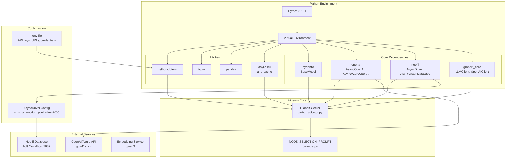
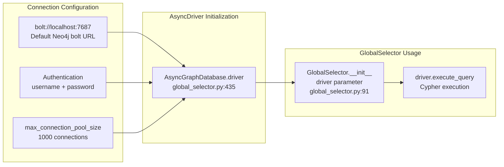
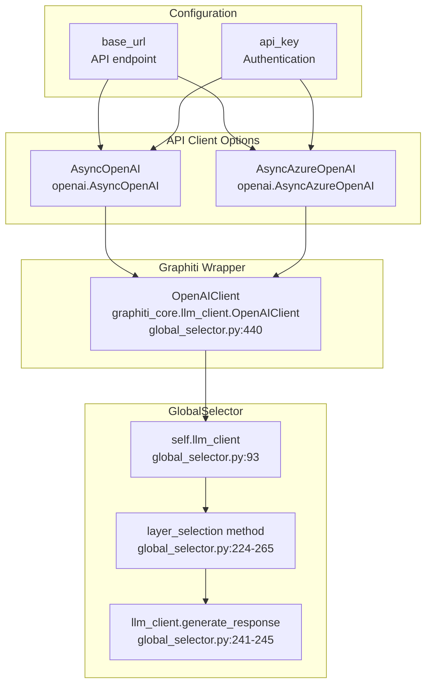
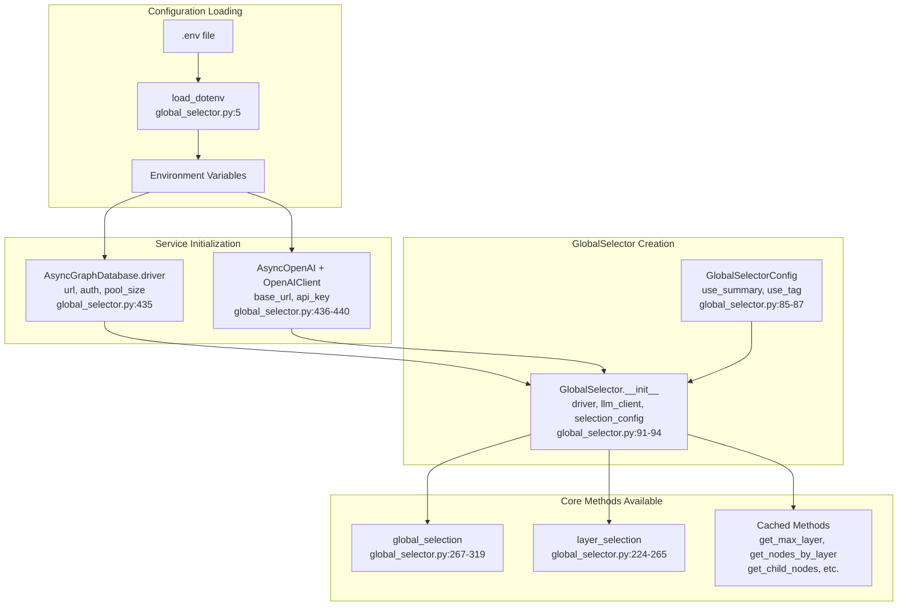

<!-- source: DeepWiki mcp.deepwiki.com · repo microsoft/Mnemis · page 6.1 Installation & Setup · fetched 2026-10-26 -->

# Installation & Setup

<details>
<summary>Relevant source files</summary>

The following files were used as context for generating this wiki page:

- [README.md](README.md)
- [global_selection/global_selector.py](global_selection/global_selector.py)

</details>


This document provides step-by-step instructions for installing and configuring Mnemis, including Python dependencies, Neo4j database setup, and LLM service configuration. By the end of this guide, you will have a working Mnemis environment ready to perform dual-route memory retrieval.

For usage examples and running the system, see [Usage Examples](#6.2). For information about running benchmark evaluations, see [Running Evaluations](#6.3).

---

## Prerequisites

Before installing Mnemis, ensure you have the following:

| Requirement | Version | Purpose |
|------------|---------|---------|
| Python | 3.10+ | Core runtime environment |
| Neo4j Database | 5.x | Graph storage for base and hierarchical graphs |
| OpenAI/Azure API Access | GPT-4.1-mini or compatible | LLM services for System-2 global selection |
| Git | Any recent version | Clone the repository |

**Hardware Recommendations:**
- Minimum 8GB RAM for development
- 16GB+ RAM recommended for benchmark evaluations
- SSD storage for Neo4j database performance

---

## System Architecture Overview

The following diagram shows the installation components and their relationships:

**Installation Component Architecture**



**Sources:** [global_selector.py:1-19](), [README.md:54-56]()

---

## Step 1: Clone Repository

Clone the Mnemis repository from GitHub:

```bash
git clone https://github.com/microsoft/Mnemis.git
cd Mnemis
```

The repository structure includes:

| Directory/File | Purpose |
|---------------|---------|
| `global_selection/` | System-2 global selection implementation |
| `data/` | Benchmark datasets (locomo.json, longmemeval_s.json) |
| `results/` | Evaluation results and memory contexts |
| `README.md` | Overview and citation information |

**Sources:** [README.md:1-72]()

---

## Step 2: Python Environment Setup

### Create Virtual Environment

Create and activate a Python virtual environment:

```bash
# Create virtual environment
python3 -m venv mnemis-env

# Activate on Linux/Mac
source mnemis-env/bin/activate

# Activate on Windows
mnemis-env\Scripts\activate
```

### Install Python Dependencies

Install the required Python packages. The core dependencies are:

```bash
# Core framework (built on Graphiti)
pip install graphiti-core

# Database driver
pip install neo4j

# LLM client
pip install openai

# Data validation and modeling
pip install pydantic

# Performance optimization
pip install async-lru

# Data processing
pip install pandas

# Progress tracking
pip install tqdm

# Environment configuration
pip install python-dotenv
```

**Dependency Mapping:**

| Package | Import Path | Used In | Purpose |
|---------|------------|---------|---------|
| `neo4j` | `neo4j.AsyncDriver` | [global_selector.py:10]() | Async graph database operations |
| `openai` | `openai.AsyncOpenAI` | [global_selector.py:13]() | LLM API client |
| `graphiti-core` | `graphiti_core.llm_client` | [global_selector.py:16]() | Graphiti framework integration |
| `pydantic` | `pydantic.BaseModel` | [global_selector.py:14]() | Type-safe data models |
| `async-lru` | `async_lru.alru_cache` | [global_selector.py:11]() | Async LRU caching |
| `python-dotenv` | `dotenv.load_dotenv` | [global_selector.py:2-5]() | Environment variable loading |

**Sources:** [global_selector.py:1-19]()

---

## Step 3: Neo4j Database Setup

Mnemis requires a Neo4j graph database to store the base graph and hierarchical graph structures.

### Install Neo4j

**Option A: Docker (Recommended for Development)**

```bash
docker run \
    --name neo4j \
    -p 7474:7474 -p 7687:7687 \
    -e NEO4J_AUTH=neo4j/your_password \
    -v $HOME/neo4j/data:/data \
    neo4j:5-community
```

**Option B: Native Installation**

Download and install Neo4j Community Edition 5.x from [neo4j.com/download](https://neo4j.com/download)

### Configure Neo4j Connection

The system uses `AsyncDriver` with the following configuration:

**Neo4j Connection Parameters**



**Sources:** [global_selector.py:432-435](), [global_selector.py:90-94]()

### Verify Neo4j Connection

Test the connection using the Neo4j Browser:
1. Open http://localhost:7474 in your browser
2. Connect with credentials: `neo4j` / `your_password`
3. Run test query: `MATCH (n) RETURN count(n)`

---

## Step 4: LLM Service Configuration

Mnemis uses LLM services for System-2 global selection via the `layer_selection` method.

### OpenAI Configuration

The system supports both OpenAI and Azure OpenAI:

**LLM Client Initialization Flow**



**Sources:** [global_selector.py:436-441](), [global_selector.py:224-245]()

### API Configuration Examples

**For OpenAI:**

```python
from openai import AsyncOpenAI
from graphiti_core.llm_client import OpenAIClient

raw_client = AsyncOpenAI(
    api_key="your-openai-api-key"
)
llm_client = OpenAIClient(client=raw_client)
```

**For Azure OpenAI:**

```python
from openai import AsyncAzureOpenAI
from graphiti_core.llm_client import OpenAIClient

raw_client = AsyncAzureOpenAI(
    azure_endpoint="https://your-resource.openai.azure.com/",
    api_key="your-azure-api-key",
    api_version="2024-02-15-preview"
)
llm_client = OpenAIClient(client=raw_client)
```

**For Custom Endpoint:**

```python
from openai import AsyncOpenAI
from graphiti_core.llm_client import OpenAIClient

raw_client = AsyncOpenAI(
    base_url="your-custom-endpoint-url",
    api_key="EMPTY"  # or your custom key
)
llm_client = OpenAIClient(client=raw_client)
```

**Sources:** [global_selector.py:436-441]()

---

## Step 5: Environment Configuration

Create a `.env` file in the project root to store configuration:

```bash
# Neo4j Configuration
NEO4J_URL=bolt://localhost:7687
NEO4J_USER=neo4j
NEO4J_PASSWORD=your_password

# OpenAI Configuration
OPENAI_API_KEY=your-openai-api-key
OPENAI_BASE_URL=https://api.openai.com/v1

# Azure OpenAI Configuration (if using Azure)
AZURE_OPENAI_ENDPOINT=https://your-resource.openai.azure.com/
AZURE_OPENAI_API_KEY=your-azure-api-key
AZURE_OPENAI_API_VERSION=2024-02-15-preview

# Model Configuration
GRAPH_MODEL=gpt-4-turbo-preview
ANSWER_MODEL=gpt-41-mini
GRADER_MODEL=gpt-41-mini

# Embedding Configuration
EMBEDDING_MODEL=qwen3
EMBEDDING_PRECISION=FLOAT32
```

The system loads environment variables using `python-dotenv`:

```python
from dotenv import load_dotenv
load_dotenv()  # Line 5 of global_selector.py
```

**Sources:** [global_selector.py:2-5]()

---

## Step 6: Initialize GlobalSelector

After configuration, initialize the `GlobalSelector` class:

**GlobalSelector Initialization Pattern**



**Sources:** [global_selector.py:85-94](), [global_selector.py:432-441]()

### Example Initialization Code

```python
import asyncio
from neo4j import AsyncGraphDatabase
from openai import AsyncOpenAI
from graphiti_core.llm_client import OpenAIClient
from global_selection.global_selector import GlobalSelector, GlobalSelectorConfig

async def main():
    # Initialize Neo4j driver
    driver = AsyncGraphDatabase.driver(
        url='bolt://localhost:7687',
        auth=('neo4j', 'your_password'),
        max_connection_pool_size=1000
    )
    
    # Initialize LLM client
    raw_client = AsyncOpenAI(
        base_url="your-api-endpoint",
        api_key="your-api-key"
    )
    llm_client = OpenAIClient(client=raw_client)
    
    # Create GlobalSelector with configuration
    config = GlobalSelectorConfig(
        use_summary=False,  # Default
        use_tag=True        # Default
    )
    selector = GlobalSelector(
        driver=driver,
        llm_client=llm_client,
        selection_config=config
    )
    
    # Ready to use
    print("GlobalSelector initialized successfully")

if __name__ == "__main__":
    asyncio.run(main())
```

**Sources:** [global_selector.py:431-449]()

---

## Step 7: Verification

### Test Global Selection

Verify the installation by running a test query:

```python
async def test_global_selection():
    # (Using selector from previous step)
    
    test_query = "What topics did we discuss yesterday?"
    test_group_id = "test_user_0"
    
    results, time_stats = await selector.global_selection(
        query=test_query,
        group_id=test_group_id
    )
    
    print(f"Retrieved {len(results['episodes'])} episodes")
    print(f"Retrieved {len(results['edges'])} edges")
    print(f"Retrieved {len(results['nodes'])} nodes")
    print(f"Time stats: {time_stats}")
```

Expected output structure:
```json
{
  "episodes": [...],
  "edges": [...],
  "nodes": [...],
  "time_stats": {
    "init": 0.01,
    "layer_selection": 2.45,
    "one_hop_neighbors": 0.33
  }
}
```

**Sources:** [global_selector.py:267-319]()

### Verify Caching

The system uses `alru_cache` with 500 entries per query type. Verify caching is working:

```python
# First call - should hit database
await selector.get_max_layer(group_id="test_user_0")

# Second call - should hit cache (faster)
await selector.get_max_layer(group_id="test_user_0")

# Clear cache if needed
selector.clear_cache()
```

**Cache Configuration:**

| Cached Method | Cache Size | Line Reference |
|--------------|-----------|----------------|
| `get_max_layer` | 500 | [global_selector.py:103-110]() |
| `get_nodes_by_layer` | 500 | [global_selector.py:112-118]() |
| `get_child_nodes` | 500 | [global_selector.py:120-127]() |
| `get_all_descendants` | 500 | [global_selector.py:144-151]() |
| `get_one_hop_neighbors` | 500 | [global_selector.py:196-201]() |

**Sources:** [global_selector.py:20](), [global_selector.py:96-101](), [global_selector.py:103-201]()

---

## Common Configuration Issues

### Issue: Neo4j Connection Failed

**Error:** `ServiceUnavailable: Unable to retrieve routing information`

**Solutions:**
1. Verify Neo4j is running: `docker ps` or check system services
2. Check connection URL is `bolt://localhost:7687` (not `http://`)
3. Verify authentication credentials
4. Ensure firewall allows port 7687

### Issue: LLM API Rate Limits

**Error:** `RateLimitError` or slow responses

**Solutions:**
1. Adjust `max_concurrent` in batch processing (default: 10 in [global_selector.py:389]())
2. Use connection pooling: `max_connection_pool_size=1000` [global_selector.py:435]()
3. Consider Azure deployment for higher quotas

### Issue: Out of Memory

**Error:** `MemoryError` during large evaluations

**Solutions:**
1. Reduce `batch_size` in evaluation functions [global_selector.py:390]()
2. Adjust cache size `CACHE_SIZE_PER_QUERY` [global_selector.py:20]()
3. Process datasets in smaller chunks

**Sources:** [global_selector.py:366-429]()

---

## Configuration Summary

**Complete System Configuration Table:**

| Component | Configuration Parameter | Default Value | Code Reference |
|-----------|------------------------|---------------|----------------|
| Neo4j URL | `url` | `bolt://localhost:7687` | [global_selector.py:432]() |
| Neo4j Auth | `auth` | `(username, password)` | [global_selector.py:433-434]() |
| Connection Pool | `max_connection_pool_size` | 1000 | [global_selector.py:435]() |
| Cache Size | `CACHE_SIZE_PER_QUERY` | 500 | [global_selector.py:20]() |
| Batch Mode | `mode` | `'batch'` | [global_selector.py:269]() |
| Max Concurrent | `max_concurrent` | 5-10 | [global_selector.py:366-389]() |
| Use Summary | `use_summary` | `False` | [global_selector.py:86]() |
| Use Tag | `use_tag` | `True` | [global_selector.py:87]() |
| Model Size | `model_size` | `ModelSize.large` | [global_selector.py:244]() |

**Sources:** [global_selector.py:20](), [global_selector.py:85-94](), [global_selector.py:267-269](), [global_selector.py:432-435]()

---

## Next Steps

After completing installation and setup:

1. **Load Benchmark Data**: See [Running Evaluations](#6.3) for dataset preparation
2. **Run Example Queries**: See [Usage Examples](#6.2) for code samples
3. **Understand System Architecture**: See [Architecture Overview](#2) for system design
4. **Review Global Selection**: See [System-2 Global Selection](#2.3) for algorithmic details

**Related Documentation:**
- [GlobalSelector Class Reference](#3.1) - Complete API documentation
- [Configuration Options](#3.4) - Advanced configuration settings
- [Performance Optimization](#3.5) - Caching and batch processing strategies

**Sources:** [README.md:53-56](), [global_selector.py:1-453]()

---

