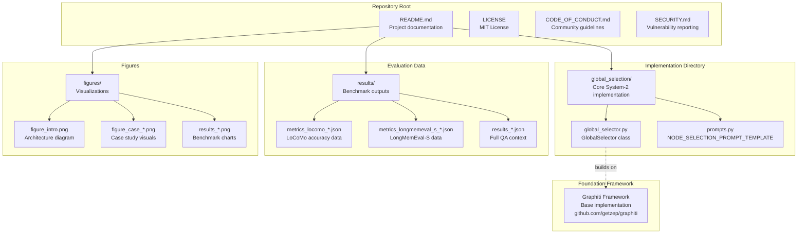
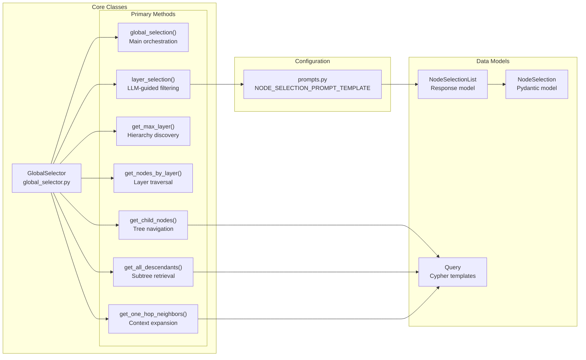
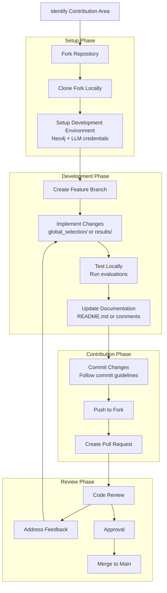
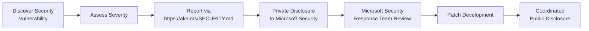
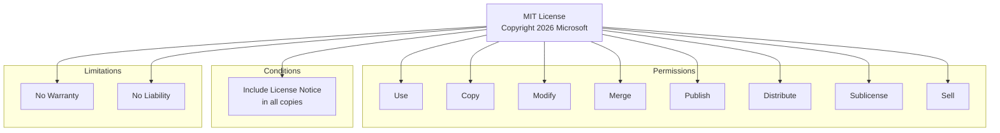

<!-- source: DeepWiki mcp.deepwiki.com · repo microsoft/Mnemis · page 8 Contributing · fetched 2026-10-26 -->

# Contributing

<details>
<summary>Relevant source files</summary>

The following files were used as context for generating this wiki page:

- [CODE_OF_CONDUCT.md](CODE_OF_CONDUCT.md)
- [LICENSE](LICENSE)
- [README.md](README.md)
- [SECURITY.md](SECURITY.md)

</details>


This document provides information for contributors to the Mnemis project, including community guidelines, security reporting procedures, licensing terms, and development practices. For installation and usage instructions, see [Getting Started](#6). For technical implementation details, see [Implementation Guide](#3).

## Purpose and Scope

This page serves as the central resource for contributors to the Mnemis dual-route memory framework. It covers:

- Community participation guidelines and code of conduct (detailed in [Code of Conduct](#8.1))
- Security vulnerability reporting procedures (detailed in [Security Policy](#8.2))
- Licensing terms for the codebase (detailed in [License](#8.3))
- Development workflow and contribution best practices
- Codebase structure for new contributors

## Overview

Mnemis is an open-source project under the MIT License maintained by Microsoft. The project welcomes contributions in several areas:

| Contribution Area | Description | Key Files/Directories |
|------------------|-------------|----------------------|
| Core Implementation | System-2 Global Selection logic, optimization | `global_selection/` |
| Evaluation Framework | Benchmark datasets, metrics, test cases | `results/` |
| Documentation | Wiki pages, code comments, examples | `README.md` |
| Research Extensions | New retrieval methods, graph schemas | - |
| Performance Optimization | Caching, batch processing, concurrency | `global_selection/` |

Sources: [README.md:1-72]()

## Repository Structure

The following diagram maps the key areas of the codebase relevant to contributors:



Sources: [README.md:54-56]()

## Development Setup

### Prerequisites

To contribute to Mnemis, developers need:

| Component | Purpose | Configuration |
|-----------|---------|--------------|
| Python Environment | Core development | Python 3.8+ |
| Neo4j Database | Graph storage | AsyncDriver with connection pool |
| LLM Services | GPT-4.1-mini access | OpenAI or Azure API credentials |
| Embedding Services | qwen3 embedder | Precision.FLOAT32 |
| Graphiti Framework | Base implementation | Installed as dependency |

### Key Implementation Files

Contributors working on core functionality should familiarize themselves with:



Sources: [README.md:54-56]()

## Contribution Workflow

### Standard Development Process



Sources: [README.md:1-72](), [CODE_OF_CONDUCT.md:1-10]()

### Contribution Categories

#### 1. Core Implementation Contributions

Contributions to the System-2 Global Selection mechanism:

- **Location**: `global_selection/` directory
- **Key Classes**: `GlobalSelector`
- **Key Methods**: `global_selection()`, `layer_selection()`, caching functions
- **Testing**: Run evaluations on LoCoMo and LongMemEval-S benchmarks
- **Performance**: Maintain or improve caching efficiency and batch processing

#### 2. Evaluation Contributions

Contributions to benchmark evaluation and metrics:

- **Location**: `results/` directory
- **File Types**: `metrics_*.json` (aggregated accuracy), `results_*.json` (full context)
- **Benchmarks**: LoCoMo (1,986 questions), LongMemEval-S (500 questions)
- **Validation**: Verify accuracy scores match expected performance (93.9% LoCoMo, 91.6% LME-S)

#### 3. Documentation Contributions

- **Primary**: [README.md:1-72]()
- **Guidelines**: [CODE_OF_CONDUCT.md:1-10]()
- **Security**: [SECURITY.md:1-14]()
- **License**: [LICENSE:1-22]()

#### 4. Research Extensions

Extensions to the dual-route memory framework:

| Extension Area | Implementation Location | Related Pages |
|---------------|------------------------|---------------|
| Alternative retrieval methods | `global_selection/` | [System-2 Global Selection](#2.3) |
| Graph schema modifications | Neo4j schema | [Graph Database Schema](#3.2) |
| Prompt engineering | `prompts.py` | [Prompt Engineering](#3.3) |
| Merge strategies | RAG_GRAPH logic | [RAG_GRAPH Merge Strategy](#2.4) |
| Performance optimization | Caching, batch processing | [Performance Optimization](#3.5) |

Sources: [README.md:54-56]()

## Community Guidelines

Mnemis follows the Microsoft Open Source Code of Conduct. All contributors must adhere to these community standards.

### Code of Conduct Summary

The project has adopted the [Microsoft Open Source Code of Conduct](https://opensource.microsoft.com/codeofconduct). Key principles include:

- **Respect**: Treat all community members with respect
- **Collaboration**: Work together constructively
- **Transparency**: Be open about intentions and processes
- **Responsibility**: Take ownership of contributions

For complete details, see [Code of Conduct](#8.1).

**Resources**:
- Full guidelines: [CODE_OF_CONDUCT.md:3]()
- FAQ: [CODE_OF_CONDUCT.md:8]()
- Contact: opencode@microsoft.com [CODE_OF_CONDUCT.md:9]()
- Employee support: [CODE_OF_CONDUCT.md:10]()

Sources: [CODE_OF_CONDUCT.md:1-10]()

## Security Reporting

Microsoft takes security seriously across all repositories.

### Reporting Vulnerabilities

**Important**: Do not report security vulnerabilities through public GitHub issues [SECURITY.md:8]().



### Security Process

1. **Discovery**: Identify a potential security vulnerability in Mnemis
2. **Private Reporting**: Report via Microsoft's centralized security portal at [https://aka.ms/SECURITY.md](https://aka.ms/SECURITY.md) [SECURITY.md:12]()
3. **Verification**: Microsoft security team verifies the report
4. **Resolution**: Development of patches and mitigations
5. **Disclosure**: Coordinated public disclosure after fix is available

For complete security reporting procedures, see [Security Policy](#8.2).

Sources: [SECURITY.md:1-14]()

## License

Mnemis is licensed under the MIT License, providing permissive open-source terms.

### License Summary



### Key Terms

| Aspect | Terms |
|--------|-------|
| Copyright | Copyright (c) 2026 Microsoft [LICENSE:3]() |
| Permissions | Use, copy, modify, merge, publish, distribute, sublicense, sell [LICENSE:8]() |
| Condition | Include copyright notice and license in all copies [LICENSE:10-11]() |
| Warranty | Provided "AS IS" without warranty [LICENSE:14]() |
| Liability | No liability for damages [LICENSE:18-20]() |

For complete license text, see [License](#8.3).

Sources: [LICENSE:1-22]()

## Development Best Practices

### Code Quality Standards

Contributors should follow these practices when modifying the codebase:

#### Performance Considerations

| Component | Best Practice | Implementation |
|-----------|---------------|----------------|
| Caching | Use `alru_cache` for expensive operations | 500-entry cache per query |
| Batch Processing | Prefer batch queries over individual calls | `mp` and `batch` modes |
| Concurrency | Use `asyncio` for I/O-bound operations | AsyncDriver connection pool |
| Database Queries | Optimize Cypher queries | Indexed lookups, parameterized queries |

#### Testing Requirements

When contributing to `global_selection/`:

1. **Unit Tests**: Test individual methods in isolation
2. **Integration Tests**: Verify end-to-end `global_selection()` flow
3. **Benchmark Tests**: Run on LoCoMo and LongMemEval-S subsets
4. **Performance Tests**: Measure query latency and cache hit rates

#### Documentation Standards

All code contributions should include:

- **Docstrings**: For all public classes and methods
- **Type Hints**: Using Python type annotations
- **Comments**: For complex logic or algorithms
- **Examples**: Usage examples for new features

Sources: [README.md:54-56]()

## Research Foundation

Mnemis is based on research published in the paper "Mnemis: Dual-Route Retrieval on Hierarchical Graphs for Long-Term LLM Memory".

### Paper Information

- **arXiv**: 2602.15313 [README.md:7]()
- **Hugging Face**: https://huggingface.co/papers/2602.15313 [README.md:10]()
- **Authors**: Zihao Tang, Xin Yu, Ziyu Xiao, Zengxuan Wen, Zelin Li, Jiaxi Zhou, Hualei Wang, Haohua Wang, Haizhen Huang, Weiwei Deng, Feng Sun, Qi Zhang [README.md:64]()

### Citation

Contributors publishing work based on Mnemis should cite:

```
@misc{tang2026mnemisdualrouteretrievalhierarchical,
      title={Mnemis: Dual-Route Retrieval on Hierarchical Graphs for Long-Term LLM Memory}, 
      author={Zihao Tang and Xin Yu and Ziyu Xiao and Zengxuan Wen and Zelin Li and Jiaxi Zhou and Hualei Wang and Haohua Wang and Haizhen Huang and Weiwei Deng and Feng Sun and Qi Zhang},
      year={2026},
      eprint={2602.15313},
      archivePrefix={arXiv},
      primaryClass={cs.CL},
      url={https://arxiv.org/abs/2602.15313}, 
}
```

For theoretical background and comparison with existing approaches, see [Research Background](#7).

Sources: [README.md:59-71]()

## Implementation Foundation

Mnemis is implemented on top of the [Graphiti](https://github.com/getzep/graphiti) framework [README.md:54](). Contributors should be familiar with:

- Graphiti's base graph operations
- Entity extraction and memory creation
- Neo4j schema conventions used by Graphiti
- AsyncDriver patterns for graph database access

The `global_selection/` directory contains Mnemis-specific extensions for System-2 Global Selection [README.md:56]().

Sources: [README.md:54-56]()

## Results and Evaluation Data

The `results/` directory contains comprehensive evaluation outputs [README.md:56]():

### Results Directory Structure

| File Pattern | Contents | Purpose |
|-------------|----------|---------|
| `metrics_locomo_*.json` | LoCoMo accuracy by category | Aggregated performance metrics |
| `metrics_longmemeval_s_*.json` | LongMemEval-S accuracy by type | Question type breakdown |
| `results_locomo_*.json` | Full QA context for LoCoMo | Evidence, facts, entities, answers |
| `results_longmemeval_s_*.json` | Full QA context for LME-S | Complete retrieval context |

### Configuration Variants

Result files include different configuration experiments:

- `ragtopk10_gtopk20`: RAG top-k=10, Graph top-k=20
- `ragtopk30_gtopk60`: RAG top-k=30, Graph top-k=60

Contributors adding new configurations should follow this naming convention. For detailed analysis, see [Configuration Impact Analysis](#4.4).

Sources: [README.md:56]()

## Additional Resources

### Related Wiki Pages

- [Getting Started](#6): Installation and setup instructions
- [Implementation Guide](#3): Technical implementation details
- [GlobalSelector Class Reference](#3.1): API documentation
- [Performance Optimization](#3.5): Caching and batch processing
- [Evaluation & Results](#4): Benchmark methodology and scores

### External Resources

- **Graphiti Repository**: https://github.com/getzep/graphiti [README.md:54]()
- **Microsoft Open Source**: https://opensource.microsoft.com/codeofconduct/ [CODE_OF_CONDUCT.md:3]()
- **Security Portal**: https://aka.ms/SECURITY.md [SECURITY.md:12]()
- **Mnemis Paper**: https://arxiv.org/abs/2602.15313 [README.md:7]()

### Contact

For questions or concerns not covered by documentation:

- **General Questions**: Create a GitHub issue
- **Code of Conduct**: opencode@microsoft.com [CODE_OF_CONDUCT.md:9]()
- **Security Issues**: Use Microsoft Security Portal [SECURITY.md:12]()
- **Microsoft Employees**: aka.ms/opensource/moderation-support [CODE_OF_CONDUCT.md:10]()

Sources: [README.md:1-72](), [CODE_OF_CONDUCT.md:1-10](), [SECURITY.md:1-14]()

---

