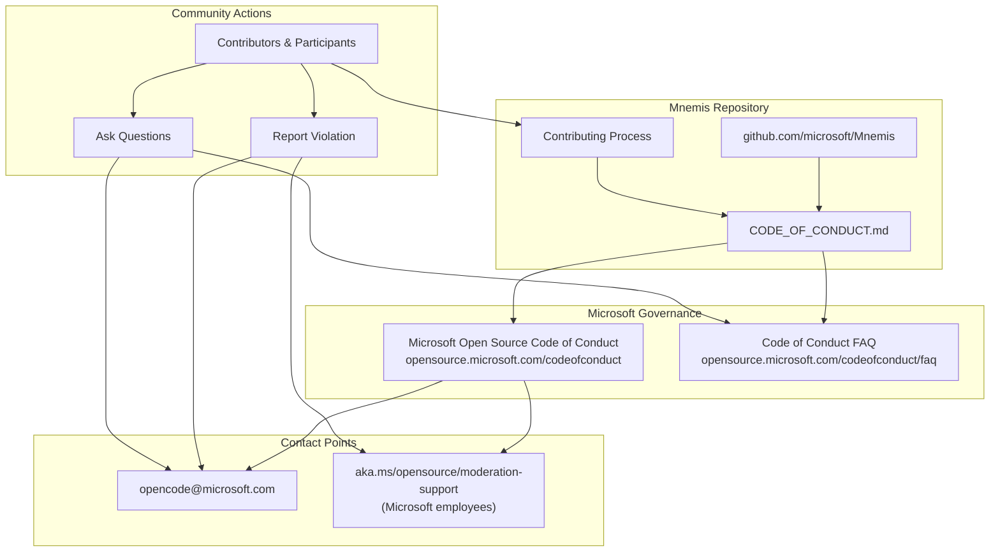
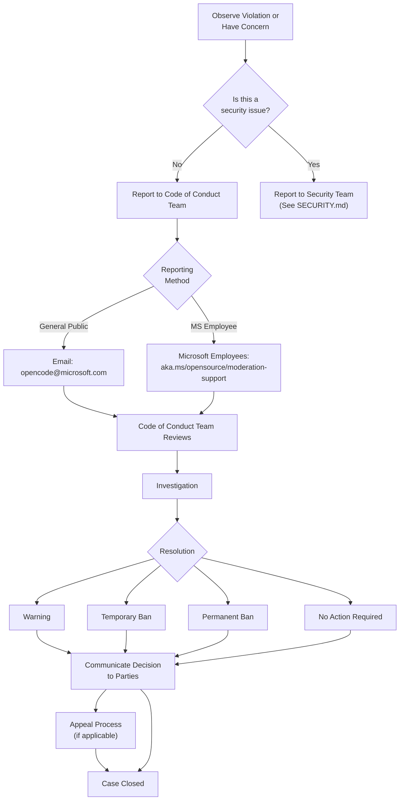
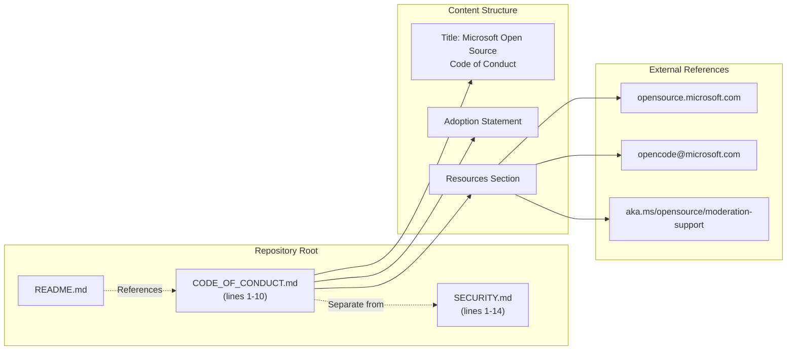
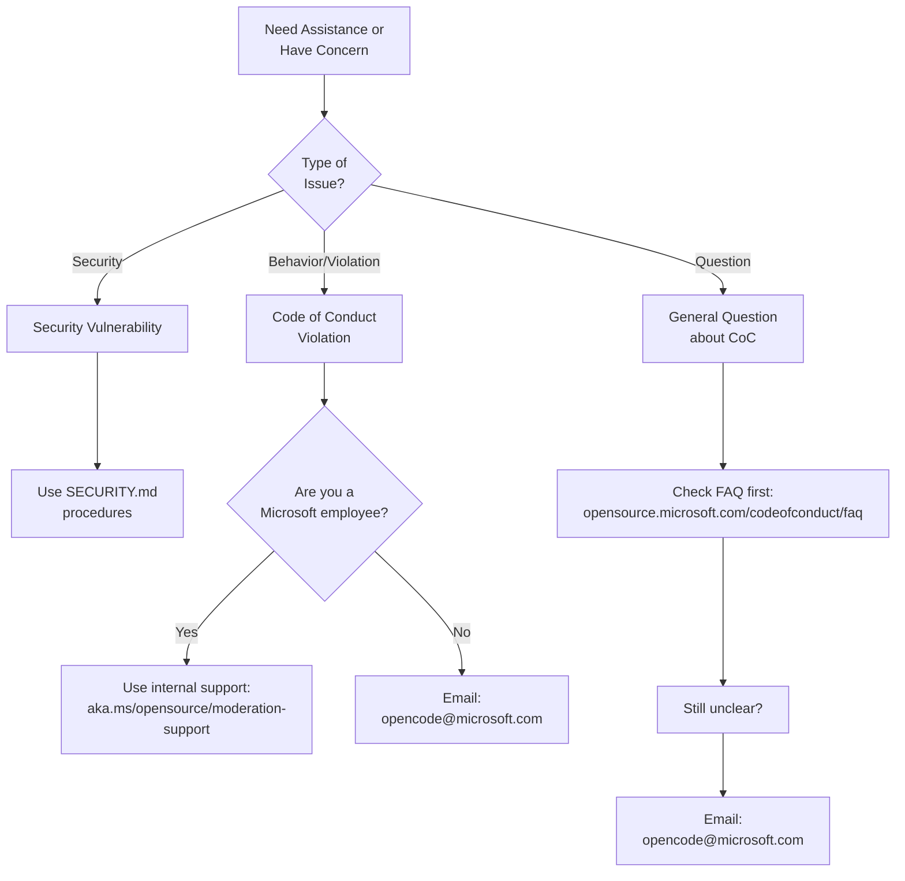

<!-- source: DeepWiki mcp.deepwiki.com · repo microsoft/Mnemis · page 8.1 Code of Conduct · fetched 2026-10-26 -->

# Code of Conduct

Relevant source files

The following files were used as context for generating this wiki page:

- [CODE_OF_CONDUCT.md](CODE_OF_CONDUCT.md)
- [SECURITY.md](SECURITY.md)

## Purpose and Scope

This page documents the community standards and behavioral expectations for contributors and participants in the Mnemis project. It outlines the adopted code of conduct policies, reporting procedures for violations, and available resources for support.

For information about security vulnerability reporting, see [Security Policy](#8.2). For general contribution guidelines and development practices, see [Contributing](#8).

**Sources:** [CODE_OF_CONDUCT.md:1-10]()

---

## Adopted Code of Conduct

The Mnemis project has adopted the **Microsoft Open Source Code of Conduct**. This is a standardized code of conduct used across all Microsoft open source projects to ensure consistent community standards and expectations.

The code of conduct defines acceptable behavior in all project spaces including:
- GitHub repositories (issues, pull requests, discussions)
- Code reviews and technical discussions
- Community forums and communication channels
- Project-related events and meetings

**Sources:** [CODE_OF_CONDUCT.md:1-3]()

---

## Code of Conduct Architecture

The following diagram illustrates the organizational structure of the code of conduct governance and how it integrates with the Mnemis project workflow:

**Diagram: Code of Conduct Governance Structure**

This diagram shows how the `CODE_OF_CONDUCT.md` file in the repository references the centralized Microsoft Open Source Code of Conduct and provides pathways for reporting and support.

**Sources:** [CODE_OF_CONDUCT.md:1-10]()

---

## Reporting and Resolution Process

The following diagram illustrates the process flow for reporting code of conduct violations and how they are handled:

**Diagram: Violation Reporting and Resolution Flow**

This flowchart demonstrates the distinction between security issues (covered in [SECURITY.md:1-14]()) and code of conduct violations, along with the complete resolution process.

**Sources:** [CODE_OF_CONDUCT.md:1-10](), [SECURITY.md:8]()

---

## Resources and Contact Information

The following table provides a comprehensive reference of all code of conduct resources and their purposes:

| Resource | URL/Contact | Purpose | Audience |
|----------|-------------|---------|----------|
| **Microsoft Open Source Code of Conduct** | [opensource.microsoft.com/codeofconduct](https://opensource.microsoft.com/codeofconduct) | Full text of the adopted code of conduct | All contributors |
| **Code of Conduct FAQ** | [opensource.microsoft.com/codeofconduct/faq](https://opensource.microsoft.com/codeofconduct/faq) | Frequently asked questions about policies and procedures | All contributors |
| **General Contact** | opencode@microsoft.com | Email for questions, concerns, or reporting violations | All contributors |
| **Microsoft Employee Support** | [aka.ms/opensource/moderation-support](https://aka.ms/opensource/moderation-support) | Internal moderation support channel | Microsoft employees only |

**Sources:** [CODE_OF_CONDUCT.md:5-10]()

---

## File Organization

The code of conduct documentation is organized as follows in the repository:

**Diagram: Code of Conduct File Structure**

The `CODE_OF_CONDUCT.md` file is a standalone document at the repository root, distinct from `SECURITY.md` which handles vulnerability reporting.

**Sources:** [CODE_OF_CONDUCT.md:1-10]()

---

## Key Principles

While the full text of the Microsoft Open Source Code of Conduct is maintained at the official Microsoft site, the key principles include:

| Principle | Description |
|-----------|-------------|
| **Respectful Communication** | Using welcoming and inclusive language |
| **Professional Behavior** | Accepting constructive criticism gracefully |
| **Focus on Community** | Prioritizing what is best for the community |
| **Empathy** | Showing empathy towards other community members |
| **Accountability** | Taking responsibility for mistakes and learning from them |

These principles apply to all interactions within the Mnemis project, including code reviews, issue discussions, pull request feedback, and any other project-related communication.

**Sources:** [CODE_OF_CONDUCT.md:3]()

---

## Enforcement

The Microsoft Open Source Code of Conduct includes enforcement guidelines that project maintainers and the code of conduct team follow. Key aspects include:

1. **Scope**: The code of conduct applies to all project spaces and when representing the project in public spaces
2. **Reporting**: All complaints are reviewed and investigated promptly and fairly
3. **Confidentiality**: Respecting the privacy and security of the reporter
4. **Proportional Response**: Enforcement actions are proportional to the violation

For questions about enforcement or specific situations, contact `opencode@microsoft.com` as specified in [CODE_OF_CONDUCT.md:9]().

**Sources:** [CODE_OF_CONDUCT.md:7-10]()

---

## Integration with Contributing Workflow

The following table shows how the code of conduct integrates with different contribution activities:

| Activity | Code of Conduct Application |
|----------|----------------------------|
| **Opening Issues** | Describe problems respectfully; avoid accusatory language |
| **Pull Requests** | Respond professionally to feedback; explain decisions clearly |
| **Code Reviews** | Provide constructive criticism; focus on code, not people |
| **Discussions** | Maintain respectful dialogue; consider diverse perspectives |
| **Disagreements** | Engage in good faith; seek consensus; escalate appropriately if needed |

All contributors to Mnemis are expected to have read and agreed to follow the Microsoft Open Source Code of Conduct before participating in the project.

**Sources:** [CODE_OF_CONDUCT.md:1-10]()

---

## Contact Decision Tree

The following diagram helps determine the appropriate contact method for different scenarios:

**Diagram: Contact Method Decision Tree**

This decision tree helps users quickly identify the correct reporting channel based on their specific situation.

**Sources:** [CODE_OF_CONDUCT.md:5-10](), [SECURITY.md:8]()

---

## Additional Notes

### Do Not Report Security Issues as Code of Conduct Violations

Security vulnerabilities should **never** be reported through the code of conduct channels. Security issues have a separate reporting process detailed in [SECURITY.md:1-14]() and page [Security Policy](#8.2). Mixing security reports with code of conduct issues can delay critical security fixes.

### Public Disclosure

Code of conduct violations should **not** be reported through public GitHub issues. All reports should be made privately through the designated contact channels to protect the privacy of all parties involved.

### Microsoft Employee Resources

Microsoft employees have access to additional internal resources through `aka.ms/opensource/moderation-support` for guidance on code of conduct matters specific to their role as Microsoft representatives.

**Sources:** [CODE_OF_CONDUCT.md:8-10](), [SECURITY.md:8]()

---

## Summary

The Mnemis project operates under the Microsoft Open Source Code of Conduct to ensure a welcoming, inclusive, and professional environment for all contributors. Key resources are documented in [CODE_OF_CONDUCT.md:1-10]() with clear pathways for reporting violations, asking questions, and accessing support.

| File | Lines | Purpose |
|------|-------|---------|
| `CODE_OF_CONDUCT.md` | 1-10 | Primary code of conduct documentation |
| External reference | N/A | Full policy at opensource.microsoft.com/codeofconduct |
| Contact: opencode@microsoft.com | N/A | General questions and reporting |
| Contact: aka.ms/opensource/moderation-support | N/A | Microsoft employee support |

**Sources:** [CODE_OF_CONDUCT.md:1-10]()

---

