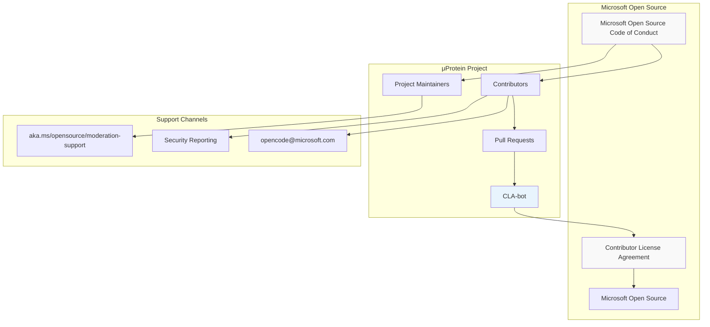
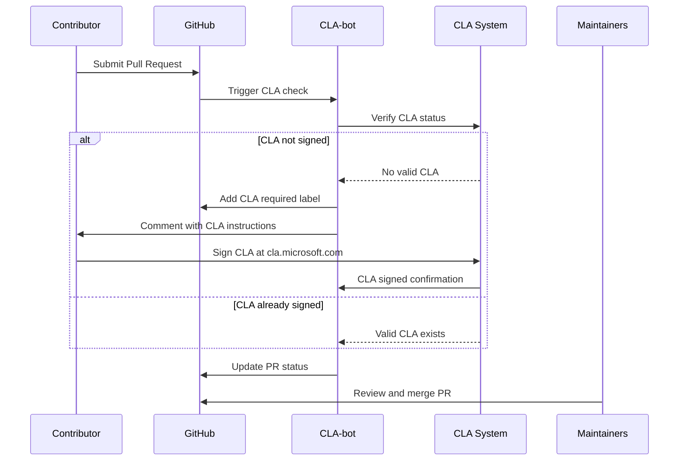
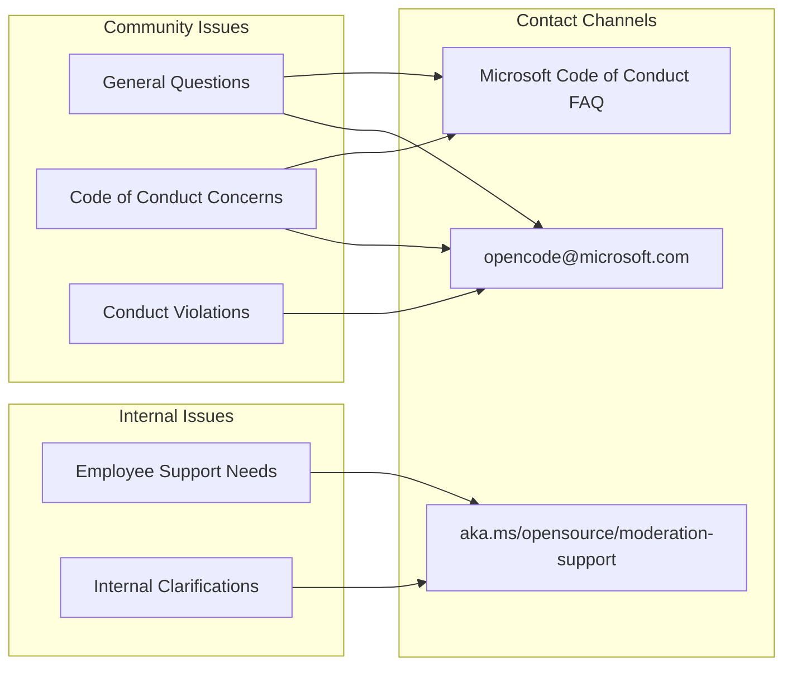

<!-- source: DeepWiki mcp.deepwiki.com · repo microsoft/Mu-Protein · page 7 Project Information · fetched 2026-10-26 -->

# Project Information

Relevant source files

The following files were used as context for generating this wiki page:

- [CODE_OF_CONDUCT.md](CODE_OF_CONDUCT.md)
- [CONTRIBUTING.md](CONTRIBUTING.md)

This document covers project governance, contribution guidelines, security policies, and community standards for the μProtein framework. It provides essential information for contributors, maintainers, and users about how to participate in the project and report issues.

For technical setup and configuration information, see [Repository Configuration](#6.1). For detailed API documentation and development guides, see [Training & Development](#4).

## Overview

The μProtein framework is an open-source Microsoft project that follows established Microsoft Open Source policies and procedures. The project maintains specific standards for contributions, security reporting, and community interaction to ensure a collaborative and secure development environment.

### Project Governance Structure

**Sources:** [CONTRIBUTING.md:1-15](), [CODE_OF_CONDUCT.md:1-11]()

## Contribution Process

The μProtein project welcomes contributions and suggestions from the community. All contributions are subject to Microsoft's standard open source contribution process.

### Contributor License Agreement (CLA)

All contributors must agree to a Contributor License Agreement before their contributions can be accepted. This process is automated through the CLA-bot system.

| Component | Purpose | Automation |
|-----------|---------|------------|
| `CLA` | Legal agreement granting rights to use contributions | Required for all contributors |
| `CLA-bot` | Automated verification system | Decorates PRs with labels and instructions |
| `microsoft.com/cla` | CLA signing portal | One-time requirement across all Microsoft repos |

The CLA process ensures that:
- Contributors have the right to submit their contributions
- Microsoft receives necessary rights to use the contributions
- The legal status of contributions is clear and documented

**Sources:** [CONTRIBUTING.md:3-10]()

### Contribution Workflow

**Sources:** [CONTRIBUTING.md:8-10]()

## Community Standards

The μProtein project adheres to the Microsoft Open Source Code of Conduct, which establishes expectations for participation and defines consequences for unacceptable behavior.

### Code of Conduct Implementation

| Resource | Purpose | Contact Method |
|----------|---------|----------------|
| `Microsoft Open Source Code of Conduct` | Primary conduct guidelines | [opensource.microsoft.com/codeofconduct](https://opensource.microsoft.com/codeofconduct) |
| `Code of Conduct FAQ` | Common questions and clarifications | [opensource.microsoft.com/codeofconduct/faq](https://opensource.microsoft.com/codeofconduct/faq) |
| `opencode@microsoft.com` | General questions and concerns | Email contact |
| `aka.ms/opensource/moderation-support` | Employee-specific support | Internal Microsoft link |

**Sources:** [CODE_OF_CONDUCT.md:3-10](), [CONTRIBUTING.md:12-14]()

### Contact Points and Support

**Sources:** [CODE_OF_CONDUCT.md:8-10]()

## Project Resources

The μProtein project maintains several key resources for contributors and users:

### Documentation Structure

| Document | Purpose | Key Information |
|----------|---------|-----------------|
| `CONTRIBUTING.md` | Contribution guidelines | CLA requirements, submission process |
| `CODE_OF_CONDUCT.md` | Community standards | Behavior expectations, contact information |
| `README.md` | Project overview | Architecture, usage, installation |
| `SECURITY.md` | Security policies | Vulnerability reporting procedures |

### Repository Standards

The project follows Microsoft's standard practices for open source repositories:

- **License Management**: All contributions are subject to the project license
- **Security Reporting**: Dedicated channels for security vulnerability reports
- **Community Guidelines**: Enforced through automated and manual moderation
- **Legal Compliance**: CLA requirement ensures legal clarity for all contributions

**Sources:** [CONTRIBUTING.md:1-15](), [CODE_OF_CONDUCT.md:1-11]()

## Getting Help

For different types of assistance, use the appropriate contact method:

### Support Matrix

| Issue Type | Recommended Action | Contact |
|------------|-------------------|---------|
| General questions about contributions | Review FAQ first, then contact | `opencode@microsoft.com` |
| Code of conduct concerns | Report directly | `opencode@microsoft.com` |
| Technical issues with the framework | Create GitHub issue | Repository issue tracker |
| Security vulnerabilities | Follow security reporting procedures | See [Security](#7.2) |
| Microsoft employee specific issues | Use internal support | `aka.ms/opensource/moderation-support` |

The project maintains these channels to ensure appropriate routing of different types of inquiries and to provide timely assistance to contributors and users.

**Sources:** [CODE_OF_CONDUCT.md:8-10](), [CONTRIBUTING.md:13-14]()

---

