# Page: Overview

# Overview

<details>
<summary>Relevant source files</summary>

The following files were used as context for generating this wiki page:

- [README.md](README.md)

</details>


This document provides an introduction to the μProtein framework, summarizing its architecture, core components, and purpose for accelerating protein engineering through machine learning. The framework consists of three main systems: PMLM (Protein Masked Language Model), μFormer (fitness landscape modeling), and μSearch (reinforcement learning optimization).

For detailed component documentation, see [System Architecture](#2). For installation and usage instructions, see [Getting Started](#3). For API documentation of specific classes and functions, see [API Reference](#5).

## Framework Purpose

μProtein is a general framework designed to accelerate protein engineering by integrating deep learning models for accurate mutational effect prediction with reinforcement learning algorithms for efficient navigation of protein fitness landscapes. The framework addresses the challenge of protein optimization by providing a systematic three-stage approach: foundation modeling, fitness prediction, and guided optimization.

**Sources:** [README.md:7-8]()

## Three-Stage Architecture

The μProtein framework implements a sequential three-stage pipeline where each component builds upon the previous stage's outputs:

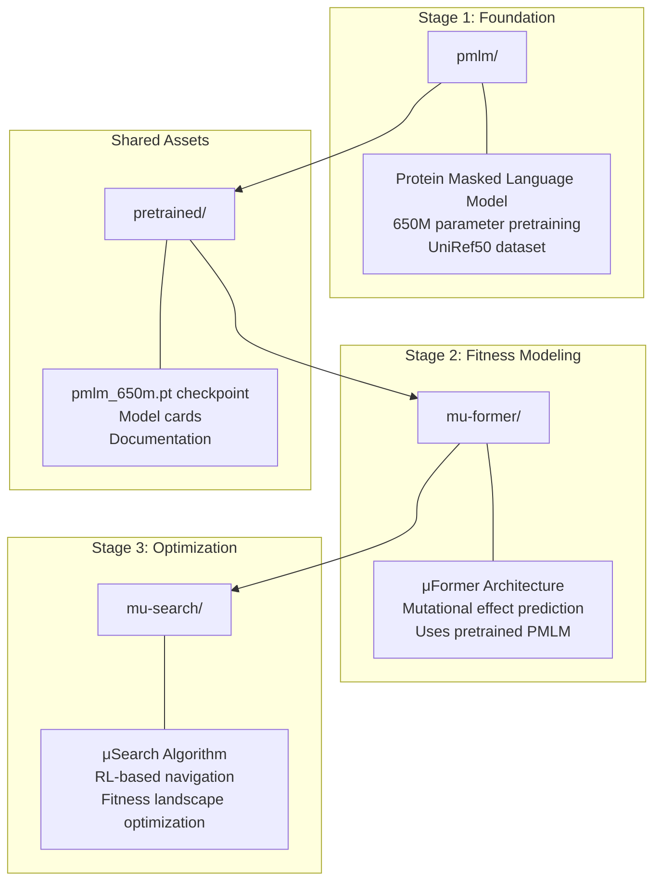

**Sources:** [README.md:12-17]()

## Component Overview

### PMLM Pretraining System

The `pmlm/` directory contains the Protein Masked Language Model pretraining infrastructure. This system creates the foundational understanding of protein sequences through self-supervised learning on large-scale protein databases.

| Component | Purpose | Key Files |
|-----------|---------|-----------|
| Training Scripts | PMLM model pretraining | `pmlm/src/` |
| Data Processing | UniRef50 preprocessing | `pmlm/script/pretrain.sh` |
| Model Output | 650M parameter checkpoint | `pretrained/pmlm_650m.pt` |

### μFormer Fitness Modeling

The `mu-former/` directory implements the μFormer architecture for predicting mutational effects on protein fitness. This component transforms the pretrained language model into a specialized oracle for fitness landscape modeling.

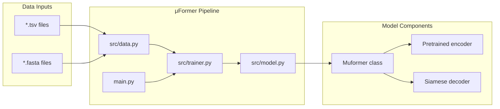

### μSearch Optimization Engine

The `mu-search/` directory contains the reinforcement learning system for navigating fitness landscapes constructed by μFormer. This component performs the actual protein optimization by efficiently exploring the sequence space.

**Sources:** [README.md:14-16](), [README.md:19-23]()

## Repository Structure

The codebase follows a modular architecture with clear separation between the three main components:

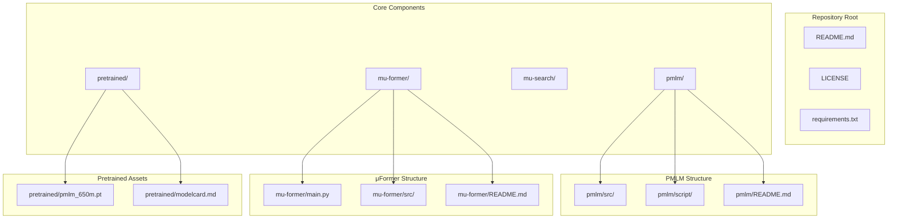

**Sources:** [README.md:12-17]()

## Integration Workflow

The three components integrate through a data flow pipeline where outputs from each stage serve as inputs to the next:

| Stage | Input | Process | Output |
|-------|-------|---------|--------|
| PMLM | UniRef50 protein sequences | Self-supervised pretraining | `pmlm_650m.pt` checkpoint |
| μFormer | Pretrained model + mutation data | Fine-tuning for fitness prediction | Trained fitness oracle |
| μSearch | Fitness oracle + target protein | RL-based optimization | Optimized protein variants |

The framework design enables independent development and improvement of each component while maintaining clean interfaces through the checkpoint and model loading mechanisms.

**Sources:** [README.md:7-8](), [README.md:14-17]()

## Getting Started

To begin using the μProtein framework:

1. **Installation**: See [Installation & Setup](#3.1) for environment configuration and dependency management
2. **Pretrained Models**: See [Using Pretrained Models](#3.2) for loading the 650M parameter PMLM checkpoint  
3. **Training**: See [Training & Development](#4) for custom model training procedures
4. **API Usage**: See [API Reference](#5) for detailed class and function documentation

The framework requires PyTorch, Fairseq, and protein-specific libraries as detailed in the installation guide.

**Sources:** [README.md:19-23]()

---

# Page: System Architecture

# System Architecture

<details>
<summary>Relevant source files</summary>

The following files were used as context for generating this wiki page:

- [README.md](README.md)

</details>


This document provides a comprehensive overview of the μProtein framework's system architecture, including its three-stage pipeline design, component interactions, and implementation structure. The μProtein framework is designed to accelerate protein engineering through the integration of deep learning-based mutational effect prediction with reinforcement learning-based fitness landscape navigation.

For implementation details of specific components, see [PMLM Pretraining](#2.1), [μFormer Architecture](#2.2), and [μSearch System](#2.3). For setup and usage information, see [Getting Started](#3).

## Framework Overview

The μProtein framework implements a three-stage pipeline architecture where each stage builds upon the previous one to enable efficient protein engineering:

### Three-Stage Pipeline Architecture

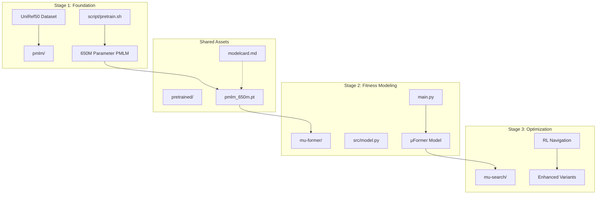

**Sources:** [README.md:14-17]()

### Component Directory Structure

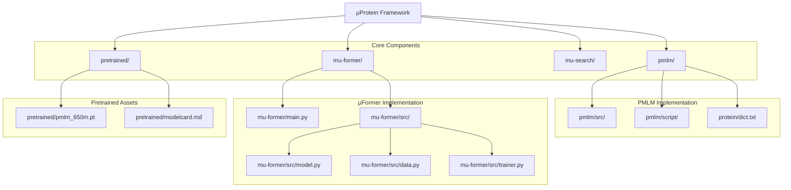

**Sources:** [README.md:12-17](), [README.md:19-23]()

## Data Flow and Processing Pipeline

The μProtein framework implements a sophisticated data flow that transforms raw protein sequences into optimized variants through multiple processing stages:

### End-to-End Data Flow

```mermaid
flowchart LR
    subgraph "Input Data"
        UNIREF["UniRef50 Sequences"]
        TARGET_PROTEINS["Target Protein Sequences"]
        MUTATION_DATA["Mutation TSV Files"]
    end
    
    subgraph "Stage 1: PMLM Training"
        FAIRSEQ_PREPROCESS["fairseq-preprocess"]
        PRETRAIN_SH["script/pretrain.sh"]
        PMLM_TRAINING["PMLM Training Loop"]
    end
    
    subgraph "Stage 2: μFormer Training"
        LOAD_PMLM["Load pmlm_650m.pt"]
        MUFORMER_MAIN["mu-former/main.py"]
        PAIRED_DATASET["PairedDataset"]
        SIAMESE_DECODER["Siamese Decoder"]
    end
    
    subgraph "Stage 3: μSearch Optimization"
        FITNESS_ORACLE["μFormer Fitness Oracle"]
        RL_NAVIGATOR["μSearch RL Navigator"]
        PROTEIN_VARIANTS["Optimized Variants"]
    end
    
    UNIREF --> FAIRSEQ_PREPROCESS
    FAIRSEQ_PREPROCESS --> PRETRAIN_SH
    PRETRAIN_SH --> PMLM_TRAINING
    PMLM_TRAINING --> LOAD_PMLM
    
    TARGET_PROTEINS --> PAIRED_DATASET
    MUTATION_DATA --> PAIRED_DATASET
    LOAD_PMLM --> MUFORMER_MAIN
    PAIRED_DATASET --> MUFORMER_MAIN
    MUFORMER_MAIN --> SIAMESE_DECODER
    
    SIAMESE_DECODER --> FITNESS_ORACLE
    FITNESS_ORACLE --> RL_NAVIGATOR
    RL_NAVIGATOR --> PROTEIN_VARIANTS
    
    RL_NAVIGATOR -.->|"queries"| FITNESS_ORACLE
```

**Sources:** [README.md:8](), [README.md:14-16]()

## Component Integration Architecture

The μProtein framework integrates multiple specialized components through well-defined interfaces:

| Component | Primary Function | Key Outputs | Integration Points |
|-----------|-----------------|-------------|-------------------|
| **PMLM** | Protein language modeling | `pmlm_650m.pt` checkpoint | Provides encoder for μFormer |
| **μFormer** | Mutational effect prediction | Fitness scores, trained model | Serves as oracle for μSearch |
| **μSearch** | RL-based optimization | Enhanced protein variants | Queries μFormer for fitness |
| **Pretrained** | Model distribution | Model files, documentation | Shared across all components |

### System Dependencies and Interfaces

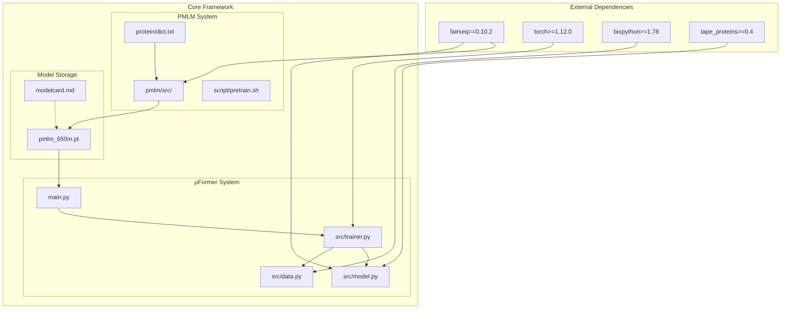

**Sources:** [README.md:14-17]()

## Implementation Structure

The μProtein framework follows a modular design that separates concerns across three distinct but integrated systems:

### Core System Responsibilities

| System | Directory | Key Components | Responsibilities |
|--------|-----------|---------------|-----------------|
| **Protein Language Model** | `pmlm/` | Training scripts, model definitions | Pre-training on UniRef50, generating protein representations |
| **Mutational Effect Predictor** | `mu-former/` | `main.py`, `src/model.py`, `src/trainer.py` | Fine-tuning PMLM, predicting fitness effects |
| **Reinforcement Learning Navigator** | `mu-search/` | RL algorithms, search strategies | Navigating fitness landscapes, generating variants |
| **Pretrained Assets** | `pretrained/` | `pmlm_650m.pt`, `modelcard.md` | Distributing trained models, documentation |

### Framework Integration Points

The system architecture enables loose coupling between components while maintaining clear data flow:

1. **PMLM → μFormer**: The pretrained checkpoint `pmlm_650m.pt` serves as the encoder foundation for mutational effect prediction
2. **μFormer → μSearch**: The trained μFormer model provides a differentiable fitness oracle for reinforcement learning
3. **Shared Resources**: The `pretrained/` directory provides centralized model distribution with Git LFS support

This architecture allows each component to be developed, tested, and deployed independently while ensuring seamless integration for end-to-end protein engineering workflows.

**Sources:** [README.md:12-17](), [README.md:21-23]()

---

# Page: PMLM Pretraining

# PMLM Pretraining

<details>
<summary>Relevant source files</summary>

The following files were used as context for generating this wiki page:

- [pmlm/README.md](pmlm/README.md)
- [pretrained/modelcard.md](pretrained/modelcard.md)
- [pretrained/pmlm_650m.pt](pretrained/pmlm_650m.pt)

</details>


This document covers the Protein Masked Language Model (PMLM) pretraining system, the foundational component of the μProtein framework. PMLM is a 650M parameter transformer encoder that learns contextual protein sequence representations through masked language modeling on UniRef50 data. This system generates the pretrained protein language model that serves as the backbone encoder for downstream tasks in μFormer and μSearch.

For information about using the pretrained PMLM model, see [Using Pretrained Models](#3.2). For training μFormer models that use PMLM as a backbone, see [μFormer Training](#4.1).

## Overview

PMLM implements a BERT-style masked language modeling objective specifically designed for protein sequences. The model learns to predict randomly masked amino acids from their context, building rich representations that capture protein sequence patterns and evolutionary relationships.

### PMLM Training Pipeline

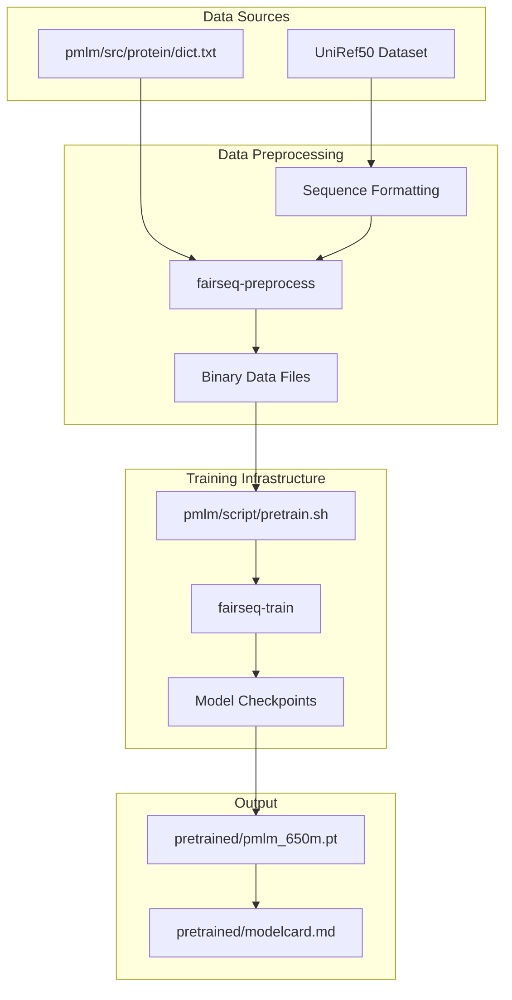

Sources: [pretrained/modelcard.md:1-146](), [pmlm/README.md:1-59]()

## Architecture and Training Objective

PMLM uses a transformer encoder architecture with masked language modeling (MLM) objective inspired by BERT. The model processes protein sequences up to 512 amino acids in length and uses a fixed 21-token amino acid vocabulary.

### Model Specifications

| Component | Specification |
|-----------|--------------|
| Architecture | Transformer Encoder |
| Parameters | ~650M |
| Max Sequence Length | 512 amino acids |
| Vocabulary Size | 21 tokens (20 amino acids + special tokens) |
| Training Objective | Pairwise Masked Language Modeling |
| Precision | Mixed precision (fp16) |

### Training Configuration

| Parameter | Value |
|-----------|-------|
| Optimizer | AdamW |
| Learning Rate | 1e-5 |
| Batch Size | Dynamic |
| Training Data | UniRef50 (50% identity deduplicated) |
| Training Time | ~100 days on 48 V100 GPUs |
| Compute | ~7 million PFLOPs |

Sources: [pretrained/modelcard.md:64-76](), [pretrained/modelcard.md:113-115]()

## Data Preparation Pipeline

The PMLM pretraining process requires careful data preparation to convert raw protein sequences into the format expected by Fairseq.

### Data Format Requirements

Protein sequences must be formatted with specific conventions:
- Written in uppercase letters
- Spaces inserted between residues
- One sequence per line

Example format:
```
C A S E F W S A W F ... C A D
```

### Preprocessing Workflow

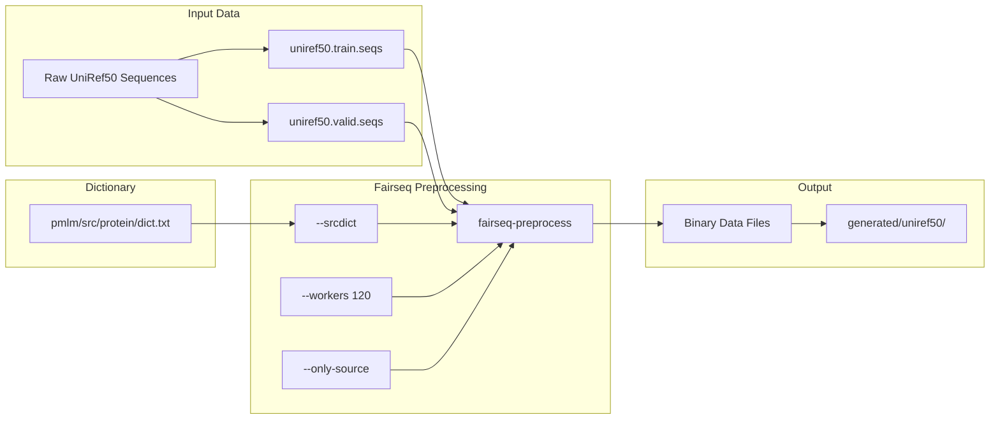

The preprocessing command structure follows this pattern:
```bash
fairseq-preprocess \
  --only-source \
  --trainpref <path_to_sequence_file>/uniref50.train.seqs \
  --validpref <path_to_sequence_file>/uniref50.valid.seqs \
  --destdir <path_to_output_folder>/generated/uniref50 \
  --workers 120 \
  --srcdict pmlm/src/protein/dict.txt
```

Sources: [pmlm/README.md:26-47]()

## Training Infrastructure

The pretraining process is orchestrated through a shell script that configures and launches the Fairseq training pipeline.

### Training Execution

The training process is initiated through the main pretraining script:

```bash
cd pmlm
bash script/pretrain.sh
```

### Infrastructure Requirements

| Resource | Specification |
|----------|--------------|
| GPUs | 48 x NVIDIA V100 (32GB) |
| Framework | PyTorch + Fairseq |
| Cloud Provider | Microsoft Azure |
| Region | East US |
| Total GPU Hours | ~100,000 |
| Carbon Footprint | ~1,100 kg CO2e |

### Training Components

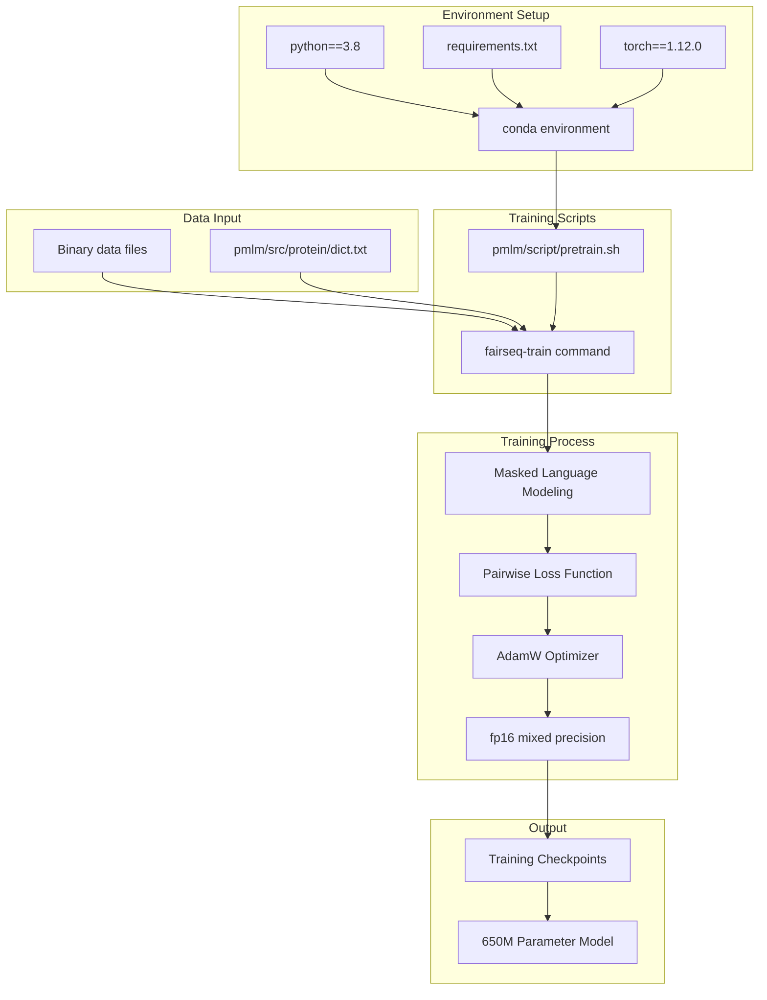

Sources: [pmlm/README.md:6-21](), [pmlm/README.md:49-54](), [pretrained/modelcard.md:104-125]()

## Pretrained Model Details

The training process produces a 650M parameter model stored as a PyTorch checkpoint file managed through Git LFS due to its large size.

### Model Artifacts

| Artifact | Description | Size |
|----------|-------------|------|
| `pretrained/pmlm_650m.pt` | Main model checkpoint | 2.7GB |
| `pretrained/modelcard.md` | Model documentation | - |
| `pmlm/src/protein/dict.txt` | Amino acid vocabulary | - |

### Model File Structure

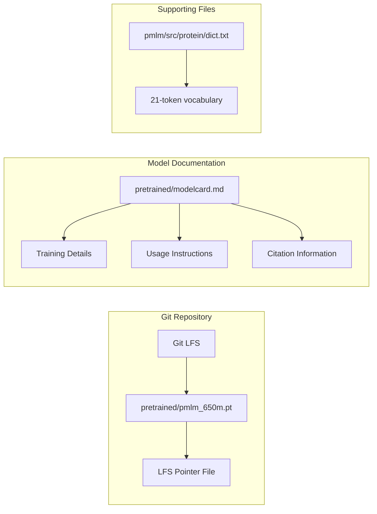

The model checkpoint contains:
- Complete transformer encoder weights
- Optimizer state
- Training metadata
- Vocabulary mappings

Sources: [pretrained/pmlm_650m.pt:1-4](), [pretrained/modelcard.md:1-146]()

## Environment Setup

Setting up the PMLM pretraining environment requires careful configuration of Python dependencies and PyTorch installation.

### Conda Environment Creation

```bash
conda create -n mutation python==3.8  
conda activate mutation  
pip install -r requirements.txt  
```

### PyTorch Installation

The PyTorch version depends on your GPU driver:

For CUDA 11.3:
```bash
pip install torch==1.12.0+cu113 torchvision==0.13.0+cu113 torchaudio==0.12.0 --extra-index-url https://download.pytorch.org/whl/cu113
```

For CPU-only:
```bash
pip install torch==1.12.0+cpu torchvision==0.13.0+cpu torchaudio==0.12.0 --extra-index-url https://download.pytorch.org/whl/cpu
```

### Key Dependencies

- **Fairseq 0.10.2**: Sequence modeling framework
- **PyTorch 1.12.0**: Deep learning framework  
- **Python 3.8**: Runtime environment
- **CUDA 11.3**: GPU acceleration (optional)

Sources: [pmlm/README.md:6-21]()

## Usage and Integration

The pretrained PMLM model serves as the foundation for downstream protein engineering tasks within the μProtein framework. The model provides contextual protein sequence embeddings that can be fine-tuned for specific tasks.

### Direct Applications

- Protein sequence embedding generation
- Transfer learning backbone for protein tasks
- Feature extraction for mutation effect prediction
- Input encoder for μFormer architecture

### Integration Points

The PMLM model integrates with other μProtein components through:
- **μFormer**: Uses PMLM as the pretrained encoder backbone
- **Fairseq ecosystem**: Leverages Fairseq model loading and inference
- **PyTorch models**: Standard PyTorch checkpoint format for compatibility

Sources: [pretrained/modelcard.md:24-37](), [pmlm/README.md:56-58]()

---

# Page: μFormer Architecture

# μFormer Architecture

<details>
<summary>Relevant source files</summary>

The following files were used as context for generating this wiki page:

- [mu-former/requirements.txt](mu-former/requirements.txt)
- [mu-former/src/data.py](mu-former/src/data.py)
- [mu-former/src/model.py](mu-former/src/model.py)
- [mu-former/src/trainer.py](mu-former/src/trainer.py)

</details>


This document provides a detailed explanation of the μFormer model architecture, the second stage of the μProtein framework responsible for predicting mutational effects on protein fitness. μFormer leverages pretrained protein language models (PMLM) to create accurate fitness prediction models that serve as differentiable oracles for protein optimization.

For information about the overall system architecture, see [System Architecture](#2). For details about PMLM pretraining, see [PMLM Pretraining](#2.1). For training procedures, see [μFormer Training](#4.1).

## Architecture Overview

μFormer implements a siamese encoder-decoder architecture that processes pairs of protein sequences to predict fitness differences. The system combines semantic representations from pretrained language models with motif-based features through specialized decoder components.

**μFormer System Architecture**

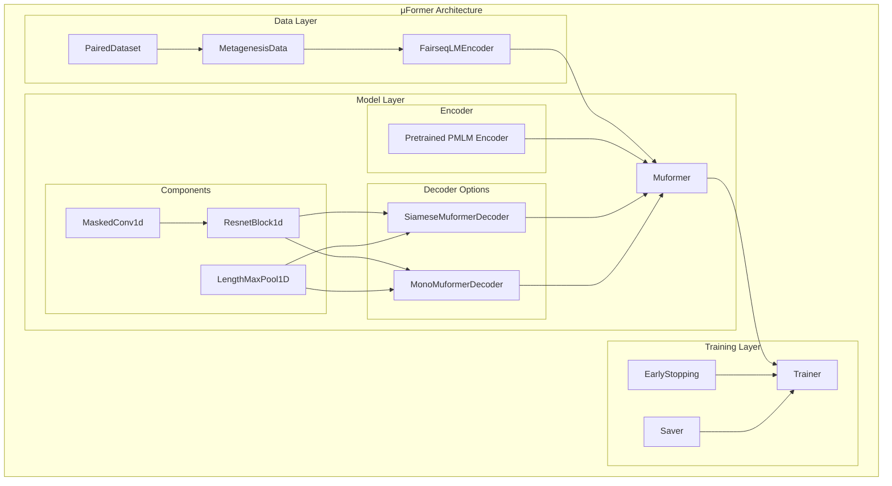

Sources: [mu-former/src/model.py:1-315](), [mu-former/src/data.py:1-454](), [mu-former/src/trainer.py:1-600]()

## Core Model Components

The μFormer architecture consists of several key components that work together to predict mutational effects.

### Muformer Class

The `Muformer` class serves as the main model orchestrator, combining a pretrained encoder with specialized decoders for mutation effect prediction.

**Muformer Component Structure**

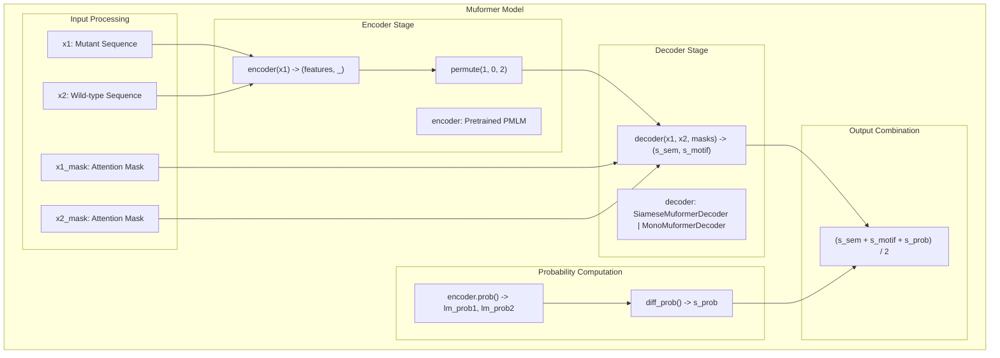

Sources: [mu-former/src/model.py:225-315]()

### Decoder Architectures

μFormer supports two decoder architectures for different use cases:

| Component | Purpose | Key Features |
|-----------|---------|--------------|
| `SiameseMuformerDecoder` | Paired sequence comparison | Processes wild-type and mutant sequences simultaneously |
| `MonoMuformerDecoder` | Single sequence analysis | Processes individual sequences independently |

**SiameseMuformerDecoder Architecture**

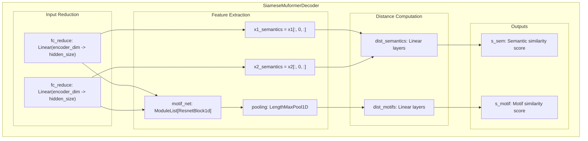

Sources: [mu-former/src/model.py:93-158]()

### Convolutional Components

The decoder uses specialized convolutional components for motif detection and sequence analysis.

| Component | Function | Implementation |
|-----------|----------|----------------|
| `MaskedConv1d` | Masked 1D convolution | Applies attention masks during convolution |
| `ResnetBlock1d` | Residual block | Two masked conv layers with skip connection |
| `LengthMaxPool1D` | Length-aware pooling | Max pooling across sequence length |

Sources: [mu-former/src/model.py:50-92]()

## Data Processing Pipeline

The data processing pipeline handles protein sequences, mutations, and fitness labels through several specialized classes.

**Data Processing Flow**

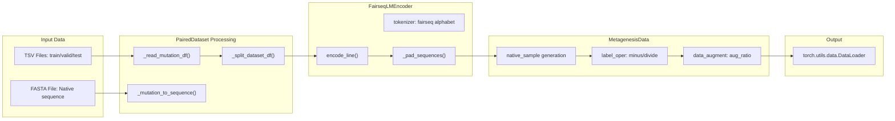

Sources: [mu-former/src/data.py:139-454]()

### Data Classes and Methods

| Class/Method | Purpose | Key Parameters |
|--------------|---------|----------------|
| `PairedDataset` | Main data orchestrator | `train_tsv`, `valid_tsv`, `test_tsv`, `fasta` |
| `MetagenesisData` | Dataset wrapper with augmentation | `mode`, `label_oper`, `aug_ratio` |
| `FairseqLMEncoder` | Sequence tokenization | `alphabet`, `batch_size` |
| `_mutation_to_sequence()` | Convert mutation strings to sequences | Handles format like "A123G" |
| `_pad_sequences()` | Batch sequence padding | `constant_value=1`, variable `length` |

Sources: [mu-former/src/data.py:85-454]()

## Training Infrastructure

The training infrastructure provides comprehensive support for model training, evaluation, and distributed computing.

**Training Component Interactions**

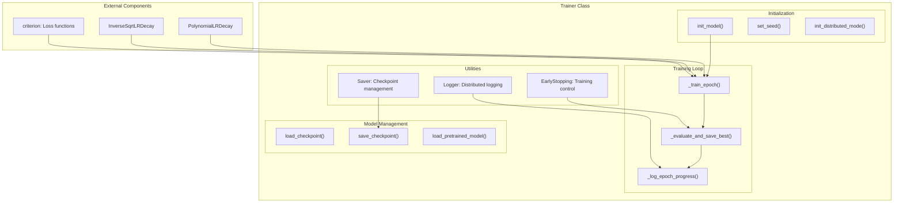

Sources: [mu-former/src/trainer.py:80-600]()

### Training Configuration

The trainer supports extensive configuration for different training scenarios:

| Parameter | Purpose | Default Value |
|-----------|---------|---------------|
| `encoder_lr` | Learning rate for pretrained encoder | `1e-5` |
| `decoder_lr` | Learning rate for decoder | `1e-4` |
| `weight_decay` | L2 regularization strength | `0.0` |
| `freeze_lm` | Whether to freeze language model | `False` |
| `num_ensembles` | Number of ensemble models | `1` |
| `batch_size` | Training batch size | `128` |

Sources: [mu-former/src/trainer.py:191-210]()

## Integration with PMLM

μFormer integrates closely with pretrained protein language models through the fairseq framework.

**PMLM Integration Architecture**

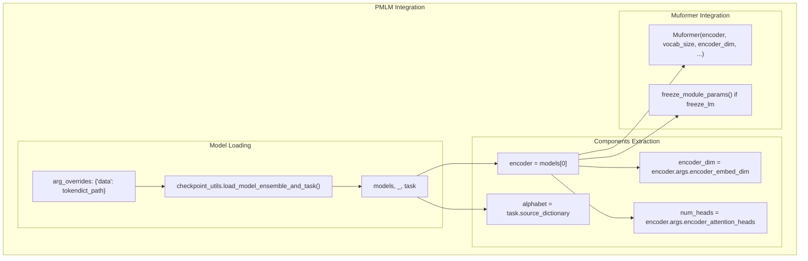

Sources: [mu-former/src/trainer.py:114-132]()

The integration enables μFormer to leverage pretrained representations while fine-tuning for specific mutation prediction tasks. The system supports both frozen and trainable encoder configurations depending on the available training data and computational resources.

Sources: [mu-former/src/trainer.py:1-600](), [mu-former/src/model.py:225-315]()

---

# Page: μSearch System

# μSearch System

<details>
<summary>Relevant source files</summary>

The following files were used as context for generating this wiki page:

- [README.md](README.md)

</details>


## Purpose and Scope

This document provides an overview of the μSearch system, the third and final stage of the μProtein framework pipeline. μSearch is a reinforcement learning-based protein optimization system that navigates fitness landscapes to discover improved protein variants. It leverages the fitness predictions from μFormer models to efficiently explore the protein sequence space and identify optimized proteins.

For detailed information about the fitness modeling component that feeds into μSearch, see [μFormer Architecture](#2.2). For implementation details of training μSearch systems, see [Training & Development](#4).

## System Overview

μSearch represents the optimization stage of the μProtein framework, where reinforcement learning algorithms are employed to navigate the protein fitness landscape constructed by μFormer. The system takes fitness predictions as an oracle and uses them to guide the search for protein variants with improved properties.

### μSearch Position in Framework Pipeline

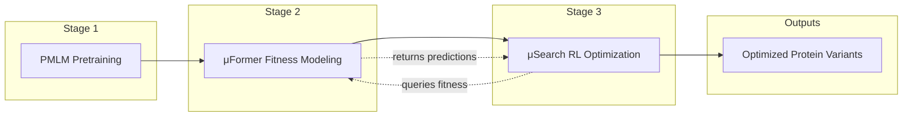

Sources: [README.md:8-16]()

## Core Components

### Reinforcement Learning Framework

μSearch implements reinforcement learning algorithms specifically designed for protein sequence optimization. The system treats protein engineering as a sequential decision-making problem where each amino acid position represents a decision point in the optimization process.

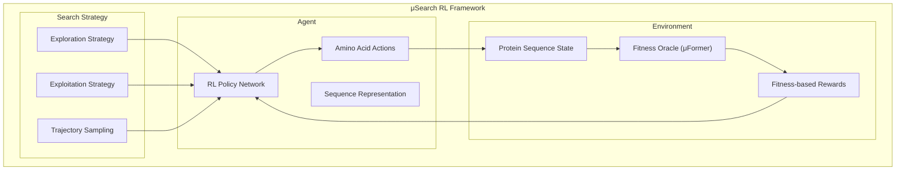

Sources: [README.md:8](), [README.md:16]()

### Fitness Landscape Navigation

The system efficiently navigates the high-dimensional protein fitness landscape by leveraging the μFormer predictions as a differentiable oracle. This allows for gradient-based optimization strategies while maintaining the flexibility of reinforcement learning for discrete sequence spaces.

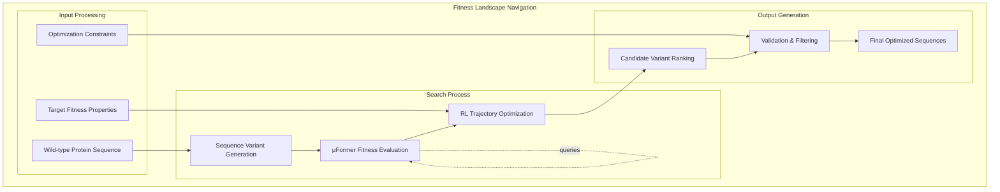

Sources: [README.md:8](), [README.md:16]()

## Integration with μFormer

μSearch relies heavily on the μFormer system to provide accurate fitness predictions that guide the reinforcement learning process. This integration creates a closed-loop optimization system where the quality of fitness modeling directly impacts the effectiveness of the search process.

### Fitness Oracle Interface

```mermaid
sequenceDiagram
    participant MS as "μSearch RL Agent"
    participant MF as "μFormer Fitness Oracle"
    participant PS as "Protein Sequence Space"
    
    MS->>PS: Generate candidate sequence
    MS->>MF: Query fitness prediction
    MF->>MF: Encode sequence features
    MF->>MF: Predict mutational effects
    MF->>MS: Return fitness score
    MS->>MS: Update policy based on reward
    MS->>PS: Select next sequence variant
    
    Note over MS,MF: Iterative optimization loop
```

Sources: [README.md:8](), [README.md:15-16]()

## System Architecture

The μSearch system is organized within the `mu-search/` directory and follows a modular architecture that separates the reinforcement learning components from the protein-specific optimization logic.

### Directory Structure

| Component | Location | Purpose |
|-----------|----------|---------|
| Core RL System | `mu-search/` | Main reinforcement learning implementation |
| Configuration | `mu-search/README.md` | System documentation and setup |
| Integration Layer | Interface with `mu-former/` | Fitness oracle communication |

Sources: [README.md:16](), [README.md:22]()

## Optimization Process

The μSearch optimization process follows a systematic approach to protein engineering that balances exploration of novel sequences with exploitation of promising regions in the fitness landscape.

### Search Algorithm Flow

```mermaid
flowchart TD
    subgraph "Initialization"
        INIT_SEQUENCE["Initialize with wild-type sequence"]
        INIT_POLICY["Initialize RL policy"]
        INIT_ENVIRONMENT["Setup optimization environment"]
    end
    
    subgraph "Optimization Loop"
        POLICY_ACTION["Sample action from policy"]
        SEQUENCE_MUTATE["Apply mutation to sequence"]
        FITNESS_QUERY["Query μFormer for fitness"]
        REWARD_COMPUTE["Compute reward signal"]
        POLICY_UPDATE["Update RL policy"]
        CONVERGENCE_CHECK["Check convergence criteria"]
    end
    
    subgraph "Termination"
        FINAL_RANKING["Rank discovered variants"]
        OUTPUT_RESULTS["Output optimized sequences"]
    end
    
    INIT_SEQUENCE --> INIT_POLICY
    INIT_POLICY --> INIT_ENVIRONMENT
    INIT_ENVIRONMENT --> POLICY_ACTION
    
    POLICY_ACTION --> SEQUENCE_MUTATE
    SEQUENCE_MUTATE --> FITNESS_QUERY
    FITNESS_QUERY --> REWARD_COMPUTE
    REWARD_COMPUTE --> POLICY_UPDATE
    POLICY_UPDATE --> CONVERGENCE_CHECK
    
    CONVERGENCE_CHECK -->|"Continue"| POLICY_ACTION
    CONVERGENCE_CHECK -->|"Converged"| FINAL_RANKING
    
    FINAL_RANKING --> OUTPUT_RESULTS
```

Sources: [README.md:8](), [README.md:16]()

## Performance Characteristics

μSearch is designed to efficiently explore the vast protein sequence space while minimizing the number of fitness evaluations required. The reinforcement learning approach enables the system to learn from previous optimization attempts and progressively improve its search strategy.

### Key Performance Features

- **Sample Efficiency**: Reduces the number of fitness evaluations needed compared to exhaustive search
- **Scalability**: Handles proteins of varying lengths and complexity
- **Adaptability**: Learns optimization strategies specific to different protein families
- **Constraint Handling**: Incorporates biochemical and structural constraints into the search process

Sources: [README.md:8]()

## Future Extensions

The μSearch system provides a foundation for various protein engineering applications and can be extended to support multi-objective optimization, ensemble-based search strategies, and integration with experimental validation pipelines.

Sources: [README.md:8-16]()

---

# Page: Getting Started

# Getting Started

<details>
<summary>Relevant source files</summary>

The following files were used as context for generating this wiki page:

- [mu-former/requirements.txt](mu-former/requirements.txt)
- [pmlm/README.md](pmlm/README.md)

</details>


This page provides a comprehensive guide to getting started with the μProtein framework. It covers environment setup, dependency installation, and initial verification of the three main components: PMLM (Protein Masked Language Model), μFormer (mutational effect prediction), and μSearch (reinforcement learning optimization). 

For detailed installation instructions, see [Installation & Setup](#3.1). For working with pretrained models, see [Using Pretrained Models](#3.2). For comprehensive training guides, see [Training & Development](#4).

## Quick Start Overview

The μProtein framework follows a three-stage workflow where each component builds upon the previous one:

```mermaid
flowchart TD
    subgraph "Environment Setup"
        ENV["conda create -n mutation python==3.8"]
        DEPS["pip install -r requirements.txt"]
        TORCH["pip install torch==1.12.0+cu113"]
    end
    
    subgraph "Framework Components"
        PMLM_PRETRAIN["pmlm/script/pretrain.sh"]
        PMLM_MODEL["pretrained/pmlm_650m.pt"]
        MUFORMER_TRAIN["mu-former/main.py"]
        MUSEARCH_RL["mu-search/ (RL optimization)"]
    end
    
    subgraph "Verification Steps"
        CHECK_DEPS["Verify dependencies"]
        LOAD_MODEL["Load pretrained model"]
        RUN_INFERENCE["Test inference"]
    end
    
    ENV --> DEPS
    DEPS --> TORCH
    TORCH --> CHECK_DEPS
    
    CHECK_DEPS --> LOAD_MODEL
    LOAD_MODEL --> RUN_INFERENCE
    
    PMLM_PRETRAIN --> PMLM_MODEL
    PMLM_MODEL --> MUFORMER_TRAIN
    MUFORMER_TRAIN --> MUSEARCH_RL
    
    LOAD_MODEL -.-> PMLM_MODEL
```

**Quick Start Workflow**

Sources: [pmlm/README.md:7-21](), [mu-former/requirements.txt:1-21]()

## Prerequisites and Dependencies

The μProtein framework requires Python 3.8 and specific versions of key dependencies to ensure compatibility across all components.

### Core Requirements

| Category | Package | Version | Purpose |
|----------|---------|---------|---------|
| ML Framework | `torch` | 1.12.0 | Core neural network training |
| Sequence Modeling | `fairseq` | 0.10.2 | Transformer architectures |
| Protein Tools | `tape_proteins` | ≥0.4 | Protein-specific utilities |
| Protein Models | `fair-esm` | latest | Evolutionary scale modeling |
| Scientific Computing | `numpy` | 1.22.0 | Numerical operations |
| Data Processing | `pandas` | latest | Data manipulation |
| Bioinformatics | `biopython` | ≥1.78 | Sequence analysis |

### Environment Setup Commands

```bash
# Create conda environment
conda create -n mutation python==3.8
conda activate mutation

# Install μFormer dependencies
pip install -r mu-former/requirements.txt

# Install PyTorch (GPU version)
pip install torch==1.12.0+cu113 torchvision==0.13.0+cu113 torchaudio==0.12.0 \
    --extra-index-url https://download.pytorch.org/whl/cu113

# Or CPU-only version
pip install torch==1.12.0+cpu torchvision==0.13.0+cpu torchaudio==0.12.0 \
    --extra-index-url https://download.pytorch.org/whl/cpu
```

Sources: [pmlm/README.md:8-21](), [mu-former/requirements.txt:1-21]()

## Component Architecture Verification

After installation, verify that all three main components are accessible and properly configured:

```mermaid
graph TB
    subgraph "PMLM Component"
        PMLM_SRC["pmlm/src/"]
        PMLM_DICT["pmlm/src/protein/dict.txt"]
        PMLM_SCRIPT["pmlm/script/pretrain.sh"]
        PRETRAINED_MODEL["pretrained/pmlm_650m.pt"]
    end
    
    subgraph "μFormer Component"
        MF_MAIN["mu-former/main.py"]
        MF_MODEL["mu-former/src/model.py"]
        MF_DATA["mu-former/src/data.py"]
        MF_TRAINER["mu-former/src/trainer.py"]
        MF_REQS["mu-former/requirements.txt"]
    end
    
    subgraph "μSearch Component"
        MS_DIR["mu-search/"]
        MS_RL["RL optimization modules"]
    end
    
    subgraph "Verification Commands"
        CHECK1["python -c 'import fairseq'"]
        CHECK2["python -c 'import tape_proteins'"]
        CHECK3["python -c 'import torch; print(torch.cuda.is_available())'"]
        CHECK4["ls pretrained/pmlm_650m.pt"]
    end
    
    MF_REQS --> CHECK1
    MF_REQS --> CHECK2
    MF_REQS --> CHECK3
    PRETRAINED_MODEL --> CHECK4
    
    PMLM_DICT --> PMLM_SRC
    PMLM_SCRIPT --> PMLM_SRC
    PRETRAINED_MODEL -.-> MF_MAIN
```

**Component Structure and Verification**

### Verification Checklist

| Component | File/Directory | Verification Command |
|-----------|----------------|---------------------|
| PMLM Source | `pmlm/src/` | `ls pmlm/src/protein/dict.txt` |
| Pretrained Model | `pretrained/pmlm_650m.pt` | `ls -lh pretrained/pmlm_650m.pt` |
| μFormer Main | `mu-former/main.py` | `python mu-former/main.py --help` |
| Fairseq Integration | `fairseq` | `python -c "import fairseq; print(fairseq.__version__)"` |
| GPU Support | `torch.cuda` | `python -c "import torch; print(torch.cuda.is_available())"` |

Sources: [pmlm/README.md:46-47](), [mu-former/requirements.txt:11]()

## Framework Workflow Overview

The μProtein framework operates through a sequential pipeline where each stage consumes outputs from the previous stage:

```mermaid
flowchart LR
    subgraph "Stage 1: Foundation"
        UNIREF["UniRef50 Dataset"]
        PREPROCESS["fairseq-preprocess"]
        PMLM_TRAIN["pmlm/script/pretrain.sh"]
        PMLM_OUTPUT["pretrained/pmlm_650m.pt"]
    end
    
    subgraph "Stage 2: Fitness Modeling"
        PROTEIN_DATA["Target protein sequences (FASTA)"]
        MUTATION_DATA["Mutation effects (TSV)"]
        MUFORMER_TRAIN["mu-former/main.py"]
        MUFORMER_MODEL["Trained μFormer"]
    end
    
    subgraph "Stage 3: Optimization"
        FITNESS_ORACLE["μFormer predictions"]
        RL_SEARCH["mu-search/ RL navigation"]
        OPTIMIZED["Enhanced protein variants"]
    end
    
    UNIREF --> PREPROCESS
    PREPROCESS --> PMLM_TRAIN
    PMLM_TRAIN --> PMLM_OUTPUT
    
    PMLM_OUTPUT --> MUFORMER_TRAIN
    PROTEIN_DATA --> MUFORMER_TRAIN
    MUTATION_DATA --> MUFORMER_TRAIN
    MUFORMER_TRAIN --> MUFORMER_MODEL
    
    MUFORMER_MODEL --> FITNESS_ORACLE
    FITNESS_ORACLE --> RL_SEARCH
    RL_SEARCH --> OPTIMIZED
    
    RL_SEARCH -.->|"queries fitness"| FITNESS_ORACLE
```

**μProtein Pipeline Workflow**

Sources: [pmlm/README.md:26-54]()

## Initial Setup Steps

### 1. Clone and Navigate Repository
```bash
git clone https://github.com/microsoft/Mu-Protein.git
cd Mu-Protein
```

### 2. Verify Large File Support
The pretrained models use Git LFS for storage management:
```bash
# Ensure Git LFS is installed
git lfs version
# Pull large files if needed
git lfs pull
```

### 3. Test Component Access
```bash
# Verify PMLM components
ls pmlm/src/protein/dict.txt
ls pmlm/script/pretrain.sh

# Verify μFormer components  
python -c "from mu-former.src.model import Muformer; print('μFormer available')"

# Check pretrained model availability
ls -lh pretrained/pmlm_650m.pt
```

### 4. Validate Environment
```bash
# Test core dependencies
python -c "import fairseq, tape_proteins, torch; print('Core dependencies OK')"

# Test protein-specific tools
python -c "import fair_esm, Bio; print('Protein tools OK')"

# Check GPU availability (if using CUDA)
python -c "import torch; print(f'CUDA available: {torch.cuda.is_available()}')"
```

Sources: [mu-former/requirements.txt:11,20](), [pmlm/README.md:46-47]()

## Next Steps

Once the environment is properly configured and verified:

1. **For using pretrained models**: See [Using Pretrained Models](#3.2) to learn how to load and perform inference with the 650M parameter PMLM model.

2. **For training μFormer models**: See [μFormer Training](#4.1) for detailed guidance on preparing training data and configuring training runs.

3. **For PMLM pretraining**: See [PMLM Training](#4.2) if you need to pretrain models from scratch on custom protein datasets.

4. **For understanding the architecture**: See [System Architecture](#2) for detailed explanations of how the components interact and the underlying model architectures.

The framework is designed with modular components, so you can start with any stage depending on your specific use case and available computational resources.

Sources: [pmlm/README.md:57-58]()

---

# Page: Installation & Setup

# Installation & Setup

<details>
<summary>Relevant source files</summary>

The following files were used as context for generating this wiki page:

- [mu-former/requirements.txt](mu-former/requirements.txt)
- [pmlm/README.md](pmlm/README.md)

</details>


This page provides comprehensive installation instructions for the μProtein framework, covering environment setup, dependency management, and configuration for all three main components (PMLM, μFormer, μSearch). This guide focuses on getting a complete development and runtime environment configured.

For information about using pretrained models after installation, see [Using Pretrained Models](#3.2). For training-specific setup procedures, see [μFormer Training](#4.1) and [PMLM Training](#4.2).

## Prerequisites

The μProtein framework requires Python 3.8 and supports both CPU and GPU environments. GPU support is recommended for training and inference with large protein language models.

### System Requirements

| Component | Minimum | Recommended |
|-----------|---------|-------------|
| Python | 3.8 | 3.8 |
| Memory | 8GB RAM | 32GB+ RAM |
| Storage | 10GB | 50GB+ (with datasets) |
| GPU | None (CPU fallback) | CUDA-compatible GPU with 8GB+ VRAM |

Sources: [pmlm/README.md:9-21]()

## Environment Setup

### Installation Flow Overview

```mermaid
flowchart TD
    START["Start Installation"]
    CONDA["Create Conda Environment"]
    ACTIVATE["Activate Environment"]
    PYTORCH["Install PyTorch"]
    DEPS["Install Framework Dependencies"]
    FAIRSEQ["Install Fairseq"]
    PROTEIN["Install Protein Tools"]
    GITLFS["Configure Git LFS"]
    VERIFY["Verify Installation"]
    
    START --> CONDA
    CONDA --> ACTIVATE
    ACTIVATE --> PYTORCH
    PYTORCH --> DEPS
    DEPS --> FAIRSEQ
    FAIRSEQ --> PROTEIN
    PROTEIN --> GITLFS
    GITLFS --> VERIFY
    
    PYTORCH -->|"GPU Support"| GPU_CHECK["Check CUDA Version"]
    PYTORCH -->|"CPU Only"| CPU_INSTALL["CPU PyTorch"]
```

Sources: [pmlm/README.md:8-21]()

### Base Environment Creation

Create and activate a dedicated conda environment:

```bash
conda create -n mutation python==3.8
conda activate mutation
```

### PyTorch Installation

PyTorch installation depends on your hardware configuration. Choose the appropriate version:

**For CUDA 11.3 GPU support:**
```bash
pip install torch==1.12.0+cu113 torchvision==0.13.0+cu113 torchaudio==0.12.0 --extra-index-url https://download.pytorch.org/whl/cu113
```

**For CPU-only environments:**
```bash
pip install torch==1.12.0+cpu torchvision==0.13.0+cpu torchaudio==0.12.0 --extra-index-url https://download.pytorch.org/whl/cpu
```

Sources: [pmlm/README.md:14-21]()

## Core Dependencies

### Framework Dependencies Overview

```mermaid
graph TB
    subgraph "Core ML Stack"
        TORCH["torch==1.12.0"]
        FAIRSEQ["fairseq==0.10.2"]
        NUMPY["numpy==1.22.0"]
    end
    
    subgraph "Protein-Specific Tools"
        TAPE["tape_proteins>=0.4"]
        FAIRESM["fair-esm"]
        BIOPYTHON["biopython>=1.78"]
    end
    
    subgraph "Data & Performance"
        PANDAS["pandas"]
        SKLEARN["scikit_learn>=0.24.1"]
        NUMBA["numba>=0.45.1"]
        LMDB["lmdb"]
        PYARROW["pyarrow"]
    end
    
    subgraph "Infrastructure"
        BOTO3["boto3"]
        PROTOBUF["protobuf==4.25.8"]
        SENTENCEPIECE["sentencepiece"]
    end
    
    TORCH --> FAIRSEQ
    FAIRSEQ --> TAPE
    NUMPY --> PANDAS
    PANDAS --> SKLEARN
```

Sources: [mu-former/requirements.txt:1-21]()

### Primary Dependencies Installation

Install the core framework dependencies:

```bash
pip install -r mu-former/requirements.txt
```

### Key Dependency Versions

| Package | Version | Purpose |
|---------|---------|---------|
| `fairseq` | 0.10.2 | Sequence modeling framework |
| `numpy` | 1.22.0 | Numerical computing |
| `tape_proteins` | ≥0.4 | Protein engineering toolkit |
| `biopython` | ≥1.78 | Biological sequence analysis |
| `scikit_learn` | ≥0.24.1 | Machine learning utilities |
| `protobuf` | 4.25.8 | Model serialization |

Sources: [mu-former/requirements.txt:1-21]()

## Component-Specific Setup

### Dependency Resolution and Component Mapping

```mermaid
graph LR
    subgraph "μFormer Components"
        MF_MAIN["main.py"]
        MF_MODEL["src/model.py"]
        MF_DATA["src/data.py"]
        MF_TRAINER["src/trainer.py"]
    end
    
    subgraph "PMLM Components"
        PMLM_SRC["pmlm/src/"]
        PROTEIN_DICT["protein/dict.txt"]
        PRETRAIN_SCRIPT["script/pretrain.sh"]
    end
    
    subgraph "Dependencies"
        FAIRSEQ_DEP["fairseq==0.10.2"]
        TAPE_DEP["tape_proteins>=0.4"]
        TORCH_DEP["torch==1.12.0"]
        BIO_DEP["biopython>=1.78"]
    end
    
    MF_MODEL --> FAIRSEQ_DEP
    MF_DATA --> BIO_DEP
    MF_TRAINER --> TORCH_DEP
    PMLM_SRC --> FAIRSEQ_DEP
    MF_MAIN --> TAPE_DEP
```

Sources: [mu-former/requirements.txt:1-21](), [pmlm/README.md:1-59]()

### Fairseq Integration

The framework relies heavily on Fairseq for sequence modeling. Ensure proper installation:

```bash
pip install fairseq==0.10.2
```

Verify Fairseq preprocessing tools are available:
```bash
fairseq-preprocess --help
```

### Protein-Specific Tools

Install specialized protein analysis libraries:

```bash
pip install tape_proteins>=0.4
pip install fair-esm
pip install biopython>=1.78
```

These provide:
- `tape_proteins`: Pre-trained protein models and evaluation frameworks
- `fair-esm`: Evolutionary Scale Modeling for proteins  
- `biopython`: FASTA/PDB file parsing and sequence manipulation

Sources: [mu-former/requirements.txt:3](), [mu-former/requirements.txt:6](), [mu-former/requirements.txt:20]()

## Large File Management

### Git LFS Configuration

The repository uses Git LFS for managing large model files, particularly the pretrained PMLM models:

```bash
git lfs install
git lfs track "*.pt"
```

Model files managed by Git LFS include:
- `pretrained/pmlm_650m.pt` (2.7GB pretrained model)
- Other checkpoint files with `.pt` extension

Sources: Repository configuration (implied from model architecture)

## Installation Verification

### Component Verification Checklist

| Component | Verification Command | Expected Outcome |
|-----------|---------------------|------------------|
| Python Environment | `python --version` | Python 3.8.x |
| PyTorch | `python -c "import torch; print(torch.__version__)"` | 1.12.0+... |
| Fairseq | `python -c "import fairseq; print(fairseq.__version__)"` | 0.10.2 |
| TAPE Proteins | `python -c "import tape"` | No import errors |
| Biopython | `python -c "from Bio import SeqIO"` | No import errors |

### Environment Validation

Create a simple validation script to test core functionality:

```python
# Basic import verification
import torch
import fairseq
import numpy as np
import pandas as pd
from Bio import SeqIO
import tape

print("✓ All core dependencies imported successfully")
print(f"PyTorch version: {torch.__version__}")
print(f"CUDA available: {torch.cuda.is_available()}")
```

## Troubleshooting Common Issues

### Dependency Conflicts

If encountering version conflicts, particularly with `numpy` or `protobuf`:

1. Create a fresh conda environment
2. Install PyTorch first
3. Install requirements.txt dependencies
4. Check for conflicting package versions: `pip list | grep -E "(numpy|protobuf|torch)"`

### CUDA Compatibility

For GPU environments, ensure CUDA toolkit compatibility:
- Check CUDA version: `nvidia-smi`
- Match PyTorch CUDA version to system CUDA version
- Test GPU availability: `python -c "import torch; print(torch.cuda.is_available())"`

### Fairseq Installation Issues

If Fairseq installation fails:
1. Ensure Cython is installed first: `pip install cython`
2. Install build dependencies: `conda install gcc_linux-64 gxx_linux-64`
3. Retry Fairseq installation

Sources: [mu-former/requirements.txt:14](), [pmlm/README.md:8-21]()

---

# Page: Using Pretrained Models

# Using Pretrained Models

<details>
<summary>Relevant source files</summary>

The following files were used as context for generating this wiki page:

- [pretrained/modelcard.md](pretrained/modelcard.md)
- [pretrained/pmlm_650m.pt](pretrained/pmlm_650m.pt)

</details>


This document provides a comprehensive guide to loading and using the pretrained PMLM (Pairwise Masked Language Model) in the μProtein framework. The pretrained models serve as the foundation for downstream protein engineering tasks and can be used for direct sequence embedding extraction or as the backbone for μFormer training.

For information about training your own PMLM models from scratch, see [PMLM Training](#4.2). For details about fine-tuning μFormer models using these pretrained weights, see [μFormer Training](#4.1).

## Pretrained Model Overview

The μProtein framework provides a 650M parameter PMLM model pretrained on the UniRef50 dataset. This model serves as the foundation encoder for all downstream protein engineering tasks in the framework.

### Model Architecture and Loading Flow

```mermaid
flowchart TD
    subgraph "Pretrained Assets"
        MODELCARD["modelcard.md"]
        MODEL_FILE["pmlm_650m.pt"]
        GITLFS["Git LFS Storage"]
    end
    
    subgraph "Loading Process"
        LOAD_STATE["torch.load()"]
        INIT_MODEL["Initialize PMLM Architecture"]
        LOAD_WEIGHTS["model.load_state_dict()"]
    end
    
    subgraph "Usage Patterns"
        DIRECT_USE["Direct Embedding Extraction"]
        MUFORMER_BACKBONE["μFormer Encoder Backbone"]
        TRANSFER_LEARNING["Transfer Learning Tasks"]
    end
    
    MODEL_FILE --> LOAD_STATE
    LOAD_STATE --> INIT_MODEL
    INIT_MODEL --> LOAD_WEIGHTS
    
    LOAD_WEIGHTS --> DIRECT_USE
    LOAD_WEIGHTS --> MUFORMER_BACKBONE
    LOAD_WEIGHTS --> TRANSFER_LEARNING
    
    MODELCARD -.-> MODEL_FILE
    GITLFS -.-> MODEL_FILE
```

Sources: [pretrained/modelcard.md:1-146](), [pretrained/pmlm_650m.pt:1-4]()

## Model Card and Specifications

The pretrained PMLM model is documented through a comprehensive model card that provides essential information for users.

### Model Details

| **Attribute** | **Value** |
|---------------|-----------|
| **Model Type** | Protein sequence encoder |
| **Parameters** | ~650M |
| **Architecture** | Transformer encoder with MLM objective |
| **Training Data** | UniRef50 (50% identity deduplication) |
| **Sequence Length** | Up to 512 amino acids |
| **Training Time** | ~100 days on 48 V100 GPUs |
| **Model Size** | 2.7GB |

### Training Configuration

| **Hyperparameter** | **Value** |
|-------------------|-----------|
| **Optimizer** | AdamW |
| **Learning Rate** | 1e-5 |
| **Precision** | Mixed precision (fp16) |
| **Batch Size** | Dynamic |
| **Vocabulary** | 21-token amino acid vocabulary |

Sources: [pretrained/modelcard.md:64-76](), [pretrained/modelcard.md:113-115]()

## Model Loading and Initialization

### Direct Model Loading

The pretrained PMLM model can be loaded directly using PyTorch's standard loading mechanisms. The model file is stored using Git LFS due to its 2.7GB size.

```mermaid
sequenceDiagram
    participant User
    participant PyTorch
    participant PMLM_Model
    participant Git_LFS
    
    User->>Git_LFS: Clone repository with LFS
    Git_LFS->>User: Download pmlm_650m.pt (2.7GB)
    User->>PyTorch: torch.load("pretrained/pmlm_650m.pt")
    PyTorch->>PMLM_Model: Load state dictionary
    PMLM_Model->>User: Return loaded model weights
    User->>PMLM_Model: Initialize model architecture
    User->>PMLM_Model: model.load_state_dict(weights)
```

Sources: [pretrained/pmlm_650m.pt:1-4]()

### Integration with μFormer

The pretrained PMLM serves as the encoder backbone for μFormer models in the mutation effect prediction pipeline.

```mermaid
graph TD
    subgraph "μFormer Architecture Integration"
        PRETRAINED_PMLM["pmlm_650m.pt"]
        ENCODER_INIT["Initialize Encoder"]
        DECODER_INIT["Initialize Siamese Decoder"]
        MUFORMER_MODEL["Complete μFormer Model"]
    end
    
    subgraph "Loading Process"
        LOAD_PRETRAINED["Load Pretrained Weights"]
        FREEZE_ENCODER["Optional: Freeze Encoder"]
        FINETUNE_DECODER["Train Decoder Only"]
    end
    
    PRETRAINED_PMLM --> LOAD_PRETRAINED
    LOAD_PRETRAINED --> ENCODER_INIT
    ENCODER_INIT --> MUFORMER_MODEL
    DECODER_INIT --> MUFORMER_MODEL
    
    MUFORMER_MODEL --> FREEZE_ENCODER
    FREEZE_ENCODER --> FINETUNE_DECODER
```

Sources: [pretrained/modelcard.md:30-32]()

## Use Cases and Applications

### Direct Use Cases

The pretrained PMLM model supports several direct use cases as outlined in the model card:

| **Use Case** | **Description** | **Implementation** |
|--------------|-----------------|-------------------|
| **Sequence Embedding** | Extract contextual protein representations | Load model, pass sequences through encoder |
| **Transfer Learning** | Fine-tune for classification tasks | Use as backbone, add task-specific head |
| **Mutation Analysis** | Analyze sequence variants | Compare embeddings of wild-type vs mutant |

### Downstream Applications

| **Application** | **Description** | **Framework Component** |
|-----------------|-----------------|------------------------|
| **Fitness Prediction** | Predict mutation effects on protein fitness | μFormer backbone encoder |
| **Protein Optimization** | Search for improved protein variants | Fitness oracle for μSearch |
| **Function Prediction** | Classify protein functions | Transfer learning target |

Sources: [pretrained/modelcard.md:26-32]()

### Out-of-Scope Use Cases

The model card explicitly identifies limitations:

- **Structure Prediction**: PMLM is not designed for protein structure prediction tasks
- **Sequence Generation**: Not suitable for generating novel sequences without additional search mechanisms
- **Synthetic Proteins**: May underperform on engineered proteins that differ significantly from natural proteins

Sources: [pretrained/modelcard.md:34-37](), [pretrained/modelcard.md:40-41]()

## Model Performance and Validation

### Evaluation Metrics

The pretrained PMLM model is evaluated using several key metrics:

| **Metric** | **Purpose** | **Application** |
|------------|-------------|----------------|
| **Perplexity** | Language modeling performance | Pretraining validation |
| **Transfer Performance** | Downstream task effectiveness | μFormer training |
| **Zero-shot Fitness** | Mutation effect prediction | Direct application |

### Performance Characteristics

- **Sequence Length Sensitivity**: Performance varies with sequence length up to 512 amino acids
- **Domain Representation**: Best performance on protein families well-represented in UniRef50
- **Transfer Learning**: Enables significant improvements over baseline models in downstream tasks

Sources: [pretrained/modelcard.md:78-101]()

## Technical Infrastructure

### Storage and Distribution

```mermaid
graph LR
    subgraph "Version Control"
        GIT_REPO["Git Repository"]
        GIT_LFS["Git LFS"]
        MODEL_POINTER["LFS Pointer File"]
    end
    
    subgraph "Model Storage"
        LFS_STORE["LFS Object Store"]
        MODEL_BINARY["pmlm_650m.pt Binary"]
        CHECKSUM["SHA256 Checksum"]
    end
    
    subgraph "User Access"
        CLONE_REPO["git clone"]
        LFS_PULL["git lfs pull"]
        LOCAL_MODEL["Local Model File"]
    end
    
    GIT_REPO --> MODEL_POINTER
    MODEL_POINTER --> GIT_LFS
    GIT_LFS --> LFS_STORE
    LFS_STORE --> MODEL_BINARY
    MODEL_BINARY --> CHECKSUM
    
    CLONE_REPO --> MODEL_POINTER
    LFS_PULL --> LOCAL_MODEL
    LFS_STORE --> LOCAL_MODEL
```

### File Specifications

- **File Path**: `pretrained/pmlm_650m.pt`
- **File Size**: 2,723,505,310 bytes (2.7GB)
- **SHA256**: `41ec3830624151782d20d41c033bd22a4a268a065ccb2dc8276ecf5d7cd62caa`
- **Storage**: Git LFS (Large File Storage)

Sources: [pretrained/pmlm_650m.pt:1-4]()

## Environmental and Computational Context

### Training Infrastructure

The model card provides transparency about the computational resources and environmental impact:

| **Resource** | **Specification** |
|--------------|------------------|
| **Hardware** | 48 × NVIDIA V100 (32GB) |
| **Cloud Provider** | Microsoft Azure |
| **Compute Region** | East US |
| **Training Hours** | ~100,000 GPU hours |
| **Compute** | ~7 million PFLOPs |
| **Carbon Footprint** | ~1,100 kg CO2e |

Sources: [pretrained/modelcard.md:104-109](), [pretrained/modelcard.md:119-125]()

## Citation and Attribution

When using the pretrained PMLM model, proper citation should follow the format provided in the model card:

```bibtex
@article{he2023muprotein,
  title={Accelerating Protein Engineering with Fitness Landscape Modeling and Reinforcement Learning},
  author={Sun, Haoran and He, Liang and Deng, Pan and Liu, Guoqing and others},
  journal={bioRxiv},
  year={2023},
}
```

### Contact Information

For technical questions about the pretrained models, contact:
- Liang He (liang.he@microsoft.com)
- Pan Deng (pan.deng@microsoft.com) 
- Guoqing Liu (guoqingliu@microsoft.com)

Sources: [pretrained/modelcard.md:129-144]()

---

# Page: Training & Development

# Training & Development

<details>
<summary>Relevant source files</summary>

The following files were used as context for generating this wiki page:

- [mu-former/main.py](mu-former/main.py)
- [mu-former/src/trainer.py](mu-former/src/trainer.py)
- [pmlm/README.md](pmlm/README.md)

</details>


This document provides a comprehensive guide for training models and developing with the μProtein framework. It covers the overall training pipeline, development workflow, and key components involved in training both PMLM and μFormer models.

For detailed step-by-step training procedures, see [μFormer Training](#4.1) and [PMLM Training](#4.2). For API reference of training utilities, see [Training Utilities](#5.3).

## Training Pipeline Overview

The μProtein framework implements a three-stage training pipeline where each stage builds upon the previous one:

```mermaid
flowchart TD
    subgraph "Stage 1: PMLM Pretraining"
        UNIREF["UniRef50 Dataset"]
        PREPROCESS["fairseq-preprocess"]
        PRETRAIN_SCRIPT["pmlm/script/pretrain.sh"]
        PMLM_MODEL["pmlm_650m.pt"]
    end
    
    subgraph "Stage 2: μFormer Training"
        TSV_DATA["Mutation Data (TSV)"]
        FASTA_DATA["Protein Sequences (FASTA)"]
        MAIN_PY["mu-former/main.py"]
        TRAINER_CLASS["Trainer.train()"]
        MUFORMER_MODEL["Fine-tuned μFormer"]
    end
    
    subgraph "Stage 3: μSearch Optimization"
        FITNESS_ORACLE["Fitness Prediction Oracle"]
        RL_SEARCH["Reinforcement Learning"]
        OPTIMIZED_PROTEINS["Optimized Protein Variants"]
    end
    
    UNIREF --> PREPROCESS
    PREPROCESS --> PRETRAIN_SCRIPT
    PRETRAIN_SCRIPT --> PMLM_MODEL
    
    PMLM_MODEL --> MAIN_PY
    TSV_DATA --> MAIN_PY
    FASTA_DATA --> MAIN_PY
    MAIN_PY --> TRAINER_CLASS
    TRAINER_CLASS --> MUFORMER_MODEL
    
    MUFORMER_MODEL --> FITNESS_ORACLE
    FITNESS_ORACLE --> RL_SEARCH
    RL_SEARCH --> OPTIMIZED_PROTEINS
```

**Sources:** [pmlm/README.md:1-59](), [mu-former/main.py:1-142]()

## Development Workflow

The typical development workflow involves setting up the environment, preparing data, and executing training scripts:

```mermaid
flowchart LR
    subgraph "Environment Setup"
        CONDA["conda create -n mutation python==3.8"]
        REQUIREMENTS["pip install -r requirements.txt"]
        PYTORCH["pip install torch==1.12.0+cu113"]
    end
    
    subgraph "Data Preparation"
        FORMAT["Format sequences with spaces"]
        FAIRSEQ_PREP["fairseq-preprocess"]
        BINARY_DATA["Binary format data"]
    end
    
    subgraph "Training Execution"
        PMLM_TRAIN["bash pmlm/script/pretrain.sh"]
        MUFORMER_TRAIN["python mu-former/main.py"]
        CHECKPOINTS["Model checkpoints"]
    end
    
    CONDA --> REQUIREMENTS
    REQUIREMENTS --> PYTORCH
    PYTORCH --> FORMAT
    FORMAT --> FAIRSEQ_PREP
    FAIRSEQ_PREP --> BINARY_DATA
    BINARY_DATA --> PMLM_TRAIN
    PMLM_TRAIN --> MUFORMER_TRAIN
    MUFORMER_TRAIN --> CHECKPOINTS
```

**Sources:** [pmlm/README.md:7-21](), [pmlm/README.md:25-47]()

## Core Training Components

The training system is built around several key components that handle different aspects of the training process:

```mermaid
graph TB
    subgraph "Training Orchestration"
        MAIN["main.py"]
        TRAINER["Trainer class"]
        ARGS["argparse configuration"]
    end
    
    subgraph "Model Architecture"
        MUFORMER["Muformer model"]
        ENCODER["pretrained encoder"]
        DECODER["siamese decoder"]
    end
    
    subgraph "Data Pipeline"
        PAIRED_DATASET["PairedDataset"]
        DATALOADERS["train/valid/test loaders"]
        BATCH_PROCESSING["batch processing"]
    end
    
    subgraph "Training Infrastructure"
        OPTIMIZER["Adam optimizer"]
        CRITERION["loss functions"]
        SCHEDULER["learning rate schedulers"]
        EARLY_STOPPING["EarlyStopping"]
    end
    
    subgraph "Persistence Layer"
        SAVER["Saver utility"]
        CHECKPOINTS["model checkpoints"]
        LOGGER["Logger utility"]
    end
    
    MAIN --> TRAINER
    ARGS --> TRAINER
    
    TRAINER --> MUFORMER
    ENCODER --> MUFORMER
    DECODER --> MUFORMER
    
    TRAINER --> PAIRED_DATASET
    PAIRED_DATASET --> DATALOADERS
    DATALOADERS --> BATCH_PROCESSING
    
    TRAINER --> OPTIMIZER
    TRAINER --> CRITERION
    TRAINER --> SCHEDULER
    TRAINER --> EARLY_STOPPING
    
    TRAINER --> SAVER
    SAVER --> CHECKPOINTS
    TRAINER --> LOGGER
```

**Sources:** [mu-former/main.py:16-42](), [mu-former/src/trainer.py:80-216]()

### Training Configuration

The training system uses extensive configuration through command-line arguments:

| Parameter Category | Key Arguments | Purpose |
|-------------------|---------------|---------|
| Data | `--train`, `--valid`, `--test`, `--fasta` | Input data files |
| Model | `--hidden-size`, `--dropout`, `--encoder-name` | Model architecture |
| Training | `--epochs`, `--batch-size`, `--lr`, `--patience` | Training hyperparameters |
| Infrastructure | `--num-workers`, `--local-rank`, `--output-dir` | System configuration |

**Sources:** [mu-former/main.py:73-135]()

## Training Loop Implementation

The core training logic is implemented in the `Trainer` class with a sophisticated training loop:

```mermaid
flowchart TD
    subgraph "Training Initialization"
        INIT_MODEL["init_model()"]
        PREPARE_DATA["_prepare_dataloaders()"]
        RESUME_STATE["_resume_training_state()"]
        INIT_SCHEDULER["_init_scheduler()"]
    end
    
    subgraph "Training Loop"
        EPOCH_START["epoch iteration"]
        TRAIN_EPOCH["_train_epoch()"]
        EVALUATE["_evaluate_and_save_best()"]
        CHECK_STOP["early stopping check"]
        SAVE_CHECKPOINT["checkpoint saving"]
    end
    
    subgraph "Training Epoch Details"
        FORWARD_PASS["model forward pass"]
        LOSS_CALC["criterion loss calculation"]
        BACKWARD_PASS["loss.backward()"]
        CLIP_GRAD["gradient clipping"]
        OPTIMIZER_STEP["optimizer.step()"]
        SCHEDULER_STEP["scheduler.step()"]
    end
    
    INIT_MODEL --> PREPARE_DATA
    PREPARE_DATA --> RESUME_STATE
    RESUME_STATE --> INIT_SCHEDULER
    INIT_SCHEDULER --> EPOCH_START
    
    EPOCH_START --> TRAIN_EPOCH
    TRAIN_EPOCH --> EVALUATE
    EVALUATE --> CHECK_STOP
    CHECK_STOP --> SAVE_CHECKPOINT
    SAVE_CHECKPOINT --> EPOCH_START
    
    TRAIN_EPOCH --> FORWARD_PASS
    FORWARD_PASS --> LOSS_CALC
    LOSS_CALC --> BACKWARD_PASS
    BACKWARD_PASS --> CLIP_GRAD
    CLIP_GRAD --> OPTIMIZER_STEP
    OPTIMIZER_STEP --> SCHEDULER_STEP
```

**Sources:** [mu-former/src/trainer.py:389-430](), [mu-former/src/trainer.py:467-499]()

### Distributed Training Support

The framework supports distributed training across multiple GPUs:

```mermaid
graph LR
    subgraph "Distributed Setup"
        ENV_VARS["RANK, WORLD_SIZE, LOCAL_RANK"]
        INIT_PROCESS["torch.distributed.init_process_group"]
        BARRIER["torch.distributed.barrier"]
    end
    
    subgraph "Model Wrapping"
        DDP["DistributedDataParallel"]
        DEVICE_MAPPING["device_ids=[local_rank]"]
        UNUSED_PARAMS["find_unused_parameters=True"]
    end
    
    subgraph "Data Distribution"
        SAMPLER["DistributedSampler"]
        SET_EPOCH["sampler.set_epoch()"]
        SYNC_BATCHES["synchronized batching"]
    end
    
    ENV_VARS --> INIT_PROCESS
    INIT_PROCESS --> BARRIER
    BARRIER --> DDP
    DDP --> DEVICE_MAPPING
    DEVICE_MAPPING --> UNUSED_PARAMS
    UNUSED_PARAMS --> SAMPLER
    SAMPLER --> SET_EPOCH
    SET_EPOCH --> SYNC_BATCHES
```

**Sources:** [mu-former/src/trainer.py:40-63](), [mu-former/src/trainer.py:147-151](), [mu-former/src/trainer.py:236-238]()

## Checkpoint Management

The framework provides comprehensive checkpoint management for model persistence and resumption:

| Operation | Method | Purpose |
|-----------|--------|---------|
| Save | `save_checkpoint()` | Save model and optimizer state |
| Load | `load_checkpoint()` | Load complete checkpoint |
| Load (stripped) | `load_checkpoint_strip()` | Load with module prefix handling |
| Resume | `_resume_training_state()` | Resume from specific epoch |

The checkpoint structure includes:
- `model_state_dict`: Model parameters
- `optimizer_state_dict`: Optimizer state  
- `log_info`: Training metadata (epoch, best score, etc.)

**Sources:** [mu-former/src/trainer.py:285-355](), [mu-former/src/trainer.py:384-387](), [mu-former/src/trainer.py:440-456]()

## Learning Rate Scheduling

The framework implements sophisticated learning rate scheduling:

```mermaid
graph TD
    subgraph "Scheduler Options"
        INVERSE_SQRT["InverseSqrtLRDecay"]
        POLYNOMIAL["PolynomialLRDecay"]
        WARMUP["warmup_updates"]
    end
    
    subgraph "Configuration"
        WARMUP_EPOCHS["warmup_epochs = 5"]
        STEPS_PER_EPOCH["len(train_loader)"]
        TOTAL_STEPS["epochs * steps_per_epoch"]
    end
    
    subgraph "Implementation"
        SCHEDULER_INIT["scheduler initialization"]
        STEP_CALL["scheduler.step()"]
        LR_UPDATE["learning rate adjustment"]
    end
    
    WARMUP_EPOCHS --> WARMUP
    STEPS_PER_EPOCH --> TOTAL_STEPS
    TOTAL_STEPS --> SCHEDULER_INIT
    WARMUP --> SCHEDULER_INIT
    SCHEDULER_INIT --> STEP_CALL
    STEP_CALL --> LR_UPDATE
```

**Sources:** [mu-former/src/trainer.py:462-465](), [mu-former/src/trainer.py:397-398]()

## Model Evaluation and Testing

The evaluation system supports multiple modes and ensemble prediction:

```mermaid
flowchart TD
    subgraph "Evaluation Modes"
        VAL_MODE["validation mode"]
        TEST_MODE["test mode"]  
        ENSEMBLE_MODE["ensemble mode"]
    end
    
    subgraph "Evaluation Process"
        MODEL_EVAL["model.eval()"]
        NO_GRAD["torch.no_grad()"]
        FORWARD_PASS["model forward pass"]
        LOSS_CALC["loss calculation"]
        METRIC_CALC["correlation metrics"]
    end
    
    subgraph "Ensemble Logic"
        MULTI_MODELS["multiple models"]
        CONCAT_PREDS["concatenate predictions"]
        MEAN_ENSEMBLE["esb_ypred.mean(axis=1)"]
        FINAL_METRICS["spearmanr correlation"]
    end
    
    VAL_MODE --> MODEL_EVAL
    TEST_MODE --> MODEL_EVAL
    ENSEMBLE_MODE --> MODEL_EVAL
    
    MODEL_EVAL --> NO_GRAD
    NO_GRAD --> FORWARD_PASS
    FORWARD_PASS --> LOSS_CALC
    LOSS_CALC --> METRIC_CALC
    
    ENSEMBLE_MODE --> MULTI_MODELS
    MULTI_MODELS --> CONCAT_PREDS
    CONCAT_PREDS --> MEAN_ENSEMBLE
    MEAN_ENSEMBLE --> FINAL_METRICS
```

**Sources:** [mu-former/src/trainer.py:545-600](), [mu-former/src/trainer.py:584-588]()

---

# Page: μFormer Training

# μFormer Training

<details>
<summary>Relevant source files</summary>

The following files were used as context for generating this wiki page:

- [mu-former/README.md](mu-former/README.md)
- [mu-former/main.py](mu-former/main.py)
- [mu-former/src/data.py](mu-former/src/data.py)
- [mu-former/src/trainer.py](mu-former/src/trainer.py)

</details>


This document provides a comprehensive guide to training μFormer models for protein mutation effect prediction. It covers data preparation, configuration options, training procedures, and the underlying code architecture. For information about the μFormer model architecture itself, see [μFormer Architecture](#2.2). For using pretrained models, see [Using Pretrained Models](#3.2).

## Training Overview

μFormer training involves fine-tuning a pretrained protein language model (PMLM) with a siamese decoder architecture to predict mutation effects. The training process requires paired protein sequence data with fitness scores and follows a standard supervised learning pipeline with specialized data handling for protein mutations.

### Training Workflow

```mermaid
flowchart TD
    subgraph "Data Preparation"
        FASTA["FASTA File"] --> NATIVE["Native Sequence"]
        TSV["TSV Files (train/valid/test)"] --> MUTATIONS["Mutation Data"]
        NATIVE --> PAIRED["PairedDataset"]
        MUTATIONS --> PAIRED
    end
    
    subgraph "Model Setup"
        PRETRAINED["Pretrained PMLM"] --> ENCODER["Encoder Loading"]
        ENCODER --> MUFORMER["Muformer Model"]
        DECODER_CONFIG["Decoder Config"] --> MUFORMER
    end
    
    subgraph "Training Loop"
        PAIRED --> DATALOADER["DataLoader"]
        DATALOADER --> TRAIN_EPOCH["_train_epoch()"]
        TRAIN_EPOCH --> EVAL["_evaluate_and_save_best()"]
        EVAL --> EARLY_STOP["EarlyStopping"]
        EARLY_STOP --> CHECKPOINT["Save Checkpoint"]
    end
    
    subgraph "Output"
        CHECKPOINT --> RESULTS["Training Results"]
        EVAL --> METRICS["Validation Metrics"]
    end
    
    MUFORMER --> TRAIN_EPOCH
```

Sources: [mu-former/main.py:16-72](), [mu-former/src/trainer.py:389-429]()

## Data Preparation

The μFormer training system processes protein mutation data through the `PairedDataset` class, which handles both native sequences and mutated variants.

### Data Input Requirements

| File Type | Purpose | Format | Required |
|-----------|---------|--------|----------|
| FASTA | Native protein sequence | `.fasta` | Yes |
| Training TSV | Training mutations & scores | `.tsv` | Yes |
| Validation TSV | Validation mutations & scores | `.tsv` | Optional* |
| Test TSV | Test mutations & scores | `.tsv` | Optional* |

*If validation/test files are not provided, the system automatically splits the training data based on `split_ratio`.

### Data Processing Pipeline

```mermaid
flowchart LR
    subgraph "Input Processing"
        FASTA_IN["FASTA File"] --> READ_NATIVE["_read_native_sequence()"]
        TSV_IN["TSV Files"] --> READ_MUT["_read_mutation_df()"]
    end
    
    subgraph "Data Transformation"
        READ_NATIVE --> NATIVE_SEQ["Native Sequence"]
        READ_MUT --> MUTATION_TO_SEQ["_mutation_to_sequence()"]
        MUTATION_TO_SEQ --> SEQUENCES["Mutated Sequences"]
    end
    
    subgraph "Encoding"
        NATIVE_SEQ --> LM_ENCODER["FairseqLMEncoder"]
        SEQUENCES --> LM_ENCODER
        LM_ENCODER --> TOKENIZED["Tokenized Sequences"]
    end
    
    subgraph "Dataset Creation"
        TOKENIZED --> METAGENESIS["MetagenesisData"]
        NATIVE_SEQ --> METAGENESIS
        METAGENESIS --> DATALOADER["DataLoader"]
    end
```

Sources: [mu-former/src/data.py:139-211](), [mu-former/src/data.py:267-287](), [mu-former/src/data.py:48-84]()

### Key Data Classes

- **`PairedDataset`**: Main dataset orchestrator that handles data splitting, reading, and preprocessing
- **`MetagenesisData`**: PyTorch Dataset implementation for paired sequence data (native vs mutated)
- **`FairseqLMEncoder`**: Tokenizer wrapper for protein language model encoding

The system supports automatic data splitting when complete train/valid/test sets are not provided, using configurable ratios through the `split_ratio` parameter.

Sources: [mu-former/src/data.py:139-453](), [mu-former/src/data.py:85-138]()

## Training Configuration

Training is configured through command-line arguments parsed in `main.py`. The configuration system supports both single-GPU and distributed multi-GPU training.

### Core Training Arguments

```python
# Learning rates (different for encoder vs decoder)
--encoder-lr 1e-5        # Learning rate for pretrained encoder
--decoder-lr 1e-4        # Learning rate for decoder layers

# Training schedule
--epochs 300             # Total training epochs
--warmup-epochs 10       # Warmup epochs for learning rate
--batch-size 8           # Batch size per GPU

# Model configuration
--decoder-name siamese   # Decoder architecture type
--hidden-size 256        # Hidden dimension in decoder
--dropout 0.2            # Dropout rate
```

### Data Configuration

```python
# Data files
--fasta path/to/sequence.fasta    # Native sequence
--train path/to/train.tsv         # Training data
--valid path/to/valid.tsv         # Validation data
--test path/to/test.tsv           # Test data

# Data processing
--split-ratio 0.7 0.1 0.2         # Train/valid/test split
--label-oper minus                # Label operation (minus/divide)
--aug-ratio -1                    # Data augmentation ratio
```

Sources: [mu-former/main.py:73-135](), [mu-former/README.md:30-37]()

## Training Execution

The training process is orchestrated by the `Trainer` class, which manages model initialization, distributed training setup, and the training loop.

### Trainer Initialization

```mermaid
graph TD
    subgraph "Trainer.__init__()"
        ARGS["Command Line Args"] --> ENCODER_SETUP["Load Pretrained Encoder"]
        ENCODER_SETUP --> DATASET_INIT["Initialize PairedDataset"]
        DATASET_INIT --> MODEL_INIT["init_model()"]
        MODEL_INIT --> DISTRIBUTED["Setup Distributed Training"]
    end
    
    subgraph "Model Components"
        MUFORMER_CREATE["Create Muformer"] --> PARALLEL["DataParallel/DistributedDataParallel"]
        PARALLEL --> OPTIMIZER["Adam Optimizer Setup"]
        OPTIMIZER --> SCHEDULER["Learning Rate Scheduler"]
    end
    
    MODEL_INIT --> MUFORMER_CREATE
```

Sources: [mu-former/src/trainer.py:80-217](), [mu-former/src/trainer.py:220-245]()

### Training Loop Architecture

The main training loop in `Trainer.train()` follows this structure:

1. **Data Loading**: Prepare train/validation dataloaders with distributed sampling
2. **Model Training**: Execute training epochs with gradient updates
3. **Validation**: Periodic evaluation and best model tracking
4. **Early Stopping**: Configurable patience-based stopping
5. **Checkpointing**: Save best model states for later use

```mermaid
sequenceDiagram
    participant Main as "main.py"
    participant Trainer as "Trainer"
    participant Model as "Muformer"
    participant Data as "PairedDataset"
    
    Main->>Trainer: train(epochs, patience, eval_freq)
    loop For each model in ensemble
        Trainer->>Data: get_dataloader('train_valid')
        Data-->>Trainer: train_loader, valid_loader
        
        loop For each epoch
            Trainer->>Trainer: _train_epoch(model, optimizer, train_loader)
            Note over Trainer: Forward pass, loss calculation, backprop
            
            alt Every eval_freq epochs
                Trainer->>Trainer: _evaluate_and_save_best(model, valid_loader)
                Trainer->>Trainer: Check early stopping criteria
            end
            
            alt Early stop or final epoch
                Trainer->>Trainer: save_checkpoint()
                break
            end
        end
    end
```

Sources: [mu-former/src/trainer.py:389-429](), [mu-former/src/trainer.py:467-499]()

### Key Training Methods

- **`_train_epoch()`**: Executes one training epoch with gradient updates and loss calculation
- **`_evaluate_and_save_best()`**: Performs validation and tracks best model performance
- **`_prepare_dataloaders()`**: Sets up distributed data loading and sampling
- **`_init_scheduler()`**: Configures learning rate scheduling (InverseSqrtLRDecay)

The training supports ensemble learning by training multiple model instances with the same configuration.

Sources: [mu-former/src/trainer.py:467-499](), [mu-former/src/trainer.py:501-515]()

## Command Line Usage

### Single GPU Training

```bash
python main.py \
  --decoder-name siamese \
  --encoder-lr 1e-5 \
  --decoder-lr 1e-4 \
  --epochs 300 \
  --warmup-epochs 10 \
  --batch-size 8 \
  --pretrained-model path/to/uformer_l_encoder.pt \
  --fasta path/to/sequence.fasta \
  --train path/to/train.tsv \
  --valid path/to/valid.tsv \
  --test path/to/test.tsv \
  --output-dir output/
```

### Multi-GPU Distributed Training

```bash
python -m torch.distributed.run \
  --nnodes=1 \
  --nproc_per_node=4 \
  --node_rank=0 \
  --master_port=6005 \
  main.py \
  --decoder-name siamese \
  --encoder-lr 1e-5 \
  --decoder-lr 1e-4 \
  --batch-size 2 \
  --epochs 300 \
  --warmup-epochs 10 \
  --pretrained-model path/to/uformer_l_encoder.pt \
  --fasta path/to/sequence.fasta \
  --train path/to/train.tsv \
  --valid path/to/valid.tsv \
  --test path/to/test.tsv \
  --output-dir output/
```

Note that batch size should be reduced proportionally when using multiple GPUs since it represents the per-GPU batch size.

Sources: [mu-former/README.md:27-51](), [mu-former/README.md:59-69]()

## Code Architecture Overview

The training system follows a modular architecture with clear separation of concerns:

```mermaid
classDiagram
    class Trainer {
        +models: List[Muformer]
        +optimizers: List[Adam]
        +dataset: PairedDataset
        +criterion: Loss
        +train(epochs, patience, eval_freq)
        +test(test_model, test_loader)
        +load_checkpoint(checkpoint_dir)
        +save_checkpoint(ckp_name, model_dict)
    }
    
    class PairedDataset {
        +train_df: DataFrame
        +valid_df: DataFrame  
        +test_df: DataFrame
        +lm_encoder: FairseqLMEncoder
        +get_dataloader(mode, batch_size)
        +build_data(mode)
    }
    
    class MetagenesisData {
        +data: List[Sample]
        +native_sample: Sample
        +__getitem__(index)
    }
    
    class FairseqLMEncoder {
        +tokenizer: Dictionary
        +encode(sequences)
    }
    
    Trainer --> PairedDataset : uses
    PairedDataset --> MetagenesisData : creates
    PairedDataset --> FairseqLMEncoder : uses
    Trainer --> Muformer : trains
```

Sources: [mu-former/src/trainer.py:80-217](), [mu-former/src/data.py:139-211](), [mu-former/src/data.py:85-138](), [mu-former/src/data.py:48-84]()

The training pipeline integrates with the broader μProtein framework by:
- Loading pretrained PMLM encoders from checkpoint files
- Outputting trained models compatible with μSearch optimization
- Supporting evaluation metrics (Spearman correlation, MAE) standard in protein engineering

Sources: [mu-former/main.py:1-142](), [mu-former/src/trainer.py:1-600]()

---

# Page: PMLM Training

# PMLM Training

<details>
<summary>Relevant source files</summary>

The following files were used as context for generating this wiki page:

- [pmlm/README.md](pmlm/README.md)

</details>


This document covers the practical aspects of training Protein Masked Language Models (PMLM) from scratch, including environment setup, data preprocessing, and training procedures. This page focuses on the implementation details for pretraining new PMLM models.

For architectural details about the PMLM system, see [PMLM Pretraining](#2.1). For using existing pretrained models, see [Using Pretrained Models](#3.2).

## Environment Setup

The PMLM training environment requires Python 3.8 with specific PyTorch and Fairseq dependencies. The environment setup follows a conda-based approach with GPU support.

### Dependencies and Installation

| Component | Version | Purpose |
|-----------|---------|---------|
| Python | 3.8 | Base runtime environment |
| PyTorch | 1.12.0 | Deep learning framework |
| Fairseq | - | Sequence modeling toolkit |
| CUDA | 11.3 (optional) | GPU acceleration |

The installation process involves creating a conda environment and installing PyTorch with appropriate CUDA support:

```bash
conda create -n mutation python==3.8
conda activate mutation
pip install -r requirements.txt
```

For GPU training, install PyTorch with CUDA support, while CPU-only training uses a different PyTorch variant.

Sources: [pmlm/README.md:5-22]()

## Data Preprocessing Pipeline

The PMLM training process requires protein sequence data to be preprocessed into Fairseq binary format. This involves sequence formatting and vocabulary mapping.

### PMLM Data Processing Workflow

```mermaid
flowchart TD
    subgraph "Raw Data"
        UNIREF["UniRef50 Dataset"]
        RAW_SEQS["Raw protein sequences"]
    end
    
    subgraph "Formatting Stage"
        FORMAT["Sequence Formatting"]
        TRAIN_TXT["uniref50.train.seqs"]
        VALID_TXT["uniref50.valid.seqs"]
    end
    
    subgraph "Preprocessing Stage"
        FAIRSEQ_PREP["fairseq-preprocess"]
        DICT["pmlm/src/protein/dict.txt"]
        BINARY_OUT["Binary format output"]
    end
    
    subgraph "Training Ready"
        TRAIN_BIN["train.bin"]
        VALID_BIN["valid.bin"]
        VOCAB["dict.txt (copied)"]
    end
    
    UNIREF --> RAW_SEQS
    RAW_SEQS --> FORMAT
    FORMAT --> TRAIN_TXT
    FORMAT --> VALID_TXT
    
    TRAIN_TXT --> FAIRSEQ_PREP
    VALID_TXT --> FAIRSEQ_PREP
    DICT --> FAIRSEQ_PREP
    
    FAIRSEQ_PREP --> BINARY_OUT
    BINARY_OUT --> TRAIN_BIN
    BINARY_OUT --> VALID_BIN
    BINARY_OUT --> VOCAB
```

### Sequence Formatting Requirements

Protein sequences must be formatted with specific requirements before preprocessing:

- **Uppercase letters only**: All amino acid residues in uppercase
- **Space-separated residues**: Spaces inserted between each residue
- **One sequence per line**: Each protein sequence on a separate line

Example formatted sequence:
```
C A S E F W S A W F ... C A D
```

### Fairseq Preprocessing Command

The `fairseq-preprocess` command converts formatted text files into binary format suitable for training:

```bash
fairseq-preprocess \
  --only-source \
  --trainpref <path_to_sequence_file>/uniref50.train.seqs \
  --validpref <path_to_sequence_file>/uniref50.valid.seqs \
  --destdir <path_to_output_folder>/generated/uniref50 \
  --workers 120 \
  --srcdict pmlm/src/protein/dict.txt
```

The command uses the protein dictionary at `pmlm/src/protein/dict.txt` to map amino acid tokens to indices.

Sources: [pmlm/README.md:25-47]()

## Training Process

The PMLM training process is orchestrated through a shell script that configures and launches the Fairseq training pipeline.

### Training Execution Workflow

```mermaid
flowchart LR
    subgraph "Training Initiation"
        USER["User Command"]
        SCRIPT["script/pretrain.sh"]
    end
    
    subgraph "Training Infrastructure"
        FAIRSEQ["fairseq-train"]
        CONFIG["Training Configuration"]
        DATA["Preprocessed Data"]
    end
    
    subgraph "Training Process"
        MODEL["PMLM Model"]
        CHECKPOINTS["Model Checkpoints"]
        LOGS["Training Logs"]
    end
    
    subgraph "Output Artifacts"
        PRETRAINED["pmlm_650m.pt"]
        METADATA["Training Metadata"]
    end
    
    USER --> SCRIPT
    SCRIPT --> FAIRSEQ
    SCRIPT --> CONFIG
    CONFIG --> FAIRSEQ
    DATA --> FAIRSEQ
    
    FAIRSEQ --> MODEL
    MODEL --> CHECKPOINTS
    MODEL --> LOGS
    
    CHECKPOINTS --> PRETRAINED
    LOGS --> METADATA
```

### Training Script Execution

To initiate PMLM pretraining, execute the training script from the PMLM directory:

```bash
cd pmlm
bash script/pretrain.sh
```

The `script/pretrain.sh` script contains the complete training configuration and launches the Fairseq training process with appropriate parameters for the 650M parameter PMLM model.

### Training Configuration

The training script configures several key aspects of the PMLM training process:

| Configuration Area | Description |
|-------------------|-------------|
| Model Architecture | 650M parameter transformer architecture |
| Data Loading | Binary format data from preprocessing |
| Optimization | Learning rate, batch size, and scheduler settings |
| Checkpointing | Model save intervals and checkpoint management |
| Hardware | GPU/CPU utilization and distributed training |

Sources: [pmlm/README.md:49-54]()

## Output and Model Artifacts

The PMLM training process generates a pretrained model that serves as the foundation for the μProtein framework's subsequent stages.

### Training Outputs

The training process produces several artifacts:

- **Pretrained Model**: A 650M parameter model saved as `pmlm_650m.pt`
- **Training Checkpoints**: Intermediate model states during training
- **Training Logs**: Performance metrics and training progress
- **Model Metadata**: Configuration and training statistics

### Pretrained Model Location

The completed pretrained model is made available in the `pretrained` folder for use by downstream components like μFormer.

Sources: [pmlm/README.md:56-58]()

## Integration with μProtein Framework

The PMLM training component serves as the foundation stage of the μProtein framework, providing the base protein language model that powers subsequent fitness modeling and optimization stages.

### PMLM Training Integration Points

```mermaid
graph TD
    subgraph "PMLM Training System"
        TRAIN_SCRIPT["script/pretrain.sh"]
        PROTEIN_DICT["pmlm/src/protein/dict.txt"]
        FAIRSEQ["fairseq-preprocess & fairseq-train"]
    end
    
    subgraph "Training Data"
        UNIREF_TRAIN["uniref50.train.seqs"]
        UNIREF_VALID["uniref50.valid.seqs"]
        BINARY_DATA["Binary format data"]
    end
    
    subgraph "Output Artifacts"
        PMLM_MODEL["pmlm_650m.pt"]
        PRETRAINED_DIR["pretrained/ folder"]
    end
    
    subgraph "Downstream Usage"
        MUFORMER["μFormer Training"]
        INFERENCE["Model Inference"]
    end
    
    UNIREF_TRAIN --> FAIRSEQ
    UNIREF_VALID --> FAIRSEQ
    PROTEIN_DICT --> FAIRSEQ
    FAIRSEQ --> BINARY_DATA
    
    TRAIN_SCRIPT --> FAIRSEQ
    BINARY_DATA --> TRAIN_SCRIPT
    
    TRAIN_SCRIPT --> PMLM_MODEL
    PMLM_MODEL --> PRETRAINED_DIR
    
    PRETRAINED_DIR --> MUFORMER
    PRETRAINED_DIR --> INFERENCE
```

The trained PMLM model provides protein sequence representations that enable effective fitness prediction in μFormer and subsequent protein optimization in μSearch.

Sources: [pmlm/README.md:1-58]()

---

# Page: API Reference

# API Reference

<details>
<summary>Relevant source files</summary>

The following files were used as context for generating this wiki page:

- [mu-former/src/criterion.py](mu-former/src/criterion.py)
- [mu-former/src/data.py](mu-former/src/data.py)
- [mu-former/src/model.py](mu-former/src/model.py)

</details>


This document provides comprehensive API documentation for the μProtein framework's key classes, functions, and modules. It covers the core interfaces for model architectures, data processing pipelines, and training utilities used across the three-stage μProtein system.

For detailed training procedures and workflows, see [Training & Development](#4). For configuration and setup of individual components, see [Configuration & Setup](#6).

## Overview

The μProtein API is organized into three primary modules that correspond to the framework's architectural components:

```mermaid
graph TB
    subgraph "API Structure"
        subgraph "Core Models (5.1)"
            MUFORMER["Muformer"]
            SIAMESE["SiameseMuformerDecoder"] 
            MONO["MonoMuformerDecoder"]
            BLOCKS["ResnetBlock1d, MaskedConv1d"]
        end
        
        subgraph "Data Processing (5.2)"
            PAIRED["PairedDataset"]
            META["MetagenesisData"]
            ENCODER_LM["FairseqLMEncoder"]
            UTILS["index_encoding, _pad_sequences"]
        end
        
        subgraph "Training Utilities (5.3)"
            CRITERION["CRITERION dict"]
            PEARSON["pearson_loss, pearson_correlation_loss"]
            SPEARMAN["SpearmanLoss"]
            LOSSES["get_criterion"]
        end
    end
    
    MUFORMER --> SIAMESE
    MUFORMER --> MONO
    PAIRED --> META
    PAIRED --> ENCODER_LM
    CRITERION --> PEARSON
    CRITERION --> SPEARMAN
```

Sources: [mu-former/src/model.py:225-315](), [mu-former/src/data.py:139-453](), [mu-former/src/criterion.py:103-115]()

## Module Architecture

The API follows a hierarchical structure where higher-level classes compose lower-level utilities:

```mermaid
graph TB
    subgraph "Model Hierarchy"
        MUFORMER_CLASS["`**Muformer**
        Main model class`"]
        DECODER_TYPES["`**Decoder Types**
        SiameseMuformerDecoder
        MonoMuformerDecoder`"]
        CONV_LAYERS["`**Convolutional Layers**
        ResnetBlock1d
        MaskedConv1d`"]
        POOLING["`**Pooling**
        LengthMaxPool1D`"]
    end
    
    subgraph "Data Pipeline"
        DATASET_MAIN["`**PairedDataset**
        Main dataset orchestrator`"]
        DATASET_IMPL["`**MetagenesisData**
        Dataset implementation`"]
        LM_ENCODER["`**FairseqLMEncoder**
        Sequence tokenization`"]
        ENCODING_UTILS["`**Encoding Utilities**
        index_encoding
        _pad_sequences`"]
    end
    
    subgraph "Loss Functions"
        CRITERION_REGISTRY["`**CRITERION Registry**
        mae, mse, pearson, spearman`"]
        LOSS_IMPL["`**Loss Implementations**
        pearson_loss
        pearson_correlation_loss
        SpearmanLoss`"]
    end
    
    MUFORMER_CLASS --> DECODER_TYPES
    DECODER_TYPES --> CONV_LAYERS
    DECODER_TYPES --> POOLING
    
    DATASET_MAIN --> DATASET_IMPL
    DATASET_MAIN --> LM_ENCODER
    LM_ENCODER --> ENCODING_UTILS
    
    CRITERION_REGISTRY --> LOSS_IMPL
```

Sources: [mu-former/src/model.py:1-315](), [mu-former/src/data.py:1-453](), [mu-former/src/criterion.py:1-115]()

## Key Interface Patterns

### Model Construction Pattern

The framework uses a consistent pattern for model initialization:

| Component | Class | Key Parameters | Purpose |
|-----------|-------|----------------|---------|
| Main Model | `Muformer` | `encoder`, `decoder_name`, `freeze_lm` | Orchestrates encoder-decoder architecture |
| Decoders | `SiameseMuformerDecoder`, `MonoMuformerDecoder` | `encoder_dim`, `hidden_size`, `activate` | Processes encoded sequences |
| Convolution | `ResnetBlock1d`, `MaskedConv1d` | `kernel_size`, `hidden_size` | Feature extraction from sequences |

Sources: [mu-former/src/model.py:225-271](), [mu-former/src/model.py:93-159](), [mu-former/src/model.py:50-82]()

### Data Processing Pattern

The data pipeline follows a builder pattern with progressive refinement:

| Stage | Class/Function | Input | Output | Purpose |
|-------|----------------|-------|--------|---------|
| Dataset Setup | `PairedDataset.__init__` | TSV files, FASTA | Dataset object | Configure data sources |
| Sequence Encoding | `FairseqLMEncoder.encode` | Raw sequences | Tokenized tensors | Convert text to model input |
| Data Loading | `PairedDataset.get_dataloader` | Mode, batch_size | DataLoader | Batch preparation |
| Mutation Processing | `MetagenesisData.__getitem__` | Index | Sample pairs | Generate training pairs |

Sources: [mu-former/src/data.py:139-211](), [mu-former/src/data.py:48-84](), [mu-former/src/data.py:406-452](), [mu-former/src/data.py:116-137]()

### Loss Function Registry

The criterion system uses a dictionary registry pattern:

```mermaid
graph LR
    GET_CRITERION["`**get_criterion(name)**
    mu-former/src/criterion.py:110-114`"]
    CRITERION_DICT["`**CRITERION dict**
    Lines 103-108`"]
    
    subgraph "Available Losses"
        MAE["`**'mae'**
        nn.L1Loss()`"]
        MSE["`**'mse'**
        nn.MSELoss()`"]
        PEARSON["`**'pearson'**
        pearson_correlation_loss`"]
        SPEARMAN["`**'spearman'**
        SpearmanLoss()`"]
    end
    
    GET_CRITERION --> CRITERION_DICT
    CRITERION_DICT --> MAE
    CRITERION_DICT --> MSE  
    CRITERION_DICT --> PEARSON
    CRITERION_DICT --> SPEARMAN
```

Sources: [mu-former/src/criterion.py:103-115]()

## Detailed API Documentation

For comprehensive documentation of specific API components:

- **[Core Models](#5.1)** - `Muformer`, decoder architectures, and neural network components
- **[Data Processing](#5.2)** - `PairedDataset`, `MetagenesisData`, and sequence encoding utilities  
- **[Training Utilities](#5.3)** - Loss functions, criterions, and training infrastructure

Each sub-section provides detailed parameter specifications, return types, and usage examples for the respective API components.

---

# Page: Core Models

# Core Models

<details>
<summary>Relevant source files</summary>

The following files were used as context for generating this wiki page:

- [mu-former/src/model.py](mu-former/src/model.py)
- [mu-former/src/protein/models/pmlm.py](mu-former/src/protein/models/pmlm.py)

</details>


This document provides comprehensive API documentation for the core model components in the μProtein framework. It covers the main model architectures including the Muformer model, PMLM encoders, decoder variants, and supporting neural network components.

For information about data processing components, see [Data Processing](#5.2). For training infrastructure and utilities, see [Training Utilities](#5.3).

## Architecture Overview

The μProtein framework implements a two-stage architecture where pretrained protein language models serve as encoders for downstream mutation effect prediction tasks.

### Core Model Hierarchy

```mermaid
graph TB
    subgraph "Core Model Architecture"
        Muformer["Muformer
        Main model class
        Combines encoder + decoder"]
        
        subgraph "Encoders"
            ProtPairwiseModel["ProtPairwiseModel
            PMLM wrapper model"]
            ProtPairwiseMaskedLMEncoder["ProtPairwiseMaskedLMEncoder
            Transformer encoder"]
        end
        
        subgraph "Decoders"
            SiameseMuformerDecoder["SiameseMuformerDecoder
            Dual sequence comparison"]
            MonoMuformerDecoder["MonoMuformerDecoder
            Single sequence analysis"]
        end
        
        subgraph "Support Components"
            ResnetBlock1d["ResnetBlock1d
            1D convolutional blocks"]
            LengthMaxPool1D["LengthMaxPool1D
            Sequence pooling"]
            MaskedConv1d["MaskedConv1d
            Masked convolution"]
        end
    end
    
    Muformer --> ProtPairwiseModel
    Muformer --> SiameseMuformerDecoder
    Muformer --> MonoMuformerDecoder
    
    ProtPairwiseModel --> ProtPairwiseMaskedLMEncoder
    
    SiameseMuformerDecoder --> ResnetBlock1d
    SiameseMuformerDecoder --> LengthMaxPool1D
    MonoMuformerDecoder --> ResnetBlock1d
    MonoMuformerDecoder --> LengthMaxPool1D
    
    ResnetBlock1d --> MaskedConv1d
```

Sources: [mu-former/src/model.py:1-315](), [mu-former/src/protein/models/pmlm.py:1-241]()

## PMLM Encoder Models

The Protein Masked Language Model (PMLM) serves as the foundation encoder for all downstream tasks. It is built on the fairseq framework and provides contextual protein sequence representations.

### ProtPairwiseModel Class

| Component | Type | Description |
|-----------|------|-------------|
| `encoder` | `ProtPairwiseMaskedLMEncoder` | Main transformer encoder |
| `classification_heads` | `nn.ModuleDict` | Optional task-specific heads |
| `vocab_size` | `int` | Protein vocabulary size |

**Key Methods:**

- `forward(src_tokens, segment_labels=None, **kwargs)` - Main forward pass
- `prob(x)` - Generate probability distributions over vocabulary
- `build_model(cls, args, task)` - Factory method for model construction

```python
# Example usage pattern from codebase
model = ProtPairwiseModel(args, encoder)
x, extra = model.forward(src_tokens)
probabilities = model.prob(x)
```

Sources: [mu-former/src/protein/models/pmlm.py:24-93]()

### ProtPairwiseMaskedLMEncoder Class

The core transformer encoder that extends fairseq's `MaskedLMEncoder` with protein-specific functionality.

| Component | Type | Description |
|-----------|------|-------------|
| `sentence_encoder` | `TransformerSentenceEncoder` | Core transformer layers |
| `masked_lm_pooler` | `nn.Linear` | Pooling layer for masked positions |
| `lm_head_transform_weight` | `nn.Linear` | Language model head transformation |
| `pair_out` | `nn.Linear` | Pairwise interaction output layer |

**Key Methods:**

- `forward(src_tokens, pairwise=False)` - Encode protein sequences
- `prob(x)` - Compute token probabilities
- `pairwise_feature(x)` - Generate pairwise position features
- `freeze_lm_head()` - Freeze language model head parameters

Sources: [mu-former/src/protein/models/pmlm.py:95-208]()

## Decoder Architectures

The μFormer framework provides two decoder variants for different prediction scenarios: siamese for sequence comparison and mono for single sequence analysis.

### Decoder Selection Flow

```mermaid
flowchart TD
    input["Input Configuration"]
    decoder_name{"decoder_name parameter"}
    
    siamese["SiameseMuformerDecoder
    Two sequence inputs
    Comparative analysis"]
    
    mono["MonoMuformerDecoder  
    Single sequence input
    Absolute prediction"]
    
    siamese_forward["distinguisher()
    Compare x1 vs x2
    Returns s_sem, s_motif"]
    
    mono_forward["Single sequence processing
    Extract features from x1
    Returns s_sem, s_motif"]
    
    input --> decoder_name
    decoder_name -->|"'siamese'"| siamese
    decoder_name -->|"'mono'"| mono
    
    siamese --> siamese_forward
    mono --> mono_forward
```

Sources: [mu-former/src/model.py:263-268](), [mu-former/src/model.py:271]()

### SiameseMuformerDecoder Class

Compares two protein sequences to predict mutation effects through semantic and motif-based features.

| Component | Type | Description |
|-----------|------|-------------|
| `fc_reduce` | `nn.Linear` | Dimension reduction layer |
| `motif_net` | `nn.ModuleList` | ResNet blocks for motif extraction |
| `pooling` | `LengthMaxPool1D` | Sequence-level pooling |
| `dist_semantics` | `nn.Sequential` | Semantic distance predictor |
| `dist_motifs` | `nn.Sequential` | Motif distance predictor |

**Key Methods:**

- `distinguisher(x1, x2, input_mask1, input_mask2)` - Core comparison logic
- `motif_feat(x, input_mask)` - Extract motif features using ResNet blocks
- `forward(x1, x2, x1_rawseq, x2_rawseq, **unused)` - Main forward pass

Sources: [mu-former/src/model.py:93-159]()

### MonoMuformerDecoder Class

Analyzes single protein sequences for absolute fitness prediction.

| Component | Type | Description |
|-----------|------|-------------|
| `fc_reduce` | `nn.Linear` | Dimension reduction layer |
| `motif_net` | `nn.ModuleList` | ResNet blocks for motif extraction |
| `pooling` | `LengthMaxPool1D` | Sequence-level pooling |
| `dist_semantics` | `nn.Sequential` | Semantic feature predictor |
| `dist_motifs` | `nn.Sequential` | Motif feature predictor |

**Key Methods:**

- `motif_feat(x, input_mask)` - Extract motif features
- `forward(x1, x2, x1_rawseq, x2_rawseq, **unused)` - Process single sequence (x2 ignored)

Sources: [mu-former/src/model.py:160-224]()

## Core Muformer Model

The main `Muformer` class orchestrates the entire prediction pipeline by combining pretrained encoders with task-specific decoders.

### Muformer Architecture Flow

```mermaid
graph LR
    subgraph "Input Processing"
        x1["x1: Sequence tokens"]
        x2["x2: Sequence tokens (optional)"]
    end
    
    subgraph "Encoder Stage"
        encoder["self.encoder
        PMLM/ESM model"]
        prob1["lm_prob1"]
        prob2["lm_prob2"]
    end
    
    subgraph "Decoder Stage"  
        decoder["self.decoder
        Siamese/Mono variant"]
        s_sem["s_sem: Semantic score"]
        s_motif["s_motif: Motif score"]
    end
    
    subgraph "Probability Integration"
        diff_prob["diff_prob()
        Language model probability"]
        s_prob["s_prob: LM score"]
    end
    
    subgraph "Output"
        final["(s_sem + s_motif + s_prob) / 2"]
    end
    
    x1 --> encoder
    x2 --> encoder
    encoder --> prob1
    encoder --> prob2
    encoder --> decoder
    
    decoder --> s_sem
    decoder --> s_motif
    
    prob1 --> diff_prob
    prob2 --> diff_prob
    diff_prob --> s_prob
    
    s_sem --> final
    s_motif --> final
    s_prob --> final
```

Sources: [mu-former/src/model.py:286-314]()

### Muformer Class Parameters

| Parameter | Type | Default | Description |
|-----------|------|---------|-------------|
| `encoder` | `nn.Module` | `None` | Pretrained encoder (PMLM/ESM) |
| `vocab_size` | `int` | `-1` | Protein vocabulary size |
| `encoder_dim` | `int` | `768` | Encoder hidden dimension |
| `hidden_size` | `int` | `256` | Decoder hidden dimension |
| `decoder_name` | `str` | `'mono'` | Decoder variant ('siamese'/'mono') |
| `freeze_lm` | `bool` | `False` | Whether to freeze encoder weights |
| `dropout` | `float` | `0.1` | Dropout probability |
| `activate` | `str` | `'tanh'` | Activation function |
| `kernel_size` | `int` | `3` | Convolution kernel size |
| `conv_layers` | `int` | `1` | Number of convolutional layers |

Sources: [mu-former/src/model.py:225-272]()

## Supporting Neural Network Components

### ResnetBlock1d Class

Implements 1D residual blocks for local motif pattern extraction from protein sequences.

```python
# Architecture pattern
identity = x
x = self.cnn1(x)  # MaskedConv1d
x = self.activate(x)
x = self.cnn2(x)  # MaskedConv1d  
x = identity + x  # Residual connection
x = self.activate(x)
```

| Component | Type | Description |
|-----------|------|-------------|
| `cnn1` | `MaskedConv1d` | First convolution layer |
| `cnn2` | `MaskedConv1d` | Second convolution layer |
| `activate` | `nn.Module` | Activation function |

Sources: [mu-former/src/model.py:63-81]()

### MaskedConv1d Class

Extends `nn.Conv1d` with input masking support for variable-length protein sequences.

**Key Features:**
- Automatic padding calculation: `padding = dilation * (kernel_size - 1) // 2`
- Input masking: `x = x * input_mask` before convolution
- Dimension handling: Transposes for proper convolution format

Sources: [mu-former/src/model.py:50-61]()

### LengthMaxPool1D Class

Performs max pooling across sequence length dimension after linear transformation.

```python
# Processing pattern
x = F.relu(self.layer(x))    # Linear + ReLU
x = torch.max(x, dim=1)[0]   # Max pool over length
```

Sources: [mu-former/src/model.py:83-91]()

### Utility Functions

| Function | Purpose | Location |
|----------|---------|----------|
| `freeze_module_params(m)` | Disable gradient computation for module | [mu-former/src/model.py:13-16]() |
| `get_activation(activate)` | Factory for activation functions | [mu-former/src/model.py:18-30]() |

Sources: [mu-former/src/model.py:13-30]()

---

# Page: Data Processing

# Data Processing

<details>
<summary>Relevant source files</summary>

The following files were used as context for generating this wiki page:

- [mu-former/src/data.py](mu-former/src/data.py)
- [mu-former/src/vocab.py](mu-former/src/vocab.py)

</details>


This document covers the data processing components of the μProtein framework, including dataset classes, sequence encoding utilities, and data loading infrastructure used primarily in the μFormer training pipeline. These components handle protein sequence data, mutation information, and the conversion between various data formats required for training and inference.

For information about training utilities and infrastructure, see [Training Utilities](#5.3). For core model architectures, see [Core Models](#5.1).

## Data Processing Pipeline

The μProtein data processing system follows a structured pipeline that transforms raw protein data into model-ready tensors:

```mermaid
flowchart TD
    subgraph "Input Sources"
        TSV["TSV Files"]
        FASTA["FASTA Files"] 
        UNIREF["UniRef50 Dataset"]
    end
    
    subgraph "PairedDataset Class"
        PAIRED_INIT["PairedDataset.__init__()"]
        READ_TSV["_read_mutation_df()"]
        READ_FASTA["_read_native_sequence()"]
        SPLIT_DATA["_split_dataset_df()"]
    end
    
    subgraph "Sequence Processing"
        MUTATION_TO_SEQ["_mutation_to_sequence()"]
        INDEX_ENC["index_encoding()"]
        FAIRSEQ_ENC["FairseqLMEncoder.encode()"]
        PAD_SEQ["_pad_sequences()"]
    end
    
    subgraph "Dataset Generation"
        BUILD_DATA["build_data()"]
        METAGENESIS["MetagenesisData"]
        DATALOADER["get_dataloader()"]
    end
    
    subgraph "Model Input"
        TENSORS["PyTorch Tensors"]
        BATCH["Batched Data"]
    end
    
    TSV --> READ_TSV
    FASTA --> READ_FASTA
    READ_TSV --> PAIRED_INIT
    READ_FASTA --> PAIRED_INIT
    PAIRED_INIT --> SPLIT_DATA
    
    SPLIT_DATA --> MUTATION_TO_SEQ
    MUTATION_TO_SEQ --> INDEX_ENC
    MUTATION_TO_SEQ --> FAIRSEQ_ENC
    FAIRSEQ_ENC --> PAD_SEQ
    
    PAD_SEQ --> BUILD_DATA
    BUILD_DATA --> METAGENESIS
    METAGENESIS --> DATALOADER
    DATALOADER --> BATCH
    BATCH --> TENSORS
```

**Sources:** [mu-former/src/data.py:139-454]()

## Core Dataset Classes

### PairedDataset

The `PairedDataset` class serves as the primary interface for loading and managing protein mutation datasets:

```mermaid
classDiagram
    class PairedDataset {
        +train_tsv: str
        +valid_tsv: str  
        +test_tsv: str
        +fasta: str
        +split_ratio: list
        +label_oper: str
        +aug_ratio: float
        +lm_encoder: FairseqLMEncoder
        +native_sequence: str
        +train_df: DataFrame
        +valid_df: DataFrame
        +test_df: DataFrame
        +__init__(train_tsv, valid_tsv, test_tsv, fasta, split_ratio, label_oper, aug_ratio, alphabet)
        +build_data(mode) Dataset
        +get_dataloader(mode, batch_size) DataLoader
        +_read_mutation_df(tsv) DataFrame
        +_split_dataset_df(input_df, split_ratio) tuple
        +_mutation_to_sequence(mutation) str
        +encode_sequence(sequences, length) dict
        +max_len: int
    }
    
    class MetagenesisData {
        +data: list
        +mode: str
        +native_sample: dict
        +fasta: str
        +label_oper: str
        +aug_ratio: float
        +__init__(data, mode, native_sample, fasta, label_oper, aug_ratio)
        +__getitem__(index) tuple
        +__len__() int
        +_read_native_sequence() str
    }
    
    class FairseqLMEncoder {
        +tokenizer: alphabet
        +batch_size: int
        +full_sequence_embed: bool
        +__init__(alphabet, batch_size, full_sequence_embed)
        +encode(sequences, length) dict
    }
    
    PairedDataset --> MetagenesisData : creates
    PairedDataset --> FairseqLMEncoder : uses
```

**Key Methods:**

| Method | Purpose | Returns |
|--------|---------|---------|
| `build_data(mode)` | Creates dataset for train/valid/test modes | `MetagenesisData` |
| `get_dataloader(mode, batch_size)` | Creates PyTorch DataLoader | `DataLoader` |
| `_mutation_to_sequence(mutation)` | Converts mutation notation to sequence | `str` |
| `encode_sequence(sequences, length)` | Encodes sequences using language model | `dict` |

**Sources:** [mu-former/src/data.py:139-205](), [mu-former/src/data.py:346-404](), [mu-former/src/data.py:406-453]()

### MetagenesisData

The `MetagenesisData` class implements PyTorch's `Dataset` interface for mutation effect prediction:

```mermaid
graph LR
    subgraph "MetagenesisData.__getitem__()"
        INDEX["index"]
        REC1["rec1 = data[index]"]
        REC2_NATIVE["rec2 = native_sample"]
        REC2_RANDOM["rec2 = data[rand_index]"]
        LABEL_OP["label_af calculation"]
        RETURN["return (rec1, rec2)"]
    end
    
    INDEX --> REC1
    INDEX --> REC2_NATIVE
    INDEX --> REC2_RANDOM
    REC1 --> LABEL_OP
    REC2_NATIVE --> LABEL_OP
    REC2_RANDOM --> LABEL_OP
    LABEL_OP --> RETURN
```

The class supports two label operations:
- **Divide mode**: `rec1['label_af'] = rec1['label'] / rec2['label']`
- **Minus mode**: `rec1['label_af'] = rec1['label'] - rec2['label']`

**Sources:** [mu-former/src/data.py:85-138]()

## Sequence Encoding Components

### FairseqLMEncoder

The `FairseqLMEncoder` class handles tokenization and encoding of protein sequences using Fairseq's tokenization framework:

```mermaid
flowchart LR
    subgraph "FairseqLMEncoder.encode()"
        SEQUENCES["sequences"]
        TOKENIZE["tokenizer.encode_line()"]
        TOKEN_IDS["token_ids"]
        PAD["_pad_sequences()"]
        MASK["attention masks"]
        RESULT["{'x': tokens, 'mask': masks}"]
    end
    
    SEQUENCES --> TOKENIZE
    TOKENIZE --> TOKEN_IDS
    TOKEN_IDS --> PAD
    PAD --> MASK
    MASK --> RESULT
```

**Key Features:**
- Prepends sequences with `<s>` token and spaces between amino acids
- Generates attention masks for padded sequences
- Returns dictionary with tokenized sequences and masks

**Sources:** [mu-former/src/data.py:48-84]()

### Amino Acid Vocabularies

The framework supports multiple amino acid encoding schemes defined in `vocab.py`:

| Vocabulary | Purpose | Size |
|------------|---------|------|
| `AMINO_ACID_INDEX` | Standard 20 amino acids + special tokens | 21 |
| `COMMON_AMINO_ACIDS_INDEX` | Common amino acids with gap character | 21 |
| `CCMPRED_AMINO_ACID_INDEX` | CCMPred-compatible encoding | 27 |
| `BLOSUM62_MATRIX` | BLOSUM62 substitution matrix | 21x21 |

**Sources:** [mu-former/src/vocab.py:9-79]()

## Data Loading and Preprocessing

### Mutation Format Processing

The system processes protein mutations in standard notation (e.g., "A123V" for alanine to valine at position 123):

```mermaid
flowchart TD
    subgraph "_mutation_to_sequence()"
        MUTATION["mutation string"]
        SPLIT["split by ';'"]
        PARSE["parse each mutation"]
        WT_CHECK["validate wild-type"]
        APPLY["apply mutation"]
        CLEAN["remove deletions"]
        SEQUENCE["mutated sequence"]
    end
    
    MUTATION --> SPLIT
    SPLIT --> PARSE
    PARSE --> WT_CHECK
    WT_CHECK --> APPLY
    APPLY --> CLEAN
    CLEAN --> SEQUENCE
```

**Supported Mutation Types:**
- Point mutations: `A123V` (alanine at position 123 to valine)
- Deletions: `A123del` (delete alanine at position 123)
- Multiple mutations: `A123V;G456D` (semicolon-separated)

**Sources:** [mu-former/src/data.py:267-287](), [mu-former/src/data.py:289-314]()

### Data Splitting and Validation

The `PairedDataset` class provides flexible data splitting capabilities:

| Split Configuration | Files Required | Split Ratio Format |
|---------------------|----------------|-------------------|
| Auto-split from single file | `train_tsv` only | `[train, valid, test]` |
| Train/valid split | `train_tsv`, `test_tsv` | `[train, valid]` |
| Pre-split datasets | All three TSV files | Not applicable |

**Sources:** [mu-former/src/data.py:179-204](), [mu-former/src/data.py:247-265]()

## Utility Functions

### Sequence Padding

The `_pad_sequences()` function handles variable-length sequence padding:

```python
# Pad sequences to maximum length or specified length
def _pad_sequences(sequences, constant_value=1, length=0):
    # Determine target shape and pad with constant_value
    # Returns padded numpy array
```

**Parameters:**
- `sequences`: List of variable-length sequences
- `constant_value`: Padding token (default: 1)
- `length`: Target length (default: max sequence length)

**Sources:** [mu-former/src/data.py:34-46]()

### Index Encoding

The `index_encoding()` function converts amino acid sequences to numerical indices:

```python
# Convert sequences to amino acid indices
def index_encoding(sequences):
    # Uses AMINO_ACID_INDEX mapping from vocab.py
    # Returns numpy array of shape (num_sequences, sequence_length)
```

**Sources:** [mu-former/src/data.py:17-32](), [mu-former/src/vocab.py:19-25]()

---

# Page: Training Utilities

# Training Utilities

<details>
<summary>Relevant source files</summary>

The following files were used as context for generating this wiki page:

- [mu-former/src/criterion.py](mu-former/src/criterion.py)
- [mu-former/src/lr_scheduler.py](mu-former/src/lr_scheduler.py)
- [mu-former/src/trainer.py](mu-former/src/trainer.py)
- [mu-former/src/utils.py](mu-former/src/utils.py)

</details>


This page documents the training infrastructure and utilities used throughout the μProtein framework for model training, evaluation, and optimization. The training utilities provide loss functions, learning rate schedulers, training orchestration, and supporting infrastructure for distributed training.

For information about the core model architectures being trained, see [Core Models](#5.1). For data processing components used during training, see [Data Processing](#5.2).

## Loss Functions and Criteria

The μProtein framework provides specialized loss functions for protein fitness prediction tasks, including correlation-based losses that are particularly suited for biological data.

### Available Loss Functions

The framework implements several loss functions in [mu-former/src/criterion.py]():

| Loss Function | Class/Function | Purpose |
|---------------|----------------|---------|
| Mean Absolute Error | `nn.L1Loss()` | Standard regression loss |
| Mean Squared Error | `nn.MSELoss()` | Standard regression loss |
| Pearson Correlation | `pearson_correlation_loss` | Correlation-based fitness prediction |
| Spearman Correlation | `SpearmanLoss` | Rank-based correlation loss |

### Correlation-Based Losses

**Pearson Correlation Loss**

The framework provides two implementations of Pearson correlation loss:
- `pearson_loss`: Simple implementation for basic correlation calculation [mu-former/src/criterion.py:7-15]()
- `pearson_correlation_loss`: Advanced implementation with normalization support [mu-former/src/criterion.py:17-43]()

**Spearman Correlation Loss**

The `SpearmanLoss` class implements a sophisticated rank-based loss function:

```mermaid
graph TD
    subgraph "SpearmanLoss Implementation"
        INPUT["Input Predictions"] --> RANK["get_rank()"]
        RANK --> COMP["comp()"]
        COMP --> SORT["sort()"]
        SORT --> COMBINE["Combine rank + score loss"]
        COMBINE --> OUTPUT["Final Loss"]
        
        RANK_CRITERION["MSELoss for ranks"] --> COMBINE
        SCORE_CRITERION["L1Loss for scores"] --> COMBINE
    end
    
    subgraph "Loss Components"
        BETA["Beta parameter"] --> COMBINE
        DELTA["Delta threshold"] --> RANK
        SIGMOID["Sigmoid normalization"] --> COMP
    end
```

Sources: [mu-former/src/criterion.py:46-101]()

### Loss Function Selection

The `get_criterion` function provides a unified interface for loss selection:

```python
CRITERION = {
    'mae': nn.L1Loss(),
    'mse': nn.MSELoss(), 
    'pearson': pearson_correlation_loss,
    'spearman': SpearmanLoss(),
}
```

Sources: [mu-former/src/criterion.py:103-114]()

## Learning Rate Schedulers

The framework implements custom learning rate schedulers optimized for protein language model fine-tuning.

### Scheduler Types

```mermaid
graph LR
    subgraph "Learning Rate Schedulers"
        POLY["PolynomialLRDecay"]
        INVSQRT["InverseSqrtLRDecay"]
    end
    
    subgraph "Common Features"
        WARMUP["Warmup Support"]
        DECAY["Decay Strategy"]
        STEP["Step Management"]
    end
    
    POLY --> WARMUP
    POLY --> DECAY
    POLY --> STEP
    INVSQRT --> WARMUP
    INVSQRT --> DECAY
    INVSQRT --> STEP
    
    subgraph "Configuration"
        TOTAL_STEPS["total_num_step"]
        END_LR["end_learning_rate"]
        POWER["power"]
        WARMUP_UPDATES["warmup_updates"]
    end
    
    TOTAL_STEPS --> POLY
    END_LR --> POLY
    POWER --> POLY
    WARMUP_UPDATES --> POLY
    WARMUP_UPDATES --> INVSQRT
```

Sources: [mu-former/src/lr_scheduler.py]()

### PolynomialLRDecay

The `PolynomialLRDecay` scheduler implements polynomial learning rate decay with warmup:

- **Warmup Phase**: Linear increase during initial training steps [mu-former/src/lr_scheduler.py:32-34]()
- **Decay Phase**: Polynomial decay to end learning rate [mu-former/src/lr_scheduler.py:36-38]()
- **Parameters**: `total_num_step`, `end_learning_rate`, `power`, `warmup_updates`

### InverseSqrtLRDecay

The `InverseSqrtLRDecay` scheduler implements inverse square root decay commonly used in transformer training:

- **Formula**: `lr = base_lr * warmup_updates^0.5 * step^-0.5` [mu-former/src/lr_scheduler.py:77]()
- **Warmup**: Linear warmup similar to polynomial scheduler [mu-former/src/lr_scheduler.py:83-85]()

Sources: [mu-former/src/lr_scheduler.py:57-90]()

## Training Infrastructure

The `Trainer` class orchestrates the complete training pipeline for μFormer models, providing distributed training support, checkpointing, and evaluation.

### Trainer Architecture

```mermaid
graph TB
    subgraph "Trainer Class Components"
        INIT["__init__()"] --> SETUP["Model Setup"]
        SETUP --> TRAIN["train()"]
        TRAIN --> EVAL["Evaluation"]
        EVAL --> SAVE["Checkpointing"]
        
        subgraph "Core Methods"
            TRAIN_EPOCH["_train_epoch()"]
            EVALUATE["_evaluate_and_save_best()"]
            LOAD_CKPT["load_checkpoint()"]
            SAVE_CKPT["save_checkpoint()"]
        end
        
        subgraph "Data Flow"
            DATALOADERS["_prepare_dataloaders()"]
            TEST_PACK["test_pack property"]
        end
        
        subgraph "Distributed Support"
            INIT_DIST["init_distributed_mode()"]
            SETUP_DIST["setup_for_distributed()"]
        end
    end
    
    TRAIN --> TRAIN_EPOCH
    TRAIN --> EVALUATE
    EVALUATE --> SAVE_CKPT
    INIT --> INIT_DIST
    INIT --> DATALOADERS
```

Sources: [mu-former/src/trainer.py:80-600]()

### Training Loop Implementation

The training pipeline follows a structured approach:

1. **Initialization**: Model setup, optimizer configuration, scheduler initialization [mu-former/src/trainer.py:216-244]()
2. **Epoch Training**: Forward pass, loss computation, backpropagation [mu-former/src/trainer.py:467-499]()
3. **Evaluation**: Model evaluation and best model tracking [mu-former/src/trainer.py:501-515]()
4. **Checkpointing**: Save/load model states [mu-former/src/trainer.py:384-387]()

### Distributed Training Support

The framework supports distributed training with:

- **Initialization**: Automatic distributed setup detection [mu-former/src/trainer.py:40-63]()
- **Model Wrapping**: `DistributedDataParallel` for multi-GPU training [mu-former/src/trainer.py:237]()
- **Synchronization**: Barrier synchronization for checkpointing [mu-former/src/trainer.py:539]()

Sources: [mu-former/src/trainer.py:26-63](), [mu-former/src/trainer.py:147-151]()

## Utility Classes

### Logger

The `Logger` class provides distributed-aware logging with file and console output:

```mermaid
graph LR
    subgraph "Logger Implementation"
        INIT_LOGGER["Logger.__init__()"] --> FORMATTER["Set Formatter"]
        FORMATTER --> HANDLERS["Configure Handlers"]
        HANDLERS --> DIST_CHECK["Check Distributed Mode"]
        
        subgraph "Output Streams"
            CONSOLE["StreamHandler (stdout)"]
            FILE["FileHandler (optional)"]
        end
        
        subgraph "Log Levels"
            DEBUG["debug()"]
            INFO["info()"]
            WARNING["warning()"]
            ERROR["error()"]
        end
    end
    
    HANDLERS --> CONSOLE
    HANDLERS --> FILE
    DIST_CHECK --> DEBUG
    DIST_CHECK --> INFO
    DIST_CHECK --> WARNING
    DIST_CHECK --> ERROR
```

Key features:
- **Distributed Awareness**: Only rank 0 processes log by default [mu-former/src/utils.py:31-38]()
- **Dual Output**: Console and optional file logging [mu-former/src/utils.py:21-29]()
- **Structured Format**: Timestamp and message formatting [mu-former/src/utils.py:16]()

Sources: [mu-former/src/utils.py:9-53]()

### Saver

The `Saver` class handles model checkpointing and result saving:

- **Checkpoint Saving**: PyTorch model state persistence [mu-former/src/utils.py:59-62]()
- **DataFrame Export**: TSV format result saving [mu-former/src/utils.py:64-66]()
- **Directory Management**: Automatic directory creation [mu-former/src/utils.py:60](), [mu-former/src/utils.py:65]()

### EarlyStopping

The `EarlyStopping` class implements training termination logic:

```mermaid
graph TD
    subgraph "EarlyStopping Logic"
        UPDATE["update(val_score)"] --> CHECK_BEST["Best score check"]
        CHECK_BEST --> IMPROVED{"Improved?"}
        IMPROVED -->|Yes| RESET["Reset counter"]
        IMPROVED -->|No| INCREMENT["Increment counter"]
        INCREMENT --> CHECK_PATIENCE{"Counter > patience?"}
        CHECK_PATIENCE -->|Yes| STOP["Set early_stop = True"]
        CHECK_PATIENCE -->|No| CONTINUE["Continue training"]
        
        subgraph "Configuration"
            PATIENCE["patience"]
            DELTA["delta threshold"]
            HIGHER_BETTER["higher_better flag"]
        end
    end
```

Key parameters:
- **Patience**: Number of evaluations without improvement before stopping [mu-former/src/utils.py:73]()
- **Delta**: Minimum improvement threshold [mu-former/src/utils.py:76]()
- **Direction**: Whether higher or lower scores are better [mu-former/src/utils.py:77]()

Sources: [mu-former/src/utils.py:69-102]()

## Integration with Training Pipeline

The training utilities integrate seamlessly with the μFormer training pipeline:

```mermaid
graph TB
    subgraph "Training Pipeline Integration"
        TRAINER["Trainer"] --> CRITERION_GETTER["get_criterion()"]
        TRAINER --> SCHEDULER_INIT["Scheduler Initialization"]
        TRAINER --> LOGGER_SETUP["Logger Setup"]
        TRAINER --> SAVER_CONFIG["Saver Configuration"]
        TRAINER --> EARLYSTOP_INIT["EarlyStopping Setup"]
        
        CRITERION_GETTER --> LOSS_CALC["Loss Calculation"]
        SCHEDULER_INIT --> LR_UPDATE["Learning Rate Updates"]
        LOGGER_SETUP --> PROGRESS_LOG["Training Progress Logging"]
        SAVER_CONFIG --> CHECKPOINT_SAVE["Model Checkpointing"]
        EARLYSTOP_INIT --> TRAINING_CONTROL["Training Termination"]
        
        subgraph "Runtime Flow"
            EPOCH_START["Epoch Start"] --> TRAIN_STEP["Training Step"]
            TRAIN_STEP --> LOSS_CALC
            LOSS_CALC --> LR_UPDATE
            TRAIN_STEP --> EVAL_STEP["Evaluation Step"]
            EVAL_STEP --> TRAINING_CONTROL
            TRAINING_CONTROL --> CHECKPOINT_SAVE
            CHECKPOINT_SAVE --> PROGRESS_LOG
        end
    end
```

Sources: [mu-former/src/trainer.py:187](), [mu-former/src/trainer.py:406](), [mu-former/src/trainer.py:458-466](), [mu-former/src/trainer.py:108-109]()

---

# Page: Configuration & Setup

# Configuration & Setup

<details>
<summary>Relevant source files</summary>

The following files were used as context for generating this wiki page:

- [.gitattributes](.gitattributes)
- [.gitignore](.gitignore)
- [LICENSE](LICENSE)

</details>


This page covers the essential configuration and setup procedures for the μProtein framework repository. It explains the repository structure, Git configuration for large model files, development environment setup, and how configuration files coordinate the three-stage pipeline. For detailed repository-specific configurations, see [Repository Configuration](#6.1). For protein task and fairseq integration configurations, see [Protein Task Configuration](#6.2).

## Repository Structure and Configuration Overview

The μProtein framework uses a multi-component architecture where configuration spans across three main systems: PMLM pretraining, μFormer training, and μSearch optimization. Each component requires specific configuration for data handling, model parameters, and training procedures.

### Repository Organization

```mermaid
graph TB
    subgraph "μProtein Repository Structure"
        ROOT["/"]
        
        subgraph "Core Components"
            PMLM["pmlm/"]
            MUFORMER["mu-former/"]
            MUSEARCH["mu-search/"]
            PRETRAINED["pretrained/"]
        end
        
        subgraph "Configuration Files"
            GITATTRIBUTES[".gitattributes"]
            GITIGNORE[".gitignore"]
            REQUIREMENTS["requirements.txt"]
            LICENSE["LICENSE"]
        end
        
        subgraph "Documentation"
            README["README.md"]
            CONTRIBUTING["CONTRIBUTING.md"]
            SECURITY["SECURITY.md"]
            CODE_OF_CONDUCT["CODE_OF_CONDUCT.md"]
        end
        
        subgraph "Data Directories"
            PROTEIN_DATA["protein/"]
            SCRIPTS["script/"]
        end
    end
    
    ROOT --> PMLM
    ROOT --> MUFORMER
    ROOT --> MUSEARCH
    ROOT --> PRETRAINED
    ROOT --> GITATTRIBUTES
    ROOT --> GITIGNORE
    ROOT --> REQUIREMENTS
    ROOT --> LICENSE
    ROOT --> README
    ROOT --> CONTRIBUTING
    ROOT --> SECURITY
    ROOT --> CODE_OF_CONDUCT
    ROOT --> PROTEIN_DATA
    ROOT --> SCRIPTS
```

Sources: [.gitattributes:1-2](), [.gitignore:1-175](), [LICENSE:1-22]()

## Git Large File Storage Configuration

The repository uses Git LFS to manage large model files, particularly the pretrained PMLM models which can exceed 2GB in size.

### LFS Configuration

```mermaid
flowchart LR
    subgraph "Git LFS Setup"
        GITATTRIBUTES_FILE[".gitattributes"]
        PT_FILES["*.pt files"]
        LFS_STORAGE["Git LFS Storage"]
        
        GITATTRIBUTES_FILE --> PT_FILES
        PT_FILES --> LFS_STORAGE
        
        FILTER["filter=lfs"]
        DIFF["diff=lfs"] 
        MERGE["merge=lfs"]
        TEXT["-text"]
        
        PT_FILES --> FILTER
        PT_FILES --> DIFF
        PT_FILES --> MERGE
        PT_FILES --> TEXT
    end
    
    subgraph "Model Files"
        PMLM_MODEL["pretrained/pmlm_650m.pt"]
        UFORMER_MODEL["uformer_l_encoder.pt"]
        OTHER_MODELS["Additional .pt files"]
    end
    
    LFS_STORAGE --> PMLM_MODEL
    LFS_STORAGE --> UFORMER_MODEL
    LFS_STORAGE --> OTHER_MODELS
```

The `.gitattributes` file configures all PyTorch model files (`.pt` extension) to use Git LFS with the following settings:

| Attribute | Purpose |
|-----------|---------|
| `filter=lfs` | Routes files through LFS clean/smudge filters |
| `diff=lfs` | Uses LFS-aware diff for large files |
| `merge=lfs` | Handles LFS files during merge operations |
| `-text` | Treats files as binary, preventing line ending conversion |

Sources: [.gitattributes:1-2]()

## Development Environment Configuration

### Dependency Management

The repository follows standard Python project conventions for dependency management and environment configuration.

```mermaid
graph TB
    subgraph "Python Environment Setup"
        PYTHON_VERSION["Python 3.x"]
        VENV["Virtual Environment"]
        REQUIREMENTS_FILE["requirements.txt"]
        
        subgraph "Core Dependencies"
            PYTORCH["PyTorch 1.12.0+"]
            FAIRSEQ["fairseq 0.10.2"]
            BIOPYTHON["biopython ≥1.78"]
            TAPE["tape_proteins ≥0.4"]
        end
        
        subgraph "Scientific Computing"
            NUMPY["numpy"]
            PANDAS["pandas"]
            SKLEARN["scikit-learn ≥0.24.1"]
        end
        
        subgraph "Infrastructure"
            BOTO3["boto3"]
            PROTOBUF["protobuf 4.25.8"]
            SENTENCEPIECE["sentencepiece"]
        end
    end
    
    PYTHON_VERSION --> VENV
    VENV --> REQUIREMENTS_FILE
    REQUIREMENTS_FILE --> PYTORCH
    REQUIREMENTS_FILE --> FAIRSEQ
    REQUIREMENTS_FILE --> BIOPYTHON
    REQUIREMENTS_FILE --> TAPE
    REQUIREMENTS_FILE --> NUMPY
    REQUIREMENTS_FILE --> PANDAS
    REQUIREMENTS_FILE --> SKLEARN
    REQUIREMENTS_FILE --> BOTO3
    REQUIREMENTS_FILE --> PROTOBUF
    REQUIREMENTS_FILE --> SENTENCEPIECE
```

### Ignored Files and Directories

The repository uses comprehensive `.gitignore` patterns to exclude development artifacts:

| Category | Examples | Lines |
|----------|----------|-------|
| Python artifacts | `__pycache__/`, `*.pyc`, `*.egg-info/` | [.gitignore:1-27]() |
| Virtual environments | `.venv`, `venv/`, `ENV/` | [.gitignore:130-137]() |
| Testing artifacts | `.coverage`, `.pytest_cache/`, `htmlcov/` | [.gitignore:39-52]() |
| IDE/Editor files | `.spyderproject`, `.ropeproject` | [.gitignore:139-144]() |
| Documentation builds | `docs/_build/`, `/site` | [.gitignore:71-147]() |

Sources: [.gitignore:1-175]()

## Configuration Flow Between Components

The μProtein framework coordinates configuration across its three-stage architecture through a combination of configuration files, environment variables, and command-line arguments.

### Component Configuration Dependencies

```mermaid
flowchart TD
    subgraph "Stage 1: PMLM Configuration"
        PMLM_CONFIG["pmlm/src/config"]
        FAIRSEQ_CONFIG["Fairseq Configuration"]
        PROTEIN_DICT["protein/dict.txt"]
        PRETRAIN_SCRIPT["script/pretrain.sh"]
    end
    
    subgraph "Stage 2: μFormer Configuration"  
        MF_MAIN["mu-former/main.py"]
        MF_CONFIG["Command-line arguments"]
        PRETRAINED_PATH["Model path configuration"]
        DATA_CONFIG["Data loading configuration"]
    end
    
    subgraph "Stage 3: μSearch Configuration"
        MS_CONFIG["μSearch configuration"]
        FITNESS_ORACLE["Fitness oracle settings"]
        RL_PARAMS["RL parameter configuration"]
    end
    
    subgraph "Shared Configuration"
        ENV_VARS["Environment Variables"]
        MODEL_PATHS["Model file paths"]
        DATA_PATHS["Data directory paths"]
    end
    
    PMLM_CONFIG --> PRETRAINED_PATH
    FAIRSEQ_CONFIG --> MF_CONFIG
    PROTEIN_DICT --> DATA_CONFIG
    PRETRAIN_SCRIPT --> MODEL_PATHS
    
    PRETRAINED_PATH --> FITNESS_ORACLE
    MF_CONFIG --> RL_PARAMS
    
    ENV_VARS --> PMLM_CONFIG
    ENV_VARS --> MF_CONFIG
    ENV_VARS --> MS_CONFIG
    
    MODEL_PATHS --> DATA_PATHS
```

Sources: [.gitattributes:1-2](), [.gitignore:130-137]()

## License and Legal Configuration

The repository operates under the MIT License, providing broad permissions for use, modification, and distribution while requiring attribution.

### License Terms Summary

| Permission | Restriction | Condition |
|------------|-------------|-----------|
| Commercial use | None | Include copyright notice |
| Modification | None | Include license text |
| Distribution | None | Include original license |
| Private use | None | No warranty provided |

The MIT License allows users to:
- Use the software commercially
- Modify and distribute the code
- Sublicense under different terms
- Include in proprietary software

Sources: [LICENSE:1-22]()

## Security and Contribution Configuration

The repository includes structured policies for security reporting and community contributions, establishing clear procedures for:

- **Security vulnerabilities**: Reporting through designated channels
- **Code contributions**: Following contributor license agreement requirements
- **Community standards**: Adherence to code of conduct policies
- **Development workflow**: Contribution guidelines and pull request procedures

For detailed contribution procedures, see [Contributing](#7.1). For security policy details, see [Security](#7.2).

Sources: [.gitignore:1-175](), [LICENSE:1-22]()

---

# Page: Repository Configuration

# Repository Configuration

<details>
<summary>Relevant source files</summary>

The following files were used as context for generating this wiki page:

- [.gitattributes](.gitattributes)
- [.gitignore](.gitignore)
- [LICENSE](LICENSE)

</details>


This page covers the essential Git and development environment configuration for the μProtein framework repository. It explains how Git LFS is configured to handle large model files, the gitignore setup for Python development, and how these configurations support the repository's needs for managing large-scale protein language models and training artifacts.

For information about installing dependencies and setting up the Python environment, see [Installation & Setup](#3.1). For details about using the pretrained model files managed by these configurations, see [Using Pretrained Models](#3.2).

## Git LFS Configuration

The μProtein repository uses Git Large File Storage (LFS) to efficiently manage large model files, particularly the pretrained PMLM model which is approximately 2.7GB in size.

### LFS Tracking Configuration

The repository's Git LFS configuration is defined in [.gitattributes:1]():

```
*.pt filter=lfs diff=lfs merge=lfs -text
```

This configuration ensures that all PyTorch model files (`.pt` extension) are automatically tracked by Git LFS. This includes critical files such as:

- `pretrained/pmlm_650m.pt` - The 650M parameter pretrained PMLM model
- Training checkpoints and saved model states
- Fine-tuned μFormer models

### LFS File Handling Workflow

The following diagram illustrates how Git LFS integrates with the μProtein development workflow:

```mermaid
flowchart TD
    DEV["Developer"] --> CLONE["git clone repository"]
    CLONE --> LFS_PULL["git lfs pull"]
    LFS_PULL --> MODEL_FILES["Access *.pt files"]
    
    DEV --> TRAIN["Train models"]
    TRAIN --> CHECKPOINT["Generate *.pt checkpoints"]
    CHECKPOINT --> AUTO_LFS["Auto-tracked by LFS"]
    AUTO_LFS --> COMMIT["git add & commit"]
    COMMIT --> PUSH_LFS["git push (LFS handles large files)"]
    
    MODEL_FILES --> INFERENCE["Model inference"]
    MODEL_FILES --> FINETUNE["Fine-tuning"]
    
    PUSH_LFS --> REMOTE_LFS["LFS remote storage"]
    REMOTE_LFS --> OTHER_DEV["Other developers"]
    OTHER_DEV --> LFS_PULL
```

**Sources:** [.gitattributes:1]()

## Git Ignore Configuration

The repository includes a comprehensive `.gitignore` file that excludes development artifacts and temporary files specific to Python machine learning workflows.

### Key Ignored Categories

| Category | Files/Patterns | Purpose |
|----------|----------------|---------|
| **Python Artifacts** | `__pycache__/`, `*.pyc`, `*.egg-info/` | Compiled Python and package artifacts |
| **Virtual Environments** | `.venv/`, `venv/`, `.env` | Development environment isolation |
| **ML Training Artifacts** | `.cache`, `*.log`, `.hypothesis/` | Training logs and caching |
| **IDE Configuration** | `.spyderproject`, `.ropeproject` | Editor-specific settings |
| **Documentation Build** | `docs/_build/`, `/site` | Generated documentation |

### Development Environment Patterns

The gitignore configuration specifically supports common Python ML development patterns:

```mermaid
graph TD
    REPO["μProtein Repository"] --> PYTHON_ENV["Python Environment"]
    PYTHON_ENV --> VENV["Virtual Environment<br/>.venv/, venv/"]
    PYTHON_ENV --> PACKAGES["Package Cache<br/>__pycache__/, *.egg-info/"]
    
    REPO --> ML_ARTIFACTS["ML Training Artifacts"]
    ML_ARTIFACTS --> LOGS["Training Logs<br/>*.log"]
    ML_ARTIFACTS --> CACHE["Model Cache<br/>.cache, .hypothesis/"]
    ML_ARTIFACTS --> CHECKPOINTS["Checkpoints<br/>(tracked by LFS)"]
    
    REPO --> IDE_CONFIG["IDE Configuration"]
    IDE_CONFIG --> JUPYTER["Jupyter<br/>.ipynb_checkpoints"]
    IDE_CONFIG --> EDITORS["Editor Settings<br/>.spyderproject, .ropeproject"]
    
    VENV -.-> IGNORED["Ignored by Git"]
    PACKAGES -.-> IGNORED
    LOGS -.-> IGNORED
    CACHE -.-> IGNORED
    JUPYTER -.-> IGNORED
    EDITORS -.-> IGNORED
    
    CHECKPOINTS --> LFS_TRACKED["Tracked by Git LFS"]
```

**Sources:** [.gitignore:1-175]()

## Repository Structure and File Management

The configuration supports the μProtein framework's modular structure while ensuring efficient version control of both source code and large model assets.

### File Classification System

```mermaid
flowchart LR
    subgraph "Source Code"
        PYTHON["Python Files<br/>*.py"]
        CONFIG["Config Files<br/>*.yaml, *.json"]
        DOCS["Documentation<br/>*.md, *.rst"]
    end
    
    subgraph "Large Assets"
        MODELS["Model Files<br/>*.pt"]
        DATA["Large Datasets<br/>(if applicable)"]
    end
    
    subgraph "Generated/Temporary"
        CACHE["Cache Files<br/>__pycache__/"]
        LOGS["Log Files<br/>*.log"]
        BUILD["Build Artifacts<br/>build/, dist/"]
    end
    
    PYTHON --> GIT_TRACKED["Git Tracked"]
    CONFIG --> GIT_TRACKED
    DOCS --> GIT_TRACKED
    
    MODELS --> LFS_TRACKED["Git LFS Tracked"]
    DATA --> LFS_TRACKED
    
    CACHE --> IGNORED["Git Ignored"]
    LOGS --> IGNORED
    BUILD --> IGNORED
```

### Development Environment Isolation

The configuration ensures clean separation between:

- **Tracked Source Code**: Core Python modules, configuration files, and documentation
- **LFS-Managed Assets**: Large model files and training checkpoints  
- **Local Development**: Virtual environments, IDE settings, and temporary files

This structure allows developers to:
1. Clone the repository efficiently (source code only initially)
2. Pull large model files on-demand with `git lfs pull`
3. Work in isolated environments without polluting the repository
4. Share model checkpoints efficiently through LFS

**Sources:** [.gitattributes:1](), [.gitignore:130-138](), [.gitignore:78-79]()

## License and Legal Configuration

The repository is distributed under the MIT License, providing broad permissions for use, modification, and distribution while requiring attribution and disclaiming warranties.

### MIT License Terms

The [LICENSE:1-22]() file establishes:

- **Copyright**: Microsoft (2025)
- **Permissions**: Use, modify, distribute, sublicense, sell
- **Conditions**: Include copyright notice and license text
- **Limitations**: No warranty, limited liability

This permissive license supports both academic research and commercial applications of the μProtein framework.

**Sources:** [LICENSE:1-22]()

---

# Page: Protein Task Configuration

# Protein Task Configuration

<details>
<summary>Relevant source files</summary>

The following files were used as context for generating this wiki page:

- [mu-former/src/protein/criterions/pmlm.py](mu-former/src/protein/criterions/pmlm.py)
- [mu-former/src/protein/dict.txt](mu-former/src/protein/dict.txt)
- [mu-former/src/protein/tasks/pmlm.py](mu-former/src/protein/tasks/pmlm.py)

</details>


This document covers the configuration and implementation of protein-specific tasks within the μProtein framework's fairseq integration. It focuses on the custom task definitions, criterions, and dictionary configurations that enable protein language modeling within the fairseq ecosystem.

For information about the broader μFormer training configuration, see [μFormer Training](#4.1). For details about the PMLM pretraining system, see [PMLM Pretraining](#2.1).

## Purpose and Scope

The protein task configuration system provides the bridge between fairseq's general sequence modeling framework and protein-specific requirements. This includes custom task definitions for protein masked language modeling, specialized criterions for protein fitness prediction, and amino acid vocabularies optimized for protein sequences.

## Task System Architecture

```mermaid
graph TB
    subgraph "Fairseq Framework"
        FairseqTask["FairseqTask"]
        FairseqCriterion["FairseqCriterion"]
        Dictionary["Dictionary"]
    end
    
    subgraph "Protein Extensions"
        ProtPMLMTask["ProtPairwiseMaskedLMTask"]
        ProtPMLMCriterion["ProtPairwiseMaskedLMCriterion"]
        ProtDict["dict.txt"]
    end
    
    subgraph "Registration System"
        TaskRegistry["`@register_task('prot_pmlm')`"]
        CriterionRegistry["`@register_criterion('prot_pmlm')`"]
    end
    
    FairseqTask --> ProtPMLMTask
    FairseqCriterion --> ProtPMLMCriterion
    Dictionary --> ProtDict
    
    TaskRegistry --> ProtPMLMTask
    CriterionRegistry --> ProtPMLMCriterion
    
    ProtPMLMTask --> ProtDict
    ProtPMLMTask --> ProtPMLMCriterion
```

Sources: [mu-former/src/protein/tasks/pmlm.py:1-38](), [mu-former/src/protein/criterions/pmlm.py:1-7](), [mu-former/src/protein/dict.txt:1-23]()

## Task Implementation

The core protein task is implemented in the `ProtPairwiseMaskedLMTask` class, which extends fairseq's `FairseqTask` to handle protein-specific requirements.

### Task Registration and Setup

The task is registered with fairseq using the decorator `@register_task('prot_pmlm')`, making it available for use in training configurations. The task setup process includes:

| Component | Description | Implementation |
|-----------|-------------|----------------|
| Dictionary Loading | Loads amino acid vocabulary from `dict.txt` | [mu-former/src/protein/tasks/pmlm.py:32]() |
| Max Positions | Configures sequence length limits | [mu-former/src/protein/tasks/pmlm.py:17-24]() |
| Mask Token | Adds special mask token for MLM | [mu-former/src/protein/tasks/pmlm.py:26]() |

### Task Class Structure

```mermaid
classDiagram
    class ProtPairwiseMaskedLMTask {
        -args: argparse.Namespace
        -dictionary: Dictionary
        -_max_positions: tuple
        -mask_idx: int
        +__init__(args, dictionary)
        +setup_task(cls, args) ClassMethod
        +source_dictionary: Dictionary
    }
    
    class FairseqTask {
        <<abstract>>
        +setup_task()
        +load_dataset()
        +build_model()
    }
    
    ProtPairwiseMaskedLMTask --|> FairseqTask
```

Sources: [mu-former/src/protein/tasks/pmlm.py:11-38]()

### Key Configuration Parameters

The task configuration handles several protein-specific parameters:

- **max_source_positions**: Maximum length for source protein sequences
- **max_target_positions**: Maximum length for target protein sequences  
- **tokens_per_sample**: Set equal to max_positions for consistency
- **mask_idx**: Index of the mask token in the vocabulary

Sources: [mu-former/src/protein/tasks/pmlm.py:17-26]()

## Criterion Implementation

The `ProtPairwiseMaskedLMCriterion` class provides the loss function for protein masked language modeling tasks.

### Criterion Structure

```mermaid
graph LR
    subgraph "Criterion Registration"
        RegDecorator["`@register_criterion('prot_pmlm')`"]
        CriterionClass["ProtPairwiseMaskedLMCriterion"]
    end
    
    subgraph "Inheritance"
        FairseqCriterion["FairseqCriterion"]
        CriterionClass
    end
    
    subgraph "Configuration"
        Task["task"]
        TPU["tpu=False"]
    end
    
    RegDecorator --> CriterionClass
    FairseqCriterion --> CriterionClass
    Task --> CriterionClass
    TPU --> CriterionClass
```

Sources: [mu-former/src/protein/criterions/pmlm.py:1-7]()

The criterion accepts the following initialization parameters:
- **task**: The associated protein task instance
- **tpu**: Boolean flag for TPU optimization (defaults to False)

## Protein Dictionary Configuration

The protein vocabulary is defined in the dictionary file, which maps amino acid symbols to token indices.

### Amino Acid Vocabulary

| Symbol | Amino Acid | Index |
|--------|------------|-------|
| A | Alanine | 0 |
| R | Arginine | 0 |
| N | Asparagine | 0 |
| D | Aspartic acid | 0 |
| C | Cysteine | 0 |
| Q | Glutamine | 0 |
| E | Glutamic acid | 0 |
| G | Glycine | 0 |
| H | Histidine | 0 |
| I | Isoleucine | 0 |
| L | Leucine | 0 |
| K | Lysine | 0 |
| M | Methionine | 0 |
| F | Phenylalanine | 0 |
| P | Proline | 0 |
| S | Serine | 0 |
| T | Threonine | 0 |
| W | Tryptophan | 0 |
| Y | Tyrosine | 0 |
| V | Valine | 0 |

### Special Tokens

The dictionary also includes special tokens for protein sequence processing:

- **X**: Unknown or ambiguous amino acid
- **-**: Gap character for sequence alignment

Sources: [mu-former/src/protein/dict.txt:1-23]()

## Integration with Fairseq

The protein task configuration integrates seamlessly with fairseq's training pipeline through the registration system.

### Component Integration Flow

```mermaid
sequenceDiagram
    participant CLI as "Fairseq CLI"
    participant Registry as "Task Registry"
    participant Task as "ProtPairwiseMaskedLMTask"
    participant Dict as "Dictionary"
    participant Criterion as "ProtPairwiseMaskedLMCriterion"
    
    CLI->>Registry: Request task "prot_pmlm"
    Registry->>Task: setup_task(args)
    Task->>Dict: Load dict.txt
    Dict-->>Task: Return Dictionary
    Task->>Task: Add mask token
    Task-->>Registry: Return configured task
    Registry->>Criterion: Initialize with task
    Criterion-->>Registry: Return criterion
    Registry-->>CLI: Ready for training
```

Sources: [mu-former/src/protein/tasks/pmlm.py:10](), [mu-former/src/protein/criterions/pmlm.py:3]()

The registration decorators enable fairseq to automatically discover and instantiate the protein-specific components when the task name `'prot_pmlm'` is specified in training configurations.

---

# Page: Project Information

# Project Information

<details>
<summary>Relevant source files</summary>

The following files were used as context for generating this wiki page:

- [CODE_OF_CONDUCT.md](CODE_OF_CONDUCT.md)
- [CONTRIBUTING.md](CONTRIBUTING.md)

</details>


This document covers project governance, contribution guidelines, security policies, and community standards for the μProtein framework. It provides essential information for contributors, maintainers, and users about how to participate in the project and report issues.

For technical setup and configuration information, see [Repository Configuration](#6.1). For detailed API documentation and development guides, see [Training & Development](#4).

## Overview

The μProtein framework is an open-source Microsoft project that follows established Microsoft Open Source policies and procedures. The project maintains specific standards for contributions, security reporting, and community interaction to ensure a collaborative and secure development environment.

### Project Governance Structure

```mermaid
graph TD
    subgraph "Microsoft Open Source"
        MSOpenSource["Microsoft Open Source"]
        CLA["Contributor License Agreement"]
        CodeOfConduct["Microsoft Open Source Code of Conduct"]
    end
    
    subgraph "μProtein Project"
        Contributors["Contributors"]
        CLABot["CLA-bot"]
        Maintainers["Project Maintainers"]
        PullRequests["Pull Requests"]
    end
    
    subgraph "Support Channels"
        OpenCode["opencode@microsoft.com"]
        ModSupport["aka.ms/opensource/moderation-support"]
        SecurityEmail["Security Reporting"]
    end
    
    Contributors --> PullRequests
    PullRequests --> CLABot
    CLABot --> CLA
    CLA --> MSOpenSource
    CodeOfConduct --> Contributors
    CodeOfConduct --> Maintainers
    
    Contributors --> OpenCode
    Maintainers --> ModSupport
    Contributors --> SecurityEmail
    
    style CLA fill:#f9f9f9
    style CodeOfConduct fill:#f9f9f9
    style CLABot fill:#e8f4fd
```

**Sources:** [CONTRIBUTING.md:1-15](), [CODE_OF_CONDUCT.md:1-11]()

## Contribution Process

The μProtein project welcomes contributions and suggestions from the community. All contributions are subject to Microsoft's standard open source contribution process.

### Contributor License Agreement (CLA)

All contributors must agree to a Contributor License Agreement before their contributions can be accepted. This process is automated through the CLA-bot system.

| Component | Purpose | Automation |
|-----------|---------|------------|
| `CLA` | Legal agreement granting rights to use contributions | Required for all contributors |
| `CLA-bot` | Automated verification system | Decorates PRs with labels and instructions |
| `microsoft.com/cla` | CLA signing portal | One-time requirement across all Microsoft repos |

The CLA process ensures that:
- Contributors have the right to submit their contributions
- Microsoft receives necessary rights to use the contributions
- The legal status of contributions is clear and documented

**Sources:** [CONTRIBUTING.md:3-10]()

### Contribution Workflow

```mermaid
sequenceDiagram
    participant C as Contributor
    participant GH as GitHub
    participant CB as CLA-bot
    participant CLA as CLA System
    participant M as Maintainers
    
    C->>GH: Submit Pull Request
    GH->>CB: Trigger CLA check
    CB->>CLA: Verify CLA status
    
    alt CLA not signed
        CLA-->>CB: No valid CLA
        CB->>GH: Add CLA required label
        CB->>C: Comment with CLA instructions
        C->>CLA: Sign CLA at cla.microsoft.com
        CLA->>CB: CLA signed confirmation
    else CLA already signed
        CLA-->>CB: Valid CLA exists
    end
    
    CB->>GH: Update PR status
    M->>GH: Review and merge PR
```

**Sources:** [CONTRIBUTING.md:8-10]()

## Community Standards

The μProtein project adheres to the Microsoft Open Source Code of Conduct, which establishes expectations for participation and defines consequences for unacceptable behavior.

### Code of Conduct Implementation

| Resource | Purpose | Contact Method |
|----------|---------|----------------|
| `Microsoft Open Source Code of Conduct` | Primary conduct guidelines | [opensource.microsoft.com/codeofconduct](https://opensource.microsoft.com/codeofconduct) |
| `Code of Conduct FAQ` | Common questions and clarifications | [opensource.microsoft.com/codeofconduct/faq](https://opensource.microsoft.com/codeofconduct/faq) |
| `opencode@microsoft.com` | General questions and concerns | Email contact |
| `aka.ms/opensource/moderation-support` | Employee-specific support | Internal Microsoft link |

**Sources:** [CODE_OF_CONDUCT.md:3-10](), [CONTRIBUTING.md:12-14]()

### Contact Points and Support

```mermaid
graph LR
    subgraph "Community Issues"
        Questions["General Questions"]
        Concerns["Code of Conduct Concerns"]
        Violations["Conduct Violations"]
    end
    
    subgraph "Internal Issues"
        EmployeeSupport["Employee Support Needs"]
        InternalQuestions["Internal Clarifications"]
    end
    
    subgraph "Contact Channels"
        OpenCodeEmail["opencode@microsoft.com"]
        ModerationSupport["aka.ms/opensource/moderation-support"]
        ConductFAQ["Microsoft Code of Conduct FAQ"]
    end
    
    Questions --> OpenCodeEmail
    Concerns --> OpenCodeEmail
    Violations --> OpenCodeEmail
    
    EmployeeSupport --> ModerationSupport
    InternalQuestions --> ModerationSupport
    
    Questions --> ConductFAQ
    Concerns --> ConductFAQ
```

**Sources:** [CODE_OF_CONDUCT.md:8-10]()

## Project Resources

The μProtein project maintains several key resources for contributors and users:

### Documentation Structure

| Document | Purpose | Key Information |
|----------|---------|-----------------|
| `CONTRIBUTING.md` | Contribution guidelines | CLA requirements, submission process |
| `CODE_OF_CONDUCT.md` | Community standards | Behavior expectations, contact information |
| `README.md` | Project overview | Architecture, usage, installation |
| `SECURITY.md` | Security policies | Vulnerability reporting procedures |

### Repository Standards

The project follows Microsoft's standard practices for open source repositories:

- **License Management**: All contributions are subject to the project license
- **Security Reporting**: Dedicated channels for security vulnerability reports
- **Community Guidelines**: Enforced through automated and manual moderation
- **Legal Compliance**: CLA requirement ensures legal clarity for all contributions

**Sources:** [CONTRIBUTING.md:1-15](), [CODE_OF_CONDUCT.md:1-11]()

## Getting Help

For different types of assistance, use the appropriate contact method:

### Support Matrix

| Issue Type | Recommended Action | Contact |
|------------|-------------------|---------|
| General questions about contributions | Review FAQ first, then contact | `opencode@microsoft.com` |
| Code of conduct concerns | Report directly | `opencode@microsoft.com` |
| Technical issues with the framework | Create GitHub issue | Repository issue tracker |
| Security vulnerabilities | Follow security reporting procedures | See [Security](#7.2) |
| Microsoft employee specific issues | Use internal support | `aka.ms/opensource/moderation-support` |

The project maintains these channels to ensure appropriate routing of different types of inquiries and to provide timely assistance to contributors and users.

**Sources:** [CODE_OF_CONDUCT.md:8-10](), [CONTRIBUTING.md:13-14]()

---

# Page: Contributing

# Contributing

<details>
<summary>Relevant source files</summary>

The following files were used as context for generating this wiki page:

- [CODE_OF_CONDUCT.md](CODE_OF_CONDUCT.md)
- [CONTRIBUTING.md](CONTRIBUTING.md)

</details>


This document provides comprehensive guidelines for contributing to the μProtein framework project. It covers the requirements, processes, and best practices for submitting contributions including bug fixes, feature enhancements, documentation improvements, and model developments.

For information about security-related contributions, see [Security](#7.2). For general project information and architecture details, see [Overview](#1) and [System Architecture](#2).

## Contribution Requirements

### Contributor License Agreement (CLA)

All contributions to the μProtein project require agreement to Microsoft's Contributor License Agreement (CLA). This legal requirement ensures that Microsoft has the rights to use and distribute your contributions.

When you submit your first pull request, a CLA-bot will automatically:
- Determine if you need to sign a CLA
- Add appropriate labels and comments to your PR
- Provide instructions for completing the CLA process

The CLA process is a one-time requirement that applies across all Microsoft repositories. Once completed, you can contribute to any Microsoft open source project.

**CLA Process Flow:**

```mermaid
flowchart TD
    PR["Submit Pull Request"] --> CLA_CHECK["CLA-bot checks CLA status"]
    CLA_CHECK --> HAS_CLA{"CLA already signed?"}
    HAS_CLA -->|Yes| PROCEED["PR ready for review"]
    HAS_CLA -->|No| SIGN_CLA["Sign CLA at cla.microsoft.com"]
    SIGN_CLA --> CLA_BOT_UPDATE["CLA-bot updates PR status"]
    CLA_BOT_UPDATE --> PROCEED
    PROCEED --> CODE_REVIEW["Code review process"]
    CODE_REVIEW --> MERGE["Merge approved PR"]
```

Sources: [CONTRIBUTING.md:3-10]()

### Code of Conduct

The μProtein project has adopted the Microsoft Open Source Code of Conduct. All contributors must adhere to these guidelines to maintain a welcoming and inclusive environment.

Key resources:
- **Primary Policy**: Microsoft Open Source Code of Conduct
- **FAQ**: Detailed explanations of conduct expectations  
- **Contact**: opencode@microsoft.com for questions or concerns
- **Employee Support**: aka.ms/opensource/moderation-support for Microsoft employees

Sources: [CODE_OF_CONDUCT.md:3-10](), [CONTRIBUTING.md:12-14]()

## Types of Contributions

The μProtein framework welcomes various types of contributions across its three-stage architecture. Each contribution type has specific areas of impact within the codebase.

### Contribution Areas by Component

```mermaid
graph TB
    subgraph "μProtein Framework Contributions"
        subgraph "PMLM_CONTRIB[\"PMLM Contributions\"]"
            PMLM_TRAINING["Training optimizations<br/>pmlm/src/"]
            PMLM_DATA["Data preprocessing<br/>pmlm/data/"]
            PMLM_SCRIPTS["Training scripts<br/>script/pretrain.sh"]
        end
        
        subgraph "MUFORMER_CONTRIB[\"μFormer Contributions\"]"
            MF_MODEL["Model architecture<br/>mu-former/src/model.py"]
            MF_TRAINING["Training improvements<br/>mu-former/src/trainer.py"]
            MF_DATA["Data processing<br/>mu-former/src/data.py"]
            MF_MAIN["Main orchestration<br/>mu-former/main.py"]
        end
        
        subgraph "MUSEARCH_CONTRIB[\"μSearch Contributions\"]"
            MS_RL["RL algorithms<br/>mu-search/"]
            MS_OPTIMIZATION["Optimization strategies"]
            MS_SEARCH["Search algorithms"]
        end
        
        subgraph "INFRASTRUCTURE_CONTRIB[\"Infrastructure Contributions\"]"
            DOCS["Documentation<br/>README.md, wiki pages"]
            TESTS["Testing framework"]
            CONFIG["Configuration<br/>requirements.txt"]
            PRETRAINED["Model management<br/>pretrained/"]
        end
    end
    
    PMLM_CONTRIB --> MUFORMER_CONTRIB
    MUFORMER_CONTRIB --> MUSEARCH_CONTRIB
    INFRASTRUCTURE_CONTRIB --> PMLM_CONTRIB
    INFRASTRUCTURE_CONTRIB --> MUFORMER_CONTRIB
    INFRASTRUCTURE_CONTRIB --> MUSEARCH_CONTRIB
```

Sources: Based on repository structure analysis

### Common Contribution Types

| Contribution Type | Primary Location | Review Requirements |
|------------------|------------------|-------------------|
| Bug fixes | Component-specific directories | Unit tests + integration tests |
| Feature enhancements | `mu-former/src/`, `pmlm/src/` | Design discussion + tests |
| Documentation | Root directory, wiki pages | Technical accuracy review |
| Model improvements | `mu-former/src/model.py` | Performance validation |
| Training optimizations | `trainer.py`, training scripts | Convergence verification |
| Data processing | `data.py` files | Data integrity checks |

## Development Workflow

### Standard Contribution Process

```mermaid
flowchart TD
    FORK["Fork repository"] --> CLONE["Clone your fork"]
    CLONE --> BRANCH["Create feature branch"]
    BRANCH --> DEVELOP["Implement changes"]
    DEVELOP --> TEST["Run tests locally"]
    TEST --> COMMIT["Commit with clear message"]
    COMMIT --> PUSH["Push to your fork"]
    PUSH --> PR["Create Pull Request"]
    PR --> CLA_CHECK["CLA verification"]
    CLA_CHECK --> REVIEW["Code review"]
    REVIEW --> FEEDBACK{"Review feedback"}
    FEEDBACK -->|Changes needed| DEVELOP
    FEEDBACK -->|Approved| MERGE["Merge to main"]
    MERGE --> CLEANUP["Delete feature branch"]
```

Sources: Standard GitHub workflow for [CONTRIBUTING.md]()

### Branch Naming Conventions

Use descriptive branch names that indicate the type and scope of changes:

- `feature/muformer-attention-optimization`
- `bugfix/pmlm-tokenization-error`
- `docs/api-reference-update`
- `perf/training-memory-optimization`

### Commit Message Guidelines

Follow conventional commit format for clear change tracking:

```
type(scope): brief description

- Detailed explanation of changes
- Why the change was needed
- Any breaking changes or migration notes
```

Examples:
- `feat(muformer): add attention head visualization`
- `fix(pmlm): resolve tokenization boundary error`
- `docs(api): update trainer class documentation`

## Code Quality Standards

### Testing Requirements

All contributions must include appropriate tests:

- **Unit tests**: For individual functions and classes
- **Integration tests**: For component interactions
- **Performance tests**: For training and inference optimizations
- **Regression tests**: For bug fixes

### Code Style Guidelines

- Follow Python PEP 8 conventions
- Use type hints for function parameters and returns
- Include docstrings for all public methods and classes
- Maintain compatibility with existing fairseq integration

### Documentation Standards

- Update API documentation for new functions/classes
- Include inline code comments for complex algorithms
- Update README.md for significant feature additions
- Add examples for new functionality

## Validation and Testing

### Model Validation Requirements

For contributions affecting model performance:

1. **Baseline comparison**: Compare against existing model checkpoints
2. **Convergence verification**: Ensure training stability
3. **Performance metrics**: Validate on standard protein benchmarks
4. **Resource usage**: Monitor memory and compute requirements

### Data Processing Validation

For contributions to data handling:

1. **Data integrity**: Verify no corruption during processing
2. **Format compatibility**: Ensure compatibility with FASTA/TSV inputs
3. **Tokenization consistency**: Maintain protein vocabulary alignment
4. **Batch processing**: Test scalability with large datasets

## Getting Help

### Communication Channels

- **Issues**: GitHub Issues for bug reports and feature requests
- **Discussions**: GitHub Discussions for general questions
- **Email**: opencode@microsoft.com for conduct or legal questions

### Before Contributing

1. Search existing issues to avoid duplication
2. Review relevant documentation sections
3. Check recent pull requests for similar work
4. Consider opening an issue for discussion before major changes

### Contribution Review Process

The review process typically involves:

1. **Automated checks**: CLA verification, basic linting
2. **Technical review**: Code quality and functionality assessment  
3. **Architecture review**: For significant changes to core components
4. **Performance review**: For changes affecting training or inference
5. **Documentation review**: Ensuring adequate documentation updates

Sources: [CONTRIBUTING.md:8-10](), [CODE_OF_CONDUCT.md]()

---

# Page: Security

# Security

<details>
<summary>Relevant source files</summary>

The following files were used as context for generating this wiki page:

- [SECURITY.md](SECURITY.md)

</details>


This document outlines the security policies, vulnerability reporting procedures, and security considerations for the μProtein framework. It covers Microsoft's coordinated vulnerability disclosure process and specific security considerations for machine learning models and protein engineering workflows.

For general project information and contributing guidelines, see [Contributing](#7.1).

## Security Policy Overview

The μProtein framework follows Microsoft's standard security policies as outlined in the repository's security documentation. Microsoft takes security seriously across all software products and services, including open-source repositories.

### Vulnerability Reporting Process

Security vulnerabilities should be reported through established Microsoft channels rather than public GitHub issues to ensure proper handling and coordinated disclosure.

```mermaid
flowchart TD
    DISCOVERY["Security Vulnerability Discovery"]
    ASSESSMENT["Initial Assessment"]
    MSRC_REPORT["Report to Microsoft Security Response Center"]
    EMAIL_REPORT["Email to secure@microsoft.com"]
    RESPONSE["24-Hour Response Window"]
    TRIAGE["MSRC Triage Process"]
    DISCLOSURE["Coordinated Vulnerability Disclosure"]
    
    DISCOVERY --> ASSESSMENT
    ASSESSMENT --> MSRC_REPORT
    ASSESSMENT --> EMAIL_REPORT
    MSRC_REPORT --> RESPONSE
    EMAIL_REPORT --> RESPONSE
    RESPONSE --> TRIAGE
    TRIAGE --> DISCLOSURE
    
    classDef reportPath fill:#f9f9f9,stroke:#333,stroke-width:2px
    class MSRC_REPORT,EMAIL_REPORT reportPath
```

**Security Reporting Workflow**

Sources: [SECURITY.md:1-42]()

### Reporting Channels

| Method | Details | Use Case |
|--------|---------|----------|
| **MSRC Portal** | [https://msrc.microsoft.com/create-report](https://msrc.microsoft.com/create-report) | Primary reporting method with web interface |
| **Email** | secure@microsoft.com | Alternative method, supports PGP encryption |
| **PGP Encryption** | [Microsoft Security Response Center PGP Key](https://aka.ms/security.md/msrc/pgp) | For sensitive vulnerability details |

Sources: [SECURITY.md:13-15]()

### Required Information for Reports

When reporting security vulnerabilities, include the following information to help with triage and resolution:

- **Issue Type**: Buffer overflow, injection vulnerabilities, authentication bypass, etc.
- **Source File Paths**: Full paths to affected files in the μProtein codebase
- **Code Location**: Specific tag/branch/commit or direct URL
- **Configuration Requirements**: Any special setup needed to reproduce
- **Reproduction Steps**: Detailed step-by-step instructions
- **Proof of Concept**: Exploit code or demonstration (if available)
- **Impact Assessment**: How an attacker might exploit the vulnerability

Sources: [SECURITY.md:19-28]()

## Framework-Specific Security Considerations

The μProtein framework presents unique security considerations due to its machine learning components, large model files, and protein engineering applications.

```mermaid
graph TD
    subgraph "μProtein Security Architecture"
        subgraph "Model Security"
            PMLM_MODEL["pmlm_650m.pt<br/>650M Parameter Model"]
            MODEL_INTEGRITY["Model Integrity Verification"]
            LFS_SECURITY["Git LFS Security"]
        end
        
        subgraph "Data Security"
            PROTEIN_DATA["Protein Sequence Data"]
            MUTATION_DATA["Mutation Dataset Files"]
            DATA_VALIDATION["Input Validation"]
        end
        
        subgraph "Training Security"
            FAIRSEQ_SEC["Fairseq Framework Security"]
            TORCH_SEC["PyTorch Security"]
            DEPENDENCY_SEC["Dependency Management"]
        end
        
        subgraph "Runtime Security"
            INFERENCE_SEC["Model Inference Security"]
            MEMORY_SEC["Memory Management"]
            GPU_SEC["GPU Resource Security"]
        end
    end
    
    PMLM_MODEL --> MODEL_INTEGRITY
    MODEL_INTEGRITY --> LFS_SECURITY
    
    PROTEIN_DATA --> DATA_VALIDATION
    MUTATION_DATA --> DATA_VALIDATION
    
    FAIRSEQ_SEC --> DEPENDENCY_SEC
    TORCH_SEC --> DEPENDENCY_SEC
    
    DATA_VALIDATION --> INFERENCE_SEC
    MODEL_INTEGRITY --> INFERENCE_SEC
    INFERENCE_SEC --> MEMORY_SEC
    INFERENCE_SEC --> GPU_SEC
```

**μProtein Framework Security Components**

Sources: [SECURITY.md:1-42]()

### Model File Security

The framework includes large pretrained models stored via Git LFS that require integrity verification:

- **Large File Storage**: The `pmlm_650m.pt` model file (2.7GB) is managed through Git LFS
- **File Integrity**: Users should verify model file checksums before use
- **Download Security**: Ensure models are downloaded from official Microsoft repositories only

The `.gitattributes` configuration manages LFS tracking for `.pt` model files.

Sources: [SECURITY.md:1-42]()

### Data Processing Security

The framework processes protein sequences and mutation data that may require secure handling:

| Component | Security Consideration | Location |
|-----------|----------------------|----------|
| **FASTA Files** | Input validation for protein sequences | `mu-former/src/data.py` |
| **TSV Files** | Mutation data parsing and validation | `mu-former/src/data.py` |
| **Preprocessing** | Secure data pipeline operations | `pmlm/src/` |

### Dependency Security

The framework relies on multiple external dependencies that should be kept updated:

- **Core ML Libraries**: PyTorch, Fairseq versions specified in `requirements.txt`
- **Protein Libraries**: TAPE, Fair-ESM, BioPython with specific version constraints
- **Scientific Computing**: NumPy, Pandas, SciKit-Learn dependencies

Regular dependency updates and security scanning are recommended for production deployments.

Sources: [SECURITY.md:1-42]()

## Security Best Practices

### For Users

1. **Model Verification**: Always verify the integrity of downloaded pretrained models
2. **Input Validation**: Validate protein sequence inputs before processing
3. **Environment Security**: Use isolated environments for training and inference
4. **Resource Monitoring**: Monitor GPU and memory usage during training operations

### For Developers

1. **Code Review**: Follow secure coding practices for contributions
2. **Dependency Management**: Keep dependencies updated and scan for vulnerabilities
3. **Data Handling**: Implement proper validation for protein sequence and mutation data
4. **Model Security**: Ensure model checkpoints are properly validated before loading

```mermaid
sequenceDiagram
    participant User
    participant Repository
    participant MSRC
    participant Security_Team
    
    User->>Repository: Discovers potential vulnerability
    User->>MSRC: Reports via msrc.microsoft.com
    MSRC->>Security_Team: Triages report within 24 hours
    Security_Team->>MSRC: Confirms and assesses impact
    MSRC->>User: Provides response and timeline
    Security_Team->>Repository: Develops fix
    Security_Team->>MSRC: Coordinates disclosure
    MSRC->>User: Coordinated vulnerability disclosure
```

**Security Response Timeline**

Sources: [SECURITY.md:17-39]()

## Coordinated Vulnerability Disclosure

Microsoft follows the principle of Coordinated Vulnerability Disclosure (CVD) for all security issues. This ensures:

- **Responsible Disclosure**: Security issues are addressed before public disclosure
- **Coordinated Timeline**: Sufficient time for fixes and user notification
- **Clear Communication**: Transparent communication with researchers and users
- **Bug Bounty Eligibility**: Complete reports may be eligible for Microsoft's bug bounty program

All communications regarding security issues should be conducted in English to ensure clear understanding and rapid response.

Sources: [SECURITY.md:31-40]()