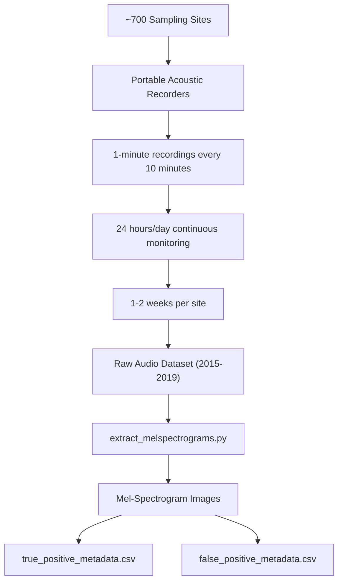
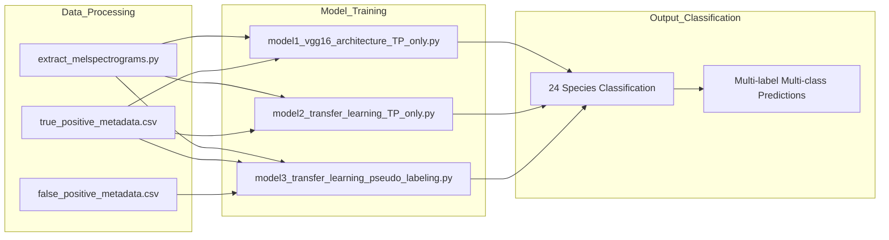
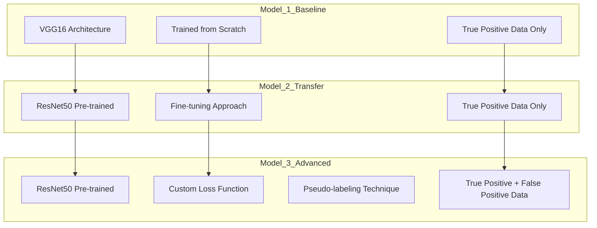
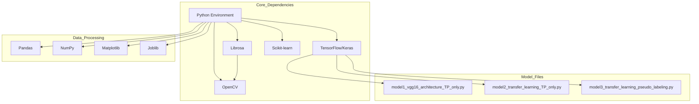

<!-- source: DeepWiki mcp.deepwiki.com · repo microsoft/Multi_Species_Bioacoustic_Classification · page 1 Project Overview · fetched 2026-10-26 -->

# Project Overview

Relevant source files

The following files were used as context for generating this wiki page:

- [README.md](README.md)
- [bioacoustics_monitoring.jpg](bioacoustics_monitoring.jpg)

## Purpose and Scope

This document provides a comprehensive introduction to the Multi-Species Bioacoustic Classification repository, explaining its conservation objectives, core methodology, and system architecture. The project implements deep learning techniques to automatically identify 24 bird and frog species from audio recordings collected across Puerto Rico's rainforests.

For detailed information about the data processing pipeline, see [Data Processing Pipeline](#3). For specific model implementations, see [Deep Learning Models](#4). For environment setup instructions, see [Environment Setup and Dependencies](#5).

## Project Background

The Multi-Species Bioacoustic Classification system is a collaborative research initiative between Microsoft's [AI for Earth](https://aka.ms/aiforearth) team, the [AI for Good Research Lab](http://aka.ms/aiforgood), and [Sieve Analytics](https://www.sieve-analytics.com). The project addresses critical biodiversity monitoring needs in Puerto Rico by automating the detection of species of Greatest Conservation Need as defined by the State Wildlife Action Plan.

### Conservation Objectives

The system targets 24 species of birds and frogs, with primary focus on endangered and threatened species while also including common species for baseline comparison:

| Species Category | Examples | Conservation Status |
|------------------|----------|-------------------|
| Greatest Conservation Need | Various endemic birds and frogs | Protected/Threatened |
| Common Baseline Species | Common coqui, Pearly-eyed thrasher, Scaly-naped pigeon | Stable populations |

The automated classification enables large-scale biodiversity monitoring across Puerto Rico's mountainous regions, providing conservation managers with actionable data for species population assessment and habitat protection decisions.

**Sources:** [README.md:1-37]()

## Data Collection Framework

Audio data collection spans 2015-2019 across approximately 700 sampling sites throughout Puerto Rico's mountain ecosystems. The systematic data collection protocol ensures comprehensive temporal and spatial coverage:

**Data Collection Parameters**
- **Temporal Resolution**: 1-minute segments every 10 minutes
- **Coverage**: 24-hour continuous monitoring
- **Duration**: 1-2 weeks per sampling location  
- **Geographic Scope**: Mountain regions across Puerto Rico
- **Collection Period**: 2015-2019

**Sources:** [README.md:12-13]()

## System Architecture Overview

The system implements a three-tier deep learning architecture that progressively increases in sophistication, from baseline CNN implementation to advanced semi-supervised learning with pseudo-labeling:

### Core System Components

| Component | File | Purpose | Data Input |
|-----------|------|---------|------------|
| Mel-Spectrogram Extraction | `extract_melspectrograms.py` | Convert audio to visual representations | Raw audio recordings |
| Baseline CNN | `model1_vgg16_architecture_TP_only.py` | VGG16 from scratch training | True positives only |
| Transfer Learning | `model2_transfer_learning_TP_only.py` | ResNet50 fine-tuning | True positives only |
| Advanced Semi-Supervised | `model3_transfer_learning_pseudo_labeling.py` | ResNet50 + pseudo-labeling | True positives + false positives |

**Sources:** [README.md:17-21]()

## Model Development Progression

The system implements three increasingly sophisticated deep learning approaches, enabling comparative analysis of different CNN architectures and training methodologies:

### Model Characteristics

**Model 1: VGG16 Baseline CNN**
- Architecture: Custom VGG16 implementation trained from scratch
- Training Data: True positive mel-spectrograms only
- Purpose: Establish baseline performance metrics

**Model 2: ResNet50 Transfer Learning**  
- Architecture: Pre-trained ResNet50 with fine-tuning
- Training Data: True positive mel-spectrograms only
- Purpose: Leverage pre-trained features for improved performance

**Model 3: Advanced ResNet50 with Pseudo-labeling**
- Architecture: Pre-trained ResNet50 with custom loss functions
- Training Data: True positive + false positive mel-spectrograms
- Purpose: Semi-supervised learning to maximize data utilization

**Sources:** [README.md:19-21]()

## Input Data Specifications

The system processes mel-spectrogram images derived from validated audio detections, implementing a multi-label multi-class classification framework:

### Data Format Requirements

| Data Type | File Extension | Resolution | Content |
|-----------|----------------|------------|---------|
| True Positive Spectrograms | `_tp.png` | 224x224 pixels | Confirmed species presence |
| False Positive Spectrograms | `_fp.png` | 224x224 pixels | Confirmed species absence |
| Metadata | `.csv` | Tabular | Species labels and validation status |

### Classification Framework
- **Task Type**: Multi-label multi-class classification
- **Target Species**: 24 bird and frog species
- **Input Format**: Mel-spectrogram images (224x224 RGB)
- **Output Format**: Species presence probability scores

**Sources:** [README.md:17-18]()

## Technology Stack and Dependencies

The system leverages a comprehensive technology stack optimized for audio processing and deep learning:

### Key Technology Components
- **Audio Processing**: Librosa for mel-spectrogram extraction
- **Image Processing**: OpenCV for spectrogram manipulation
- **Deep Learning**: TensorFlow/Keras for CNN implementation
- **Data Management**: Pandas and NumPy for data handling
- **Parallel Processing**: Joblib for performance optimization

**Sources:** [README.md:1-37]()

## Collaborative Framework

The project operates within a structured collaborative framework involving multiple Microsoft AI initiatives and external conservation partners:

### Partnership Structure
- **Microsoft AI for Earth**: Primary platform and infrastructure support
- **Microsoft AI for Good Research Lab**: Research methodology and validation
- **Sieve Analytics**: Data collection and domain expertise

### Open Source Contribution
The project welcomes contributions under the Microsoft Open Source Code of Conduct, requiring Contributor License Agreement (CLA) compliance for all submissions.

**Sources:** [README.md:5-6](), [README.md:24-36]()

---

