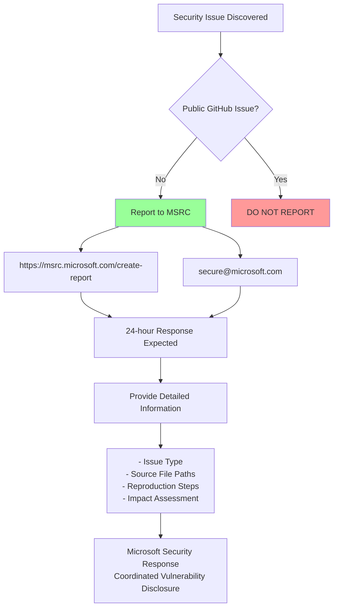
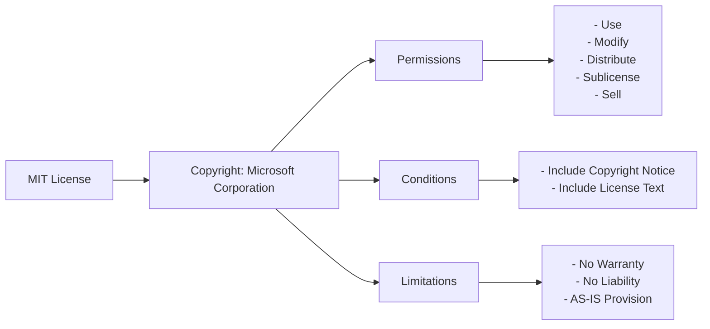
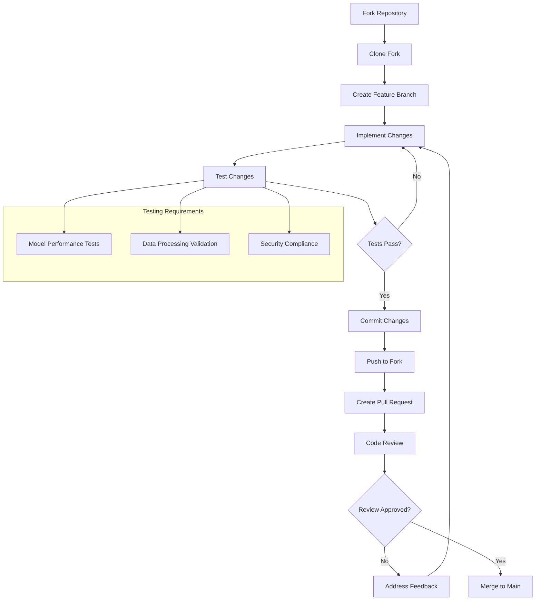
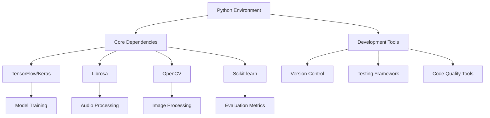

<!-- source: DeepWiki mcp.deepwiki.com · repo microsoft/Multi_Species_Bioacoustic_Classification · page 8 Contributing and Development Guidelines · fetched 2026-10-26 -->

# Contributing and Development Guidelines

Relevant source files

The following files were used as context for generating this wiki page:

- [CODE_OF_CONDUCT.md](CODE_OF_CONDUCT.md)
- [LICENSE](LICENSE)
- [SECURITY.md](SECURITY.md)

This document provides essential guidelines for contributing to the Multi-Species Bioacoustic Classification project, including code of conduct, security reporting procedures, licensing requirements, and development practices. For information about setting up the technical environment and dependencies, see [Environment Setup and Dependencies](#5).

## Purpose and Scope

This page covers the organizational and procedural aspects of contributing to the project, including community standards, security practices, and legal requirements. The guidelines ensure consistent, secure, and collaborative development while maintaining the project's conservation mission and Microsoft's open source standards.

## Code of Conduct

The project operates under the Microsoft Open Source Code of Conduct, which establishes community standards and behavioral expectations for all contributors.

### Community Standards

| Aspect | Requirement | Contact |
|--------|-------------|---------|
| Code of Conduct | [Microsoft Open Source Code of Conduct](https://opensource.microsoft.com/codeofconduct) | [opencode@microsoft.com](mailto:opencode@microsoft.com) |
| Questions/Concerns | FAQ available | [Microsoft Code of Conduct FAQ](https://opensource.microsoft.com/codeofconduct/faq) |
| Enforcement | Community-driven moderation | Direct contact required for violations |

The code of conduct applies to all project spaces, including GitHub issues, pull requests, documentation, and any communication channels.

**Sources:** [CODE_OF_CONDUCT.md:1-10]()

## Security Guidelines

Microsoft maintains strict security standards for all repositories. The project follows established vulnerability disclosure and reporting procedures.

### Security Vulnerability Reporting Process

### Required Security Information

When reporting security vulnerabilities, include the following details:

| Information Type | Description | Example |
|-----------------|-------------|---------|
| Issue Type | Classification of vulnerability | Buffer overflow, injection, XSS |
| Source Files | Full paths to affected files | `extract_melspectrograms.py`, `model3_transfer_learning_pseudo_labeling.py` |
| Location | Git reference or URL | Specific branch, commit, or tag |
| Configuration | Special setup requirements | Environment variables, data paths |
| Reproduction | Step-by-step instructions | Command sequences, input data |
| Proof of Concept | Exploit code if available | Minimal working example |
| Impact | Potential attack vectors | Data exposure, code execution |

### Security Response Timeline

- **24 hours**: Initial response expected from Microsoft Security Response Center
- **Follow-up**: Required if no initial response received
- **Languages**: English preferred for all communications
- **Policy**: Coordinated Vulnerability Disclosure principle

**Sources:** [SECURITY.md:1-42]()

## Licensing Requirements

The project operates under the MIT License with specific attribution requirements for Microsoft Corporation.

### License Terms

### Attribution Requirements

All contributions and derivative works must include:

1. **Copyright Notice**: `Copyright (c) Microsoft Corporation.`
2. **License Text**: Full MIT License text must be preserved
3. **Distribution**: All copies and substantial portions must include both notice and license

### Contribution Rights

Contributors grant Microsoft Corporation the right to:
- Use contributed code under the MIT License terms
- Modify and redistribute contributions
- Sublicense contributions as part of the larger project
- Include contributions in commercial and non-commercial applications

**Sources:** [LICENSE:1-22]()

## Contributing Process

### Development Workflow

### Code Standards

| Component | Standard | Validation |
|-----------|----------|------------|
| Python Code | PEP 8 compliance | Automated linting |
| Model Files | Consistent naming convention | File path validation |
| Documentation | Technical accuracy | Peer review |
| Data Processing | Reproducible results | Output verification |
| Dependencies | Version compatibility | Environment testing |

### Key Files and Modules for Contributors

When contributing to different aspects of the system, focus on these core modules:

| Contribution Area | Primary Files | Key Functions/Classes |
|------------------|---------------|----------------------|
| Data Processing | `extract_melspectrograms.py` | Audio processing pipeline |
| Model Architecture | `model1_vgg16_architecture_TP_only.py` | VGG16 implementation |
| Transfer Learning | `model2_transfer_learning_TP_only.py` | ResNet50 fine-tuning |
| Advanced Models | `model3_transfer_learning_pseudo_labeling.py` | Pseudo-labeling implementation |
| Evaluation | Model evaluation scripts | Metrics calculation |

### Quality Assurance Requirements

1. **Model Performance**: Contributions affecting model training must demonstrate equivalent or improved performance on existing test datasets
2. **Data Integrity**: Changes to data processing must preserve spectrogram quality and species classification accuracy
3. **Backwards Compatibility**: New features should not break existing model loading or prediction capabilities
4. **Documentation**: All new functions and classes require docstring documentation following existing patterns

## Development Environment Guidelines

### Environment Consistency

Contributions must work within the established technology stack:

### Required Development Practices

| Practice | Requirement | Implementation |
|----------|-------------|----------------|
| Dependency Management | Pin specific versions | Update `requirements.txt` |
| Code Documentation | Comprehensive docstrings | Follow existing patterns |
| Error Handling | Robust exception handling | Validate inputs and outputs |
| Logging | Informative progress tracking | Use consistent logging levels |
| File Organization | Maintain directory structure | Follow existing conventions |

### Testing Requirements

Contributors must ensure their changes:
1. **Pass existing tests**: All current functionality must remain intact
2. **Include new tests**: New features require corresponding test cases
3. **Validate model outputs**: Changes to models must verify prediction accuracy
4. **Test data compatibility**: Ensure compatibility with existing mel-spectrogram formats

## Review and Approval Process

### Review Criteria

Pull requests undergo evaluation based on:

| Criteria | Evaluation Focus | Reviewer Responsibility |
|----------|------------------|------------------------|
| Technical Accuracy | Algorithm correctness | Domain expert review |
| Conservation Impact | Species identification performance | Conservation specialist review |
| Code Quality | Standards compliance | Technical reviewer |
| Security | Vulnerability assessment | Security-focused review |
| Documentation | Clarity and completeness | Documentation reviewer |

### Approval Requirements

- **Technical Review**: At least one technical reviewer approval
- **Conservation Review**: Validation of biological/conservation accuracy
- **Security Review**: Security compliance verification for significant changes
- **Maintainer Approval**: Final approval from project maintainers

**Sources:** [CODE_OF_CONDUCT.md:1-10](), [SECURITY.md:1-42](), [LICENSE:1-22]()

---

