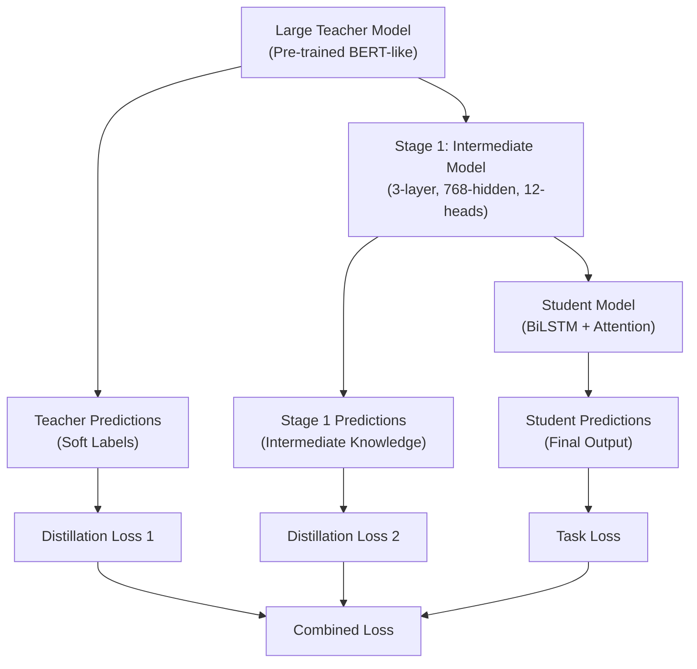
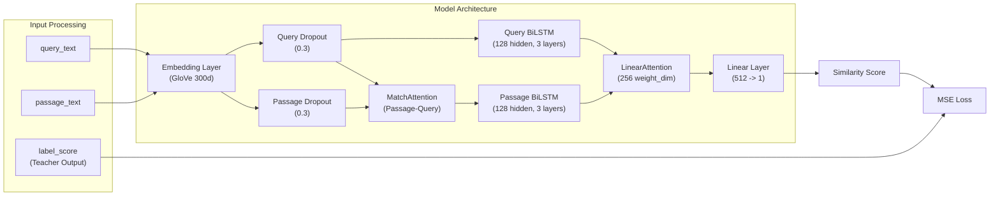
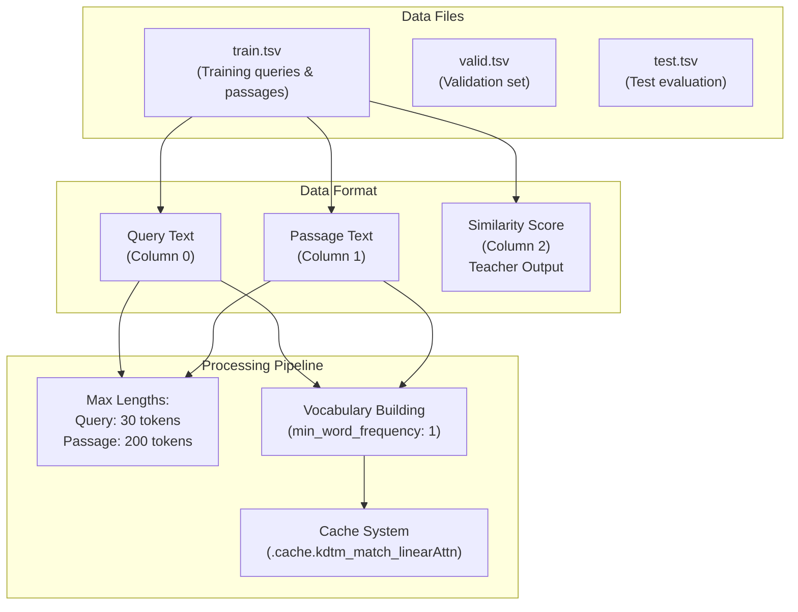
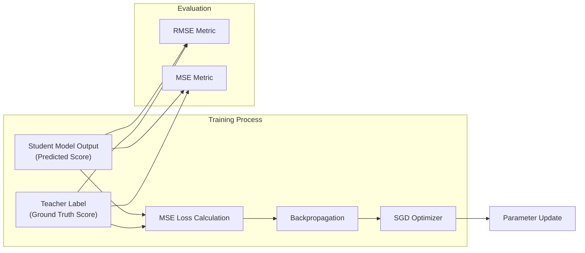
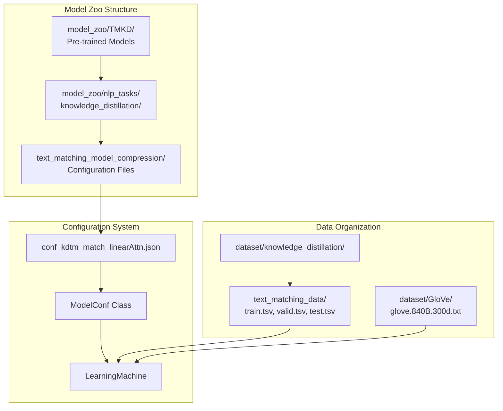

<!-- source: DeepWiki mcp.deepwiki.com · repo microsoft/NeuronBlocks · page 5.4 Knowledge Distillation · fetched 2026-10-26 -->

# Knowledge Distillation

Relevant source files

The following files were used as context for generating this wiki page:

- [dataset/knowledge_distillation/text_matching_data/test.tsv](dataset/knowledge_distillation/text_matching_data/test.tsv)
- [dataset/knowledge_distillation/text_matching_data/train.tsv](dataset/knowledge_distillation/text_matching_data/train.tsv)
- [dataset/knowledge_distillation/text_matching_data/valid.tsv](dataset/knowledge_distillation/text_matching_data/valid.tsv)
- [model_zoo/TMKD/README.md](model_zoo/TMKD/README.md)
- [model_zoo/nlp_tasks/knowledge_distillation/text_matching_model_compression/conf_kdtm_match_linearAttn.json](model_zoo/nlp_tasks/knowledge_distillation/text_matching_model_compression/conf_kdtm_match_linearAttn.json)

Knowledge distillation in NeuronBlocks provides model compression techniques that transfer knowledge from larger teacher models to smaller, more efficient student models. This implementation focuses on text matching tasks and includes the Two-stage Multi-teacher Knowledge Distillation (TMKD) approach for web question answering systems.

For general model examples and configurations, see [Model Examples](#5). For specific block implementations used in distillation architectures, see [Block Reference](#6).

## TMKD Implementation

The TMKD (Two-stage Multi-teacher Knowledge Distillation) implementation is based on the WSDM 2020 paper "Model Compression with Two-stage Multi-teacher Knowledge Distillation for Web Question Answering System". This approach provides a systematic method for compressing large transformer models into more efficient architectures while maintaining performance.

### TMKD Architecture Overview

The TMKD process involves training smaller models to mimic the behavior of larger teacher models through multiple stages of knowledge transfer.

**Sources:** [model_zoo/TMKD/README.md:1-42]()

## Text Matching Model Compression

NeuronBlocks implements knowledge distillation specifically for text matching tasks, where models learn to score query-passage pairs by learning from teacher model outputs.

### Model Compression Configuration

The text matching compression uses a specialized configuration that combines traditional neural network architectures with knowledge distillation training:

| Component | Configuration | Purpose |
|-----------|--------------|---------|
| Dataset Type | `regression` | Continuous similarity scores |
| Architecture | BiLSTM + LinearAttention | Efficient student model |
| Loss Function | MSELoss | Regression-based distillation |
| Input Format | Query-Passage pairs | Text matching task |

**Sources:** [model_zoo/nlp_tasks/knowledge_distillation/text_matching_model_compression/conf_kdtm_match_linearAttn.json:1-187]()

## Architecture Components

### Core Layers Configuration

The knowledge distillation model uses several key architectural components optimized for efficiency:

**Embedding Layer:**
- Word embeddings with 300-dimensional GloVe vectors
- Supports both query and passage text inputs
- Pre-trained embeddings from `dataset/GloVe/glove.840B.300d.txt`

**Attention Mechanisms:**
- `MatchAttention` for cross-attention between query and passage
- `LinearAttention` for self-attention with 256-dimensional weights
- Combination layers for feature fusion

**Recurrent Processing:**
- BiLSTM layers with 128 hidden dimensions
- 3-layer depth for both query and passage processing
- 0.3 dropout rate for regularization

**Sources:** [model_zoo/nlp_tasks/knowledge_distillation/text_matching_model_compression/conf_kdtm_match_linearAttn.json:67-174]()

## Data Format and Processing

### Training Data Structure

Knowledge distillation datasets follow a specific format for query-passage matching with continuous similarity scores:

### Data Sample Format

Each training example consists of:
- **Query text**: Question or search query
- **Passage text**: Candidate answer or document passage  
- **Label score**: Continuous similarity score (0.0 to 1.0) from teacher model

Example data points show various query types with corresponding relevance scores, such as factual questions, entity queries, and informational requests.

**Sources:** [dataset/knowledge_distillation/text_matching_data/train.tsv:1-10](), [dataset/knowledge_distillation/text_matching_data/valid.tsv:1-10](), [dataset/knowledge_distillation/text_matching_data/test.tsv:1-10]()

## Training Configuration

### Optimization Settings

The knowledge distillation training uses specific hyperparameters optimized for model compression:

| Parameter | Value | Purpose |
|-----------|--------|---------|
| Optimizer | SGD | Stable convergence |
| Learning Rate | 0.2 | Initial learning rate |
| Momentum | 0.9 | SGD momentum |
| LR Decay | 0.95 | Learning rate scheduling |
| Minimum LR | 0.005 | Lower bound for learning rate |
| Batch Size | 128 | Training batch size |
| Max Epochs | 10 | Training duration |

### Loss Function and Metrics

The distillation process uses:
- **Loss**: MSELoss for regression-based knowledge transfer
- **Metrics**: RMSE and MSE for evaluation
- **Target**: Continuous similarity scores from teacher model

**Sources:** [model_zoo/nlp_tasks/knowledge_distillation/text_matching_model_compression/conf_kdtm_match_linearAttn.json:40-64](), [model_zoo/nlp_tasks/knowledge_distillation/text_matching_model_compression/conf_kdtm_match_linearAttn.json:176-187]()

## Integration with NeuronBlocks Framework

### File Structure and Organization

The knowledge distillation implementation integrates with the broader NeuronBlocks architecture:

### Usage with Training Pipeline

Knowledge distillation models follow the standard NeuronBlocks training workflow:

1. **Configuration Loading**: JSON config specifies architecture and hyperparameters
2. **Data Processing**: TSV files processed through Problem class
3. **Model Building**: Architecture constructed from Block Zoo components  
4. **Training Execution**: LearningMachine handles distillation training loop
5. **Evaluation**: Metrics calculated on validation/test sets

**Sources:** [model_zoo/nlp_tasks/knowledge_distillation/text_matching_model_compression/conf_kdtm_match_linearAttn.json:2-4](), [model_zoo/nlp_tasks/knowledge_distillation/text_matching_model_compression/conf_kdtm_match_linearAttn.json:30-39]()

---

