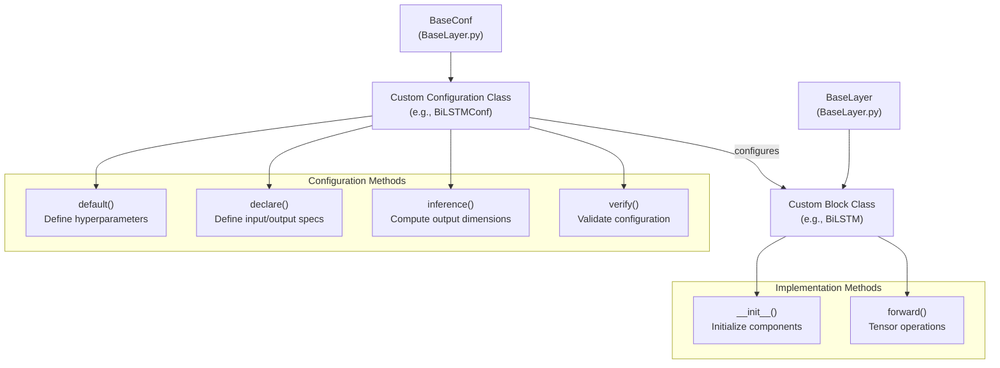
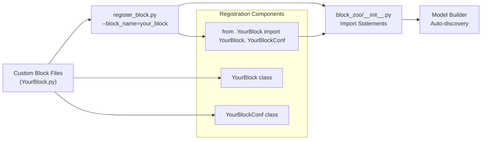
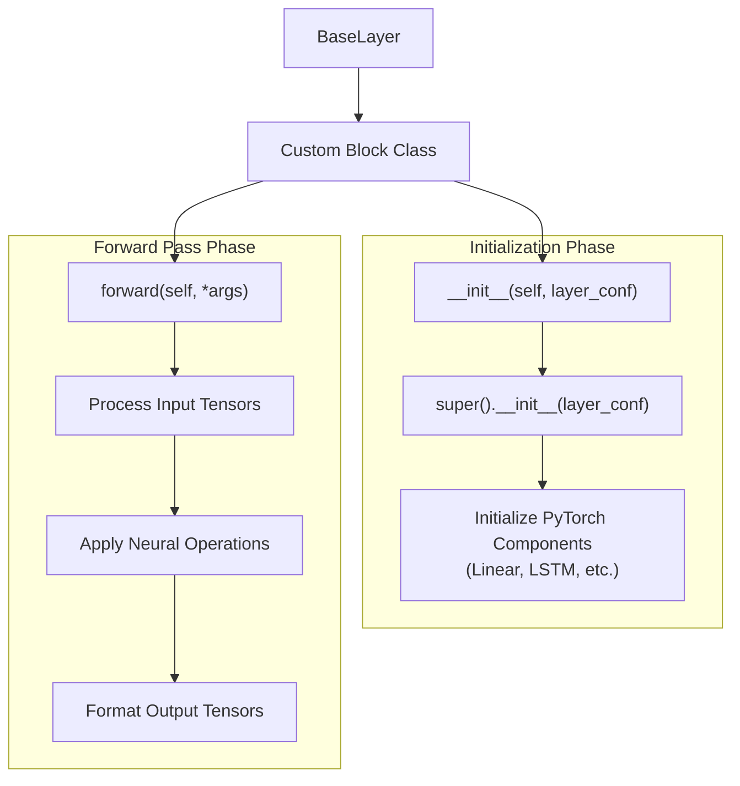
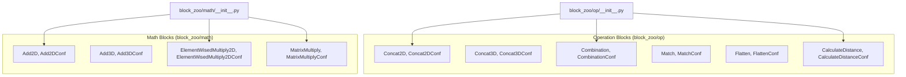

<!-- source: DeepWiki mcp.deepwiki.com · repo microsoft/NeuronBlocks · page 8.2 Custom Blocks · fetched 2026-10-26 -->

# Custom Blocks

<details>
<summary>Relevant source files</summary>

The following files were used as context for generating this wiki page:

- [Contributing.md](Contributing.md)
- [autotest/tools/get_results.py](autotest/tools/get_results.py)
- [block_zoo/__init__.py](block_zoo/__init__.py)
- [block_zoo/op/__init__.py](block_zoo/op/__init__.py)

</details>


This document provides comprehensive guidance for creating custom neural network blocks in NeuronBlocks. It covers the technical architecture, implementation requirements, and registration process for extending the Block Zoo with new reusable components.

For general contribution guidelines, see [Contributing Guide](#8.1). For understanding the existing block ecosystem, see [Block Zoo](#3.1). For automated testing of custom blocks, see [Automated Testing](#7.3).

## Block Architecture Overview

Custom blocks in NeuronBlocks follow a dual-class architecture pattern where each block consists of a configuration class and an implementation class that work together to define reusable neural network components.

### Block Class Hierarchy



Sources: [block_zoo/BaseLayer.py](), [Contributing.md:24-72]()

### Block Registration System



Sources: [Contributing.md:73-79](), [block_zoo/__init__.py:1-58]()

## Configuration Class Implementation

The configuration class defines the block's interface, hyperparameters, and validation logic. It must inherit from `BaseConf` and implement four core methods.

### Required Methods

| Method | Purpose | Return Type |
|--------|---------|-------------|
| `default()` | Define default hyperparameters | Dictionary |
| `declare()` | Specify input/output requirements | None (sets attributes) |
| `inference()` | Calculate output dimensions | None (sets attributes) |
| `verify()` | Validate configuration | None (raises on error) |

### Method Implementation Details

#### default() Method
This static method returns a dictionary of default hyperparameter values that can be overridden in JSON configuration files.

```python
@staticmethod
def default():
    return {
        'hidden_dim': 128,
        'dropout': 0.0,
        'bidirectional': True
    }
```

#### declare() Method
Defines input/output specifications using these key attributes:
- `num_of_input`: Number of inputs (-1 for variable)
- `input_ranks`: List of expected input tensor ranks
- `num_of_output`: Number of outputs
- `output_ranks`: List of output tensor ranks

#### inference() Method
Computes output dimensions based on input dimensions and hyperparameters, setting the `output_dim` attribute.

#### verify() Method
Performs validation checks and raises exceptions for invalid configurations.

Sources: [Contributing.md:27-60]()

## Block Class Implementation

The block class contains the actual neural network logic and must inherit from `BaseLayer`. It implements PyTorch module functionality through two primary methods.

### Core Implementation Structure



Sources: [Contributing.md:61-72]()

### __init__ Method Requirements

The initialization method must:
1. Call `super().__init__(layer_conf)` first
2. Initialize PyTorch modules based on configuration
3. Set up any required internal state

### forward Method Requirements

The forward method must:
1. Accept variable number of input tensors (`*args`)
2. Process inputs according to block logic
3. Return output tensors in expected format
4. Handle tensor dimension transformations correctly

## Registration Process

Custom blocks must be registered in the Block Zoo to be discoverable by the model building system.

### Automatic Registration

NeuronBlocks provides an automated registration script that handles the import statements and makes blocks available system-wide.

```bash
cd PROJECT_ROOT
python register_block.py --block_name=your_custom_block
```

This script automatically:
1. Adds import statements to [block_zoo/__init__.py]()
2. Makes both the block class and configuration class available
3. Enables auto-discovery by the model builder

### Manual Registration

Alternatively, you can manually add import statements to [block_zoo/__init__.py:1-58]():

```python
from .YourCustomBlock import YourCustomBlock, YourCustomBlockConf
```

Sources: [Contributing.md:73-79](), [block_zoo/__init__.py]()

## Block Categories and Examples

The Block Zoo organizes blocks into several categories, each serving different architectural purposes.

### Existing Block Categories

| Category | Purpose | Examples |
|----------|---------|----------|
| Core Layers | Basic building blocks | `Linear`, `Embedding`, `Dropout` |
| Recurrent Layers | Sequence processing | `BiLSTM`, `BiGRU`, `BiQRNN` |  
| Convolutional Layers | Spatial processing | `Conv`, `Conv2D`, `ConvPooling` |
| Attention Mechanisms | Context modeling | `FullAttention`, `BiAttFlow`, `LinearAttention` |
| Pooling Operations | Dimension reduction | `Pooling`, `Pooling1D`, `Pooling2D` |
| Math Operations | Tensor manipulation | `Add2D`, `Minus3D`, `MatrixMultiply` |
| Combination Operations | Multi-input processing | `Concat2D`, `Combination`, `Match` |

### Operation Block Structure



Sources: [block_zoo/op/__init__.py:1-9](), [block_zoo/__init__.py:36-46]()

## Best Practices for Custom Blocks

### Configuration Design
- Use descriptive parameter names that clearly indicate their purpose
- Provide sensible default values for all hyperparameters
- Include parameter validation in the `verify()` method
- Document expected input/output tensor shapes in comments

### Implementation Guidelines
- Follow PyTorch best practices for module design
- Handle variable input sizes gracefully when possible
- Use appropriate initialization for neural network parameters
- Include proper error handling for invalid inputs

### Tensor Rank Management
The rank system in NeuronBlocks follows these conventions:
- Rank 0: Scalar values
- Rank 1: Vector (1D tensor)
- Rank 2: Matrix (2D tensor)  
- Rank 3: 3D tensor (batch × sequence × features)

Ensure your block's `declare()` method correctly specifies input and output ranks.

### Testing Integration
Before contributing custom blocks, verify functionality using the automated testing system:
- Add test cases for your block in the autotest framework
- Ensure compatibility with different input configurations
- Test both training and inference modes

Sources: [Contributing.md:27-81](), [autotest/tools/get_results.py]()

## Advanced Block Patterns

### Multi-Input Blocks
For blocks accepting variable numbers of inputs, set `num_of_input = -1` in the `declare()` method and ensure all inputs have the same rank.

### Conditional Output Dimensions
Some blocks may have output dimensions that depend on runtime calculations. Handle this in the `inference()` method by computing dimensions based on input specifications and hyperparameters.

### State Management
For blocks requiring persistent state (like RNNs), properly initialize and manage internal state in the `__init__` and `forward` methods.

This architecture enables the creation of sophisticated, reusable neural network components that integrate seamlessly with the NeuronBlocks ecosystem.

Sources: [Contributing.md:45-49](), [block_zoo/__init__.py]()

---

