# Page: Overview

# Overview

<details>
<summary>Relevant source files</summary>

The following files were used as context for generating this wiki page:

- [README.md](README.md)
- [README_zh_CN.md](README_zh_CN.md)
- [requirements.txt](requirements.txt)

</details>


This document provides a comprehensive overview of NeuronBlocks, an NLP deep learning modeling toolkit designed to simplify neural network model development through modular components and JSON-based configuration. This page covers the system's architecture, core components, and fundamental concepts needed to understand how NeuronBlocks operates.

For specific installation and setup instructions, see [Getting Started](#2). For detailed information about individual neural network components, see [Block Zoo](#3.1). For pre-configured model examples, see [Model Zoo](#3.2).

## What is NeuronBlocks

NeuronBlocks is a modular NLP deep learning toolkit that enables engineers and researchers to build end-to-end neural network pipelines through JSON configuration files rather than extensive coding. The system abstracts complex neural network architectures into reusable building blocks, allowing users to construct models by combining components similar to assembling Lego blocks.

The toolkit supports both training and inference stages across multiple NLP tasks including text classification, sentiment analysis, question answering, sequence tagging, and knowledge distillation. It provides cross-platform compatibility (Linux/Windows, CPU/GPU) and supports both English and Chinese language processing.

**Sources:** [README.md:27-29](), [README.md:40-48]()

## System Architecture

The NeuronBlocks architecture consists of two main components working together through a JSON-based configuration system:

### High-Level Architecture with Code Entities

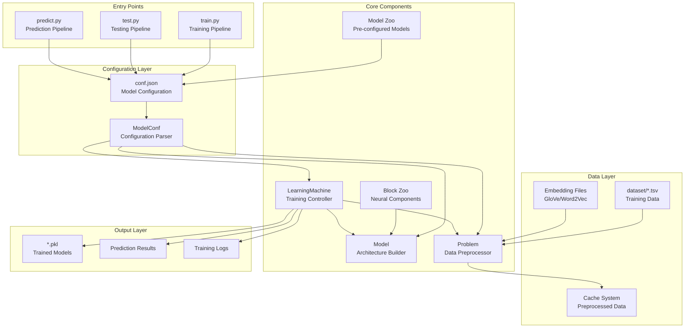

**Sources:** [README.md:30-33](), [README.md:90-100]()

### Block Zoo and Model Zoo Architecture

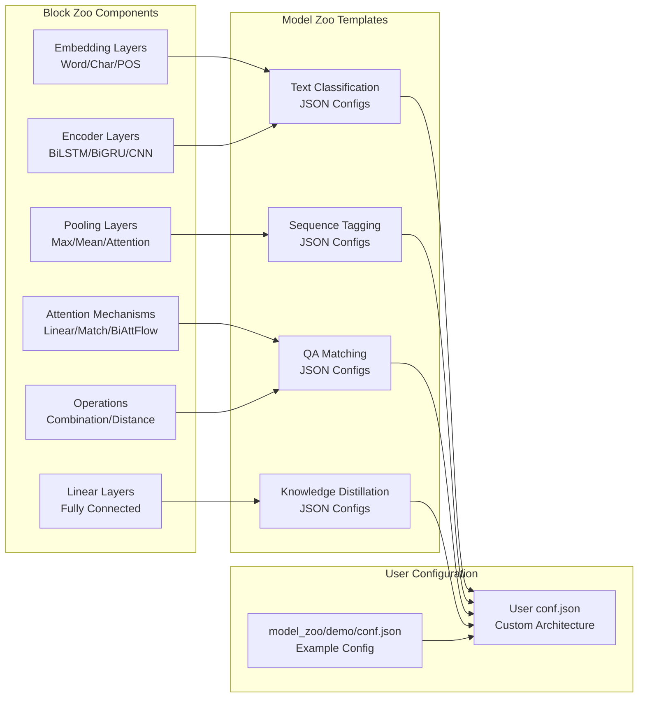

**Sources:** [README.md:30-33](), [README.md:50-56]()

## Core Components

### Block Zoo
The Block Zoo provides reusable neural network components that serve as building blocks for model architecture design. These components are implemented as PyTorch modules and can be combined through JSON configuration to create complex architectures.

**Key component categories:**
- **Embedding layers**: Word embeddings, character embeddings, positional encodings
- **Encoder layers**: BiLSTM, BiGRU, CNN layers for sequence processing  
- **Attention mechanisms**: Various attention types including linear attention and bidirectional attention flow
- **Pooling layers**: Max pooling, mean pooling, attention-based pooling
- **Linear layers**: Fully connected layers with configurable dimensions
- **Operations**: Combination operations, distance calculations, tensor manipulations

### Model Zoo  
The Model Zoo contains pre-configured model architectures for common NLP tasks, distributed as JSON configuration files. Users can directly use these configurations or modify them as starting points for custom models.

**Available model templates:**
- Text classification and sentiment analysis models
- Question answering and text matching models  
- Sequence tagging models for NER and slot filling
- Knowledge distillation models for model compression
- Reading comprehension models

**Sources:** [README.md:30-33](), [README.md:40-48]()

## Execution Workflow

The NeuronBlocks execution follows a consistent pattern across training, testing, and prediction phases:

### Training and Testing Pipeline

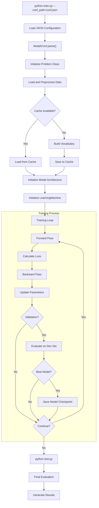

**Sources:** [README.md:90-100](), [README.md:102-114]()

## Technical Capabilities

### Platform and Environment Support

| Environment | CPU Training | Single-GPU Training | Multi-GPU Training |
|-------------|--------------|-------------------|-------------------|
| **CPU Inference** | ✓ | ✓ | ✓ |
| **Single-GPU Inference** | ✓ | ✓ | ✓ |
| **Multi-GPU Inference** | ✓ | ✓ | ✓ |

**System Requirements:**
- Python 3.6 or higher
- PyTorch 0.4.1 or higher  
- Cross-platform support (Linux/Windows)
- Optional GPU acceleration

**Sources:** [README.md:62](), [README.md:74](), [README.md:133-138]()

### Language and Task Support

**Supported Languages:**
- English (with NLTK tokenization)
- Chinese (with Jieba tokenization)

**Supported NLP Tasks:**
- Sentence classification and sentiment analysis
- Question answering and textual entailment
- Sequence tagging and slot filling
- Machine reading comprehension
- Knowledge distillation for model compression

**Sources:** [README.md:36-48]()

### Prediction Modes

NeuronBlocks supports two prediction modes through `predict.py`:

1. **Interactive Mode**: Real-time prediction with user input prompts
   ```bash
   python predict.py --conf_path=conf.json --predict_mode='interactive'
   ```

2. **Batch Mode**: Batch processing of input files
   ```bash  
   python predict.py --conf_path=conf.json --predict_mode='batch' --predict_data_path=data.tsv
   ```

**Sources:** [README.md:102-114]()

## Target Audience

NeuronBlocks addresses challenges faced by engineers and researchers working with neural networks for NLP:

**Primary Users:**
- NLP engineers building production systems with minimal deep learning expertise
- Researchers prototyping new model architectures quickly
- Teams requiring cross-platform model deployment
- Organizations needing model sharing and collaboration capabilities

**Key Benefits:**
- **Reduced coding overhead**: JSON configuration instead of implementation
- **Model sharing**: Easy distribution through configuration files
- **Code reusability**: Common blocks shared across projects
- **Platform flexibility**: Consistent behavior across environments
- **Model visualization**: Architecture validation and debugging tools
- **Extensibility**: Community contributions of new blocks and models

**Sources:** [README.md:118-141]()

---

# Page: Getting Started

# Getting Started

<details>
<summary>Relevant source files</summary>

The following files were used as context for generating this wiki page:

- [README.md](README.md)
- [README_zh_CN.md](README_zh_CN.md)
- [Tutorial.md](Tutorial.md)
- [Tutorial_zh_CN.md](Tutorial_zh_CN.md)
- [block_zoo/Pooling2D.py](block_zoo/Pooling2D.py)
- [model_zoo/nlp_tasks/knowledge_distillation/query_binary_classifier_compression/conf_kdqbc_bilstmattn_cnn.json](model_zoo/nlp_tasks/knowledge_distillation/query_binary_classifier_compression/conf_kdqbc_bilstmattn_cnn.json)
- [requirements.txt](requirements.txt)

</details>


This document provides installation instructions, basic setup, and initial usage patterns for NeuronBlocks. It covers the essential steps to install dependencies, run your first model, and understand the core configuration system. For detailed model architecture design, see [Core Architecture](#3). For comprehensive examples of specific NLP tasks, see [Model Examples](#5).

## Prerequisites and System Requirements

NeuronBlocks requires specific software versions and system configurations to function properly.

### System Requirements

| Component | Requirement |
|-----------|-------------|
| Python | 3.6 or higher |
| PyTorch | 0.4.1 or higher |
| Operating System | Linux, Windows (PowerShell recommended) |
| Hardware | CPU or GPU (CUDA support optional) |

### Platform Compatibility Matrix

NeuronBlocks supports flexible deployment across different hardware configurations:

| Training Mode | CPU Inference | Single-GPU Inference | Multi-GPU Inference |
|---------------|---------------|---------------------|---------------------|
| CPU Training | ✓ | ✓ | ✓ |
| Single-GPU Training | ✓ | ✓ | ✓ |
| Multi-GPU Training | ✓ | ✓ | ✓ |

**Sources:** [README.md:62-82](), [README.md:133-138](), [Tutorial.md:33-52]()

## Installation Process

The installation follows a three-step process: repository cloning, Python dependencies, and PyTorch installation.

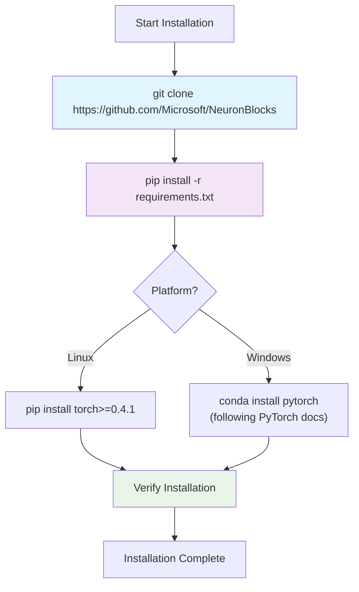

### Step-by-Step Installation

1. **Clone Repository**
   ```bash
   git clone https://github.com/Microsoft/NeuronBlocks
   cd NeuronBlocks
   ```

2. **Install Python Dependencies**
   ```bash
   pip install -r requirements.txt
   ```

3. **Install PyTorch**
   
   **For Linux:**
   ```bash
   pip install "torch>=0.4.1"
   ```
   
   **For Windows:**
   Follow the [PyTorch installation guide](https://pytorch.org/get-started/locally) using Conda.

### Core Dependencies

The [`requirements.txt`](requirements.txt:1-7)() specifies essential packages:

| Package | Version | Purpose |
|---------|---------|---------|
| `nltk` | 3.4.1 | English tokenization |
| `jieba` | 0.39 | Chinese tokenization |
| `gensim` | 3.7.2 | Word embedding support |
| `tqdm` | 4.31.1 | Progress bars |
| `numpy` | 1.16.3 | Numerical computations |
| `scikit-learn` | 0.20.3 | Evaluation metrics |

**Sources:** [README.md:64-82](), [Tutorial.md:35-52](), [requirements.txt:1-7]()

## Quick Start Workflow

The basic NeuronBlocks workflow involves three main executables: `train.py`, `test.py`, and `predict.py`, all controlled by JSON configuration files.

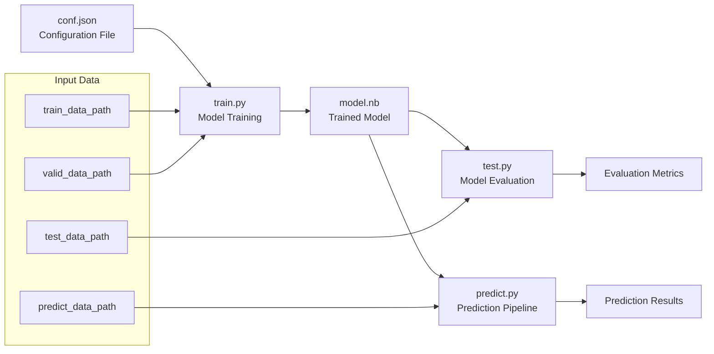

### Basic Commands

Execute these commands from the project root directory:

```bash
# Training
python train.py --conf_path=model_zoo/demo/conf.json

# Testing
python test.py --conf_path=model_zoo/demo/conf.json

# Prediction
python predict.py --conf_path=model_zoo/demo/conf.json
```

### Prediction Modes

NeuronBlocks supports two prediction modes:

**Interactive Mode** - Real-time single-case prediction:
```bash
python predict.py --conf_path=model_zoo/demo/conf.json --predict_mode='interactive'
```

**Batch Mode** - File-based batch prediction:
```bash
python predict.py --conf_path=model_zoo/demo/conf.json --predict_mode='batch' --predict_data_path=dataset/demo/predict.tsv
```

**Sources:** [README.md:84-114](), [Tutorial.md:56-72]()

## Configuration System Architecture

The configuration system uses JSON files to define model architecture, data paths, training parameters, and evaluation metrics. This eliminates the need for extensive coding.

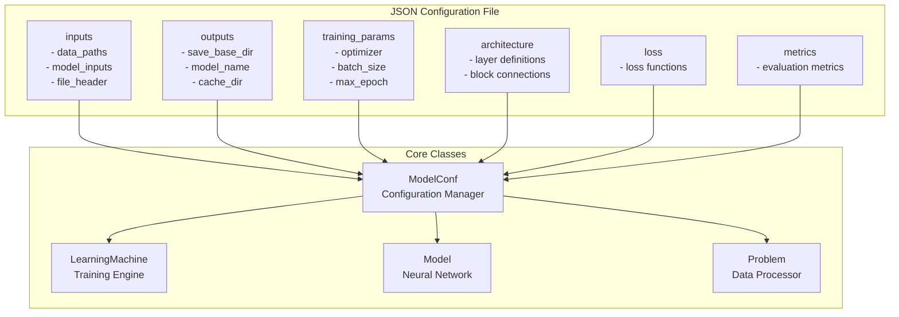

### Essential Configuration Sections

**Data Configuration (`inputs`):**
```json
{
  "inputs": {
    "use_cache": true,
    "dataset_type": "classification",
    "data_paths": {
      "train_data_path": "./dataset/demo/train.tsv",
      "valid_data_path": "./dataset/demo/valid.tsv",
      "test_data_path": "./dataset/demo/test.tsv",
      "pre_trained_emb": "./dataset/GloVe/glove.840B.300d.txt"
    },
    "file_header": {
      "question_text": 0,
      "answer_text": 1,
      "label": 2
    },
    "model_inputs": {
      "question": ["question_text"],
      "answer": ["answer_text"]
    },
    "target": ["label"]
  }
}
```

**Model Architecture (`architecture`):**
The architecture section defines neural network layers using Block Zoo components:
```json
{
  "architecture": [
    {
      "layer": "Embedding",
      "conf": {
        "word": {
          "cols": ["question_text", "answer_text"],
          "dim": 300
        }
      }
    },
    {
      "layer_id": "encoder",
      "layer": "BiLSTM",
      "conf": {
        "hidden_dim": 128,
        "dropout": 0.1
      },
      "inputs": ["question"]
    }
  ]
}
```

**Sources:** [Tutorial.md:77-204](), [model_zoo/nlp_tasks/knowledge_distillation/query_binary_classifier_compression/conf_kdqbc_bilstmattn_cnn.json:1-191]()

## Core Execution Pipeline

The training and evaluation pipeline orchestrates data processing, model building, and learning through key Python modules.

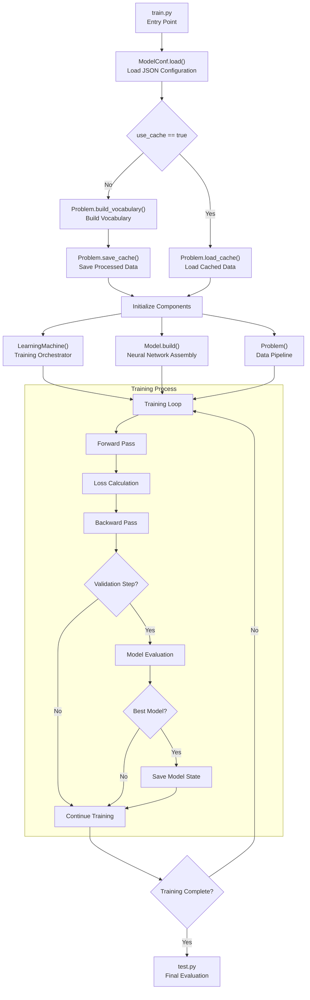

### Key Components and Their Roles

| Component | File/Class | Primary Function |
|-----------|------------|------------------|
| Configuration Loader | `ModelConf` | Parse and validate JSON configurations |
| Training Orchestrator | `LearningMachine` | Coordinate training process and optimization |
| Neural Network Builder | `Model` | Assemble Block Zoo components into networks |
| Data Processor | `Problem` | Handle data loading, preprocessing, and caching |
| Block Registry | Block Zoo classes | Provide reusable neural network components |

**Sources:** [README.md:90-100](), diagrams from high-level system overview

## Project Directory Structure

Understanding the directory layout helps navigate the codebase and organize custom models and datasets.

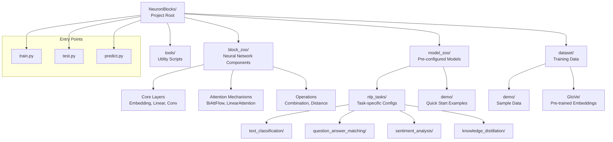

### Directory Organization Guidelines

**For New Projects:**
1. Create model directory: `model_zoo/your_project/`
2. Place datasets in: `dataset/your_project/`
3. Configure JSON files in your model directory
4. Reference data paths relative to project root

**Common File Patterns:**
- Configuration files: `*.json`
- Training data: `train.tsv`, `valid.tsv`, `test.tsv`
- Model outputs: `model.nb`, `*.log`
- Pre-trained embeddings: `*.txt`, `*.bin`

**Sources:** [Tutorial.md:81-84](), [README.md:30-56]()

## Language and Tokenization Support

NeuronBlocks provides built-in support for multiple languages with automatic tokenizer selection.

### Language Configuration

| Language | Configuration | Default Tokenizer | Usage |
|----------|---------------|-------------------|-------|
| English | `"language": "English"` | `nltk` | Default for most tasks |
| Chinese | `"language": "Chinese"` | `jieba` | Set explicitly in JSON config |

### Tokenizer Selection

The system automatically selects appropriate tokenizers based on the `language` setting in configuration files. Custom tokenizers can be specified using the `tokenizer` parameter in `training_params`.

**Example Chinese Configuration:**
```json
{
  "language": "Chinese",
  "training_params": {
    "tokenizer": "jieba"
  }
}
```

**Sources:** [Tutorial.md:207-211](), [README_zh_CN.md:37-39]()

## GPU and Multi-GPU Setup

NeuronBlocks automatically detects and utilizes available GPU resources with configurable device selection.

### GPU Configuration Options

```bash
# Use specific GPU
CUDA_VISIBLE_DEVICES=0 python train.py --conf_path=config.json

# Use multiple GPUs
CUDA_VISIBLE_DEVICES=0,1 python train.py --conf_path=config.json

# Force CPU usage
CUDA_VISIBLE_DEVICES= python train.py --conf_path=config.json
```

### Training Parameters for GPU

```json
{
  "training_params": {
    "use_gpu": true,
    "batch_size": 32,
    "cpu_num_workers": -1
  }
}
```

**Sources:** [Tutorial.md:140-148](), [Tutorial.md:149]()

## Next Steps

After completing the basic setup:

1. **Try the Demo Example** - Run the provided demo to verify installation
2. **Explore Model Zoo** - Review pre-configured models for your task type (see [Model Examples](#5))
3. **Understanding Architecture** - Learn about Block Zoo components (see [Core Architecture](#3))
4. **Custom Model Creation** - Design your own neural network architectures (see [Block Reference](#6))
5. **Advanced Features** - Explore visualization tools and automated testing (see [Utilities and Tools](#7))

For immediate hands-on experience, proceed with the demo example using the commands shown in the Quick Start Workflow section.

**Sources:** [README.md:115-141](), [Tutorial.md:220-230]()

---

# Page: Core Architecture

# Core Architecture

<details>
<summary>Relevant source files</summary>

The following files were used as context for generating this wiki page:

- [.gitignore](.gitignore)
- [ModelConf.py](ModelConf.py)
- [README.md](README.md)
- [README_zh_CN.md](README_zh_CN.md)
- [Tutorial.md](Tutorial.md)
- [Tutorial_zh_CN.md](Tutorial_zh_CN.md)
- [block_zoo/Pooling2D.py](block_zoo/Pooling2D.py)
- [model_zoo/nlp_tasks/knowledge_distillation/query_binary_classifier_compression/conf_kdqbc_bilstmattn_cnn.json](model_zoo/nlp_tasks/knowledge_distillation/query_binary_classifier_compression/conf_kdqbc_bilstmattn_cnn.json)
- [requirements.txt](requirements.txt)
- [utils/common_utils.py](utils/common_utils.py)

</details>


This document describes the fundamental design principles and core components of NeuronBlocks, focusing on how the JSON configuration system, Block Zoo, Model Zoo, and execution pipeline work together to enable modular NLP model development. For specific details about individual blocks and layers, see [Block Reference](#6). For training procedures and evaluation, see [Training and Evaluation](#4).

## Design Philosophy

NeuronBlocks follows a configuration-driven architecture where models are defined entirely through JSON configuration files rather than imperative code. This design enables researchers and engineers to build complex neural networks by composing reusable components from the Block Zoo without writing PyTorch implementation code.

The architecture centers around three core principles:

1. **Modular Composition**: Neural networks are built by connecting blocks from the Block Zoo like building with Lego pieces
2. **Configuration-Driven**: All model architecture, training parameters, and data processing settings are specified in JSON files
3. **Separation of Concerns**: The Block Zoo provides reusable components, Model Zoo provides pre-configured architectures, and the execution pipeline handles training/testing/prediction

**Core Architecture Overview**

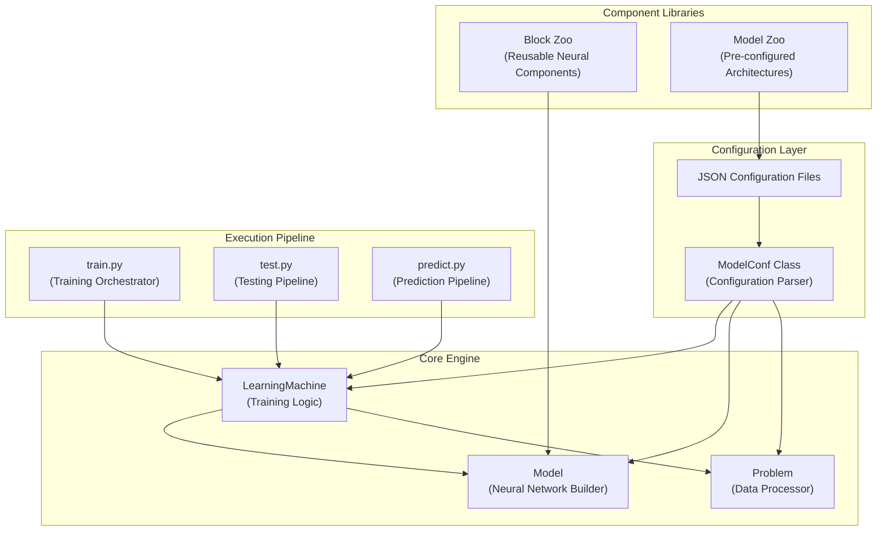

Sources: [README.md:27-56](), [Tutorial.md:75-85](), [ModelConf.py:68-100]()

## Configuration System

The configuration system is the central nervous system of NeuronBlocks, implemented primarily through the `ModelConf` class. This system transforms JSON configuration files into Python objects that drive the entire model building and training process.

**Configuration Architecture**

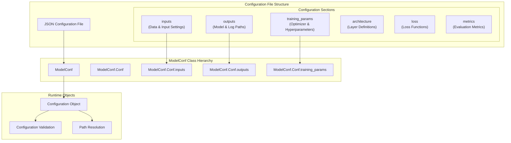

The `ModelConf` class uses a nested class structure with the `ConstantStaticItems` pattern to declaratively define configuration schema and validation rules. Each configuration section is represented by a nested class that handles loading and validation of its respective JSON section.

Sources: [ModelConf.py:68-100](), [ModelConf.py:101-169](), [Tutorial.md:77-205]()

### Configuration Loading Process

The configuration loading follows a structured pipeline:

1. **File Loading**: JSON configuration is loaded and parsed using `load_from_json`
2. **Schema Mapping**: The nested `ModelConf.Conf` classes map JSON structure to Python objects
3. **Path Configuration**: Input/output paths are resolved and validated
4. **Training Parameter Setup**: Optimizer settings and hyperparameters are configured
5. **Architecture Processing**: Layer definitions are validated and prepared for model building

Key methods in the loading process:

- `configurate_outputs()` - Sets up model save directories and logging paths
- `configurate_inputs()` - Processes data paths and input format specifications  
- `configurate_training_params()` - Configures optimizer and training settings
- `configurate_architecture()` - Validates layer definitions and connections

Sources: [ModelConf.py:174-185](), [ModelConf.py:186-244](), [ModelConf.py:245-356]()

## Block Zoo Architecture

The Block Zoo is the foundation of NeuronBlocks' modular design, providing a library of reusable neural network components that can be combined to build complex architectures. Each block is a self-contained PyTorch module with standardized interfaces.

**Block Zoo Component Structure**

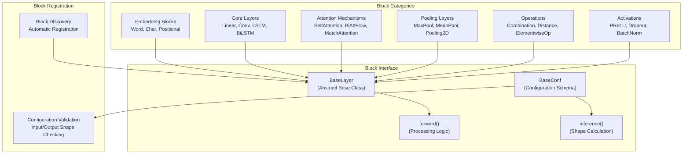

Each block follows a standardized pattern with two main classes:
- **Configuration Class** (e.g., `Pooling2DConf`): Defines parameters, validates inputs, and calculates output dimensions
- **Implementation Class** (e.g., `Pooling2D`): Contains the actual PyTorch neural network logic

Sources: [block_zoo/Pooling2D.py:14-89](), [block_zoo/Pooling2D.py:90-125]()

### Block Interface Design

All blocks inherit from `BaseLayer` and `BaseConf` to ensure consistent interfaces:

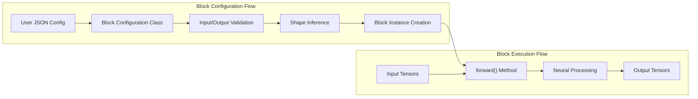

The configuration classes handle:
- Parameter validation through `verify()` methods
- Output shape calculation through `inference()` methods  
- Input rank and dimension checking
- Default value assignment

Sources: [block_zoo/Pooling2D.py:34-78]()

## Model Zoo Architecture

The Model Zoo provides pre-configured JSON files that demonstrate best practices and enable quick experimentation with proven architectures. Each model configuration represents a complete solution for specific NLP tasks.

**Model Zoo Organization**

```mermaid
graph TB
    subgraph "Task Categories"
        TextClassification["text_classification/<br/>CNN, BiLSTM+Attention Models"]
        QuestionAnswering["question_answer_matching/<br/>ARC-I, ARC-II, BiAttFlow Models"]
        SentimentAnalysis["sentiment_analysis/<br/>BiLSTM, Attention Models"]
        SequenceTagging["slot_tagging/<br/>BiLSTM+CRF, Char+Word Models"]
        KnowledgeDistillation["knowledge_distillation/<br/>Student-Teacher Models"]
        ChineseTasks["chinese_*/<br/>Chinese Language Models"]
    end
    
    subgraph "Configuration Structure"
        ModelTemplate["Model Configuration Template"]
        
        subgraph "Standard Sections"
            DataPaths["data_paths<br/>(Dataset Locations)"]
            ModelInputs["model_inputs<br/>(Input Definitions)"] 
            ArchitectureDef["architecture<br/>(Layer Stack Definition)"]
            LossConfig["loss<br/>(Loss Function Config)"]
            MetricsConfig["metrics<br/>(Evaluation Metrics)"]
        end
    end
    
    subgraph "Usage Pattern"
        UserSelects["User Selects Model"]
        ConfigLoading["ModelConf Loading"]
        ModelBuilding["Model Construction"]
        Training["Training Execution"]
    end
    
    TextClassification --> ModelTemplate
    QuestionAnswering --> ModelTemplate
    SentimentAnalysis --> ModelTemplate
    SequenceTagging --> ModelTemplate
    KnowledgeDistillation --> ModelTemplate
    ChineseTasks --> ModelTemplate
    
    DataPaths --> ModelTemplate
    ModelInputs --> ModelTemplate
    ArchitectureDef --> ModelTemplate
    LossConfig --> ModelTemplate
    MetricsConfig --> ModelTemplate
    
    UserSelects --> ConfigLoading
    ConfigLoading --> ModelBuilding
    ModelBuilding --> Training
```

Model Zoo configurations follow standardized patterns but can be customized for specific requirements. The architecture section defines the complete layer stack using Block Zoo components.

Sources: [model_zoo/nlp_tasks/knowledge_distillation/query_binary_classifier_compression/conf_kdqbc_bilstmattn_cnn.json:61-178](), [Tutorial.md:220-622]()

### Model Configuration Pattern

A typical model configuration follows this structure:

1. **Input Configuration**: Data paths, file formats, and preprocessing settings
2. **Architecture Definition**: Sequential layer definitions with inputs and configurations
3. **Training Setup**: Optimizer, learning rate, batch size, and other hyperparameters
4. **Output Specification**: Model save paths, logging configuration, and prediction formats

The architecture section uses a layer-by-layer definition where each layer specifies:
- `layer`: The block type from Block Zoo
- `layer_id`: Unique identifier for referencing in subsequent layers  
- `conf`: Block-specific configuration parameters
- `inputs`: List of previous layer IDs that feed into this layer

Sources: [model_zoo/nlp_tasks/knowledge_distillation/query_binary_classifier_compression/conf_kdqbc_bilstmattn_cnn.json:61-178]()

## Execution Pipeline

The execution pipeline consists of three main entry points (`train.py`, `test.py`, `predict.py`) that orchestrate the model lifecycle through shared core components.

**Execution Flow Architecture**

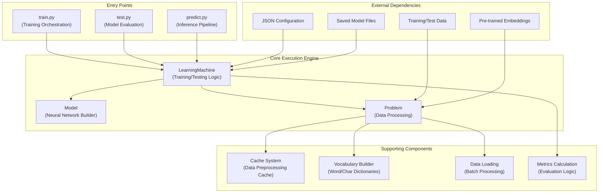

### Core Engine Components

The execution pipeline is built around three primary classes:

**LearningMachine**: Central orchestrator that manages the training/testing lifecycle
- Coordinates between Model and Problem instances
- Handles optimization and learning rate scheduling
- Manages model checkpointing and evaluation
- Implements the main training loop with validation

**Model**: Neural network builder that constructs PyTorch modules from JSON specifications  
- Instantiates Block Zoo components based on architecture configuration
- Manages layer connections and forward pass routing
- Handles model serialization and loading

**Problem**: Data processing pipeline that handles corpus management
- Builds vocabularies from training data
- Manages data preprocessing and tokenization
- Implements caching for efficient repeated runs
- Handles batch creation and padding

Sources: [README.md:92-100](), [Tutorial.md:62-72]()

### Training Pipeline Flow

The training pipeline follows a structured execution sequence:

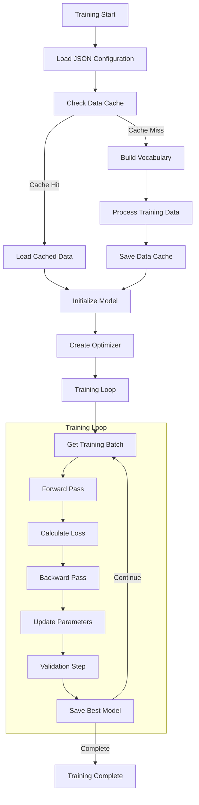

The training process leverages the configuration system for all parameters and uses the Block Zoo components to build the neural network dynamically at runtime.

Sources: [Tutorial.md:62-72](), [ModelConf.py:357-412]()

## Component Integration

The core architecture achieves modularity through well-defined interfaces between components. The configuration system acts as the central coordinator, while the Block Zoo and Model Zoo provide the building blocks and templates respectively.

**Integration Patterns**

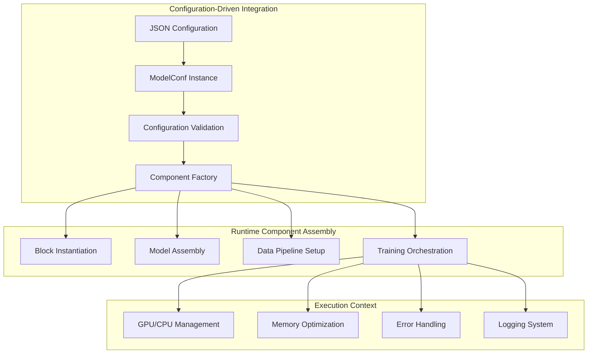

This architecture enables several key capabilities:

1. **Hot-swappable Components**: Blocks can be replaced without code changes by modifying JSON configuration
2. **Composable Architectures**: Complex models are built by connecting simple, reusable blocks
3. **Reproducible Experiments**: Complete model specifications are captured in version-controllable JSON files
4. **Cross-Platform Compatibility**: The same configuration works across different hardware and operating systems

The integration relies heavily on Python's dynamic class loading and PyTorch's module system to achieve runtime flexibility while maintaining type safety through configuration validation.

Sources: [ModelConf.py:413-439](), [utils/common_utils.py:17-40](), [README.md:127-141]()

---

# Page: Block Zoo

# Block Zoo

<details>
<summary>Relevant source files</summary>

The following files were used as context for generating this wiki page:

- [Tutorial.md](Tutorial.md)
- [Tutorial_zh_CN.md](Tutorial_zh_CN.md)
- [block_zoo/Pooling2D.py](block_zoo/Pooling2D.py)
- [block_zoo/__init__.py](block_zoo/__init__.py)
- [block_zoo/op/__init__.py](block_zoo/op/__init__.py)
- [model_zoo/nlp_tasks/knowledge_distillation/query_binary_classifier_compression/conf_kdqbc_bilstmattn_cnn.json](model_zoo/nlp_tasks/knowledge_distillation/query_binary_classifier_compression/conf_kdqbc_bilstmattn_cnn.json)

</details>


The Block Zoo is NeuronBlocks' collection of reusable neural network components that serve as building blocks for constructing NLP models. It provides a comprehensive library of pre-implemented layers, attention mechanisms, operations, and embeddings that can be combined through JSON configuration files to create complex model architectures without writing custom code.

For information about pre-configured model templates, see [Model Zoo](#3.2). For details on the JSON configuration system that uses these blocks, see [Configuration System](#3.3).

## Architecture Overview

The Block Zoo follows a modular design where each neural network component is implemented as a self-contained block with standardized interfaces. Every block consists of a configuration class and an implementation class that inherit from common base classes.

### Block Zoo Module Structure

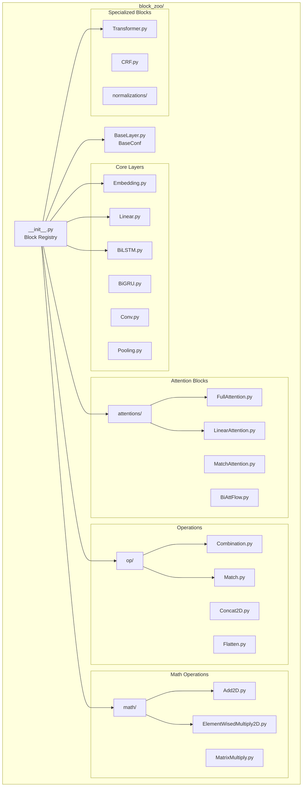

Sources: [block_zoo/__init__.py:1-58](), [block_zoo/Pooling2D.py:10-11](), [block_zoo/op/__init__.py:1-9]()

### Block Class Hierarchy

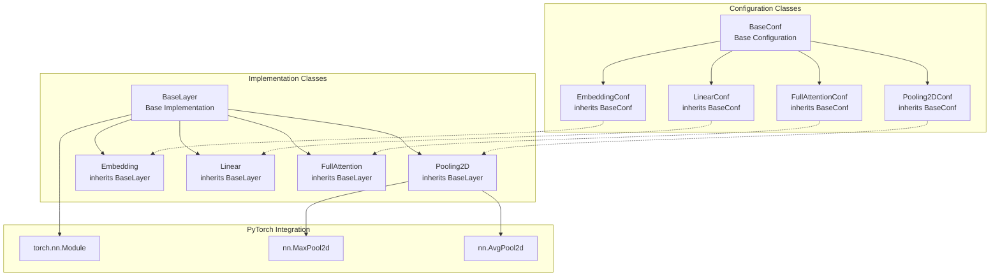

Sources: [block_zoo/BaseLayer.py](), [block_zoo/Pooling2D.py:14-89](), [block_zoo/__init__.py:3-58]()

## Block Categories

The Block Zoo organizes neural network components into several functional categories:

### Core Neural Network Layers

| Block Class | Configuration Class | Purpose |
|-------------|-------------------|---------|
| `Embedding` | `EmbeddingConf` | Word, character, and POS tag embeddings |
| `Linear` | `LinearConf` | Fully connected layers with activation |
| `BiLSTM` | `BiLSTMConf` | Bidirectional LSTM layers |
| `BiGRU` | `BiGRUConf` | Bidirectional GRU layers |
| `Conv` | `ConvConf` | 1D convolutional layers |
| `Conv2D` | `Conv2DConf` | 2D convolutional layers |
| `Pooling` | `PoolingConf` | 1D pooling operations |
| `Pooling2D` | `Pooling2DConf` | 2D pooling operations |

### Attention Mechanisms

| Block Class | Configuration Class | Purpose |
|-------------|-------------------|---------|
| `FullAttention` | `FullAttentionConf` | Full attention over sequence |
| `LinearAttention` | `LinearAttentionConf` | Linear attention with dimension reduction |
| `MatchAttention` | `MatchAttentionConf` | Matching-based attention |
| `BiAttFlow` | `BiAttFlowConf` | Bidirectional attention flow |
| `Attention` | `AttentionConf` | General attention mechanism |

### Operations and Transformations

| Block Class | Configuration Class | Purpose |
|-------------|-------------------|---------|
| `Combination` | `CombinationConf` | Combines multiple inputs |
| `Match` | `MatchConf` | Computes matching between sequences |
| `Concat2D` | `Concat2DConf` | Concatenates 2D tensors |
| `Flatten` | `FlattenConf` | Flattens tensor dimensions |
| `CalculateDistance` | `CalculateDistanceConf` | Computes distances between vectors |

### Mathematical Operations

| Block Class | Configuration Class | Purpose |
|-------------|-------------------|---------|
| `Add2D` | `Add2DConf` | Element-wise addition for 2D tensors |
| `ElementWisedMultiply2D` | `ElementWisedMultiply2DConf` | Element-wise multiplication |
| `MatrixMultiply` | `MatrixMultiplyConf` | Matrix multiplication operations |

Sources: [block_zoo/__init__.py:1-58](), [block_zoo/op/__init__.py:1-9]()

## Block Structure and Configuration

Each block in the Block Zoo follows a standardized structure with separate configuration and implementation classes.

### Configuration Class Pattern

Every block has a configuration class that inherits from `BaseConf` and defines:

- **Input/Output Specifications**: Tensor dimensions and ranks
- **Parameter Validation**: Checks for valid parameter values  
- **Shape Inference**: Calculates output dimensions from input dimensions
- **Default Values**: Provides sensible defaults for optional parameters

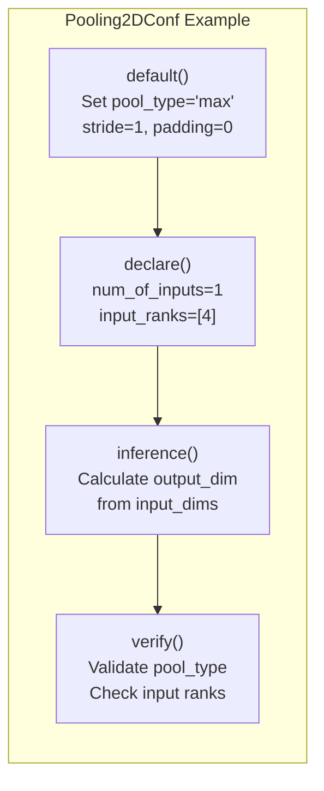

### Implementation Class Pattern

The implementation class inherits from `BaseLayer` and provides:

- **PyTorch Integration**: Uses `torch.nn.Module` components
- **Forward Pass Logic**: Implements the actual computation
- **Tensor Manipulation**: Handles shape transformations and permutations

Example from `Pooling2D`:

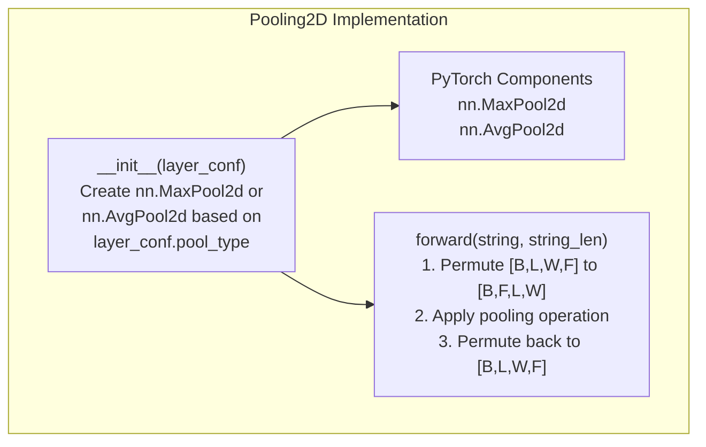

Sources: [block_zoo/Pooling2D.py:14-123](), [block_zoo/BaseLayer.py]()

## Usage in Model Architectures  

Blocks are used in JSON configuration files to define model architectures. Each block specification includes the block type, configuration parameters, and input connections.

### Block Specification Format

```json
{
  "layer_id": "unique_identifier", 
  "layer": "BlockClassName",
  "conf": {
    "parameter1": "value1",
    "parameter2": "value2"
  },
  "inputs": ["input_layer_ids"]
}
```

### Architecture Definition Flow

```mermaid
graph TD
    subgraph "JSON Configuration"
        ARCH["architecture section<br/>List of block specs"]
        EMBED_SPEC["Embedding block<br/>layer: 'Embedding'"]
        LSTM_SPEC["BiLSTM block<br/>layer: 'BiLSTM'"]
        POOL_SPEC["Pooling block<br/>layer: 'Pooling'"]
    end
    
    subgraph "Block Zoo Resolution"
        REGISTRY["Block Registry<br/>__init__.py imports"]
        EMBED_CLASS["Embedding class"]
        LSTM_CLASS["BiLSTM class"] 
        POOL_CLASS["Pooling class"]
    end
    
    subgraph "Model Construction"
        MODEL_BUILDER["Model.py<br/>build_model()"]
        INSTANCES["Block Instances<br/>Actual PyTorch layers"]
    end
    
    ARCH --> EMBED_SPEC
    ARCH --> LSTM_SPEC
    ARCH --> POOL_SPEC
    
    EMBED_SPEC --> REGISTRY
    LSTM_SPEC --> REGISTRY
    POOL_SPEC --> REGISTRY
    
    REGISTRY --> EMBED_CLASS
    REGISTRY --> LSTM_CLASS
    REGISTRY --> POOL_CLASS
    
    EMBED_CLASS --> MODEL_BUILDER
    LSTM_CLASS --> MODEL_BUILDER
    POOL_CLASS --> MODEL_BUILDER
    
    MODEL_BUILDER --> INSTANCES
```

### Real Configuration Example

From the knowledge distillation example:

| Block | Purpose | Configuration |
|-------|---------|---------------|
| `Embedding` | Word embeddings | `{"word": {"cols": ["query_text"], "dim": 300}}` |
| `BiLSTMAtt` | Encoder with attention | `{"hidden_dim": 128, "dropout": 0, "num_layers": 1}` |
| `Conv` | CNN feature extraction | `{"window_size": 3, "output_channel_num": 128}` |
| `Pooling` | Max pooling | `{"pool_axis": 1, "pool_type": "max"}` |
| `Combination` | Feature combination | `{"operations": ["origin"]}` |
| `Linear` | Dense layers | `{"hidden_dim": [256, 128], "activation": "PReLU"}` |

Sources: [model_zoo/nlp_tasks/knowledge_distillation/query_binary_classifier_compression/conf_kdqbc_bilstmattn_cnn.json:61-178](), [Tutorial.md:157-188]()

## Block Registration and Discovery

The Block Zoo uses a centralized registration system to make blocks available for use in configurations.

### Import-Based Registration

```mermaid
graph TB
    subgraph "block_zoo/__init__.py Registration"
        CORE_IMPORTS["Core Layer Imports<br/>from .Embedding import Embedding, EmbeddingConf<br/>from .BiLSTM import BiLSTM, BiLSTMConf<br/>from .Linear import Linear, LinearConf"]
        
        ATT_IMPORTS["Attention Imports<br/>from .attentions import FullAttention, FullAttentionConf<br/>from .attentions import LinearAttention, LinearAttentionConf"]
        
        OP_IMPORTS["Operation Imports<br/>from .op import *<br/>Imports all operation blocks"]
        
        MATH_IMPORTS["Math Imports<br/>from .math import Add2D, Add2DConf<br/>from .math import MatrixMultiply, MatrixMultiplyConf"]
    end
    
    subgraph "Runtime Discovery"
        CONFIG_PARSER["Configuration Parser<br/>Looks up block by name"]
        DYNAMIC_LOAD["Dynamic Loading<br/>Instantiate block classes"]
    end
    
    CORE_IMPORTS --> CONFIG_PARSER
    ATT_IMPORTS --> CONFIG_PARSER  
    OP_IMPORTS --> CONFIG_PARSER
    MATH_IMPORTS --> CONFIG_PARSER
    
    CONFIG_PARSER --> DYNAMIC_LOAD
```

### Block Naming Convention

- **Configuration Classes**: End with `Conf` (e.g., `BiLSTMConf`, `PoolingConf`)
- **Implementation Classes**: Match the layer name used in JSON configs (e.g., `BiLSTM`, `Pooling`)
- **Module Organization**: Related blocks grouped in subdirectories (`attentions/`, `op/`, `math/`)

### Extension Points

The registration system supports extensibility:

1. **New Block Addition**: Add import statement to `__init__.py`
2. **Subdirectory Support**: Use `from .subdir import *` pattern
3. **Automatic Discovery**: All imported classes become available in configurations

Sources: [block_zoo/__init__.py:1-58](), [block_zoo/op/__init__.py:1-9]()

---

# Page: Model Zoo

# Model Zoo

<details>
<summary>Relevant source files</summary>

The following files were used as context for generating this wiki page:

- [Tutorial.md](Tutorial.md)
- [Tutorial_zh_CN.md](Tutorial_zh_CN.md)
- [block_zoo/Pooling2D.py](block_zoo/Pooling2D.py)
- [block_zoo/embedding/CNNCharEmbedding.py](block_zoo/embedding/CNNCharEmbedding.py)
- [model_zoo/advanced/conf.json](model_zoo/advanced/conf.json)
- [model_zoo/nlp_tasks/knowledge_distillation/query_binary_classifier_compression/conf_kdqbc_bilstmattn_cnn.json](model_zoo/nlp_tasks/knowledge_distillation/query_binary_classifier_compression/conf_kdqbc_bilstmattn_cnn.json)
- [settings.py](settings.py)

</details>


The Model Zoo provides a comprehensive collection of pre-configured neural network models for common NLP tasks. It serves as a starting point for practitioners to quickly begin training models without having to design architectures from scratch, while also demonstrating best practices for model configuration in NeuronBlocks.

For information about the individual neural network components used to build these models, see [Block Zoo](#3.1). For details about the JSON configuration system that defines these models, see [Configuration System](#3.3).

## Overview

The Model Zoo consists of JSON configuration files that define complete model architectures, training parameters, and data processing pipelines for specific NLP tasks. Each model configuration can be used directly for training or modified to suit custom requirements.

## Model Zoo Architecture

```mermaid
graph TB
    subgraph "Model Zoo Structure"
        MZ["model_zoo/"]
        DEMO["demo/"]
        NLP["nlp_tasks/"]
        ADV["advanced/"]
        
        subgraph "Task Categories"
            TC["text_classification/"]
            QA["question_answer_matching/"]
            SA["sentiment_analysis/"]
            KD["knowledge_distillation/"]
            ST["slot_tagging/"]
            CN["chinese_*/"]
        end
        
        subgraph "Configuration Files"
            JSON1["conf_*.json"]
            JSON2["conf_*.json"]
            JSON3["conf_*.json"]
        end
    end
    
    subgraph "Core Components"
        MC["ModelConf"]
        TRAIN["train.py"]
        BZ["Block Zoo"]
        LM["LearningMachine"]
    end
    
    MZ --> DEMO
    MZ --> NLP
    MZ --> ADV
    
    NLP --> TC
    NLP --> QA
    NLP --> SA
    NLP --> KD
    NLP --> ST
    NLP --> CN
    
    TC --> JSON1
    QA --> JSON2
    SA --> JSON3
    
    JSON1 --> MC
    JSON2 --> MC
    JSON3 --> MC
    
    MC --> TRAIN
    MC --> LM
    JSON1 --> BZ
    JSON2 --> BZ
    JSON3 --> BZ
```

Sources: [Tutorial.md:220-621](), [model_zoo/advanced/conf.json:1-203]()

## Configuration Structure

Each model in the Model Zoo follows a standardized JSON configuration format that defines all aspects of the model and training process:

```mermaid
graph LR
    subgraph "JSON Configuration Structure"
        JSON["*.json"]
        
        subgraph "Core Sections"
            INPUTS["inputs"]
            OUTPUTS["outputs"] 
            TRAINING["training_params"]
            ARCH["architecture"]
            LOSS["loss"]
            METRICS["metrics"]
        end
        
        subgraph "Input Configuration"
            DATA["data_paths"]
            HEADER["file_header"]
            MODEL_IN["model_inputs"]
            TARGET["target"]
        end
        
        subgraph "Architecture Definition"
            LAYERS["layer definitions"]
            EMBEDDING["Embedding"]
            BILSTM["BiLSTM"]
            LINEAR["Linear"]
            COMB["Combination"]
        end
    end
    
    JSON --> INPUTS
    JSON --> OUTPUTS
    JSON --> TRAINING
    JSON --> ARCH
    JSON --> LOSS
    JSON --> METRICS
    
    INPUTS --> DATA
    INPUTS --> HEADER
    INPUTS --> MODEL_IN
    INPUTS --> TARGET
    
    ARCH --> LAYERS
    LAYERS --> EMBEDDING
    LAYERS --> BILSTM
    LAYERS --> LINEAR
    LAYERS --> COMB
```

Sources: [Tutorial.md:77-204](), [model_zoo/advanced/conf.json:5-202]()

## Available Model Categories

The Model Zoo organizes models into several task-specific categories:

| Task Category | Directory Path | Supported Metrics | Example Models |
|---------------|----------------|-------------------|----------------|
| Text Classification | `nlp_tasks/text_classification/` | accuracy, auc, f1 | TextCNN, BiLSTM+Attention |
| Question Answer Matching | `nlp_tasks/question_answer_matching/` | auc, accuracy | BiLSTM+MatchAttention, ARC-I/II |
| Sentiment Analysis | `nlp_tasks/sentiment_analysis/` | accuracy, f1 | BiLSTM, BiLSTM+Attention |
| Sequence Tagging | `nlp_tasks/slot_tagging/` | seq_tag_f1, accuracy | BiLSTM+CRF, CCNN+WLSTM+CRF |
| Knowledge Distillation | `nlp_tasks/knowledge_distillation/` | MSE, RMSE, AUC | Student-Teacher compression |
| Chinese NLP | `nlp_tasks/chinese_*/` | task-specific | Chinese sentiment, text matching |

Sources: [Tutorial.md:230-621](), [settings.py:24-32]()

## Model Configuration Workflow

```mermaid
flowchart TD
    START["Select Model from Zoo"] --> LOCATE["Locate JSON config file"]
    LOCATE --> CUSTOMIZE["Customize configuration"]
    
    subgraph "Configuration Customization"
        DATA_PATHS["Update data_paths"]
        MODEL_PARAMS["Adjust training_params"]
        ARCH_MOD["Modify architecture"]
        HYPER["Tune hyperparameters"]
    end
    
    CUSTOMIZE --> DATA_PATHS
    CUSTOMIZE --> MODEL_PARAMS
    CUSTOMIZE --> ARCH_MOD
    CUSTOMIZE --> HYPER
    
    DATA_PATHS --> TRAIN_CMD["python train.py --conf_path=model_zoo/.../conf.json"]
    MODEL_PARAMS --> TRAIN_CMD
    ARCH_MOD --> TRAIN_CMD
    HYPER --> TRAIN_CMD
    
    TRAIN_CMD --> LOAD_CONF["ModelConf.load()"]
    LOAD_CONF --> BUILD_MODEL["Model construction"]
    BUILD_MODEL --> TRAINING["LearningMachine.train()"]
    TRAINING --> EVALUATION["Model evaluation"]
    
    EVALUATION --> RESULTS["Save results & logs"]
```

Sources: [Tutorial.md:62-72](), [Tutorial.md:240-311]()

## Advanced Configuration Features

The Model Zoo includes advanced configuration examples that demonstrate sophisticated modeling techniques:

### Multi-Feature Input Support
Models can incorporate multiple types of features beyond basic text, including POS tags, character-level features, and custom embeddings.

```json
"model_inputs": {
  "question": ["question_text", "question_postag", "question_char"],
  "answer": ["answer_text", "answer_postag", "answer_char"]
}
```

### Embedding Configuration
The embedding layer supports various types of embeddings with different parameters:

```json
"architecture": [
  {
    "layer": "Embedding",
    "conf": {
      "word": {
        "cols": ["question_text", "answer_text"],
        "dim": 300,
        "fix_weight": true
      },
      "char": {
        "cols": ["question_char", "answer_char"],
        "type": "CNNCharEmbedding",
        "dim": [30, 20, 100],
        "window_size": [3, 3, 5]
      }
    }
  }
]
```

Sources: [model_zoo/advanced/conf.json:34-101](), [Tutorial.md:629-678]()

## Knowledge Distillation Models

The Model Zoo includes specialized configurations for model compression using knowledge distillation:

### Teacher-Student Architecture
Knowledge distillation models use regression loss to minimize the difference between student and teacher model outputs:

```json
"loss": {
  "losses": [
    {
      "type": "MSELoss",
      "conf": {
        "size_average": true
      },
      "inputs": ["output", "label_score"]
    }
  ]
}
```

### Compression Performance
Student models achieve significant speedup while maintaining competitive performance:

| Model Type | AUC | Speed Improvement |
|------------|-----|------------------|
| Teacher (BERT base) | 0.9112 | 1x |
| Student (BiLSTMAttn+TextCNN) | 0.8941 | 32x-38x |

Sources: [model_zoo/nlp_tasks/knowledge_distillation/query_binary_classifier_compression/conf_kdqbc_bilstmattn_cnn.json:1-191](), [Tutorial.md:431-479]()

## Character-Level Embeddings

The Model Zoo demonstrates the use of `CNNCharEmbedding` for character-level feature extraction:

### CNNCharEmbedding Configuration
Character embeddings use convolutional operations to extract features from character sequences:

```json
"char": {
  "type": "CNNCharEmbedding",
  "dim": [30, 20, 100],
  "embedding_matrix_dim": 50,
  "stride": [1, 2, 3],
  "window_size": [3, 3, 5],
  "activation": "ReLU"
}
```

The `CNNCharEmbedding` class processes character sequences through multiple CNN layers with different window sizes to capture various n-gram patterns.

Sources: [block_zoo/embedding/CNNCharEmbedding.py:15-133](), [model_zoo/advanced/conf.json:91-101]()

## Usage Patterns

### Basic Usage
```bash
# Train a model from the zoo
python train.py --conf_path=model_zoo/nlp_tasks/text_classification/conf_text_classification_cnn.json

# Test the trained model  
python test.py --conf_path=model_zoo/nlp_tasks/text_classification/conf_text_classification_cnn.json

# Make predictions
python predict.py --conf_path=model_zoo/nlp_tasks/text_classification/conf_text_classification_cnn.json
```

### Model Customization
Users can modify existing configurations by:
1. Updating `data_paths` to point to custom datasets
2. Adjusting `training_params` for different optimization strategies
3. Modifying the `architecture` section to experiment with different layer combinations
4. Changing `loss` and `metrics` configurations for different evaluation criteria

Sources: [Tutorial.md:62-72](), [Tutorial.md:240-255]()

## Integration with Core Systems

The Model Zoo integrates seamlessly with other NeuronBlocks components:

- **Block Zoo**: Model architectures reference blocks defined in the Block Zoo
- **Configuration System**: All models use the `ModelConf` class for configuration management
- **Training Pipeline**: Models are executed through the standard `train.py`/`test.py`/`predict.py` workflow
- **Data Processing**: Models specify data preprocessing requirements through the `inputs` section

Sources: [Tutorial.md:157-189](), [settings.py:14-51]()

---

# Page: Configuration System

# Configuration System

<details>
<summary>Relevant source files</summary>

The following files were used as context for generating this wiki page:

- [.gitignore](.gitignore)
- [ModelConf.py](ModelConf.py)
- [Tutorial.md](Tutorial.md)
- [Tutorial_zh_CN.md](Tutorial_zh_CN.md)
- [block_zoo/Pooling2D.py](block_zoo/Pooling2D.py)
- [model_zoo/nlp_tasks/knowledge_distillation/query_binary_classifier_compression/conf_kdqbc_bilstmattn_cnn.json](model_zoo/nlp_tasks/knowledge_distillation/query_binary_classifier_compression/conf_kdqbc_bilstmattn_cnn.json)
- [utils/common_utils.py](utils/common_utils.py)

</details>


The Configuration System is the central mechanism in NeuronBlocks for defining model architectures, training parameters, data paths, and execution settings through JSON files. It provides a declarative approach to building and configuring neural network models without writing code, enabling users to focus on model design rather than implementation details.

For information about the specific blocks available for model architecture, see [Block Zoo](#3.1). For pre-configured model examples, see [Model Zoo](#3.2).

## Overview

The configuration system operates through JSON files that specify every aspect of model training, testing, and prediction. The system handles configuration loading, validation, and transformation into runtime objects through the `ModelConf` class and its nested configuration structures.

## Configuration File Structure

## JSON Configuration Architecture

```mermaid
graph TB
    subgraph "JSON Configuration File"
        META["license<br/>tool_version<br/>model_description"]
        INPUTS["inputs<br/>• use_cache<br/>• dataset_type<br/>• data_paths<br/>• model_inputs<br/>• target"]
        OUTPUTS["outputs<br/>• save_base_dir<br/>• model_name<br/>• log names<br/>• cache_dir"]
        TRAINING["training_params<br/>• optimizer<br/>• batch_size<br/>• max_epoch<br/>• vocabulary"]
        ARCH["architecture<br/>• layer definitions<br/>• layer connections<br/>• layer configurations"]
        LOSS["loss<br/>• loss functions<br/>• loss parameters"]
        METRICS["metrics<br/>• evaluation metrics"]
    end
    
    subgraph "ModelConf Class Hierarchy"
        MODELCONF["ModelConf"]
        CONF_INPUTS["Conf.inputs"]
        CONF_OUTPUTS["Conf.outputs"] 
        CONF_TRAINING["Conf.training_params"]
        DATA_PATHS["Conf.inputs.data_paths"]
        VOCAB["Conf.training_params.vocabulary"]
    end
    
    META --> MODELCONF
    INPUTS --> CONF_INPUTS
    OUTPUTS --> CONF_OUTPUTS
    TRAINING --> CONF_TRAINING
    ARCH --> MODELCONF
    LOSS --> MODELCONF
    METRICS --> MODELCONF
    
    CONF_INPUTS --> DATA_PATHS
    CONF_TRAINING --> VOCAB
```

*Sources: [Tutorial.md:86-204](), [ModelConf.py:101-169]()*

The configuration file follows a hierarchical structure with seven main sections, each mapped to corresponding classes in the `ModelConf` system for type-safe loading and validation.

## Core Configuration Management

### ModelConf Class

The `ModelConf` class serves as the primary configuration manager, handling loading, validation, and runtime configuration setup.

```mermaid
graph LR
    subgraph "Configuration Loading Flow"
        JSON_FILE["JSON Configuration File"]
        LOAD_FROM_FILE["load_from_file()"]
        CONF_SECTIONS["Configuration Sections"]
        VALIDATION["check_conf()"]
        RUNTIME_CONFIG["Runtime Configuration"]
    end
    
    subgraph "ModelConf Methods"
        CONFIGURE_INPUTS["configurate_inputs()"]
        CONFIGURE_OUTPUTS["configurate_outputs()"]
        CONFIGURE_TRAINING["configurate_training_params()"]
        CONFIGURE_ARCH["configurate_architecture()"]
        CONFIGURE_LOSS["configurate_loss()"]
        CONFIGURE_CACHE["configurate_cache()"]
    end
    
    JSON_FILE --> LOAD_FROM_FILE
    LOAD_FROM_FILE --> CONF_SECTIONS
    CONF_SECTIONS --> CONFIGURE_INPUTS
    CONF_SECTIONS --> CONFIGURE_OUTPUTS
    CONF_SECTIONS --> CONFIGURE_TRAINING
    CONF_SECTIONS --> CONFIGURE_ARCH
    CONF_SECTIONS --> CONFIGURE_LOSS
    CONF_SECTIONS --> CONFIGURE_CACHE
    CONFIGURE_INPUTS --> VALIDATION
    CONFIGURE_OUTPUTS --> VALIDATION
    CONFIGURE_TRAINING --> VALIDATION
    CONFIGURE_ARCH --> VALIDATION
    CONFIGURE_LOSS --> VALIDATION
    CONFIGURE_CACHE --> VALIDATION
    VALIDATION --> RUNTIME_CONFIG
```

*Sources: [ModelConf.py:68-100](), [ModelConf.py:174-184]()*

### Configuration Loading Process

The `ModelConf` constructor handles the complete configuration loading pipeline:

1. **Phase Validation**: Validates the execution phase (`train`, `test`, `predict`, `cache`)
2. **File Loading**: Loads JSON configuration using `load_from_json`
3. **Version Compatibility**: Checks NeuronBlocks version compatibility
4. **Section Configuration**: Processes each configuration section through dedicated methods
5. **Validation**: Performs comprehensive configuration validation

*Sources: [ModelConf.py:69-92]()*

## Configuration Sections

### Inputs Configuration

The `inputs` section defines data sources, file formats, and model input specifications.

| Parameter | Type | Default | Description |
|-----------|------|---------|-------------|
| `use_cache` | boolean | `true` | Enable data caching for faster subsequent runs |
| `dataset_type` | string | required | Task type: `classification`, `regression`, `sequence_tagging` |
| `file_header` | object | required | Column mappings for train/valid/test data |
| `model_inputs` | object | required | Input field mappings to model inputs |
| `target` | array | required | Target column names for training |

*Sources: [ModelConf.py:107-129](), [Tutorial.md:92-119]()*

### Data Paths Configuration

The nested `data_paths` section specifies file locations:

```mermaid
graph TB
    subgraph "Data Paths Configuration"
        TRAIN_PATH["train_data_path"]
        VALID_PATH["valid_data_path"] 
        TEST_PATH["test_data_path"]
        PREDICT_PATH["predict_data_path"]
        EMB_PATH["pre_trained_emb"]
        PRETRAINED_PATH["pretrained_model_path"]
    end
    
    subgraph "Runtime Path Resolution"
        PATH_CONFIG["configurate_data_path()"]
        PATH_VALIDATION["Path Validation"]
        PHASE_LOGIC["Phase-specific Logic"]
    end
    
    TRAIN_PATH --> PATH_CONFIG
    VALID_PATH --> PATH_CONFIG
    TEST_PATH --> PATH_CONFIG
    PREDICT_PATH --> PATH_CONFIG
    EMB_PATH --> PATH_CONFIG
    PRETRAINED_PATH --> PATH_CONFIG
    
    PATH_CONFIG --> PATH_VALIDATION
    PATH_CONFIG --> PHASE_LOGIC
```

*Sources: [ModelConf.py:112-118](), [ModelConf.py:247-279]()*

### Training Parameters

The `training_params` section controls model training behavior:

```mermaid
graph LR
    subgraph "Training Parameters"
        OPTIMIZER["optimizer<br/>• name<br/>• params"]
        BATCH["batch_size<br/>batch_num_to_show_results"]
        EPOCH["max_epoch<br/>steps_per_validation"]
        LR["lr_decay<br/>minimum_lr<br/>epoch_start_lr_decay"]
        VOCAB["vocabulary<br/>• min_word_frequency<br/>• max_vocabulary"]
        HARDWARE["use_gpu<br/>cpu_num_workers"]
    end
    
    subgraph "Runtime Configuration"
        GPU_SETUP["GPU Detection & Setup"]
        BATCH_CALC["Batch Size Calculation"]
        OPTIMIZER_INIT["Optimizer Initialization"]
    end
    
    OPTIMIZER --> OPTIMIZER_INIT
    BATCH --> BATCH_CALC
    HARDWARE --> GPU_SETUP
```

*Sources: [ModelConf.py:142-164](), [ModelConf.py:357-413]()*

### Architecture Configuration

The `architecture` section defines the neural network structure as a list of layer configurations:

```mermaid
graph TD
    subgraph "Architecture Definition"
        LAYER_LIST["architecture: [ ]"]
        EMB_LAYER["Embedding Layer<br/>• layer: 'Embedding'<br/>• conf: word/char/pos"]
        PROCESSING["Processing Layers<br/>• layer_id: custom_name<br/>• layer: block_type<br/>• inputs: [layer_ids]"]
        OUTPUT["Output Layer<br/>• output_layer_flag: true<br/>• layer: 'Linear'"]
    end
    
    subgraph "Architecture Processing"
        INPUT_TYPES["Extract input_types"]
        FEATURE_DETECT["Detect extra_feature"]
        OUTPUT_DETECT["Find output_layer_id"]
        CNN_CHECK["Check CNN layers"]
    end
    
    LAYER_LIST --> EMB_LAYER
    EMB_LAYER --> PROCESSING
    PROCESSING --> OUTPUT
    
    LAYER_LIST --> INPUT_TYPES
    INPUT_TYPES --> FEATURE_DETECT
    PROCESSING --> OUTPUT_DETECT
    PROCESSING --> CNN_CHECK
```

*Sources: [ModelConf.py:414-447](), [Tutorial.md:157-189]()*

## Configuration Validation System

### ConstantStaticItems Pattern

The configuration system uses a sophisticated pattern for declarative configuration loading through the `ConstantStaticItems` class:

```mermaid
graph TB
    subgraph "Configuration Class Hierarchy"
        CSI["ConstantStaticItems"]
        ADD_ITEM["add_item()"]
        LOAD_DATA["load_data()"]
        GET_VALUE["get_value_by_key()"]
    end
    
    subgraph "Generated Configuration Classes"
        CONF_CLASS["Configuration Class"]
        ATTR_CLASSES["Attribute Classes"]
        DEFAULT_VALUES["Default Values"]
        VALIDATION["Validation Logic"]
    end
    
    CSI --> ADD_ITEM
    ADD_ITEM --> CONF_CLASS
    CONF_CLASS --> ATTR_CLASSES
    ATTR_CLASSES --> DEFAULT_VALUES
    ATTR_CLASSES --> VALIDATION
    
    GET_VALUE --> LOAD_DATA
    LOAD_DATA --> CONF_CLASS
```

*Sources: [ModelConf.py:22-66]()*

### Validation Process

The configuration validation process ensures correctness across multiple dimensions:

1. **Structural Validation**: Verifies required fields exist and optional fields have defaults
2. **Type Validation**: Ensures values match expected types
3. **Value Validation**: Validates enums, ranges, and constraints  
4. **Cross-section Validation**: Checks consistency between related configuration sections
5. **Runtime Validation**: Validates file paths, GPU availability, and resource constraints

*Sources: [ModelConf.py:90-91](), [utils/common_utils.py:15-19]()*

## Configuration Usage Patterns

### Multi-phase Configuration

The configuration system supports different execution phases with phase-specific validation:

| Phase | Purpose | Required Sections | Validation Level |
|-------|---------|------------------|------------------|
| `train` | Model training | All sections | Full validation |
| `test` | Model evaluation | inputs, outputs, architecture, loss, metrics | Partial validation |
| `predict` | Inference | inputs, outputs, architecture | Minimal validation |
| `cache` | Cache verification | inputs only | Cache-specific validation |

*Sources: [ModelConf.py:79-81](), [ModelConf.py:90-91]()*

### Parameter Override System

Command-line parameters can override configuration file values through the `params` mechanism:

```mermaid
graph LR
    subgraph "Parameter Sources"
        JSON_CONFIG["JSON Configuration"]
        CLI_PARAMS["Command Line Parameters"]
        DEFAULT_VALUES["Default Values"]
    end
    
    subgraph "Resolution Priority"
        PARAM_CHECK["hasattr(params, key)"]
        OVERRIDE["Override JSON value"]
        FALLBACK["Use JSON/Default"]
    end
    
    CLI_PARAMS --> PARAM_CHECK
    JSON_CONFIG --> PARAM_CHECK
    DEFAULT_VALUES --> PARAM_CHECK
    
    PARAM_CHECK --> OVERRIDE
    PARAM_CHECK --> FALLBACK
```

*Sources: [ModelConf.py:257-267](), [ModelConf.py:368-369]()*

### Configuration Caching

The system implements intelligent caching of processed configurations and computed artifacts:

- **Configuration MD5**: Tracks changes to training data and configuration
- **Problem Caching**: Serializes vocabulary and preprocessing state
- **Embedding Caching**: Caches loaded pre-trained embeddings
- **Cache Validation**: Ensures cache consistency across runs

*Sources: [ModelConf.py:460-488](), [ModelConf.py:489-497]()*

---

# Page: Training and Evaluation

# Training and Evaluation

<details>
<summary>Relevant source files</summary>

The following files were used as context for generating this wiki page:

- [LearningMachine.py](LearningMachine.py)
- [Model.py](Model.py)
- [block_zoo/Embedding.py](block_zoo/Embedding.py)
- [predict.py](predict.py)
- [test.py](test.py)
- [train.py](train.py)

</details>


This document provides a comprehensive overview of the training and evaluation system in NeuronBlocks, covering the end-to-end workflow from data preparation to model testing. The system is designed around a centralized `LearningMachine` class that orchestrates training, validation, and testing processes across different NLP task types.

For detailed information about specific components, see [Training Pipeline](#4.1), [Testing and Prediction](#4.2), [Data Processing](#4.3), and [Evaluation Metrics](#4.4). For model architecture details, see [Core Architecture](#3).

## System Overview

The training and evaluation system consists of three main entry points (`train.py`, `test.py`, `predict.py`) that all leverage the core `LearningMachine` class for model operations. The system supports caching, distributed training, and multiple problem types including classification, sequence tagging, regression, and machine reading comprehension.

### Core Components Architecture

```mermaid
graph TB
    subgraph "Entry Points"
        TRAIN_PY["train.py<br/>Main Training Script"]
        TEST_PY["test.py<br/>Model Testing Script"]
        PREDICT_PY["predict.py<br/>Prediction Script"]
    end
    
    subgraph "Core Classes"
        LM["LearningMachine<br/>Training/Testing Orchestrator"]
        MODEL["Model<br/>Neural Network Builder"]
        PROBLEM["Problem<br/>Data Processor"]
        MODELCONF["ModelConf<br/>Configuration Manager"]
    end
    
    subgraph "Support Systems"
        CACHE["Cache<br/>Data/Model Caching"]
        EVALUATOR["Evaluator<br/>Metrics Calculator"]
        LOSS["Loss<br/>Loss Functions"]
        OPTIMIZER["PyTorch Optimizers<br/>SGD/Adam/etc"]
    end
    
    subgraph "Data Flow"
        RAW_DATA["Raw TSV/JSON Data"]
        ENCODED_DATA["Encoded Tensors"]
        TRAINED_MODEL["Saved Model Files"]
        PREDICTIONS["Prediction Output"]
    end
    
    TRAIN_PY --> LM
    TEST_PY --> LM
    PREDICT_PY --> LM
    
    LM --> MODEL
    LM --> PROBLEM
    LM --> EVALUATOR
    LM --> LOSS
    
    TRAIN_PY --> CACHE
    TRAIN_PY --> OPTIMIZER
    
    MODELCONF --> LM
    MODELCONF --> MODEL
    MODELCONF --> PROBLEM
    
    RAW_DATA --> PROBLEM
    PROBLEM --> ENCODED_DATA
    ENCODED_DATA --> MODEL
    MODEL --> TRAINED_MODEL
    MODEL --> PREDICTIONS
    
    CACHE --> PROBLEM
    CACHE --> ENCODED_DATA
```

Sources: [train.py:1-390](), [LearningMachine.py:31-92](), [test.py:17-58](), [predict.py:15-71]()

## Training Workflow

The training process follows a structured pipeline that handles data preparation, model initialization, iterative training with validation, and model persistence. The workflow supports both fresh training and fine-tuning from pretrained models.

### Training Pipeline Flow

```mermaid
flowchart TD
    START["python train.py --conf_path config.json"] --> INIT_CONF["ModelConf('train', conf_path)"]
    INIT_CONF --> INIT_PROBLEM["Problem('train', problem_type)"]
    
    INIT_PROBLEM --> CHECK_FINETUNE{"`conf.pretrained_model_path?`"}
    CHECK_FINETUNE -->|Yes| LOAD_SAVED_PROBLEM["problem.load_problem(saved_problem_path)"]
    CHECK_FINETUNE -->|No| CACHE_CHECK
    
    LOAD_SAVED_PROBLEM --> CACHE_CHECK{"`conf.use_cache?`"}
    CACHE_CHECK -->|Yes| CACHE_VERIFY["Cache._check_dictionary()<br/>Cache._check_encoding()"]
    CACHE_CHECK -->|No| BUILD_VOCAB
    
    CACHE_VERIFY --> CACHE_VALID{"`Cache Valid?`"}
    CACHE_VALID -->|Yes| CACHE_LOAD["cache.load(conf, problem, emb_matrix)"]
    CACHE_VALID -->|No| BUILD_VOCAB["problem.build(data_path_list)<br/>Build vocabulary & embeddings"]
    
    CACHE_LOAD --> INIT_LEARNING_MACHINE
    BUILD_VOCAB --> SAVE_CACHE["cache.save(conf, params, problem)"]
    SAVE_CACHE --> INIT_LEARNING_MACHINE["LearningMachine('train', conf, problem)"]
    
    INIT_LEARNING_MACHINE --> LOAD_PRETRAINED{"`pretrained_model_path?`"}
    LOAD_PRETRAINED -->|Yes| LOAD_MODEL["lm.load_model(pretrained_model_path)"]
    LOAD_PRETRAINED -->|No| INIT_OPTIMIZER
    LOAD_MODEL --> INIT_OPTIMIZER["optimizer = eval(optimizer_name)"]
    
    INIT_OPTIMIZER --> INIT_LOSS["loss_fn = Loss(**loss_conf)"]
    INIT_LOSS --> TRAIN_LOOP["lm.train(optimizer, loss_fn)"]
    
    TRAIN_LOOP --> FINAL_TEST["lm.test(loss_fn, test_path)"]
    FINAL_TEST --> END["Training Complete"]
```

Sources: [train.py:228-338](), [train.py:108-128](), [LearningMachine.py:93-338]()

### Cache System Architecture

The caching system optimizes training by storing preprocessed data and embeddings to avoid redundant computation across training runs.

```mermaid
graph LR
    subgraph "Cache Types"
        DICT_CACHE["Dictionary Cache<br/>problem.pkl<br/>emb_matrix.pkl"]
        ENC_CACHE["Encoding Cache<br/>train_data_md5/<br/>encoded tensors"]
    end
    
    subgraph "Cache Validation"
        CONF_CHECK["Configuration Check<br/>_verify_conf()"]
        MD5_CHECK["MD5 Integrity Check<br/>md5([file_paths])"]
        INDEX_CHECK["Index File Validation<br/>encoding_cache_index"]
    end
    
    subgraph "Cache Operations"
        CHECK["cache.check(conf, params)"]
        LOAD["cache.load(conf, problem)"]
        SAVE["cache.save(conf, params)"]
        RENEW["_renew_cache()"]
    end
    
    CHECK --> CONF_CHECK
    CHECK --> MD5_CHECK
    CHECK --> INDEX_CHECK
    
    CONF_CHECK --> DICT_CACHE
    MD5_CHECK --> ENC_CACHE
    
    CHECK --> LOAD
    CHECK --> RENEW
    LOAD --> DICT_CACHE
    LOAD --> ENC_CACHE
    SAVE --> DICT_CACHE
    SAVE --> ENC_CACHE
```

Sources: [train.py:25-227](), [train.py:108-128](), [train.py:200-227]()

## LearningMachine Core Operations

The `LearningMachine` class serves as the central orchestrator for all model operations, handling different problem types and providing unified interfaces for training, testing, and prediction.

### LearningMachine Method Structure

| Method | Purpose | Key Parameters | Problem Types Supported |
|--------|---------|---------------|------------------------|
| `__init__` | Initialize learning machine | `phase`, `conf`, `problem`, `vocab_info` | All |
| `train` | Execute training loop | `optimizer`, `loss_fn` | All |
| `test` | Evaluate model on test data | `loss_fn`, `test_data_path` | All |
| `evaluate` | Internal evaluation method | `data`, `evaluator`, `loss_fn` | All |
| `predict` | Generate predictions | `data_path`, `output_path` | All |
| `interactive` | Interactive prediction mode | `samples`, `file_columns` | All |

Sources: [LearningMachine.py:31-89](), [LearningMachine.py:93-338](), [LearningMachine.py:339-360]()

### Training Loop Implementation

```mermaid
sequenceDiagram
    participant TL as "Training Loop"
    participant DG as "Data Generator"
    participant Model as "Neural Model"
    participant Loss as "Loss Function"
    participant Eval as "Evaluator"
    participant LRS as "LRScheduler"
    
    TL->>DG: _get_training_data_generator()
    loop Each Data Part
        DG->>TL: train_data, train_length, train_target
        loop Each Batch
            TL->>Model: model(inputs_desc, length_desc)
            Model->>TL: logits
            TL->>Loss: loss_fn(logits_flat, target_batches)
            Loss->>TL: loss
            TL->>Model: loss.backward()
            TL->>Model: optimizer.step()
            
            alt Validation Step
                TL->>Eval: evaluate(valid_data)
                Eval->>TL: metrics_result
                alt Best Model
                    TL->>TL: Save model checkpoint
                end
            end
        end
    end
    TL->>LRS: lr_scheduler.step()
```

Sources: [LearningMachine.py:124-338](), [LearningMachine.py:146-336]()

## Problem Type Support

The system supports multiple NLP task types with specialized handling for each:

### Problem Type Configuration

| Problem Type | Class Constant | Prediction Output | Metrics |
|-------------|---------------|------------------|---------|
| Classification | `ProblemTypes.classification` | Class probabilities | `accuracy`, `auc`, `f1` |
| Sequence Tagging | `ProblemTypes.sequence_tagging` | Tag sequences | `seq_tag_f1`, `accuracy` |
| Regression | `ProblemTypes.regression` | Continuous values | `mse`, `rmse` |
| MRC | `ProblemTypes.mrc` | Text spans | `mrc_em`, `mrc_f1` |

Sources: [LearningMachine.py:76-88](), [LearningMachine.py:182-265]()

## Testing and Prediction

The testing system reuses the same `LearningMachine` infrastructure but operates in evaluation mode with different data flow patterns.

### Test vs Predict Workflow

```mermaid
graph TB
    subgraph "test.py Workflow"
        TEST_START["test.py --conf_path config.json"] --> TEST_CONF["ModelConf('test', conf_path)"]
        TEST_CONF --> TEST_PROBLEM["Problem('test', ...)"]
        TEST_PROBLEM --> TEST_LOAD_PROBLEM["problem.load_problem(saved_problem_path)"]
        TEST_LOAD_PROBLEM --> TEST_LM["LearningMachine('test', ...)"]
        TEST_LM --> TEST_LOAD_MODEL["lm.load_model(previous_model_path)"]
        TEST_LOAD_MODEL --> TEST_EXECUTE["lm.test(loss_fn, test_path)"]
    end
    
    subgraph "predict.py Workflow"
        PRED_START["predict.py --conf_path config.json"] --> PRED_CONF["ModelConf('predict', conf_path)"]
        PRED_CONF --> PRED_PROBLEM["Problem('predict', ...)"]
        PRED_PROBLEM --> PRED_LOAD_PROBLEM["problem.load_problem(saved_problem_path)"]
        PRED_LOAD_PROBLEM --> PRED_LM["LearningMachine('predict', ...)"]
        PRED_LM --> PRED_LOAD_MODEL["lm.load_model(previous_model_path)"]
        PRED_LOAD_MODEL --> PRED_MODE{"`predict_mode`"}
        PRED_MODE -->|batch| PRED_BATCH["lm.predict(data_path, output_path)"]
        PRED_MODE -->|interactive| PRED_INTERACTIVE["lm.interactive(samples)"]
    end
```

Sources: [test.py:17-58](), [predict.py:15-71](), [predict.py:37-70]()

## GPU and Distributed Training Support

The system supports GPU acceleration and multi-GPU distributed training through PyTorch's `DataParallel`:

```mermaid
graph LR
    subgraph "GPU Configuration"
        USE_GPU["conf.use_gpu"] --> CHECK_GPU{"`torch.cuda.is_available()`"}
        CHECK_GPU -->|True| SINGLE_GPU["Single GPU Mode"]
        CHECK_GPU -->|True| MULTI_GPU["Multi-GPU DataParallel"]
        CHECK_GPU -->|False| CPU_MODE["CPU Mode"]
    end
    
    subgraph "Model Wrapping"
        SINGLE_GPU --> MODEL_GPU["model.cuda()"]
        MULTI_GPU --> DATA_PARALLEL["nn.DataParallel(model)"]
        DATA_PARALLEL --> TRANSFER_GPU["transfer_to_gpu(model)"]
    end
    
    subgraph "Batch Size Scaling"
        MULTI_GPU --> SCALE_BATCH["batch_num *= torch.cuda.device_count()"]
        SCALE_BATCH --> SCALE_LOGGING["logging *= device_count()"]
    end
```

Sources: [LearningMachine.py:36-48](), [LearningMachine.py:140-144](), [Model.py:405-420]()

## Integration Points

This training and evaluation system integrates with several other NeuronBlocks components:

- **Configuration System**: Uses `ModelConf` for parameter management (see [Configuration System](#3.3))
- **Block Zoo**: Leverages neural building blocks for model construction (see [Block Zoo](#3.1))
- **Data Processing**: Depends on `Problem` class for data handling (see [Data Processing](#4.3))
- **Model Architecture**: Uses `Model` class for neural network construction (see [Core Architecture](#3))

The system provides a complete training-to-deployment pipeline that handles the complexity of modern deep learning workflows while maintaining flexibility for different NLP tasks and deployment scenarios.

Sources: [train.py:1-390](), [LearningMachine.py:1-897](), [test.py:1-77](), [predict.py:1-91]()

---

# Page: Training Pipeline

# Training Pipeline

<details>
<summary>Relevant source files</summary>

The following files were used as context for generating this wiki page:

- [LearningMachine.py](LearningMachine.py)
- [Model.py](Model.py)
- [block_zoo/Embedding.py](block_zoo/Embedding.py)
- [train.py](train.py)

</details>


This document covers the training pipeline in NeuronBlocks, which orchestrates the complete process of training neural network models from data preprocessing through model evaluation. The training pipeline handles caching, data encoding, model initialization, training loops, validation, and model persistence.

For information about testing and prediction workflows, see [Testing and Prediction](#4.2). For details about data preprocessing components, see [Data Processing](#4.3).

## Overview

The training pipeline is implemented primarily through the `train.py` script, which coordinates several key components to execute the complete training workflow. The pipeline supports various NLP tasks including text classification, sequence tagging, regression, and machine reading comprehension.

## High-Level Training Workflow

```mermaid
flowchart TD
    START["python train.py --conf_path config.json"] --> PARSE["Parse Arguments & Load Configuration"]
    PARSE --> INIT_COMPONENTS["Initialize Core Components"]
    
    subgraph "Core Components Initialization"
        INIT_COMPONENTS --> CONF["ModelConf: Load & validate configuration"]
        CONF --> PROBLEM["Problem: Initialize data processor"]
        PROBLEM --> CACHE_CHECK["Cache: Check existing cache validity"]
    end
    
    CACHE_CHECK --> CACHE_DECISION{Use Valid Cache?}
    CACHE_DECISION -->|No| BUILD_DATA["Build vocabulary & encode data"]
    CACHE_DECISION -->|Yes| LOAD_CACHE["Load cached dictionaries & encodings"]
    
    BUILD_DATA --> SAVE_NEW_CACHE["Save new cache files"]
    SAVE_NEW_CACHE --> INIT_TRAINING
    LOAD_CACHE --> INIT_TRAINING["Initialize Training Components"]
    
    subgraph "Training Setup"
        INIT_TRAINING --> VOCAB_INFO["get_vocab_info(): Create vocabulary mappings"]
        VOCAB_INFO --> LEARNING_MACHINE["LearningMachine: Initialize with model"]
        LEARNING_MACHINE --> LOSS_FN["Loss: Initialize loss function"]
        LOSS_FN --> OPTIMIZER["Optimizer: Setup parameter optimization"]
    end
    
    OPTIMIZER --> TRAIN_LOOP["lm.train(optimizer, loss_fn)"]
    TRAIN_LOOP --> FINAL_TEST["Load best model & final evaluation"]
    FINAL_TEST --> END["Training Complete"]

    style CONF fill:#e1f5fe
    style PROBLEM fill:#f3e5f5
    style CACHE_CHECK fill:#fff2cc
    style LEARNING_MACHINE fill:#e8f5e8
```

Sources: [train.py:228-338]()

## Core Components

### Cache Management

The `Cache` class handles intelligent caching of preprocessed data and model dictionaries to avoid redundant computation across training runs.

```mermaid
classDiagram
    class Cache {
        +boolean dictionary_invalid
        +boolean embedding_invalid
        +boolean encoding_invalid
        +check(conf, params)
        +load(conf, problem, emb_matrix)
        +save(conf, params, problem, emb_matrix)
        +back_up(conf, problem)
        -_check_dictionary(conf, params)
        -_check_encoding(conf)
        -_prepare_encoding_cache(conf, problem, build)
    }
    
    class ModelConf {
        +problem_path
        +cache_dir
        +encoding_cache_dir
        +train_data_md5
        +problem_md5
        +use_cache
    }
    
    class Problem {
        +build(data_paths, ...)
        +encode(data_path, ...)
        +load_problem(path)
        +export_problem(path)
        +get_vocab_sizes()
    }
    
    Cache --> ModelConf : uses configuration
    Cache --> Problem : manages problem data
```

The cache system validates three levels of cache:
- **Dictionary cache**: Vocabulary mappings and embeddings
- **Encoding cache**: Pre-encoded training data
- **Configuration cache**: Model configuration consistency

Sources: [train.py:25-227]()

### Learning Machine

The `LearningMachine` class serves as the central training coordinator, managing the model, training loop, validation, and evaluation.

```mermaid
graph TB
    subgraph "LearningMachine Architecture"
        LM["LearningMachine"]
        LM --> MODEL["self.model: Model instance"]
        LM --> CONF["self.conf: ModelConf"]
        LM --> PROBLEM["self.problem: Problem"]
        LM --> EVALUATOR["self.evaluator: Evaluator"]
        LM --> METRICS["self.metrics: List of metrics"]
    end
    
    subgraph "Core Methods"
        LM --> TRAIN["train(optimizer, loss_fn)"]
        LM --> TEST["test(loss_fn, test_data_path)"]
        LM --> EVALUATE["evaluate(data, length, target, ...)"]
        LM --> PREDICT["predict(predict_data_path, output_path)"]
        LM --> LOAD_MODEL["load_model(model_path)"]
    end
    
    subgraph "Training Loop Components"
        TRAIN --> GET_BATCHES["get_batches(): Create data batches"]
        TRAIN --> FORWARD["model.forward(): Forward pass"]
        TRAIN --> LOSS_CALC["loss_fn(): Calculate loss"]
        TRAIN --> BACKWARD["loss.backward(): Backward pass"]
        TRAIN --> OPTIMIZER_STEP["optimizer.step(): Update parameters"]
        TRAIN --> VALIDATION["Periodic validation on dev set"]
        TRAIN --> MODEL_SAVE["Save best model based on validation"]
    end

    style LM fill:#e1f5fe
    style TRAIN fill:#e8f5e8
    style VALIDATION fill:#fff2cc
```

Sources: [LearningMachine.py:31-92](), [LearningMachine.py:93-338]()

## Training Loop Details

The core training loop in `LearningMachine.train()` implements a sophisticated training process with validation, early stopping, and model checkpointing.

```mermaid
flowchart TD
    START_TRAIN["Start Training Loop"] --> INIT_LOOP["Initialize epoch=1, best_result=None"]
    INIT_LOOP --> EPOCH_CHECK{epoch ≤ max_epoch?}
    
    EPOCH_CHECK -->|Yes| GET_DATA["Get training data generator"]
    GET_DATA --> BATCH_LOOP["Process data batches"]
    
    subgraph "Batch Processing"
        BATCH_LOOP --> TRANSFORM["transform_params2tensors()"]
        TRANSFORM --> FORWARD["model.forward()"]
        FORWARD --> SOFTMAX["Apply softmax to logits"]
        SOFTMAX --> DECODE["Decode predictions"]
        DECODE --> LOSS["Calculate loss"]
        LOSS --> BACKWARD["loss.backward()"]
        BACKWARD --> CLIP["Gradient clipping (optional)"]
        CLIP --> STEP["optimizer.step()"]
        STEP --> RECORD["Record metrics"]
    end
    
    RECORD --> VALIDATION_CHECK{Validation time?}
    VALIDATION_CHECK -->|Yes| VALIDATE["evaluate() on validation set"]
    VALIDATION_CHECK -->|No| MORE_BATCHES{More batches?}
    
    VALIDATE --> COMPARE["Compare with best_result"]
    COMPARE --> IS_BETTER{Better than best?}
    IS_BETTER -->|Yes| SAVE_MODEL["Save model to disk"]
    IS_BETTER -->|No| CONTINUE
    SAVE_MODEL --> TEST_EVAL["evaluate() on test set"]
    TEST_EVAL --> CONTINUE["Continue training"]
    
    MORE_BATCHES -->|Yes| BATCH_LOOP
    MORE_BATCHES -->|No| LR_DECAY["lr_scheduler.step()"]
    CONTINUE --> MORE_BATCHES
    
    LR_DECAY --> NEXT_EPOCH["epoch += 1"]
    NEXT_EPOCH --> EPOCH_CHECK
    
    EPOCH_CHECK -->|No| FINAL_TEST["Load best model & final test"]
    FINAL_TEST --> END_TRAIN["Training Complete"]

    style VALIDATE fill:#e1f5fe
    style SAVE_MODEL fill:#e8f5e8
    style LOSS fill:#fff2cc
```

Sources: [LearningMachine.py:93-338]()

### Problem Type Support

The training pipeline supports multiple problem types with specialized handling for each:

| Problem Type | Prediction Shape | Metrics | Special Handling |
|--------------|------------------|---------|------------------|
| `classification` | `[batch_size, num_classes]` | accuracy, auc, f1 | Softmax + argmax for predictions |
| `sequence_tagging` | `[batch_size, seq_len, num_tags]` | seq_tag_f1, accuracy | BIO/BIOES decoding, CRF support |
| `regression` | `[batch_size, 1]` | mse, rmse | Direct numeric predictions |
| `mrc` | `[batch_size, seq_len, 1]` | mrc_em, mrc_f1 | Span extraction from passages |

Sources: [LearningMachine.py:114-122](), [LearningMachine.py:182-211]()

## Model Architecture Construction

The `Model` class builds the neural network architecture based on the configuration, handling layer dependencies and data flow.

```mermaid
graph TD
    subgraph "Model Construction Process"
        INIT["Model.__init__()"] --> EMBED_LAYER["Create Embedding layer"]
        EMBED_LAYER --> ARCH_LOOP["Process architecture layers"]
        
        subgraph "Layer Processing"
            ARCH_LOOP --> GET_CONF["get_conf(): Validate layer config"]
            GET_CONF --> GET_LAYER["get_layer(): Instantiate layer"]
            GET_LAYER --> ADD_LAYER["add_layer(): Register in ModuleDict"]
            ADD_LAYER --> ADD_DEPS["add_dependency(): Track dependencies"]
        end
        
        ADD_DEPS --> TOPO_SORT["get_topological_sequence()"]
        TOPO_SORT --> MODEL_READY["Model ready for training"]
    end
    
    subgraph "Runtime Forward Pass"
        MODEL_READY --> FORWARD_START["forward(inputs_desc, length_desc, *params)"]
        FORWARD_START --> TRANSFORM_INPUTS["transform_tensors2params()"]
        TRANSFORM_INPUTS --> EMBED_FORWARD["Apply embedding layer"]
        EMBED_FORWARD --> LAYER_SEQUENCE["Process layers in topological order"]
        LAYER_SEQUENCE --> OUTPUT["Return output layer results"]
    end

    style EMBED_LAYER fill:#f3e5f5
    style TOPO_SORT fill:#e1f5fe
    style LAYER_SEQUENCE fill:#e8f5e8
```

Sources: [Model.py:143-266](), [Model.py:347-403]()

### Layer Configuration and Dependencies

```mermaid
graph LR
    subgraph "Layer Dependency Management"
        INPUT1["Input: question_text"] --> EMBED["embedding"]
        INPUT2["Input: answer_text"] --> EMBED
        
        EMBED --> BILSTM["BiLSTM: layer1"]
        BILSTM --> ATTENTION["Attention: layer2"]
        ATTENTION --> LINEAR["Linear: output_layer"]
        
        subgraph "Dependency Tracking"
            DEPS["layer_dependencies = {<br/>  'layer1': {'embedding'},<br/>  'layer2': {'layer1'},<br/>  'output_layer': {'layer2'}<br/>}"]
        end
        
        subgraph "Topological Sort"
            TOPO["topological_sequence = <br/>['layer1', 'layer2', 'output_layer']"]
        end
    end

    style EMBED fill:#f3e5f5
    style DEPS fill:#fff2cc
    style TOPO fill:#e1f5fe
```

Sources: [Model.py:195-267](), [Model.py:313-345]()

## Data Flow and Encoding

The training pipeline processes data through multiple encoding stages before reaching the model.

```mermaid
flowchart LR
    subgraph "Data Preprocessing"
        RAW["Raw TSV Data"] --> PROBLEM_ENCODE["problem.encode()"]
        PROBLEM_ENCODE --> VOCAB_BUILD["Vocabulary Building"]
        VOCAB_BUILD --> DATA_ENCODE["Text → ID Conversion"]
    end
    
    subgraph "Batch Processing"
        DATA_ENCODE --> GET_BATCHES["get_batches()"]
        GET_BATCHES --> TRANSFORM["transform_params2tensors()"]
        TRANSFORM --> MODEL_INPUT["Model Inputs"]
    end
    
    subgraph "Model Processing"
        MODEL_INPUT --> EMBED_LAYER["Embedding Layer"]
        EMBED_LAYER --> ARCH_LAYERS["Architecture Layers"]
        ARCH_LAYERS --> LOGITS["Raw Logits"]
        LOGITS --> SOFTMAX["Softmax/Activation"]
        SOFTMAX --> PREDICTIONS["Predictions"]
    end
    
    subgraph "Training Feedback"
        PREDICTIONS --> LOSS_CALC["Loss Calculation"]
        LOSS_CALC --> GRADIENTS["Gradient Computation"]
        GRADIENTS --> PARAM_UPDATE["Parameter Updates"]
    end

    style VOCAB_BUILD fill:#f3e5f5
    style EMBED_LAYER fill:#e1f5fe
    style LOSS_CALC fill:#fff2cc
```

Sources: [train.py:247-261](), [LearningMachine.py:97-107](), [LearningMachine.py:131-134]()

## Configuration and Customization

The training pipeline is highly configurable through JSON configuration files and command-line arguments.

### Command Line Interface

```bash
python train.py \
    --conf_path configs/sentiment_classification.json \
    --train_data_path data/train.tsv \
    --valid_data_path data/valid.tsv \
    --test_data_path data/test.tsv \
    --cache_dir cache/ \
    --model_save_dir models/ \
    --max_epoch 50 \
    --batch_size 32 \
    --learning_rate 0.001
```

### Key Configuration Components

| Component | Purpose | Configuration Location |
|-----------|---------|----------------------|
| `ModelConf` | Model architecture and training params | JSON config file |
| `Problem` | Data processing and task definition | `conf.problem_type`, `conf.input_types` |
| `LearningMachine` | Training loop and evaluation | `conf.max_epoch`, `conf.batch_size_total` |
| `Cache` | Data caching and persistence | `conf.use_cache`, `conf.cache_dir` |
| Loss Function | Training objective | `conf.loss` |
| Optimizer | Parameter optimization | `conf.optimizer_name`, `conf.optimizer_params` |

Sources: [train.py:356-379](), [train.py:230-234](), [train.py:299-323]()

---

# Page: Testing and Prediction

# Testing and Prediction

<details>
<summary>Relevant source files</summary>

The following files were used as context for generating this wiki page:

- [LearningMachine.py](LearningMachine.py)
- [Model.py](Model.py)
- [block_zoo/Embedding.py](block_zoo/Embedding.py)
- [predict.py](predict.py)
- [test.py](test.py)

</details>


This page covers model evaluation and inference in NeuronBlocks. Testing evaluates trained models against labeled datasets to compute performance metrics, while prediction generates outputs for new, unlabeled data. Both processes share core evaluation logic but differ in their input requirements and output formats.

For information about the training process, see [Training Pipeline](#4.1). For details about data preprocessing, see [Data Processing](#4.3). For available evaluation metrics, see [Evaluation Metrics](#4.4).

## Overview

Testing and prediction in NeuronBlocks operate through two main entry points: `test.py` for model evaluation and `predict.py` for inference on new data. Both utilize the `LearningMachine` class's evaluation infrastructure but serve different purposes:

- **Testing**: Evaluates model performance on labeled test data and computes metrics
- **Prediction**: Generates predictions for unlabeled data in batch or interactive mode

```mermaid
graph TB
    subgraph "Entry Points"
        TEST_PY["test.py<br/>Model Evaluation"]
        PREDICT_PY["predict.py<br/>Inference Pipeline"]
    end
    
    subgraph "Core Components"
        LM["LearningMachine<br/>Evaluation Engine"]
        MODEL["Model<br/>Neural Network"]
        PROBLEM["Problem<br/>Data Processor"]
        EVALUATOR["Evaluator<br/>Metrics Calculator"]
    end
    
    subgraph "Data Flow"
        TEST_DATA["Test Dataset<br/>Labeled Data"]
        PREDICT_DATA["Prediction Data<br/>Unlabeled Data"]
        METRICS["Performance Metrics<br/>Accuracy, F1, etc."]
        PREDICTIONS["Prediction Output<br/>Labels/Scores"]
    end
    
    TEST_PY --> LM
    PREDICT_PY --> LM
    LM --> MODEL
    LM --> PROBLEM
    LM --> EVALUATOR
    
    TEST_DATA --> LM
    PREDICT_DATA --> LM
    LM --> METRICS
    LM --> PREDICTIONS
    
    style TEST_PY fill:#e1f5fe
    style PREDICT_PY fill:#f3e5f5
    style LM fill:#fff2cc
```

Sources: [test.py:17-58](), [predict.py:15-71](), [LearningMachine.py:31-92]()

## Testing Workflow

The testing process evaluates trained models against labeled datasets to measure performance. The `test.py` script orchestrates this workflow by loading saved models and running evaluation.

### Test Script Execution

Testing begins with the `test.py` script, which handles configuration loading, model restoration, and evaluation orchestration:

```mermaid
flowchart TD
    START([test.py execution]) --> LOAD_CONF["Load ModelConf<br/>Configuration"]
    LOAD_CONF --> CREATE_PROBLEM["Create Problem<br/>Data Processor"]
    CREATE_PROBLEM --> LOAD_PROBLEM["Load saved Problem<br/>from training"]
    LOAD_PROBLEM --> CREATE_LM["Create LearningMachine<br/>initialize=False"]
    CREATE_LM --> LOAD_MODEL["Load trained model<br/>from checkpoint"]
    LOAD_MODEL --> CREATE_LOSS["Create Loss function<br/>for evaluation"]
    CREATE_LOSS --> DETERMINE_PATH["Determine test data path<br/>test_data_path or valid_data_path"]
    DETERMINE_PATH --> RUN_TEST["Execute LearningMachine.test()"]
    RUN_TEST --> OUTPUT["Log evaluation results<br/>Optional prediction output"]
    
    style LOAD_MODEL fill:#e1f5fe
    style RUN_TEST fill:#fff2cc
```

Sources: [test.py:17-58]()

### Model Loading and Setup

The testing process requires several key components to be loaded and configured:

| Component | Purpose | Configuration |
|-----------|---------|---------------|
| `ModelConf` | Configuration management | Loaded from JSON config file |
| `Problem` | Data processing pipeline | Restored from saved state during training |
| `LearningMachine` | Evaluation orchestrator | Initialized without model building |
| `Model` | Neural network | Loaded from saved checkpoint |
| `Loss` | Loss function | Created for evaluation metrics |

Sources: [test.py:18-46](), [LearningMachine.py:32-90]()

### Core Testing Logic

The `LearningMachine.test()` method handles the core testing logic:

```mermaid
graph LR
    subgraph "LearningMachine.test()"
        TEST_INPUT["test_data_path<br/>predict_output_path"]
        LOAD_DATA["Load and encode<br/>test data"]
        CALL_EVAL["Call evaluate()<br/>with test data"]
        OUTPUT_RESULTS["Output metrics<br/>and predictions"]
    end
    
    TEST_INPUT --> LOAD_DATA
    LOAD_DATA --> CALL_EVAL
    CALL_EVAL --> OUTPUT_RESULTS
    
    style CALL_EVAL fill:#fff2cc
```

Sources: [LearningMachine.py:339-360]()

## Prediction Workflow

Prediction generates outputs for new, unlabeled data and supports both batch processing and interactive inference modes.

### Prediction Modes

NeuronBlocks supports two prediction modes:

| Mode | Description | Use Case |
|------|-------------|----------|
| `batch` | Process entire datasets | Production inference on large datasets |
| `interactive` | Real-time single sample inference | Development, testing, demonstrations |

Sources: [predict.py:37-70]()

### Batch Prediction

Batch mode processes entire datasets efficiently:

```mermaid
flowchart TD
    START([predict.py batch mode]) --> LOAD_CONFIG["Load prediction<br/>configuration"]
    LOAD_CONFIG --> SETUP_LM["Setup LearningMachine<br/>with saved model"]
    SETUP_LM --> LOAD_DATA["Load prediction<br/>dataset"]
    LOAD_DATA --> PROCESS_BATCH["Process data<br/>in batches"]
    PROCESS_BATCH --> GENERATE_PRED["Generate predictions<br/>using model"]
    GENERATE_PRED --> WRITE_OUTPUT["Write predictions<br/>to output file"]
    
    style PROCESS_BATCH fill:#e1f5fe
    style GENERATE_PRED fill:#fff2cc
```

Sources: [predict.py:37-41]()

### Interactive Prediction

Interactive mode provides real-time inference for individual samples:

```mermaid
graph TB
    subgraph "Interactive Mode"
        PROMPT["Display task format<br/>and input prompts"]
        INPUT["User provides<br/>sample input"]
        PROCESS["Process single sample<br/>through pipeline"]
        PREDICT["Generate prediction<br/>with model"]
        DISPLAY["Display inference<br/>result"]
        CONTINUE{"Continue?"}
    end
    
    PROMPT --> INPUT
    INPUT --> PROCESS
    PROCESS --> PREDICT
    PREDICT --> DISPLAY
    DISPLAY --> CONTINUE
    CONTINUE -->|Yes| INPUT
    CONTINUE -->|No| END([Exit])
    
    style PREDICT fill:#fff2cc
```

Sources: [predict.py:42-70]()

## Core Evaluation Logic

The `LearningMachine.evaluate()` method implements the shared evaluation logic used by both testing and prediction workflows.

### Evaluation Process

The evaluation process handles different problem types and supports both metric computation and prediction output:

```mermaid
graph TB
    subgraph "LearningMachine.evaluate()"
        SET_EVAL["Set model to eval mode<br/>torch.no_grad()"]
        GET_BATCHES["Create data batches<br/>get_batches()"]
        INIT_RECORDER["Initialize StreamingRecorder<br/>for predictions/targets"]
        
        subgraph "Batch Processing Loop"
            FORWARD["Forward pass<br/>model(inputs, lengths)"]
            SOFTMAX["Apply softmax<br/>to logits"]
            DECODE["Decode predictions<br/>by problem type"]
            RECORD["Record predictions<br/>and targets"]
            COMPUTE_LOSS["Compute loss<br/>for metrics"]
        end
        
        EVAL_METRICS["Evaluate metrics<br/>using Evaluator"]
        OUTPUT_PRED["Write predictions<br/>if output path provided"]
    end
    
    SET_EVAL --> GET_BATCHES
    GET_BATCHES --> INIT_RECORDER
    INIT_RECORDER --> FORWARD
    FORWARD --> SOFTMAX
    SOFTMAX --> DECODE
    DECODE --> RECORD
    RECORD --> COMPUTE_LOSS
    COMPUTE_LOSS --> FORWARD
    COMPUTE_LOSS --> EVAL_METRICS
    EVAL_METRICS --> OUTPUT_PRED
    
    style FORWARD fill:#e1f5fe
    style DECODE fill:#fff2cc
```

Sources: [LearningMachine.py:361-648]()

### Problem Type Handling

The evaluation logic adapts to different problem types with specialized prediction decoding:

| Problem Type | Prediction Format | Decoding Logic |
|--------------|------------------|----------------|
| `classification` | Class indices and confidence scores | `logits_softmax.max(1)[1]` for class prediction |
| `sequence_tagging` | Tag sequences per token | `logits_softmax.max(2)[1]` for sequence labels |
| `regression` | Continuous values | Direct output from final layer |
| `mrc` | Text spans from passages | Custom decoding for start/end positions |

Sources: [LearningMachine.py:182-266](), [LearningMachine.py:470-568]()

### Streaming Data Recording

The `StreamingRecorder` class manages prediction and target data during evaluation:

```mermaid
graph LR
    subgraph "StreamingRecorder Usage"
        INIT["Initialize recorder<br/>with field names"]
        RECORD["Record batch results<br/>predictions, targets, scores"]
        RETRIEVE["Retrieve accumulated<br/>data for evaluation"]
        CLEAR["Clear records<br/>between validations"]
    end
    
    INIT --> RECORD
    RECORD --> RETRIEVE
    RETRIEVE --> CLEAR
    CLEAR --> RECORD
    
    style RECORD fill:#e1f5fe
```

Sources: [LearningMachine.py:114-122](), [LearningMachine.py:414-422]()

## Output Formats and Results

### Testing Output

Testing produces performance metrics and optionally saves detailed predictions:

- **Metrics**: Accuracy, F1 score, AUC, RMSE depending on problem type
- **Logging**: Detailed evaluation results logged to console and files
- **Predictions**: Optional detailed prediction files with confidence scores

### Prediction Output

Prediction generates structured output files with model predictions:

| Field Type | Description | Format |
|------------|-------------|--------|
| `prediction` | Predicted class/tag/value | String or numeric |
| `confidence` | Overall prediction confidence | Float 0.0-1.0 |
| `confidence@label` | Confidence for specific label | Float 0.0-1.0 |

Sources: [LearningMachine.py:522-534]()

### Prediction File Format

Prediction output files maintain the original input format with additional prediction columns:

```
Original_Column1    Original_Column2    prediction    confidence
Sample text 1       Context 1          positive      0.87
Sample text 2       Context 2          negative      0.92
```

Sources: [LearningMachine.py:424-433](), [LearningMachine.py:578-587]()

## GPU and Performance Considerations

### Memory Management

During evaluation, the system implements several memory optimization strategies:

- **Gradient Computation**: Disabled via `torch.no_grad()` to save memory
- **Batch Processing**: Configurable batch sizes to manage memory usage  
- **Cache Clearing**: `torch.cuda.empty_cache()` called between validation steps

### Model Parallelism

The evaluation logic supports multi-GPU inference:

- **DataParallel**: Automatic handling of `nn.DataParallel` wrapped models
- **Batch Size Scaling**: Automatic batch size adjustment for multiple GPUs
- **Device Management**: Proper tensor device placement for GPU inference

Sources: [LearningMachine.py:410](), [LearningMachine.py:140-144](), [LearningMachine.py:589-592]()

---

# Page: Data Processing

# Data Processing

<details>
<summary>Relevant source files</summary>

The following files were used as context for generating this wiki page:

- [problem.py](problem.py)
- [utils/corpus_utils.py](utils/corpus_utils.py)

</details>


This document covers the data processing pipeline in NeuronBlocks, which handles text preprocessing, vocabulary building, data encoding, and batch generation for neural network training and inference. The data processing system is primarily implemented through the `Problem` class and associated utilities.

For information about training pipeline orchestration, see [Training Pipeline](#4.1). For details about model configuration, see [Configuration System](#3.3).

## Overview

The NeuronBlocks data processing pipeline transforms raw text data into numerical representations suitable for neural network processing. The system supports multiple problem types (classification, sequence tagging, regression, MRC), multiple languages (English, Chinese), and various input modalities (words, characters, BPE tokens, POS tags).

```mermaid
graph TB
    subgraph "Input Data"
        RAW["Raw Text Files<br/>(TSV/JSON format)"]
        EMBED["Pre-trained Embeddings<br/>(GloVe, Word2Vec, FastText)"]
    end
    
    subgraph "Data Processing Pipeline"
        PROBLEM["Problem Class<br/>Main orchestrator"]
        TOKENIZER["Tokenizers<br/>(English/Chinese)"]
        PREPROCESSOR["Text Preprocessor<br/>Normalization"]
        VOCAB["Vocabulary Builder<br/>CellDict"]
        ENCODER["Data Encoder<br/>Text to indices"]
        BATCHER["Batch Generator<br/>Tensor creation"]
    end
    
    subgraph "Output Data"
        INDICES["Encoded Data<br/>Token indices"]
        LENGTHS["Sequence Lengths<br/>For padding"]
        TARGETS["Target Labels<br/>Encoded"]
        BATCHES["Data Batches<br/>PyTorch tensors"]
    end
    
    RAW --> PROBLEM
    EMBED --> VOCAB
    PROBLEM --> TOKENIZER
    PROBLEM --> PREPROCESSOR
    PROBLEM --> VOCAB
    PROBLEM --> ENCODER
    PROBLEM --> BATCHER
    
    TOKENIZER --> VOCAB
    PREPROCESSOR --> VOCAB
    VOCAB --> ENCODER
    ENCODER --> BATCHER
    
    ENCODER --> INDICES
    ENCODER --> LENGTHS
    ENCODER --> TARGETS
    BATCHER --> BATCHES
    
    style PROBLEM fill:#e1f5fe
    style VOCAB fill:#e8f5e8
    style BATCHER fill:#fff2cc
```

Sources: [problem.py:1-955](), [utils/corpus_utils.py:1-443]()

## Core Components

### Problem Class

The `Problem` class serves as the main orchestrator for data processing operations. It manages vocabulary construction, data encoding/decoding, and batch generation based on the problem type and configuration.

```mermaid
graph LR
    subgraph "Problem Class Architecture"
        INIT["__init__<br/>Initialize problem"]
        BUILD["build()<br/>Vocabulary construction"]
        ENCODE["encode()<br/>Data to indices"]
        DECODE["decode()<br/>Indices to text"]
        BATCH["get_batches()<br/>Tensor batching"]
    end
    
    subgraph "Key Attributes"
        INPUT_DICTS["input_dicts<br/>CellDict objects"]
        OUTPUT_DICT["output_dict<br/>Target vocabulary"]
        TOKENIZER_OBJ["tokenizer<br/>Language-specific"]
        PREPROCESSOR_OBJ["text_preprocessor<br/>Text cleaning"]
    end
    
    INIT --> BUILD
    BUILD --> ENCODE
    ENCODE --> DECODE
    ENCODE --> BATCH
    
    INIT --> INPUT_DICTS
    INIT --> OUTPUT_DICT
    INIT --> TOKENIZER_OBJ
    INIT --> PREPROCESSOR_OBJ
    
    style INIT fill:#e1f5fe
    style BUILD fill:#e8f5e8
    style ENCODE fill:#fff2cc
```

Sources: [problem.py:28-955]()

### Tokenizers and Preprocessors

The system supports language-specific tokenization through dedicated tokenizer classes:

| Component | Class | Supported Languages | Purpose |
|-----------|-------|-------------------|---------|
| English Tokenizer | `EnglishTokenizer` | English | NLTK-based tokenization with stopword removal |
| Chinese Tokenizer | `ChineseTokenizer` | Chinese | Jieba-based Chinese text segmentation |
| Text Preprocessor | `EnglishTextPreprocessor` | Multiple | Unicode normalization, DBC/SBC conversion |

```mermaid
graph TB
    subgraph "Tokenization Flow"
        TEXT["Raw Text Input"]
        PREPROCESS["Text Preprocessor<br/>DBC2SBC, Unicode fix"]
        TOKENIZE["Tokenizer<br/>Language-specific"]
        TOKENS["Token List"]
    end
    
    subgraph "Tokenizer Selection"
        NLTK["EnglishTokenizer<br/>NLTK backend"]
        JIEBA["ChineseTokenizer<br/>Jieba backend"]
    end
    
    TEXT --> PREPROCESS
    PREPROCESS --> TOKENIZE
    TOKENIZE --> TOKENS
    
    TOKENIZE --> NLTK
    TOKENIZE --> JIEBA
    
    style PREPROCESS fill:#e8f5e8
    style TOKENIZE fill:#fff2cc
```

Sources: [problem.py:100-104](), [problem.py:21-24]()

## Data Formats and Input Types

### Supported Problem Types

The system handles four main problem types, each with specific data processing requirements:

| Problem Type | Target Format | Special Processing |
|--------------|---------------|--------------------|
| Classification | Single label per sample | Label encoding via `output_dict` |
| Sequence Tagging | Label sequence | BIO/BIOES tag handling, sequence alignment |
| Regression | Floating-point value | Direct numeric conversion |
| MRC (Machine Reading) | Character spans | Token offset calculation, span alignment |

```mermaid
graph TD
    subgraph "Problem Type Processing"
        INPUT["Input Data"]
        TYPE_CHECK{"Problem Type?"}
        
        CLASSIFICATION["Classification<br/>Single label encoding"]
        SEQUENCE["Sequence Tagging<br/>Tag sequence alignment"]
        REGRESSION["Regression<br/>Float conversion"]
        MRC["MRC<br/>Span calculation"]
    end
    
    INPUT --> TYPE_CHECK
    TYPE_CHECK -->|"ProblemTypes.classification"| CLASSIFICATION
    TYPE_CHECK -->|"ProblemTypes.sequence_tagging"| SEQUENCE
    TYPE_CHECK -->|"ProblemTypes.regression"| REGRESSION
    TYPE_CHECK -->|"ProblemTypes.mrc"| MRC
    
    style TYPE_CHECK fill:#fff2cc
    style MRC fill:#e1f5fe
```

Sources: [problem.py:56-72](), [problem.py:184-191](), [problem.py:608-671]()

### Input Type Configurations

The system supports multiple input modalities that can be combined within a single model:

```mermaid
graph LR
    subgraph "Input Type System"
        WORD["Word Input<br/>Token-level"]
        CHAR["Character Input<br/>Character-level"]
        BPE["BPE Input<br/>Subword units"]
        POSTAG["POS Tag Input<br/>Linguistic features"]
    end
    
    subgraph "Processing Methods"
        WORD_PROC["Tokenization<br/>+ Vocabulary lookup"]
        CHAR_PROC["Character splitting<br/>+ Padding"]
        BPE_PROC["BPE Encoding<br/>+ Subword vocab"]
        POSTAG_PROC["Feature extraction<br/>+ Tag vocab"]
    end
    
    WORD --> WORD_PROC
    CHAR --> CHAR_PROC
    BPE --> BPE_PROC
    POSTAG --> POSTAG_PROC
    
    style WORD fill:#e1f5fe
    style BPE fill:#e8f5e8
    style CHAR fill:#fff2cc
```

Sources: [problem.py:141-181](), [problem.py:493-519](), [problem.py:580-601]()

## Vocabulary Building

### CellDict Architecture

Vocabulary management is handled through `CellDict` objects that maintain bidirectional mappings between tokens and indices:

```mermaid
graph TB
    subgraph "CellDict Structure"
        BUILD["build()<br/>Threshold filtering"]
        UPDATE["update()<br/>Add tokens"]
        LOOKUP["lookup()<br/>Token to IDs"]
        DECODE["decode()<br/>IDs to tokens"]
    end
    
    subgraph "Special Tokens"
        UNK["<unk><br/>Unknown token"]
        PAD["<pad><br/>Padding token"]
        START["<start><br/>Sequence start"]
        EOS["<eos><br/>Sequence end"]
    end
    
    subgraph "Mappings"
        CELL_ID["cell_id_map<br/>Token → ID"]
        ID_CELL["id_cell_map<br/>ID → Token"]
    end
    
    UPDATE --> BUILD
    BUILD --> LOOKUP
    BUILD --> DECODE
    
    BUILD --> UNK
    BUILD --> PAD
    BUILD --> START
    BUILD --> EOS
    
    LOOKUP --> CELL_ID
    DECODE --> ID_CELL
    
    style BUILD fill:#e8f5e8
    style LOOKUP fill:#fff2cc
```

Sources: [problem.py:86-96](), [problem.py:292-304]()

### Embedding Integration

Pre-trained embeddings are loaded and integrated during vocabulary building:

| Format | Library | File Types | Usage |
|--------|---------|------------|--------|
| GloVe | Custom loader | Text files | Direct text parsing |
| Word2Vec | Gensim | Binary/Text | KeyedVectors interface |
| FastText | Gensim | Binary/Text | FastText model loading |

Sources: [utils/corpus_utils.py:28-72](), [problem.py:306-351]()

## Data Encoding Process

### Multi-Processing Pipeline

The system uses multi-processing for efficient data encoding:

```mermaid
graph TB
    subgraph "Multi-Processing Architecture"
        GENERATOR["Data Generator<br/>Chunk reader"]
        SCHEDULER["ProcessorsScheduler<br/>Worker management"]
        WORKERS["Worker Processes<br/>Parallel encoding"]
        AGGREGATOR["Result Aggregator<br/>Merge results"]
    end
    
    subgraph "Encoding Steps"
        TOKENIZE["Tokenization"]
        PREPROCESS["Preprocessing"]
        VOCAB_LOOKUP["Vocabulary Lookup"]
        PADDING["Sequence Padding"]
        TENSOR_CONV["Tensor Conversion"]
    end
    
    GENERATOR --> SCHEDULER
    SCHEDULER --> WORKERS
    WORKERS --> AGGREGATOR
    
    WORKERS --> TOKENIZE
    TOKENIZE --> PREPROCESS
    PREPROCESS --> VOCAB_LOOKUP
    VOCAB_LOOKUP --> PADDING
    PADDING --> TENSOR_CONV
    
    style SCHEDULER fill:#e1f5fe
    style WORKERS fill:#e8f5e8
    style AGGREGATOR fill:#fff2cc
```

Sources: [problem.py:194-222](), [problem.py:392-410]()

### Sequence Processing

The encoding process handles variable-length sequences with appropriate padding and length tracking:

```mermaid
graph LR
    subgraph "Sequence Processing Flow"
        INPUT_SEQ["Input Sequence"]
        LENGTH_CHECK{"Length Constraints?"}
        FIXED_PAD["Fixed Length<br/>Cut/Pad to fixed size"]
        MAX_CUT["Max Length<br/>Truncate if too long"]
        MIN_PAD["Min Length<br/>Pad if too short"]
        BOS_EOS["Add BOS/EOS<br/>If configured"]
        FINAL["Final Sequence"]
    end
    
    INPUT_SEQ --> LENGTH_CHECK
    LENGTH_CHECK -->|"Fixed lengths"| FIXED_PAD
    LENGTH_CHECK -->|"Max lengths"| MAX_CUT
    LENGTH_CHECK -->|"Min length"| MIN_PAD
    FIXED_PAD --> BOS_EOS
    MAX_CUT --> MIN_PAD
    MIN_PAD --> BOS_EOS
    BOS_EOS --> FINAL
    
    style LENGTH_CHECK fill:#fff2cc
    style BOS_EOS fill:#e8f5e8
```

Sources: [problem.py:543-556](), [problem.py:619-630]()

## Batching and Tensor Creation

### Batch Generation Pipeline

The `get_batches` function in `corpus_utils.py` handles the conversion from encoded data to PyTorch tensors:

```mermaid
graph TD
    subgraph "Batch Generation Process"
        ENCODED["Encoded Data<br/>Lists of indices"]
        PERMUTE{"Permutation?"}
        SHUFFLE["Data Shuffling<br/>Random permutation"]
        BATCH_SPLIT["Batch Splitting<br/>Fixed batch size"]
        PADDING["Batch Padding<br/>Same length within batch"]
        TENSOR["Tensor Conversion<br/>PyTorch tensors"]
    end
    
    subgraph "Padding Strategy"
        SENT_PAD["Sentence Padding<br/>Max sentence length"]
        WORD_PAD["Word Padding<br/>Max word length (char)"]
        TARGET_PAD["Target Padding<br/>Sequence targets"]
    end
    
    ENCODED --> PERMUTE
    PERMUTE -->|"True"| SHUFFLE
    PERMUTE -->|"False"| BATCH_SPLIT
    SHUFFLE --> BATCH_SPLIT
    BATCH_SPLIT --> PADDING
    PADDING --> TENSOR
    
    PADDING --> SENT_PAD
    PADDING --> WORD_PAD
    PADDING --> TARGET_PAD
    
    style PERMUTE fill:#fff2cc
    style PADDING fill:#e8f5e8
    style TENSOR fill:#e1f5fe
```

Sources: [utils/corpus_utils.py:177-399](), [utils/corpus_utils.py:306-396]()

### Character-Level Processing

For character-level inputs, the system implements nested padding (sentence-level and word-level):

| Level | Padding Strategy | Purpose |
|-------|-----------------|---------|
| Sentence | Pad to max sentence length | Uniform batch processing |
| Word | Pad to max word length | Character sequence alignment |
| Batch | Pad to batch max | Tensor compatibility |

Sources: [utils/corpus_utils.py:342-350](), [problem.py:580-598]()

## Caching Mechanisms

### Encoding Cache System

The system provides caching for encoded data to speed up repeated training runs:

```mermaid
graph LR
    subgraph "Cache System"
        CHECK{"Cache Exists?"}
        BUILD_CACHE["Build Cache<br/>Encode and save"]
        LOAD_CACHE["Load Cache<br/>Direct loading"]
        INDEX_FILE["Index File<br/>Cache metadata"]
        MD5_CHECK["MD5 Verification<br/>Cache integrity"]
    end
    
    CHECK -->|"No"| BUILD_CACHE
    CHECK -->|"Yes"| MD5_CHECK
    BUILD_CACHE --> INDEX_FILE
    MD5_CHECK --> LOAD_CACHE
    
    style CHECK fill:#fff2cc
    style BUILD_CACHE fill:#e8f5e8
    style MD5_CHECK fill:#e1f5fe
```

Sources: [problem.py:771-812](), [problem.py:777-812]()

## MRC-Specific Processing

### Span Alignment for Reading Comprehension

For Machine Reading Comprehension tasks, the system handles character-to-token span alignment:

```mermaid
graph TB
    subgraph "MRC Span Processing"
        CHAR_SPANS["Character Spans<br/>Answer positions"]
        TOKEN_OFFSETS["Token Offsets<br/>Character boundaries"]
        SPAN_CALC["Span Calculator<br/>Alignment logic"]
        WORD_SPANS["Word-level Spans<br/>Token positions"]
    end
    
    subgraph "Alignment Process"
        START_ALIGN["Start Position<br/>Find containing token"]
        END_ALIGN["End Position<br/>Find containing token"]
        VALIDATION["Span Validation<br/>Boundary checks"]
    end
    
    CHAR_SPANS --> SPAN_CALC
    TOKEN_OFFSETS --> SPAN_CALC
    SPAN_CALC --> START_ALIGN
    SPAN_CALC --> END_ALIGN
    START_ALIGN --> VALIDATION
    END_ALIGN --> VALIDATION
    VALIDATION --> WORD_SPANS
    
    style SPAN_CALC fill:#e1f5fe
    style VALIDATION fill:#fff2cc
```

Sources: [problem.py:643-670](), [problem.py:504-510](), [problem.py:661-667]()

---

# Page: Evaluation Metrics

# Evaluation Metrics

<details>
<summary>Relevant source files</summary>

The following files were used as context for generating this wiki page:

- [core/CellDict.py](core/CellDict.py)
- [dataset/knowledge_distillation/query_binary_classifier/test.tsv](dataset/knowledge_distillation/query_binary_classifier/test.tsv)
- [dataset/knowledge_distillation/query_binary_classifier/train.tsv](dataset/knowledge_distillation/query_binary_classifier/train.tsv)
- [dataset/knowledge_distillation/query_binary_classifier/valid.tsv](dataset/knowledge_distillation/query_binary_classifier/valid.tsv)
- [dataset/slot_tagging/conll_2003/eng.testa.tsv](dataset/slot_tagging/conll_2003/eng.testa.tsv)
- [dataset/slot_tagging/conll_2003/eng.testb.tsv](dataset/slot_tagging/conll_2003/eng.testb.tsv)
- [dataset/slot_tagging/conll_2003/eng.train.tsv](dataset/slot_tagging/conll_2003/eng.train.tsv)
- [metrics/Evaluator.py](metrics/Evaluator.py)
- [metrics/slot_tagging_metrics.py](metrics/slot_tagging_metrics.py)

</details>


This document covers the evaluation metrics system in NeuronBlocks, which provides comprehensive model evaluation capabilities across different NLP tasks. The system supports classification, sequence tagging, regression, and machine reading comprehension metrics through a unified interface.

For information about the training pipeline that uses these metrics, see [Training Pipeline](#4.1). For details about data preprocessing and format requirements, see [Data Processing](#4.3).

## Core Evaluation Framework

The evaluation system is built around the `Evaluator` class, which provides a unified interface for computing various metrics across different NLP tasks. The framework supports multiple evaluation scenarios including binary classification, multi-class classification, sequence labeling, and regression tasks.

### Evaluator Architecture

```mermaid
graph TB
    subgraph "Core Evaluation System"
        Evaluator["Evaluator"]
        get_supported_metrics["get_supported_metrics()"]
        evaluate["evaluate()"]
        compare["compare()"]
        format_result["format_result()"]
    end
    
    subgraph "Metric Categories"
        ClassificationMetrics["Classification Metrics<br/>accuracy, f1, precision, recall"]
        AUCMetrics["AUC Metrics<br/>auc, auc@average, auc@type"]
        SeqMetrics["Sequence Metrics<br/>seq_tag_f1, seq_tag_accuracy"]
        RegressionMetrics["Regression Metrics<br/>MSE, RMSE"]
        MRCMetrics["MRC Metrics<br/>mrc_f1, mrc_em"]
    end
    
    subgraph "Configuration"
        metrics_config["metrics: List[str]"]
        pos_label["pos_label: int"]
        tagging_scheme["tagging_scheme: str"]
        label_indices["label_indices: Dict"]
    end
    
    Evaluator --> get_supported_metrics
    Evaluator --> evaluate
    Evaluator --> compare
    Evaluator --> format_result
    
    evaluate --> ClassificationMetrics
    evaluate --> AUCMetrics
    evaluate --> SeqMetrics
    evaluate --> RegressionMetrics
    evaluate --> MRCMetrics
    
    metrics_config --> Evaluator
    pos_label --> AUCMetrics
    tagging_scheme --> SeqMetrics
    label_indices --> AUCMetrics
```

Sources: [metrics/Evaluator.py:15-133]()

## Classification Metrics

The system provides comprehensive classification metrics supporting both binary and multi-class scenarios with different averaging strategies.

### Supported Classification Metrics

| Metric Type | Method Name | Description | Averaging |
|-------------|-------------|-------------|-----------|
| Accuracy | `accuracy()` | Overall classification accuracy | Global |
| F1 Score | `f1()` | F1 for binary classification | Binary only |
| Macro F1 | `macro_f1()` | Unweighted mean of per-class F1 | Macro |
| Micro F1 | `micro_f1()` | Global F1 from total TP/FP/FN | Micro |
| Weighted F1 | `weighted_f1()` | Support-weighted mean F1 | Weighted |
| Precision | `macro_precision()`, `micro_precision()`, `weighted_precision()` | Precision with different averaging | Various |
| Recall | `macro_recall()`, `micro_recall()`, `weighted_recall()` | Recall with different averaging | Various |
| AUC | `auc()` | Area under ROC curve | Binary |

### AUC Metrics with Type-Specific Support

The system supports advanced AUC computation including type-specific AUC for multi-class problems:

```mermaid
graph LR
    subgraph "AUC Computation"
        auc_basic["auc()"]
        auc_average["auc@average"]
        auc_specific["auc@type_name"]
    end
    
    subgraph "Input Data"
        y_true["y_true: labels"]
        y_pred_pos["y_pred_pos_score: confidence"]
        y_pred_all["y_pred_scores_all: all class scores"]
        label_indices["label_indices: type mapping"]
    end
    
    subgraph "Processing"
        roc_curve["sklearn.metrics.roc_curve()"]
        auc_calculation["sklearn.metrics.auc()"]
        type_indexing["label_indices[target]"]
    end
    
    y_true --> auc_basic
    y_pred_pos --> auc_basic
    auc_basic --> roc_curve
    roc_curve --> auc_calculation
    
    y_pred_all --> auc_average
    y_pred_all --> auc_specific
    label_indices --> type_indexing
    type_indexing --> auc_specific
```

Sources: [metrics/Evaluator.py:134-137](), [metrics/Evaluator.py:63-71]()

## Sequence Tagging Evaluation

For sequence labeling tasks like Named Entity Recognition (NER), the system provides specialized evaluation that handles different tagging schemes and computes entity-level metrics.

### Tagging Scheme Support

The system supports multiple tagging schemes through dedicated parsing functions:

```mermaid
graph TB
    subgraph "Tagging Schemes"
        BIO["BIO Scheme<br/>B-LOC, I-LOC, O"]
        BIOES["BIOES/BMES Scheme<br/>B-LOC, I-LOC, E-LOC, S-LOC, O"]
    end
    
    subgraph "Parsing Functions"
        get_ner_BIO["get_ner_BIO()"]
        get_ner_BIOES["get_ner_BIOES()"]
    end
    
    subgraph "Entity Extraction"
        tag_parsing["Tag sequence parsing"]
        entity_spans["Entity span extraction"]
        span_format["[start,end,type] format"]
    end
    
    subgraph "Evaluation"
        seq_tag_f1["seq_tag_f1()"]
        seq_tag_accuracy["seq_tag_accuracy()"]
    end
    
    BIO --> get_ner_BIO
    BIOES --> get_ner_BIOES
    
    get_ner_BIO --> tag_parsing
    get_ner_BIOES --> tag_parsing
    
    tag_parsing --> entity_spans
    entity_spans --> span_format
    span_format --> seq_tag_f1
    
    seq_tag_f1 --> seq_tag_accuracy
```

Sources: [metrics/slot_tagging_metrics.py:5-97](), [metrics/Evaluator.py:142-206]()

### Entity-Level F1 Computation

The sequence tagging evaluation converts tag sequences to entity spans and computes precision, recall, and F1 at the entity level:

```python
# Example from seq_tag_f1 implementation
golden_full = []  # All gold entities across sentences
predict_full = []  # All predicted entities
right_full = []   # Correctly predicted entities

# For each sentence, extract entities and compute overlap
for idx in range(sent_num):
    if tagging_scheme == "BIO":
        gold_matrix = get_ner_BIO(golden_list)
        pred_matrix = get_ner_BIO(predict_list)
    # Intersection gives correct predictions
    right_ner = list(set(gold_matrix).intersection(set(pred_matrix)))
```

Sources: [metrics/Evaluator.py:154-185]()

## Regression Metrics

For regression tasks, the system provides standard error metrics:

| Metric | Method | Description |
|--------|---------|-------------|
| MSE | `MSE()` | Mean Squared Error |
| RMSE | `RMSE()` | Root Mean Squared Error |

These metrics are marked as "smaller is better" in the comparison logic.

Sources: [metrics/Evaluator.py:329-351](), [metrics/Evaluator.py:103-118]()

## Machine Reading Comprehension Metrics

For MRC tasks, the system implements specialized metrics that handle text-based answers:

### MRC Evaluation Pipeline

```mermaid
graph LR
    subgraph "Input Processing"
        y_true_text["y_true: answer text"]
        y_pred_text["y_pred: predicted text"]
    end
    
    subgraph "Text Normalization"
        normalize_answer["normalize_answer()"]
        remove_articles["remove articles (a, an, the)"]
        remove_punc["remove punctuation"]
        lowercase["convert to lowercase"]
        whitespace_fix["normalize whitespace"]
    end
    
    subgraph "Scoring"
        tokenize["split into tokens"]
        token_overlap["compute token overlap"]
        f1_computation["F1 = 2*P*R/(P+R)"]
        em_computation["EM = exact match"]
    end
    
    y_true_text --> normalize_answer
    y_pred_text --> normalize_answer
    
    normalize_answer --> remove_articles
    remove_articles --> remove_punc
    remove_punc --> lowercase
    lowercase --> whitespace_fix
    
    whitespace_fix --> tokenize
    tokenize --> token_overlap
    token_overlap --> f1_computation
    token_overlap --> em_computation
```

Sources: [metrics/Evaluator.py:353-403]()

## Metric Configuration and Usage

### Evaluator Initialization

The `Evaluator` class is configured with specific parameters for different evaluation scenarios:

```python
evaluator = Evaluator(
    metrics=['accuracy', 'f1', 'auc'],
    pos_label=1,  # For binary classification
    tagging_scheme='BIO',  # For sequence tagging
    label_indices={'PER': 0, 'LOC': 1, 'ORG': 2}  # For type-specific AUC
)
```

### Evaluation Workflow

```mermaid
graph TB
    subgraph "Evaluation Process"
        evaluate_call["evaluate()"]
        metric_dispatch["Metric-specific method dispatch"]
        result_collection["Result aggregation"]
        formatting["format_result()"]
    end
    
    subgraph "Input Validation"
        check_auc_scores["Check AUC score requirements"]
        validate_tagging["Validate tagging scheme"]
    end
    
    subgraph "Output"
        result_dict["Dict[metric_name, score]"]
        formatted_string["Formatted result string"]
        comparison["compare() for model selection"]
    end
    
    evaluate_call --> check_auc_scores
    evaluate_call --> validate_tagging
    check_auc_scores --> metric_dispatch
    validate_tagging --> metric_dispatch
    
    metric_dispatch --> result_collection
    result_collection --> result_dict
    result_collection --> formatting
    formatting --> formatted_string
    
    result_dict --> comparison
```

Sources: [metrics/Evaluator.py:46-81](), [metrics/Evaluator.py:131-132]()

## Integration with Training Pipeline

The evaluation system integrates with the training pipeline through the `LearningMachine` class, which uses evaluators to track model performance and determine the best model:

### Training Integration Points

| Integration Point | Purpose | Metrics Used |
|-------------------|---------|--------------|
| Validation | Monitor training progress | Task-specific metrics |
| Model Selection | Choose best checkpoint | Primary metric comparison |
| Early Stopping | Prevent overfitting | Validation metric trends |
| Final Evaluation | Test set performance | All configured metrics |

The `compare()` method enables automatic model selection by determining whether current results are better than previous ones based on the primary metric.

Sources: [metrics/Evaluator.py:82-119]()

## Data Format Requirements

The evaluation system expects specific data formats depending on the task type:

### Classification Tasks
- `y_true`: List of integer labels
- `y_pred`: List of predicted integer labels  
- `y_pred_pos_score`: List of positive class probabilities (for AUC)
- `y_pred_scores_all`: 2D array of all class probabilities (for type-specific AUC)

### Sequence Tagging Tasks
- `y_true`: List of lists of tag strings (e.g., `[['B-PER', 'I-PER', 'O'], ...]`)
- `y_pred`: List of lists of predicted tag strings

### MRC Tasks
- `y_true`: List of answer text strings
- `y_pred`: List of predicted answer text strings

Sources: [metrics/Evaluator.py:46-56](), [dataset/slot_tagging/conll_2003/eng.testb.tsv:1-10](), [dataset/knowledge_distillation/query_binary_classifier/valid.tsv:1-10]()

---

# Page: Model Examples

# Model Examples

<details>
<summary>Relevant source files</summary>

The following files were used as context for generating this wiki page:

- [block_zoo/embedding/CNNCharEmbedding.py](block_zoo/embedding/CNNCharEmbedding.py)
- [dataset/get_glove.sh](dataset/get_glove.sh)
- [dataset/get_glove_6B.sh](dataset/get_glove_6B.sh)
- [model_zoo/advanced/conf.json](model_zoo/advanced/conf.json)
- [model_zoo/nlp_tasks/slot_tagging/conf_slot_tagging.json](model_zoo/nlp_tasks/slot_tagging/conf_slot_tagging.json)
- [register_block.py](register_block.py)
- [settings.py](settings.py)
- [tools/calculate_auc.py](tools/calculate_auc.py)

</details>


This document provides practical examples of implementing different NLP tasks using the NeuronBlocks toolkit. It demonstrates how to configure and build models for various problem types including classification, sequence tagging, text matching, and advanced multi-modal scenarios.

For detailed information about the underlying components used in these examples, see [Core Architecture](#3), [Block Zoo](#3.1), and [Model Zoo](#3.2). For training and evaluation procedures, see [Training and Evaluation](#4).

## Overview of Model Categories

NeuronBlocks supports four primary problem types defined in `ProblemTypes` enum, each with specific model architectures and evaluation metrics:

```mermaid
graph TD
    subgraph "ProblemTypes Enum"
        CLASSIFICATION["ProblemTypes.classification<br/>Text Classification Tasks"]
        SEQUENCE["ProblemTypes.sequence_tagging<br/>NER, Slot Filing"]
        REGRESSION["ProblemTypes.regression<br/>Scoring Tasks"]
        MRC["ProblemTypes.mrc<br/>Reading Comprehension"]
    end
    
    subgraph "Configuration Files"
        ADV_CONF["model_zoo/advanced/conf.json<br/>Multi-modal Classification"]
        SLOT_CONF["model_zoo/nlp_tasks/slot_tagging/<br/>conf_slot_tagging.json"]
        TASK_CONFIGS["Task-specific Configurations<br/>In model_zoo directory"]
    end
    
    subgraph "Evaluation Metrics"
        CLASS_METRICS["Classification Metrics<br/>auc, accuracy, f1, macro_f1"]
        SEQ_METRICS["Sequence Metrics<br/>seq_tag_f1, seq_tag_accuracy"]
        REGR_METRICS["Regression Metrics<br/>MSE, RMSE"]
        MRC_METRICS["MRC Metrics<br/>f1, em"]
    end
    
    CLASSIFICATION --> ADV_CONF
    SEQUENCE --> SLOT_CONF
    CLASSIFICATION --> CLASS_METRICS
    SEQUENCE --> SEQ_METRICS
    REGRESSION --> REGR_METRICS
    MRC --> MRC_METRICS
    
    ADV_CONF --> TASK_CONFIGS
    SLOT_CONF --> TASK_CONFIGS
```

Sources: [settings.py:18-32](), [model_zoo/advanced/conf.json](), [model_zoo/nlp_tasks/slot_tagging/conf_slot_tagging.json]()

## Text Classification and Matching Example

The advanced configuration demonstrates a sophisticated text matching model that can be adapted for classification tasks. It showcases multiple embedding types, attention mechanisms, and layer combinations.

### Architecture Overview

```mermaid
graph TD
    subgraph "Input Processing"
        QUESTION_TEXT["question_text<br/>Input Column"]
        ANSWER_TEXT["answer_text<br/>Input Column"] 
        QUESTION_POSTAG["question_postag<br/>POS Tags"]
        ANSWER_POSTAG["answer_postag<br/>POS Tags"]
        CHAR_INPUTS["Character-level Inputs<br/>question_char, answer_char"]
    end
    
    subgraph "Embedding Layer"
        WORD_EMB["Word Embedding<br/>dim: 300, fix_weight: true"]
        POSTAG_EMB["POS Tag Embedding<br/>dim: 20"]
        CHAR_EMB["CNNCharEmbedding<br/>dim: [30,20,100]"]
    end
    
    subgraph "Question Processing Pipeline"
        Q_BILSTM["question_1: BiLSTM<br/>hidden_dim: 64"]
        Q_LAYERNORM["question_2: LayerNorm"]
        Q_LINEAR["question_3: Linear<br/>hidden_dim: 128, PReLU"]
        Q_POOL["question_4: Pooling<br/>mean pooling"]
    end
    
    subgraph "Answer Processing Pipeline"
        A_BILSTMATT["answer_1: BiLSTMAtt<br/>hidden_dim: 64"]
        A_LINEAR["answer_2: Linear<br/>hidden_dim: 128, batch_norm"]
        A_DROPOUT["answer_3: Dropout<br/>dropout: 0.5"]
        A_POOL["answer_4: Pooling<br/>Reuse question_4 layer"]
    end
    
    subgraph "Output Processing"
        COMBINATION["Combination Layer<br/>operations: origin, difference, dot_multiply"]
        OUTPUT_LINEAR["Output Linear<br/>hidden_dim: [128, 2]"]
        CROSSENTROPY["CrossEntropyLoss<br/>size_average: true"]
    end
    
    QUESTION_TEXT --> WORD_EMB
    ANSWER_TEXT --> WORD_EMB
    QUESTION_POSTAG --> POSTAG_EMB
    ANSWER_POSTAG --> POSTAG_EMB
    CHAR_INPUTS --> CHAR_EMB
    
    WORD_EMB --> Q_BILSTM
    POSTAG_EMB --> Q_BILSTM
    CHAR_EMB --> Q_BILSTM
    
    Q_BILSTM --> Q_LAYERNORM
    Q_LAYERNORM --> Q_LINEAR
    Q_LINEAR --> Q_POOL
    
    WORD_EMB --> A_BILSTMATT
    POSTAG_EMB --> A_BILSTMATT
    CHAR_EMB --> A_BILSTMATT
    
    A_BILSTMATT --> A_LINEAR
    A_LINEAR --> A_DROPOUT
    A_DROPOUT --> A_POOL
    
    Q_POOL --> COMBINATION
    A_POOL --> COMBINATION
    COMBINATION --> OUTPUT_LINEAR
    OUTPUT_LINEAR --> CROSSENTROPY
```

Sources: [model_zoo/advanced/conf.json:77-202]()

### Key Configuration Patterns

The advanced example demonstrates several important configuration patterns:

| Component | Configuration | Purpose |
|-----------|---------------|---------|
| `CNNCharEmbedding` | `dim: [30, 20, 100]`, `window_size: [3,3,5]` | Multi-scale character representation |
| `BiLSTMAtt` | `hidden_dim: 64` | Attention-enhanced recurrent processing |
| `LayerNorm` | Applied after BiLSTM | Stabilizes training |
| `Combination` | `operations: ["origin", "difference", "dot_multiply"]` | Feature interaction modeling |
| `Pooling` | `pool_type: "mean"`, `pool_axis: 1` | Sequence-to-vector conversion |

The model processes questions and answers through separate but parallel pipelines, then combines their representations using multiple operations before final classification.

Sources: [model_zoo/advanced/conf.json:78-101](), [model_zoo/advanced/conf.json:170-177]()

## Sequence Tagging Example

The slot tagging configuration demonstrates a typical sequence labeling architecture for named entity recognition using the BIOES tagging scheme.

### Sequence Tagging Architecture

```mermaid
graph TD
    subgraph "Input Configuration"
        SEQUENCE_COL["sequence<br/>file_header: 0"]
        TAG_COL["tag<br/>file_header: 1"]
        BIOES_SCHEME["tagging_scheme: BIOES<br/>TaggingSchemes enum"]
    end
    
    subgraph "Model Architecture"
        WORD_EMBEDDING["Embedding Layer<br/>word dim: 100"]
        EMB_DROPOUT["emb_dropout<br/>Dropout: 0.5"]
        BI_LSTM["sentence_BiLSTM<br/>BiLSTM hidden_dim: 100"]
        LSTM_DROPOUT["lstm_dropout<br/>Dropout: 0.5"]
        OUTPUT_LINEAR["Output Linear<br/>hidden_dim: [-1]"]
    end
    
    subgraph "Loss and Metrics"
        CE_LOSS["CrossEntropyLoss<br/>ignore_index: 0, size_average: false"]
        SEQ_METRICS["seq_tag_f1<br/>seq_tag_accuracy"]
    end
    
    subgraph "Training Configuration"
        SGD_OPT["SGD Optimizer<br/>lr: 0.015, weight_decay: 1e-8"]
        LR_DECAY["lr_decay: 0.95<br/>minimum_lr: 0.00001"]
        BATCH_CONFIG["batch_size: 10<br/>max_epoch: 2"]
    end
    
    SEQUENCE_COL --> WORD_EMBEDDING
    BIOES_SCHEME --> TAG_COL
    
    WORD_EMBEDDING --> EMB_DROPOUT
    EMB_DROPOUT --> BI_LSTM  
    BI_LSTM --> LSTM_DROPOUT
    LSTM_DROPOUT --> OUTPUT_LINEAR
    
    OUTPUT_LINEAR --> CE_LOSS
    TAG_COL --> CE_LOSS
    CE_LOSS --> SEQ_METRICS
    
    SGD_OPT --> BATCH_CONFIG
    LR_DECAY --> BATCH_CONFIG
```

Sources: [model_zoo/nlp_tasks/slot_tagging/conf_slot_tagging.json:1-119]()

### Sequence Tagging Configuration Details

The slot tagging example uses several key configuration patterns specific to sequence labeling:

```json
{
  "dataset_type": "sequence_tagging",
  "tagging_scheme": "BIOES",
  "add_start_end_for_seq": false,
  "file_header": {
    "sequence": 0,
    "tag": 1
  }
}
```

The architecture uses a straightforward BiLSTM with dropout regularization, designed for token-level classification. The `ignore_index: 0` in `CrossEntropyLoss` handles padding tokens, while `size_average: false` ensures proper loss calculation for variable-length sequences.

Sources: [model_zoo/nlp_tasks/slot_tagging/conf_slot_tagging.json:6-19](), [model_zoo/nlp_tasks/slot_tagging/conf_slot_tagging.json:106-118]()

## Character-Level Embedding Integration

The `CNNCharEmbedding` component demonstrates how to incorporate character-level information into word representations, particularly useful for handling out-of-vocabulary words and morphologically rich languages.

### CNNCharEmbedding Processing Flow

```mermaid
graph TD
    subgraph "Character Input Processing"
        CHAR_INPUT["Character Input<br/>[batch_size, seq_len, char_num_in_words]"]
        RESHAPE1["Reshape<br/>[batch_size, seq_len * char_num_in_words]"]
        CHAR_LOOKUP["char_embeddings lookup<br/>embedding_matrix_dim: 50"]
        RESHAPE2["Reshape<br/>[batch_size * seq_len, char_num_in_words, embedding_dim]"]
    end
    
    subgraph "CNN Processing"
        UNSQUEEZE["Add Channel Dimension<br/>[batch_size * seq_len, 1, char_num, embedding_dim]"]
        CONV2D_1["Conv2d Layer 1<br/>window_size[0], output_channel[0]"]
        CONV2D_2["Conv2d Layer 2<br/>window_size[1], output_channel[1]"]
        CONV2D_3["Conv2d Layer 3<br/>window_size[2], output_channel[2]"]
    end
    
    subgraph "Pooling and Output"
        MAXPOOL1["Max Pool 1D<br/>Kernel size: conv_output.size(2)"]
        CONCAT["Concatenate Outputs<br/>torch.cat(outputs, 2)"]
        FINAL_RESHAPE["Final Reshape<br/>[batch_size, seq_len, total_output_dim]"]
    end
    
    CHAR_INPUT --> RESHAPE1
    RESHAPE1 --> CHAR_LOOKUP
    CHAR_LOOKUP --> RESHAPE2
    RESHAPE2 --> UNSQUEEZE
    
    UNSQUEEZE --> CONV2D_1
    UNSQUEEZE --> CONV2D_2
    UNSQUEEZE --> CONV2D_3
    
    CONV2D_1 --> MAXPOOL1
    CONV2D_2 --> MAXPOOL1
    CONV2D_3 --> MAXPOOL1
    
    MAXPOOL1 --> CONCAT
    CONCAT --> FINAL_RESHAPE
```

The `CNNCharEmbedding` class in `block_zoo/embedding/CNNCharEmbedding.py` implements multi-scale character convolutions with configurable window sizes and output dimensions, allowing the model to capture character patterns at different granularities.

Sources: [block_zoo/embedding/CNNCharEmbedding.py:93-132](), [model_zoo/advanced/conf.json:91-101]()

## Data Pipeline and Evaluation Integration

Model examples integrate with NeuronBlocks' data processing and evaluation systems through standardized configuration patterns and evaluation utilities.

### Model-to-Evaluation Pipeline

```mermaid
graph LR
    subgraph "Model Configuration"
        MODEL_INPUTS["model_inputs<br/>question, answer"]
        TARGET["target<br/>label"]
        PREDICT_FIELDS["predict_fields<br/>prediction, confidence"]
    end
    
    subgraph "Training Process"
        TRAIN_PY["train.py<br/>Training Orchestrator"]
        LEARNING_MACHINE["LearningMachine<br/>Training Logic"]
        MODEL_SAVE["Model Checkpoints<br/>model.nb files"]
    end
    
    subgraph "Evaluation Tools"
        CALC_AUC["calculate_auc.py<br/>AUC calculation utility"]
        METRICS_EVAL["Built-in Metrics<br/>accuracy, f1, seq_tag_f1"]
        PREDICT_OUTPUT["Prediction Output<br/>predict.tsv files"]
    end
    
    subgraph "Cache System"
        CACHE_DIR["cache_dir<br/>.cache.* directories"]
        VOCAB_CACHE["Vocabulary Caching<br/>Preprocessing optimization"]
        DATA_ENCODING["Data Encoding Cache<br/>cencoding_* files"]
    end
    
    MODEL_INPUTS --> TRAIN_PY
    TARGET --> TRAIN_PY
    TRAIN_PY --> LEARNING_MACHINE
    LEARNING_MACHINE --> MODEL_SAVE
    
    MODEL_SAVE --> PREDICT_OUTPUT
    PREDICT_FIELDS --> PREDICT_OUTPUT
    PREDICT_OUTPUT --> CALC_AUC
    PREDICT_OUTPUT --> METRICS_EVAL
    
    TRAIN_PY --> CACHE_DIR
    CACHE_DIR --> VOCAB_CACHE
    VOCAB_CACHE --> DATA_ENCODING
```

The evaluation pipeline supports multiple output formats and metrics. The `calculate_auc.py` utility provides external AUC calculation for binary classification tasks, while built-in metrics handle multi-class and sequence tagging scenarios.

Sources: [tools/calculate_auc.py:27-34](), [model_zoo/advanced/conf.json:45-47](), [settings.py:24-32]()

## Extension and Registration Patterns

Model examples can be extended with custom blocks using the registration system, enabling contribution of new neural network components.

### Block Registration Workflow

```mermaid
graph TD
    subgraph "Block Development"
        CUSTOM_BLOCK["CustomBlock.py<br/>User Implementation"]
        CUSTOM_CONF["CustomBlockConf<br/>Configuration Class"]
        BLOCK_ZOO_DIR["block_zoo/<subdir>/<br/>Block Location"]
    end
    
    subgraph "Registration Process"
        REGISTER_PY["register_block.py<br/>Registration Utility"]
        GET_BLOCK_PATH["get_block_path()<br/>Find block file"]
        WRITE_FILE["write_file()<br/>Update __init__.py"]
        IMPORT_LINE["Import Statement<br/>from .subdir import CustomBlock, CustomBlockConf"]
    end
    
    subgraph "Integration"
        INIT_FILES["__init__.py Files<br/>Block discovery"]
        MODEL_CONFIG["Model Configuration<br/>JSON architecture"]
        AUTOTEST["Automated Testing<br/>Quality assurance"]
    end
    
    CUSTOM_BLOCK --> BLOCK_ZOO_DIR
    CUSTOM_CONF --> BLOCK_ZOO_DIR
    BLOCK_ZOO_DIR --> REGISTER_PY
    
    REGISTER_PY --> GET_BLOCK_PATH
    GET_BLOCK_PATH --> WRITE_FILE
    WRITE_FILE --> IMPORT_LINE
    
    IMPORT_LINE --> INIT_FILES
    INIT_FILES --> MODEL_CONFIG
    MODEL_CONFIG --> AUTOTEST
```

The `register_block.py` utility automates the process of making custom blocks discoverable by the NeuronBlocks framework, ensuring proper import statements are added to the appropriate `__init__.py` files throughout the block zoo hierarchy.

Sources: [register_block.py:8-55]()

---

# Page: Text Classification

# Text Classification

<details>
<summary>Relevant source files</summary>

The following files were used as context for generating this wiki page:

- [block_zoo/embedding/CNNCharEmbedding.py](block_zoo/embedding/CNNCharEmbedding.py)
- [core/ChineseTokenizer.py](core/ChineseTokenizer.py)
- [core/EnglishTokenizer.py](core/EnglishTokenizer.py)
- [core/Stopwords.py](core/Stopwords.py)
- [dataset/chinese_sentiment_analysis/dev.tsv](dataset/chinese_sentiment_analysis/dev.tsv)
- [dataset/chinese_sentiment_analysis/test.tsv](dataset/chinese_sentiment_analysis/test.tsv)
- [dataset/chinese_sentiment_analysis/train.tsv](dataset/chinese_sentiment_analysis/train.tsv)
- [model_zoo/advanced/conf.json](model_zoo/advanced/conf.json)
- [model_zoo/nlp_tasks/chinese_sentiment_analysis/conf_chinese_sentiment_analysis_bilstm.json](model_zoo/nlp_tasks/chinese_sentiment_analysis/conf_chinese_sentiment_analysis_bilstm.json)
- [settings.py](settings.py)

</details>


## Purpose and Scope

This section covers text classification tasks in NeuronBlocks, including sentiment analysis, document categorization, and other classification problems where the goal is to assign discrete labels to input text. Text classification is one of the core problem types supported by the framework, defined as `ProblemTypes.classification` in the system.

For sequence labeling tasks like named entity recognition, see [Sequence Tagging](#5.2). For text similarity and matching tasks, see [Text Matching](#5.3).

## Data Format and Processing Pipeline

Text classification in NeuronBlocks follows a standardized data processing pipeline that transforms raw text into model inputs and predictions.

### Data Flow Architecture

```mermaid
flowchart TD
    RAW["`**Raw Text Data**
    TSV format files`"] --> TOKENIZER["`**Tokenizer**
    EnglishTokenizer/ChineseTokenizer`"]
    
    TOKENIZER --> VOCAB["`**Vocabulary Builder**
    CellDict`"]
    
    VOCAB --> EMBEDDING["`**Embedding Layer**
    Word/Char embeddings`"]
    
    EMBEDDING --> ENCODER["`**Text Encoder**
    BiLSTM/CNN layers`"]
    
    ENCODER --> POOLING["`**Pooling Layer**
    Max/Mean pooling`"]
    
    POOLING --> CLASSIFIER["`**Classification Head**
    Linear layers`"]
    
    CLASSIFIER --> LOSS["`**Loss Function**
    CrossEntropyLoss`"]
    
    CLASSIFIER --> PRED["`**Predictions**
    Label + Confidence`"]
    
    LABELS["`**Ground Truth Labels**
    Integer class IDs`"] --> LOSS
    
    LOSS --> METRICS["`**Evaluation Metrics**
    accuracy, f1, auc`"]
```

**Sources:** [settings.py:18](), [core/EnglishTokenizer.py:9-25](), [core/ChineseTokenizer.py:10-26](), [model_zoo/nlp_tasks/chinese_sentiment_analysis/conf_chinese_sentiment_analysis_bilstm.json:107-118]()

### Input Data Format

Text classification tasks expect data in TSV format with the following structure:

| Column | Content | Example |
|--------|---------|---------|
| 0 | Text content | "酒店服务很好，房间干净整洁" |
| 1 | Label | 1 (positive) or 0 (negative) |

The file header configuration maps these columns to model inputs:

```json
"file_header": {
  "sentence_col": 0,
  "label": 1
}
```

**Sources:** [dataset/chinese_sentiment_analysis/train.tsv:1-5](), [model_zoo/nlp_tasks/chinese_sentiment_analysis/conf_chinese_sentiment_analysis_bilstm.json:17-20]()

### Language Support

The framework provides dedicated tokenizers for different languages:

- **English**: Uses `EnglishTokenizer` with NLTK word tokenization
- **Chinese**: Uses `ChineseTokenizer` with Jieba segmentation
- **Stopword removal**: Configurable for both languages

**Sources:** [core/EnglishTokenizer.py:10-24](), [core/ChineseTokenizer.py:11-25](), [core/Stopwords.py:7-9]()

## Model Architecture Components

### Core Classification Architecture

```mermaid
graph TB
    subgraph "Input Processing"
        TEXT["`**Text Input**
        sentence_col`"] --> EMB_WORD["`**Word Embedding**
        300-dim vectors`"]
        TEXT --> EMB_CHAR["`**Char Embedding**
        CNNCharEmbedding`"]
    end
    
    subgraph "Feature Extraction"
        EMB_WORD --> DROP["`**Dropout**
        0.2 rate`"]
        EMB_CHAR --> DROP
        DROP --> BILSTM["`**BiLSTM**
        256 hidden_dim, 2 layers`"]
        DROP --> CNN["`**Conv1D**
        Multiple window sizes`"]
    end
    
    subgraph "Aggregation"
        BILSTM --> POOL_MAX["`**MaxPooling**
        pool_axis=1`"]
        CNN --> POOL_MEAN["`**MeanPooling**
        pool_axis=1`"]
        BILSTM --> ATTENTION["`**Attention**
        LinearAttention`"]
    end
    
    subgraph "Classification"
        POOL_MAX --> LINEAR["`**Linear**
        [128, 2] dimensions`"]
        POOL_MEAN --> LINEAR
        ATTENTION --> LINEAR
        LINEAR --> SOFTMAX["`**Output**
        Class probabilities`"]
    end
    
    LABELS["`**Labels**
    Ground truth`"] --> LOSS_FN["`**CrossEntropyLoss**
    size_average=true`"]
    SOFTMAX --> LOSS_FN
```

**Sources:** [model_zoo/nlp_tasks/chinese_sentiment_analysis/conf_chinese_sentiment_analysis_bilstm.json:56-106](), [block_zoo/embedding/CNNCharEmbedding.py:64-132](), [model_zoo/advanced/conf.json:77-189]()

### Embedding Strategies

The framework supports multiple embedding approaches:

| Embedding Type | Implementation | Configuration |
|----------------|----------------|---------------|
| Word-level | Standard embedding lookup | `"word": {"cols": ["sentence_col"], "dim": 300}` |
| Character-level | CNN over character sequences | `"char": {"type": "CNNCharEmbedding", "dim": [30, 20, 100]}` |
| POS tags | Part-of-speech embeddings | `"postag": {"cols": ["postag_col"], "dim": 20}` |

**Sources:** [model_zoo/advanced/conf.json:82-101](), [block_zoo/embedding/CNNCharEmbedding.py:26-36]()

## Configuration Examples

### Basic Sentiment Analysis

The Chinese sentiment analysis configuration demonstrates a typical text classification setup:

```json
{
  "dataset_type": "classification",
  "language": "Chinese",
  "tokenizer": "jieba",
  "architecture": [
    {
      "layer": "Embedding",
      "conf": {
        "word": {
          "cols": ["sentence_col"],
          "dim": 300
        }
      }
    },
    {
      "layer": "BiLSTM",
      "conf": {
        "hidden_dim": 256,
        "dropout": 0.2,
        "num_layers": 2
      }
    },
    {
      "layer": "Pooling",
      "conf": {
        "pool_type": "max"
      }
    },
    {
      "layer": "Linear",
      "conf": {
        "hidden_dim": [128, 2]
      }
    }
  ]
}
```

**Sources:** [model_zoo/nlp_tasks/chinese_sentiment_analysis/conf_chinese_sentiment_analysis_bilstm.json:4-105]()

### Advanced Multi-Feature Model

The advanced configuration shows how to combine multiple input features:

```json
{
  "model_inputs": {
    "question": ["question_text", "question_postag", "question_char"],
    "answer": ["answer_text", "answer_postag", "answer_char"]
  },
  "architecture": [
    {
      "layer": "Embedding",
      "conf": {
        "word": {"cols": ["question_text", "answer_text"], "dim": 300},
        "postag": {"cols": ["question_postag", "answer_postag"], "dim": 20},
        "char": {"type": "CNNCharEmbedding", "dim": [30, 20, 100]}
      }
    }
  ]
}
```

**Sources:** [model_zoo/advanced/conf.json:33-101]()

## Training and Evaluation

### Supported Metrics

Text classification supports comprehensive evaluation metrics:

| Metric Category | Available Metrics |
|-----------------|-------------------|
| Basic | `accuracy` |
| Precision/Recall | `f1`, `macro_f1`, `micro_f1`, `weighted_f1` |
| Class-specific | `macro_precision`, `macro_recall`, `micro_precision`, `micro_recall` |
| Ranking | `auc`, `auc@1`, `auc@0`, `auc@average` |

**Sources:** [settings.py:24-32](), [model_zoo/advanced/conf.json:202]()

### Training Configuration

Key training parameters for text classification:

```json
{
  "training_params": {
    "optimizer": {"name": "Adam"},
    "batch_size": 32,
    "max_epoch": 30,
    "lr_decay": 0.95,
    "minimum_lr": 0.0001,
    "vocabulary": {
      "min_word_frequency": 1
    }
  }
}
```

**Sources:** [model_zoo/nlp_tasks/chinese_sentiment_analysis/conf_chinese_sentiment_analysis_bilstm.json:36-55]()

### Prediction Output

Classification models generate predictions with confidence scores:

| Field | Description | Example |
|-------|-------------|---------|
| `prediction` | Predicted class label | `1` |
| `confidence` | Probability score | `0.85` |

For binary classification, `confidence@positive` provides the probability of the positive class.

**Sources:** [settings.py:35-40](), [model_zoo/advanced/conf.json:45]()

## Data Processing Pipeline

### Preprocessing Steps

The framework applies configurable text preprocessing:

```json
{
  "training_params": {
    "text_preprocessing": ["DBC2SBC"],
    "max_lengths": {
      "sentence": 100
    }
  }
}
```

Common preprocessing operations include:
- `DBC2SBC`: Convert double-byte characters to single-byte
- Length truncation and padding
- Tokenization with language-specific rules

**Sources:** [model_zoo/advanced/conf.json:71-75](), [core/EnglishTokenizer.py:18-24](), [core/ChineseTokenizer.py:19-25]()

### Caching System

The framework provides intelligent caching for faster experimentation:

```json
{
  "inputs": {
    "use_cache": true,
    "cache_dir": ".cache.chinese_sentiment_analysis/"
  }
}
```

This caches processed vocabularies and encoded data between training runs.

**Sources:** [model_zoo/nlp_tasks/chinese_sentiment_analysis/conf_chinese_sentiment_analysis_bilstm.json:7](), [settings.py:69-77]()

---

# Page: Sequence Tagging

# Sequence Tagging

<details>
<summary>Relevant source files</summary>

The following files were used as context for generating this wiki page:

- [dataset/get_glove.sh](dataset/get_glove.sh)
- [dataset/get_glove_6B.sh](dataset/get_glove_6B.sh)
- [dataset/slot_tagging/conll_2003/eng.testa.tsv](dataset/slot_tagging/conll_2003/eng.testa.tsv)
- [dataset/slot_tagging/conll_2003/eng.testb.tsv](dataset/slot_tagging/conll_2003/eng.testb.tsv)
- [dataset/slot_tagging/conll_2003/eng.train.tsv](dataset/slot_tagging/conll_2003/eng.train.tsv)
- [metrics/Evaluator.py](metrics/Evaluator.py)
- [metrics/slot_tagging_metrics.py](metrics/slot_tagging_metrics.py)
- [model_zoo/nlp_tasks/slot_tagging/conf_slot_tagging.json](model_zoo/nlp_tasks/slot_tagging/conf_slot_tagging.json)
- [register_block.py](register_block.py)
- [tools/calculate_auc.py](tools/calculate_auc.py)

</details>


This document covers sequence tagging functionality in NeuronBlocks, including Named Entity Recognition (NER) and slot filling tasks. Sequence tagging involves assigning labels to each token in a sequence, commonly used for identifying entities like persons, locations, and organizations in text.

For text classification tasks, see [Text Classification](#5.1). For text matching tasks, see [Text Matching](#5.3).

## Overview

Sequence tagging in NeuronBlocks is implemented as a token-level classification task where each word in a sequence receives a label. The framework supports multiple tagging schemes and provides specialized evaluation metrics for sequence labeling tasks.

**Sequence Tagging Pipeline:**

```mermaid
flowchart LR
    Input["Raw Text\n'John lives in Seattle'"] --> Tokenize["Tokenizer\n['John', 'lives', 'in', 'Seattle']"]
    Tokenize --> Embed["Embedding Layer\nword embeddings"]
    Embed --> BiLSTM["BiLSTM\ncontextual encoding"]
    BiLSTM --> Linear["Linear Layer\ntag classification"]
    Linear --> Output["Tag Sequence\n['B-PER', 'O', 'O', 'B-LOC']"]
    
    Config["conf_slot_tagging.json"] --> Embed
    Config --> BiLSTM
    Config --> Linear
```

Sources: [model_zoo/nlp_tasks/slot_tagging/conf_slot_tagging.json:1-119](), [dataset/slot_tagging/conll_2003/eng.testb.tsv:1-10]()

## Data Format and Tagging Schemes

### Data Format

Sequence tagging data is stored in TSV format with tokens and their corresponding tags:

```
John    B-PER
lives   O  
in      O
Seattle B-LOC
```

The configuration specifies the data structure via `file_header`:

```json
"file_header": {
  "sequence": 0,
  "tag": 1
}
```

### Supported Tagging Schemes

NeuronBlocks supports two primary tagging schemes configured via the `tagging_scheme` parameter:

**BIOES Tagging Scheme:**
- `B-`: Beginning of entity
- `I-`: Inside entity  
- `O`: Outside entity
- `E-`: End of entity
- `S-`: Single token entity

**BIO Tagging Scheme:**
- `B-`: Beginning of entity
- `I-`: Inside entity
- `O`: Outside entity

**Tagging Scheme Processing:**

```mermaid
flowchart TD
    InputTags["Tag Sequence\n['B-PER', 'I-PER', 'E-PER', 'O', 'S-LOC']"] --> SchemeCheck{Tagging Scheme?}
    
    SchemeCheck -->|BIOES| BIOES["get_ner_BIOES()\nExtract entity spans"]
    SchemeCheck -->|BIO| BIO["get_ner_BIO()\nExtract entity spans"]
    
    BIOES --> EntitySpans["Entity List\n[PER[0,2], LOC[4]]"]
    BIO --> EntitySpans
    
    EntitySpans --> Evaluation["seq_tag_f1()\nseq_tag_accuracy()"]
```

Sources: [model_zoo/nlp_tasks/slot_tagging/conf_slot_tagging.json:8](), [metrics/slot_tagging_metrics.py:5-97](), [metrics/Evaluator.py:157-162]()

## Model Architecture

### Standard Architecture Components

The typical sequence tagging architecture consists of several layers defined in the `architecture` section:

**Architecture Flow:**

```mermaid
flowchart TD
    Words["Input Words"] --> Embedding["Embedding Layer\ndim: 100"]
    Embedding --> EmbDropout["emb_dropout\nDropout: 0.5"]
    EmbDropout --> BiLSTM["sentence_BiLSTM\nhidden_dim: 100\nnum_layers: 1"]
    BiLSTM --> LSTMDropout["lstm_dropout\nDropout: 0.5"] 
    LSTMDropout --> Linear["output\nLinear Layer\nactivation: PReLU"]
    Linear --> Tags["Tag Predictions"]
    
    Loss["CrossEntropyLoss\nignore_index: 0"] --> Optimization["Optimizer\nSGD lr: 0.015"]
```

### Layer Configuration

Key architectural components from the configuration:

- **Embedding Layer**: Maps words to dense vectors with configurable dimensions
- **BiLSTM Layer**: Captures bidirectional context with specified hidden dimensions  
- **Dropout Layers**: Regularization at multiple points (embedding and LSTM output)
- **Linear Output Layer**: Final classification layer with PReLU activation

Sources: [model_zoo/nlp_tasks/slot_tagging/conf_slot_tagging.json:56-105]()

## Configuration System

### Dataset Configuration

The sequence tagging configuration requires specific dataset parameters:

```json
{
  "dataset_type": "sequence_tagging",
  "tagging_scheme": "BIOES",
  "data_paths": {
    "train_data_path": "./dataset/slot_tagging/conll_2003/eng.train.tsv",
    "valid_data_path": "./dataset/slot_tagging/conll_2003/eng.testa.tsv", 
    "test_data_path": "./dataset/slot_tagging/conll_2003/eng.testb.tsv"
  }
}
```

### Training Configuration

Training parameters are configured for sequence tagging optimization:

- **Optimizer**: SGD with learning rate 0.015
- **Learning Rate Decay**: 0.95 per epoch starting from epoch 1
- **Batch Size**: 10 sequences per batch
- **Loss Function**: CrossEntropyLoss with `ignore_index: 0` for padding tokens

**Configuration Flow:**

```mermaid
flowchart LR
    subgraph "Dataset Config"
        DatasetType["dataset_type:\nsequence_tagging"]
        TaggingScheme["tagging_scheme:\nBIOES"]
        DataPaths["data_paths:\ntrain/valid/test"]
    end
    
    subgraph "Architecture Config" 
        Embedding["Embedding\nword: dim 100"]
        BiLSTM["BiLSTM\nhidden_dim: 100"]
        Linear["Linear\noutput layer"]
    end
    
    subgraph "Training Config"
        Optimizer["SGD\nlr: 0.015"]
        Loss["CrossEntropyLoss\nignore_index: 0"]
        Metrics["Metrics:\nseq_tag_f1,\nseq_tag_accuracy"]
    end
    
    DatasetType --> Embedding
    TaggingScheme --> Metrics
    DataPaths --> Training["Training Process"]
    Embedding --> BiLSTM
    BiLSTM --> Linear
    Linear --> Loss
    Loss --> Optimizer
    Optimizer --> Training
```

Sources: [model_zoo/nlp_tasks/slot_tagging/conf_slot_tagging.json:5-55](), [model_zoo/nlp_tasks/slot_tagging/conf_slot_tagging.json:106-118]()

## Evaluation Metrics

### Sequence Tagging Metrics

NeuronBlocks provides specialized metrics for sequence tagging evaluation:

**F1 Score Calculation (`seq_tag_f1`)**:
- Extracts entity spans using tagging scheme-specific functions
- Computes precision, recall, and F1 at entity level
- Handles both BIOES and BIO tagging schemes

**Accuracy Calculation (`seq_tag_accuracy`)**:
- Token-level accuracy comparing predicted vs. true tags
- Simple per-token classification accuracy

### Metric Implementation

**Evaluation Process:**

```mermaid
flowchart TD
    YTrue["y_true: True Tags"] --> SchemeCheck{Check Tagging Scheme}
    YPred["y_pred: Predicted Tags"] --> SchemeCheck
    
    SchemeCheck -->|BIOES| GetBIOES["get_ner_BIOES()\nExtract gold entities"]
    SchemeCheck -->|BIO| GetBIO["get_ner_BIO()\nExtract gold entities"]
    
    GetBIOES --> GoldEntities["gold_matrix:\nGold entity spans"]
    GetBIO --> GoldEntities
    
    YPred --> ExtractPred["Extract predicted\nentity spans"]
    ExtractPred --> PredEntities["pred_matrix:\nPredicted entity spans"]
    
    GoldEntities --> Intersection["Intersection:\nCorrect entities"]
    PredEntities --> Intersection
    
    Intersection --> F1Calc["F1 = 2*P*R/(P+R)\nP = correct/predicted\nR = correct/gold"]
```

The evaluation process:
1. Uses `get_ner_BIOES()` or `get_ner_BIO()` to extract entity spans
2. Computes intersection of predicted and gold entity spans  
3. Calculates precision, recall, and F1-score at entity level

Sources: [metrics/Evaluator.py:142-207](), [metrics/slot_tagging_metrics.py:5-97]()

## Implementation Details

### Core Functions

**Entity Extraction Functions**:
- `get_ner_BIOES(label_list)`: Processes BIOES tags to extract entity spans
- `get_ner_BIO(label_list)`: Processes BIO tags to extract entity spans  
- `reverse_style(input_string)`: Helper function for tag format conversion

**Evaluation Methods**:
- `seq_tag_f1(y_true, y_pred)`: Entity-level F1 score calculation
- `seq_tag_accuracy(y_true, y_pred)`: Token-level accuracy calculation

### Loss Configuration

The sequence tagging task uses `CrossEntropyLoss` with specific parameters:
- `size_average: false`: Sum rather than average loss
- `ignore_index: 0`: Ignore padding tokens in loss calculation

This configuration ensures proper handling of variable-length sequences and padding tokens common in sequence tagging tasks.

Sources: [metrics/slot_tagging_metrics.py:5-97](), [metrics/Evaluator.py:142-207](), [model_zoo/nlp_tasks/slot_tagging/conf_slot_tagging.json:107-117]()

---

# Page: Text Matching

# Text Matching

<details>
<summary>Relevant source files</summary>

The following files were used as context for generating this wiki page:

- [autotest/dataset/QQP/dev_autotest.tsv](autotest/dataset/QQP/dev_autotest.tsv)
- [autotest/dataset/QQP/train_autotest.tsv](autotest/dataset/QQP/train_autotest.tsv)
- [autotest/dataset/knowledge_distillation/text_matching_data/test_autotest.tsv](autotest/dataset/knowledge_distillation/text_matching_data/test_autotest.tsv)
- [autotest/dataset/knowledge_distillation/text_matching_data/train_autotest.tsv](autotest/dataset/knowledge_distillation/text_matching_data/train_autotest.tsv)
- [block_zoo/attentions/Interaction.py](block_zoo/attentions/Interaction.py)
- [block_zoo/attentions/__init__.py](block_zoo/attentions/__init__.py)
- [block_zoo/op/Flatten.py](block_zoo/op/Flatten.py)
- [model_zoo/nlp_tasks/question_answer_matching/conf_question_answer_matching_pyramid.json](model_zoo/nlp_tasks/question_answer_matching/conf_question_answer_matching_pyramid.json)

</details>


Text matching in NeuronBlocks refers to neural network models that compare pairs of text sequences to determine their semantic similarity, relatedness, or answer relationships. This includes tasks such as question-answer matching, paraphrase identification, and semantic textual similarity.

For sequence labeling tasks, see [Sequence Tagging](#5.2). For single text classification, see [Text Classification](#5.1).

## Overview

Text matching models in NeuronBlocks follow a general architecture pattern where two text sequences are processed through embedding layers, then compared using interaction mechanisms, and finally classified to determine their relationship. The framework supports various matching paradigms from simple element-wise operations to sophisticated attention-based interactions.

**Text Matching Architecture Flow**

```mermaid
flowchart TD
    Input1["Question/Text A"] --> Embed1["Embedding Layer"]
    Input2["Passage/Text B"] --> Embed2["Embedding Layer"]
    
    Embed1 --> Dropout1["Dropout"]
    Embed2 --> Dropout2["Dropout"]
    
    Dropout1 --> Interaction["Interaction Layer"]
    Dropout2 --> Interaction
    
    Interaction --> Conv2D1["Conv2D Layer"]
    Conv2D1 --> Pool1["Pooling2D"]
    Pool1 --> Conv2D2["Conv2D Layer"] 
    Conv2D2 --> Pool2["Pooling2D"]
    
    Pool2 --> Flatten["Flatten"]
    Flatten --> Linear["Linear Layer"]
    Linear --> Output["Classification Output"]
```

Sources: [model_zoo/nlp_tasks/question_answer_matching/conf_question_answer_matching_pyramid.json:63-161]()

## Core Components

### Interaction Layer

The `Interaction` layer is the central component for text matching, implementing various methods to compare two sequences element-wise or through learned projections.

**Interaction Layer Architecture**

```mermaid
flowchart LR
    subgraph "Input Sequences"
        Seq1["string1<br/>[batch, len1, dim]"]
        Seq2["string2<br/>[batch, len2, dim]"]
    end
    
    subgraph "Interaction Types"
        General["general<br/>Linear projection"]
        Dot["dot<br/>Dot product"]
        Mul["mul<br/>Element-wise multiply"]
        Plus["plus<br/>Element-wise add"]
        Minus["minus<br/>Element-wise subtract"]
        Concat["concat<br/>Concatenation"]
    end
    
    subgraph "Output Shapes"
        DotOut["[batch, len1, len2, 1]<br/>for dot/general"]
        ElemOut["[batch, len1, len2, dim]<br/>for element-wise ops"]
    end
    
    Seq1 --> General
    Seq2 --> General
    Seq1 --> Dot
    Seq2 --> Dot
    Seq1 --> Mul
    Seq2 --> Mul
    
    General --> DotOut
    Dot --> DotOut
    Mul --> ElemOut
```

The `InteractionConf` class defines the configuration with `matching_type` parameter supporting: `'general'`, `'mul'`, `'plus'`, `'minus'`, `'dot'`, `'concat'`.

Sources: [block_zoo/attentions/Interaction.py:15-56](), [block_zoo/attentions/Interaction.py:64-134]()

### Supporting Layers

Text matching models typically use additional layers for feature extraction and dimensionality reduction:

- **Flatten Layer**: Converts multi-dimensional interaction matrices to vectors for classification
- **Conv2D/Pooling2D**: Extract local patterns from interaction matrices  
- **Linear Layers**: Final classification with configurable hidden dimensions

Sources: [block_zoo/op/Flatten.py:48-72](), [model_zoo/nlp_tasks/question_answer_matching/conf_question_answer_matching_pyramid.json:100-160]()

## Model Examples

### Question-Answer Matching (WikiQA)

The WikiQA model demonstrates a pyramid CNN architecture for question-answer matching:

**WikiQA Model Configuration**

| Component | Configuration | Purpose |
|-----------|---------------|---------|
| Embedding | 300-dim GloVe, fixed weights | Word representations |
| Dropout | 0.2 rate | Regularization |
| Interaction | `matching_type: "general"` | Question-passage comparison |
| Conv2D Layers | 3x3 and 5x5 kernels, 8 channels | Feature extraction |
| Pooling2D | Max pooling | Dimensionality reduction |
| Linear | Hidden dims [128, 2] | Binary classification |

**Data Format**: TSV files with columns for question_id, question_text, document_id, document_title, passage_id, passage_text, and label.

Sources: [model_zoo/nlp_tasks/question_answer_matching/conf_question_answer_matching_pyramid.json:1-175]()

### Question-Question Pairs (QQP)

The QQP dataset format supports duplicate question detection with binary labels:

```
id	qid1	qid2	question1	question2	is_duplicate
133273	213221	213222	How is the life of a math student?	Which level of prepration is enough for the exam jlpt5?	0
402555	536040	536041	How do I control my horny emotions?	How do you control your horniness?	1
```

Sources: [autotest/dataset/QQP/train_autotest.tsv:1-10]()

## Training Configuration

### Data Preprocessing

Text matching models require specific preprocessing:

- **Fixed Sequence Lengths**: Questions and passages are truncated/padded to fixed lengths
- **Vocabulary Building**: Minimum word frequency filtering for vocabulary construction
- **Embedding Integration**: Pre-trained embeddings (GloVe, Word2Vec) can be loaded and optionally fine-tuned

**Preprocessing Parameters**

```mermaid
graph TD
    Data["Raw Text Pairs"] --> Tokenize["Tokenization"]
    Tokenize --> Vocab["Vocabulary Building<br/>min_word_frequency: 1"]
    Vocab --> Pad["Fixed Length Padding<br/>question: 30, passage: 200"]
    Pad --> Embed["Embedding Lookup<br/>300-dim GloVe"]
```

Sources: [model_zoo/nlp_tasks/question_answer_matching/conf_question_answer_matching_pyramid.json:42-61]()

### Loss Functions and Metrics

Text matching models commonly use:

- **CrossEntropyLoss**: With class weights to handle imbalanced datasets (e.g., `[0.1, 0.9]` for negative/positive classes)
- **Evaluation Metrics**: AUC and accuracy for binary classification tasks

The weighted loss addresses the common problem where negative pairs significantly outnumber positive pairs in matching datasets.

Sources: [model_zoo/nlp_tasks/question_answer_matching/conf_question_answer_matching_pyramid.json:162-174]()

## Knowledge Distillation

Text matching supports knowledge distillation for model compression, where a large teacher model's knowledge is transferred to a smaller student model. This is particularly useful for deploying text matching models in resource-constrained environments.

**Knowledge Distillation Data Format**:
```
query	passage	label
best testosterone booster for men	Here are 10 of the best ways to increase your T levels naturally...	1
Current APEL list	the army s authorized protective eyewear list...	0
```

The label represents the similarity score or binary match decision from the teacher model.

Sources: [autotest/dataset/knowledge_distillation/text_matching_data/test_autotest.tsv:1-5]()

## Available Attention Mechanisms

NeuronBlocks provides various attention mechanisms that can be used in text matching architectures:

- **FullAttention**: Complete attention matrix computation
- **LinearAttention**: Linear complexity attention
- **BiAttFlow**: Bidirectional attention flow for reading comprehension
- **MatchAttention**: Specialized matching attention
- **BilinearAttention**: Bilinear similarity computation

These can be used as alternatives or complements to the basic `Interaction` layer for more sophisticated matching.

Sources: [block_zoo/attentions/__init__.py:3-10]()

---

# Page: Knowledge Distillation

# Knowledge Distillation

<details>
<summary>Relevant source files</summary>

The following files were used as context for generating this wiki page:

- [dataset/knowledge_distillation/text_matching_data/test.tsv](dataset/knowledge_distillation/text_matching_data/test.tsv)
- [dataset/knowledge_distillation/text_matching_data/train.tsv](dataset/knowledge_distillation/text_matching_data/train.tsv)
- [dataset/knowledge_distillation/text_matching_data/valid.tsv](dataset/knowledge_distillation/text_matching_data/valid.tsv)
- [model_zoo/TMKD/README.md](model_zoo/TMKD/README.md)
- [model_zoo/nlp_tasks/knowledge_distillation/text_matching_model_compression/conf_kdtm_match_linearAttn.json](model_zoo/nlp_tasks/knowledge_distillation/text_matching_model_compression/conf_kdtm_match_linearAttn.json)

</details>


Knowledge distillation in NeuronBlocks provides model compression techniques that transfer knowledge from larger teacher models to smaller, more efficient student models. This implementation focuses on text matching tasks and includes the Two-stage Multi-teacher Knowledge Distillation (TMKD) approach for web question answering systems.

For general model examples and configurations, see [Model Examples](#5). For specific block implementations used in distillation architectures, see [Block Reference](#6).

## TMKD Implementation

The TMKD (Two-stage Multi-teacher Knowledge Distillation) implementation is based on the WSDM 2020 paper "Model Compression with Two-stage Multi-teacher Knowledge Distillation for Web Question Answering System". This approach provides a systematic method for compressing large transformer models into more efficient architectures while maintaining performance.

### TMKD Architecture Overview

```mermaid
flowchart TD
    Teacher["Large Teacher Model<br/>(Pre-trained BERT-like)"] --> Stage1["Stage 1: Intermediate Model<br/>(3-layer, 768-hidden, 12-heads)"]
    Stage1 --> Student["Student Model<br/>(BiLSTM + Attention)"]
    
    Teacher --> TeacherOut["Teacher Predictions<br/>(Soft Labels)"]
    Stage1 --> Stage1Out["Stage 1 Predictions<br/>(Intermediate Knowledge)"]
    Student --> StudentOut["Student Predictions<br/>(Final Output)"]
    
    TeacherOut --> Loss1["Distillation Loss 1"]
    Stage1Out --> Loss2["Distillation Loss 2"] 
    StudentOut --> Loss3["Task Loss"]
    
    Loss1 --> TotalLoss["Combined Loss"]
    Loss2 --> TotalLoss
    Loss3 --> TotalLoss
```

The TMKD process involves training smaller models to mimic the behavior of larger teacher models through multiple stages of knowledge transfer.

**Sources:** [model_zoo/TMKD/README.md:1-42]()

## Text Matching Model Compression

NeuronBlocks implements knowledge distillation specifically for text matching tasks, where models learn to score query-passage pairs by learning from teacher model outputs.

### Model Compression Configuration

The text matching compression uses a specialized configuration that combines traditional neural network architectures with knowledge distillation training:

| Component | Configuration | Purpose |
|-----------|--------------|---------|
| Dataset Type | `regression` | Continuous similarity scores |
| Architecture | BiLSTM + LinearAttention | Efficient student model |
| Loss Function | MSELoss | Regression-based distillation |
| Input Format | Query-Passage pairs | Text matching task |

```mermaid
graph LR
    subgraph "Input Processing"
        QueryText["query_text"]
        PassageText["passage_text"] 
        LabelScore["label_score<br/>(Teacher Output)"]
    end
    
    subgraph "Model Architecture"
        Embedding["Embedding Layer<br/>(GloVe 300d)"]
        QueryDropout["Query Dropout<br/>(0.3)"]
        PassageDropout["Passage Dropout<br/>(0.3)"]
        QueryBiLSTM["Query BiLSTM<br/>(128 hidden, 3 layers)"]
        MatchAttention["MatchAttention<br/>(Passage-Query)"]
        PassageBiLSTM["Passage BiLSTM<br/>(128 hidden, 3 layers)"]
        LinearAttn["LinearAttention<br/>(256 weight_dim)"]
        Linear["Linear Layer<br/>(512 -> 1)"]
    end
    
    QueryText --> Embedding
    PassageText --> Embedding
    Embedding --> QueryDropout
    Embedding --> PassageDropout
    QueryDropout --> QueryBiLSTM
    PassageDropout --> MatchAttention
    QueryDropout --> MatchAttention
    MatchAttention --> PassageBiLSTM
    QueryBiLSTM --> LinearAttn
    PassageBiLSTM --> LinearAttn
    LinearAttn --> Linear
    Linear --> Output["Similarity Score"]
    LabelScore --> MSELoss["MSE Loss"]
    Output --> MSELoss
```

**Sources:** [model_zoo/nlp_tasks/knowledge_distillation/text_matching_model_compression/conf_kdtm_match_linearAttn.json:1-187]()

## Architecture Components

### Core Layers Configuration

The knowledge distillation model uses several key architectural components optimized for efficiency:

**Embedding Layer:**
- Word embeddings with 300-dimensional GloVe vectors
- Supports both query and passage text inputs
- Pre-trained embeddings from `dataset/GloVe/glove.840B.300d.txt`

**Attention Mechanisms:**
- `MatchAttention` for cross-attention between query and passage
- `LinearAttention` for self-attention with 256-dimensional weights
- Combination layers for feature fusion

**Recurrent Processing:**
- BiLSTM layers with 128 hidden dimensions
- 3-layer depth for both query and passage processing
- 0.3 dropout rate for regularization

**Sources:** [model_zoo/nlp_tasks/knowledge_distillation/text_matching_model_compression/conf_kdtm_match_linearAttn.json:67-174]()

## Data Format and Processing

### Training Data Structure

Knowledge distillation datasets follow a specific format for query-passage matching with continuous similarity scores:

```mermaid
graph TD
    subgraph "Data Files"
        TrainData["train.tsv<br/>(Training queries & passages)"]
        ValidData["valid.tsv<br/>(Validation set)"]
        TestData["test.tsv<br/>(Test evaluation)"]
    end
    
    subgraph "Data Format"
        Query["Query Text<br/>(Column 0)"]
        Passage["Passage Text<br/>(Column 1)"] 
        Score["Similarity Score<br/>(Column 2)<br/>Teacher Output"]
    end
    
    subgraph "Processing Pipeline"
        MaxLengths["Max Lengths:<br/>Query: 30 tokens<br/>Passage: 200 tokens"]
        Vocabulary["Vocabulary Building<br/>(min_word_frequency: 1)"]
        Cache["Cache System<br/>(.cache.kdtm_match_linearAttn)"]
    end
    
    TrainData --> Query
    TrainData --> Passage
    TrainData --> Score
    Query --> MaxLengths
    Passage --> MaxLengths
    Query --> Vocabulary
    Passage --> Vocabulary
    Vocabulary --> Cache
```

### Data Sample Format

Each training example consists of:
- **Query text**: Question or search query
- **Passage text**: Candidate answer or document passage  
- **Label score**: Continuous similarity score (0.0 to 1.0) from teacher model

Example data points show various query types with corresponding relevance scores, such as factual questions, entity queries, and informational requests.

**Sources:** [dataset/knowledge_distillation/text_matching_data/train.tsv:1-10](), [dataset/knowledge_distillation/text_matching_data/valid.tsv:1-10](), [dataset/knowledge_distillation/text_matching_data/test.tsv:1-10]()

## Training Configuration

### Optimization Settings

The knowledge distillation training uses specific hyperparameters optimized for model compression:

| Parameter | Value | Purpose |
|-----------|--------|---------|
| Optimizer | SGD | Stable convergence |
| Learning Rate | 0.2 | Initial learning rate |
| Momentum | 0.9 | SGD momentum |
| LR Decay | 0.95 | Learning rate scheduling |
| Minimum LR | 0.005 | Lower bound for learning rate |
| Batch Size | 128 | Training batch size |
| Max Epochs | 10 | Training duration |

### Loss Function and Metrics

The distillation process uses:
- **Loss**: MSELoss for regression-based knowledge transfer
- **Metrics**: RMSE and MSE for evaluation
- **Target**: Continuous similarity scores from teacher model

```mermaid
flowchart LR
    subgraph "Training Process"
        StudentOutput["Student Model Output<br/>(Predicted Score)"]
        TeacherLabel["Teacher Label<br/>(Ground Truth Score)"]
        MSELoss["MSE Loss Calculation"]
        Backprop["Backpropagation"]
        Optimizer["SGD Optimizer"]
    end
    
    StudentOutput --> MSELoss
    TeacherLabel --> MSELoss
    MSELoss --> Backprop
    Backprop --> Optimizer
    Optimizer --> Update["Parameter Update"]
    
    subgraph "Evaluation"
        RMSE["RMSE Metric"]
        MSE["MSE Metric"]
    end
    
    StudentOutput --> RMSE
    TeacherLabel --> RMSE
    StudentOutput --> MSE
    TeacherLabel --> MSE
```

**Sources:** [model_zoo/nlp_tasks/knowledge_distillation/text_matching_model_compression/conf_kdtm_match_linearAttn.json:40-64](), [model_zoo/nlp_tasks/knowledge_distillation/text_matching_model_compression/conf_kdtm_match_linearAttn.json:176-187]()

## Integration with NeuronBlocks Framework

### File Structure and Organization

The knowledge distillation implementation integrates with the broader NeuronBlocks architecture:

```mermaid
graph TD
    subgraph "Model Zoo Structure"
        TMKD["model_zoo/TMKD/<br/>Pre-trained Models"]
        KDTasks["model_zoo/nlp_tasks/<br/>knowledge_distillation/"]
        TextMatching["text_matching_model_compression/<br/>Configuration Files"]
    end
    
    subgraph "Data Organization"
        KDDataset["dataset/knowledge_distillation/"]
        TextMatchData["text_matching_data/<br/>train.tsv, valid.tsv, test.tsv"]
        Embeddings["dataset/GloVe/<br/>glove.840B.300d.txt"]
    end
    
    subgraph "Configuration System"
        JSONConfig["conf_kdtm_match_linearAttn.json"]
        ModelConf["ModelConf Class"]
        LearningMachine["LearningMachine"]
    end
    
    TMKD --> KDTasks
    KDTasks --> TextMatching
    TextMatching --> JSONConfig
    KDDataset --> TextMatchData
    JSONConfig --> ModelConf
    ModelConf --> LearningMachine
    TextMatchData --> LearningMachine
    Embeddings --> LearningMachine
```

### Usage with Training Pipeline

Knowledge distillation models follow the standard NeuronBlocks training workflow:

1. **Configuration Loading**: JSON config specifies architecture and hyperparameters
2. **Data Processing**: TSV files processed through Problem class
3. **Model Building**: Architecture constructed from Block Zoo components  
4. **Training Execution**: LearningMachine handles distillation training loop
5. **Evaluation**: Metrics calculated on validation/test sets

**Sources:** [model_zoo/nlp_tasks/knowledge_distillation/text_matching_model_compression/conf_kdtm_match_linearAttn.json:2-4](), [model_zoo/nlp_tasks/knowledge_distillation/text_matching_model_compression/conf_kdtm_match_linearAttn.json:30-39]()

---

# Page: Block Reference

# Block Reference

<details>
<summary>Relevant source files</summary>

The following files were used as context for generating this wiki page:

- [block_zoo/Linear.py](block_zoo/Linear.py)
- [block_zoo/Pooling1D.py](block_zoo/Pooling1D.py)
- [block_zoo/__init__.py](block_zoo/__init__.py)
- [block_zoo/op/__init__.py](block_zoo/op/__init__.py)

</details>


This document provides a comprehensive reference for all neural network blocks available in the NeuronBlocks toolkit. Blocks are the fundamental building units used to construct neural network architectures declaratively through JSON configuration files. Each block encapsulates a specific neural computation pattern and can be combined with others to create complex models.

For specific implementation examples using blocks in different tasks, see [Model Examples](#5). For guidance on creating custom blocks, see [Custom Blocks](#8.2). For understanding how blocks fit into the overall training pipeline, see [Core Architecture](#3).

## Block Architecture

All blocks in NeuronBlocks follow a consistent two-class architecture pattern: a configuration class (`*Conf`) that defines parameters and validation logic, and an implementation class that contains the actual neural network computation.

### Block Class Hierarchy

```mermaid
graph TD
    BaseConf["BaseConf<br/>Configuration Base Class"]
    BaseLayer["BaseLayer<br/>Implementation Base Class"]
    
    subgraph "Configuration Classes"
        LinearConf["LinearConf"]
        PoolingConf["PoolingConf"] 
        EmbeddingConf["EmbeddingConf"]
        AttentionConf["AttentionConf"]
        OpConf["Operation*Conf"]
    end
    
    subgraph "Implementation Classes"
        LinearImpl["Linear"]
        PoolingImpl["Pooling"]
        EmbeddingImpl["Embedding"]
        AttentionImpl["Attention*"]
        OpImpl["Operation*"]
    end
    
    BaseConf --> LinearConf
    BaseConf --> PoolingConf
    BaseConf --> EmbeddingConf
    BaseConf --> AttentionConf
    BaseConf --> OpConf
    
    BaseLayer --> LinearImpl
    BaseLayer --> PoolingImpl
    BaseLayer --> EmbeddingImpl
    BaseLayer --> AttentionImpl
    BaseLayer --> OpImpl
    
    LinearConf -.-> LinearImpl
    PoolingConf -.-> PoolingImpl
    EmbeddingConf -.-> EmbeddingImpl
    AttentionConf -.-> AttentionImpl
    OpConf -.-> OpImpl
```

**Sources:** [block_zoo/__init__.py:1-58](), [block_zoo/Linear.py:15-24](), [block_zoo/Pooling1D.py:14-23]()

### Configuration Lifecycle

```mermaid
flowchart TD
    JSONConfig["JSON Configuration<br/>User-defined parameters"]
    CreateConf["*Conf() Constructor<br/>Initialize with user parameters"]
    Default["default()<br/>Set default values"]
    Declare["declare()<br/>Define input requirements"]
    VerifyBefore["verify_before_inference()<br/>Validate user parameters"]
    Inference["inference()<br/>Calculate output dimensions"]
    Verify["verify()<br/>Final validation"]
    CreateLayer["*Layer() Constructor<br/>Build neural network"]
    Forward["forward()<br/>Process data"]
    
    JSONConfig --> CreateConf
    CreateConf --> Default
    Default --> Declare
    Declare --> VerifyBefore
    VerifyBefore --> Inference
    Inference --> Verify
    Verify --> CreateLayer
    CreateLayer --> Forward
```

**Sources:** [block_zoo/Linear.py:28-86](), [block_zoo/Pooling1D.py:28-68]()

## Block Categories

The NeuronBlocks toolkit organizes blocks into distinct functional categories, each serving specific roles in neural architecture construction:

| Category | Purpose | Key Blocks | Reference |
|----------|---------|------------|-----------|
| **Core Layers** | Fundamental building blocks for basic transformations | `Linear`, `Pooling`, `Conv`, `Dropout` | [Core Layers](#6.1) |
| **Attention Mechanisms** | Attention-based interaction and alignment | `FullAttention`, `BiAttFlow`, `LinearAttention` | [Attention Mechanisms](#6.2) |
| **Operations** | Tensor manipulation and combination | `Combination`, `Match`, `CalculateDistance` | [Operations](#6.3) |
| **Embedding Layers** | Text representation and encoding | `Embedding`, `CNNCharEmbedding`, `LSTMCharEmbedding` | [Embedding Layers](#6.4) |

### Block-to-Code Mapping

```mermaid
graph LR
    subgraph "User Configuration"
        JSON["`{
            'layer': 'Linear',
            'conf': {
                'hidden_dim': 128,
                'activation': 'ReLU'
            }
        }`"]
    end
    
    subgraph "Block Zoo Implementation"
        LinearConf["LinearConf<br/>block_zoo/Linear.py:15"]
        Linear["Linear<br/>block_zoo/Linear.py:88"]
        BaseConf["BaseConf<br/>block_zoo/BaseLayer.py"]
        BaseLayer["BaseLayer<br/>block_zoo/BaseLayer.py"]
    end
    
    subgraph "PyTorch Implementation"
        Sequential["nn.Sequential"]
        LinearLayer["nn.Linear"]
        Activation["nn.ReLU"]
        BatchNorm["nn.BatchNorm1d"]
    end
    
    JSON --> LinearConf
    LinearConf --> Linear
    LinearConf --> BaseConf
    Linear --> BaseLayer
    
    Linear --> Sequential
    Linear --> LinearLayer
    Linear --> Activation
    Linear --> BatchNorm
```

**Sources:** [block_zoo/__init__.py:8](), [block_zoo/Linear.py:88-126]()

## Common Block Patterns

### Input/Output Specification

All blocks declare their input requirements and calculate output dimensions automatically:

```python
# Configuration pattern from LinearConf
def declare(self):
    self.num_of_inputs = 1        # Number of input tensors
    self.input_ranks = [-1]       # Expected tensor ranks (-1 = any rank)

def inference(self):
    # Calculate output dimensions based on input dimensions
    self.output_dim = copy.deepcopy(self.input_dims[0])
    self.output_dim[-1] = self.hidden_dim
```

### Forward Pass Interface

All block implementations follow a consistent forward pass signature:

```python
def forward(self, string, string_len=None):
    """
    Args:
        string (Tensor): Input tensor with arbitrary shape
        string_len (Tensor): Length information for variable-length sequences
    
    Returns:
        Tuple[Tensor, Tensor]: (output_tensor, length_tensor)
    """
```

**Sources:** [block_zoo/Linear.py:127-152](), [block_zoo/Pooling1D.py:87-102]()

## Available Blocks by Category

### Core Layers
- **Linear Transformations**: `Linear`, `HighwayLinear`
- **Convolution**: `Conv`, `Conv2D`, `ConvPooling`
- **Pooling**: `Pooling`, `Pooling1D`, `Pooling2D`
- **Regularization**: `Dropout`, `LayerNorm`
- **Recurrent**: `BiLSTM`, `BiLSTMLast`, `BiGRU`, `BiGRULast`, `BiLSTMAtt`, `BiQRNN`

### Attention Mechanisms
- **Full Attention**: `FullAttention`, `Attention`
- **Specialized Attention**: `Seq2SeqAttention`, `LinearAttention`, `BiAttFlow`
- **Matching Attention**: `MatchAttention`, `BilinearAttention`, `Interaction`

### Operations
- **Concatenation**: `Concat2D`, `Concat3D`
- **Combination**: `Combination`, `Match`
- **Transformation**: `Flatten`, `Expand_plus`
- **Distance**: `CalculateDistance`

### Advanced Blocks
- **Transformer**: `Transformer`, `EncoderDecoder`
- **Sequence Modeling**: `CRF`
- **Mathematical Operations**: `Add2D`, `Add3D`, `Minus2D`, `Minus3D`, `ElementWisedMultiply2D`, `ElementWisedMultiply3D`, `MatrixMultiply`

**Sources:** [block_zoo/__init__.py:3-57](), [block_zoo/op/__init__.py:3-9]()

## Block Usage in Models

Blocks are instantiated and connected through JSON configuration files. The Model class automatically handles block instantiation, connection, and data flow based on the configuration:

```mermaid
flowchart LR
    subgraph "JSON Configuration"
        Architecture["`{
            'architecture': [
                {
                    'layer': 'Embedding',
                    'conf': {...}
                },
                {
                    'layer': 'BiLSTM', 
                    'conf': {...}
                },
                {
                    'layer': 'Linear',
                    'conf': {...}
                }
            ]
        }`"]
    end
    
    subgraph "Model Construction"
        ModelConf["ModelConf<br/>Configuration Parser"]
        Model["Model<br/>Architecture Builder"]
        BlockRegistry["Block Registry<br/>block_zoo.__init__.py"]
    end
    
    subgraph "Runtime Execution"
        EmbeddingBlock["Embedding<br/>Layer Instance"]
        BiLSTMBlock["BiLSTM<br/>Layer Instance"]
        LinearBlock["Linear<br/>Layer Instance"]
    end
    
    Architecture --> ModelConf
    ModelConf --> Model
    Model --> BlockRegistry
    BlockRegistry --> EmbeddingBlock
    BlockRegistry --> BiLSTMBlock
    BlockRegistry --> LinearBlock
    
    EmbeddingBlock --> BiLSTMBlock
    BiLSTMBlock --> LinearBlock
```

For detailed information about specific block categories, see the following sub-pages:
- [Core Layers](#6.1) - Basic building blocks and fundamental layers
- [Attention Mechanisms](#6.2) - Attention layer types and configurations  
- [Operations](#6.3) - Tensor manipulation and combination operations
- [Embedding Layers](#6.4) - Text representation and encoding layers

**Sources:** [block_zoo/__init__.py:1-58](), [block_zoo/op/__init__.py:1-9]()

---

# Page: Core Layers

# Core Layers

<details>
<summary>Relevant source files</summary>

The following files were used as context for generating this wiki page:

- [block_zoo/Conv.py](block_zoo/Conv.py)
- [block_zoo/Conv2D.py](block_zoo/Conv2D.py)
- [block_zoo/Linear.py](block_zoo/Linear.py)
- [block_zoo/Pooling1D.py](block_zoo/Pooling1D.py)
- [block_zoo/embedding/LSTMCharEmbedding.py](block_zoo/embedding/LSTMCharEmbedding.py)

</details>


This document covers the fundamental neural network building blocks available in NeuronBlocks' Block Zoo. Core layers provide essential operations like linear transformations, convolutions, and pooling that serve as the foundation for more complex architectures. For attention mechanisms, see [Attention Mechanisms](#6.2). For tensor operations and combinations, see [Operations](#6.3). For embedding layers, see [Embedding Layers](#6.4).

## Overview

Core layers in NeuronBlocks implement the most commonly used neural network operations. Each layer follows the Block Zoo architecture pattern with a configuration class and implementation class, providing standardized interfaces for dimension inference, validation, and GPU support.

### Core Layer Architecture

```mermaid
graph TB
    subgraph "BaseLayer Architecture"
        BaseConf["BaseConf<br/>Configuration Base"]
        BaseLayer["BaseLayer<br/>Implementation Base"]
    end
    
    subgraph "Core Layer Types"
        LinearConf["LinearConf"] --> Linear["Linear"]
        ConvConf["ConvConf"] --> Conv["Conv"]
        Conv2DConf["Conv2DConf"] --> Conv2D["Conv2D"]
        Pooling1DConf["Pooling1DConf"] --> Pooling1D["Pooling1D"]
    end
    
    subgraph "Common Methods"
        default["default()"]
        declare["declare()"]
        inference["inference()"]
        verify["verify()"]
        forward["forward()"]
    end
    
    BaseConf --> LinearConf
    BaseConf --> ConvConf
    BaseConf --> Conv2DConf
    BaseConf --> Pooling1DConf
    
    BaseLayer --> Linear
    BaseLayer --> Conv
    BaseLayer --> Conv2D
    BaseLayer --> Pooling1D
    
    LinearConf -.-> default
    LinearConf -.-> declare
    LinearConf -.-> inference
    LinearConf -.-> verify
    
    Linear -.-> forward
```

Sources: [block_zoo/Linear.py:15-87](), [block_zoo/Conv.py:13-87](), [block_zoo/Conv2D.py:13-89](), [block_zoo/Pooling1D.py:14-69]()

## Linear Layer

The `Linear` layer implements fully connected transformations, supporting multiple hidden layers, various activation functions, and optional batch normalization.

### Linear Layer Configuration

| Parameter | Type | Default | Description |
|-----------|------|---------|-------------|
| `hidden_dim` | `int` or `list` | `128` | Dimensions of linear layers |
| `activation` | `str` | `'PReLU'` | Activation function name |
| `batch_norm` | `bool` | `True` | Apply batch normalization |
| `last_hidden_activation` | `bool` | `True` | Apply activation to final layer |
| `last_hidden_softmax` | `bool` | `False` | Apply softmax to final layer |
| `keep_dim` | `bool` | `True` | Preserve output dimensions |

### Linear Layer Implementation Details

```mermaid
flowchart TD
    input["Input Tensor<br/>[batch_size, ..., input_dim]"]
    
    subgraph "LinearConf Processing"
        validate["validate hidden_dim"]
        build_layers["Build OrderedDict of layers"]
        handle_multi["Handle multiple hidden layers"]
    end
    
    subgraph "Layer Construction"
        linear1["nn.Linear(input_dim, hidden_dim[0])"]
        batch_norm1["nn.BatchNorm1d (optional)"]
        activate1["nn.activation() (optional)"]
        linear2["nn.Linear(hidden_dim[0], hidden_dim[1])"]
        softmax["nn.Softmax (optional)"]
    end
    
    subgraph "Forward Pass"
        mask["Apply padding mask<br/>(if rank 3 input)"]
        sequential["nn.Sequential.forward()"]
        squeeze["torch.squeeze (optional)"]
    end
    
    output["Output Tensor<br/>[batch_size, ..., hidden_dim[-1]]"]
    
    input --> validate
    validate --> build_layers
    build_layers --> handle_multi
    handle_multi --> linear1
    linear1 --> batch_norm1
    batch_norm1 --> activate1
    activate1 --> linear2
    linear2 --> softmax
    softmax --> mask
    mask --> sequential
    sequential --> squeeze
    squeeze --> output
```

Sources: [block_zoo/Linear.py:88-153]()

The `Linear` class supports complex multi-layer configurations through the `hidden_dim` parameter. When passed an integer, it creates a single linear layer. When passed a list, it creates multiple sequential layers with optional batch normalization and activation between them.

**Key Implementation Features:**
- Automatic padding mask application for rank-3 inputs [block_zoo/Linear.py:137-148]()
- Dynamic layer construction using `OrderedDict` [block_zoo/Linear.py:106-125]()
- Configurable final layer activation and softmax [block_zoo/Linear.py:111-121]()

## Convolution Layers

NeuronBlocks provides two convolution implementations: `Conv` for 1D convolutions commonly used in NLP, and `Conv2D` for 2D convolutions used in vision-like tasks.

### Conv (1D Convolution)

The `Conv` layer performs 1D convolution along the sequence dimension, suitable for text processing tasks.

### Conv Configuration Parameters

| Parameter | Type | Default | Description |
|-----------|------|---------|-------------|
| `window_size` | `int` | `3` | Convolution kernel size |
| `output_channel_num` | `int` | `16` | Number of output channels |
| `stride` | `int` | `1` | Convolution stride |
| `padding` | `int` or `str` | `0` | Padding size or 'SAME' |
| `activation` | `str` | `'ReLU'` | Activation function |
| `batch_norm` | `bool` | `True` | Apply batch normalization |
| `dropout` | `float` | `0` | Dropout rate |

```mermaid
graph LR
    subgraph "Conv Forward Pass"
        input["Input<br/>[batch, seq_len, feature_dim]"]
        mask["Apply Mask<br/>(if mask=True)"]
        transpose1["Transpose to<br/>[batch, feature_dim, seq_len]"]
        conv1d["nn.Conv1d"]
        activate["Activation Function"]
        dropout_layer["Dropout (optional)"]
        batch_norm_layer["BatchNorm1d (optional)"]
        transpose2["Transpose to<br/>[batch, seq_len, output_channels]"]
        output["Output<br/>[batch, new_seq_len, output_channels]"]
    end
    
    input --> mask
    mask --> transpose1
    transpose1 --> conv1d
    conv1d --> activate
    activate --> dropout_layer
    dropout_layer --> batch_norm_layer
    batch_norm_layer --> transpose2
    transpose2 --> output
```

Sources: [block_zoo/Conv.py:124-163]()

### Conv2D (2D Convolution)

The `Conv2D` layer performs 2D convolution operations, useful for tasks requiring spatial feature extraction.

**Key Differences from Conv:**
- Operates on 4D tensors `[batch_size, height, width, channels]`
- Uses `nn.Conv2d` and `nn.BatchNorm2d` [block_zoo/Conv2D.py:104-107]()
- Supports 2D window sizes, strides, and padding [block_zoo/Conv2D.py:42-56]()

Sources: [block_zoo/Conv2D.py:90-136]()

## Pooling Layers

The `Pooling1D` layer provides pooling operations to reduce sequence dimensionality while preserving important features.

### Pooling1D Configuration

| Parameter | Type | Default | Description |
|-----------|------|---------|-------------|
| `pool_type` | `str` | `'max'` | Pooling type: 'max' or 'mean' |
| `window_size` | `int` | `3` | Pooling window size |
| `stride` | `int` | `1` | Pooling stride |
| `padding` | `int` | `0` | Padding size |

### Pooling Implementation

```mermaid
flowchart LR
    subgraph "Pooling1D Processing"
        input_tensor["Input<br/>[batch, seq_len, feature_dim]"]
        permute1["Permute to<br/>[batch, feature_dim, seq_len]"]
        
        subgraph "Pooling Operation"
            maxpool["nn.MaxPool1d"]
            avgpool["nn.AvgPool1d"]
        end
        
        permute2["Permute to<br/>[batch, new_seq_len, feature_dim]"]
        output_tensor["Output<br/>[batch, pooled_len, feature_dim]"]
    end
    
    input_tensor --> permute1
    permute1 --> maxpool
    permute1 --> avgpool
    maxpool --> permute2
    avgpool --> permute2
    permute2 --> output_tensor
    
    pool_type_max["pool_type == 'max'"] -.-> maxpool
    pool_type_mean["pool_type == 'mean'"] -.-> avgpool
```

Sources: [block_zoo/Pooling1D.py:70-102]()

The pooling layer automatically handles tensor dimension reordering, converting from NeuronBlocks' standard `[batch, seq_len, feature]` format to PyTorch's expected `[batch, feature, seq_len]` format for pooling operations.

## Configuration Pattern

All core layers follow a consistent configuration pattern that enables automatic dimension inference and validation.

### Standard Configuration Flow

```mermaid
sequenceDiagram
    participant User as "User Config"
    participant Conf as "LayerConf"
    participant Layer as "Layer Instance"
    participant Model as "Model Builder"
    
    User->>Conf: Initialize with parameters
    Conf->>Conf: default() - Set defaults
    Conf->>Conf: declare() - Declare input requirements
    Model->>Conf: Set input_dims from previous layer
    Conf->>Conf: verify_before_inference()
    Conf->>Conf: inference() - Calculate output_dims
    Conf->>Conf: verify() - Final validation
    Conf->>Layer: Create layer instance
    Layer->>Layer: Initialize PyTorch modules
```

Sources: [block_zoo/Linear.py:28-85](), [block_zoo/Conv.py:29-87](), [block_zoo/Pooling1D.py:28-68]()

### Common Configuration Methods

Each core layer configuration implements these essential methods:

- **`default()`** - Sets default parameter values [block_zoo/Linear.py:29-35]()
- **`declare()`** - Specifies input requirements and tensor ranks [block_zoo/Linear.py:38-40]()
- **`inference()`** - Calculates output dimensions from input dimensions [block_zoo/Linear.py:43-57]()
- **`verify()`** - Validates configuration parameters [block_zoo/Linear.py:67-85]()

This pattern ensures consistent behavior across all Block Zoo components and enables automatic model architecture validation before training begins.

Sources: [block_zoo/BaseLayer.py](), [block_zoo/Linear.py:15-87](), [block_zoo/Conv.py:13-87](), [block_zoo/Conv2D.py:13-89](), [block_zoo/Pooling1D.py:14-69]()

---

# Page: Attention Mechanisms

# Attention Mechanisms

<details>
<summary>Relevant source files</summary>

The following files were used as context for generating this wiki page:

- [block_zoo/__init__.py](block_zoo/__init__.py)
- [block_zoo/attentions/Interaction.py](block_zoo/attentions/Interaction.py)
- [block_zoo/attentions/__init__.py](block_zoo/attentions/__init__.py)
- [block_zoo/op/Flatten.py](block_zoo/op/Flatten.py)
- [block_zoo/op/__init__.py](block_zoo/op/__init__.py)
- [model_zoo/nlp_tasks/question_answer_matching/conf_question_answer_matching_pyramid.json](model_zoo/nlp_tasks/question_answer_matching/conf_question_answer_matching_pyramid.json)

</details>


This page provides comprehensive documentation for all attention mechanism implementations available in NeuronBlocks. These layers enable models to focus on relevant parts of input sequences through learned weighting mechanisms.

For basic building blocks like linear and pooling layers, see [Core Layers](#6.1). For tensor manipulation operations used alongside attention, see [Operations](#6.3).

## Overview

NeuronBlocks provides a comprehensive suite of attention mechanisms designed for various NLP tasks including text matching, sequence-to-sequence modeling, and reading comprehension. All attention layers inherit from `BaseLayer` and follow the standard configuration pattern with corresponding `*Conf` classes.

The attention mechanisms are organized into specialized categories:
- **Self-attention layers** for sequence encoding
- **Cross-attention layers** for sequence matching
- **Interaction layers** for computing sequence relationships
- **Specialized attention** for specific architectures

## Attention Layer Architecture

```mermaid
graph TD
    BaseLayer["BaseLayer<br/>Base class for all layers"]
    BaseConf["BaseConf<br/>Base configuration class"]
    
    subgraph "Core Attention Classes"
        Attention["Attention<br/>Generic attention mechanism"]
        AttentionConf["AttentionConf<br/>Generic attention config"]
        
        FullAttention["FullAttention<br/>Full sequence attention"]
        FullAttentionConf["FullAttentionConf<br/>Full attention config"]
        
        LinearAttention["LinearAttention<br/>Linear attention projection"]
        LinearAttentionConf["LinearAttentionConf<br/>Linear attention config"]
    end
    
    subgraph "Sequence-to-Sequence Attention"
        Seq2SeqAttention["Seq2SeqAttention<br/>Seq2seq attention layer"]
        Seq2SeqAttentionConf["Seq2SeqAttentionConf<br/>Seq2seq config"]
    end
    
    subgraph "Matching Attention"
        MatchAttention["MatchAttention<br/>Matching attention layer"]
        MatchAttentionConf["MatchAttentionConf<br/>Matching config"]
        
        BilinearAttention["BilinearAttention<br/>Bilinear attention"]
        BilinearAttentionConf["BilinearAttentionConf<br/>Bilinear config"]
        
        BiAttFlow["BiAttFlow<br/>Bidirectional attention flow"]
        BiAttFlowConf["BiAttFlowConf<br/>BiAttFlow config"]
    end
    
    subgraph "Interaction Layer"
        Interaction["Interaction<br/>Sequence interaction layer"]
        InteractionConf["InteractionConf<br/>Interaction config"]
    end
    
    BaseLayer --> Attention
    BaseLayer --> FullAttention
    BaseLayer --> LinearAttention
    BaseLayer --> Seq2SeqAttention
    BaseLayer --> MatchAttention
    BaseLayer --> BilinearAttention
    BaseLayer --> BiAttFlow
    BaseLayer --> Interaction
    
    BaseConf --> AttentionConf
    BaseConf --> FullAttentionConf
    BaseConf --> LinearAttentionConf
    BaseConf --> Seq2SeqAttentionConf
    BaseConf --> MatchAttentionConf
    BaseConf --> BilinearAttentionConf
    BaseConf --> BiAttFlowConf
    BaseConf --> InteractionConf
```

Sources: [block_zoo/__init__.py:27-34](), [block_zoo/attentions/__init__.py:1-10]()

## Attention Layer Categories

### Core Attention Layers

| Layer | Class | Purpose | Input Rank | Output Rank |
|-------|-------|---------|------------|-------------|
| `Attention` | `Attention` | Generic attention mechanism | 3 | 3 |
| `FullAttention` | `FullAttention` | Full sequence attention | 3 | 3 |
| `LinearAttention` | `LinearAttention` | Linear attention with projection | 3 | 2 or 3 |

### Sequence-to-Sequence Attention

| Layer | Class | Purpose | Input Rank | Output Rank |
|-------|-------|---------|------------|-------------|
| `Seq2SeqAttention` | `Seq2SeqAttention` | Encoder-decoder attention | 3 | 3 |

### Matching and Interaction Layers

| Layer | Class | Purpose | Input Rank | Output Rank |
|-------|-------|---------|------------|-------------|
| `MatchAttention` | `MatchAttention` | Sequence matching attention | 3 | Variable |
| `BilinearAttention` | `BilinearAttention` | Bilinear attention mechanism | 3 | Variable |
| `BiAttFlow` | `BiAttFlow` | Bidirectional attention flow | 3 | Variable |
| `Interaction` | `Interaction` | Sequence interaction layer | 3 | 4 |

Sources: [block_zoo/__init__.py:27-34](), [block_zoo/attentions/__init__.py:1-10]()

## Interaction Layer Implementation

The `Interaction` layer provides a comprehensive example of attention mechanism implementation with multiple matching strategies.

### Matching Types

The `Interaction` layer supports six different matching types:

```mermaid
graph LR
    subgraph "Input Sequences"
        X1["string1<br/>[batch, seq_len1, dim]"]
        X2["string2<br/>[batch, seq_len2, dim]"]
    end
    
    subgraph "Matching Operations"
        DOT["dot<br/>Dot product similarity"]
        GENERAL["general<br/>Learnable transformation + dot"]
        MUL["mul<br/>Element-wise multiplication"]
        PLUS["plus<br/>Element-wise addition"]
        MINUS["minus<br/>Element-wise subtraction"]
        CONCAT["concat<br/>Concatenation"]
    end
    
    subgraph "Output Shapes"
        SHAPE1["[batch, seq_len1, seq_len2, 1]<br/>dot, general"]
        SHAPE2["[batch, seq_len1, seq_len2, dim]<br/>mul, plus, minus"]
        SHAPE3["[batch, seq_len1, seq_len2, 2*dim]<br/>concat"]
    end
    
    X1 --> DOT
    X2 --> DOT
    X1 --> GENERAL
    X2 --> GENERAL
    X1 --> MUL
    X2 --> MUL
    X1 --> PLUS
    X2 --> PLUS
    X1 --> MINUS
    X2 --> MINUS
    X1 --> CONCAT
    X2 --> CONCAT
    
    DOT --> SHAPE1
    GENERAL --> SHAPE1
    MUL --> SHAPE2
    PLUS --> SHAPE2
    MINUS --> SHAPE2
    CONCAT --> SHAPE3
```

Sources: [block_zoo/attentions/Interaction.py:43-53](), [block_zoo/attentions/Interaction.py:100-131]()

### Configuration Structure

The `InteractionConf` class defines the configuration interface:

| Parameter | Type | Default | Description |
|-----------|------|---------|-------------|
| `matching_type` | string | 'general' | Type of matching operation |
| `num_of_inputs` | int | 2 | Number of input sequences |
| `input_ranks` | list | [3, 3] | Expected input tensor ranks |

**Valid matching_type values:**
- `'general'`: Learnable linear transformation followed by dot product
- `'dot'`: Direct dot product similarity
- `'mul'`: Element-wise multiplication
- `'plus'`: Element-wise addition  
- `'minus'`: Element-wise subtraction
- `'concat'`: Concatenation along feature dimension

Sources: [block_zoo/attentions/Interaction.py:15-31](), [block_zoo/attentions/Interaction.py:58-62]()

### Implementation Details

The forward pass implementation varies by matching type:

#### Dot Product Operations
For `'dot'` and `'general'` matching types:
```python
# General matching includes learnable transformation
if self.matching_type=='general':
    x1 = x1.view(-1, seq_dim1)
    x1 = self.linear_in(x1)  # Linear transformation
    x1 = x1.view(-1, padded_seq_len1, seq_dim2)

result = torch.bmm(x1, x2.transpose(1, 2).contiguous())
result = torch.unsqueeze(result, -1)  # Add channel dimension
```

#### Element-wise Operations
For `'mul'`, `'plus'`, `'minus'`, and `'concat'`:
```python
x1_exp = torch.stack([x1] * padded_seq_len2, dim=2)  # Expand x1
x2_exp = torch.stack([x2] * padded_seq_len1, dim=1)  # Expand x2
result = func(x1_exp, x2_exp)  # Apply matching function
```

Sources: [block_zoo/attentions/Interaction.py:100-131]()

## Configuration Patterns

### Basic Attention Configuration

Most attention layers follow this configuration pattern:

```json
{
  "layer_id": "attention_layer",
  "layer": "LinearAttention", 
  "conf": {
    "hidden_dim": 128,
    "dropout": 0.1
  },
  "inputs": ["input_sequence"]
}
```

### Interaction Layer Configuration

```json
{
  "layer_id": "interaction",
  "layer": "Interaction",
  "conf": {
    "dropout": 0.2,
    "matching_type": "general"
  },
  "inputs": ["question_dropout", "passage_dropout"]
}
```

Sources: [model_zoo/nlp_tasks/question_answer_matching/conf_question_answer_matching_pyramid.json:91-98]()

## Usage in Model Architectures

### Text Matching Pipeline

```mermaid
flowchart TD
    subgraph "Input Processing"
        EMB1["Embedding Layer<br/>question_text → embeddings"]
        EMB2["Embedding Layer<br/>passage_text → embeddings"]
        DROP1["Dropout<br/>question_dropout"]
        DROP2["Dropout<br/>passage_dropout"]
    end
    
    subgraph "Attention Processing"
        INTERACT["Interaction Layer<br/>matching_type: general"]
        CONV1["Conv2D<br/>window_size: 3"]
        POOL1["Pooling2D<br/>max pooling"]
        CONV2["Conv2D<br/>window_size: 5"]
        POOL2["Pooling2D<br/>max pooling"]
    end
    
    subgraph "Output Processing"
        FLATTEN["Flatten<br/>4D → 2D"]
        LINEAR["Linear<br/>classification"]
    end
    
    EMB1 --> DROP1
    EMB2 --> DROP2
    DROP1 --> INTERACT
    DROP2 --> INTERACT
    INTERACT --> CONV1
    CONV1 --> POOL1
    POOL1 --> CONV2
    CONV2 --> POOL2
    POOL2 --> FLATTEN
    FLATTEN --> LINEAR
```

Sources: [model_zoo/nlp_tasks/question_answer_matching/conf_question_answer_matching_pyramid.json:63-161]()

## Input and Output Specifications

### Standard Input Format

All attention layers expect inputs with consistent tensor shapes:

| Input | Shape | Description |
|-------|-------|-------------|
| `string` | `[batch_size, seq_len, dim]` | Input sequence tensor |
| `string_len` | `[batch_size]` | Actual sequence lengths |

For dual-input attention layers like `Interaction`:

| Input | Shape | Description |
|-------|-------|-------------|
| `string1` | `[batch_size, seq_len1, dim]` | First sequence tensor |
| `string1_len` | `[batch_size]` | First sequence lengths |
| `string2` | `[batch_size, seq_len2, dim]` | Second sequence tensor |
| `string2_len` | `[batch_size]` | Second sequence lengths |

### Output Specifications

Output shapes depend on the attention mechanism:

| Attention Type | Output Shape | Description |
|----------------|--------------|-------------|
| Self-attention | `[batch_size, seq_len, dim]` | Attended sequence |
| Cross-attention | `[batch_size, seq_len1, dim]` | Query-attended features |
| Interaction | `[batch_size, seq_len1, seq_len2, channels]` | Interaction matrix |

Sources: [block_zoo/attentions/Interaction.py:78-89](), [block_zoo/attentions/Interaction.py:132-133]()

## Integration with Other Components

### Embedding Integration

Attention layers typically follow embedding layers:

```mermaid
graph LR
    subgraph "Preprocessing"
        TEXT["Raw Text Input"]
        TOKEN["Tokenization"]
        VOCAB["Vocabulary Mapping"]
    end
    
    subgraph "Embedding Stage"
        EMBED["Embedding Layer<br/>word/char embeddings"]
        DROP["Dropout Layer<br/>regularization"]
    end
    
    subgraph "Attention Stage"
        ATT["Attention Mechanism<br/>focus computation"]
        NORM["Layer Normalization<br/>stabilization"]
    end
    
    subgraph "Downstream"
        POOL["Pooling Layer<br/>aggregation"]
        LINEAR["Linear Layer<br/>classification"]
    end
    
    TEXT --> TOKEN
    TOKEN --> VOCAB
    VOCAB --> EMBED
    EMBED --> DROP
    DROP --> ATT
    ATT --> NORM
    NORM --> POOL
    POOL --> LINEAR
```

Sources: [model_zoo/nlp_tasks/question_answer_matching/conf_question_answer_matching_pyramid.json:64-88]()

### Operation Layer Integration

Attention outputs often feed into operation layers for further processing:

```mermaid
graph TB
    subgraph "Attention Output"
        ATT_OUT["Attention Layer<br/>[batch, seq1, seq2, dim]"]
    end
    
    subgraph "Operation Layers"
        FLATTEN["Flatten<br/>Reshape to 2D"]
        CONCAT["Concat2D/Concat3D<br/>Combine features"]
        COMBO["Combination<br/>Feature combination"]
        DIST["CalculateDistance<br/>Distance metrics"]
    end
    
    subgraph "Final Processing"
        LINEAR["Linear Layer<br/>Final prediction"]
    end
    
    ATT_OUT --> FLATTEN
    ATT_OUT --> CONCAT
    ATT_OUT --> COMBO
    ATT_OUT --> DIST
    
    FLATTEN --> LINEAR
    CONCAT --> LINEAR
    COMBO --> LINEAR
    DIST --> LINEAR
```

Sources: [block_zoo/op/__init__.py:1-9](), [block_zoo/op/Flatten.py:48-71]()

## Error Handling and Validation

### Configuration Validation

The attention layer configurations include comprehensive validation:

- **Input rank validation**: Ensures tensors have expected dimensions
- **Sequence length validation**: Verifies fixed-length requirements for certain operations  
- **Parameter validation**: Checks required configuration parameters
- **Matching type validation**: Validates supported operation types

### Common Configuration Errors

| Error Type | Cause | Solution |
|------------|-------|----------|
| `ConfigurationError` | Variable sequence length | Set `fixed_lengths` in training params |
| `ValueError` | Invalid matching_type | Use supported matching types |
| Dimension mismatch | Incompatible input dimensions | Check input tensor shapes |

Sources: [block_zoo/attentions/Interaction.py:40-41](), [block_zoo/attentions/Interaction.py:50-53](), [block_zoo/attentions/Interaction.py:58-62]()

---

# Page: Operations

# Operations

<details>
<summary>Relevant source files</summary>

The following files were used as context for generating this wiki page:

- [block_zoo/__init__.py](block_zoo/__init__.py)
- [block_zoo/op/CalculateDistance.py](block_zoo/op/CalculateDistance.py)
- [block_zoo/op/Combination.py](block_zoo/op/Combination.py)
- [block_zoo/op/Expand_plus.py](block_zoo/op/Expand_plus.py)
- [block_zoo/op/__init__.py](block_zoo/op/__init__.py)

</details>


This section covers tensor manipulation operations available in the Block Zoo. Operations are specialized layers that perform mathematical transformations, combinations, and calculations on tensor inputs. These operations serve as building blocks for complex neural network architectures, enabling tasks like sequence matching, feature combination, and distance measurement.

For core neural network layers like Linear and Pooling, see [Core Layers](#6.1). For attention mechanisms, see [Attention Mechanisms](#6.2).

## Operation Categories

Operations in NeuronBlocks are organized into several functional categories, each serving specific purposes in neural network architectures:

### Operation Class Hierarchy

```mermaid
graph TD
    BaseLayer["BaseLayer<br/>block_zoo.BaseLayer"] --> CombOp["Combination Operations"]
    BaseLayer --> DistOp["Distance Operations"] 
    BaseLayer --> TensorOp["Tensor Manipulation"]
    BaseLayer --> MathOp["Mathematical Operations"]
    
    CombOp --> Combination["Combination<br/>block_zoo.op.Combination"]
    CombOp --> Match["Match<br/>block_zoo.op.Match"]
    
    DistOp --> CalculateDistance["CalculateDistance<br/>block_zoo.op.CalculateDistance"]
    
    TensorOp --> Concat2D["Concat2D<br/>block_zoo.op.Concat2D"]
    TensorOp --> Concat3D["Concat3D<br/>block_zoo.op.Concat3D"]
    TensorOp --> Flatten["Flatten<br/>block_zoo.op.Flatten"]
    TensorOp --> ExpandPlus["Expand_plus<br/>block_zoo.op.Expand_plus"]
    
    MathOp --> Add2D["Add2D<br/>block_zoo.math.Add2D"]
    MathOp --> Add3D["Add3D<br/>block_zoo.math.Add3D"]
    MathOp --> Minus2D["Minus2D<br/>block_zoo.math.Minus2D"]
    MathOp --> Minus3D["Minus3D<br/>block_zoo.math.Minus3D"]
    MathOp --> ElementWise2D["ElementWisedMultiply2D<br/>block_zoo.math.ElementWisedMultiply2D"]
    MathOp --> ElementWise3D["ElementWisedMultiply3D<br/>block_zoo.math.ElementWisedMultiply3D"]
    MathOp --> MatrixMult["MatrixMultiply<br/>block_zoo.math.MatrixMultiply"]
```

Sources: [block_zoo/__init__.py:36-46](), [block_zoo/op/__init__.py:1-9]()

## Combination Operations

Combination operations merge multiple input representations using various mathematical strategies. These are essential for text matching and sequence comparison tasks.

### Combination Layer

The `Combination` layer merges representations of two or more sequences using configurable operations:

| Operation | Description | Formula | Use Case |
|-----------|-------------|---------|----------|
| `"origin"` | Concatenate original inputs | `[input1; input2; ...]` | Feature combination |
| `"difference"` | Absolute difference | `abs(input1 - input2)` | Dissimilarity measurement |
| `"dot_multiply"` | Element-wise product | `input1 ⊙ input2` | Interaction modeling |

**Configuration Example:**
```json
{
  "layer": "Combination",
  "conf": {
    "operations": ["origin", "difference", "dot_multiply"]
  }
}
```

**Key Implementation Details:**
- Returns length of first input as sequence length
- Requires equal dimensions for `difference` and `dot_multiply` operations
- Supports variable number of inputs for `origin` and `dot_multiply`

Sources: [block_zoo/op/Combination.py:17-50](), [block_zoo/op/Combination.py:79-123]()

## Distance Calculations

Distance operations compute similarity and dissimilarity metrics between tensor representations, commonly used in matching and ranking tasks.

### CalculateDistance Layer

The `CalculateDistance` layer computes various distance metrics between two 2D tensor inputs:

| Distance Type | Formula | Range | Characteristics |
|---------------|---------|--------|-----------------|
| `"cos"` | Cosine similarity | [-1, 1] | Angle-based, normalized |
| `"euclidean"` | L2 distance | [0, ∞) | Geometric distance |
| `"manhattan"` | L1 distance | [0, ∞) | Sum of absolute differences |
| `"chebyshev"` | L∞ distance | [0, ∞) | Maximum absolute difference |

**Implementation Details:**
```python
# Cosine similarity
result = F.cosine_similarity(x, y)

# Euclidean distance  
result = torch.sqrt(torch.sum((x-y)**2, dim=1))

# Manhattan distance
result = torch.sum(torch.abs((x - y)), dim=1)

# Chebyshev distance
result = torch.abs((x - y)).max(dim=1)
```

Sources: [block_zoo/op/CalculateDistance.py:15-97]()

## Tensor Manipulation Operations

These operations handle tensor reshaping, concatenation, and dimensional transformations essential for connecting different network components.

### Concatenation Operations

| Operation | Input Shapes | Output Shape | Purpose |
|-----------|--------------|--------------|---------|
| `Concat2D` | Multiple [batch, dim] | [batch, sum(dims)] | Feature fusion |
| `Concat3D` | Multiple [batch, seq, dim] | [batch, seq, sum(dims)] | Sequence feature fusion |

### Expand_plus Operation

The `Expand_plus` layer creates interaction matrices between two sequences by expanding and adding them:

```mermaid
graph LR
    X["X<br/>[batch, x_len, dim]"] --> XExpand["X_expanded<br/>[batch, x_len, y_len, dim]"]
    Y["Y<br/>[batch, y_len, dim]"] --> YExpand["Y_expanded<br/>[batch, x_len, y_len, dim]"]
    XExpand --> Add["Addition<br/>X + Y"]
    YExpand --> Add
    Add --> Output["Output<br/>[batch, x_len, y_len, dim]"]
```

**Transformation Process:**
1. Expand X along y_len dimension: `[batch, x_len, dim]` → `[batch, x_len, y_len, dim]`
2. Expand Y along x_len dimension: `[batch, y_len, dim]` → `[batch, x_len, y_len, dim]`
3. Element-wise addition to create interaction matrix

Sources: [block_zoo/op/Expand_plus.py:43-75]()

## Mathematical Operations

Basic mathematical operations for tensor arithmetic, supporting both 2D and 3D tensors:

### Available Math Operations

| Operation Class | Supported Tensors | Function |
|-----------------|-------------------|----------|
| `Add2D` / `Add3D` | 2D/3D tensors | Element-wise addition |
| `Minus2D` / `Minus3D` | 2D/3D tensors | Element-wise subtraction |
| `ElementWisedMultiply2D` / `ElementWisedMultiply3D` | 2D/3D tensors | Element-wise multiplication |
| `MatrixMultiply` | 2D tensors | Matrix multiplication |

Sources: [block_zoo/__init__.py:40-46]()

## Operation Integration Patterns

Operations integrate into the NeuronBlocks architecture as modular components that can be chained and configured:

```mermaid
graph TD
    Input1["Input Tensor 1<br/>e.g., Query Sequence"] --> OpLayer["Operation Layer<br/>e.g., Combination"]
    Input2["Input Tensor 2<br/>e.g., Document Sequence"] --> OpLayer
    OpLayer --> OpConf["Operation Config<br/>CombinationConf"]
    OpConf --> OpLogic["Operation Logic<br/>forward() method"]
    OpLogic --> Output["Combined Output<br/>Concatenated Features"]
    
    subgraph "Configuration"
        JSONConf["JSON Configuration<br/>operations parameter"] --> OpConf
    end
    
    subgraph "Common Usage Patterns"
        TextMatch["Text Matching<br/>Combination + Distance"]
        SeqComp["Sequence Comparison<br/>Expand_plus + Pooling"]
        FeatureFusion["Feature Fusion<br/>Concat + Linear"]
    end
```

**Typical Usage Workflow:**
1. Define operation type and parameters in JSON configuration
2. Operation layer processes multiple tensor inputs
3. Mathematical transformations applied based on operation type
4. Output tensors feed into downstream layers

Sources: [block_zoo/op/Combination.py:91-122](), [block_zoo/op/CalculateDistance.py:71-97](), [block_zoo/BaseLayer.py]()

---

# Page: Embedding Layers

# Embedding Layers

<details>
<summary>Relevant source files</summary>

The following files were used as context for generating this wiki page:

- [block_zoo/Conv.py](block_zoo/Conv.py)
- [block_zoo/embedding/CNNCharEmbedding.py](block_zoo/embedding/CNNCharEmbedding.py)
- [block_zoo/embedding/LSTMCharEmbedding.py](block_zoo/embedding/LSTMCharEmbedding.py)
- [model_zoo/advanced/conf.json](model_zoo/advanced/conf.json)
- [settings.py](settings.py)

</details>


This document covers the embedding layer implementations in NeuronBlocks' Block Zoo, including word embeddings, character-level embeddings, and part-of-speech tag embeddings. These layers convert discrete tokens into dense vector representations that serve as input to downstream neural network components.

For information about other neural network layers, see [Core Layers](#6.1). For attention mechanisms that often work with embeddings, see [Attention Mechanisms](#6.2).

## Overview

NeuronBlocks provides a unified `Embedding` layer that can handle multiple embedding types simultaneously within a single configuration. The embedding system supports:

- **Word embeddings**: Pre-trained embeddings (GloVe, Word2Vec, FastText) and trainable word vectors
- **Character embeddings**: CNN-based and LSTM-based character-level representations  
- **POS tag embeddings**: Part-of-speech tag embeddings for syntactic information

## Embedding Architecture

The embedding layer architecture processes different input types and combines them into unified representations:

```mermaid
graph TD
    subgraph "Input Processing"
        WordTokens["Word Tokens"]
        CharTokens["Character Sequences"] 
        POSTags["POS Tags"]
    end
    
    subgraph "Embedding Components"
        WordEmb["Word Embedding<br/>nn.Embedding"]
        CharCNN["CNNCharEmbedding<br/>Conv + MaxPool"]
        CharLSTM["LSTMCharEmbedding<br/>BiLSTM"]
        POSEmb["POS Embedding<br/>nn.Embedding"]
    end
    
    subgraph "Output Combination"
        Concat["Concatenation<br/>torch.cat"]
        Output["Combined Embeddings<br/>[batch, seq_len, total_dim]"]
    end
    
    WordTokens --> WordEmb
    CharTokens --> CharCNN
    CharTokens --> CharLSTM  
    POSTags --> POSEmb
    
    WordEmb --> Concat
    CharCNN --> Concat
    CharLSTM --> Concat
    POSEmb --> Concat
    
    Concat --> Output
```

**Sources:** [model_zoo/advanced/conf.json:77-102](), [block_zoo/embedding/CNNCharEmbedding.py:64-133]()

## Word Embeddings

Word embeddings convert word tokens into dense vector representations. The system supports both pre-trained and trainable embeddings.

### Configuration

| Parameter | Type | Description |
|-----------|------|-------------|
| `cols` | list | Input column names containing word tokens |
| `dim` | int | Embedding dimension (e.g., 300 for GloVe) |
| `fix_weight` | bool | Whether to freeze pre-trained weights |

### Pre-trained Embedding Support

The system integrates with common pre-trained embeddings through configuration:

```mermaid
graph LR
    subgraph "Pre-trained Sources"
        GloVe["GloVe Embeddings<br/>glove.840B.300d.txt"]
        Word2Vec["Word2Vec<br/>Binary/Text Format"]
        FastText["FastText<br/>Subword Information"]
    end
    
    subgraph "Configuration"
        EmbType["pretrained_emb_type"]
        EmbFormat["pretrained_emb_binary_or_text"]
        EmbPath["pre_trained_emb"]
    end
    
    subgraph "Word Embedding Layer"
        Lookup["nn.Embedding<br/>Vocabulary → Vectors"]
        FixWeight["fix_weight=true<br/>Frozen Parameters"]
    end
    
    GloVe --> EmbPath
    Word2Vec --> EmbPath
    FastText --> EmbPath
    
    EmbType --> Lookup
    EmbFormat --> Lookup
    EmbPath --> Lookup
    
    Lookup --> FixWeight
```

**Sources:** [model_zoo/advanced/conf.json:13-18](), [model_zoo/advanced/conf.json:82-86]()

## Character Embeddings

Character-level embeddings capture sub-word information and handle out-of-vocabulary words. NeuronBlocks provides two character embedding implementations.

### CNN Character Embedding

The `CNNCharEmbedding` class implements character-level embeddings using convolutional neural networks:

```mermaid
graph TD
    subgraph "Input Processing"
        CharInput["Character Sequences<br/>[batch, seq_len, max_chars]"]
        Reshape1["Reshape<br/>[batch, seq_len * max_chars]"]
    end
    
    subgraph "Embedding Lookup"
        CharEmb["nn.Embedding<br/>char_embeddings"]
        Reshape2["Reshape<br/>[batch*seq_len, max_chars, emb_dim]"]
    end
    
    subgraph "CNN Processing"
        Conv2D["nn.Conv2d<br/>Multiple Kernels"]
        Activation["Activation<br/>ReLU/PReLU"]
        MaxPool["F.max_pool1d<br/>Temporal Pooling"]
    end
    
    subgraph "Output Formation"
        Concat["torch.cat<br/>Multi-kernel Concat"]
        FinalReshape["Reshape<br/>[batch, seq_len, output_dim]"]
    end
    
    CharInput --> Reshape1
    Reshape1 --> CharEmb
    CharEmb --> Reshape2
    Reshape2 --> Conv2D
    Conv2D --> Activation
    Activation --> MaxPool
    MaxPool --> Concat
    Concat --> FinalReshape
```

**Sources:** [block_zoo/embedding/CNNCharEmbedding.py:93-132]()

### CNN Character Embedding Configuration

| Parameter | Type | Description |
|-----------|------|-------------|
| `type` | string | "CNNCharEmbedding" |
| `dim` | list | Output dimensions for each CNN kernel |
| `embedding_matrix_dim` | int | Character embedding dimension |
| `window_size` | list | Convolution kernel widths |
| `stride` | list | Convolution strides |
| `activation` | string | Activation function (ReLU, PReLU) |
| `dropout` | float | Dropout rate |

**Sources:** [block_zoo/embedding/CNNCharEmbedding.py:15-36]()

### LSTM Character Embedding

The `LSTMCharEmbedding` class uses bidirectional LSTM for character-level representations:

```mermaid
graph TD
    subgraph "Input Processing"
        CharInput["Character Sequences<br/>[batch, seq_len, max_chars]"]
        Reshape["Reshape<br/>[batch*seq_len, max_chars]"]
    end
    
    subgraph "Embedding and LSTM"
        CharEmb["nn.Embedding<br/>Character Lookup"]
        Dropout["nn.Dropout<br/>Regularization"]
        BiLSTM["nn.LSTM<br/>bidirectional=True"]
    end
    
    subgraph "Output Processing"
        HiddenState["Final Hidden State<br/>char_hidden[0]"]
        Transpose["transpose(1,0)"]
        FinalReshape["Reshape<br/>[batch, seq_len, dim]"]
    end
    
    CharInput --> Reshape
    Reshape --> CharEmb
    CharEmb --> Dropout
    Dropout --> BiLSTM
    BiLSTM --> HiddenState
    HiddenState --> Transpose
    Transpose --> FinalReshape
```

**Sources:** [block_zoo/embedding/LSTMCharEmbedding.py:80-104]()

### LSTM Character Embedding Configuration

| Parameter | Type | Description |
|-----------|------|-------------|
| `dim` | int | Output dimension (split for bidirectional) |
| `embedding_matrix_dim` | int | Character embedding dimension |
| `dropout` | float | Dropout rate |
| `bidirect_flag` | bool | Use bidirectional LSTM |

**Sources:** [block_zoo/embedding/LSTMCharEmbedding.py:15-35]()

## POS Tag Embeddings

Part-of-speech tag embeddings provide syntactic information through trainable embeddings:

```json
"postag": {
  "cols": ["question_postag","answer_postag"],
  "dim": 20
}
```

POS embeddings use standard `nn.Embedding` layers with smaller dimensions (typically 10-50) compared to word embeddings.

**Sources:** [model_zoo/advanced/conf.json:87-90]()

## Multi-Type Embedding Configuration

The unified embedding layer combines multiple embedding types in a single configuration:

```mermaid
graph TB
    subgraph "Configuration Structure"
        EmbLayer["layer: Embedding"]
        WeightGPU["weight_on_gpu: false"]
        Conf["conf: {...}"]
    end
    
    subgraph "Embedding Types"
        WordConf["word:<br/>cols, dim, fix_weight"]
        POSConf["postag:<br/>cols, dim"]
        CharConf["char:<br/>type, cols, dim, etc."]
    end
    
    subgraph "Processing Pipeline"
        InputCols["Input Columns<br/>question_text, answer_postag, etc."]
        EmbLookup["Embedding Lookups<br/>Parallel Processing"]
        Concatenation["Feature Concatenation<br/>torch.cat(dim=-1)"]
        Output["Combined Output<br/>[batch, seq_len, total_dim]"]
    end
    
    EmbLayer --> Conf
    Conf --> WordConf
    Conf --> POSConf  
    Conf --> CharConf
    
    WordConf --> InputCols
    POSConf --> InputCols
    CharConf --> InputCols
    
    InputCols --> EmbLookup
    EmbLookup --> Concatenation
    Concatenation --> Output
```

**Sources:** [model_zoo/advanced/conf.json:79-101]()

## Implementation Details

### Base Classes and Inheritance

Both character embedding implementations inherit from `BaseLayer` and use corresponding configuration classes:

- `CNNCharEmbedding` ← `BaseLayer`
- `CNNCharEmbeddingConf` ← `BaseConf`
- `LSTMCharEmbedding` ← `BaseLayer`  
- `LSTMCharEmbeddingConf` ← `BaseConf`

**Sources:** [block_zoo/embedding/CNNCharEmbedding.py:11](), [block_zoo/embedding/LSTMCharEmbedding.py:11]()

### GPU Support

Embedding layers automatically handle GPU placement based on configuration:

```python
if self.is_cuda():
    self.char_embeddings = self.char_embeddings.cuda()
    self.char_lstm = self.char_lstm.cuda()
```

**Sources:** [block_zoo/embedding/LSTMCharEmbedding.py:75-78]()

### Weight Initialization

Character embeddings use uniform initialization for embedding matrices:

```python
nn.init.uniform_(self.char_embeddings.weight, -0.001, 0.001)
```

**Sources:** [block_zoo/embedding/CNNCharEmbedding.py:77](), [block_zoo/embedding/LSTMCharEmbedding.py:68]()

---

# Page: Utilities and Tools

# Utilities and Tools

<details>
<summary>Relevant source files</summary>

The following files were used as context for generating this wiki page:

- [dataset/get_glove.sh](dataset/get_glove.sh)
- [dataset/get_glove_6B.sh](dataset/get_glove_6B.sh)
- [model_zoo/nlp_tasks/slot_tagging/conf_slot_tagging.json](model_zoo/nlp_tasks/slot_tagging/conf_slot_tagging.json)
- [register_block.py](register_block.py)
- [tools/calculate_auc.py](tools/calculate_auc.py)
- [utils/corpus_utils.py](utils/corpus_utils.py)

</details>


This section covers the supporting utilities, tools, and helper functions that facilitate development, testing, and data processing within the NeuronBlocks toolkit. These utilities provide essential functionality for corpus processing, embedding management, model registration, evaluation metrics calculation, and automated testing workflows.

For information about the core training and evaluation pipeline, see [Training and Evaluation](#4). For details about data preprocessing within the main pipeline, see [Data Processing](#4.3).

## Overview

The NeuronBlocks toolkit includes several categories of utilities that support the main machine learning pipeline:

```mermaid
graph TB
    subgraph "Data Utilities"
        CORPUS["corpus_utils.py<br/>Core Data Processing"]
        EMBED_DL["get_glove.sh<br/>Embedding Downloads"]
        BATCH["get_batches()<br/>Batch Creation"]
        LOAD_EMB["load_embedding()<br/>Embedding Loading"]
    end
    
    subgraph "Development Tools"
        REGISTER["register_block.py<br/>Block Registration"]
        CALC_AUC["calculate_auc.py<br/>Metric Calculation"]
        AUTO_TEST["Automated Testing<br/>Quality Assurance"]
    end
    
    subgraph "Model Utilities"
        MODEL_VIZ["Model Visualization<br/>Architecture Validation"]
        CONFIG_VAL["Configuration Validation<br/>JSON Schema Checking"]
    end
    
    subgraph "Core Pipeline Integration"
        TRAIN["train.py"]
        TEST["test.py"]
        PREDICT["predict.py"]
    end
    
    %% Data flow connections
    EMBED_DL --> LOAD_EMB
    LOAD_EMB --> CORPUS
    CORPUS --> BATCH
    BATCH --> TRAIN
    BATCH --> TEST
    BATCH --> PREDICT
    
    %% Development workflow
    REGISTER --> TRAIN
    CALC_AUC --> TEST
    AUTO_TEST --> REGISTER
    
    %% Model utilities
    MODEL_VIZ --> CONFIG_VAL
    CONFIG_VAL --> TRAIN
    
    style CORPUS fill:#e3f2fd
    style BATCH fill:#e8f5e8
    style REGISTER fill:#fff3e0
```

Sources: [utils/corpus_utils.py:1-443](), [tools/calculate_auc.py:1-48](), [register_block.py:1-64](), [dataset/get_glove.sh:1-21]()

## Data Processing Utilities

The `corpus_utils.py` module serves as the primary data processing utility, providing functions for embedding loading, text preprocessing, batch creation, and tensor operations.

### Embedding Management

The `load_embedding()` function supports multiple embedding formats and provides flexible loading capabilities:

```mermaid
flowchart TD
    START["load_embedding()"] --> FORMAT{Format Type}
    
    FORMAT -->|"glove"| GLOVE["GloVe Text Format<br/>Line-by-line parsing"]
    FORMAT -->|"word2vec"| W2V["Word2Vec Format<br/>KeyedVectors.load_word2vec_format()"]
    FORMAT -->|"fasttext"| FT["FastText Format<br/>FastText.load_fasttext_format()"]
    
    subgraph "File Type Processing"
        GLOVE --> GLOVE_PARSE["Parse space-separated<br/>word + vector values"]
        W2V --> W2V_BIN{Binary vs Text}
        FT --> FT_BIN{Binary vs Text}
        
        W2V_BIN -->|binary=True| W2V_LOAD["Load binary format"]
        W2V_BIN -->|binary=False| W2V_TEXT["Load text format"]
        FT_BIN -->|binary| FT_LOAD["Load FastText binary"]
        FT_BIN -->|text| FT_TEXT["Load FastText text"]
    end
    
    subgraph "Output Processing"
        GLOVE_PARSE --> FILTER{word_set filtering}
        W2V_LOAD --> FILTER
        W2V_TEXT --> FILTER
        FT_LOAD --> FILTER
        FT_TEXT --> FILTER
        
        FILTER -->|word_set provided| SUBSET["Filtered embedding_dict"]
        FILTER -->|word_set=None| FULL["Complete embedding_dict"]
    end
    
    SUBSET --> RETURN["Return embedding_dict"]
    FULL --> RETURN
```

Sources: [utils/corpus_utils.py:28-72]()

Key parameters for `load_embedding()`:
- `embedding_path`: Path to embedding file
- `embedding_dim`: Expected vector dimensionality  
- `format`: One of 'glove', 'word2vec', 'fasttext'
- `file_type`: 'text' or 'binary'
- `word_set`: Optional set for vocabulary filtering

### Batch Processing Pipeline

The `get_batches()` function transforms preprocessed data into training-ready batches with proper padding and tensor conversion:

```mermaid
graph TD
    subgraph "Input Data Structure"
        DATA["data<br/>{string1: {word1: [...], postag1: [...]},<br/>string2: {word1: [...], postag1: [...]}}"]
        LENGTH["length<br/>{string1: [...], string2: [...]}"]
        TARGET["target<br/>[...]"]
    end
    
    subgraph "Batch Processing Steps"
        PERM["Permutation<br/>corpus_permutation() if permutate=True"]
        PAD_SETUP["Padding Setup<br/>Set pad_ids for input_types and target"]
        BATCH_SPLIT["Batch Splitting<br/>Split corpus into batch_size chunks"]
        TENSOR_PAD["Tensor Padding<br/>cut_and_padding() for sequence alignment"]
    end
    
    subgraph "Output Tensors"
        DATA_BATCH["data_batches<br/>List of padded batch dicts"]
        LENGTH_BATCH["length_batches<br/>Sequence length info per batch"]
        TARGET_BATCH["target_batches<br/>Padded target tensors"]
    end
    
    DATA --> PERM
    LENGTH --> PERM
    TARGET --> PERM
    PERM --> PAD_SETUP
    PAD_SETUP --> BATCH_SPLIT
    BATCH_SPLIT --> TENSOR_PAD
    TENSOR_PAD --> DATA_BATCH
    TENSOR_PAD --> LENGTH_BATCH
    TENSOR_PAD --> TARGET_BATCH
    
    style DATA_BATCH fill:#e8f5e8
    style TENSOR_PAD fill:#e3f2fd
```

Sources: [utils/corpus_utils.py:177-399]()

The `get_batches()` function handles multiple data scenarios:
- **Character-level data**: Applies 2D padding for [batch_size, seq_len, word_len] tensors
- **Sequence tagging**: Pads target sequences to match input sequence lengths
- **Classification**: Handles scalar targets without sequence padding
- **Multi-GPU support**: Converts to `torch.LongTensor` for `nn.DataParallel` compatibility

### Array and Sequence Utilities

Several helper functions support data manipulation:

| Function | Purpose | Key Parameters |
|----------|---------|----------------|
| `split_array()` | Chunk arrays into fixed-size pieces | `arr`, `n`, `small_chunk_threshold` |
| `split_array_averagely()` | Split arrays into equal-sized chunks | `arr`, `m` |
| `cut_and_padding()` | Truncate or pad sequences to fixed length | `seq`, `max_len`, `pad` |
| `get_seq_mask()` | Generate padding masks for sequences | `seq_len`, `max_seq_len` |
| `to_categorical()` | Convert class indices to one-hot vectors | `y`, `nb_classes` |

Sources: [utils/corpus_utils.py:75-135](), [utils/corpus_utils.py:402-418]()

## Development and Registration Tools

### Block Registration System

The `register_block.py` utility automates the process of registering custom neural network blocks within the Block Zoo architecture:

```mermaid
flowchart LR
    subgraph "Block Registration Workflow"
        INPUT["Custom Block<br/>MyBlock.py"]
        FIND["get_block_path()<br/>Locate block file in block_zoo/"]
        VALIDATE["Path Validation<br/>Check if block exists"]
        WRITE["write_file()<br/>Add import statements"]
        INIT["Update __init__.py<br/>Auto-import MyBlock, MyBlockConf"]
    end
    
    subgraph "Block Zoo Structure"
        ROOT["block_zoo/__init__.py"]
        SUB["block_zoo/subdir/__init__.py"]
        BLOCK["block_zoo/subdir/MyBlock.py"]
    end
    
    INPUT --> FIND
    FIND --> VALIDATE
    VALIDATE -->|"Found"| WRITE
    VALIDATE -->|"Not Found"| ERROR["Exception:<br/>Block file does not exist"]
    WRITE --> INIT
    INIT --> ROOT
    INIT --> SUB
    
    BLOCK --> FIND
    
    style WRITE fill:#e8f5e8
    style ERROR fill:#ffebee
```

Sources: [register_block.py:8-55]()

Usage example:
```bash
python register_block.py --block_name MyCustomBlock
```

The registration process:
1. **Search**: `get_block_path()` recursively searches `block_zoo/` subdirectories
2. **Validation**: Ensures the `.py` file exists before registration
3. **Import Generation**: Creates import statements for both the block class and configuration class
4. **Hierarchy Update**: Updates all relevant `__init__.py` files in the directory hierarchy

### Evaluation Metrics Tools

The `calculate_auc.py` utility provides standalone AUC calculation for model evaluation:

| Parameter | Description | Example |
|-----------|-------------|---------|
| `--input_file` | TSV file with predictions and labels | `predictions.tsv` |
| `--predict_index` | Column index for model predictions | `0` |
| `--label_index` | Column index for ground truth labels | `1` |
| `--header` | Whether file contains header row | `--header` |

Sources: [tools/calculate_auc.py:7-48]()

Example usage:
```bash
python tools/calculate_auc.py --input_file results.tsv --predict_index 0 --label_index 1 --header
```

## Embedding Download Utilities

The toolkit includes shell scripts for automated embedding downloads:

### GloVe Embedding Scripts

Two scripts are provided for different GloVe embedding sets:

| Script | Embeddings Downloaded | Size |
|--------|----------------------|------|
| `get_glove.sh` | GloVe 840B.300d + 6B | Large-scale embeddings |
| `get_glove_6B.sh` | GloVe 6B only | Smaller embedding set |

Sources: [dataset/get_glove.sh:1-21](), [dataset/get_glove_6B.sh:1-16]()

Both scripts:
1. Create a `GloVe/` directory structure
2. Download embeddings via `curl` from Stanford NLP servers
3. Extract using `unzip`
4. Clean up temporary ZIP files

The downloaded embeddings integrate with the embedding loading system via:
```json
{
  "data_paths": {
    "pre_trained_emb": "dataset/GloVe/glove.6B.100d.txt"
  }
}
```

Sources: [model_zoo/nlp_tasks/slot_tagging/conf_slot_tagging.json:13]()

## Integration with Core Pipeline

These utilities integrate seamlessly with the main NeuronBlocks pipeline:

```mermaid
graph LR
    subgraph "Preprocessing Phase"
        DOWNLOAD["Embedding Download<br/>get_glove.sh"]
        LOAD["Embedding Loading<br/>load_embedding()"]
        PROCESS["Data Processing<br/>corpus_utils functions"]
    end
    
    subgraph "Training Phase"
        BATCH["Batch Creation<br/>get_batches()"]
        TRAIN["Training Loop<br/>train.py"]
        VALID["Validation<br/>Metrics calculation"]
    end
    
    subgraph "Development Phase"
        REGISTER["Block Registration<br/>register_block.py"]
        TEST["Automated Testing<br/>Quality checks"]
        EVAL["Evaluation<br/>calculate_auc.py"]
    end
    
    DOWNLOAD --> LOAD
    LOAD --> PROCESS
    PROCESS --> BATCH
    BATCH --> TRAIN
    TRAIN --> VALID
    
    REGISTER --> TEST
    TEST --> TRAIN
    VALID --> EVAL
    
    style BATCH fill:#e3f2fd
    style REGISTER fill:#fff3e0
    style EVAL fill:#e8f5e8
```

Sources: [utils/corpus_utils.py:177-399](), [register_block.py:38-55](), [tools/calculate_auc.py:30-34]()

The utilities provide essential infrastructure that enables:
- **Flexible data loading** supporting multiple embedding formats
- **Efficient batch processing** with automatic padding and tensor conversion  
- **Streamlined development** through automated block registration
- **Comprehensive evaluation** with standalone metric calculation tools
- **Reproducible experiments** through standardized data processing pipelines

---

# Page: Data Utilities

# Data Utilities

<details>
<summary>Relevant source files</summary>

The following files were used as context for generating this wiki page:

- [dataset/get_glove.sh](dataset/get_glove.sh)
- [dataset/get_glove_6B.sh](dataset/get_glove_6B.sh)
- [model_zoo/nlp_tasks/slot_tagging/conf_slot_tagging.json](model_zoo/nlp_tasks/slot_tagging/conf_slot_tagging.json)
- [register_block.py](register_block.py)
- [tools/calculate_auc.py](tools/calculate_auc.py)
- [utils/corpus_utils.py](utils/corpus_utils.py)

</details>


This page covers the data processing utilities that support corpus handling, embedding management, and data preparation within the NeuronBlocks toolkit. These utilities provide the foundational data operations required for training, testing, and evaluation workflows.

For information about the model training pipeline that consumes these utilities, see [Training Pipeline](#4.1). For details about the Problem class that orchestrates data preprocessing, see [Data Processing](#4.3).

## Overview

The data utilities in NeuronBlocks provide a comprehensive set of functions for managing different aspects of data processing in NLP workflows. The utilities are primarily implemented in the `corpus_utils` module and support various data formats, embedding types, and preprocessing operations.

```mermaid
graph TB
    subgraph "Data Input Sources"
        TSV["TSV Files"]
        JSON_FILES["JSON Data Files"]
        EMBEDDING_FILES["Embedding Files<br/>(GloVe, Word2Vec, FastText)"]
    end
    
    subgraph "Core Data Utilities"
        LOAD_EMB["load_embedding()"]
        TEXT_PROC["text_to_word_sequence()"]
        BATCHING["get_batches()"]
        PADDING["cut_and_padding()"]
        PERMUTATION["corpus_permutation()"]
    end
    
    subgraph "Data Structures"
        VOCAB["Vocabulary Dictionaries"]
        BATCHES["Data Batches"]
        MASKS["Sequence Masks"]
        TARGETS["Target Labels"]
    end
    
    subgraph "External Tools"
        DOWNLOAD_SCRIPTS["get_glove.sh<br/>get_glove_6B.sh"]
        AUC_CALC["calculate_auc.py"]
    end
    
    TSV --> TEXT_PROC
    JSON_FILES --> BATCHING
    EMBEDDING_FILES --> LOAD_EMB
    
    LOAD_EMB --> VOCAB
    TEXT_PROC --> VOCAB
    BATCHING --> BATCHES
    PADDING --> BATCHES
    PERMUTATION --> BATCHES
    
    BATCHES --> MASKS
    BATCHES --> TARGETS
    
    DOWNLOAD_SCRIPTS --> EMBEDDING_FILES
    TARGETS --> AUC_CALC
```

**Sources:** [utils/corpus_utils.py:1-443](), [dataset/get_glove.sh:1-22](), [tools/calculate_auc.py:1-48]()

## Embedding Management

The embedding management system provides unified loading and processing for multiple embedding formats commonly used in NLP tasks.

### Embedding Loading Function

The `load_embedding()` function serves as the primary interface for loading pre-trained embeddings:

```mermaid
graph LR
    INPUT["Embedding File Path"] --> LOAD_EMB["load_embedding()"]
    FORMAT["Format Parameter<br/>(glove, word2vec, fasttext)"] --> LOAD_EMB
    FILE_TYPE["File Type<br/>(text, binary)"] --> LOAD_EMB
    WORD_SET["Optional Word Set Filter"] --> LOAD_EMB
    
    LOAD_EMB --> GLOVE_HANDLER["GloVe Text Handler"]
    LOAD_EMB --> W2V_HANDLER["Word2Vec Handler<br/>KeyedVectors.load_word2vec_format()"]
    LOAD_EMB --> FT_HANDLER["FastText Handler<br/>FastText.load_fasttext_format()"]
    
    GLOVE_HANDLER --> EMB_DICT["embedding_dict"]
    W2V_HANDLER --> EMB_DICT
    FT_HANDLER --> EMB_DICT
```

**Function Signature and Parameters:**

| Parameter | Type | Description |
|-----------|------|-------------|
| `embedding_path` | str | File path to embedding file |
| `embedding_dim` | int | Expected embedding dimension |
| `format` | str | Format type: 'glove', 'word2vec', 'fasttext' |
| `file_type` | str | File encoding: 'text' or 'binary' |
| `with_head` | bool | Whether file contains header line |
| `word_set` | set | Optional vocabulary filter |

**Sources:** [utils/corpus_utils.py:28-72]()

### Embedding Download Scripts

Automated scripts are provided for acquiring common embedding datasets:

- `get_glove.sh`: Downloads GloVe 840B.300d and 6B embeddings
- `get_glove_6B.sh`: Downloads GloVe 6B embeddings only

**Sources:** [dataset/get_glove.sh:1-22](), [dataset/get_glove_6B.sh:1-16]()

## Core Data Processing Functions

### Sequence Processing

The sequence processing utilities handle text tokenization, padding, and length management:

```mermaid
graph TB
    subgraph "Text Processing Pipeline"
        RAW_TEXT["Raw Text Input"] --> TEXT_TO_WORD["text_to_word_sequence()"]
        FILTERS["base_filter()"] --> TEXT_TO_WORD
        TEXT_TO_WORD --> WORD_SEQ["Word Sequence"]
    end
    
    subgraph "Sequence Operations"
        WORD_SEQ --> CUT_PAD["cut_and_padding()"]
        MAX_LEN["max_len parameter"] --> CUT_PAD
        PAD_SYMBOL["pad symbol"] --> CUT_PAD
        CUT_PAD --> FIXED_SEQ["Fixed Length Sequence"]
    end
    
    subgraph "Masking"
        SEQ_LENGTHS["Sequence Lengths"] --> GET_MASK["get_seq_mask()"]
        GET_MASK --> MASK_MATRIX["Sequence Mask Matrix"]
    end
```

**Key Functions:**

- `text_to_word_sequence()`: Tokenizes text with configurable filters
- `cut_and_padding()`: Truncates or pads sequences to fixed length
- `get_seq_mask()`: Generates attention masks for variable-length sequences

**Sources:** [utils/corpus_utils.py:110-124](), [utils/corpus_utils.py:146-154](), [utils/corpus_utils.py:402-419]()

### Data Structure Utilities

Additional utilities support common data transformations:

| Function | Purpose | Parameters |
|----------|---------|------------|
| `to_categorical()` | Convert class indices to one-hot vectors | `y`: class vector, `nb_classes`: number of classes |
| `split_array()` | Split arrays into chunks of fixed size | `arr`: array, `n`: chunk size, `small_chunk_threshold`: merge threshold |
| `split_array_averagely()` | Split arrays into equal-sized chunks | `arr`: array, `m`: number of chunks |
| `corpus_permutation()` | Shuffle multiple corpora consistently | `*corpora`: variable number of corpus arrays |

**Sources:** [utils/corpus_utils.py:126-136](), [utils/corpus_utils.py:75-94](), [utils/corpus_utils.py:96-108](), [utils/corpus_utils.py:156-175]()

## Batch Processing System

The `get_batches()` function implements the core batching mechanism that transforms processed data into training-ready batches:

```mermaid
graph TB
    subgraph "Input Data Structure"
        DATA_DICT["data: dict<br/>{string1: {word1: [...], feature1: [...]}<br/> string2: {word1: [...], feature1: [...]}}"]
        LENGTH_DICT["length: dict<br/>{string1: [...], string2: [...]}"]
        TARGET_DICT["target: dict<br/>{target_name: [...]}"]
        INPUT_TYPES["input_types: dict<br/>configuration"]
    end
    
    subgraph "Processing Steps"
        PERMUTE["Permutation<br/>(if permutate=True)"]
        PAD_SETUP["Padding Setup<br/>pad_ids configuration"]
        BATCH_LOOP["Batch Creation Loop<br/>(batch_size chunks)"]
    end
    
    subgraph "Batch Operations"
        CHAR_PROC["Character Sequence<br/>Processing"]
        TENSOR_CONV["Tensor Conversion<br/>(if transform_tensor=True)"]
        MASK_GEN["Sequence Mask<br/>Generation"]
    end
    
    subgraph "Output Batches"
        DATA_BATCHES["data_batches:<br/>List[Dict]"]
        LENGTH_BATCHES["length_batches:<br/>List[Dict]"]
        TARGET_BATCHES["target_batches:<br/>List[Dict]"]
    end
    
    DATA_DICT --> PERMUTE
    LENGTH_DICT --> PERMUTE
    TARGET_DICT --> PERMUTE
    
    PERMUTE --> PAD_SETUP
    PAD_SETUP --> BATCH_LOOP
    
    BATCH_LOOP --> CHAR_PROC
    BATCH_LOOP --> TENSOR_CONV
    BATCH_LOOP --> MASK_GEN
    
    CHAR_PROC --> DATA_BATCHES
    TENSOR_CONV --> DATA_BATCHES
    MASK_GEN --> LENGTH_BATCHES
    TARGET_BATCHES --> TARGET_BATCHES
```

### Batch Processing Parameters

| Parameter | Type | Description |
|-----------|------|-------------|
| `problem` | Problem | Problem instance for configuration |
| `data` | dict | Nested data structure with input sequences |
| `length` | dict | Sequence length information |
| `target` | dict | Target labels/values |
| `batch_size` | int | Number of samples per batch |
| `input_types` | dict | Input type configuration |
| `pad_ids` | dict | Padding token IDs for each input type |
| `permutate` | bool | Whether to shuffle data |
| `transform_tensor` | bool | Convert to PyTorch tensors |
| `predict_mode` | str | Processing mode ('batch' or other) |

### Problem Type Handling

The batching system adapts its behavior based on the problem type defined in the `ProblemTypes` enum:

- **Classification**: Handles categorical targets with optional padding
- **Sequence Tagging**: Manages sequence-level targets with tag alignment
- **Regression**: Processes continuous target values
- **MRC** (Machine Reading Comprehension): Supports complex question-answer structures

**Sources:** [utils/corpus_utils.py:177-399]()

## Integration with Model Configuration

Data utilities integrate with the broader NeuronBlocks system through configuration files that specify data paths and processing parameters:

```mermaid
graph LR
    subgraph "Configuration System"
        JSON_CONFIG["JSON Configuration"]
        DATA_PATHS["data_paths section"]
        TRAIN_PARAMS["training_params section"]
    end
    
    subgraph "Data Specification"
        TRAIN_DATA["train_data_path"]
        VALID_DATA["valid_data_path"]
        TEST_DATA["test_data_path"]
        PRE_EMB["pre_trained_emb"]
    end
    
    subgraph "Processing Configuration"
        VOCAB_PARAMS["vocabulary parameters"]
        BATCH_CONFIG["batch_size"]
        CACHE_SETTINGS["use_cache, cache_dir"]
    end
    
    JSON_CONFIG --> DATA_PATHS
    JSON_CONFIG --> TRAIN_PARAMS
    
    DATA_PATHS --> TRAIN_DATA
    DATA_PATHS --> VALID_DATA
    DATA_PATHS --> TEST_DATA
    DATA_PATHS --> PRE_EMB
    
    TRAIN_PARAMS --> VOCAB_PARAMS
    TRAIN_PARAMS --> BATCH_CONFIG
    TRAIN_PARAMS --> CACHE_SETTINGS
```

**Sources:** [model_zoo/nlp_tasks/slot_tagging/conf_slot_tagging.json:9-14](), [model_zoo/nlp_tasks/slot_tagging/conf_slot_tagging.json:35-55]()

## Evaluation Utilities

The `calculate_auc.py` tool provides standalone evaluation capabilities for binary classification tasks:

### AUC Calculation Tool

**Command Line Interface:**
```
python tools/calculate_auc.py \
    --input_file predictions.tsv \
    --predict_index 0 \
    --label_index 1 \
    --header
```

**Functionality:**
- Reads TSV format prediction files
- Calculates ROC AUC scores using scikit-learn
- Supports flexible column indexing
- Optional header row handling

**Sources:** [tools/calculate_auc.py:1-48]()

---

# Page: Model Visualization

# Model Visualization

<details>
<summary>Relevant source files</summary>

The following files were used as context for generating this wiki page:

- [.nojekyll](.nojekyll)
- [model_visualizer/README.md](model_visualizer/README.md)
- [model_visualizer/server/templates/model_visualizer.html](model_visualizer/server/templates/model_visualizer.html)

</details>


The Model Visualization system provides tools for visualizing neural network model architectures and validating configuration correctness in NeuronBlocks. This system helps users debug and understand their model configurations by generating visual representations of the model structure defined in JSON configuration files.

For information about configuration files themselves, see [Configuration System](#3.3). For details about the blocks that make up the visualized models, see [Block Zoo](#3.1).

## System Overview

The Model Visualization system operates in two distinct modes, each serving different use cases and deployment scenarios.

### System Architecture

```mermaid
graph TB
    subgraph "Input"
        ConfigJSON["JSON Configuration File"]
        UserInput["User Input via Browser"]
    end
    
    subgraph "Command Line Mode"
        GetModelGraph["get_model_graph.py"]
        GraphvizCLI["Graphviz CLI"]
        OutputFiles["graph.gv + graph.gv.svg"]
    end
    
    subgraph "Browser Mode"
        WebServer["server/main.py"]
        HTMLTemplate["server/templates/model_visualizer.html"]
        StaticFiles["server/static/"]
        WebInterface["Web Browser Interface"]
    end
    
    subgraph "Core Visualization Engine"
        ModelParser["Model Configuration Parser"]
        GraphGenerator["Graph Structure Generator"]
        GraphvizLib["Graphviz Library"]
    end
    
    ConfigJSON --> GetModelGraph
    UserInput --> HTMLTemplate
    HTMLTemplate --> WebServer
    WebServer --> ModelParser
    GetModelGraph --> ModelParser
    ModelParser --> GraphGenerator
    GraphGenerator --> GraphvizLib
    GraphvizLib --> GraphvizCLI
    GraphvizLib --> StaticFiles
    GraphvizCLI --> OutputFiles
    StaticFiles --> WebInterface
```

*Sources: [model_visualizer/README.md:1-53](), [model_visualizer/server/templates/model_visualizer.html:1-33]()*

## Command Line Mode

The command line interface provides a direct way to generate model visualizations from JSON configuration files without requiring a web server.

### Usage Pattern

The command line mode is accessed through the `get_model_graph.py` script with the following parameters:

| Parameter | Required | Default | Description |
|-----------|----------|---------|-------------|
| `--conf_path` | Yes | - | Path to the input JSON configuration file |
| `--graph_path` | No | `./graph` | Path for the output model graph files |

### Command Line Workflow

```mermaid
flowchart TD
    Start["User executes get_model_graph.py"] --> ParseArgs["Parse command line arguments"]
    ParseArgs --> LoadConfig["Load JSON config from --conf_path"]
    LoadConfig --> ValidateConfig["Validate configuration structure"]
    ValidateConfig --> ParseModel["Parse model architecture"]
    ParseModel --> GenerateGraph["Generate Graphviz .gv file"]
    GenerateGraph --> RenderSVG["Render .gv to .svg format"]
    RenderSVG --> SaveFiles["Save both graph.gv and graph.gv.svg"]
    SaveFiles --> Complete["Files ready at --graph_path"]
    
    LoadConfig --> ConfigError["Configuration Error"]
    ValidateConfig --> ConfigError
    ParseModel --> ConfigError
    ConfigError --> ErrorExit["Exit with error message"]
```

### Output Files

The command line mode generates two files:

- **graph.gv**: Raw Graphviz DOT format file containing the graph structure
- **graph.gv.svg**: SVG rendering of the model architecture suitable for viewing in browsers or image viewers

*Sources: [model_visualizer/README.md:25-37]()*

## Browser Mode

The browser mode provides a web-based interface for interactive model visualization, allowing users to input configurations directly through a web form.

### Server Architecture

```mermaid
graph TB
    subgraph "Web Server Components"
        MainPy["main.py"]
        WebPyFramework["web.py Framework"]
        Port["Port 8080"]
    end
    
    subgraph "Web Interface"
        HTMLForm["model_visualizer.html Form"]
        JsonTextarea["Config JSON Textarea"]
        SubmitBtn["Submit Button"]
        ResultDisplay["SVG Image Display"]
    end
    
    subgraph "Static File Serving"
        StaticDir["static/ directory"]
        GraphSVG["graph.gv.svg"]
        BootstrapCSS["Bootstrap CSS (CDN)"]
    end
    
    subgraph "Request Processing"
        POSTHandler["POST Request Handler"]
        ConfigProcessor["Configuration Processor"]
        GraphGenerator["Graph Generator"]
        FileWriter["Static File Writer"]
    end
    
    MainPy --> WebPyFramework
    WebPyFramework --> Port
    Port --> HTMLForm
    HTMLForm --> JsonTextarea
    JsonTextarea --> SubmitBtn
    SubmitBtn --> POSTHandler
    POSTHandler --> ConfigProcessor
    ConfigProcessor --> GraphGenerator
    GraphGenerator --> FileWriter
    FileWriter --> GraphSVG
    GraphSVG --> StaticDir
    StaticDir --> ResultDisplay
    BootstrapCSS --> HTMLForm
```

### Web Interface Components

The browser interface consists of several key elements defined in the HTML template:

| Component | Element | Purpose |
|-----------|---------|---------|
| Form Container | `<form method="POST">` | Handles configuration submission |
| JSON Input | `<textarea name="json">` | User input for model configuration |
| Submit Button | `<button type="submit">` | Triggers visualization generation |
| Result Display | `` | Shows generated model diagram |

### Browser Mode Workflow

```mermaid
sequenceDiagram
    participant User as "User Browser"
    participant Server as "main.py Server"
    participant Template as "model_visualizer.html"
    participant Generator as "Graph Generator"
    participant Static as "static/ Files"
    
    User->>Server: GET / (initial page load)
    Server->>Template: Render empty form
    Template->>User: Display form with JSON textarea
    
    User->>Server: POST / (submit JSON config)
    Server->>Generator: Process configuration
    Generator->>Static: Write graph.gv.svg
    Static-->>Server: File saved successfully
    Server->>Template: Render form with status=True
    Template->>User: Display form + SVG image
    
    Note over User,Static: SVG served from static/ directory
```

*Sources: [model_visualizer/README.md:39-52](), [model_visualizer/server/templates/model_visualizer.html:18-28]()*

## Installation and Dependencies

The Model Visualization system requires two external dependencies:

### Required Libraries

| Library | Version | Purpose |
|---------|---------|---------|
| `graphviz` | Latest | Graph generation and rendering engine |
| `web.py` | `0.40.dev0` | Lightweight web framework for browser mode |

### Platform-Specific Installation

**Linux/macOS**:
```bash
pip install graphviz
pip install web.py==0.40.dev0
```

**Windows**:
- Install Graphviz from [Graphviz Windows Packages](https://graphviz.gitlab.io/_pages/Download/Download_windows.html)
- Add Graphviz to system PATH variable
- Install web.py via pip as above

### Server Deployment

To start the browser mode server:

```bash
cd server/
python main.py 8080
```

Access URLs:
- **Linux**: `http://<machine_ip>:8080`
- **Windows**: `http://localhost:8080`

*Sources: [model_visualizer/README.md:6-17](), [model_visualizer/README.md:41-49]()*

## Configuration Integration

The Model Visualization system integrates directly with NeuronBlocks' JSON configuration system, parsing the same configuration files used for training and testing.

### Supported Configuration Elements

The visualizer processes standard NeuronBlocks configuration sections:

- **Architecture**: Block connections and layer definitions
- **Inputs**: Input layer specifications
- **Outputs**: Output layer configurations  
- **Block definitions**: Individual block parameters and connections

### Validation and Error Checking

The visualization process includes configuration validation that helps identify:

- Malformed JSON syntax
- Missing required configuration sections
- Invalid block connections
- Unsupported block types
- Dimension mismatches between connected blocks

*Sources: [model_visualizer/README.md:3-4]()*

---

# Page: Automated Testing

# Automated Testing

<details>
<summary>Relevant source files</summary>

The following files were used as context for generating this wiki page:

- [autotest.sh](autotest.sh)
- [autotest/README.md](autotest/README.md)

</details>


## Purpose and Scope

The automated testing system in NeuronBlocks provides continuous integration and quality assurance capabilities for verifying that code changes do not introduce regressions in model performance. This system runs predefined test configurations across multiple NLP tasks and compares results against baseline metrics to ensure code reliability.

This document covers the autotest framework implementation and usage. For information about model evaluation and testing individual trained models, see [Testing and Prediction](#4.2). For general training procedures, see [Training Pipeline](#4.1).

## System Overview

The automated testing system is built around a shell script orchestrator that executes training and testing pipelines on predefined configurations, then compares results against established baselines to detect performance regressions.

### Autotest Workflow

```mermaid
flowchart TD
    START["autotest.sh execution"] --> SETUP["Setup GPU/CPU configuration"]
    SETUP --> MODE{Execution Mode}
    
    MODE -->|Single Process| SEQUENTIAL["Sequential execution"]
    MODE -->|Multi Process| PARALLEL["Parallel execution"]
    
    SEQUENTIAL --> TRAIN1["Train test configuration 1"]
    PARALLEL --> TRAIN_ALL["Train all configurations in parallel"]
    
    TRAIN1 --> TEST1["Test configuration 1"]
    TEST1 --> TRAIN2["Train test configuration 2"]
    TRAIN2 --> TEST2["Test configuration 2"]
    TEST2 --> CONTINUE["Continue for all configs..."]
    
    TRAIN_ALL --> WAIT["Wait for all training to complete"]
    WAIT --> TEST_ALL["Test all configurations"]
    TEST_ALL --> GATHER["Gather all results"]
    
    CONTINUE --> RESULTS["Collect results"]
    GATHER --> RESULTS
    RESULTS --> COMPARE["get_results.py comparison"]
    COMPARE --> OUTPUT["Generate contrast_results.txt"]
    OUTPUT --> END["Quality assurance complete"]
```

Sources: [autotest.sh:1-29](), [autotest/README.md:1-45]()

## Test Configuration System

The autotest system executes four predefined test configurations that cover different NLP tasks and language processing scenarios:

| Configuration File | Task Type | Language | Model Architecture | Purpose |
|-------------------|-----------|----------|-------------------|---------|
| `conf_text_classification_bilstm_attn_autotest.json` | Text Classification | English | BiLSTM + Attention | Basic classification testing |
| `conf_chinese_text_matching_char_autotest.json` | Text Matching | Chinese | Character-level | Multi-language support testing |
| `conf_question_pairs_bilstm_attn_autotest.json` | Question Matching | English | BiLSTM + Attention | Complex matching task testing |
| `conf_kdtm_match_linearAttn_autotest.json` | Knowledge Distillation | English | Linear Attention | Model compression testing |

### Test Configuration Architecture

```mermaid
graph TB
    subgraph "Autotest Configurations"
        TEXT_CLASS["conf_text_classification_bilstm_attn_autotest.json"]
        CHINESE_MATCH["conf_chinese_text_matching_char_autotest.json"]
        QUESTION_PAIRS["conf_question_pairs_bilstm_attn_autotest.json"]
        KDTM["conf_kdtm_match_linearAttn_autotest.json"]
    end
    
    subgraph "Training Pipeline"
        TRAIN_PY["train.py"]
        LEARNING_MACHINE["LearningMachine"]
        MODEL_BUILD["Model Building"]
    end
    
    subgraph "Testing Pipeline"
        TEST_PY["test.py"]
        EVALUATION["Model Evaluation"]
        METRICS["Metric Calculation"]
    end
    
    subgraph "Result Collection"
        GET_RESULTS["get_results.py"]
        BASELINE_COMPARE["Baseline Comparison"]
        CONTRAST_RESULTS["contrast_results.txt"]
    end
    
    TEXT_CLASS --> TRAIN_PY
    CHINESE_MATCH --> TRAIN_PY
    QUESTION_PAIRS --> TRAIN_PY
    KDTM --> TRAIN_PY
    
    TRAIN_PY --> LEARNING_MACHINE
    LEARNING_MACHINE --> MODEL_BUILD
    
    TEXT_CLASS --> TEST_PY
    CHINESE_MATCH --> TEST_PY
    QUESTION_PAIRS --> TEST_PY
    KDTM --> TEST_PY
    
    TEST_PY --> EVALUATION
    EVALUATION --> METRICS
    
    METRICS --> GET_RESULTS
    GET_RESULTS --> BASELINE_COMPARE
    BASELINE_COMPARE --> CONTRAST_RESULTS
```

Sources: [autotest.sh:10-27](), [autotest/README.md:32-44]()

## Execution Modes

The autotest system supports two execution modes controlled by command-line parameters to `autotest.sh`:

### Single Process Mode (Sequential)
Executes test configurations one after another, completing training and testing for each configuration before proceeding to the next. This mode is memory-efficient but slower.

### Multi-Process Mode (Parallel)
Launches all training processes simultaneously using background execution and shell job control (`&` and `wait`), then runs testing sequentially. This mode is faster but requires more system resources.

### GPU/CPU Configuration
The system supports flexible hardware configuration:
- **CPU-only testing**: Uses `CUDA_VISIBLE_DEVICES=-1` for all operations
- **GPU training with CPU testing**: Trains on specified GPU(s) but tests on CPU for consistency
- **Full GPU testing**: Uses specified GPU devices for both training and testing

### Execution Flow Control

```mermaid
flowchart LR
    subgraph "Parameter Processing"
        PARAM_A["Parameter A: Process Mode"]
        PARAM_B["Parameter B: GPU Device"]
    end
    
    subgraph "Mode Selection"
        SINGLE["Single Process<br/>Sequential execution"]
        MULTI["Multi Process<br/>Parallel execution"]
    end
    
    subgraph "Hardware Config"
        CPU_ONLY["CPU Only<br/>CUDA_VISIBLE_DEVICES=-1"]
        GPU_TRAIN["GPU Training<br/>CPU Testing"]
        GPU_FULL["Full GPU<br/>User specified"]
    end
    
    subgraph "Execution"
        TRAIN_SEQ["Sequential Training"]
        TRAIN_PAR["Parallel Training"]
        TEST_CPU["CPU Testing"]
        TEST_GPU["GPU Testing"]
    end
    
    PARAM_A -->|"Y"| MULTI
    PARAM_A -->|"N/default"| SINGLE
    PARAM_B -->|"empty"| CPU_ONLY
    PARAM_B -->|"device_id"| GPU_TRAIN
    
    SINGLE --> TRAIN_SEQ
    MULTI --> TRAIN_PAR
    
    CPU_ONLY --> TEST_CPU
    GPU_TRAIN --> TEST_CPU
    GPU_FULL --> TEST_GPU
    
    TRAIN_SEQ --> TEST_CPU
    TRAIN_PAR --> TEST_CPU
```

Sources: [autotest.sh:3-27]()

## Quality Assurance and Results Comparison

The autotest system implements regression detection by comparing current test results against established baselines stored in the system.

### Baseline Comparison Process

The `get_results.py` tool processes test outputs and generates a comparison report showing:

- **Task identification**: Maps test configurations to human-readable task names
- **Hardware context**: Distinguishes between GPU and CPU test results  
- **Metric comparison**: Compares new results against historical baselines
- **Regression detection**: Identifies significant performance drops

### Results Format

The system outputs results in `contrast_results.txt` with the following structure:

```
tasks                   GPU/CPU old accuracy/AUC    new accuracy/AUC 
english_text_matching       GPU     0.96655         0.97375
chinese_text_matching       GPU     0.70001         0.7 
quora_question_pairs        GPU     0.72596         0.727864
knowledge_distillation      CPU     0.66329         0.6695541666666667
```

### Quality Gates

The automated testing serves as a quality gate for:
- **Performance regression detection**: Identifies when changes negatively impact model accuracy
- **Cross-platform consistency**: Verifies that models behave consistently across CPU/GPU environments
- **Multi-language support**: Ensures changes don't break Chinese text processing capabilities
- **Architecture compatibility**: Tests different neural network configurations remain functional

Sources: [autotest/README.md:32-44](), [autotest.sh:28]()

## Prerequisites and Setup

Before running the automated testing system, several dependencies must be satisfied:

### Data Dependencies
1. **GloVe embeddings**: Required for English text processing tasks
   ```bash
   cd PROJECT_ROOT/dataset
   sh get_glove.sh
   ```

2. **20 Newsgroups dataset**: Required for text classification testing
   ```bash
   cd PROJECT_ROOT/dataset
   python get_20_newsgroups.py
   ```

### System Requirements
- Sufficient disk space for model outputs in `./autotest/models/` (automatically cleared before each run)
- GPU access (optional, but recommended for faster execution)
- Python environment with NeuronBlocks dependencies installed

Sources: [autotest/README.md:3-12]()

## Usage Examples

### Basic Usage Patterns

```bash
# Single process with CPU only
sh autotest.sh N

# Single process with GPU 0
sh autotest.sh N 0

# Multiple processes with CPU only  
sh autotest.sh Y

# Multiple processes with GPU 0
sh autotest.sh Y 0

# Multiple processes with multiple GPUs
sh autotest.sh Y 0,1
```

### Integration with CI/CD

The autotest system is designed for integration with continuous integration pipelines:

1. **Pre-commit testing**: Run before merging pull requests
2. **Nightly regression testing**: Scheduled execution to catch issues early
3. **Release validation**: Verify release candidates maintain quality standards

The `--force=True` parameter in the training commands ensures that existing model outputs are overwritten, making the system suitable for automated environments.

Sources: [autotest/README.md:15-31](), [autotest.sh:13-26]()

---

# Page: Development

# Development

<details>
<summary>Relevant source files</summary>

The following files were used as context for generating this wiki page:

- [Contributing.md](Contributing.md)
- [SECURITY.md](SECURITY.md)
- [autotest/tools/get_results.py](autotest/tools/get_results.py)

</details>


This document provides comprehensive guidance for developing, extending, and contributing to the NeuronBlocks toolkit. It covers the development ecosystem, contribution workflows, custom block creation, quality assurance processes, and security considerations.

For specific information about using existing blocks and models, see [Block Reference](#6). For examples of implementing different NLP tasks, see [Model Examples](#5).

## Development Ecosystem Overview

The NeuronBlocks development ecosystem is designed to support collaborative contributions while maintaining code quality and consistency. The framework provides structured processes for extending functionality through custom blocks and pre-configured models.

### Development Components

```mermaid
graph TB
    subgraph "Contribution Areas"
        ModelZoo["Model Zoo Contributions<br/>JSON Configuration Files"]
        BlockZoo["Block Zoo Contributions<br/>Neural Network Components"] 
        CoreFramework["Core Framework<br/>Base Classes & Utilities"]
    end
    
    subgraph "Development Tools" 
        RegisterScript["register_block.py<br/>Block Registration"]
        AutoTest["autotest/<br/>Quality Assurance"]
        BaseClasses["BaseLayer.py<br/>Foundation Classes"]
    end
    
    subgraph "Quality Gates"
        CLA["Contributor License Agreement<br/>Legal Compliance"]
        CodeReview["Pull Request Review<br/>Code Quality"]
        AutomatedTest["Automated Testing<br/>Functionality Verification"] 
    end
    
    subgraph "Documentation"
        ContribGuide["Contributing.md<br/>Contribution Guidelines"]
        SecurityPolicy["SECURITY.md<br/>Security Policies"]
        ExampleConfigs["model_zoo/<br/>Reference Implementations"]
    end
    
    ModelZoo --> RegisterScript
    BlockZoo --> RegisterScript  
    RegisterScript --> AutoTest
    AutoTest --> AutomatedTest
    
    ContribGuide --> CLA
    CLA --> CodeReview
    CodeReview --> AutomatedTest
    
    BaseClasses --> BlockZoo
    ExampleConfigs --> ModelZoo
    SecurityPolicy --> CodeReview
```

Sources: [Contributing.md:1-82](), [autotest/tools/get_results.py:1-51](), [SECURITY.md:1-42]()

### Contribution Workflow

The development process follows Microsoft's open source contribution model with specific adaptations for NeuronBlocks' modular architecture.

```mermaid
flowchart TD
    Start["Developer Identifies<br/>Enhancement Need"] --> Fork["Fork Repository<br/>Create Feature Branch"]
    Fork --> ContribType{"Contribution Type?"}
    
    ContribType -->|Model| ModelDev["Develop Model Configuration<br/>JSON Files in model_zoo/"]
    ContribType -->|Block| BlockDev["Implement Block Classes<br/>Configuration + Logic"]
    ContribType -->|Core| CoreDev["Modify Core Framework<br/>Base Classes or Utilities"]
    
    ModelDev --> Validate["Test Configuration<br/>Against Reference Tasks"]
    BlockDev --> Register["Run register_block.py<br/>Auto-register New Block"]  
    CoreDev --> CoreTest["Comprehensive Testing<br/>All Dependent Components"]
    
    Register --> BlockTest["Implement Block Tests<br/>Verify Functionality"]
    Validate --> DocUpdate["Update Documentation<br/>Usage Examples"]
    BlockTest --> DocUpdate
    CoreTest --> DocUpdate
    
    DocUpdate --> AutoTest["Run autotest/<br/>Quality Verification"]
    AutoTest --> TestPass{"All Tests Pass?"}
    
    TestPass -->|No| Debug["Debug Issues<br/>Fix Problems"]
    Debug --> AutoTest
    TestPass -->|Yes| PR["Create Pull Request<br/>Include Test Results"]
    
    PR --> CLA["Sign Contributor<br/>License Agreement"]
    CLA --> Review["Microsoft Team<br/>Code Review"]
    Review --> Merge["Merge to Main<br/>Integration Complete"]
```

Sources: [Contributing.md:4-11](), [Contributing.md:74-82]()

## Block Development Process

Creating custom blocks follows a structured three-step process that ensures consistency and integration with the existing framework.

### Block Architecture Components

```mermaid
graph TB
    subgraph "Block Implementation Requirements"
        ConfigClass["Configuration Class<br/>Inherits BaseLayer Config"]
        BlockClass["Block Class<br/>Inherits BaseLayer Block"] 
        Registration["Block Registration<br/>register_block.py"]
    end
    
    subgraph "Configuration Class Methods"
        DefaultMethod["default()<br/>Define Default Hyperparameters"]
        DeclareMethod["declare()<br/>Define Input/Output Specifications"]
        InferenceMethod["inference()<br/>Calculate Output Dimensions"]
        VerifyMethod["verify()<br/>Validate Configuration"]
    end
    
    subgraph "Block Class Methods"
        InitMethod["__init__()<br/>Initialize Block Attributes"]
        ForwardMethod["forward()<br/>Tensor Operation Logic"]
        Additional["Additional Methods<br/>Block-specific Functions"]
    end
    
    subgraph "Base Framework"
        BaseConfig["BaseLayer Configuration<br/>block_zoo/BaseLayer.py"]
        BaseBlock["BaseLayer Block<br/>block_zoo/BaseLayer.py"]
        Registry["Block Registry<br/>Auto-discovery System"]
    end
    
    ConfigClass --> DefaultMethod
    ConfigClass --> DeclareMethod
    ConfigClass --> InferenceMethod
    ConfigClass --> VerifyMethod
    
    BlockClass --> InitMethod
    BlockClass --> ForwardMethod
    BlockClass --> Additional
    
    BaseConfig --> ConfigClass
    BaseBlock --> BlockClass
    Registration --> Registry
    
    ConfigClass --> Registration
    BlockClass --> Registration
```

Sources: [Contributing.md:24-79]()

### Block Development Steps

| Step | Component | Requirements | Purpose |
|------|-----------|-------------|----------|
| 1 | Configuration Class | Inherit from BaseLayer, implement required methods | Define block behavior and validation |
| 2 | Block Implementation | Inherit from BaseLayer, implement `__init__` and `forward` | Implement tensor operations and logic |
| 3 | Registration | Run `register_block.py --block_name=new_block_name` | Auto-register for framework discovery |

The configuration class methods serve specific purposes:

- **`default()`**: Defines default hyperparameters read from JSON configuration files
- **`declare()`**: Specifies input ranks and number of inputs the block accepts  
- **`inference()`**: Calculates output dimensions based on input specifications
- **`verify()`**: Performs validation checks during model definition

Sources: [Contributing.md:27-60]()

## Quality Assurance Framework

The autotest system provides comprehensive quality assurance for contributions, ensuring functionality and performance standards are maintained.

### Automated Testing Pipeline

```mermaid
graph LR
    subgraph "Test Execution Environment"
        GPUTest["GPU Testing<br/>Training Pipeline"]
        CPUTest["CPU Testing<br/>Inference Pipeline"] 
        TestTasks["Reference Tasks<br/>Benchmark Datasets"]
    end
    
    subgraph "Test Coverage Areas"
        EnglishText["english_text_matching<br/>English NLP Tasks"]
        ChineseText["chinese_text_matching<br/>Chinese NLP Tasks"] 
        QuestionPairs["quora_question_pairs<br/>Question Similarity"]
        KnowledgeDist["knowledge_distillation<br/>Model Compression"]
    end
    
    subgraph "Results Processing"
        LogParsing["get_results.py<br/>Log File Analysis"]
        MetricCalc["calculate_AUC.py<br/>Performance Metrics"]
        Comparison["contrast_results.txt<br/>Performance Comparison"]
    end
    
    subgraph "Quality Gates"
        AccuracyThresh["Accuracy Thresholds<br/>Performance Baselines"]
        RegressionCheck["Regression Detection<br/>Performance Degradation"]
        TestStatus["Pass/Fail Status<br/>Contribution Approval"]
    end
    
    GPUTest --> EnglishText
    GPUTest --> ChineseText
    GPUTest --> QuestionPairs
    CPUTest --> EnglishText
    CPUTest --> ChineseText
    CPUTest --> QuestionPairs
    TestTasks --> KnowledgeDist
    
    EnglishText --> LogParsing
    ChineseText --> LogParsing
    QuestionPairs --> LogParsing
    KnowledgeDist --> MetricCalc
    
    LogParsing --> Comparison
    MetricCalc --> Comparison
    Comparison --> AccuracyThresh
    AccuracyThresh --> RegressionCheck
    RegressionCheck --> TestStatus
```

Sources: [autotest/tools/get_results.py:4-50]()

### Test Result Analysis

The automated testing system processes results from multiple task configurations and compares them against established baselines:

| Task | Baseline Performance | Test Environment | Metric |
|------|---------------------|------------------|---------|
| English Text Matching | 0.96655 | GPU/CPU | Accuracy |
| Chinese Text Matching | 0.70001 | GPU/CPU | Accuracy |
| Quora Question Pairs | 0.72596 | GPU/CPU | Accuracy |
| Knowledge Distillation | 0.66329 | CPU | AUC |

The testing framework extracts performance metrics from log files and generates comparison reports in `contrast_results.txt` to detect performance regressions.

Sources: [autotest/tools/get_results.py:7-50]()

## Security Considerations

NeuronBlocks follows Microsoft's comprehensive security policies and coordinated vulnerability disclosure principles.

### Security Reporting Process

```mermaid
flowchart TD
    Discovery["Security Vulnerability<br/>Discovered"] --> Assessment["Assess Vulnerability<br/>Against Microsoft Definition"]
    Assessment --> Private["Report Privately<br/>Do NOT Use GitHub Issues"]
    
    Private --> MSRC["Microsoft Security<br/>Response Center (MSRC)"]
    Private --> Email["secure@microsoft.com<br/>Direct Email Reporting"]
    
    MSRC --> Response["24-Hour Response<br/>Acknowledgment"]
    Email --> Response
    
    Response --> Investigation["Security Team<br/>Investigation Process"]
    Investigation --> Disclosure["Coordinated<br/>Vulnerability Disclosure"]
    
    subgraph "Required Information"
        IssueType["Issue Type<br/>Buffer Overflow, Injection, etc."]
        SourceFiles["Affected Source Files<br/>Full Paths"]
        Location["Source Code Location<br/>Tag/Branch/Commit"]
        Reproduction["Reproduction Steps<br/>Configuration Requirements"]
        Impact["Security Impact<br/>Exploitation Scenarios"]
    end
    
    Discovery --> IssueType
    IssueType --> SourceFiles
    SourceFiles --> Location
    Location --> Reproduction
    Reproduction --> Impact
    Impact --> Private
```

Sources: [SECURITY.md:9-40]()

### Security Best Practices

- **Never report security vulnerabilities through public GitHub issues**
- **Encrypt sensitive communications** using Microsoft's PGP key when possible
- **Provide comprehensive details** including proof-of-concept code and impact analysis
- **Follow coordinated disclosure** principles to protect users during remediation

The security framework emphasizes protecting user data and maintaining system integrity while supporting the open-source development model.

Sources: [SECURITY.md:11-39]()

---

# Page: Contributing Guide

# Contributing Guide

<details>
<summary>Relevant source files</summary>

The following files were used as context for generating this wiki page:

- [Contributing.md](Contributing.md)
- [autotest/tools/get_results.py](autotest/tools/get_results.py)

</details>


This document provides comprehensive guidance for contributing to the NeuronBlocks project, including how to add new models, blocks, and improvements to the codebase. It covers the contribution workflow, technical requirements, and quality assurance processes.

For information about creating custom blocks after they've been accepted, see [Custom Blocks](#8.2). For security considerations when contributing, see [Security](#8.3). For details about the automated testing system, see [Automated Testing](#7.3).

## Contribution Types and Prerequisites

NeuronBlocks welcomes several types of contributions that extend the toolkit's capabilities:

| Contribution Type | Description | Target Location |
|-------------------|-------------|-----------------|
| **Model Zoo** | Pre-configured JSON models for specific NLP tasks | `model_zoo/` directory |
| **Block Zoo** | Custom neural network components and layers | `block_zoo/` directory |
| **Core Improvements** | Bug fixes, performance optimizations, new features | Various core modules |
| **Documentation** | Wiki updates, examples, tutorials | Documentation files |
| **Testing** | New test cases, autotest improvements | `autotest/` directory |

### Microsoft Contributor License Agreement (CLA)

All contributions require agreement to Microsoft's Contributor License Agreement (CLA). When you submit a pull request, a CLA-bot automatically determines if you need to provide a CLA and decorates the PR with appropriate instructions. This is a one-time requirement across all Microsoft repositories.

The project follows the [Microsoft Open Source Code of Conduct](https://opensource.microsoft.com/codeofconduct). For questions, contact [opencode@microsoft.com](mailto:opencode@microsoft.com).

**Sources:** [Contributing.md:1-15]()

## Contribution Workflow Overview

```mermaid
flowchart TD
    START["Developer Starts Contribution"] --> TYPE{Contribution Type?}
    
    TYPE -->|Model| MODEL_PATH["Model Zoo Contribution"]
    TYPE -->|Block| BLOCK_PATH["Block Zoo Contribution"] 
    TYPE -->|Core| CORE_PATH["Core Code Contribution"]
    
    MODEL_PATH --> JSON_CONFIG["Create JSON Configuration"]
    JSON_CONFIG --> MODEL_STRUCTURE["Follow model_zoo Structure"]
    MODEL_STRUCTURE --> MODEL_PR["Submit Pull Request"]
    
    BLOCK_PATH --> CONF_CLASS["Implement Configuration Class"]
    CONF_CLASS --> BLOCK_CLASS["Implement Block Class"]
    BLOCK_CLASS --> REGISTER["Run register_block.py"]
    REGISTER --> BLOCK_PR["Submit Pull Request"]
    
    CORE_PATH --> CODE_CHANGES["Implement Changes"]
    CODE_CHANGES --> CORE_PR["Submit Pull Request"]
    
    MODEL_PR --> CLA_CHECK{CLA Required?}
    BLOCK_PR --> CLA_CHECK
    CORE_PR --> CLA_CHECK
    
    CLA_CHECK -->|Yes| CLA_SIGN["Sign CLA via Bot"]
    CLA_CHECK -->|No| AUTOTEST["Run Autotest Validation"]
    CLA_SIGN --> AUTOTEST
    
    AUTOTEST --> TEST_PASS{Tests Pass?}
    TEST_PASS -->|No| FIX_ISSUES["Fix Issues"]
    TEST_PASS -->|Yes| CODE_REVIEW["Code Review Process"]
    FIX_ISSUES --> AUTOTEST
    
    CODE_REVIEW --> APPROVED{Approved?}
    APPROVED -->|No| ADDRESS_FEEDBACK["Address Feedback"]
    APPROVED -->|Yes| MERGE["Merge to Master"]
    ADDRESS_FEEDBACK --> CODE_REVIEW
    
    MERGE --> END["Contribution Complete"]
```

**Sources:** [Contributing.md:1-82]()

## Model Zoo Contributions

Contributing models to the Model Zoo involves creating JSON configuration files that define complete NLP model architectures for specific tasks.

### Requirements

- **JSON Configuration**: Complete model definition following NeuronBlocks configuration schema
- **Task Alignment**: Model should address a specific NLP task (classification, matching, etc.)
- **Documentation**: Clear description of the model's purpose and expected performance
- **Structure Compliance**: Follow existing `model_zoo/` directory organization

### Process

1. **Choose Target Task**: Identify the NLP task your model addresses
2. **Create Configuration**: Write a JSON file defining the model architecture using Block Zoo components
3. **Follow Structure**: Place the configuration in the appropriate `model_zoo/` subdirectory
4. **Submit PR**: Create a pull request with your model configuration

The Model Zoo provides templates for common tasks like text classification, sequence tagging, and text matching. Review existing configurations to understand the expected format and structure.

**Sources:** [Contributing.md:17-19]()

## Block Zoo Contributions

Contributing to the Block Zoo requires implementing new neural network components that can be reused across different model architectures. This is a three-step process involving configuration class implementation, block class implementation, and registration.

### Block Development Process

```mermaid
flowchart TD
    subgraph "Step 1: Configuration Class"
        INHERIT_CONF["Inherit BaseLayer Configuration"]
        IMPL_DEFAULT["Implement default() Method"]
        IMPL_DECLARE["Implement declare() Method"] 
        IMPL_INFERENCE["Implement inference() Method"]
        IMPL_VERIFY["Implement verify() Method"]
    end
    
    subgraph "Step 2: Block Implementation"
        INHERIT_BLOCK["Inherit BaseLayer Block"]
        IMPL_INIT["Implement __init__() Method"]
        IMPL_FORWARD["Implement forward() Method"]
    end
    
    subgraph "Step 3: Registration"
        RUN_REGISTER["Execute register_block.py"]
        AUTO_DISCOVERY["Automatic Block Discovery"]
        VALIDATION["Validate Registration"]
    end
    
    INHERIT_CONF --> IMPL_DEFAULT
    IMPL_DEFAULT --> IMPL_DECLARE
    IMPL_DECLARE --> IMPL_INFERENCE
    IMPL_INFERENCE --> IMPL_VERIFY
    
    IMPL_VERIFY --> INHERIT_BLOCK
    INHERIT_BLOCK --> IMPL_INIT
    IMPL_INIT --> IMPL_FORWARD
    
    IMPL_FORWARD --> RUN_REGISTER
    RUN_REGISTER --> AUTO_DISCOVERY
    AUTO_DISCOVERY --> VALIDATION
    
    subgraph "Example: BiLSTM Block"
        BI_CONF["BiLSTMConf Class"]
        BI_BLOCK["BiLSTM Class"]
        BI_REG["BiLSTM Registration"]
    end
    
    IMPL_VERIFY -.-> BI_CONF
    IMPL_FORWARD -.-> BI_BLOCK
    VALIDATION -.-> BI_REG
```

**Sources:** [Contributing.md:20-79]()

### Step 1: Configuration Class Implementation

Create a configuration class that inherits from `BaseLayer` and implements required methods:

#### Required Methods

| Method | Purpose | Implementation Details |
|--------|---------|----------------------|
| `default()` | Define default hyperparameters | Read block parameters from JSON configuration |
| `declare()` | Define input requirements | Specify `input_ranks` and `num_of_inputs` |
| `inference()` | Calculate output dimensions | Determine `output_dim` based on inputs and parameters |
| `verify()` | Validate configuration | Check parameter validity and compatibility |

#### Input Rank System

The rank system defines tensor dimensionality requirements:
- **Rank 0**: Scalar values
- **Rank 1**: Vector (1D tensor)
- **Rank 2**: Matrix (2D tensor)  
- **Rank 3**: 3D tensor (e.g., batch × sequence × features)

#### Input Number Specifications

- **Positive integer**: Accepts exactly N inputs (e.g., `num_of_inputs = 2`)
- **-1**: Accepts any number of inputs with same rank

**Sources:** [Contributing.md:24-60]()

### Step 2: Block Class Implementation

Implement the actual neural network block by inheriting from `BaseLayer` and defining the computation logic:

#### Required Methods

| Method | Purpose | Key Responsibilities |
|--------|---------|---------------------|
| `__init__()` | Initialize block | Set up PyTorch modules, parameters, and internal state |
| `forward()` | Define computation | Implement tensor operations and forward pass logic |

The block class should handle tensor operations efficiently and maintain compatibility with PyTorch's automatic differentiation system.

**Sources:** [Contributing.md:61-72]()

### Step 3: Block Registration

NeuronBlocks provides automated block registration to integrate new blocks into the system:

```bash
cd PROJECT_ROOT
python register_block.py --block_name=new_block_name
```

This script automatically:
- Discovers the new block class and configuration
- Registers the block in the Block Zoo registry
- Enables the block for use in JSON configurations
- Validates the registration process

**Sources:** [Contributing.md:73-79]()

## Testing and Quality Assurance

All contributions must pass automated testing before acceptance. The autotest system validates functionality and maintains code quality standards.

### Autotest System Components

```mermaid
flowchart LR
    subgraph "Test Tasks"
        ENGLISH_TEXT["english_text_matching"]
        CHINESE_TEXT["chinese_text_matching"] 
        QUORA_PAIRS["quora_question_pairs"]
        KNOWLEDGE_DIST["knowledge_distillation"]
    end
    
    subgraph "Test Execution"
        GPU_TRAIN["GPU Training Tests"]
        CPU_TEST["CPU Testing"]
        ACCURACY_CHECK["Accuracy Validation"]
        LOG_ANALYSIS["Log Analysis"]
    end
    
    subgraph "Results Processing"
        GET_RESULTS["get_results.py"]
        CALCULATE_AUC["calculate_AUC.py"]
        CONTRAST_FILE["contrast_results.txt"]
    end
    
    ENGLISH_TEXT --> GPU_TRAIN
    CHINESE_TEXT --> GPU_TRAIN
    QUORA_PAIRS --> GPU_TRAIN
    KNOWLEDGE_DIST --> CPU_TEST
    
    GPU_TRAIN --> LOG_ANALYSIS
    CPU_TEST --> LOG_ANALYSIS
    LOG_ANALYSIS --> ACCURACY_CHECK
    
    ACCURACY_CHECK --> GET_RESULTS
    GET_RESULTS --> CALCULATE_AUC
    CALCULATE_AUC --> CONTRAST_FILE
```

### Validation Requirements

Before submitting contributions, run the autotest system to verify:

1. **Functional Correctness**: Models train and test without errors
2. **Performance Standards**: Accuracy meets expected benchmarks
3. **Compatibility**: Integration with existing components works properly
4. **Resource Usage**: Memory and computation requirements are reasonable

The autotest system compares new results against established baselines and generates detailed reports for review.

**Sources:** [autotest/tools/get_results.py:1-51](), [Contributing.md:81-82]()

### Test Result Analysis

The autotest system tracks performance across multiple dimensions:

| Task Type | GPU Training | CPU Testing | Metric Type |
|-----------|--------------|-------------|-------------|
| English Text Matching | ✓ | ✓ | Accuracy |
| Chinese Text Matching | ✓ | ✓ | Accuracy |
| Question Pairs | ✓ | ✓ | Accuracy |
| Knowledge Distillation | - | ✓ | AUC |

Results are automatically compared against baseline performance to detect regressions or improvements.

**Sources:** [autotest/tools/get_results.py:7-51]()

## Code Quality Standards

Contributions should adhere to established coding standards and best practices:

### Block Implementation Guidelines

- **Clear Documentation**: Include docstrings explaining block purpose and parameters
- **Error Handling**: Implement proper validation and error messages
- **Efficiency**: Optimize tensor operations for performance
- **Modularity**: Design blocks for reusability across different models
- **Compatibility**: Ensure integration with existing Block Zoo components

### Testing Best Practices

- **Comprehensive Coverage**: Test various input configurations and edge cases
- **Performance Validation**: Verify computational efficiency and memory usage
- **Integration Testing**: Ensure blocks work properly within complete model architectures
- **Regression Testing**: Maintain compatibility with existing functionality

**Sources:** [Contributing.md:20-82]()

---

# Page: Custom Blocks

# Custom Blocks

<details>
<summary>Relevant source files</summary>

The following files were used as context for generating this wiki page:

- [Contributing.md](Contributing.md)
- [autotest/tools/get_results.py](autotest/tools/get_results.py)
- [block_zoo/__init__.py](block_zoo/__init__.py)
- [block_zoo/op/__init__.py](block_zoo/op/__init__.py)

</details>


This document provides comprehensive guidance for creating custom neural network blocks in NeuronBlocks. It covers the technical architecture, implementation requirements, and registration process for extending the Block Zoo with new reusable components.

For general contribution guidelines, see [Contributing Guide](#8.1). For understanding the existing block ecosystem, see [Block Zoo](#3.1). For automated testing of custom blocks, see [Automated Testing](#7.3).

## Block Architecture Overview

Custom blocks in NeuronBlocks follow a dual-class architecture pattern where each block consists of a configuration class and an implementation class that work together to define reusable neural network components.

### Block Class Hierarchy

```mermaid
graph TB
    BaseConf["BaseConf<br/>(BaseLayer.py)"] --> CustomConf["Custom Configuration Class<br/>(e.g., BiLSTMConf)"]
    BaseLayer["BaseLayer<br/>(BaseLayer.py)"] --> CustomBlock["Custom Block Class<br/>(e.g., BiLSTM)"]
    
    CustomConf --> |"configures"| CustomBlock
    
    subgraph "Configuration Methods"
        DefaultMethod["default()<br/>Define hyperparameters"]
        DeclareMethod["declare()<br/>Define input/output specs"]
        InferenceMethod["inference()<br/>Compute output dimensions"]
        VerifyMethod["verify()<br/>Validate configuration"]
    end
    
    subgraph "Implementation Methods"
        InitMethod["__init__()<br/>Initialize components"]
        ForwardMethod["forward()<br/>Tensor operations"]
    end
    
    CustomConf --> DefaultMethod
    CustomConf --> DeclareMethod
    CustomConf --> InferenceMethod
    CustomConf --> VerifyMethod
    
    CustomBlock --> InitMethod
    CustomBlock --> ForwardMethod
```

Sources: [block_zoo/BaseLayer.py](), [Contributing.md:24-72]()

### Block Registration System

```mermaid
graph LR
    CustomBlock["Custom Block Files<br/>(YourBlock.py)"] --> RegisterScript["register_block.py<br/>--block_name=your_block"]
    RegisterScript --> BlockZooInit["block_zoo/__init__.py<br/>Import Statements"]
    BlockZooInit --> ModelBuilder["Model Builder<br/>Auto-discovery"]
    
    subgraph "Registration Components"
        BlockClass["YourBlock class"]
        ConfigClass["YourBlockConf class"]
        ImportLine["from .YourBlock import YourBlock, YourBlockConf"]
    end
    
    CustomBlock --> BlockClass
    CustomBlock --> ConfigClass
    RegisterScript --> ImportLine
    ImportLine --> BlockZooInit
```

Sources: [Contributing.md:73-79](), [block_zoo/__init__.py:1-58]()

## Configuration Class Implementation

The configuration class defines the block's interface, hyperparameters, and validation logic. It must inherit from `BaseConf` and implement four core methods.

### Required Methods

| Method | Purpose | Return Type |
|--------|---------|-------------|
| `default()` | Define default hyperparameters | Dictionary |
| `declare()` | Specify input/output requirements | None (sets attributes) |
| `inference()` | Calculate output dimensions | None (sets attributes) |
| `verify()` | Validate configuration | None (raises on error) |

### Method Implementation Details

#### default() Method
This static method returns a dictionary of default hyperparameter values that can be overridden in JSON configuration files.

```python
@staticmethod
def default():
    return {
        'hidden_dim': 128,
        'dropout': 0.0,
        'bidirectional': True
    }
```

#### declare() Method
Defines input/output specifications using these key attributes:
- `num_of_input`: Number of inputs (-1 for variable)
- `input_ranks`: List of expected input tensor ranks
- `num_of_output`: Number of outputs
- `output_ranks`: List of output tensor ranks

#### inference() Method
Computes output dimensions based on input dimensions and hyperparameters, setting the `output_dim` attribute.

#### verify() Method
Performs validation checks and raises exceptions for invalid configurations.

Sources: [Contributing.md:27-60]()

## Block Class Implementation

The block class contains the actual neural network logic and must inherit from `BaseLayer`. It implements PyTorch module functionality through two primary methods.

### Core Implementation Structure

```mermaid
graph TD
    BaseLayer["BaseLayer"] --> CustomBlock["Custom Block Class"]
    
    subgraph "Initialization Phase"
        Init["__init__(self, layer_conf)"]
        SuperInit["super().__init__(layer_conf)"]
        Components["Initialize PyTorch Components<br/>(Linear, LSTM, etc.)"]
    end
    
    subgraph "Forward Pass Phase"
        Forward["forward(self, *args)"]
        InputProcess["Process Input Tensors"]
        Computation["Apply Neural Operations"]
        OutputFormat["Format Output Tensors"]
    end
    
    CustomBlock --> Init
    Init --> SuperInit
    SuperInit --> Components
    
    CustomBlock --> Forward
    Forward --> InputProcess
    InputProcess --> Computation
    Computation --> OutputFormat
```

Sources: [Contributing.md:61-72]()

### __init__ Method Requirements

The initialization method must:
1. Call `super().__init__(layer_conf)` first
2. Initialize PyTorch modules based on configuration
3. Set up any required internal state

### forward Method Requirements

The forward method must:
1. Accept variable number of input tensors (`*args`)
2. Process inputs according to block logic
3. Return output tensors in expected format
4. Handle tensor dimension transformations correctly

## Registration Process

Custom blocks must be registered in the Block Zoo to be discoverable by the model building system.

### Automatic Registration

NeuronBlocks provides an automated registration script that handles the import statements and makes blocks available system-wide.

```bash
cd PROJECT_ROOT
python register_block.py --block_name=your_custom_block
```

This script automatically:
1. Adds import statements to [block_zoo/__init__.py]()
2. Makes both the block class and configuration class available
3. Enables auto-discovery by the model builder

### Manual Registration

Alternatively, you can manually add import statements to [block_zoo/__init__.py:1-58]():

```python
from .YourCustomBlock import YourCustomBlock, YourCustomBlockConf
```

Sources: [Contributing.md:73-79](), [block_zoo/__init__.py]()

## Block Categories and Examples

The Block Zoo organizes blocks into several categories, each serving different architectural purposes.

### Existing Block Categories

| Category | Purpose | Examples |
|----------|---------|----------|
| Core Layers | Basic building blocks | `Linear`, `Embedding`, `Dropout` |
| Recurrent Layers | Sequence processing | `BiLSTM`, `BiGRU`, `BiQRNN` |  
| Convolutional Layers | Spatial processing | `Conv`, `Conv2D`, `ConvPooling` |
| Attention Mechanisms | Context modeling | `FullAttention`, `BiAttFlow`, `LinearAttention` |
| Pooling Operations | Dimension reduction | `Pooling`, `Pooling1D`, `Pooling2D` |
| Math Operations | Tensor manipulation | `Add2D`, `Minus3D`, `MatrixMultiply` |
| Combination Operations | Multi-input processing | `Concat2D`, `Combination`, `Match` |

### Operation Block Structure

```mermaid
graph TB
    subgraph "Operation Blocks (block_zoo/op)"
        Concat2D["Concat2D, Concat2DConf"]
        Concat3D["Concat3D, Concat3DConf"] 
        Combination["Combination, CombinationConf"]
        Match["Match, MatchConf"]
        Flatten["Flatten, FlattenConf"]
        Distance["CalculateDistance, CalculateDistanceConf"]
    end
    
    subgraph "Math Blocks (block_zoo/math)"
        Add2D["Add2D, Add2DConf"]
        Add3D["Add3D, Add3DConf"]
        Multiply["ElementWisedMultiply2D, ElementWisedMultiply2DConf"]
        MatMul["MatrixMultiply, MatrixMultiplyConf"]
    end
    
    OpInit["block_zoo/op/__init__.py"] --> Concat2D
    OpInit --> Combination
    OpInit --> Distance
    
    MathInit["block_zoo/math/__init__.py"] --> Add2D
    MathInit --> Multiply
    MathInit --> MatMul
```

Sources: [block_zoo/op/__init__.py:1-9](), [block_zoo/__init__.py:36-46]()

## Best Practices for Custom Blocks

### Configuration Design
- Use descriptive parameter names that clearly indicate their purpose
- Provide sensible default values for all hyperparameters
- Include parameter validation in the `verify()` method
- Document expected input/output tensor shapes in comments

### Implementation Guidelines
- Follow PyTorch best practices for module design
- Handle variable input sizes gracefully when possible
- Use appropriate initialization for neural network parameters
- Include proper error handling for invalid inputs

### Tensor Rank Management
The rank system in NeuronBlocks follows these conventions:
- Rank 0: Scalar values
- Rank 1: Vector (1D tensor)
- Rank 2: Matrix (2D tensor)  
- Rank 3: 3D tensor (batch × sequence × features)

Ensure your block's `declare()` method correctly specifies input and output ranks.

### Testing Integration
Before contributing custom blocks, verify functionality using the automated testing system:
- Add test cases for your block in the autotest framework
- Ensure compatibility with different input configurations
- Test both training and inference modes

Sources: [Contributing.md:27-81](), [autotest/tools/get_results.py]()

## Advanced Block Patterns

### Multi-Input Blocks
For blocks accepting variable numbers of inputs, set `num_of_input = -1` in the `declare()` method and ensure all inputs have the same rank.

### Conditional Output Dimensions
Some blocks may have output dimensions that depend on runtime calculations. Handle this in the `inference()` method by computing dimensions based on input specifications and hyperparameters.

### State Management
For blocks requiring persistent state (like RNNs), properly initialize and manage internal state in the `__init__` and `forward` methods.

This architecture enables the creation of sophisticated, reusable neural network components that integrate seamlessly with the NeuronBlocks ecosystem.

Sources: [Contributing.md:45-49](), [block_zoo/__init__.py]()

---

# Page: Security

# Security

<details>
<summary>Relevant source files</summary>

The following files were used as context for generating this wiki page:

- [SECURITY.md](SECURITY.md)

</details>


This document covers security policies, vulnerability reporting procedures, and safe usage guidelines for the NeuronBlocks toolkit. It outlines Microsoft's security stance, the process for reporting security issues, and best practices for secure development and deployment.

For information about contributing code and extensions, see [Contributing Guide](#8.1). For details about custom block development, see [Custom Blocks](#8.2).

## Security Policy

NeuronBlocks follows Microsoft's comprehensive security policy for open source projects. Microsoft takes the security of software products and services seriously, including all source code repositories managed through GitHub organizations.

### Vulnerability Definition and Scope

Security vulnerabilities in NeuronBlocks are defined according to [Microsoft's definition of a security vulnerability](https://aka.ms/opensource/security/definition). This includes issues that could compromise the confidentiality, integrity, or availability of the system or its data.

**Sources: [SECURITY.md:1-42]()**

## Vulnerability Reporting Process

### Reporting Security Issues

```mermaid
flowchart TD
    DISCOVER["Security Issue Discovered"] --> EVAL{"Is it a public\nGitHub issue?"}
    EVAL -->|No| MSRC["Report to Microsoft\nSecurity Response Center"]
    EVAL -->|Yes| PRIVATE["Do NOT report publicly"]
    PRIVATE --> MSRC
    
    MSRC --> FORM["Submit via\nhttps://msrc.microsoft.com/create-report"]
    MSRC --> EMAIL["Send to secure@microsoft.com\nwith PGP encryption if possible"]
    
    FORM --> RESPONSE["Response within\n24 hours"]
    EMAIL --> RESPONSE
    
    RESPONSE --> FOLLOWUP{"Response\nreceived?"}
    FOLLOWUP -->|No| EMAIL_FOLLOWUP["Follow up via email"]
    FOLLOWUP -->|Yes| TRIAGE["Microsoft triages\nand investigates"]
    EMAIL_FOLLOWUP --> TRIAGE
    
    TRIAGE --> DISCLOSURE["Coordinated Vulnerability\nDisclosure Process"]
```

### Required Information for Reports

When reporting security vulnerabilities, include the following details to help with triage:

| Information Type | Description |
|------------------|-------------|
| **Issue Type** | Buffer overflow, injection, XSS, etc. |
| **Source Files** | Full paths of affected files |
| **Location** | Tag/branch/commit or direct URL |
| **Configuration** | Special setup required to reproduce |
| **Reproduction Steps** | Step-by-step instructions |
| **Proof of Concept** | Exploit code if available |
| **Impact Assessment** | How an attacker might exploit the issue |

### Communication Guidelines

- **Primary Language**: English preferred for all communications
- **Response Time**: Expect response within 24 hours
- **Follow-up**: If no response received, follow up via email
- **Bug Bounty**: More complete reports may contribute to higher bounty awards

**Sources: [SECURITY.md:9-42]()**

## Security Considerations in NeuronBlocks

### Model and Data Security Attack Vectors

```mermaid
graph TB
    subgraph "External Inputs"
        CONFIG["JSON Configuration Files"]
        MODELS["Pre-trained Models\n(Pickle Files)"]
        EMBEDDINGS["External Embeddings\n(GloVe, Word2Vec)"]
        USERDATA["User Training Data\n(TSV, JSON)"]
    end
    
    subgraph "NeuronBlocks Core"
        MODELCONF["ModelConf\nConfiguration Parser"]
        LEARNINGMACHINE["LearningMachine\nModel Execution"]
        PROBLEM["Problem\nData Preprocessor"]
        BLOCKZOO["Block Zoo\nCustom Components"]
    end
    
    subgraph "Security Risks"
        CODEEXEC["Code Execution\nvia Pickle Deserialization"]
        PATHTRAVERSAL["Path Traversal\nvia File Operations"]
        DATAEXFIL["Data Exfiltration\nvia Model Inference"]
        INJECTION["Configuration Injection\nvia JSON Parsing"]
    end
    
    CONFIG --> MODELCONF
    MODELS --> LEARNINGMACHINE
    EMBEDDINGS --> PROBLEM
    USERDATA --> PROBLEM
    
    MODELCONF --> INJECTION
    LEARNINGMACHINE --> CODEEXEC
    PROBLEM --> PATHTRAVERSAL
    BLOCKZOO --> CODEEXEC
    
    LEARNINGMACHINE --> DATAEXFIL
    PROBLEM --> DATAEXFIL
```

### Safe Usage Guidelines

#### Model Files and Serialization
- **Never load untrusted model files**: Python pickle files can execute arbitrary code during deserialization
- **Verify model sources**: Only use models from trusted sources or train your own
- **Isolate model loading**: Consider running model loading in sandboxed environments

#### Configuration Security
- **Validate JSON configurations**: Ensure configuration files come from trusted sources
- **Restrict file paths**: Avoid user-controlled file paths in configuration
- **Sanitize input paths**: Validate all file path inputs to prevent directory traversal

#### Data Handling
- **Sensitive data protection**: Be cautious when processing sensitive or personal text data
- **Data residuals**: Models may retain information from training data
- **Access controls**: Implement appropriate access controls for training data and models

#### External Dependencies
- **Embedding sources**: Verify integrity of downloaded pre-trained embeddings
- **Dependency scanning**: Regularly scan dependencies for known vulnerabilities
- **Version pinning**: Use specific versions of dependencies to avoid supply chain attacks

**Sources: [SECURITY.md:1-42]()**

## Development Security Practices

### Secure Coding Guidelines

For developers extending NeuronBlocks or contributing custom blocks:

#### Input Validation
- Validate all configuration parameters in custom blocks
- Sanitize file paths and user inputs
- Implement bounds checking for tensor operations

#### Safe Deserialization
- Avoid pickle for saving/loading custom models when possible
- Use safer serialization formats like JSON for configuration
- Implement signature verification for model files

#### Resource Management
- Implement proper resource cleanup in custom blocks
- Add memory and computation limits where appropriate
- Handle exceptions gracefully to prevent information disclosure

### Code Review Security Checklist

When reviewing contributions:

- [ ] No hardcoded credentials or secrets
- [ ] Safe file handling with path validation
- [ ] Proper input sanitization
- [ ] No unsafe deserialization patterns
- [ ] Resource limits and cleanup implemented
- [ ] Error handling doesn't leak sensitive information

**Sources: [SECURITY.md:1-42]()**

## Coordinated Vulnerability Disclosure

Microsoft follows the principle of Coordinated Vulnerability Disclosure (CVD). This means:

1. **Responsible Disclosure**: Security researchers work with Microsoft to address vulnerabilities before public disclosure
2. **Timeline Coordination**: Disclosure timing balances public safety with time needed for fixes
3. **Credit Attribution**: Security researchers receive appropriate credit for their findings
4. **Bug Bounty Program**: Eligible vulnerabilities may qualify for bounty rewards

### Microsoft Security Response Center (MSRC)

The MSRC coordinates all security response activities for Microsoft products, including NeuronBlocks. Key contacts and resources:

- **Report Portal**: https://msrc.microsoft.com/create-report
- **Email Contact**: secure@microsoft.com
- **PGP Key**: Available at Microsoft Security Response Center PGP Key page
- **Program Information**: microsoft.com/msrc

**Sources: [SECURITY.md:37-42]()**