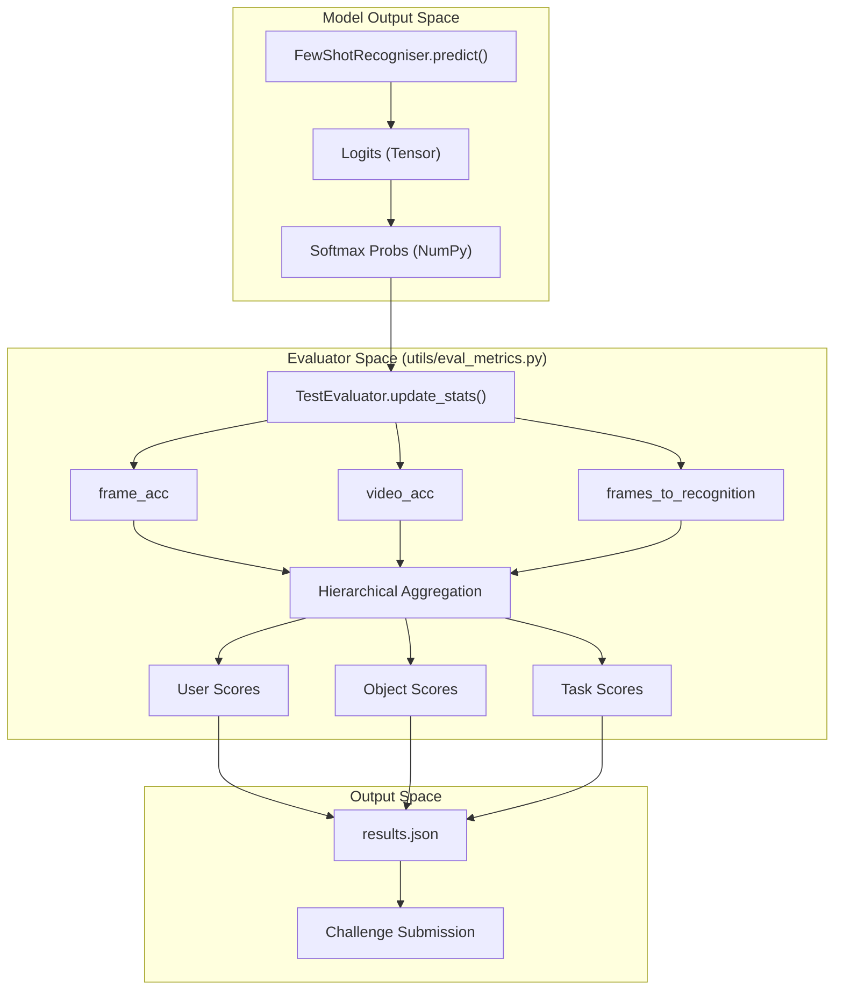
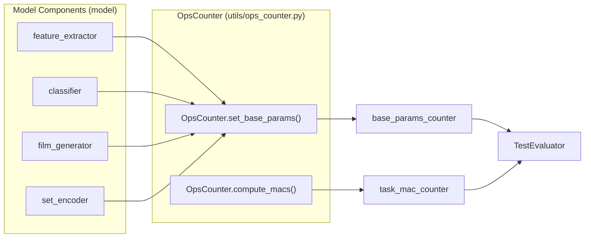

<!-- source: DeepWiki mcp.deepwiki.com · repo microsoft/ORBIT-Dataset · page 5 Evaluation & Metrics · fetched 2026-10-26 -->

# Evaluation & Metrics

Relevant source files

The following files were used as context for generating this wiki page:

- [orbit_challenge_getting_started.ipynb](orbit_challenge_getting_started.ipynb)
- [utils/eval_metrics.py](utils/eval_metrics.py)
- [utils/ops_counter.py](utils/ops_counter.py)

The ORBIT codebase provides a comprehensive evaluation framework designed to measure few-shot object recognition performance across multiple granularities. Because the dataset is organized hierarchically (User → Object → Video → Frame), the evaluation system aggregates raw frame-level predictions into higher-level metrics to provide a holistic view of model robustness and personalization efficiency.

The evaluation logic is primarily encapsulated in `utils/eval_metrics.py` [utils/eval_metrics.py:1-158](), which defines specialized classes for training, validation, and testing phases.

## Metric Hierarchy & Definitions

The system tracks three primary performance metrics. These are calculated at the frame or video level and then aggregated up the hierarchy (Task → Object → User).

| Metric | Code Symbol | Definition |
| :--- | :--- | :--- |
| **Frame Accuracy** | `frame_acc` | Average accuracy across all frames in a target video or clip [utils/eval_metrics.py:27-36](). |
| **Video Accuracy** | `video_acc` | A binary score (1.0 or 0.0) based on whether the most frequent frame prediction matches the video label [utils/eval_metrics.py:38-46](). |
| **Frames-to-Recognition** | `frames_to_recognition` | The index of the first correct prediction, normalized by the total number of frames in the video [utils/eval_metrics.py:48-60](). |

For a detailed breakdown of how these metrics are calculated and how confidence intervals are derived, see **[Evaluator Classes & Metric Hierarchy](#5.1)**.

## Evaluator Architecture

The evaluation system uses a class-based hierarchy to handle different stages of the model lifecycle. The `Evaluator` base class [utils/eval_metrics.py:14-70]() contains the core logic for metric computation, while its subclasses manage state and data aggregation.

### Evaluation Data Flow
The following diagram illustrates how raw model outputs are processed by the `TestEvaluator` to produce the final `results.json` and aggregated statistics.

**Sources:** [utils/eval_metrics.py:14-158](), [orbit_challenge_getting_started.ipynb:10-12]()

## Computational Profiling

In addition to recognition accuracy, the ORBIT benchmark emphasizes the efficiency of the personalization process. The `OpsCounter` class [utils/ops_counter.py:10-95]() integrates with the `thop` library to track:

*   **MACs (Multiply-Accumulate Operations):** Measured during both the personalization (adaptation) phase and the inference phase.
*   **Parameter Counts:** Tracks the base model parameters and any task-specific parameters generated during adaptation.

The `TestEvaluator` can be configured to include these operational metrics in its final report [utils/eval_metrics.py:102-110]().

### Profiling Integration
The diagram below shows how `OpsCounter` interacts with the model components to profile complexity.

**Sources:** [utils/ops_counter.py:20-49](), [utils/ops_counter.py:79-86](), [utils/eval_metrics.py:133-134]()

For details on how custom operations (e.g., for `timm` layers) are registered and how backward passes are accounted for, see **[Computational Profiling (OpsCounter)](#5.2)**.

## Sub-Pages

*   **[Evaluator Classes & Metric Hierarchy](#5.1)**: Detailed coverage of `TrainEvaluator`, `ValidationEvaluator`, and `TestEvaluator`. Explains the hierarchical aggregation logic (video → task → object → user) and `results.json` serialization.
*   **[Computational Profiling (OpsCounter)](#5.2)**: Technical details on tracking MACs and parameter counts using the `thop` library, including custom hooks for specific architecture layers.

**Sources:** [utils/eval_metrics.py:1-158](), [utils/ops_counter.py:1-95](), [orbit_challenge_getting_started.ipynb:8-12]()

---

