# Page: ORBIT Dataset & Few-Shot Recognition — Overview

# ORBIT Dataset & Few-Shot Recognition — Overview

<details>
<summary>Relevant source files</summary>

The following files were used as context for generating this wiki page:

- [CODE_OF_CONDUCT.md](CODE_OF_CONDUCT.md)
- [LICENSE.md](LICENSE.md)
- [NOTICE.md](NOTICE.md)
- [README.md](README.md)
- [SECURITY.md](SECURITY.md)
- [data/__init__.py](data/__init__.py)
- [data/orbit_extra_annotations.zip](data/orbit_extra_annotations.zip)
- [orbit_challenge_getting_started.ipynb](orbit_challenge_getting_started.ipynb)

</details>


This page provides a high-level introduction to the **ORBIT (Object Recognition for Blind Image Training)** benchmark. The project provides a real-world dataset and a suite of few-shot learning models designed to recognize objects for blind and low-vision users. 

The framework supports both standard meta-learning and **LITE (Large Image and Task Episodic)** training, which enables processing high-resolution (224x224) frames on a single GPU [README.md:1-5]().

## System Architecture

The ORBIT codebase is structured to bridge high-level few-shot learning concepts (tasks, episodes, personalization) with concrete PyTorch implementations. The architecture is divided into three main layers: Data Pipeline, Model Stack, and Execution Learners.

### Logic to Code Mapping
The following diagram illustrates how conceptual entities in the ORBIT domain map to specific classes and files within the repository.

**Diagram: Entity Mapping**
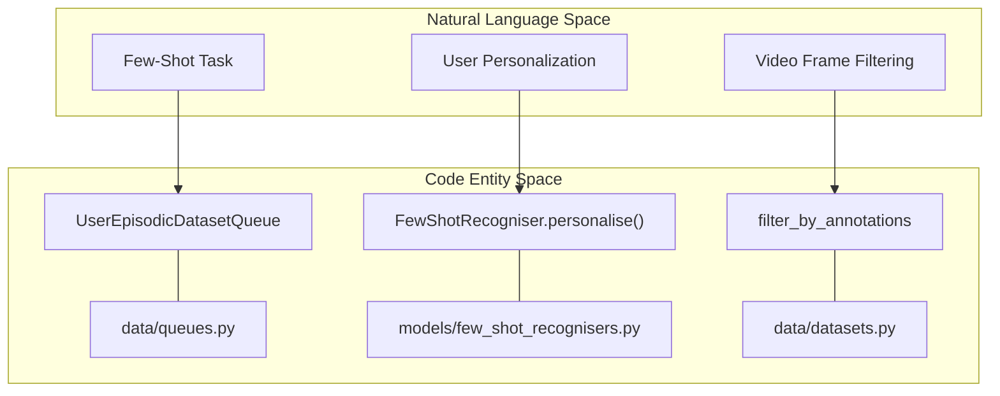
Sources: [orbit_challenge_getting_started.ipynb:88-111](), [README.md:84-88]()

## Key Concepts

### 1. The ORBIT Dataset
The dataset consists of videos of objects collected by blind and low-vision users. It is organized by **Collector → Object → Video Type (Clean/Clutter) → Video → Frame** [README.md:22]().
*   **Clean Videos:** Used for the **Support Set** to personalize the model to a specific user's objects.
*   **Clutter Videos:** Used for the **Query Set** to evaluate the model's recognition performance in realistic, noisy environments.

For details on the hierarchy and metadata, see [Dataset Structure & Annotations](#2.1).

### 2. Few-Shot Learning Pipeline
The system follows a meta-learning paradigm where models are "personalized" to a specific user's objects using a small number of examples.

**Diagram: System Workflow**
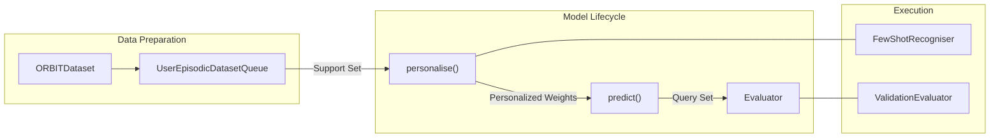
Sources: [orbit_challenge_getting_started.ipynb:88-111](), [README.md:73-82]()

### 3. Personalization & Recognition Rules
The benchmark enforces strict protocols for evaluation:
*   **Personalization:** Models must use only clean videos and labels for the specific test user [README.md:87-88](). Extra annotations (like bounding boxes) cannot be used during this phase [README.md:91]().
*   **Recognition:** Models are evaluated on 200 randomly sampled frames per clutter video [README.md:78-79](). Frames where the object is not present (flagged by `object_not_present_issue`) are filtered out [README.md:80]().

## Core Components

| Component | Responsibility | Key Files |
| :--- | :--- | :--- |
| **Data Queues** | Manages episodic sampling of users and objects into tasks. | `data/queues.py` |
| **Recognisers** | Implements few-shot architectures (ProtoNets, CNAPs, etc.). | `models/few_shot_recognisers.py` |
| **Learners** | Orchestrates the training loops and optimization logic. | `single-step-learner.py`, `multi-step-learner.py` |
| **Evaluators** | Computes frame-level and video-level accuracy metrics. | `utils/eval_metrics.py` |

## Getting Started & Repository Map

To begin working with the ORBIT Dataset:
*   **Installation:** Use the provided `environment.yml` or `requirements.txt` to set up the dependencies (PyTorch 1.13.1, TorchVision 0.14.1) [README.md:7-38]().
*   **Setup Guide:** For a step-by-step walkthrough, see **[Getting Started](#1.1)**.
*   **Code Navigation:** To understand the directory structure and where specific logic resides, see **[Repository Structure](#1.2)**.

Sources: [README.md:1-38](), [orbit_challenge_getting_started.ipynb:1-12]()

---

# Page: Getting Started

# Getting Started

<details>
<summary>Relevant source files</summary>

The following files were used as context for generating this wiki page:

- [environment.yml](environment.yml)
- [orbit_challenge_getting_started.ipynb](orbit_challenge_getting_started.ipynb)
- [requirements.txt](requirements.txt)
- [scripts/download_benchmark_dataset.sh](scripts/download_benchmark_dataset.sh)
- [scripts/download_unfiltered_dataset.sh](scripts/download_unfiltered_dataset.sh)

</details>


This page provides a step-by-step guide for setting up the ORBIT Dataset codebase, installing dependencies, downloading the required data, and running an initial benchmark experiment.

## Environment Setup

The repository supports environment configuration via Conda or Pip. The environment is centered around Python 3.7 and PyTorch 1.13.1 (or 2.6.0 for newer pip-based setups).

### Option 1: Conda (Recommended)
Use the `environment.yml` file to create a reproducible environment with all necessary channels (pytorch, plotly, nvidia) pre-configured.

```bash
conda env create -f environment.yml
conda activate orbit-dataset
```
Sources: [environment.yml:1-19]()

### Option 2: Pip
Alternatively, you can install dependencies using `requirements.txt`.

```bash
pip install -r requirements.txt
```
Sources: [requirements.txt:1-8]()

### Key Dependencies
| Package | Version | Purpose |
| :--- | :--- | :--- |
| `torch` | 1.13.1 / 2.6.0 | Core deep learning framework |
| `torchvision` | 0.14.1 | Image transformations and datasets |
| `timm` | 0.6.12 | Pre-trained vision backbones (EfficientNet, ViT) |
| `thop` | 0.1.1.post | MACs/Parameters profiling (OpsCounter) |
| `plotly` | 4.8.1 | Visualization of dataset statistics |

Sources: [environment.yml:10-18](), [requirements.txt:1-6]()

---

## Dataset Acquisition

The ORBIT dataset can be downloaded in several formats depending on your storage capacity and research needs.

### 1. Benchmark Dataset
The benchmark dataset is organized into `train`, `validation`, and `test` splits. You can download it at the original resolution (1080x1080) or pre-resized to 224x224.

*   **224x224 (Recommended):** ~54GB.
*   **1080x1080:** ~83GB.

Use the provided shell script to automate the download and unzipping process:
```bash
# Usage: bash scripts/download_benchmark_dataset.sh <destination_path> <frame_size>
bash scripts/download_benchmark_dataset.sh ./data 224
```
Sources: [scripts/download_benchmark_dataset.sh:5-18](), [orbit_challenge_getting_started.ipynb:24-24]()

### 2. Unfiltered Dataset
The unfiltered dataset contains additional users and videos not included in the benchmark splits.
```bash
bash scripts/download_unfiltered_dataset.sh ./data
```
Sources: [scripts/download_unfiltered_dataset.sh:10-22]()

### 3. Extra Annotations
The benchmark requires metadata (bounding boxes, quality issues) stored in a separate ZIP file.
```python
# From orbit_challenge_getting_started.ipynb
!wget -O orbit_extra_annotations.zip https://github.com/microsoft/ORBIT-Dataset/raw/dev/data/orbit_extra_annotations.zip
```
Sources: [orbit_challenge_getting_started.ipynb:61-61]()

---

## Data Flow: From Files to Episodes

The following diagram illustrates how the system transitions from raw files to the `UserEpisodicDatasetQueue` used in the getting started notebook.

**Data Loading Architecture**
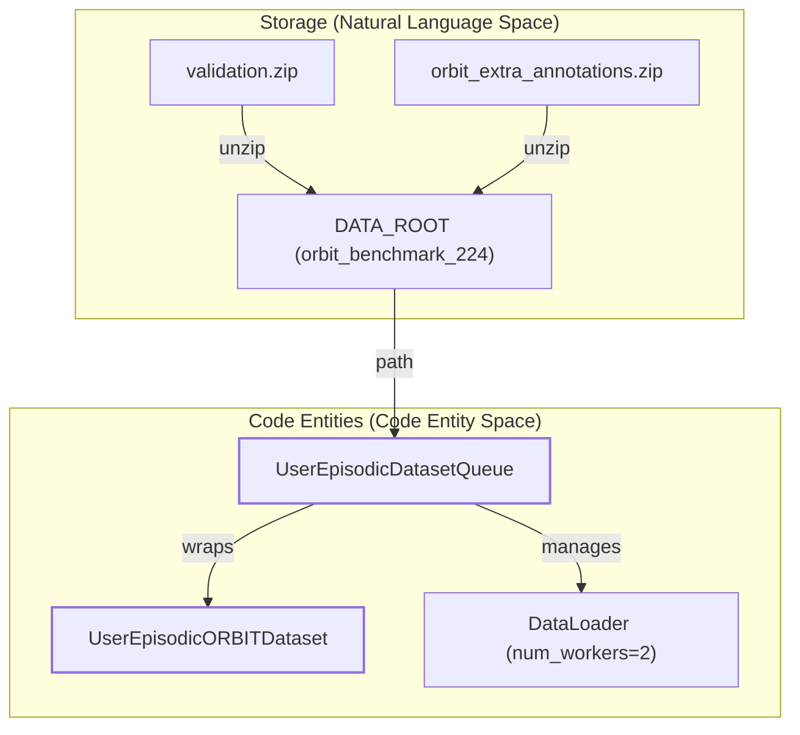
Sources: [orbit_challenge_getting_started.ipynb:35-47](), [orbit_challenge_getting_started.ipynb:88-113]()

---

## Running the Getting Started Notebook

The `orbit_challenge_getting_started.ipynb` notebook provides a complete walkthrough for the ORBIT Few-Shot Object Recognition Challenge.

### Step 1: Initialize the Data Queue
The notebook uses `UserEpisodicDatasetQueue` to sample tasks. Key parameters include:
*   `way_method="max"`: Samples all objects available for a specific user.
*   `shot_method=["max", "max"]`: Uses all available context videos for personalization and all target videos for evaluation.
*   `filter_by_annotations`: Specifically filters for `no_object_not_present_issue` to ensure target frames contain the object.

Sources: [orbit_challenge_getting_started.ipynb:91-111]()

### Step 2: Model Initialization
The starter task uses a Prototypical Network with a CLIP Vision Transformer (`vit_b_32_clip`) backbone.

**Inference Pipeline**
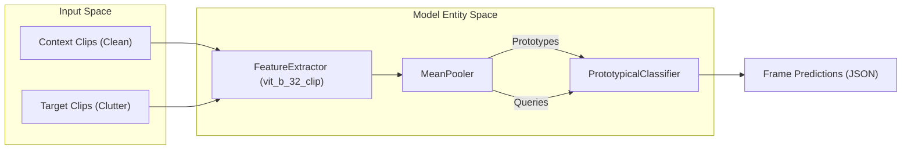
Sources: [orbit_challenge_getting_started.ipynb:121-121]()

### Step 3: Generating Predictions
The notebook iterates through the `data_queue`, performs a personalization step (computing prototypes from context videos), and then predicts labels for target frames. The output is a JSON file compatible with the Challenge evaluation server.

Sources: [orbit_challenge_getting_started.ipynb:10-10]()

---

# Page: Repository Structure

# Repository Structure

<details>
<summary>Relevant source files</summary>

The following files were used as context for generating this wiki page:

- [.gitignore](.gitignore)
- [README.md](README.md)
- [__init__.py](__init__.py)
- [azure-pipelines.yml](azure-pipelines.yml)
- [data/orbit_extra_annotations.zip](data/orbit_extra_annotations.zip)

</details>


This page provides a technical map of the ORBIT Dataset repository. The codebase is designed to support high-resolution few-shot learning, specifically for the task of teachable object recognition using the ORBIT benchmark. It includes a modular architecture for dataset loading, model definition (supporting both single-step and multi-step meta-learners), and evaluation.

## Top-Level Layout

The repository is organized into functional modules that separate data handling, model logic, and execution scripts.

| Directory / File | Description |
| :--- | :--- |
| `model/` | Core neural network architectures, including backbones, set encoders, and classifier heads. |
| `data/` | Dataset loading logic, episodic sampling, and annotation processing. |
| `utils/` | Shared utilities for arguments, metrics, and computational profiling. |
| `scripts/` | Shell and Python scripts for data preparation (downloading, resizing, summarizing). |
| `single-step-learner.py` | Entry point for training/testing CNAPs and ProtoNets. |
| `multi-step-learner.py` | Entry point for training/testing FineTuner and MAML. |

**Sources:** `README.md` [1-57](), `__init__.py` [1-6]()

---

## Data Flow and System Architecture

The following diagram maps the relationship between the Natural Language concepts of the ORBIT benchmark and the specific Code Entities that implement them.

### System Entity Mapping: Data to Model
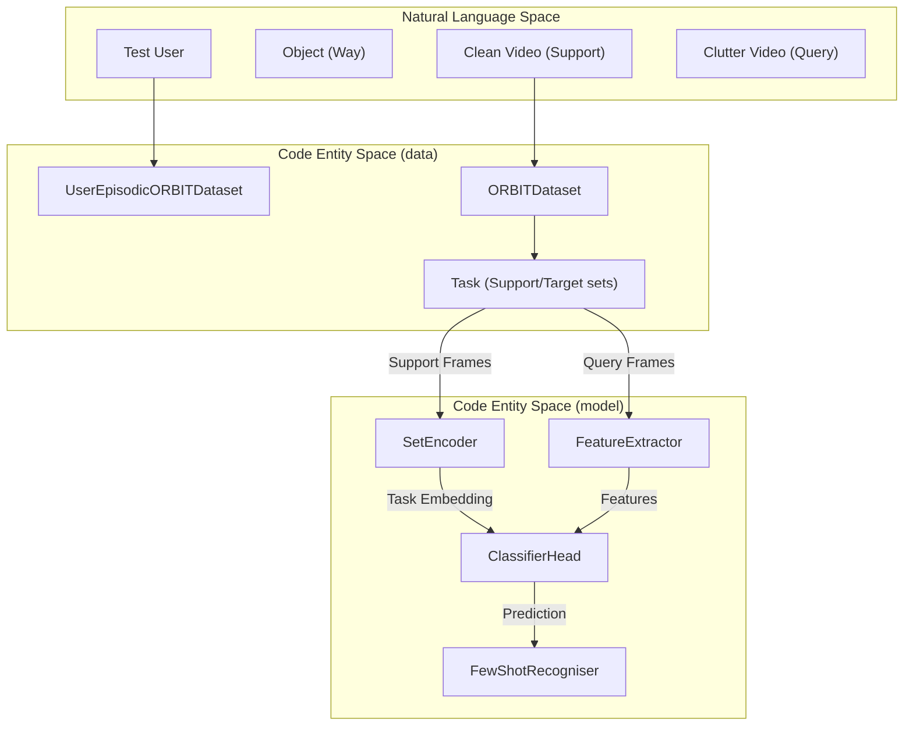
**Sources:** `README.md` [73-95](), `__init__.py` [4-5]()

---

## Directory Details

### 1. `model/`
This directory contains the modular components of the few-shot recognition pipeline.
*   **Backbones:** Logic for loading `EfficientNet`, `ViT`, and `ResNet` architectures.
*   **Adaptation:** Implements FiLM (Feature Wise Linear Modulation) for task-specific adaptation.
*   **Heads:** Pluggable classification layers such as `LinearClassifier`, `VersaClassifier`, and `PrototypicalClassifier`.
*   **Set Encoders:** Implements `DeepSets` via the `SetEncoder` class to process support sets into fixed-length embeddings.

### 2. `data/`
Responsible for transforming raw video frames into episodic tasks.
*   **`ORBITDataset`**: The base class that handles frame loading from the filesystem.
*   **`UserEpisodicORBITDataset`**: Orchestrates the sampling of users and their respective objects/videos to form few-shot episodes.
*   **`orbit_extra_annotations.zip`**: Contains JSON metadata for frame-level filtering (e.g., `object_not_present_issue`).

### 3. `utils/`
Contains infrastructure for experiment management.
*   **`args.py`**: Centralized configuration for all CLI arguments.
*   **`eval_metrics.py`**: Implementation of frame accuracy, video accuracy, and confidence intervals.
*   **`ops_counter.py`**: Integration with the `thop` library to measure MACs and parameters.

### 4. `scripts/`
Utility scripts for environment setup and data maintenance.
*   `download_benchmark_dataset.sh`: Automates dataset acquisition and resizing.
*   `summarize_dataset.py`: Computes statistics (users, objects, videos) across splits.

---

## Execution Pipeline

The repository distinguishes between "Single-Step" learners (which use parameter generation or metric learning) and "Multi-Step" learners (which use gradient-based optimization).

### Logic Flow: Single-Step vs Multi-Step
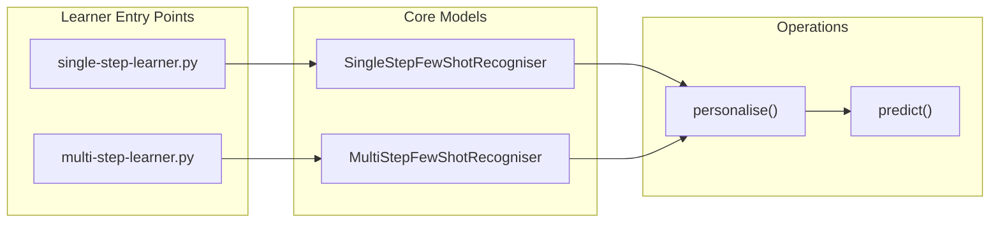
**Sources:** `__init__.py` [5](), `README.md` [57-85]()

## Infrastructure & CI/CD
The repository includes configuration for automated testing and security.
*   **`azure-pipelines.yml`**: Configures a Windows-based CI agent that runs `CredScan` for security and `ComponentGovernance` for open-source compliance on every push to `master` and a weekly schedule.
*   **Environment Management**: Dependencies are defined in both `environment.yml` (Conda) and `requirements.txt` (pip) to support various setup preferences.

**Sources:** `azure-pipelines.yml` [1-23](), `README.md` [25-38]()

---

# Page: Dataset

# Dataset

<details>
<summary>Relevant source files</summary>

The following files were used as context for generating this wiki page:

- [data/dataloaders.py](data/dataloaders.py)
- [data/datasets.py](data/datasets.py)
- [data/queues.py](data/queues.py)
- [data/samplers.py](data/samplers.py)

</details>


The ORBIT benchmark is a large-scale dataset of high-resolution videos recorded by people who are blind or low-vision. It is designed for the task of few-shot object recognition in a real-world setting. The dataset is organized to support episodic meta-learning, where models are trained and evaluated on tasks consisting of a small set of "context" (support) videos and a set of "target" (query) videos.

### Dataset Overview

The dataset is categorized into three primary splits: `train`, `validation`, and `test` [data/datasets.py:45](). Each split contains a collection of users, and each user has recorded multiple objects. For each object, there are two types of videos: **clean** (the object is the primary focus) and **clutter** (the object is shown in a natural, cluttered environment) [data/datasets.py:30,94]().

The following diagram illustrates the relationship between the physical data storage and the code entities used to manage it:

**Data Organization and Code Entity Mapping**
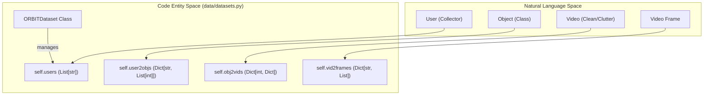
Sources: [data/datasets.py:18-102]()

---

### Dataset Structure & Annotations
The dataset follows a strict hierarchy: **Collector → Object → Video Type → Video → Frame**. Metadata and ground-truth information are provided via JSON and ZIP files, including object cluster labels and bounding boxes.

*   **Hierarchy**: Data is stored on disk following the user-object-video structure.
*   **Annotations**: The system supports loading specific annotation types (e.g., `object_bounding_box`) [data/datasets.py:71]() and filtering frames based on the presence of these annotations [data/datasets.py:64]().
*   **Clustering**: For certain evaluation modes, objects can be grouped into clusters using `orbit_{mode}_object_cluster_labels.json` [data/datasets.py:108]().

For details, see [Dataset Structure & Annotations](#2.1).

---

### Dataset Loading Pipeline
The loading pipeline transforms raw files into episodic tasks. This process is managed by the `DataLoader` [data/dataloaders.py:8]() and specific queue classes that handle sampling logic.

**Loading Pipeline Architecture**
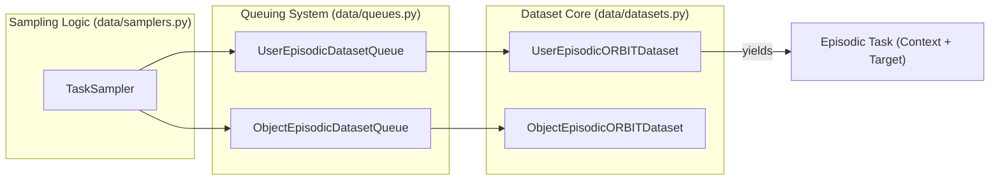
Sources: [data/samplers.py:8-12](), [data/queues.py:42-80](), [data/datasets.py:18-22]()

*   **Episodic Sampling**: Tasks are sampled either user-centrically (all objects for a single user) or object-centrically [data/dataloaders.py:16-17]().
*   **Frame Processing**: Frames are resized to `frame_size` [data/datasets.py:53](), normalized using specific stats (e.g., ImageNet or CLIP) [data/datasets.py:82-87](), and sampled into contiguous clips of `clip_length` [data/datasets.py:52]().
*   **Memory Management**: The pipeline implements caps on the number of objects per user (`object_cap`), videos per object (`context_shot_cap`), and frames per video (`frame_cap`) to ensure consistent memory usage [data/datasets.py:76-80]().

For details, see [Dataset Loading Pipeline](#2.2).

---

### Dataset Utilities & Scripts
A variety of helper scripts are provided in the `scripts/` directory to manage the dataset lifecycle. These include:
*   **Downloader**: Scripts to fetch the benchmark or unfiltered datasets.
*   **Preprocessing**: Tools for resizing frames offline to speed up training.
*   **Analysis**: Utilities to compute dataset statistics, visualize frame distributions, and generate average images per object class.

For details, see [Dataset Utilities & Scripts](#2.3).

Sources: [data/datasets.py:18-102](), [data/queues.py:8-41](), [data/dataloaders.py:8-15](), [data/samplers.py:8-12]()

---

# Page: Dataset Structure & Annotations

# Dataset Structure & Annotations

<details>
<summary>Relevant source files</summary>

The following files were used as context for generating this wiki page:

- [README.md](README.md)
- [data/object_clusters_benchmark.txt](data/object_clusters_benchmark.txt)
- [data/object_clusters_full.txt](data/object_clusters_full.txt)
- [data/orbit_benchmark_mode_splits.json](data/orbit_benchmark_mode_splits.json)
- [data/orbit_benchmark_users_to_split.json](data/orbit_benchmark_users_to_split.json)
- [data/orbit_dataset_readme.txt](data/orbit_dataset_readme.txt)
- [data/orbit_extra_annotations.zip](data/orbit_extra_annotations.zip)
- [data/orbit_test_object_cluster_labels.json](data/orbit_test_object_cluster_labels.json)
- [data/orbit_train_object_cluster_labels.json](data/orbit_train_object_cluster_labels.json)
- [data/orbit_validation_object_cluster_labels.json](data/orbit_validation_object_cluster_labels.json)

</details>


The ORBIT dataset is a real-world few-shot recognition dataset containing videos of objects collected by people who are blind or have low vision [README.md:1-5](). It is designed to benchmark "teachable" object recognition systems where a model must learn to recognize a user's personal objects from just a few high-quality "clean" videos and then recognize them in high-clutter "target" videos [README.md:73-83]().

## File Hierarchy

The dataset is organized into two primary versions: the **Unfiltered Dataset** and the **Benchmark Dataset** [data/orbit_dataset_readme.txt:4-13](). Both follow a strict directory-based hierarchy.

### ORBIT Unfiltered Dataset
The unfiltered version contains 4,733 videos (approx. 3.1 million frames) across 588 objects from 97 collectors [data/orbit_dataset_readme.txt:5]().

| Level | Entity | Description |
| :--- | :--- | :--- |
| 1 | **Collector** | Folders named by User ID (e.g., `P999`) [data/orbit_dataset_readme.txt:6](). |
| 2 | **Object** | Folders for each object belonging to that collector [data/orbit_dataset_readme.txt:7](). |
| 3 | **Video Type** | `clean`, `clutter`, or `clutter-pan` [data/orbit_dataset_readme.txt:8](). |
| 4 | **Video** | Unique video instance folders [data/orbit_dataset_readme.txt:9](). |
| 5 | **Frame** | Individual `.jpg` files [data/orbit_dataset_readme.txt:10](). |

### ORBIT Benchmark Dataset
The benchmark version is a subset containing 3,822 videos of 386 objects from 67 collectors [data/orbit_dataset_readme.txt:14-22](). It adds a "Mode" level at the top of the hierarchy to separate splits.

**Hierarchy:** `Mode` → `Collector` → `Object` → `Video Type` → `Video` → `Frame` [data/orbit_dataset_readme.txt:15-20]().

### Data Entity Mapping
The following diagram bridges the natural language concepts of the dataset to the physical directory structure and the JSON metadata used by the loading pipeline.

**Data Space to Code Entity Mapping**
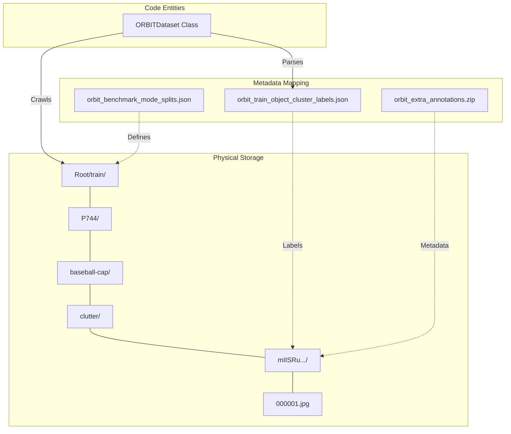
**Sources:** [data/orbit_dataset_readme.txt:13-20](), [data/orbit_benchmark_mode_splits.json:1](), [data/orbit_train_object_cluster_labels.json:1]().

---

## Dataset Splits

The benchmark dataset is split by **Collector (User)**. This ensures that a model evaluated on the `test` split must generalize to entirely new users and objects not seen during `train` or `validation`.

| Split | Number of Users | User IDs (Examples) |
| :--- | :---: | :--- |
| **Train** | 44 | `P613`, `P277`, `P332`, `P470`, `P744`, ... [data/orbit_benchmark_mode_splits.json:1]() |
| **Validation** | 6 | `P867`, `P579`, `P235`, `P778`, `P189`, `P194` [data/orbit_benchmark_mode_splits.json:1]() |
| **Test** | 17 | `P198`, `P953`, `P233`, `P204`, `P999`, ... [data/orbit_benchmark_mode_splits.json:1]() |

---

## Object Cluster Labels

Because users may name the same type of object differently (e.g., "keys" vs "house keys"), the dataset provides cluster labels to group synonymous objects.

*   **Mapping Files**:
    *   `orbit_train_object_cluster_labels.json` [data/orbit_train_object_cluster_labels.json:1]()
    *   `orbit_validation_object_cluster_labels.json` [data/orbit_validation_object_cluster_labels.json:1]()
    *   `orbit_test_object_cluster_labels.json` [data/orbit_test_object_cluster_labels.json:1]()
*   **Structure**: A dictionary where the key is the video folder name and the value is an integer cluster ID.
    *   *Example*: `P744--baseball-cap--clutter--...` maps to ID `45` [data/orbit_train_object_cluster_labels.json:1]().
*   **Cluster Definitions**: The text files `object_clusters_benchmark.txt` and `object_clusters_full.txt` provide the human-readable names for these IDs.
    *   *Example ID 1*: "keys, house keys, radar key, my keys..." [data/object_clusters_benchmark.txt:1]().
    *   *Example ID 11*: "remote, tv remote, apple tv remote..." [data/object_clusters_benchmark.txt:11]().

---

## Extra Annotations & Bounding Boxes

The `orbit_extra_annotations.zip` file contains per-video JSON files providing frame-level metadata [data/orbit_extra_annotations.zip:1-10]().

### Annotation Metadata
Each JSON file contains details for every frame in a video:
1.  **Object Presence**: `object_not_present_issue` (boolean). Used to filter frames where the object is out of view [README.md:80]().
2.  **Quality Issues**: Flags for blur, occlusion, or poor lighting.
3.  **Bounding Boxes**: `[x, y, width, height]` coordinates for the object in the frame.

**Annotation Data Flow**
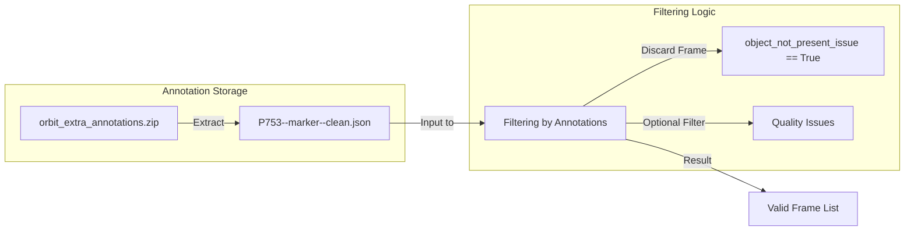
**Sources:** [README.md:80-82](), [data/orbit_extra_annotations.zip:2-10]().

### Filtering Rules
During evaluation (CLU-VE), clutter videos are filtered to exclude frames where the ground-truth object is not present (`object_not_present_issue=True`) [README.md:80](). 
*   If a video has **< 50** valid frames after filtering, it is excluded from evaluation [README.md:80]().
*   If a video has **50-200** valid frames, all are used [README.md:80]().
*   If a video has **> 200** valid frames, 200 are randomly sampled [README.md:78-80]().

---

## Summary Statistics

The dataset can be summarized using `scripts/summarize_dataset.py` [README.md:50-52]().

| Metric | Benchmark (Combined) |
| :--- | :--- |
| **Total Videos** | 3,822 [data/orbit_dataset_readme.txt:14]() |
| **Total Frames** | 2,687,934 [data/orbit_dataset_readme.txt:14]() |
| **Mean Image (RGB)** | `[0.500, 0.436, 0.396]` [data/orbit_dataset_readme.txt:24]() |
| **Std Dev (RGB)** | `[0.145, 0.143, 0.138]` [data/orbit_dataset_readme.txt:24]() |

**Sources:** [README.md:40-55](), [data/orbit_dataset_readme.txt:1-27](), [data/orbit_benchmark_mode_splits.json:1](), [data/object_clusters_benchmark.txt:1-127]().

---

# Page: Dataset Loading Pipeline

# Dataset Loading Pipeline

<details>
<summary>Relevant source files</summary>

The following files were used as context for generating this wiki page:

- [data/dataloaders.py](data/dataloaders.py)
- [data/datasets.py](data/datasets.py)
- [data/queues.py](data/queues.py)
- [data/samplers.py](data/samplers.py)
- [data/utils.py](data/utils.py)

</details>


The ORBIT dataset loading pipeline is responsible for transforming raw video frames and metadata into episodic tasks suitable for few-shot learning. It handles complex requirements such as user-centric or object-centric sampling, frame-level filtering based on quality annotations, contiguous clip sampling, and memory management via hard caps on frames and videos.

## Pipeline Architecture

The pipeline is organized hierarchically, starting from high-level `DataLoader` configurations down to individual frame processing in the `ORBITDataset` base class.

### High-Level Data Flow
The `DataLoader` class in `data/dataloaders.py` initializes specialized queues (`UserEpisodicDatasetQueue` or `ObjectEpisodicDatasetQueue`) for training, validation, and testing. These queues wrap the underlying PyTorch `Dataset` and `Sampler` logic.

| Component | Responsibility |
| :--- | :--- |
| **DataLoader** | Orchestrates the creation of train/val/test queues based on configuration. [data/dataloaders.py:8-12]() |
| **DatasetQueue** | Manages a `DataLoader` instance and a `TaskSampler` to yield episodic tasks. [data/queues.py:8-13]() |
| **TaskSampler** | Determines the order of user/object indices to sample, ensuring a fixed number of tasks per item. [data/samplers.py:8-12]() |
| **ORBITDataset** | The core logic for scanning the filesystem, loading annotations, and sampling frames/clips. [data/datasets.py:18-21]() |

### Code Entity Space Mapping
The following diagram bridges the abstract concepts of "Tasks" and "Episodes" to the specific classes and functions in the codebase.

**Task Assembly Hierarchy**
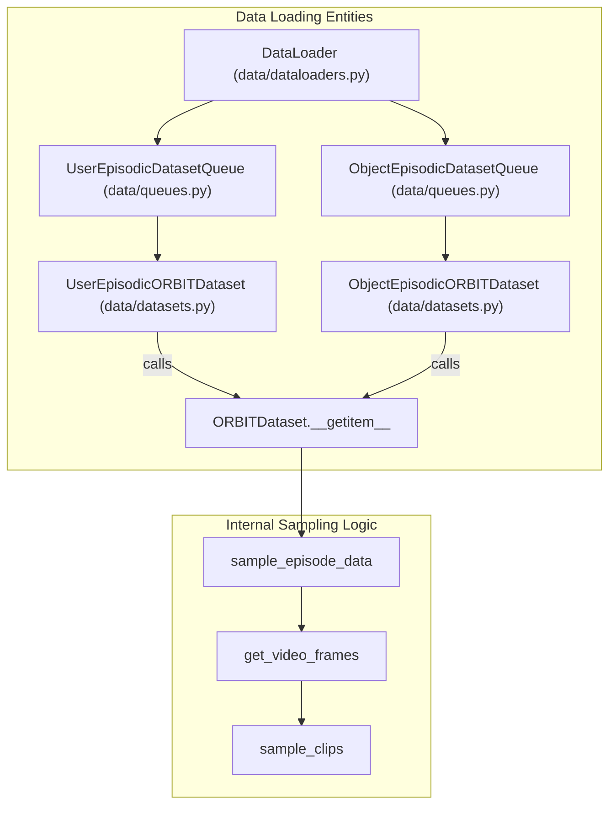
Sources: [data/dataloaders.py:8-12](), [data/queues.py:42-47](), [data/datasets.py:18-22](), [data/datasets.py:171-175](), [data/datasets.py:240-245]()

---

## Core Dataset Classes

### ORBITDataset (Base Class)
The `ORBITDataset` class [data/datasets.py:18]() is the foundation for all loading operations. During initialization, it performs a recursive scan of the dataset root to map users to objects and objects to videos [data/datasets.py:102-132]().

**Key Configuration Parameters:**
- `way_method`: Determines how many objects are selected per task ('random' or 'max'). [data/datasets.py:46]()
- `shot_methods`: Strategy for selecting context and target videos (e.g., 'random', 'all'). [data/datasets.py:47]()
- `clip_methods`: Strategy for sampling contiguous frames (e.g., 'uniform', 'random', 'continuous'). [data/datasets.py:51]()
- `filter_by_annotations`: List of criteria (like `quality_issues`) used to exclude frames. [data/datasets.py:60-62]()

### UserEpisodicORBITDataset
This variant samples tasks at the **User** level. Each call to `__getitem__(user_idx)` generates a complete few-shot task where the context and target sets are drawn from the objects owned by that specific user.
Sources: [data/datasets.py:171-175]()

### ObjectEpisodicORBITDataset
This variant samples tasks at the **Object** level. It is primarily used for training scenarios where the model should see a wide variety of objects from different users in a single batch.
Sources: [data/datasets.py:215-219]()

---

## Frame Filtering and Annotation Loading

ORBIT provides fine-grained annotations that allow the pipeline to filter out "bad" frames (e.g., frames where the object is occluded or out of focus).

### Filtering Logic
If `filter_by_annotations` is enabled, the dataset loads JSON annotation files from `self.annotation_root` [data/datasets.py:72](). Frames are filtered in `get_video_frames` [data/datasets.py:328]() based on the `filter_params` criteria:
1. **Annotation Check**: Frames are checked against labels like `object_not_present_flag` or `occlusion_flag`. [data/datasets.py:349-355]()
2. **Minimum Frame Requirement**: If a video has fewer than `min_video_frames` after filtering, it may be discarded. [data/datasets.py:125-130]()

### Memory Management Caps
To prevent OOM (Out of Memory) errors and ensure stable training, the pipeline enforces several "caps":
- `clip_cap`: Limits the number of clips sampled from a single video (default: 200). [data/datasets.py:79]()
- `frame_cap`: Limits the total frames processed in a single video (default: 1000). [data/datasets.py:80]()
- `context_shot_cap` / `target_shot_cap`: Limits the number of videos per object (default: 15). [data/datasets.py:77-78]()

---

## Clip Sampling Methods

The pipeline supports multiple ways to sample frames from a video, defined by the `clip_methods` parameter.

| Method | Implementation Detail |
| :--- | :--- |
| **uniform** | Samples `clip_length` frames at equal intervals across the video. [data/datasets.py:421-424]() |
| **random** | Samples `clip_length` contiguous frames starting at a random offset. [data/datasets.py:417-420]() |
| **continuous** | Samples all possible contiguous clips of `clip_length` from the video. [data/datasets.py:425-428]() |

**Data Loading Flow (Frame to Clip)**
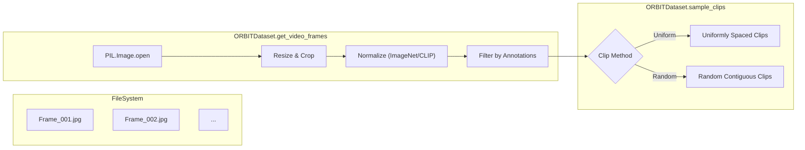
Sources: [data/datasets.py:328-360](), [data/datasets.py:401-415](), [data/datasets.py:440-455]()

---

## Episodic Task Assembly

A "Task" in ORBIT is a dictionary containing everything needed for a few-shot learning step. The `sample_episode_data` function [data/datasets.py:240]() performs the following:
1. **Object Selection**: Selects $N$ objects (the "way"). [data/datasets.py:255-263]()
2. **Video Selection**: For each object, selects context and target videos (the "shot"). [data/datasets.py:265-285]()
3. **Frame Processing**: Loads and processes frames for every selected video. [data/datasets.py:287-300]()
4. **Label Mapping**: Maps raw object IDs to local task labels (0 to $N-1$). [data/datasets.py:302-315]()

### Task Dictionary Structure
The assembled task contains:
- `context_clips`: Tensor of shape `(num_context_clips, clip_length, C, H, W)`.
- `target_clips`: Tensor of shape `(num_target_clips, clip_length, C, H, W)`.
- `context_labels` / `target_labels`: Local labels for the task.
- `context_annotations` / `target_annotations`: Bounding boxes or other metadata if requested.

Sources: [data/datasets.py:240-326](), [data/utils.py:30-47]()

---

# Page: Dataset Utilities & Scripts

# Dataset Utilities & Scripts

<details>
<summary>Relevant source files</summary>

The following files were used as context for generating this wiki page:

- [scripts/compute_avg_image.py](scripts/compute_avg_image.py)
- [scripts/download_benchmark_dataset.sh](scripts/download_benchmark_dataset.sh)
- [scripts/download_unfiltered_dataset.sh](scripts/download_unfiltered_dataset.sh)
- [scripts/merge_and_split_benchmark_users.py](scripts/merge_and_split_benchmark_users.py)
- [scripts/resize_videos.py](scripts/resize_videos.py)
- [scripts/summarize_dataset.py](scripts/summarize_dataset.py)

</details>


This page details the helper scripts and utilities provided in the ORBIT repository for managing, processing, and analyzing the dataset. These tools handle the end-to-end data lifecycle, from initial download and resizing to statistical summarization and user split management.

## Dataset Acquisition and Preparation

The repository provides shell scripts to automate the download of the ORBIT dataset from FigShare. These scripts handle downloading ZIP files, unzipping them into the correct directory structure, and performing initial cleanup.

### Benchmark Dataset Download
The script `scripts/download_benchmark_dataset.sh` downloads the curated benchmark version of the dataset. It supports two frame sizes: the default raw size or a pre-resized 224x224 version [scripts/download_benchmark_dataset.sh:7-18](). If a custom frame size is requested (other than 224), it automatically invokes the `resize_videos.py` script after unzipping [scripts/download_benchmark_dataset.sh:45-51]().

### Unfiltered Dataset Download
The script `scripts/download_unfiltered_dataset.sh` downloads the full, unfiltered ORBIT dataset, including an "other" folder containing additional data [scripts/download_unfiltered_dataset.sh:8](). Post-download, it flattens the directory structure [scripts/download_unfiltered_dataset.sh:42-49]() and runs `scripts/merge_and_split_benchmark_users.py` to reconcile user folders that were merged or split during the benchmark creation process [scripts/download_unfiltered_dataset.sh:52]().

### Video Resizing Utility
The `scripts/resize_videos.py` script is a multi-threaded utility for resizing raw video frames to a target resolution (default 224x224). It uses a `ThreadPool` to process videos in parallel [scripts/resize_videos.py:23-28]().

**Key Functions:**
* `main()`: Initializes the thread pool and iterates through all video directories found via a 5-level glob pattern (`*/*/*/*/*`) [scripts/resize_videos.py:20-25]().
* `resize_video_frames()`: The worker function that opens frames using `PIL.Image`, converts them to RGB if necessary, and saves them with Lanczos resampling at 95% quality [scripts/resize_videos.py:43-48]().

**Data Flow: Acquisition to Storage**
The following diagram illustrates how raw data from FigShare is transformed into a local usable format.

**Title: Dataset Preparation Pipeline**
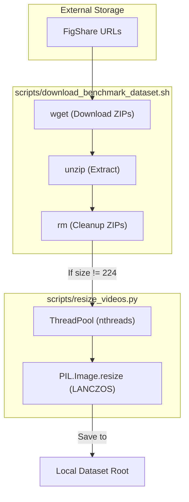
Sources: [scripts/download_benchmark_dataset.sh:1-52](), [scripts/resize_videos.py:11-51]()

---

## Dataset Summarization and Statistics

The `scripts/summarize_dataset.py` script provides a comprehensive analysis of the dataset's composition. It calculates statistics at the user, object, and video levels, broken down by video type (e.g., "clean" vs. "clutter").

### Implementation Details
The script iterates through the directory structure to tally videos and frames. It supports summarizing across standard splits (`train`, `validation`, `test`) or treating the root as a single pool [scripts/summarize_dataset.py:16-17]().

**Core Logic Entities:**
* `get_tallies_by_user()`: Traverses the file system to count frames per video and videos per object for every user in a given path.
* `compute_count_stats()`: Calculates means, standard deviations, percentiles (25th/75th), and min/max for video and object counts [scripts/summarize_dataset.py:86-147]().
* `compute_num_frames_stats()`: Computes statistics for frame counts per video and per user [scripts/summarize_dataset.py:41-84]().

**Code Entity Association**
The following diagram maps the statistical calculations to the dataset's hierarchical structure.

**Title: Statistics Aggregation Logic**
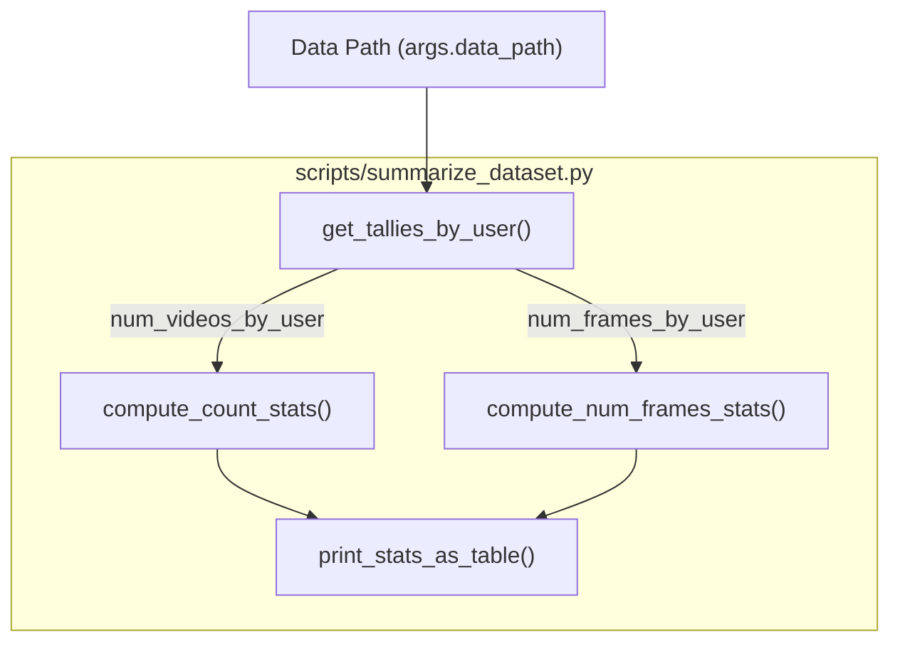
Sources: [scripts/summarize_dataset.py:9-149]()

---

## User Management Utilities

### Merging and Splitting Users
The script `scripts/merge_and_split_benchmark_users.py` is used to maintain consistency between the unfiltered ORBIT data and the benchmark splits. This is necessary because some users in the raw data were split into multiple "virtual" users for the benchmark to ensure distinct object sets for training and testing.

* `merge_users()`: Moves videos from the "other" folder into the main user directories, merging contents if the user already exists [scripts/merge_and_split_benchmark_users.py:22-51]().
* `split_users()`: Reads a JSON mapping (`orbit_benchmark_users_to_split.json`) and redistributes objects and videos from a single benchmark user into multiple new user directories [scripts/merge_and_split_benchmark_users.py:53-81](). It also renames individual frame files to match the new user IDs [scripts/merge_and_split_benchmark_users.py:78]().

### Computing Average Image
The `scripts/compute_avg_image.py` script calculates the mean and standard deviation of pixel values across the entire training set. This is used for data normalization during model training.

* It processes all `train` video directories [scripts/compute_avg_image.py:16]().
* For every frame, it converts the image to a NumPy array and computes the mean per RGB channel [scripts/compute_avg_image.py:26-27]().
* The final output is the global average and standard deviation normalized to the `[0, 1]` range [scripts/compute_avg_image.py:31-33]().

Sources: [scripts/merge_and_split_benchmark_users.py:10-84](), [scripts/compute_avg_image.py:10-37]()

## Summary of Script Capabilities

| Script | Purpose | Key Dependencies |
| :--- | :--- | :--- |
| `download_benchmark_dataset.sh` | Downloads/unzips benchmark ZIPs from FigShare. | `wget`, `unzip` |
| `download_unfiltered_dataset.sh` | Downloads/unzips unfiltered ZIPs and flattens structure. | `wget`, `unzip`, `merge_and_split_benchmark_users.py` |
| `resize_videos.py` | Multi-threaded resizing of frames to target resolution. | `PIL`, `multiprocessing` |
| `summarize_dataset.py` | Generates tabular statistics (videos/frames per user/object). | `numpy`, `glob` |
| `merge_and_split_benchmark_users.py` | Reconciles raw users with benchmark user splits. | `shutil`, `json` |
| `compute_avg_image.py` | Computes global RGB mean/std for normalization. | `PIL`, `numpy` |

Sources: [scripts/download_benchmark_dataset.sh:1-52](), [scripts/download_unfiltered_dataset.sh:1-53](), [scripts/resize_videos.py:1-51](), [scripts/summarize_dataset.py:1-149](), [scripts/merge_and_split_benchmark_users.py:1-85](), [scripts/compute_avg_image.py:1-37]()

---

# Page: Model Architecture

# Model Architecture

<details>
<summary>Relevant source files</summary>

The following files were used as context for generating this wiki page:

- [model/feature_adapters.py](model/feature_adapters.py)
- [model/feature_extractors.py](model/feature_extractors.py)
- [model/few_shot_recognisers.py](model/few_shot_recognisers.py)
- [model/film.py](model/film.py)
- [model/set_encoders.py](model/set_encoders.py)

</details>


The ORBIT model architecture is designed for few-shot video recognition, specifically addressing the challenge of personalizing a recognizer to a user's objects with very few examples. The system is composed of a modular stack including a feature extractor backbone, a task-specific adaptation layer (FiLM), and pluggable classifier heads.

### High-Level System Overview

The core of the architecture is the `FewShotRecogniser` [model/few_shot_recognisers.py:46-49](), which manages the lifecycle of a few-shot task: receiving context (support) examples to "personalise" the model, and then "predicting" labels for target (query) examples.

#### Code Entity Map: Recognition Pipeline
The following diagram illustrates how high-level concepts map to specific classes and functions within the codebase.

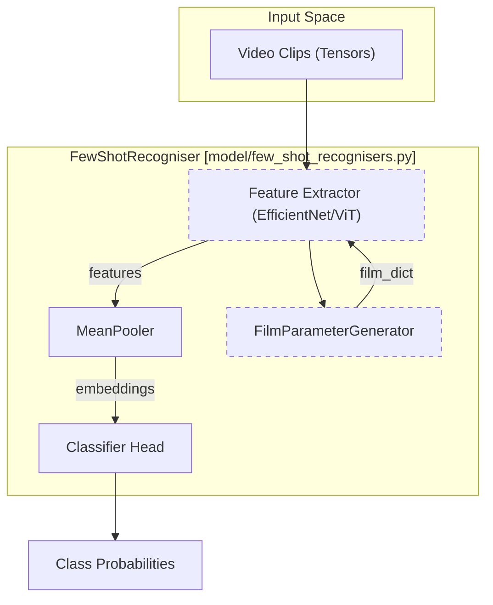
**Sources:** [model/few_shot_recognisers.py:46-88](), [model/feature_extractors.py:37-79](), [model/poolers.py:34-37]()

---

### 1. Few-Shot Recogniser Variants
The framework supports different learning paradigms through specialized subclasses of `FewShotRecogniser`.

*   **SingleStepFewShotRecogniser**: Implements "amortized" few-shot learning where a task-encoding network (SetEncoder) generates parameters in a single forward pass. This is used for models like **CNAPs** and **ProtoNets** [model/few_shot_recognisers.py:171-174]().
*   **MultiStepFewShotRecogniser**: Implements gradient-based personalization. The model's parameters (or a subset of them) are updated over multiple optimization steps using the context set. This is used for **FineTuner** and **MAML** [model/few_shot_recognisers.py:383-386]().

For details on the lifecycle and memory optimizations like LITE, see [FewShotRecogniser Base & Variants](#3.1).

**Sources:** [model/few_shot_recognisers.py:171-174](), [model/few_shot_recognisers.py:383-386]()

---

### 2. Feature Extractors & FiLM Adaptation
The system uses standard backbones (backbones) from the `timm` library, which are modified to support **FiLM (Feature-wise Linear Modulation)**.

*   **Backbones**: Supports `efficientnet_b0`, `efficientnet_v2_s`, `vit_s_32`, `vit_b_32`, and `vit_b_32_clip` [model/feature_extractors.py:39-64]().
*   **FiLM Tagging**: Layers (typically BatchNorm or LayerNorm) are "tagged" so their parameters can be modulated by a generator [model/film.py:38-67]().
*   **Parameter Generation**: The `FilmParameterGenerator` [model/feature_adapters.py:36-38]() produces scale and shift values based on a task embedding, allowing the backbone to adapt its feature extraction to the specific objects in a task.

For details on backbone configuration and dynamic parameter generation, see [Feature Extractors & FiLM Adaptation](#3.2).

**Sources:** [model/feature_extractors.py:37-79](), [model/film.py:38-67](), [model/feature_adapters.py:36-79]()

---

### 3. Classifier Heads & Set Encoders
The architecture separates the logic of "how to compare features" into pluggable classifier heads and "how to represent a task" into set encoders.

#### Code Entity Map: Component Interaction
This diagram shows the relationship between the `SetEncoder` (which processes the context set) and the `Classifier` (which processes the target set).

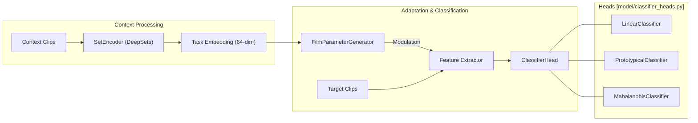
**Sources:** [model/set_encoders.py:34-37](), [model/classifier_heads.py:41-44](), [model/few_shot_recognisers.py:72-84]()

*   **Set Encoders**: Uses a `SimplePrePoolNet` (DeepSets architecture) to encode a set of context images into a single 64-dimensional task embedding [model/set_encoders.py:34-44]().
*   **Classifier Heads**: Includes `PrototypicalClassifier` (distance-based), `LinearClassifier` (softmax-based), and `MahalanobisClassifier` (distribution-based) [model/classifier_heads.py:41-44]().
*   **Poolers**: The `MeanPooler` aggregates frame-level features into clip-level features by averaging across the temporal dimension [model/poolers.py:34-45]().

For details on the mathematical implementations of these heads and encoders, see [Classifier Heads & Set Encoders](#3.3).

**Sources:** [model/set_encoders.py:34-44](), [model/classifier_heads.py:41-44](), [model/poolers.py:34-45]()

---

# Page: FewShotRecogniser Base & Variants

# FewShotRecogniser Base & Variants

<details>
<summary>Relevant source files</summary>

The following files were used as context for generating this wiki page:

- [model/few_shot_recognisers.py](model/few_shot_recognisers.py)
- [model/set_encoders.py](model/set_encoders.py)

</details>


This page provides a detailed technical overview of the `FewShotRecogniser` class hierarchy. These classes define the lifecycle of a few-shot recognition task, including how a model is personalized to a specific user's context (support) set and how it subsequently predicts labels for target (query) videos.

## The FewShotRecogniser Base Class

The `FewShotRecogniser` [model/few_shot_recognisers.py:46-50]() is an abstract base class inheriting from `nn.Module`. It establishes the shared infrastructure for all few-shot models in the repository, including the feature extractor, the pooling logic, and the classifier head.

### Key Components
*   **Feature Extractor**: Initialized via `create_feature_extractor` [model/few_shot_recognisers.py:63-68](). It supports various backbones (EfficientNet, ViT, ResNet) and can be configured to use FiLM (Feature Wise Linear Modulation) layers.
*   **Classifier Head**: A pluggable module (e.g., `LinearClassifier`, `VersaClassifier`, `PrototypicalClassifier`) that maps features to class logits [model/few_shot_recognisers.py:71-84]().
*   **Frame Pooler**: A `MeanPooler` [model/few_shot_recognisers.py:87]() that aggregates frame-level features into clip-level or video-level representations.

### The Lifecycle Methods
Every variant must implement or utilize three primary lifecycle stages:
1.  **`personalise`**: Adapts the model to a specific task using a context set of labeled videos.
2.  **`predict`**: Performs inference on unlabeled target videos using the personalized state.
3.  **`_reset`**: Clears task-specific parameters (e.g., FiLM parameters or classifier weights) to prepare for the next task [model/few_shot_recognisers.py:166-174]().

**Sources:** [model/few_shot_recognisers.py:46-174](), [model/poolers.py:31-40]()

---

## SingleStepFewShotRecogniser (CNAPs / ProtoNets)

The `SingleStepFewShotRecogniser` [model/few_shot_recognisers.py:176-180]() is designed for "amortized" meta-learning. Instead of using gradient descent during personalization, it uses an external "task encoder" to generate model parameters in a single forward pass.

### Architecture & Data Flow
This variant introduces a `SetEncoder` [model/few_shot_recognisers.py:192-194]() and a `FilmParameterGenerator` [model/few_shot_recognisers.py:196-200]().

*   **Task Embedding**: The `SetEncoder` (DeepSets) processes context frames to produce a global task representation [model/set_encoders.py:34-45]().
*   **Parameter Generation**: The `FilmParameterGenerator` takes this task embedding and produces FiLM coefficients (gammas and betas) for every adapted layer in the backbone [model/few_shot_recognisers.py:214-218]().
*   **Stateless Inference**: To apply these generated parameters without modifying the backbone's global state, the model uses `torch.nn.utils.stateless.functional_call` [model/few_shot_recognisers.py:114-115]().

### Single-Step Personalization Logic
| Method | Description |
| :--- | :--- |
| `personalise` | Encodes context clips through `SetEncoder`, generates FiLM parameters, and initializes the classifier head (e.g., computing prototypes for ProtoNets) [model/few_shot_recognisers.py:204-225](). |
| `predict` | Passes target clips through the backbone using the generated FiLM dictionary via `functional_call` [model/few_shot_recognisers.py:236-241](). |

**Code Entity Mapping: Single-Step Inference**
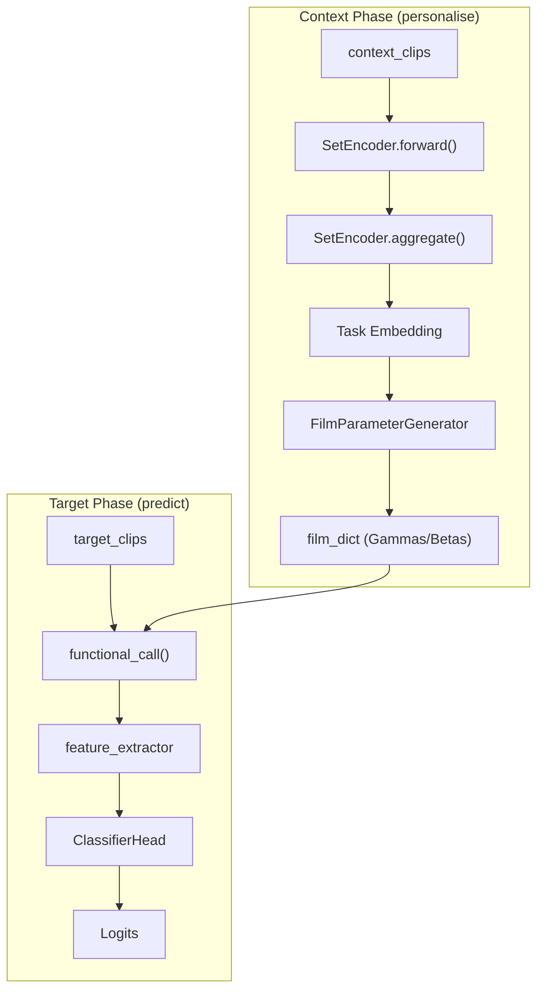
**Sources:** [model/few_shot_recognisers.py:176-261](), [model/set_encoders.py:34-80](), [model/feature_adapters.py:34-60]()

---

## MultiStepFewShotRecogniser (FineTuner / MAML)

The `MultiStepFewShotRecogniser` [model/few_shot_recognisers.py:263-267]() implements gradient-based personalization. It does not use a task encoder; instead, it updates parameters (or generated parameters) via optimization steps on the context set.

### FineTuner vs. MAML
1.  **FineTuner**: Typically freezes the backbone and only trains a task-specific `LinearClassifier` or unfreezes specific FiLM layers [model/few_shot_recognisers.py:328-335]().
2.  **MAML**: Performs a bi-level optimization where the `personalise` step involves a small number of inner-loop gradient updates to the model weights before the outer-loop update.

### Implementation Details
*   **Optimization**: The `personalise` method initializes a per-task optimizer (e.g., SGD or Adam) [model/few_shot_recognisers.py:313-323]().
*   **LITE (Learned Intermediate Training Embeddings)**: To save memory during multi-step optimization, the model can pre-extract and cache backbone features if the backbone is frozen, only backpropagating through the head [model/few_shot_recognisers.py:339-346]().

**Code Entity Mapping: Multi-Step Personalization**
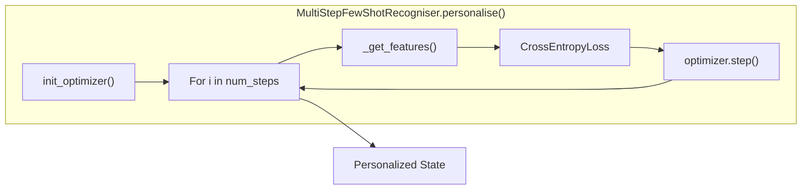
**Sources:** [model/few_shot_recognisers.py:263-365](), [utils/optim.py:32-55]()

---

## Memory Optimization: LITE

The **LITE** (Learned Intermediate Training Embeddings) optimization is critical for handling the high memory demands of video tasks.

1.  **Feature Caching**: If `self.learn_extractor` is `False`, LITE extracts features for the entire context set once [model/few_shot_recognisers.py:342-344]().
2.  **Stateless Heads**: During the personalization loop, only the classifier head is updated.
3.  **Reduced Overhead**: This prevents the need to store activation tensors for the deep backbone during the multiple gradient steps of the `FineTuner` [model/few_shot_recognisers.py:348-353]().

**Sources:** [model/few_shot_recognisers.py:339-365](), [model/feature_extractors.py:55-70]()

---

## Classifier Heads

The `FewShotRecogniser` delegates the final classification logic to specialized head modules.

| Class | Logic | Reference |
| :--- | :--- | :--- |
| `LinearClassifier` | Standard FC layer; weights often initialized from context prototypes. | [model/classifier_heads.py:36-50]() |
| `PrototypicalClassifier` | Computes squared Euclidean or Cosine distance to class means (prototypes). | [model/classifier_heads.py:108-125]() |
| `VersaClassifier` | Probabilistic head using a distribution over weights. | [model/classifier_heads.py:76-106]() |
| `MahalanobisClassifier` | Uses class-specific covariances for distance metrics. | [model/classifier_heads.py:159-180]() |

**Sources:** [model/classifier_heads.py:36-180](), [model/few_shot_recognisers.py:71-84]()

---

# Page: Feature Extractors & FiLM Adaptation

# Feature Extractors & FiLM Adaptation

<details>
<summary>Relevant source files</summary>

The following files were used as context for generating this wiki page:

- [model/feature_adapters.py](model/feature_adapters.py)
- [model/feature_extractors.py](model/feature_extractors.py)
- [model/film.py](model/film.py)

</details>


This page details the implementation of the backbone networks used for feature extraction and the Feature Linear Modulation (FiLM) adaptation mechanism. The ORBIT framework supports a variety of architectures (EfficientNet, ViT) and provides a dynamic system for adapting these backbones to specific tasks using a parameter generation network.

## Feature Extractor Configuration

The framework utilizes the `timm` (PyTorch Image Models) library to load pre-trained backbones. Supported architectures include EfficientNet variants and Vision Transformers (ViT). Each backbone is configured with a specific `output_size` which determines the input dimensionality for subsequent classifier heads.

### Supported Backbones
| Feature Extractor Name | Implementation | Pre-trained Source | Output Size |
|:---|:---|:---|:---|
| `efficientnet_b0` | `tf_efficientnet_b0` | GitHub (rwightman) | 1280 |
| `efficientnet_v2_s` | `tf_efficientnetv2_s_in21k` | GitHub (rwightman) | 1280 |
| `vit_s_32` | `vit_small_patch32_224_in21k` | Google Storage | 384 |
| `vit_b_32` | `vit_base_patch32_224_in21k` | Google Storage | 768 |
| `vit_b_32_clip` | `vit_base_patch32_224_clip_laion2b` | HuggingFace (LAION-2B) | 768 |

The function `create_feature_extractor` in `model/feature_extractors.py` handles the initialization of these models [model/feature_extractors.py:37-66](). It also manages freezing the backbone if `learn_extractor` is set to `False` [model/feature_extractors.py:68-69]().

### Backbone Initialization Flow
The following diagram illustrates how the system transitions from configuration strings to instantiated `timm` modules.

**Backbone Creation Logic**
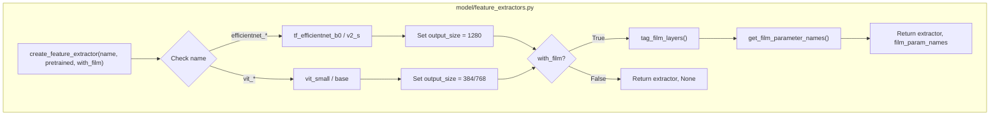
Sources: [model/feature_extractors.py:37-79](), [model/film.py:38-74]()

---

## FiLM Adaptation System

FiLM (Feature Linear Modulation) is used to adapt the feature extractor to a specific task by applying an affine transformation to intermediate feature maps (normalization layers).

### Layer Tagging and Identification
To support FiLM, specific layers within the backbone must be identified and "tagged". This is performed by `tag_film_layers` [model/film.py:38]().

- **EfficientNet**: Tags the Batch Normalization layers (`bn1`, `bn2`) within `EdgeResidual`, `ConvBnAct`, `InvertedResidual`, and `CondConvResidual` blocks [model/film.py:41-46]().
- **Vision Transformer (ViT)**: Tags Layer Normalization (`norm`, `norm1`, `norm2`) or Group Normalization layers [model/film.py:62]().

Tagged layers are assigned a `.film = True` attribute [model/film.py:53](), which is later used by `get_film_parameter_names` to extract the full parameter paths (e.g., `blocks.0.0.bn1.weight`) [model/film.py:68-74]().

### FilmParameterGenerator
The `FilmParameterGenerator` class is responsible for dynamically generating the $\gamma$ (scaling) and $\beta$ (shifting) parameters for the tagged layers based on a task embedding [model/feature_adapters.py:36]().

1.  **Initialization**: It stores the `initial_film_parameters` (the pre-trained weights/biases of the tagged layers) [model/feature_adapters.py:42]().
2.  **Generators**: For every tagged parameter, it creates a `DenseBlock` (MLP) that maps the task embedding (from a `SetEncoder`) to the required parameter size [model/feature_adapters.py:48-49]().
3.  **Regularizers**: It maintains a `ParameterList` of learnable weights used to scale the generated parameters, initialized with a small standard deviation (0.001) [model/feature_adapters.py:50-51]().

### Parameter Generation Logic
The `forward` pass of the generator computes the adapted parameters [model/feature_adapters.py:66-78]():
- **Weights ($\gamma$)**: $W_{adapted} = W_{initial} \times (G(x) \times R + 1)$
- **Biases ($\beta$)**: $B_{adapted} = B_{initial} + (G(x) \times R)$
Where $G(x)$ is the output of the generator MLP and $R$ is the learnable regularizer.

### Entity Relationship: FiLM Components
This diagram maps the logical FiLM concepts to their implementation entities.

**FiLM Implementation Mapping**
```mermaid
classDiagram
    class FeatureExtractor {
        <<timm module>>
        +tag_film_layers()
        +film_param_names
    }
    class FilmParameterGenerator {
        +generators: ModuleList(DenseBlock)
        +regularizers: ParameterList
        +initial_film_parameters: dict
        +forward(task_embedding)
    }
    class NullGenerator {
        +forward(x) : returns {}
    }
    class DenseBlock {
        <<model/mlps.py>>
        +forward(x)
    }

    FeatureExtractor ..> FilmParameterGenerator : "Provides target layer names"
    FilmParameterGenerator *-- DenseBlock : "Uses to generate shifts"
    FilmParameterGenerator ..> FeatureExtractor : "Modulates layers during forward"
```
Sources: [model/film.py:38-74](), [model/feature_adapters.py:36-96](), [model/feature_extractors.py:71-77]()

---

## Dynamic Adaptation Flow

The data flow for feature adaptation occurs during the `personalise` step of the model.

1.  **Task Embedding**: The context set is processed by a `SetEncoder` to produce a task-specific embedding $x$.
2.  **Parameter Generation**: $x$ is passed to `FilmParameterGenerator.forward(x)`, which returns a dictionary of adapted weights and biases [model/feature_adapters.py:66-78]().
3.  **Application**: These generated parameters are passed into the feature extractor using `torch.func.functional_call` (in the `FewShotRecogniser` subclasses), allowing the backbone to use task-specific weights without permanent state modification.
4.  **Regularization**: The generator tracks an `l2_term` based on the `regularizers` [model/feature_adapters.py:76](), which is added to the training loss to encourage the model to stay close to the pre-trained weights [model/feature_adapters.py:63-64]().

If feature adaptation is disabled (`--adapt_features False`), a `NullGenerator` is used, which returns an empty dictionary and zero regularization [model/feature_adapters.py:80-96]().

Sources: [model/feature_adapters.py:36-96](), [model/film.py:68-95](), [model/feature_extractors.py:37-79]()

---

# Page: Classifier Heads & Set Encoders

# Classifier Heads & Set Encoders

<details>
<summary>Relevant source files</summary>

The following files were used as context for generating this wiki page:

- [model/__init__.py](model/__init__.py)
- [model/classifier_heads.py](model/classifier_heads.py)
- [model/few_shot_recognisers.py](model/few_shot_recognisers.py)
- [model/mlps.py](model/mlps.py)
- [model/poolers.py](model/poolers.py)
- [model/set_encoders.py](model/set_encoders.py)

</details>


This section describes the modular components used by the `FewShotRecogniser` to process features and perform classification. It covers the pluggable classifier heads that map features to class probabilities, the `SetEncoder` used for task-level embeddings, and the pooling mechanisms for temporal aggregation.

### Overview of Components

The architecture separates feature extraction from classification and task adaptation. The `FewShotRecogniser` coordinates these components based on the configuration provided during initialization [model/few_shot_recognisers.py:50-88]().

| Component | Class / Entity | Purpose |
| :--- | :--- | :--- |
| **Classifier Head** | `LinearClassifier`, `VersaClassifier`, `PrototypicalClassifier`, `MahalanobisClassifier` | Maps extracted features to class logits using various few-shot strategies. |
| **Set Encoder** | `SetEncoder` (DeepSets) | Generates a permutation-invariant task embedding from a context set. |
| **Pooler** | `MeanPooler` | Aggregates frame-level features into clip-level representations. |
| **MLP Blocks** | `DenseResidualBlock`, `DenseBlock` | Supporting neural layers for hyper-networks and adapters. |

**Sources:** [model/few_shot_recognisers.py:46-88](), [model/set_encoders.py:34-37](), [model/poolers.py:7-16]()

---

### Classifier Heads

The repository implements several classifier variants, ranging from standard linear layers to metric-learning heads and hyper-networks.

#### 1. LinearClassifier
A standard linear layer (`nn.Linear`) that is typically initialized per-task. It is used in gradient-based personalization methods like the `FineTuner` [model/classifier_heads.py:38-42]().
* **Initialization**: The `init` method creates weight and bias parameters based on the number of classes in the current task [model/classifier_heads.py:53-60]().
* **Prediction**: Computes logits as `logit_scale * (W * x + b)` [model/classifier_heads.py:70]().

#### 2. VersaClassifier
Based on the Versa architecture, this head uses hyper-networks to generate class weights and biases from context features [model/classifier_heads.py:121-125]().
* **Hyper-networks**: Employs `weight_processor` and `bias_processor`, which are `DenseResidualBlock` instances [model/classifier_heads.py:133-134]().
* **Mechanism**: It computes mean class representations from the context set and passes them through the processors to generate the linear layer parameters [model/classifier_heads.py:153-174]().

#### 3. PrototypicalClassifier
Implements Prototypical Networks. It computes a "prototype" (mean vector) for each class in the context set and classifies target features based on distance to these prototypes [model/classifier_heads.py:192-196]().
* **Distances**: Supports `euclidean` (default) or `cosine` distance functions [model/classifier_heads.py:198-202]().

#### 4. MahalanobisClassifier
An extension of prototypical networks that accounts for class covariance. It computes per-class means and a precision matrix (inverse covariance) to calculate Mahalanobis distances [model/classifier_heads.py:255-259]().

**Classifier Data Flow and Entity Mapping**

```mermaid
graph TD
    subgraph "Natural Language Space"
        A["Input Features"]
        B["Class Logits"]
        C["Context Set"]
    end

    subgraph "Code Entity Space (model/classifier_heads.py)"
        FE["target_features (Tensor)"]
        CL["LinearClassifier"]
        VC["VersaClassifier"]
        PC["PrototypicalClassifier"]
        MC["MahalanobisClassifier"]
        
        FE --> CL
        FE --> VC
        FE --> PC
        FE --> MC
        
        CL -- "F.linear" --> B
        VC -- "weight_processor" --> B
        PC -- "_compute_distance" --> B
        MC -- "Mahalanobis Distance" --> B
    end
```

**Sources:** [model/classifier_heads.py:38-80](), [model/classifier_heads.py:121-180](), [model/classifier_heads.py:192-253](), [model/classifier_heads.py:255-325]()

---

### Set Encoders (DeepSets)

The `SetEncoder` is used to generate a task-level embedding from the context set, which is often required by FiLM parameter generators to adapt the feature extractor to a specific task [model/set_encoders.py:34-37]().

* **Implementation**: It implements the DeepSets architecture, which ensures the resulting embedding is invariant to the order of elements in the set [model/set_encoders.py:36]().
* **SimplePrePoolNet**: This internal component consists of five convolutional layers that reduce input frames to 64-dimensional embeddings [model/set_encoders.py:81-120]().
* **Aggregation**: The `aggregate` function typically performs a `mean` operation across all encoded elements in the set to produce a single task vector [model/set_encoders.py:61-75]().

**Task Embedding Pipeline**

```mermaid
graph LR
    subgraph "Code Entity Space (model/set_encoders.py)"
        Input["Context Clips (Tensor)"]
        F["_flatten()"]
        SPPN["SimplePrePoolNet"]
        AGG["aggregate(aggregation='mean')"]
        Output["Task Embedding (64-dim)"]

        Input --> F
        F --> SPPN
        SPPN --> AGG
        AGG --> Output
    end
```

**Sources:** [model/set_encoders.py:34-80](), [model/set_encoders.py:81-120]()

---

### Pooling & Supporting Blocks

#### MeanPooler
The `MeanPooler` is responsible for temporal aggregation. In the ORBIT pipeline, models often process "clips" (sequences of frames). The `MeanPooler` takes frame-level features and averages them over the temporal dimension `T` to create a single clip-level feature vector [model/poolers.py:7-16]().

#### MLP Blocks
Located in `model/mlps.py`, these blocks provide the foundation for hyper-networks like those in `VersaClassifier` or FiLM generators.
* **DenseResidualBlock**: A linear layer followed by two internal linear layers with ELU activations and a residual skip connection [model/mlps.py:33-50]().
* **DenseBlock**: A simpler sequential block containing `Linear -> LayerNorm -> ReLU -> Linear` [model/mlps.py:52-63]().

**Sources:** [model/poolers.py:7-16](), [model/mlps.py:33-63]()

---

# Page: Training & Personalization

# Training & Personalization

<details>
<summary>Relevant source files</summary>

The following files were used as context for generating this wiki page:

- [README.md](README.md)
- [data/orbit_extra_annotations.zip](data/orbit_extra_annotations.zip)
- [utils/args.py](utils/args.py)

</details>


The ORBIT framework supports a variety of learning paradigms to address the challenge of few-shot video recognition. Training is primarily orchestrated through two main learner scripts, which handle different optimization strategies: single-step meta-learning (e.g., CNAPs, ProtoNets) and multi-step gradient-based personalization (e.g., FineTuner, MAML).

## Learning Paradigms

The framework categorizes models based on how they adapt to a new user's objects. This distinction is reflected in the high-level orchestration scripts and the underlying model classes.

### 1. Single-Step Learning
Single-step learners use a feed-forward approach to adaptation. A set encoder processes the context (support) set to produce a task embedding, which is then used to generate parameters (via FiLM) or prototypes for classification. This is orchestrated by `single-step-learner.py` [single-step-learner.py:1-10]().
*   **Models:** CNAPs, Simple CNAPs, ProtoNets.
*   **Key Logic:** Uses the `Learner` class to manage meta-training loops [single-step-learner.py:30-35]().
*   **Details:** See [Single-Step Learner (CNAPs & ProtoNets)](#4.1).

### 2. Multi-Step Learning (Fine-Tuning)
The FineTuner approach initializes a model and performs multiple steps of gradient descent on the context set of a specific task to "personalize" the weights before performing inference on the target set.
*   **Models:** FineTuner (Standard SGD/Adam adaptation).
*   **Key Logic:** Orchestrated by `multi-step-learner.py` [multi-step-learner.py:1-10]().
*   **Details:** See [Multi-Step Learner (FineTuner)](#4.2).

### 3. Optimization-Based Meta-Learning (MAML)
MAML performs bi-level optimization. It learns a model initialization that can be adapted to a new task in a few gradient steps. While it uses multiple steps for personalization, the training objective optimizes for the post-adaptation performance.
*   **Models:** MAML.
*   **Key Logic:** Implemented within the `MultiStepFewShotRecogniser` logic and orchestrated by `multi-step-learner.py` [multi-step-learner.py:12-20]().
*   **Details:** See [MAML Learner](#4.3).

---

## Training Orchestration

Training is driven by command-line arguments defined in `utils/args.py` [utils/args.py:12-15](). These arguments control the sampling of "tasks" (episodes), which are the fundamental unit of training in ORBIT.

### Task Sampling & Data Flow
The `Learner` classes interact with the `UserEpisodicORBITDataset` to sample tasks consisting of a **Context Set** (clean videos for personalization) and a **Target Set** (clutter or clean videos for evaluation) [data/dataset.py:343-350]().

**Code Entity Association: Training Data Flow**
```mermaid
graph TD
    subgraph "Data Space"
        DS["ORBITDataset"]
        UED["UserEpisodicORBITDataset"]
    end

    subgraph "Orchestration Space (Code Entities)"
        SSL["single-step-learner.py"]
        MSL["multi-step-learner.py"]
        ARGS["utils/args.py"]
    end

    subgraph "Model Space"
        FS["FewShotRecogniser"]
        LITE["LITE (Memory Optimization)"]
    end

    ARGS -->|"--train_way_method"| UED
    ARGS -->|"--train_context_clip_method"| UED
    UED -->|samples Task| SSL
    UED -->|samples Task| MSL
    SSL -->|calls| FS
    MSL -->|calls| FS
    FS -->|if --use_lite| LITE
```
**Sources:** [utils/args.py:39-75](), [data/dataset.py:343-380](), [single-step-learner.py:110-120]()

### LITE Training
To support large images (224x224) on consumer GPUs, the framework implements **LITE (Large Image and Task Episodic)** training. LITE reduces memory consumption by avoiding the storage of intermediate activations for the entire task, instead processing clips in a memory-efficient manner during the meta-training step [README.md:5-6]().
*   **Activation:** Triggered by the `--use_lite` flag in `utils/args.py` [utils/args.py:122-123]().
*   **Function:** `train_task_with_lite` in the Single-Step Learner [single-step-learner.py:228-230]().

---

## Learning Paradigm Comparison

| Feature | Single-Step (CNAPs/Proto) | Multi-Step (FineTuner) | MAML |
| :--- | :--- | :--- | :--- |
| **Adaptation Method** | Parameter Generation / Prototypes | Gradient Descent (SGD/Adam) | Bi-level Gradient Optimization |
| **Script** | `single-step-learner.py` | `multi-step-learner.py` | `multi-step-learner.py` |
| **Personalization Speed** | Very Fast (Feed-forward) | Slow (Iterative) | Slow (Iterative) |
| **Memory Efficiency** | High (with LITE) | Moderate | Low (Higher grad requirements) |

**Code Entity Association: Learner Hierarchy**
```mermaid
graph TD
    subgraph "Base Classes"
        FSR["FewShotRecogniser (model/few_shot_recogniser.py)"]
    end

    subgraph "Implementation Classes"
        SSFSR["SingleStepFewShotRecogniser"]
        MSFSR["MultiStepFewShotRecogniser"]
    end

    subgraph "Execution Scripts"
        SSL_SCRIPT["single-step-learner.py"]
        MSL_SCRIPT["multi-step-learner.py"]
    end

    FSR <|-- SSFSR
    FSR <|-- MSFSR
    SSL_SCRIPT --> SSFSR
    MSL_SCRIPT --> MSFSR
```
**Sources:** [model/few_shot_recogniser.py:12-25](), [single-step-learner.py:1-20](), [multi-step-learner.py:1-20]()

---

## Child Pages
*   **[Single-Step Learner (CNAPs & ProtoNets)](#4.1)**: Details on the `Learner` class, `train_task` logic, and FiLM regularization.
*   **[Multi-Step Learner (FineTuner)](#4.2)**: Details on per-task gradient updates and computational profiling during personalization.
*   **[MAML Learner](#4.3)**: Details on the MAML implementation and bi-level optimization logic.
*   **[Configuration & Hyperparameters](#4.4)**: Exhaustive reference for all CLI arguments in `utils/args.py`.

**Sources:** [README.md:57-85](), [utils/args.py:12-130](), [single-step-learner.py:1-50](), [multi-step-learner.py:1-50]()

---

# Page: Single-Step Learner (CNAPs & ProtoNets)

# Single-Step Learner (CNAPs & ProtoNets)

<details>
<summary>Relevant source files</summary>

The following files were used as context for generating this wiki page:

- [single-step-learner.py](single-step-learner.py)
- [utils/args.py](utils/args.py)
- [utils/optim.py](utils/optim.py)

</details>


The single-step learner paradigm in the ORBIT codebase refers to meta-learning approaches where personalization to a new user occurs in a single forward pass without gradient-based updates. This is primarily used for **CNAPs** (Conditional Neural Adaptive Processes) and **ProtoNets** (Prototypical Networks). The orchestration of training and evaluation for these models is handled by `single-step-learner.py` [single-step-learner.py:1-45]().

## The Learner Class

The `Learner` class is the central controller for the single-step training pipeline. It initializes the dataset loaders, the model architecture, and the evaluators, and manages the training loop across epochs [single-step-learner.py:53-78]().

### Initialization and Data Flow
During initialization, the `Learner` configures the `SingleStepFewShotRecogniser` based on command-line arguments, including the choice of feature extractor (e.g., EfficientNet, ViT) and classifier head (e.g., Prototypical, Mahalanobis, or Linear) [single-step-learner.py:121-127]().

### System Data Flow: Single-Step Meta-Training
The following diagram illustrates how data moves from the `DataLoader` through the `Learner` and into the `SingleStepFewShotRecogniser`.

**Data Flow: Task-Based Learning**
```mermaid
graph TD
    subgraph "Data Space"
        A["DataLoader"] -- "get_tasks()" --> B["Task Dictionary"]
    end

    subgraph "Code Entity Space: Learner"
        B --> C["unpack_task()"]
        C --> D["Learner.train_task()"]
        D --> E["SingleStepFewShotRecogniser.forward()"]
    end

    subgraph "Model Space"
        E --> F["SetEncoder"]
        F --> G["FilmParameterGenerator"]
        G --> H["FeatureExtractor (FiLM adapted)"]
        H --> I["Classifier Head"]
    end

    I -- "Logits" --> J["cross_entropy loss"]
    J -- "Backprop" --> K["Optimizer.step()"]
```
**Sources:** [single-step-learner.py:116-127](), [single-step-learner.py:149-160](), [data/utils.py:39-39]()

## Task Training Mechanisms

The `Learner` supports two primary methods for processing a training task, depending on memory constraints: `train_task` and `train_task_with_lite`.

### Standard Training (`train_task`)
In the standard `train_task` method, the entire task (context and target sets) is passed to the model.
1.  **Unpacking**: The task dictionary is decomposed into context/target images and labels [single-step-learner.py:175-177]().
2.  **Forward Pass**: The model computes logits for the target images based on the context images [single-step-learner.py:179-179]().
3.  **Loss Calculation**: The `cross_entropy` loss is calculated. If `adapt_features` is enabled (CNAPs mode), a **FiLM regularization loss** is added to prevent the generated FiLM parameters from deviating too far from identity [single-step-learner.py:180-182]().

### LITE Training (`train_task_with_lite`)
When `args.with_lite` is enabled, the learner uses the **LITE** (Learned Intermediate Token Estimation) optimization to handle large tasks that would otherwise exceed GPU memory [single-step-learner.py:192-212]().
-   The target set is broken into smaller batches using `get_batch_indices` [single-step-learner.py:202-202]().
-   The model processes the context set once to generate task-specific parameters (or prototypes) and then iterates through target batches [single-step-learner.py:203-207]().
-   Gradients are accumulated across batches before the optimizer update [single-step-learner.py:211-212]().

**Sources:** [single-step-learner.py:173-190](), [single-step-learner.py:192-212](), [utils/optim.py:8-9]()

## Optimization and Scheduling

The training lifecycle is governed by a standard PyTorch optimizer and a scheduler from the `timm` library [utils/optim.py:6-6]().

| Component | Logic | Code Reference |
| :--- | :--- | :--- |
| **Optimizer** | Supports `Adam` and `SGD`. Uses a separate `extractor_lr_scale` for the backbone. | [utils/optim.py:11-32]() |
| **Scheduler** | Supports `multistep` and `cosine` decay patterns via `timm.scheduler`. | [utils/optim.py:34-43]() |
| **FiLM Regularization** | L2 penalty on FiLM parameters, weighted by `film_reg_coeff`. | [single-step-learner.py:182-182]() |

### System Architecture: Optimization Lifecycle
The diagram below shows the relationship between the `Learner` and the optimization utilities.

**Optimization Entity Mapping**
```mermaid
graph LR
    subgraph "Natural Language Space"
        "Learning Rate Control"
        "Weight Updates"
        "Backbone Scaling"
    end

    subgraph "Code Entity Space"
        L["Learner.run()"] --> IO["init_optimizer()"]
        L --> IS["init_scheduler()"]
        IO --> PE["Param Groups: base_params"]
        IO --> FE["Param Groups: feature_extractor.parameters()"]
        FE -- "Applied Scale" --> LR["extractor_lr_scale"]
    end
```
**Sources:** [single-step-learner.py:139-140](), [utils/optim.py:11-30]()

## Evaluation Integration

The `Learner` integrates three specialized evaluator classes to track performance [single-step-learner.py:128-134]():
1.  **TrainEvaluator**: Logs `frame_acc` during the training loop [single-step-learner.py:132-132]().
2.  **ValidationEvaluator**: Used at the end of each epoch to determine the "best" model checkpoint [single-step-learner.py:133-133]().
3.  **TestEvaluator**: Executed after training (or in `test` mode) to provide final benchmark metrics, including `video_acc` and `frames_to_recognition`. It also includes an `OpsCounter` to profile computational cost [single-step-learner.py:134-134]().

**Sources:** [single-step-learner.py:128-135](), [single-step-learner.py:161-171]()

---

# Page: Multi-Step Learner (FineTuner)

# Multi-Step Learner (FineTuner)

<details>
<summary>Relevant source files</summary>

The following files were used as context for generating this wiki page:

- [multi-step-learner.py](multi-step-learner.py)
- [utils/args.py](utils/args.py)

</details>


The Multi-Step Learner (FineTuner) provides a framework for gradient-based personalization. Unlike single-step learners that use a set encoder to generate task-specific parameters in a single forward pass, the FineTuner initializes a model and performs multiple steps of gradient descent (e.g., SGD or Adam) on the context set of a specific task before performing inference on target videos.

## Overview and Execution Flow

The entry point for this learning paradigm is `multi-step-learner.py` [multi-step-learner.py:1-48](). The execution is managed by the `Learner` class [multi-step-learner.py:52-81](), which orchestrates model initialization, data loading via `DataLoader`, and the evaluation loop. 

The FineTuner operates exclusively in a "test-time adaptation" mode within this repository. It loads a pre-trained backbone (and optionally FiLM layers) and adapts to a new user's objects by fine-tuning the classifier head and/or the feature extractor on the provided context clips [multi-step-learner.py:154-162]().

### System Entity Mapping: Learner Logic
The following diagram maps the logical personalization steps to the specific classes and methods implemented in the codebase.

**FineTuner Personalization Lifecycle**
```mermaid
graph TD
    subgraph "Initialization Phase"
        A["Learner.run()"] --> B["Learner.init_model()"]
        B --> C["MultiStepFewShotRecogniser"]
    end

    subgraph "Task Personalization"
        D["Learner.test() loop"] --> E["unpack_task()"]
        E --> F["Learner.init_finetuner()"]
        F --> G["finetuner.personalise()"]
        G --> H["Gradient Descent (SGD/Adam)"]
    end

    subgraph "Inference & Metrics"
        H --> I["finetuner.predict()"]
        I --> J["TestEvaluator.append_task_metrics()"]
    end

    style C stroke-dasharray: 5 5
    style G stroke-dasharray: 5 5
```
**Sources:** [multi-step-learner.py:49-50](), [multi-step-learner.py:108-115](), [multi-step-learner.py:146-162](), [multi-step-learner.py:117-122]().

## MultiStepFewShotRecogniser

The core model class is `MultiStepFewShotRecogniser`, defined in `model/few_shot_recognisers.py` [model/few_shot_recognisers.py:40](). It inherits from the base `FewShotRecogniser` and implements the gradient-based personalization logic.

### Key Components
*   **Feature Extractor:** Backbones such as EfficientNet or ViT, configured via `self.args.feature_extractor` [multi-step-learner.py:109]().
*   **Classifier Head:** Pluggable heads (Linear, Proto, etc.) defined in `self.args.classifier` [multi-step-learner.py:109]().
*   **Personalization Method:** The `personalise()` method resets the classifier (and optionally the feature extractor) and performs optimization steps [multi-step-learner.py:162]().

### Data Flow and Profiling
The FineTuner is integrated with `OpsCounter` to profile the computational cost of personalization (backwards pass) and inference (forward pass) [multi-step-learner.py:126]().

**Data Flow: Task Processing**
| Step | Function/Method | Description |
| :--- | :--- | :--- |
| 1 | `unpack_task` | Extracts `context_clips` and `target_frames_by_video` from the task dictionary [multi-step-learner.py:147](). |
| 2 | `init_finetuner` | Creates a fresh copy of the model for the current task [multi-step-learner.py:154](). |
| 3 | `personalise` | Updates model weights using the context set and the specified optimizer (SGD/Adam) [multi-step-learner.py:162](). |
| 4 | `predict` | Generates object predictions for target video frames [multi-step-learner.py:175](). |

**Sources:** [multi-step-learner.py:142-180](), [model/few_shot_recognisers.py:40]().

## Personalization and Inference

The personalization process is highly configurable via CLI arguments defined in `utils/args.py`.

### Optimization Parameters
*   **Optimizer:** Choice between `sgd` and `adam` via `--personalize_optimizer` [utils/args.py:113]().
*   **Learning Rate:** Set via `--personalize_lr` [utils/args.py:115]().
*   **Steps:** Number of gradient steps performed per task via `--personalize_num_steps` [utils/args.py:117]().
*   **Batch Size:** Size of context clip batches used during personalization via `--batch_size` [utils/args.py:107]().

### Computational Profiling
The `TestEvaluator` is initialized with `with_ops_counter=True` and `count_backwards=True` [multi-step-learner.py:126](). This ensures that the Multiply-Accumulate operations (MACs) for the gradient updates during personalization are captured alongside the standard inference MACs. The `test()` method calls `self.test_evaluator.set_base_params(self.model)` to establish a baseline for parameter counting before task-specific adaptation begins [multi-step-learner.py:140]().

**Entity Interaction: Personalization & Profiling**
```mermaid
sequenceDiagram
    participant L as Learner
    participant F as MultiStepFewShotRecogniser
    participant E as TestEvaluator
    participant O as OpsCounter

    L->>F: personalise(context_clips, context_labels)
    activate F
    F->>O: start_counting_backwards()
    Note over F: Perform SGD/Adam updates
    F->>O: stop_counting_backwards()
    deactivate F
    L->>F: predict(target_clips)
    F->>E: log_inference_macs()
    L->>E: append_task_metrics(logits, labels)
```
**Sources:** [multi-step-learner.py:126](), [multi-step-learner.py:140-141](), [multi-step-learner.py:162-175](), [utils/args.py:113-117]().

## Summary of Configuration Options

The following arguments from `utils/args.py` specifically impact the Multi-Step Learner:

| Argument | Purpose |
| :--- | :--- |
| `--learn_extractor` | If True, gradients are propagated through the entire backbone during personalization [utils/args.py:29-30](). |
| `--adapt_features` | If True, only FiLM parameters are updated during personalization [utils/args.py:31-32](). |
| `--personalize_optimizer` | Selects the optimizer for the multi-step update [utils/args.py:113](). |
| `--personalize_num_steps` | Defines the number of optimization iterations per task [utils/args.py:117](). |

**Sources:** [utils/args.py:27-36](), [utils/args.py:113-118]().

---

# Page: Configuration & Hyperparameters

# Configuration & Hyperparameters

<details>
<summary>Relevant source files</summary>

The following files were used as context for generating this wiki page:

- [utils/args.py](utils/args.py)
- [utils/logging.py](utils/logging.py)
- [utils/optim.py](utils/optim.py)

</details>


This page provides a technical reference for the configuration system used in the ORBIT codebase. All command-line interface (CLI) arguments, hyperparameter settings, and argument verification logic are centralized in `utils/args.py`.

The configuration system governs how data is sampled into episodic tasks, which feature extractors and classifiers are instantiated, and the optimization schedule for meta-learning.

## Argument Parsing Architecture

The entry point for configuration is the `parse_args` function in `utils/args.py`. This function utilizes `argparse` to define and validate parameters across several categories: model architecture, data sampling, optimization, and annotation filtering.

### Configuration Flow
The diagram below illustrates how CLI arguments flow from `utils/args.py` into the model and data loading components.

**Configuration Data Flow**
```mermaid
graph TD
    subgraph "CLI / utils/args.py"
        [parse_args] --> [Model_Params]
        [parse_args] --> [Data_Params]
        [parse_args] --> [Optim_Params]
    end

    subgraph "Data Pipeline"
        [Data_Params] --> [ORBITDataset]
        [Data_Params] --> [Sampler_Logic]
    end

    subgraph "Model Initialization"
        [Model_Params] --> [FewShotRecogniser]
        [Model_Params] --> [FeatureExtractor]
        [Model_Params] --> [Classifier]
    end

    subgraph "Training Loop"
        [Optim_Params] --> [init_optimizer]
        [Optim_Params] --> [init_scheduler]
    end
```
Sources: [utils/args.py:12-14](), [utils/optim.py:11-34]()

---

## Data Sampling Parameters

The ORBIT framework supports complex episodic sampling strategies. These arguments control how users, objects, and videos are selected for the context (support) and target (query) sets.

| Argument | Type | Default | Description |
| :--- | :--- | :--- | :--- |
| `--train_way_method` | `str` | `random` | Method to sample classes for a train task (`random` or `max`). [[utils/args.py:39-40]]() |
| `--train_object_cap` | `int` | `15` | Maximum number of objects sampled per training task. [[utils/args.py:43-44]]() |
| `--context_shot` | `int` | `5` | Number of videos per object for context set if method is `fixed`. [[utils/args.py:55-56]]() |
| `--subsample_factor`| `int` | `30` | Factor to subsample video when using `uniform` clip sampling. [[utils/args.py:65-66]]() |
| `--clip_length` | `int` | `1` | Number of frames to sample per clip. [[utils/args.py:75-76]]() |
| `--train_task_type` | `str` | `user_centric`| Whether to sample tasks based on users or objects. [[utils/args.py:89-90]]() |

### Clip Sampling Methods
The framework supports several methods for sampling clips from videos, defined via `--train_context_clip_method`, `--train_target_clip_method`, and their test-time equivalents:
- `uniform`: Samples frames at regular intervals defined by `--subsample_factor`. [[utils/args.py:67-68]]()
- `random`: Samples a random selection of frames. [[utils/args.py:69-70]]()
- `random_200`: Samples up to 200 random frames (used for target videos in evaluation). [[utils/args.py:73-74]]()
- `max`: Samples all available frames in the video. [[utils/args.py:71-72]]()

Sources: [utils/args.py:39-90]()

---

## Model & Architecture Configuration

These arguments determine the backbone, the adaptation mechanism (FiLM), and the classification head.

| Argument | Choices | Description |
| :--- | :--- | :--- |
| `--feature_extractor` | `efficientnet_b0`, `vit_s_32`, `vit_b_32_clip`, etc. | Backbone architecture. [[utils/args.py:27-28]]() |
| `--learn_extractor` | `flag` | If set, the entire backbone is fine-tuned. [[utils/args.py:29-30]]() |
| `--adapt_features` | `flag` | If set, FiLM layers are inserted for task adaptation. [[utils/args.py:31-32]]() |
| `--classifier` | `linear`, `versa`, `proto`, `mahalanobis` | Head used for classification. [[utils/args.py:33-34]]() |
| `--use_lite` | `flag` | Enables LITE (Learned Intermediate Training Embeddings) to reduce memory. [[utils/args.py:101-102]]() |

**Model Component Mapping**
```mermaid
graph LR
    [args.feature_extractor] -- "loads" --> [timm_models]
    [args.adapt_features] -- "triggers" --> [FilmParameterGenerator]
    [args.classifier] -- "selects" --> [Classifier_Head]
    [args.use_lite] -- "modifies" --> [FewShotRecogniser_forward]
```
Sources: [utils/args.py:22-37](), [utils/args.py:101-102]()

---

## Annotation Filtering Macros

ORBIT provides granular control over frame quality through annotation filtering. The system uses specific macros to include or exclude frames based on quality issues recorded during data collection.

- **Available Options**: `object_not_present_issue`, `framing_issue`, `viewpoint_issue`, `blur_issue`, `occlusion_issue`, `overexposed_issue`, `underexposed_issue`. [[utils/args.py:7]]()
- **Negated Options**: Prefixed with `no_` (e.g., `no_blur_issue`). [[utils/args.py:8]]()

Users can specify these filters for four distinct sets:
1. `--train_filter_context` [[utils/args.py:81-82]]()
2. `--train_filter_target` [[utils/args.py:83-84]]()
3. `--test_filter_context` [[utils/args.py:85-86]]()
4. `--test_filter_target` [[utils/args.py:87-88]]()

---

## Optimizer & Scheduler Settings

The `utils/optim.py` file contains logic to initialize optimizers and schedulers based on arguments parsed in `utils/args.py`.

### Optimizer Initialization
The function `init_optimizer` handles parameter grouping, allowing the feature extractor to have a different learning rate scale (default `0.1`) compared to the rest of the model. [[utils/optim.py:11-32]]()

- **Supported Optimizers**: `adam` (with `epsilon`, `weight_decay`, `betas`) and `sgd` (with `momentum`, `weight_decay`). [[utils/optim.py:14-26]]()
- **Learning Rate Scaling**: The backbone parameters are identified using `id(p)` and placed in a separate param group with `lr_scale`. [[utils/optim.py:12-29]]()

### Scheduler Configuration
The `init_scheduler` function integrates with the `timm` library's scheduler factory. [[utils/optim.py:34-43]]()
- **Multistep**: Automatically calculates `decay_milestones` based on `args.decay_epochs` and `args.epochs`. [[utils/optim.py:35-39]]()
- **Cosine**: Sets `warmup_prefix` to True for cosine annealing schedules. [[utils/optim.py:40-41]]()

Sources: [utils/optim.py:11-43](), [utils/args.py:106-120]()

---

## Logging & Verification Logic

The framework includes utilities to manage experiment output and verify checkpoint integrity.

- **`get_log_files`**: Generates a timestamped directory within `--checkpoint_dir`, creating `best.pt`, `final.pt`, and `log.txt`. [[utils/logging.py:13-33]]()
- **`verify_checkpoint_dir`**: Ensures the provided model path exists before attempting to load for testing or resuming. [[utils/logging.py:35-39]]()
- **`print_and_log`**: A helper to simultaneously output to stdout and the experiment's log file. [[utils/logging.py:8-11]]()

Sources: [utils/logging.py:8-39]()

---

# Page: Evaluation & Metrics

# Evaluation & Metrics

<details>
<summary>Relevant source files</summary>

The following files were used as context for generating this wiki page:

- [orbit_challenge_getting_started.ipynb](orbit_challenge_getting_started.ipynb)
- [utils/eval_metrics.py](utils/eval_metrics.py)
- [utils/ops_counter.py](utils/ops_counter.py)

</details>


The ORBIT codebase provides a comprehensive evaluation framework designed to measure few-shot object recognition performance across multiple granularities. Because the dataset is organized hierarchically (User → Object → Video → Frame), the evaluation system aggregates raw frame-level predictions into higher-level metrics to provide a holistic view of model robustness and personalization efficiency.

The evaluation logic is primarily encapsulated in `utils/eval_metrics.py` [utils/eval_metrics.py:1-158](), which defines specialized classes for training, validation, and testing phases.

## Metric Hierarchy & Definitions

The system tracks three primary performance metrics. These are calculated at the frame or video level and then aggregated up the hierarchy (Task → Object → User).

| Metric | Code Symbol | Definition |
| :--- | :--- | :--- |
| **Frame Accuracy** | `frame_acc` | Average accuracy across all frames in a target video or clip [utils/eval_metrics.py:27-36](). |
| **Video Accuracy** | `video_acc` | A binary score (1.0 or 0.0) based on whether the most frequent frame prediction matches the video label [utils/eval_metrics.py:38-46](). |
| **Frames-to-Recognition** | `frames_to_recognition` | The index of the first correct prediction, normalized by the total number of frames in the video [utils/eval_metrics.py:48-60](). |

For a detailed breakdown of how these metrics are calculated and how confidence intervals are derived, see **[Evaluator Classes & Metric Hierarchy](#5.1)**.

## Evaluator Architecture

The evaluation system uses a class-based hierarchy to handle different stages of the model lifecycle. The `Evaluator` base class [utils/eval_metrics.py:14-70]() contains the core logic for metric computation, while its subclasses manage state and data aggregation.

### Evaluation Data Flow
The following diagram illustrates how raw model outputs are processed by the `TestEvaluator` to produce the final `results.json` and aggregated statistics.

```mermaid
graph TD
    subgraph "Model Output Space"
        A["FewShotRecogniser.predict()"] --> B["Logits (Tensor)"]
        B --> C["Softmax Probs (NumPy)"]
    end

    subgraph "Evaluator Space (utils/eval_metrics.py)"
        C --> D["TestEvaluator.update_stats()"]
        D --> E["frame_acc"]
        D --> F["video_acc"]
        D --> G["frames_to_recognition"]
        
        E & F & G --> H["Hierarchical Aggregation"]
        H --> I["User Scores"]
        H --> J["Object Scores"]
        H --> K["Task Scores"]
    end

    subgraph "Output Space"
        I & J & K --> L["results.json"]
        L --> M["Challenge Submission"]
    end
```
**Sources:** [utils/eval_metrics.py:14-158](), [orbit_challenge_getting_started.ipynb:10-12]()

## Computational Profiling

In addition to recognition accuracy, the ORBIT benchmark emphasizes the efficiency of the personalization process. The `OpsCounter` class [utils/ops_counter.py:10-95]() integrates with the `thop` library to track:

*   **MACs (Multiply-Accumulate Operations):** Measured during both the personalization (adaptation) phase and the inference phase.
*   **Parameter Counts:** Tracks the base model parameters and any task-specific parameters generated during adaptation.

The `TestEvaluator` can be configured to include these operational metrics in its final report [utils/eval_metrics.py:102-110]().

### Profiling Integration
The diagram below shows how `OpsCounter` interacts with the model components to profile complexity.

```mermaid
graph LR
    subgraph "Model Components (model)"
        FE["feature_extractor"]
        CL["classifier"]
        FG["film_generator"]
        SE["set_encoder"]
    end

    subgraph "OpsCounter (utils/ops_counter.py)"
        OC["OpsCounter.set_base_params()"]
        CM["OpsCounter.compute_macs()"]
    end

    FE & CL & FG & SE --> OC
    OC --> P["base_params_counter"]
    
    CM --> M["task_mac_counter"]
    
    P & M --> TE["TestEvaluator"]
```
**Sources:** [utils/ops_counter.py:20-49](), [utils/ops_counter.py:79-86](), [utils/eval_metrics.py:133-134]()

For details on how custom operations (e.g., for `timm` layers) are registered and how backward passes are accounted for, see **[Computational Profiling (OpsCounter)](#5.2)**.

## Sub-Pages

*   **[Evaluator Classes & Metric Hierarchy](#5.1)**: Detailed coverage of `TrainEvaluator`, `ValidationEvaluator`, and `TestEvaluator`. Explains the hierarchical aggregation logic (video → task → object → user) and `results.json` serialization.
*   **[Computational Profiling (OpsCounter)](#5.2)**: Technical details on tracking MACs and parameter counts using the `thop` library, including custom hooks for specific architecture layers.

**Sources:** [utils/eval_metrics.py:1-158](), [utils/ops_counter.py:1-95](), [orbit_challenge_getting_started.ipynb:8-12]()

---

# Page: Evaluator Classes & Metric Hierarchy

# Evaluator Classes & Metric Hierarchy

<details>
<summary>Relevant source files</summary>

The following files were used as context for generating this wiki page:

- [utils/eval_metrics.py](utils/eval_metrics.py)
- [utils/logging.py](utils/logging.py)
- [utils/ops_counter.py](utils/ops_counter.py)

</details>


The evaluation framework in the ORBIT codebase is designed to handle the multi-level nature of few-shot video recognition. It provides mechanisms to track performance from individual frames up to user-level aggregations, while also accounting for computational efficiency through integrated profiling.

## Evaluator Hierarchy and Implementation

The evaluation logic is centered around the `Evaluator` base class and its specialized descendants. These classes manage the calculation of core metrics and the aggregation of results across different evaluation stages (training, validation, and testing).

### Base Evaluator
The `Evaluator` class [utils/eval_metrics.py:14-15]() defines the core metric functions used across the repository. It maps metric names to implementation functions via the `self.stat_fns` dictionary [utils/eval_metrics.py:18-22]().

### Specialized Evaluators
*   **`TrainEvaluator`**: Used during meta-training to track batch-level statistics. It maintains `current_stats` for the latest batch and `running_stats` to compute mean performance across an epoch [utils/eval_metrics.py:71-76]().
*   **`TestEvaluator`**: A complex evaluator used for validation and testing. It handles hierarchical data storage (User → Task → Object → Video → Frame) and manages the `OpsCounter` for tracking computational MACs and parameters [utils/eval_metrics.py:101-110]().

### Evaluator Class Relationship
The following diagram illustrates the relationship between the evaluator classes and the data entities they process.

**Evaluator to Code Entity Mapping**
```mermaid
graph TD
    subgraph "Evaluator Classes"
        Base["Evaluator (utils/eval_metrics.py)"]
        TE["TrainEvaluator"]
        TSE["TestEvaluator"]
    end

    subgraph "Metric Functions (stat_fns)"
        FA["get_frame_accuracy"]
        VA["get_video_accuracy"]
        FTR["get_frames_to_recognition"]
    end

    subgraph "Data Entities"
        Task["Task (UserEpisodicORBITDataset)"]
        Vid["Video"]
        Frame["Frame Logits"]
    end

    Base -- "Inherited by" --> TE
    Base -- "Inherited by" --> TSE
    Base -- "Contains" --> FA
    Base -- "Contains" --> VA
    Base -- "Contains" --> FTR

    TE -- "Updates via" --> Frame
    TSE -- "Aggregates" --> Task
    TSE -- "Computes for" --> Vid
```
**Sources:** [utils/eval_metrics.py:14-110](), [utils/ops_counter.py:10-14]()

---

## Core Metrics

The framework computes three primary recognition metrics, all derived from frame-level probability distributions.

| Metric | Code Function | Definition |
| :--- | :--- | :--- |
| **Frame Accuracy** | `get_frame_accuracy` | The percentage of frames where the predicted class (highest probability) matches the ground truth label [utils/eval_metrics.py:27-36](). |
| **Video Accuracy** | `get_video_accuracy` | A binary score (1.0 or 0.0) per video. A video is "correct" if the most frequent frame-level prediction matches the video label [utils/eval_metrics.py:38-46](). |
| **Frames-to-Recognition** | `get_frames_to_recognition` | The index of the first correctly predicted frame, normalized by the total number of frames in the video. If no frame is correct, it returns 1.0 [utils/eval_metrics.py:48-60](). |

### Confidence Intervals
For all mean statistics, the `Evaluator` computes a 95% confidence interval using the formula:
$(1.96 \times \text{std}(\text{scores})) / \sqrt{\text{len}(\text{scores})}$ [utils/eval_metrics.py:24-25]().

**Sources:** [utils/eval_metrics.py:18-70]()

---

## Hierarchical Aggregation

The `TestEvaluator` performs a bottom-up aggregation to produce final benchmark results. This is critical because the ORBIT dataset is organized by users, each having multiple tasks and objects.

### Data Flow for Results
The `TestEvaluator.get_mean_stats()` function [utils/eval_metrics.py:155]() processes scores in the following order:
1.  **Video Level**: Frame-level probabilities are reduced to video-level metrics (Accuracy, FTR).
2.  **Task Level**: Metrics are averaged across all target videos within a single task.
3.  **Object Level**: Metrics are grouped and averaged by the specific object being recognized.
4.  **User Level**: Task-level scores are averaged for each user.
5.  **Final Average**: The final benchmark score is the mean of the user-level averages, ensuring each user contributes equally regardless of their number of videos.

**Hierarchical Aggregation Flow**
```mermaid
graph BT
    subgraph "Inference Outputs"
        Logits["Logits (Tensor)"]
        Probs["Softmax Probs (np.ndarray)"]
    end

    subgraph "Aggregation Logic (TestEvaluator)"
        F["Frame Metrics"]
        V["Video Metrics (Mode of Frames)"]
        T["Task Metrics (Avg of Videos)"]
        U["User Metrics (Avg of Tasks)"]
        Final["Final Result (Avg of Users)"]
    end

    Logits --> Probs
    Probs --> F
    F --> V
    V --> T
    T --> U
    U --> Final
```
**Sources:** [utils/eval_metrics.py:113-148](), [utils/eval_metrics.py:155-159]()

---

## Computational Profiling (OpsCounter)

The `TestEvaluator` optionally integrates with `OpsCounter` to measure the cost of personalization and inference.

*   **Parameter Counting**: `set_base_params` calculates the total parameters in the feature extractor, classifier, FiLM generator, and set encoder [utils/ops_counter.py:20-46]().
*   **MACs Tracking**: Uses the `thop` library to profile specific modules. The `compute_macs` function [utils/ops_counter.py:79-86]() applies a multiplier (typically 2) to account for both forward and backward passes during gradient-based personalization (e.g., in FineTuner or MAML) [utils/ops_counter.py:13]().
*   **Custom Ops**: Supports specialized layers (like `Conv2dSame` from `timm`) that are not handled by default profiling hooks [utils/ops_counter.py:71-77]().

**Sources:** [utils/ops_counter.py:10-95](), [utils/eval_metrics.py:106-109]()

---

## Serialization and Model Selection

### results.json
The `TestEvaluator.save()` method [utils/eval_metrics.py:112]() serializes the complete evaluation trace to a `results.json` file. This file contains:
*   User IDs and their corresponding tasks [utils/eval_metrics.py:124-125]().
*   Task-level object lists [utils/eval_metrics.py:132]().
*   MAC counts for personalization [utils/eval_metrics.py:134]().
*   Frame-level predictions for every video, indexed by their original frame ID [utils/eval_metrics.py:144-146]().

### Model Selection Logic
During training, the `ValidationEvaluator` (an instance of `TestEvaluator`) is used to determine the "best" model. The system typically monitors `video_acc` to decide when to save `checkpoint_path_best` [utils/logging.py:25-33]().

**Sources:** [utils/eval_metrics.py:112-154](), [utils/logging.py:13-33]()

---

# Page: Computational Profiling (OpsCounter)

# Computational Profiling (OpsCounter)

<details>
<summary>Relevant source files</summary>

The following files were used as context for generating this wiki page:

- [environment.yml](environment.yml)
- [requirements.txt](requirements.txt)
- [utils/eval_metrics.py](utils/eval_metrics.py)
- [utils/ops_counter.py](utils/ops_counter.py)

</details>


The ORBIT framework provides integrated tools for measuring the computational cost of few-shot personalization and inference. This is primarily handled by the `OpsCounter` class, which tracks Multiply-Accumulate operations (MACs) and parameter counts using the `thop` library. Profiling is essential for evaluating the efficiency of different adaptation strategies (e.g., FiLM vs. Fine-Tuning) in resource-constrained environments.

### System Overview and Dependency Integration

Computational profiling is orchestrated through the `OpsCounter` class, which serves as a wrapper around the `thop` (Torch-OpCounter) library. It is integrated directly into the evaluation lifecycle via the `TestEvaluator`.

| Component | Responsibility |
| :--- | :--- |
| `thop` | Core library for profiling PyTorch models [requirements.txt:3](). |
| `OpsCounter` | Manages stateful tracking of MACs and parameters per task [utils/ops_counter.py:10-15](). |
| `TestEvaluator` | Optionally initializes `OpsCounter` and logs results to `results.json` [utils/eval_metrics.py:102-109](). |

**Profiling Data Flow**
The following diagram illustrates how profiling data flows from the model operations into the final evaluation metrics.

Title: Profiling Data Flow Architecture
```mermaid
graph TD
    subgraph "Model Life Cycle"
        A["FewShotRecogniser"] -- "initialization" --> B["set_base_params"]
        C["Personalization/Inference"] -- "forward pass" --> D["compute_macs"]
    end

    subgraph "OpsCounter Entity [utils/ops_counter.py]"
        B --> E["base_params_counter"]
        D --> F["task_mac_counter"]
        D --> G["task_params_counter"]
    end

    subgraph "Evaluation Entity [utils/eval_metrics.py]"
        H["TestEvaluator"] -- "wraps" --> I["OpsCounter"]
        F -- "collected per task" --> J["macs_counter"]
        J -- "serialization" --> K["results.json"]
    end
```
Sources: [utils/ops_counter.py:10-95](), [utils/eval_metrics.py:101-154]()

### OpsCounter Implementation Details

The `OpsCounter` class maintains counters for MACs and parameters that are updated during a task's lifecycle.

#### Parameter Tracking
Upon initialization of a test task, `set_base_params` is called to calculate the static footprint of the model. This includes:
*   **Feature Extractor**: Backbone parameters [utils/ops_counter.py:23-25]().
*   **Classifier**: Parameters of the classification head [utils/ops_counter.py:28-31]().
*   **Adaptation Modules**: Parameters for the `film_generator`, `set_encoder`, and the generated `film_params` [utils/ops_counter.py:34-44]().

#### MACs Calculation
MACs are tracked using the `compute_macs` function, which utilizes `thop.profile` [utils/ops_counter.py:79-83](). 
*   **Forward/Backward Multiplier**: If `count_backward` is enabled, the MAC count is multiplied by 2 to approximate the cost of a full training step [utils/ops_counter.py:13]().
*   **Custom Ops**: Standard `thop` does not support all layer types. `OpsCounter` defines `custom_ops` to handle specific layers like `timm.models.layers.Conv2dSame` [utils/ops_counter.py:71-77]().

#### Function Reference
| Function | Description |
| :--- | :--- |
| `set_base_params(base_model)` | Sums parameters across all sub-modules to establish a baseline [utils/ops_counter.py:20](). |
| `compute_macs(module, *inputs)` | Wraps `thop.profile` to count operations for a specific module and input [utils/ops_counter.py:79](). |
| `get_uncounted_modules(model)` | Utility to identify leaf modules that `thop` currently ignores [utils/ops_counter.py:56](). |
| `task_complete()` | Resets task-specific counters for the next episode [utils/ops_counter.py:87](). |

Sources: [utils/ops_counter.py:10-95]()

### Integration with TestEvaluator

The `TestEvaluator` manages the `OpsCounter` during the evaluation of the test set.

1.  **Initialization**: If `with_ops_counter` is passed to the `TestEvaluator` constructor, an `OpsCounter` instance is created [utils/eval_metrics.py:106-107]().
2.  **Per-Task Logging**: During the evaluation loop, the MACs required to personalize the model for a specific user/task are stored in `self.macs_counter` [utils/eval_metrics.py:134]().
3.  **Serialization**: When `save()` is called, the MAC counts are included in the `results.json` file under the key `task_macs_to_personalise` [utils/eval_metrics.py:134, 153]().

**Entity Relationship: Evaluator and Profiler**
This diagram shows how the `TestEvaluator` interacts with the `OpsCounter` methods to capture metrics.

Title: TestEvaluator and OpsCounter Interaction
```mermaid
sequenceDiagram
    participant TE as TestEvaluator [utils/eval_metrics.py]
    participant OC as OpsCounter [utils/ops_counter.py]
    participant TH as thop [external]

    TE->>OC: set_base_params(model)
    loop Per Task
        TE->>OC: compute_macs(personalize_step, inputs)
        OC->>TH: profile(module, inputs)
        TH-->>OC: macs, params
        OC->>OC: add_macs(macs * multiplier)
        TE->>TE: Store task_mac_counter
        TE->>OC: task_complete()
    end
    TE->>TE: save() -> results.json
```
Sources: [utils/eval_metrics.py:101-154](), [utils/ops_counter.py:79-95]()

### Summary of Metrics Tracked
The system outputs a breakdown of the model's computational footprint:
*   **Total Parameters**: The sum of `base_params_counter` and any task-specific parameters [utils/ops_counter.py:94-95]().
*   **Parameter Breakdown**: A formatted string detailing the contribution of the feature extractor, classifier, and FiLM components [utils/ops_counter.py:48]().
*   **MACs per Task**: The cumulative operations performed during the personalization phase of a few-shot task [utils/eval_metrics.py:134]().

Sources: [utils/ops_counter.py:46-48](), [utils/eval_metrics.py:133-134]()

---

# Page: Pre-trained Checkpoints

# Pre-trained Checkpoints

<details>
<summary>Relevant source files</summary>

The following files were used as context for generating this wiki page:

- [README.md](README.md)
- [data/orbit_extra_annotations.zip](data/orbit_extra_annotations.zip)
- [scripts/resize_videos.py](scripts/resize_videos.py)

</details>


This page provides a high-level catalogue of available pre-trained model checkpoints for the ORBIT dataset. These checkpoints represent the baseline models evaluated in the ORBIT benchmark and the LITE (Large Image and Task Episodic) training framework.

The checkpoints are categorized by their evaluation setting: **CLEVE** (Clean-video Evaluation) and **CLUVE** (Clutter-video Evaluation). Both settings utilize the same underlying model architectures but are validated and tested against different video types within the ORBIT dataset structure [README.md:73-82]().

### Available Architectures and Backbones
The repository supports several few-shot learning architectures, defined primarily in the `models/` directory. These models utilize various backbones (feature extractors) adapted via FiLM (Feature Instruction Linear Modulation) [models/few_shot_recogniser.py:11-30]().

*   **Architectures**: ProtoNets, CNAPs, SimpleCNAPs, MAML, and FineTuner.
*   **Backbones**: ResNet-18, EfficientNet-B0, and ViT-B-32-CLIP.
*   **Optimization**: Standard training and LITE (Memory Efficient) training for large 224x224 frames [README.md:5-7]().

### Model Configuration Mapping
The following diagram illustrates how the pre-trained checkpoints relate to the core code entities used for personalization and inference.

**Checkpoint to Code Entity Mapping**
```mermaid
graph TD
    subgraph "Natural Language Space"
        A["Pre-trained Checkpoint"]
        B["Evaluation Setting (CLEVE/CLUVE)"]
    end

    subgraph "Code Entity Space (models)"
        C["FewShotRecogniser"]
        D["SingleStepFewShotRecogniser"]
        E["MultiStepFewShotRecogniser"]
        F["FeatureExtractor (Backbone)"]
    end

    A -->|Loads into| C
    C -->|Subclassed by| D
    C -->|Subclassed by| E
    D -->|Used for| G["CNAPs / ProtoNets"]
    E -->|Used for| H["FineTuner / MAML"]
    F -->|Modified by| I["FilmParameterGenerator"]
    B -->|Determines| J["TestEvaluator Mode"]

```
Sources: [models/few_shot_recogniser.py:11-30](), [utils/args.py:20-50](), [README.md:73-82]()

---

### Evaluation Settings

The ORBIT benchmark distinguishes between two primary evaluation modes based on the nature of the query (target) videos.

#### CLEVE Checkpoints
The **Clean-video Evaluation (CLEVE)** setting involves tasks where both the support (context) and query (target) videos are "clean" (i.e., the object is centered and clearly visible against a non-distracting background). This setting is typically used to establish a performance ceiling for the models.

For a detailed list of available CLEVE checkpoints, including frame sizes and LITE status, see **[CLEVE Checkpoints](#6.1)**.

#### CLUVE Checkpoints
The **Clutter-video Evaluation (CLUVE)** setting is the primary benchmark for the ORBIT dataset [README.md:77-78](). In this setting, models are personalized using clean support videos but must recognize objects in "clutter" query videos, which contain significant background noise, occlusions, and varied lighting typical of real-world environments.

For a detailed list of available CLUVE checkpoints, including backbone types and frame sizes, see **[CLUVE Checkpoints](#6.2)**.

---

### Checkpoint Lifecycle and Loading
Checkpoints are saved as `.pth` files and contain the state dictionaries for the feature extractor, FiLM generators, and classifier heads. The loading process is handled by the `Learner` classes which initialize the `FewShotRecogniser` based on the arguments passed via `utils/args.py`.

**Personalization Logic Flow**
```mermaid
graph LR
    subgraph "Personalization (Code Space)"
        K["Learner.train_task"]
        L["FewShotRecogniser.personalise"]
        M["ClassifierHead"]
    end

    subgraph "Data Space"
        N["Support Set (Clean)"]
        O["Target Set (Clutter/Clean)"]
    end

    K -->|Passes| N
    N -->|Inputs to| L
    L -->|Updates| M
    M -->|Predicts on| O
```
Sources: [single_step_learner.py:50-80](), [models/few_shot_recogniser.py:100-120](), [README.md:84-88]()

### Summary Table of Baseline Models

| Model | Architecture Type | Backbones Supported | Training Mode |
| :--- | :--- | :--- | :--- |
| **ProtoNets** | Metric-based | ResNet-18, EfficientNet-B0 | Standard / LITE |
| **CNAPs** | Parameter Generation | ResNet-18, EfficientNet-B0 | Standard / LITE |
| **SimpleCNAPs** | Parameter Generation | ResNet-18, EfficientNet-B0 | Standard / LITE |
| **FineTuner** | Gradient-based | ViT-B-32-CLIP | Standard |
| **MAML** | Gradient-based | ResNet-18 | Standard |

Sources: [README.md:4-5](), [utils/args.py:102-140]()

---

# Page: CI/CD & Infrastructure

# CI/CD & Infrastructure

<details>
<summary>Relevant source files</summary>

The following files were used as context for generating this wiki page:

- [.gitignore](.gitignore)
- [azure-pipelines.yml](azure-pipelines.yml)
- [environment.yml](environment.yml)
- [requirements.txt](requirements.txt)

</details>


This section provides an overview of the infrastructure supporting the ORBIT Dataset repository, including the automation pipelines for security and compliance, and the configuration files required to reproduce the research environment.

The repository utilizes Azure Pipelines to ensure code integrity through scheduled builds and automated scanning tasks. The infrastructure is designed to support a PyTorch-based machine learning workflow, with specific dependencies for computer vision, model profiling, and data visualization.

## Pipeline Automation

The CI/CD workflow is defined in `azure-pipelines.yml` and is configured to run on a Windows-based virtual machine agent. The pipeline does not currently execute the full training or evaluation suite (which requires significant GPU resources) but instead focuses on security auditing and open-source software (OSS) compliance.

The pipeline is triggered by:
1.  **Code Changes**: Direct pushes or merges to the `master` branch [[azure-pipelines.yml:1-2]]().
2.  **Scheduled Builds**: A weekly cron job that runs every Sunday at 12:00 UTC to ensure ongoing compliance even when no code changes are made [[azure-pipelines.yml:7-13]]().

For details on the specific tasks executed during these builds, see [Azure Pipelines Configuration](#7.1).

### Infrastructure to Code Mapping
The following diagram illustrates how the Azure DevOps infrastructure interacts with the repository components and external security tools.

**Infrastructure Pipeline Flow**
```mermaid
graph TD
    subgraph "Azure DevOps Environment"
        "VM_Pool"["vmImage: 'windows-latest'"]
        "Trigger_Master"["trigger: master"]
        "Trigger_Weekly"["cron: '0 12 * * 0'"]
    end

    subgraph "Pipeline Tasks (azure-pipelines.yml)"
        "CredScan"["task: CredScan@3"]
        "CompGov"["task: ComponentGovernanceComponentDetection@0"]
    end

    subgraph "Codebase Entities"
        "Requirements"["requirements.txt"]
        "Env"["environment.yml"]
    end

    "Trigger_Master" --> "VM_Pool"
    "Trigger_Weekly" --> "VM_Pool"
    "VM_Pool" --> "CredScan"
    "VM_Pool" --> "CompGov"
    "CompGov" -.-> "Requirements"
    "CompGov" -.-> "Env"
```
Sources: [azure-pipelines.yml:1-23](), [requirements.txt:1-9](), [environment.yml:1-19]()

## Environment & Dependencies

The ORBIT codebase relies on a specific stack of Python libraries for deep learning (PyTorch), model backbone loading (`timm`), and computational profiling (`thop`). To ensure reproducibility, the project provides two methods for environment setup:

*   **Conda Environment**: Defined in `environment.yml`, specifying Python 3.7 and CUDA 11.6 compatibility [[environment.yml:7-11]]().
*   **Pip Requirements**: Defined in `requirements.txt`, providing a flat list of dependencies including `torch`, `torchvision`, and `tqdm` [[requirements.txt:1-6]]().

There is a noted version discrepancy between these files (e.g., `torch==2.6.0` in pip vs `pytorch=1.13.1` in Conda) which users must manage based on their specific hardware and CUDA availability.

For details on managing these dependencies and resolving version conflicts, see [Environment & Dependencies](#7.2).

### Dependency Ecosystem
The following diagram maps the primary external libraries used in the codebase to their specific roles within the ORBIT framework.

**Dependency Role Map**
```mermaid
graph LR
    subgraph "Deep Learning Core"
        "torch"["torch (PyTorch)"]
        "torchvision"["torchvision"]
    end

    subgraph "Model Components"
        "timm"["timm (Feature Extractors)"]
        "thop"["thop (OpsCounter)"]
    end

    subgraph "Utilities"
        "tqdm"["tqdm (Progress Bars)"]
        "plotly"["plotly (Visualization)"]
    end

    "torch" --> "timm"
    "torch" --> "thop"
    "torchvision" --> "timm"
```
Sources: [requirements.txt:1-6](), [environment.yml:9-18]()

## Security & Compliance

The repository integrates automated security tools to maintain Microsoft's security standards:

| Task | Purpose | File Reference |
| :--- | :--- | :--- |
| **CredScan** | Scans the codebase for exposed credentials, secrets, or keys. | [azure-pipelines.yml:16-16]() |
| **Component Governance** | Detects open-source components and alerts on high-level security vulnerabilities or licensing issues. | [azure-pipelines.yml:18-23]() |
| **Git Ignore** | Prevents sensitive files like `.venv`, `checkpoint/`, and `plots` from being committed. | [.gitignore:1-11]() |

Sources: [azure-pipelines.yml:15-23](), [.gitignore:1-11]()

---

# Page: Azure Pipelines Configuration

# Azure Pipelines Configuration

<details>
<summary>Relevant source files</summary>

The following files were used as context for generating this wiki page:

- [azure-pipelines.yml](azure-pipelines.yml)

</details>


The ORBIT Dataset repository utilizes Azure Pipelines to maintain code security and open-source compliance. The configuration is defined in a single YAML file, focusing on automated security scanning and dependency auditing rather than functional unit testing.

### Pipeline Orchestration

The pipeline is designed to run automatically under two specific conditions: continuous integration on the main branch and a recurring weekly schedule.

| Feature | Configuration |
| :--- | :--- |
| **Trigger** | Pushes to the `master` branch [azure-pipelines.yml:1-2](). |
| **Scheduled Run** | Every Sunday at 12:00 UTC (labeled as "Weekly Monday build") [azure-pipelines.yml:7-13](). |
| **Agent Pool** | Microsoft-hosted `windows-latest` VM image [azure-pipelines.yml:4-5](). |

#### Logic Flow: Trigger to Execution
The following diagram illustrates the transition from a repository event to the execution of the pipeline tasks.

**Trigger and Environment Mapping**
```mermaid
graph TD
    subgraph "Natural Language Space"
        A["Code Push"]
        B["Weekly Schedule"]
        C["Windows Environment"]
    end

    subgraph "Code Entity Space"
        A --> Trigger["trigger: - master"]
        B --> Cron["schedules: - cron: '0 12 * * 0'"]
        C --> Pool["pool: vmImage: 'windows-latest'"]
    end

    Trigger --> Pipeline["azure-pipelines.yml"]
    Cron --> Pipeline
    Pool --> Pipeline
```
Sources: [azure-pipelines.yml:1-13]()

---

### Security and Compliance Tasks

The pipeline execution consists of two primary tasks focused on repository integrity and legal compliance.

#### 1. Credential Scanning (`CredScan@3`)
The `CredScan@3` task is integrated to search the codebase for exposed secrets, such as API keys, passwords, or certificates, before they are permanently committed to the repository history [azure-pipelines.yml:16]().

#### 2. Component Governance (`ComponentGovernanceComponentDetection@0`)
This task performs a deep scan of the project's dependencies (e.g., those defined in `requirements.txt` or `environment.yml`) to ensure compliance with open-source licensing and to detect known vulnerabilities in third-party libraries [azure-pipelines.yml:18-23]().

**Task Implementation Details**
*   **scanType**: Set to `Register`, ensuring all detected components are logged in the organization's governance portal [azure-pipelines.yml:20]().
*   **verbosity**: Set to `Verbose` to provide detailed logs of the detection process [azure-pipelines.yml:21]().
*   **alertWarningLevel**: Set to `High`, ensuring that significant compliance risks or vulnerabilities trigger immediate alerts [azure-pipelines.yml:22]().

**Compliance Task Data Flow**
```mermaid
graph LR
    subgraph "Input Artifacts"
        Repo["Repository Files"]
        Deps["Dependencies (requirements.txt)"]
    end

    subgraph "Azure Pipeline Tasks"
        CS["CredScan@3"]
        CG["ComponentGovernanceComponentDetection@0"]
    end

    subgraph "Compliance Output"
        SecAlert["Security Alerts"]
        GovReport["Governance Report"]
    end

    Repo --> CS
    Repo --> CG
    Deps --> CG
    CS --> SecAlert
    CG --> GovReport
```
Sources: [azure-pipelines.yml:15-23]()

---

### Execution Environment
The pipeline utilizes the `windows-latest` virtual machine pool [azure-pipelines.yml:5](). While the core ORBIT training and evaluation logic is platform-agnostic, the choice of a Windows agent for these specific security tasks is standard for Microsoft-internal compliance workflows. These tasks do not execute the Python training scripts (e.g., `single-step-learner.py`) but rather analyze the static files and configuration within the repository.

Sources: [azure-pipelines.yml:4-5]()

---

# Page: Environment & Dependencies

# Environment & Dependencies

<details>
<summary>Relevant source files</summary>

The following files were used as context for generating this wiki page:

- [environment.yml](environment.yml)
- [requirements.txt](requirements.txt)

</details>


This page details the software environment and external dependencies required to run the ORBIT Dataset codebase. The project supports environment reproduction via both Conda (`environment.yml`) and pip (`requirements.txt`). It utilizes PyTorch for model implementation, `timm` for feature extractor backbones, and `thop` for computational profiling.

## Environment Specification Overview

The ORBIT codebase is designed to run in a Python environment with specific versions of PyTorch and CUDA to ensure compatibility with the provided pre-trained checkpoints and evaluation scripts.

### Dependency Management Diagram
The following diagram illustrates how the two configuration files map to the system's software stack.

**Software Stack Mapping**
```mermaid
graph TD
    subgraph "Configuration Files"
        ENV["environment.yml (Conda)"]
        REQ["requirements.txt (pip)"]
    end

    subgraph "Core Runtime"
        PY["python=3.7"]
        PT["pytorch=1.13.1 / 2.6.0"]
        CUDA["pytorch-cuda=11.6"]
    end

    subgraph "External Libraries"
        TIMM["timm (Feature Extractors)"]
        THOP["thop (MACs/Params Profiling)"]
        PLOT["plotly (Visualization)"]
        TQDM["tqdm (Progress Bars)"]
    end

    ENV --> PY
    ENV --> PT
    ENV --> CUDA
    ENV --> PLOT
    ENV --> TIMM
    ENV --> THOP

    REQ --> PT
    REQ --> TIMM
    REQ --> THOP
    REQ --> PLOT
```
Sources: [environment.yml:1-19](), [requirements.txt:1-8]()

## Core Dependencies

### PyTorch and CUDA
The repository relies on PyTorch for its core few-shot learning logic. There is a version discrepancy between the two environment files:
*   **Conda (`environment.yml`)**: Pins `pytorch=1.13.1` and `torchvision=0.14.1` with `pytorch-cuda=11.6` [environment.yml:10-12](). This is the recommended configuration for stability with the CUDA 11.6 toolkit.
*   **Pip (`requirements.txt`)**: Specifies `torch==2.6.0` [requirements.txt:1](). Users utilizing this file should ensure their local CUDA drivers are compatible with the newer 2.x runtime.

### Feature Extractors (`timm`)
The `timm` (PyTorch Image Models) library is critical for loading backbone architectures such as EfficientNet and Vision Transformers (ViT). Both environment files pin this to version `0.6.12` [environment.yml:18](), [requirements.txt:6](). This specific version is required to ensure that the layer names match the FiLM (Feature Instrumental Layer Modulation) tagging logic used in the model adaptation layers.

### Computational Profiling (`thop`)
To support the metrics described in [5.2. Computational Profiling (OpsCounter)], the repository uses `thop` (PyTorch-OpCounter). It is pinned to `0.1.1.post2209072238` [environment.yml:17](), [requirements.txt:3](). This library is used to calculate Multiply-Accumulate Operations (MACs) and parameter counts during the personalization phase of few-shot tasks.

## Dependency Discrepancies

The following table highlights the differences between the two environment definitions. It is recommended to use the Conda environment for GPU-accelerated training and evaluation to ensure CUDA toolkit alignment.

| Dependency | Conda (`environment.yml`) | Pip (`requirements.txt`) | Notes |
| :--- | :--- | :--- | :--- |
| **Python** | `3.7` [environment.yml:7]() | Not specified | Conda enforces the runtime version. |
| **PyTorch** | `1.13.1` [environment.yml:10]() | `2.6.0` [requirements.txt:1]() | Significant version gap; use 1.13.1 for exact reproduction. |
| **CUDA** | `11.6` [environment.yml:11]() | Not specified | Handled by system drivers in pip. |
| **tqdm** | `4.62.3` [environment.yml:13]() | `4.66.3` [requirements.txt:5]() | Used for progress tracking in episodic loops. |
| **Plotly** | `4.8.1` [environment.yml:9]() | `4.8.1` [requirements.txt:4]() | Used for generating performance visualizations. |

Sources: [environment.yml:1-19](), [requirements.txt:1-9]()

## Installation Procedures

### Using Conda (Recommended)
The Conda configuration creates an environment named `orbit-dataset` [environment.yml:1](). It pulls from the `pytorch`, `plotly`, and `nvidia` channels to resolve hardware-optimized binaries [environment.yml:2-5]().

```bash
conda env create -f environment.yml
conda activate orbit-dataset
```

### Using Pip
The pip configuration is intended for lightweight environments or CI/CD runners where Conda is unavailable.

```bash
pip install -r requirements.txt
```

### Interactive Environments
Both files include dependencies for Jupyter notebook support to facilitate the "Getting Started" tutorials:
*   `ipykernel==6.15.2` [environment.yml:14](), [requirements.txt:7]()
*   `jupyter==1.0.0` [environment.yml:15](), [requirements.txt:8]()

Sources: [environment.yml:1-19](), [requirements.txt:1-9]()

---

# Page: Glossary

# Glossary

<details>
<summary>Relevant source files</summary>

The following files were used as context for generating this wiki page:

- [README.md](README.md)
- [data/datasets.py](data/datasets.py)
- [data/orbit_extra_annotations.zip](data/orbit_extra_annotations.zip)
- [model/feature_adapters.py](model/feature_adapters.py)
- [model/feature_extractors.py](model/feature_extractors.py)
- [model/few_shot_recognisers.py](model/few_shot_recognisers.py)
- [model/film.py](model/film.py)
- [model/set_encoders.py](model/set_encoders.py)
- [orbit_challenge_getting_started.ipynb](orbit_challenge_getting_started.ipynb)
- [single-step-learner.py](single-step-learner.py)
- [utils/args.py](utils/args.py)
- [utils/eval_metrics.py](utils/eval_metrics.py)
- [utils/ops_counter.py](utils/ops_counter.py)

</details>


This glossary defines the technical terms, acronyms, and domain-specific concepts used throughout the ORBIT codebase. It provides mapping between high-level recognition concepts and their specific implementations in the Python source code.

## Core Concepts & Domain Terms

### Task (Episodic Task)
In the ORBIT benchmark, a **Task** represents a single few-shot learning problem. It is defined by a specific **User**, a set of **Objects** (the "way"), a **Support Set** (context videos), and a **Query Set** (target videos) [README.md:73-82](). In the code, tasks are generated as dictionaries by the `DataLoader` [data/dataloaders.py:38]() and unpacked using `unpack_task` [data/utils.py:39]().

### Support Set (Context Set)
The set of labeled data used to personalize a model to a new user's objects. In ORBIT, these are always **Clean Videos** where the object is clearly visible and centered [README.md:87-89]().
* **Implementation:** Referred to as `context` throughout the data pipeline [data/datasets.py:47-51]().

### Query Set (Target Set)
The set of unlabeled data (during inference) used to evaluate the personalized model. In the standard **CLUVE** (Clutter Video Evaluation) setting, these are **Clutter Videos** where the object is in a real-world environment [README.md:77-78]().
* **Implementation:** Referred to as `target` throughout the data pipeline [data/datasets.py:47-51]().

### Way and Shot
*   **Way:** The number of unique objects (classes) in a task. In ORBIT, the "way" typically includes *all* objects belonging to a specific user [README.md:75]().
*   **Shot:** The number of videos provided per object. ORBIT distinguishes between **Context Shot** (number of clean videos for personalization) and **Target Shot** (number of clutter videos for evaluation) [utils/args.py:55-58]().

---

## Code Entity Mapping: Data Flow

The following diagram bridges the natural language concepts of the ORBIT dataset to the specific classes and functions that handle them.

**Data Pipeline: Concept to Code Entity**

```mermaid
graph TD
    subgraph "Natural Language Space"
        A["User Task"]
        B["Clean Videos (Context)"]
        C["Clutter Videos (Target)"]
    end

    subgraph "Code Entity Space"
        D["UserEpisodicORBITDataset"]
        E["DataLoader"]
        F["unpack_task()"]
        G["ORBITDataset.__get_item__()"]
    end

    A -- "Managed by" --> D
    B -- "Sampled in" --> G
    C -- "Sampled in" --> G
    D -- "Wrapped by" --> E
    E -- "Produces dict" --> F
    F -- "Returns Tensors" --> H["Model Input"]
```
**Sources:** [data/datasets.py:18-22](), [data/dataloaders.py:38](), [data/utils.py:39](), [single-step-learner.py:116-119]()

---

## Architectural Components

### Feature Extractor (Backbone)
The neural network that converts raw image frames into high-dimensional feature vectors. Supported backbones include `efficientnet_b0`, `vit_s_32`, and `vit_b_32_clip` [utils/args.py:27-28]().
*   **Implementation:** Created via `create_feature_extractor` [model/feature_extractors.py:37]().

### FiLM (Feature Linear Modulation)
A method for adapting a global feature extractor to a specific task by applying per-channel scale ($\gamma$) and shift ($\beta$) parameters to the network's normalization layers [model/film.py:38-40]().
*   **Implementation:** `FilmParameterGenerator` [model/feature_adapters.py:36]() produces these parameters, which are then applied via `torch.nn.utils.stateless.functional_call` [model/few_shot_recognisers.py:35, 115]().

### Set Encoder
A network (DeepSets) used to encode the entire context set into a single task-level embedding. This embedding is then used by the `FilmParameterGenerator` to produce the FiLM parameters [model/set_encoders.py:34-36]().
*   **Implementation:** `SimplePrePoolNet` [model/set_encoders.py:81]().

### Classifier Head
The final layer of the model that produces class probabilities. ORBIT supports multiple heads:
*   **PrototypicalClassifier:** Uses Euclidean or Cosine distance to class centroids [model/few_shot_recognisers.py:77-80]().
*   **VersaClassifier:** A probabilistic linear head [model/few_shot_recognisers.py:75-76]().
*   **MahalanobisClassifier:** Uses Mahalanobis distance for metric learning [model/few_shot_recognisers.py:81-82]().

---

## Code Entity Mapping: Recognition Lifecycle

The following diagram maps the logical steps of "Learning" and "Recognizing" to the specific class methods in the `FewShotRecogniser` hierarchy.

**Model Lifecycle: Logic to Code Entity**

```mermaid
graph LR
    subgraph "Logic"
        P["Personalization"]
        I["Inference"]
        M["Metric Calculation"]
    end

    subgraph "Code Entity Space"
        P1["SingleStepFewShotRecogniser.personalise()"]
        P2["MultiStepFewShotRecogniser.personalise()"]
        I1["FewShotRecogniser.predict()"]
        I2["FewShotRecogniser._get_features()"]
        M1["Evaluator.get_frame_accuracy()"]
    end

    P -- "Implemented in" --> P1
    P -- "Implemented in" --> P2
    I -- "Calls" --> I1
    I1 -- "Uses" --> I2
    M -- "Calculated by" --> M1
```
**Sources:** [model/few_shot_recognisers.py:46-50, 99, 192](), [utils/eval_metrics.py:14-19, 27-36]()

---

## Technical Acronyms & Metadata

| Term | Definition | Code Pointer |
| :--- | :--- | :--- |
| **LITE** | **L**arge **I**mage and **T**ask **E**pisodic training. A memory-optimization technique for high-res frames. | [single-step-learner.py:78](), [model/few_shot_recognisers.py:228]() |
| **CLEVE** | **Cle**an-video **E**valuation. Both context and target videos are clean. | [utils/args.py:61-64]() |
| **CLUVE** | **Clu**tter-video **E**valuation. Context is clean, target is clutter. | [README.md:77](), [utils/args.py:61-64]() |
| **MACs** | Multiply-Accumulate Operations. Used to measure computational cost. | [utils/ops_counter.py:10, 50]() |
| **FiLM Tagging** | The process of identifying layers in a backbone (e.g., `bn1`, `norm1`) to be modulated. | [model/film.py:38-40]() |
| **Object Cap** | A limit on the number of objects sampled per user to ensure consistent task size. | [data/datasets.py:76](), [utils/args.py:43-46]() |

---

## Evaluation Metrics

### Frame Accuracy (`frame_acc`)
The percentage of frames in a video where the model's top prediction matches the ground truth label [utils/eval_metrics.py:27-36]().

### Video Accuracy (`video_acc`)
A video is considered correctly recognized if the most frequent frame prediction across the entire video matches the ground truth [utils/eval_metrics.py:38-46]().

### Frames-to-Recognition
The index of the first correct frame prediction in a video, normalized by the total number of frames in that video [utils/eval_metrics.py:48-60]().

### OpsCounter
A utility class that uses the `thop` library to track MACs and parameter counts during the `personalise` and `predict` phases [utils/ops_counter.py:10-14](). It registers custom hooks for non-standard layers like `Conv2dSame` in EfficientNet [utils/ops_counter.py:71-77]().

**Sources:** [utils/eval_metrics.py:18-22](), [utils/ops_counter.py:10-18](), [README.md:79-82]()