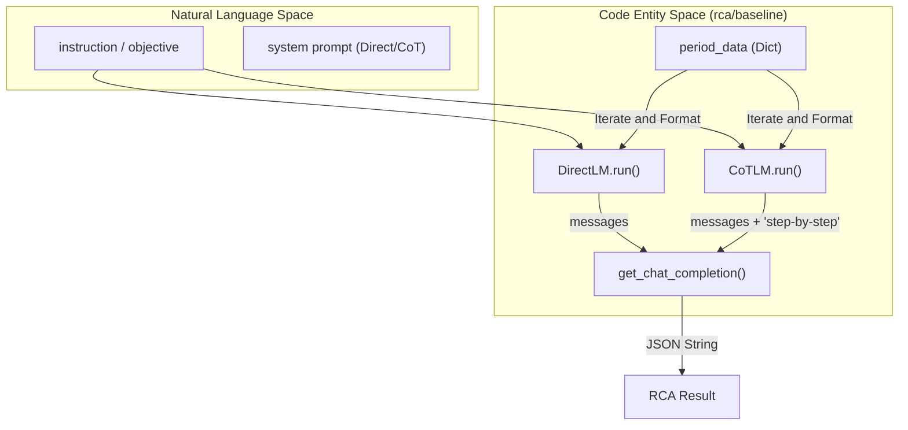
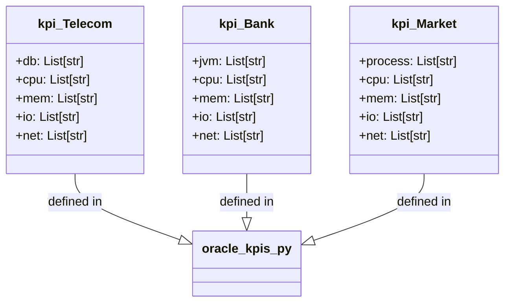

<!-- source: DeepWiki mcp.deepwiki.com · repo microsoft/OpenRCA · page 3.3 Alternative Baselines · fetched 2026-10-26 -->

# Alternative Baselines

Relevant source files

The following files were used as context for generating this wiki page:

- [rca/baseline/cot_lm.py](rca/baseline/cot_lm.py)
- [rca/baseline/direct_lm.py](rca/baseline/direct_lm.py)
- [rca/baseline/oracle_kpis.py](rca/baseline/oracle_kpis.py)

While the **RCA-agent** uses an iterative "Reasoning-Action" loop with a Python interpreter, OpenRCA also provides alternative baseline implementations: **DirectLM** and **CoT-LM**. These baselines serve as comparative benchmarks to evaluate the necessity of agentic workflows and tool-use in root cause analysis. Additionally, the **Oracle KPIs** configuration defines the critical telemetry metrics for different system domains.

## 1. DirectLM Baseline

The `DirectLM` baseline represents a zero-shot approach where the LLM is provided with the entire telemetry dataset and the issue statement in a single prompt. It is required to output the root cause analysis directly in a structured JSON format without any intermediate steps or tool execution.

### Implementation and Data Flow
The implementation in `rca/baseline/direct_lm.py` follows a linear flow:
1. **Data Assembly**: It iterates through `period_data`, appending telemetry strings (logs, metrics, traces) into a single context block `[rca/baseline/direct_lm.py:49-53]()`.
2. **Prompt Construction**: It combines the system schema (`info`), the assembled data, and the `objective` (the RCA question) `[rca/baseline/direct_lm.py:54-58]()`.
3. **Inference**: It calls `get_chat_completion` and attempts to parse the response as JSON `[rca/baseline/direct_lm.py:64-68]()`.

### Trade-offs
*   **Pros**: Low latency and reduced API costs as it requires only one LLM call.
*   **Cons**: Highly susceptible to "lost in the middle" phenomena and context window limits. It cannot perform data filtering or aggregation, often leading to `context_length_exceeded` errors on large datasets `[rca/baseline/direct_lm.py:71-73]()`.

**Sources:** `rca/baseline/direct_lm.py`

---

## 2. CoT-LM (Chain-of-Thought) Baseline

The `CoTLM` baseline improves upon `DirectLM` by instructing the LLM to perform "step-by-step" reasoning before providing the final answer. This leverages the Chain-of-Thought prompting technique to improve the model's logical deduction over complex telemetry.

### Implementation and Data Flow
The `CoTLM` class in `rca/baseline/cot_lm.py` is architecturally similar to `DirectLM` but uses a different `user` prompt template:
*   **Reasoning Instruction**: The prompt explicitly asks the model to "first conduct a comprehensive analysis on the given telemetry data step-by-step" `[rca/baseline/cot_lm.py:18]()`.
*   **JSON Summarization**: After the reasoning steps, the model must provide the final findings in a specific JSON format containing the `root cause occurrence datetime`, `root cause component`, and `root cause reason` `[rca/baseline/cot_lm.py:21-32]()`.

### Data Space Bridge: Direct/CoT-LM Execution
The following diagram illustrates how these baselines bridge the gap between the Natural Language objective and the telemetry data stored in the code.

**Baseline Execution Flow**

**Sources:** `rca/baseline/direct_lm.py`, `rca/baseline/cot_lm.py`

---

## 3. Oracle KPIs

The `Oracle KPIs` are not an execution baseline but a domain-specific configuration file (`rca/baseline/oracle_kpis.py`) that defines which metrics are most relevant for identifying root causes in each system type (Telecom, Bank, Market). This serves as a reference for filtering noise in more advanced agents.

### KPI Definitions by Domain
The file categorizes metrics into standard operational pillars: CPU, Memory, I/O, Network, and Domain-specific (e.g., JVM for Bank, DB for Telecom).

| System | Key Metrics (Code Identifiers) | Source |
| :--- | :--- | :--- |
| **Telecom** | `Proc_Used_Pct`, `tnsping_result_time`, `Disk_io_util` | `[rca/baseline/oracle_kpis.py:1-16]()` |
| **Bank** | `JVM_CPULoad`, `MEMUsedMemPerc`, `DSKReadWrite`, `TCP-CLOSE-WAIT` | `[rca/baseline/oracle_kpis.py:23-60]()` |
| **Market** | `container_cpu_usage_seconds`, `system.io.r_s`, `frontend-http` | `[rca/baseline/oracle_kpis.py:67-97]()` |

### Code Mapping: KPI Categories
The following diagram shows how the `oracle_kpis.py` file structures the "Ground Truth" of what an agent should look for.

**KPI Schema Structure**

**Sources:** `rca/baseline/oracle_kpis.py`

---

## 4. Summary of Baseline Differences

The alternative baselines provide a spectrum of complexity for evaluating LLM performance on OpenRCA:

| Feature | DirectLM | CoT-LM | RCA-agent |
| :--- | :--- | :--- | :--- |
| **Approach** | Single-shot JSON | Chain-of-Thought | Iterative Tool-use |
| **Logic** | Implicit | Explicit Step-by-Step | Python Execution |
| **Context Handling** | Poor (Truncation likely) | Poor (Truncation likely) | Good (Dynamic Filtering) |
| **Implementation** | `direct_lm.py` | `cot_lm.py` | `rca_agent/` |

**Sources:** `rca/baseline/direct_lm.py`, `rca/baseline/cot_lm.py`

---

