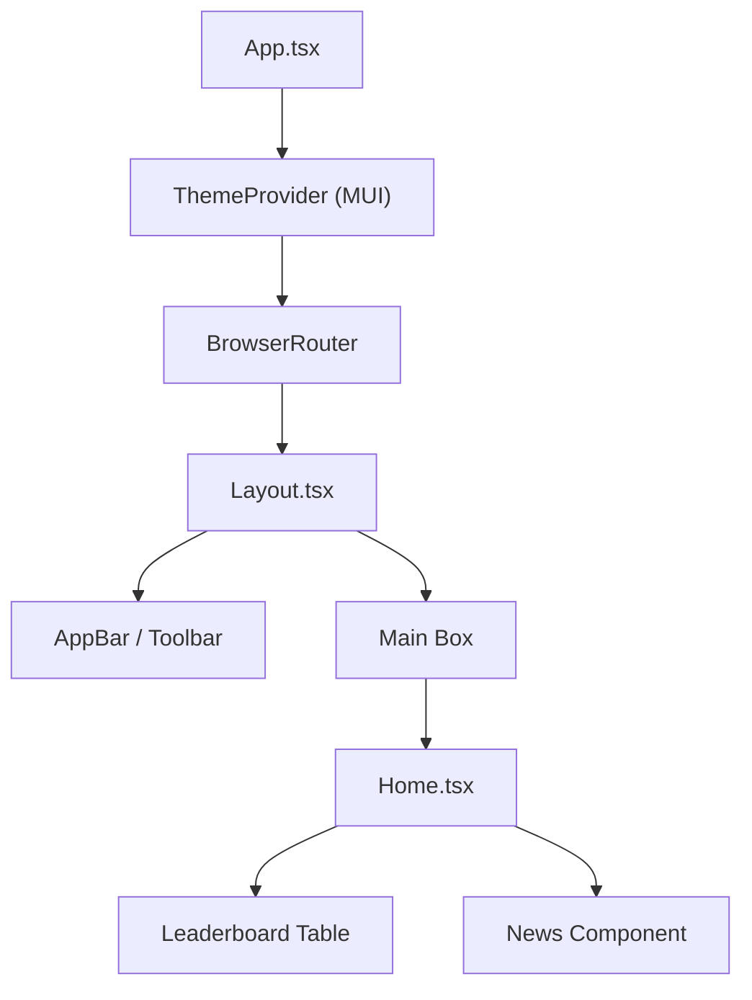
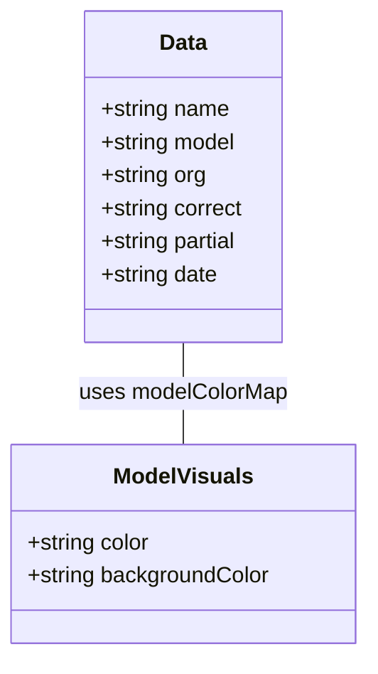
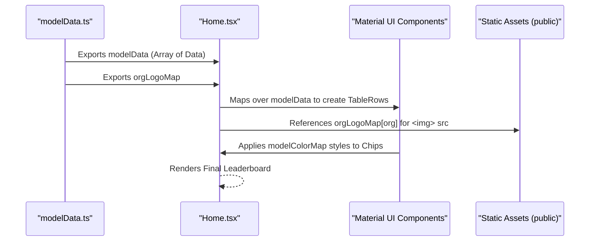

<!-- source: DeepWiki mcp.deepwiki.com · repo microsoft/OpenRCA · page 7.1 Visual Components · fetched 2026-10-26 -->

# Visual Components

Relevant source files

The following files were used as context for generating this wiki page:

- [docs/public/cuhksz.png](docs/public/cuhksz.png)
- [docs/public/microsoft.jpg](docs/public/microsoft.jpg)
- [docs/public/ms_logo.svg](docs/public/ms_logo.svg)
- [docs/public/overview.pdf](docs/public/overview.pdf)
- [docs/public/overview.png](docs/public/overview.png)
- [docs/public/overview.svg](docs/public/overview.svg)
- [docs/public/thu.jpg](docs/public/thu.jpg)
- [docs/public/vite.svg](docs/public/vite.svg)
- [docs/src/App.tsx](docs/src/App.tsx)
- [docs/src/components/Layout.tsx](docs/src/components/Layout.tsx)
- [docs/src/data/modelData.ts](docs/src/data/modelData.ts)
- [docs/src/index.css](docs/src/index.css)
- [docs/src/main.tsx](docs/src/main.tsx)
- [docs/src/pages/Home.tsx](docs/src/pages/Home.tsx)

## Purpose and Scope
This document details the visual assets and React component architecture used in the OpenRCA documentation interface. It covers the frontend structure, the leaderboard data model, and static branding assets. The interface is built using React, Vite, and Material UI (MUI) to present benchmark results and project information.

## Frontend Architecture

The documentation interface is a Single Page Application (SPA) structured with a layout-page pattern. The application state and routing are managed at the top level, while specific data visualizations like the leaderboard are driven by a centralized data model.

### Component Hierarchy

Sources: [docs/src/App.tsx:17-30](), [docs/src/components/Layout.tsx:8-34](), [docs/src/pages/Home.tsx]()

### Key React Entities

| Entity | File Path | Role |
| :--- | :--- | :--- |
| `App` | [docs/src/App.tsx:17]() | Root component; defines the MUI `createTheme` and `Router` configuration. |
| `Layout` | [docs/src/components/Layout.tsx:8]() | Functional component providing the `AppBar` navigation and main content container. |
| `Home` | [docs/src/pages/Home.tsx]() | Primary landing page containing the benchmark leaderboard and news updates. |
| `theme` | [docs/src/App.tsx:6-15]() | MUI theme object defining the "Inter" font family and primary color palette (`#1976d2`). |

Sources: [docs/src/App.tsx:6-15](), [docs/src/components/Layout.tsx:1-34]()

## Data Model and Mapping

The visual interface relies on a structured data model to render the benchmark leaderboard. This model maps raw model performance metrics to visual indicators like colors and organization logos.

### Leaderboard Data Structure

The `Data` interface defines the schema for model performance entries:

Sources: [docs/src/data/modelData.ts:1-8]()

### Visual Mapping Tables

The UI uses mapping objects to ensure consistent branding for different LLM providers and models.

**Organization Logo Mapping (`orgLogoMap`)**
| Organization | Asset Path |
| :--- | :--- |
| Microsoft | `/OpenRCA/ms_logo.svg` |
| Google | `/OpenRCA/google_logo.svg` |
| OpenAI | `/OpenRCA/openai_logo.svg` |
| Anthropic | `/OpenRCA/anthropic_logo.svg` |
| Meta | `/OpenRCA/meta_logo.svg` |

Sources: [docs/src/data/modelData.ts:21-27]()

**Model Color Mapping (`modelColorMap`)**
| Model Family | Primary Color | Background Color |
| :--- | :--- | :--- |
| Claude 3.5 Sonnet | `#1a237e` | `#e8eaf6` |
| GPT-4o | `#004d40` | `#e0f2f1` |
| Llama 3.1 Instruct | `#e65100` | `#ffe0b2` |

Sources: [docs/src/data/modelData.ts:11-18]()

## Static Assets

Visual components are stored in the `docs/public/` directory and are served as static assets.

### Logo and Branding Assets
The repository includes several formats for institutional and project branding:

- **Vector Graphics**: `ms_logo.svg` [docs/public/ms_logo.svg:1]() and `vite.svg` [docs/public/vite.svg:1]() are used for UI icons and the navigation bar due to their scalability.
- **Raster Images**: `cuhksz.png` [docs/public/cuhksz.png:1]() and `thu.jpg` [docs/public/thu.jpg:1]() provide high-resolution attribution for collaborating institutions.
- **Branding**: `microsoft.jpg` [docs/public/microsoft.jpg:1]() serves as a fallback for the Microsoft corporate identity.

### Documentation Visuals
- **Overview Diagrams**: `overview.png` [docs/public/overview.png:1]() and `overview.svg` [docs/public/overview.svg:1]() provide visual representations of the OpenRCA benchmark pipeline.
- **Reference PDF**: `overview.pdf` [docs/public/overview.pdf:1]() is available for offline viewing of the system architecture.

Sources: [docs/public/ms_logo.svg:1](), [docs/public/overview.svg:1](), [docs/public/overview.pdf:1](), [docs/public/cuhksz.png:1]()

## Implementation Data Flow

The following diagram illustrates how the `modelData.ts` entities are consumed by the React components to render the visual interface.

Sources: [docs/src/data/modelData.ts:36-64](), [docs/src/pages/Home.tsx](), [docs/src/components/Layout.tsx:11-28]()

## Styling and Layout

The interface utilizes a combination of Material UI's CSS-in-JS and global CSS.

- **Global Styles**: `docs/src/index.css` defines the "Inter" font stack and basic reset styles [docs/src/index.css:1-14]().
- **Navigation**: The `Layout` component uses the MUI `AppBar` with a white background and no shadow to create a clean, modern header [docs/src/components/Layout.tsx:11]().
- **Typography**: The theme enforces a specific font family across all MUI components to match the project's branding [docs/src/App.tsx:7-9]().

Sources: [docs/src/index.css:1-20](), [docs/src/App.tsx:6-15](), [docs/src/components/Layout.tsx:11-13]()

---

