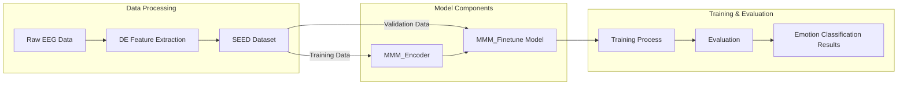
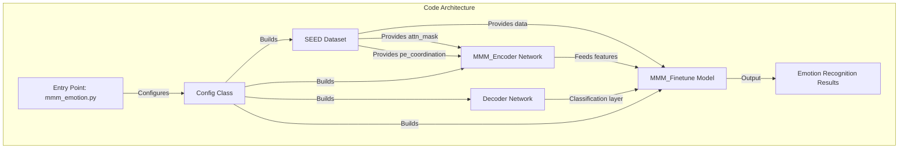
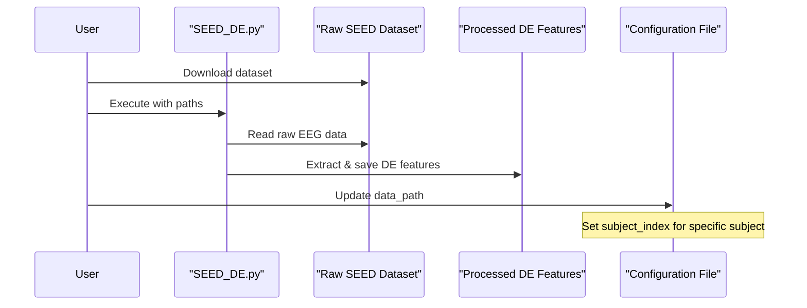
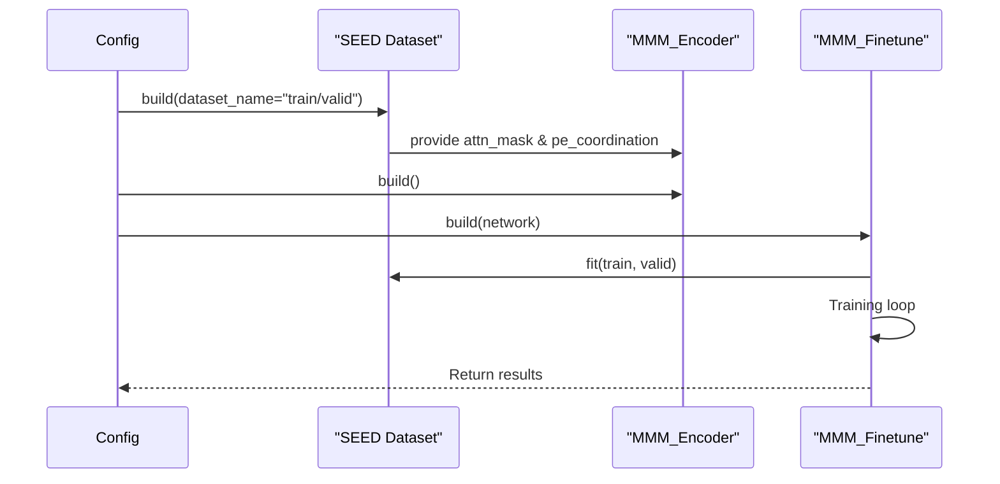
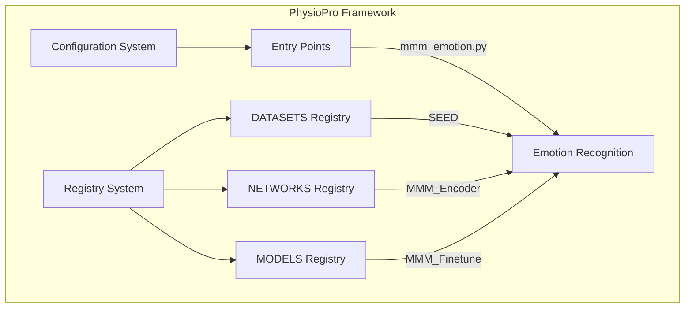

<!-- source: DeepWiki mcp.deepwiki.com · repo microsoft/PhysioPro · page 3.1 Emotion Recognition with MMM · fetched 2026-10-26 -->

# Emotion Recognition with MMM

<details>
<summary>Relevant source files</summary>

The following files were used as context for generating this wiki page:

- [docs/MMM.md](docs/MMM.md)
- [physiopro/entry/mmm_emotion.py](physiopro/entry/mmm_emotion.py)

</details>


## Purpose and Scope

This document provides a comprehensive guide for using PhysioPro's MMM (Learning Topology-Agnostic EEG Representations with Geometry-Aware Modeling) framework for EEG-based emotion recognition. It covers data preparation, model configuration, training process, and practical usage guidelines. This page focuses specifically on emotion recognition applications; for general information about MMM's architecture, see [MMM_Encoder](#2.2.1), and for time series classification with other models, see [Time Series Classification with ContiFormer](#3.2).

Sources: [docs/MMM.md:1-5]()

## Overview of MMM for Emotion Recognition

MMM is a specialized encoder architecture designed for EEG data that creates topology-agnostic representations using geometry-aware modeling. Within PhysioPro, the emotion recognition pipeline leverages MMM's capabilities to process EEG signals from the SEED dataset and classify emotional states.



Sources: [docs/MMM.md:3-5](), [physiopro/entry/mmm_emotion.py:1-14]()

## System Architecture

The emotion recognition system consists of several interconnected components that handle data processing, model training, and evaluation.



Key components:
- **Entry Point**: The `mmm_emotion.py` script that orchestrates the entire process
- **SEED Dataset**: Provides EEG data with emotion labels
- **MMM_Encoder**: Processes EEG signals with geometry-aware modeling
- **MMM_Finetune Model**: Handles the training, evaluation, and prediction

Sources: [physiopro/entry/mmm_emotion.py:15-31]()

## Data Preparation

### SEED Dataset

The SEED (SJTU Emotion EEG Dataset) is a collection of EEG recordings used for emotion recognition research. To use it with PhysioPro:

1. Obtain the dataset from the [SEED official website](https://bcmi.sjtu.edu.cn/home/seed)
2. Extract Differential Entropy (DE) features using the provided script



### DE Feature Extraction

The system requires Differential Entropy (DE) features extracted from the raw EEG signals. This can be done using the provided script:

```
python scripts/SEED_DE.py
```

**Note**: There are known issues with DE features for SEED as discussed in [docs/MMM.md:34-37](). While the provided checkpoint is trained on DE features, users should be aware of these limitations.

Sources: [docs/MMM.md:7-15](), [docs/MMM.md:34-37]()

## Configuration Setup

The emotion recognition pipeline is configured through YAML files. Two example configurations are provided:

1. `mmm_emotion.yml`: For training from scratch
2. `mmm_emotion_from_ckpt.yml`: For loading a pre-trained encoder

The configuration file defines:
- Dataset parameters (including subject index)
- Network architecture (MMM_Encoder)
- Decoder network
- Model parameters
- Runtime settings

Key configuration parameters include:

| Section | Parameter | Description |
|---------|-----------|-------------|
| data | subject_index | Target subject for emotion recognition |
| data | data_path | Path to the processed DE features |
| network | hidden_size | Size of hidden layers in MMM_Encoder |
| network | num_hidden_layers | Number of transformer layers |
| model | learning_rate | Learning rate for fine-tuning |
| model | epochs | Number of training epochs |

Sources: [docs/MMM.md:17-32](), [physiopro/entry/mmm_emotion.py:7-13]()

## Implementation Details

### Training Process

The training pipeline for emotion recognition with MMM follows these steps:

1. Setup experiment environment
2. Build training and validation datasets
3. Initialize the MMM_Encoder with attention mask and positional encoding
4. Initialize the MMM_Finetune model with the encoder
5. Train/fine-tune the model
6. Evaluate performance



### Code Structure

The emotion recognition system is implemented across several key files:

- Entry point: `physiopro/entry/mmm_emotion.py`
- Dataset implementation: Part of DATASETS registry
- Network architecture: MMM_Encoder in NETWORKS registry
- Model implementation: MMM_Finetune in MODELS registry

Sources: [physiopro/entry/mmm_emotion.py:15-31]()

## Usage Guide

### Step-by-Step Instructions

1. **Prepare the data**:
   - Download the SEED dataset
   - Extract DE features using `scripts/SEED_DE.py`
   - Optionally download the pre-trained checkpoint

2. **Create output directory**:
   ```bash
   mkdir -p outputs/MMM_SEED/<subject_index>/
   ```

3. **Run the fine-tuning task**:
   ```bash
   python -m physiopro.entry.mmm_emotion docs/configs/mmm_emotion.yml
   ```
   Or with pre-trained checkpoint:
   ```bash
   python -m physiopro.entry.mmm_emotion docs/configs/mmm_emotion_from_ckpt.yml
   ```

4. **Monitor training progress**:
   ```bash
   tensorboard --logdir outputs/
   ```

5. **Adjust for different subjects**:
   - Modify `data.subject_index` in the configuration file to run on different subjects

Sources: [docs/MMM.md:17-32]()

## Performance Considerations

### DE Feature Limitations

There are known issues with the DE feature approach for the SEED dataset, as noted in the documentation. The current checkpoint is trained on DE features to maintain consistency with published results, but users should be aware of these limitations.

The PhysioPro team is:
1. Investigating the impact of these issues on performance
2. Working on training MMM on raw EEG signals as an alternative

For the latest updates on this issue, refer to the [GitHub repository](https://github.com/microsoft/PhysioPro/issues/16).

### Best Practices

1. **Subject-Specific Models**: Emotion recognition performance can vary across subjects. Train subject-specific models by changing the subject index.
2. **Hyperparameter Tuning**: Adjust learning rate, batch size, and other parameters based on the specific subject and task.
3. **Pre-trained Checkpoint**: When available, using the pre-trained checkpoint can significantly improve performance and reduce training time.

Sources: [docs/MMM.md:34-37]()

## Integration with the PhysioPro Framework

The emotion recognition system with MMM is built on top of the PhysioPro framework, utilizing its modular architecture:



The registry pattern allows for flexible component selection and configuration, making it easy to adapt the emotion recognition pipeline for different datasets or model architectures.

Sources: [physiopro/entry/mmm_emotion.py:1-6]()

---

