# Page: Overview

# Overview

<details>
<summary>Relevant source files</summary>

The following files were used as context for generating this wiki page:

- [README.md](README.md)
- [docs/configs/mmm_emotion_from_ckpt.yml](docs/configs/mmm_emotion_from_ckpt.yml)

</details>


PhysioPro is a deep learning framework designed for processing and analyzing physiological data, with a particular focus on EEG (electroencephalogram) data. This framework provides modular components for time series analysis tasks, supporting both regular and irregular time series data.

For installation instructions, see [Installation and Setup](#1.1). For a detailed breakdown of system architecture, see [System Architecture](#1.2).

## Purpose and Core Capabilities

PhysioPro provides researchers and developers with tools to:

- Process raw physiological signals, especially EEG data
- Train deep learning models on time series data
- Handle irregular sampling in time series through specialized architectures
- Perform EEG-based emotion recognition
- Model temporal point processes for event prediction

The framework's key innovations include:

1. **MMM (Topology-Agnostic EEG Representations)**: Specialized architecture for EEG data that incorporates geometry-aware processing
2. **ContiFormer (Continuous-Time Transformer)**: Advanced architecture for handling irregularly sampled time series data

Sources: [README.md:1-7]()

## High-Level System Architecture

The following diagram illustrates the main components of PhysioPro and their relationships:

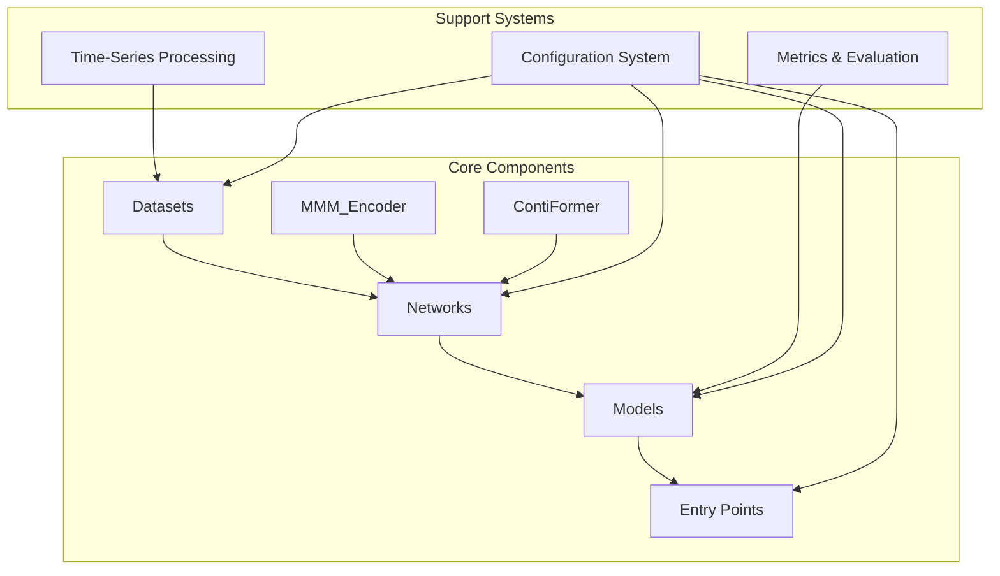

The system follows a modular design pattern where:
- **Datasets** handle data loading and preprocessing
- **Networks** implement neural network architectures
- **Models** manage training, evaluation, and inference
- **Entry Points** provide interfaces for running experiments
- **Configuration System** coordinates component selection and parameterization

Sources: [README.md:21-24]()

## Data and Processing Flow

The following diagram shows how data flows through the PhysioPro system:

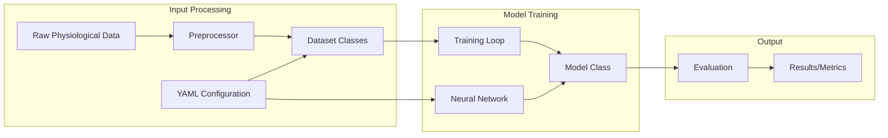

This pipeline is configured through YAML configuration files that specify dataset parameters, network architecture, and training settings.

Sources: [docs/configs/mmm_emotion_from_ckpt.yml:1-47]()

## Key Components

### Dataset System

PhysioPro includes specialized dataset classes for different types of physiological data:

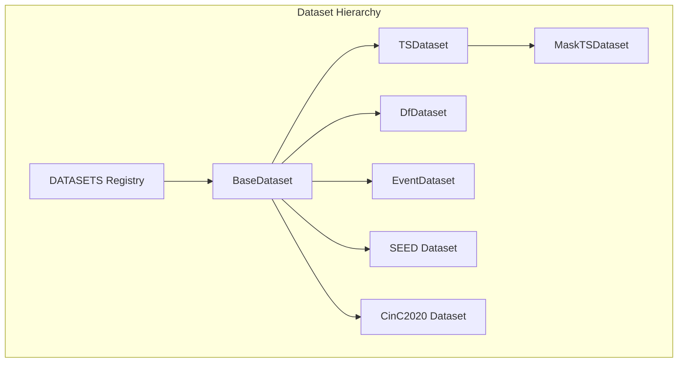

For detailed information about specific datasets, see [Dataset System](#2.1).

### Network Architectures

PhysioPro offers several neural network architectures optimized for time series data:

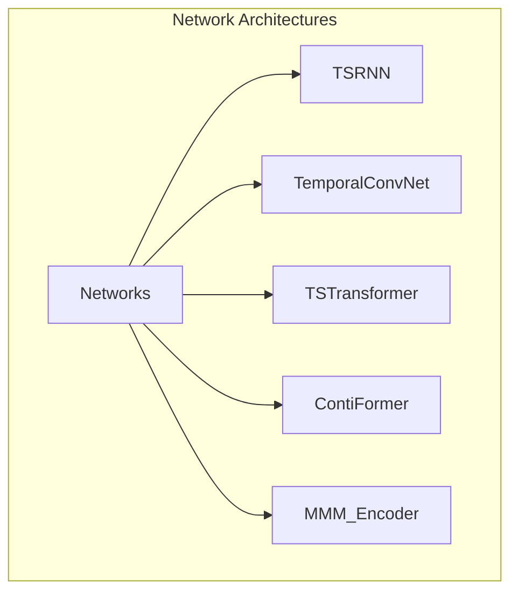

The two flagship architectures are:

1. **MMM_Encoder**: Specialized for EEG data processing with geometry-aware modeling
2. **ContiFormer**: Designed for continuous-time modeling of irregular time series

For more information on network architectures, see [Network Architectures](#2.2).

Sources: [README.md:5-7]()

### Model System

Models in PhysioPro orchestrate the training and evaluation process:

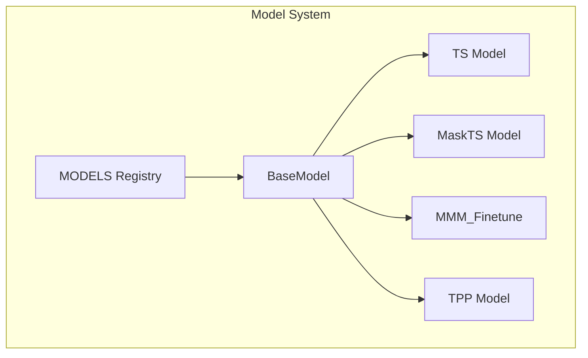

Models implement training loops, checkpointing, metric calculation, and other standard functionality. The specific model classes are tailored to different tasks such as emotion recognition, time series prediction, and temporal point process modeling.

For more details on models, see [Model System](#2.3).

Sources: [docs/configs/mmm_emotion_from_ckpt.yml:25-43]()

## Configuration System

PhysioPro uses YAML configuration files to specify all aspects of an experiment:

| Configuration Section | Purpose |
|----------------------|---------|
| `data` | Dataset type and parameters |
| `network` | Neural network architecture and parameters |
| `model` | Training parameters, optimizer, loss function, etc. |
| `runtime` | Execution settings like device selection and output directory |

Example configuration snippet for emotion recognition with MMM:

```yaml
data:
  type: SEED
  window_size: 1
  subject_index: 3

network:
  type: MMM_Encoder
  depth: 6
  num_heads: 8

model:
  type: MMM_Finetune
  task: multiclassification
  optimizer: Adam
  lr: 0.00005
```

Sources: [docs/configs/mmm_emotion_from_ckpt.yml:1-47]()

## Main Use Cases

PhysioPro supports several key use cases:

1. **EEG-Based Emotion Recognition**
   - Uses the MMM_Encoder with the SEED dataset
   - Provides tools for fine-tuning pre-trained models
   
2. **Time Series Classification**
   - Supports both regular and irregular time series
   - Uses various network architectures including ContiFormer
   
3. **Temporal Point Process Modeling**
   - Specialized for event prediction tasks
   - Leverages continuous-time modeling capabilities

For practical tutorials on these use cases, see [Use Cases and Tutorials](#3).

Sources: [README.md:5-7](), [docs/configs/mmm_emotion_from_ckpt.yml:1-47]()

## Responsible AI Considerations

PhysioPro is intended for research purposes in physiological data analysis. The framework is not designed for clinical applications and should not be used to influence treatment decisions. Users should:

- Train models with their own data
- Perform Responsible AI testing before any production use
- Validate fair outcomes across different groups of people

Sources: [README.md:26-44]()

---

# Page: Installation and Setup

# Installation and Setup

<details>
<summary>Relevant source files</summary>

The following files were used as context for generating this wiki page:

- [README.md](README.md)
- [docs/configs/mmm_emotion_from_ckpt.yml](docs/configs/mmm_emotion_from_ckpt.yml)
- [setup.py](setup.py)

</details>


This document provides detailed instructions for installing and configuring PhysioPro, a deep learning framework for physiological data processing and analysis. For information about the overall system architecture, see [System Architecture](#1.2).

## Prerequisites

Before installing PhysioPro, ensure your system meets the following requirements:

- Python 3.8 or higher
- pip package manager
- Git (for cloning the repository)
- Sufficient disk space (approximately 200MB for the framework and dependencies)
- Optional: CUDA-compatible GPU for accelerated training

Sources: [setup.py:67-68]()

## Installation Options

There are two main approaches to installing PhysioPro, depending on your intended use.

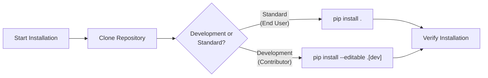

### Standard Installation

For end users who want to use PhysioPro without modifying its source code:

```bash
# 1. Clone the repository
git clone https://github.com/microsoft/PhysioPro.git

# 2. Navigate to the repository root
cd PhysioPro

# 3. Install the package
pip install .
```

Sources: [README.md:11-14]()

### Development Installation

For developers who want to modify the source code or contribute to the project:

```bash
# 1. Clone the repository
git clone https://github.com/microsoft/PhysioPro.git

# 2. Navigate to the repository root
cd PhysioPro

# 3. Install in development mode with additional dependencies
pip install --editable .[dev]
```

The development installation includes additional tools for testing and code quality:
- flake8 (code linting)
- pytest (testing framework)
- pytest-azurepipelines (CI/CD integration)
- pytest-cov (code coverage)
- pylint (code analysis)

Sources: [README.md:16-19](), [setup.py:81]()

## Dependencies

PhysioPro has the following core dependencies that will be automatically installed:

| Package | Version | Purpose |
|---------|---------|---------|
| torch | 2.0.1 | Deep learning framework |
| torchvision | 0.15.2 | Computer vision utilities |
| torchcde | 0.2.5 | Neural controlled differential equations |
| utilsd | 0.0.18.post0 | Utility functions |
| pandas | >=2.0.3 | Data manipulation and analysis |
| scipy | >=1.10.1 | Scientific computing |
| sktime | 0.21.0 | Time series analysis |
| tqdm | >=4.42.1 | Progress bars |
| tensorboard | >=2.14.0 | Experiment visualization |
| numba | >=0.57.1 | JIT compilation for Python |
| biosppy | >=1.0.0 | Biosignal processing |

Sources: [setup.py:68-80]()

## Verifying Installation

After installation, you can verify that PhysioPro is correctly installed by importing it in Python:

```python
import physiopro
print(physiopro.__version__)
```

If the installation was successful, this will print the current version of PhysioPro without any errors.

## Configuration System

PhysioPro uses YAML configuration files to define experiments. These files specify dataset parameters, network architecture, and training settings.

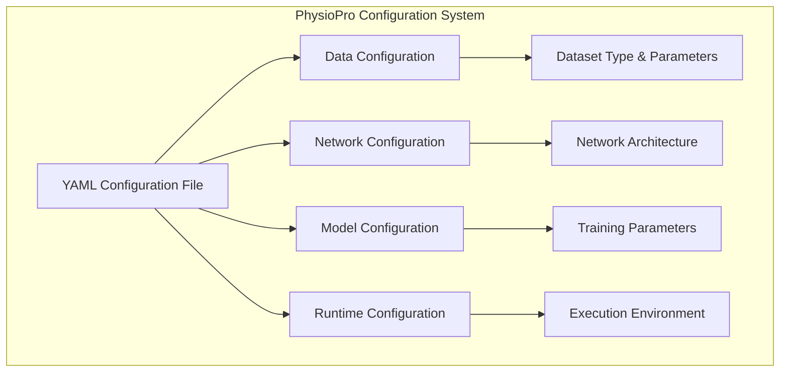

### Configuration File Structure

A typical configuration file includes these main sections:

1. **data**: Specifies the dataset type and parameters
2. **network**: Defines the neural network architecture
3. **model**: Sets up training parameters, loss functions, and metrics
4. **runtime**: Configures execution details like seed, device, and output directories

Sources: [docs/configs/mmm_emotion_from_ckpt.yml:1-47]()

### Example Configuration

Here's a simplified example of a configuration file for emotion recognition using the MMM model:

```yaml
data:
  type: SEED
  window_size: 1
  subject_index: 3
  prefix: /path/to/data/

network:
  type: MMM_Encoder
  depth: 6
  num_heads: 8
  encoder_dim: 64
  channel_num: 79
  in_chans: 5

model:
  type: MMM_Finetune
  task: multiclassification
  model_path: /path/to/pretrained_model.pt
  optimizer: Adam
  lr: 0.00005
  weight_decay: 0.005
  loss_fn: cross_entropy
  metrics: [accuracy]
  batch_size: 32
  out_size: 3

runtime:
  seed: 51
  use_cuda: true
  output_dir: outputs/MMM_SEED/3/
```

Sources: [docs/configs/mmm_emotion_from_ckpt.yml:1-47]()

## Integration with System Components

After installation, PhysioPro's components become available for your experiments. The following diagram shows how the installation process connects to the main system components:

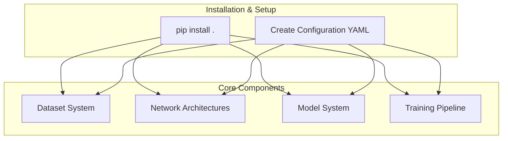

## Next Steps

After completing the installation and setup:

1. Explore the [Quick Start](https://github.com/microsoft/PhysioPro/blob/main/docs/quick-start.md) guide for basic usage examples
2. Learn about the [Dataset System](#2.1) to understand how to prepare your data
3. Explore the [Network Architectures](#2.2) to choose appropriate models for your tasks
4. Review the [Use Cases and Tutorials](#3) for practical examples

Sources: [README.md:21-23]()

## Troubleshooting

If you encounter issues during installation, try the following:

1. Ensure you have the correct Python version (3.8+)
2. Update pip to the latest version: `pip install --upgrade pip`
3. Check for conflicting dependencies in your environment
4. Consider creating a new virtual environment for PhysioPro

For GPU support, ensure you have:
- Compatible NVIDIA GPU
- Appropriate CUDA drivers installed
- Compatible CUDA toolkit version for PyTorch 2.0.1

---

# Page: System Architecture

# System Architecture

<details>
<summary>Relevant source files</summary>

The following files were used as context for generating this wiki page:

- [README.md](README.md)
- [docs/configs/mmm_emotion_from_ckpt.yml](docs/configs/mmm_emotion_from_ckpt.yml)
- [physiopro/__init__.py](physiopro/__init__.py)
- [physiopro/module/basic_transform.py](physiopro/module/basic_transform.py)

</details>


This document provides a high-level overview of PhysioPro's system architecture, explaining the major components and how they interact. For details on installation, see [Installation and Setup](#1.1). For in-depth information about specific components, refer to the [Core Components](#2) section.

## Purpose and Scope

PhysioPro is a deep learning framework specifically designed for processing and analyzing physiological data, with a particular focus on EEG data. The architecture is designed to be modular, allowing components to be combined in various ways for different time series analysis tasks including:

- EEG-based emotion recognition
- Time series classification and prediction
- Temporal point process modeling
- Irregular time series analysis

This document outlines the overall structure of the system, its main components, their roles, and their interactions.

## High-Level System Overview

### System Component Diagram

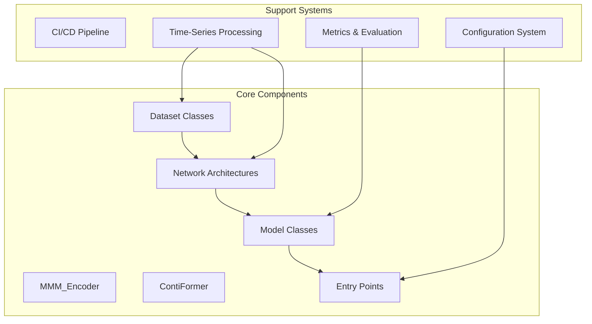

Sources: README.md

The architecture consists of two main parts:

1. **Core Components**:
   - **Dataset Classes**: Data loading and preprocessing components
   - **Network Architectures**: Neural network implementations specialized for time series
   - **Model Classes**: Higher-level abstractions combining networks with training logic
   - **MMM_Encoder**: Specialized architecture for EEG data with geometry-aware processing
   - **ContiFormer**: Advanced architecture for handling irregular time series
   - **Entry Points**: Scripts and interfaces for running experiments

2. **Support Systems**:
   - **Configuration System**: YAML-based experiment configuration
   - **Metrics & Evaluation**: Performance measurement tools
   - **Time-Series Processing**: Utilities for processing time series data
   - **CI/CD Pipeline**: Code quality and testing infrastructure

## Data Flow Architecture

### Data and Processing Pipeline

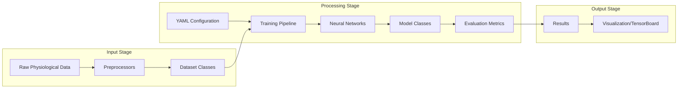

Sources: docs/configs/mmm_emotion_from_ckpt.yml

The data processing pipeline consists of:

1. **Input Stage**: Raw physiological data (e.g., EEG signals) is preprocessed and loaded into dataset classes
2. **Processing Stage**: Neural networks process the data through models that implement training and evaluation logic
3. **Output Stage**: Results are analyzed and visualized
4. **Configuration**: YAML files specify dataset parameters, network architecture, and training configuration

The following table shows the key components involved in the data flow:

| Stage | Component | Purpose |
|-------|-----------|---------|
| Input | Dataset Classes | Load and preprocess data |
| Processing | Neural Networks | Implement architectures like ContiFormer, MMM_Encoder |
| Processing | Model Classes | Define training procedures and evaluation metrics |
| Output | TensorBoard | Visualize results and metrics |
| Configuration | YAML Files | Configure all components and experiments |

## Component Hierarchies

### Dataset Class Hierarchy

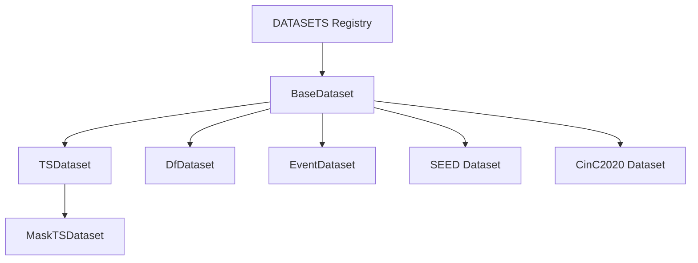

Sources: docs/configs/mmm_emotion_from_ckpt.yml

The dataset system provides a unified interface for handling different types of physiological data:

- **BaseDataset**: Abstract base class implementing common functionality
- **TSDataset**: For time series data
- **DfDataset**: For tabular data in DataFrame format
- **EventDataset**: For event sequence data (temporal point processes)
- **MaskTSDataset**: For time series with missing values
- **SEED**: For the SEED EEG-based emotion recognition dataset
- **CinC2020**: For the CinC2020 cardiac signal dataset

For detailed information about each dataset type, see [Dataset System](#2.1).

### Network Architecture Hierarchy

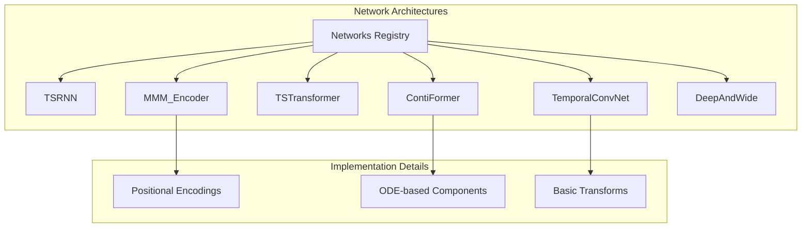

Sources: physiopro/module/basic_transform.py, docs/configs/mmm_emotion_from_ckpt.yml

PhysioPro implements several neural network architectures:

- **Time Series Networks**:
  - **TSRNN**: Recurrent networks for time series
  - **TemporalConvNet**: Temporal convolutional networks with components like `Chomp1d` [physiopro/module/basic_transform.py:7-13]()
  - **TSTransformer**: Transformer architecture for time series

- **Advanced Networks**:
  - **ContiFormer**: Continuous-time transformer for irregular time series
  - **MMM_Encoder**: Specialized for EEG data with geometry-aware processing

- **Specialized Networks**:
  - **DeepAndWide**: Combining deep learning with linear models

For detailed information about each network architecture, see [Network Architectures](#2.2).

### Model Class Hierarchy

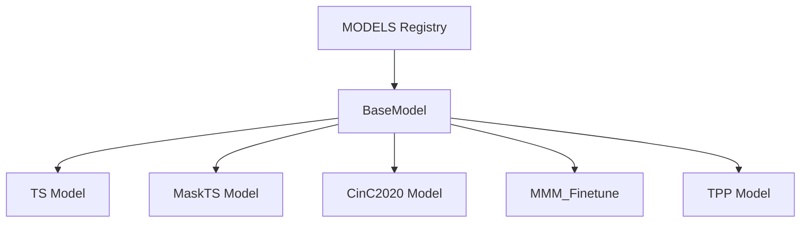

Sources: docs/configs/mmm_emotion_from_ckpt.yml

The model system provides abstractions for training and inference:

- **BaseModel**: Abstract base class with common functionality
- **TS**: For general time series tasks
- **MaskTS**: For time series with missing values
- **CinC2020**: For cardiac signal analysis
- **MMM_Finetune**: For fine-tuning pre-trained MMM models
- **TPP**: For temporal point process modeling

For detailed information about each model type, see [Model System](#2.3).

## Training Pipeline and Component Integration

### Training Pipeline Sequence

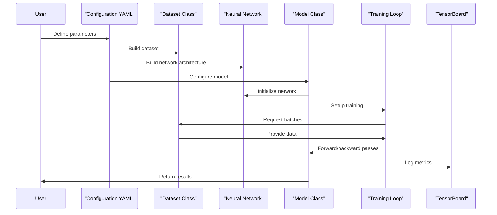

Sources: docs/configs/mmm_emotion_from_ckpt.yml

The training pipeline is orchestrated through several steps:

1. The user defines experiment parameters in a YAML configuration file
2. The configuration is used to instantiate the dataset, network, and model
3. The model initializes the network and sets up the training loop
4. Training proceeds with data batches from the dataset class
5. The model computes forward and backward passes
6. Metrics are logged to TensorBoard
7. Results are returned to the user

## Configuration System

The configuration system uses YAML files to define experiment parameters. Below is an example for emotion recognition with MMM:

```yaml
data:
  type: SEED
  window_size: 1
  subject_index: 3
  prefix: /path/to/data/

network:
  type: MMM_Encoder
  depth: 6
  num_heads: 8
  encoder_dim: 64
  channel_num: 79
  in_chans: 5
  pe_type: 2d

model:
  type: MMM_Finetune
  task: multiclassification
  model_path: /path/to/pretrained_model.pt
  optimizer: Adam
  lr: 0.00005
  weight_decay: 0.005
  loss_fn: cross_entropy
  metrics: [accuracy]
  observe: accuracy
  lower_is_better: False
  max_epochs: 100
  early_stop: 70
  batch_size: 32
  out_size: 3

runtime:
  seed: 51
  use_cuda: true
  output_dir: outputs/MMM_SEED/3/
```

Sources: docs/configs/mmm_emotion_from_ckpt.yml

The configuration file is divided into sections:

- **data**: Dataset parameters (type, window size, subject index)
- **network**: Neural network architecture parameters
- **model**: Training parameters (optimizer, learning rate, loss function, metrics)
- **runtime**: Execution parameters (random seed, device, output directory)

## Key Components

### MMM (Topology-Agnostic EEG Representations)

MMM is specialized for EEG data processing with geometry-aware modeling. It provides:

- Topology-agnostic EEG representations
- Geometry-aware processing
- Fine-tuning capabilities for specific tasks like emotion recognition

For detailed information about MMM, see [MMM_Encoder](#2.2.1).

Sources: README.md

### ContiFormer (Continuous-Time Transformer)

ContiFormer is designed for irregular time series modeling with continuous-time capabilities:

- Handles irregularly sampled time series data
- Uses ODE-based components for continuous-time modeling
- Supports various time series tasks

For detailed information about ContiFormer, see [ContiFormer](#2.2.2).

Sources: README.md

## Summary

PhysioPro's architecture is modular and flexible, supporting various physiological data processing tasks:

- **Modularity**: Components can be mixed and matched for different applications
- **Configurability**: YAML-based configuration for easy experiment setup
- **Specialized Architectures**: Advanced networks like MMM and ContiFormer
- **Comprehensive Pipeline**: From data loading to results visualization

The system is particularly strong for EEG data analysis and irregular time series processing, with state-of-the-art architectures implemented in a cohesive framework.

Sources: README.md, docs/configs/mmm_emotion_from_ckpt.yml

---

# Page: Core Components

# Core Components

<details>
<summary>Relevant source files</summary>

The following files were used as context for generating this wiki page:

- [physiopro/dataset/__init__.py](physiopro/dataset/__init__.py)
- [physiopro/model/__init__.py](physiopro/model/__init__.py)
- [physiopro/network/__init__.py](physiopro/network/__init__.py)

</details>


PhysioPro is built around a modular architecture with several core components that work together to process and analyze physiological data. This page provides an overview of these key subsystems and how they interrelate. For detailed information about individual components, please refer to their dedicated documentation pages.

The core components of PhysioPro consist of:
- Dataset System: For loading and processing physiological data [Dataset System](#2.1)
- Network Architectures: Deep learning models specialized for time series [Network Architectures](#2.2)
- Model System: Classes that manage training and evaluation [Model System](#2.3)

## Component Architecture

The following diagram illustrates the high-level architecture and interactions between PhysioPro's core components:

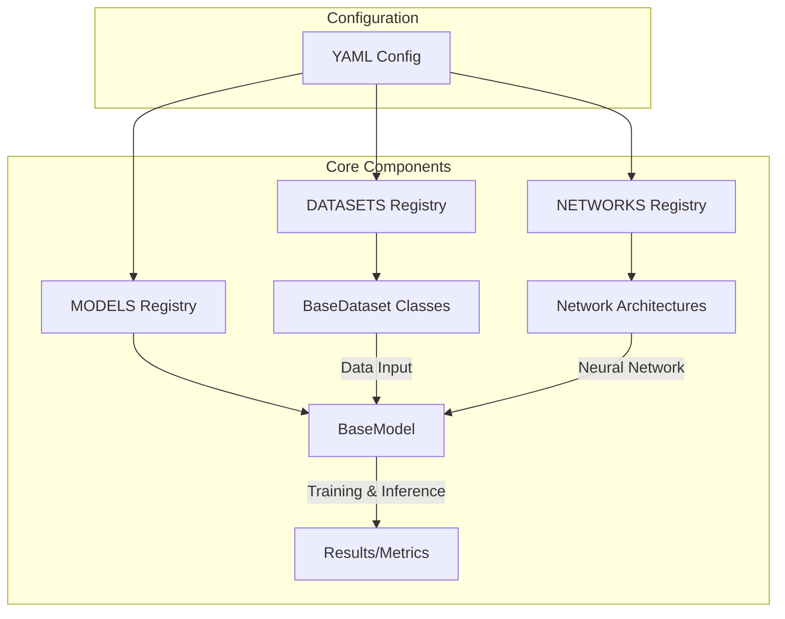

Sources: [physiopro/dataset/__init__.py](physiopro/dataset/__init__.py), [physiopro/model/__init__.py](physiopro/model/__init__.py), [physiopro/network/__init__.py](physiopro/network/__init__.py)

## Dataset System

The Dataset System handles data loading, preprocessing, and batching for physiological data. PhysioPro implements various dataset classes to support different data types and processing needs.

### Dataset Class Hierarchy

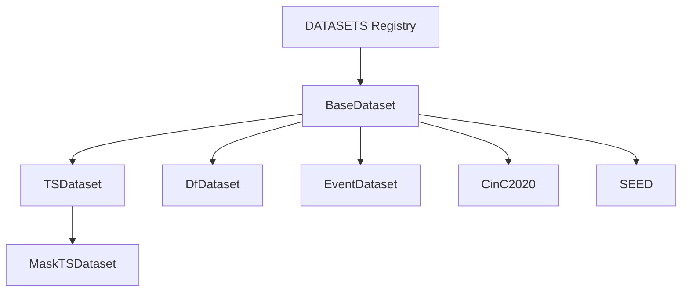

Sources: [physiopro/dataset/__init__.py:4-10](physiopro/dataset/__init__.py:4-10)

### Available Dataset Classes

| Dataset Class | Purpose |
|---------------|---------|
| `TSDataset` | Base class for time series data |
| `MaskTSDataset` | For time series with missing values |
| `DfDataset` | For pandas DataFrame-based data |
| `EventDataset` | For temporal point process/event data |
| `CinC2020` | For cardiac signal analysis |
| `SEED` | For EEG-based emotion recognition |

Sources: [physiopro/dataset/__init__.py:4-10](physiopro/dataset/__init__.py:4-10)

## Network Architectures

PhysioPro provides multiple neural network architectures specialized for physiological and time series data. These networks serve as the computational backbone for models.

### Network Architecture Hierarchy

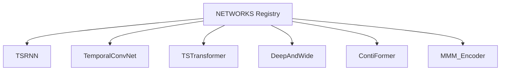

Sources: [physiopro/network/__init__.py:1-6](physiopro/network/__init__.py:1-6)

### Available Network Architectures

| Network Architecture | Purpose |
|---------------------|---------|
| `TSRNN` | Recurrent Neural Networks for time series |
| `TemporalConvNet` | Temporal convolutional networks |
| `TSTransformer` | Transformer architecture for time series |
| `DeepAndWide` | Network for CinC2020 cardiac data |
| `ContiFormer` | Continuous-time transformer for irregular time series |
| `MMM_Encoder` | Specialized encoder for EEG data |

Sources: [physiopro/network/__init__.py:1-6](physiopro/network/__init__.py:1-6)

## Model System

The Model System combines datasets and networks with training logic to create end-to-end solutions for physiological data analysis tasks. Models handle training loops, evaluation metrics, and checkpointing.

### Model Class Hierarchy

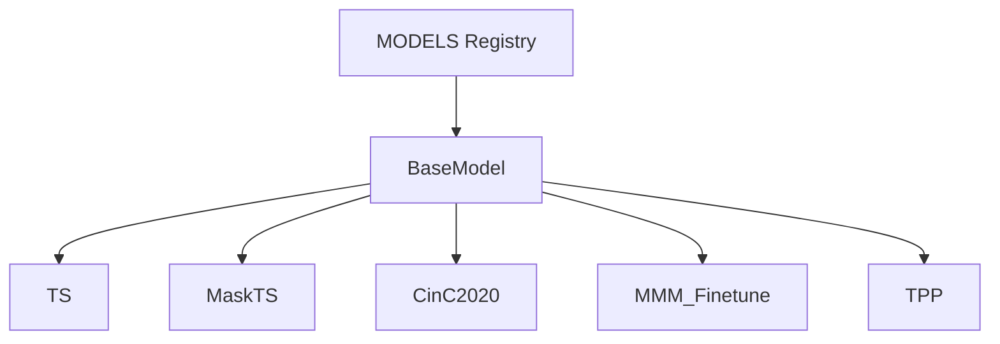

Sources: [physiopro/model/__init__.py:1-6](physiopro/model/__init__.py:1-6)

### Available Model Classes

| Model Class | Purpose |
|-------------|---------|
| `BaseModel` | Base class with common functionality |
| `TS` | For general time series prediction |
| `MaskTS` | For time series with missing values |
| `CinC2020` | For cardiac signal analysis |
| `MMM_Finetune` | For EEG-based emotion recognition |
| `TPP` | For temporal point process modeling |

Sources: [physiopro/model/__init__.py:1-6](physiopro/model/__init__.py:1-6)

## Component Integration and Data Flow

The following diagram illustrates how data flows through PhysioPro's core components during a typical training or inference process:

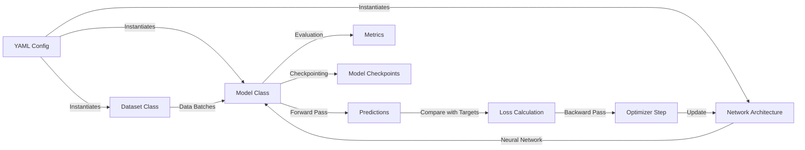

Sources: [physiopro/dataset/__init__.py](physiopro/dataset/__init__.py), [physiopro/model/__init__.py](physiopro/model/__init__.py), [physiopro/network/__init__.py](physiopro/network/__init__.py)

## Registry Pattern

PhysioPro uses a registry pattern for component management. Each core component type (Dataset, Network, Model) has an associated registry that enables dynamic component selection via configuration.

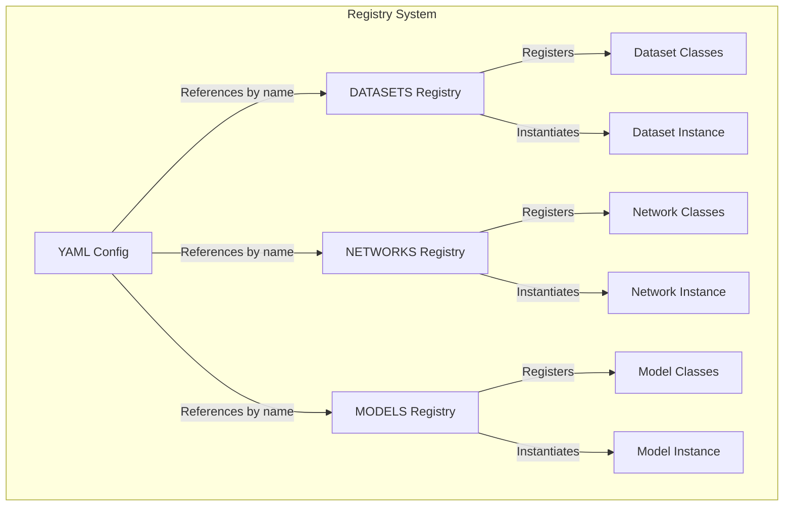

Sources: [physiopro/dataset/__init__.py:4](physiopro/dataset/__init__.py:4), [physiopro/model/__init__.py:1](physiopro/model/__init__.py:1), [physiopro/network/__init__.py:1](physiopro/network/__init__.py:1)

## Specialized Components

Two key specialized components in PhysioPro deserve special attention:

1. **MMM_Encoder**: A specialized architecture for processing EEG data that preserves topological relationships between channels.

2. **ContiFormer**: A continuous-time transformer that handles irregularly sampled time series through ODE-based components.

For detailed information about these specialized components, see [MMM_Encoder](#2.2.1) and [ContiFormer](#2.2.2).

## Summary

PhysioPro's core components provide a flexible, modular framework for physiological data analysis:

- **Dataset System**: Handles data loading and preprocessing
- **Network Architectures**: Provide specialized neural networks for time series
- **Model System**: Manages the training and evaluation process

Each component type follows a consistent organization with:
- A registry for dynamic component selection
- A base class defining common functionality
- Specialized implementations for specific data types and tasks

For more detailed information about specific components, refer to their dedicated documentation pages:
- [Dataset System](#2.1)
- [Network Architectures](#2.2)
- [Model System](#2.3)

---

# Page: Dataset System

# Dataset System

<details>
<summary>Relevant source files</summary>

The following files were used as context for generating this wiki page:

- [physiopro/dataset/__init__.py](physiopro/dataset/__init__.py)

</details>


## Purpose and Scope

The Dataset System in PhysioPro is responsible for loading, preprocessing, and providing structured access to various types of physiological time series data. This component serves as the foundation for all data operations within the framework, bridging raw data sources with the neural network and model components.

This document covers the dataset class hierarchy, available dataset implementations, and how to use them in the training pipeline. For information about the network architectures that consume this data, see [Network Architectures](#2.2). For details on how models use these datasets, see [Model System](#2.3).

Sources: [physiopro/dataset/__init__.py:1-11]()

## Dataset Registry and Hierarchy

PhysioPro implements a registry pattern for datasets through the `DATASETS` registry. This allows for dynamic registration and instantiation of dataset classes based on configuration parameters.

```mermaid
classDiagram
    class "DATASETS" {
        <<Registry>>
        +register(name, cls)
        +get(name)
    }
    
    class "BaseDataset" {
        <<Abstract>>
        +__init__(args, kwargs)
        +__getitem__(idx)
        +__len__()
        +prepare_data()
        +setup()
    }
    
    class "TSDataset" {
        +__init__(args, kwargs)
        +__getitem__(idx)
        +preprocess()
    }
    
    class "DfDataset" {
        +__init__(args, kwargs)
        +__getitem__(idx)
        +load_dataframe()
    }
    
    class "EventDataset" {
        +__init__(args, kwargs)
        +__getitem__(idx)
        +process_events()
    }
    
    class "MaskTSDataset" {
        +__init__(args, kwargs)
        +__getitem__(idx)
        +apply_masking()
    }
    
    class "CinC2020" {
        +__init__(args, kwargs)
        +__getitem__(idx)
        +load_ecg_data()
    }
    
    class "SEED" {
        +__init__(args, kwargs)
        +__getitem__(idx) 
        +load_eeg_data()
    }
    
    DATASETS ..> BaseDataset : registers
    BaseDataset <|-- TSDataset
    BaseDataset <|-- DfDataset
    BaseDataset <|-- EventDataset
    TSDataset <|-- MaskTSDataset
    BaseDataset <|-- CinC2020
    BaseDataset <|-- SEED
```

The dataset system follows a hierarchical structure with a base class that defines common functionality, and specialized subclasses for different data types and sources. All dataset classes implement the PyTorch `Dataset` interface, making them compatible with PyTorch's `DataLoader`.

Sources: [physiopro/dataset/__init__.py:4-10]()

## Dataset Types

### Base Dataset

The `BaseDataset` serves as the abstract base class for all dataset implementations in PhysioPro. It defines the common interface and functionality that all datasets must implement.

### Time Series Datasets

#### TSDataset

The `TSDataset` class is designed for handling general time series data. It provides functionality for loading, preprocessing, and accessing time series data with consistent sampling.

#### MaskTSDataset

The `MaskTSDataset` extends `TSDataset` with capabilities for handling missing values in time series data. This is particularly useful for real-world physiological data where sensor readings may be incomplete or contain artifacts.

For more details on masked time series handling, see [Masked Time Series Dataset](#2.1.4).

### Specialized Datasets

#### DfDataset

The `DfDataset` class is optimized for loading and processing data from pandas DataFrames. It provides utilities for preprocessing tabular data and converting it to tensors for model consumption.

#### EventDataset

The `EventDataset` class is specifically designed for temporal point process modeling. It handles sequences of discrete events with timestamps, making it suitable for applications such as predicting medical events or sensor activations.

For more details on event sequence modeling, see [EventDataset for Temporal Point Processes](#2.1.2).

#### Domain-Specific Datasets

- **SEED**: Specialized for EEG-based emotion recognition using the SEED dataset. For more details, see [SEED Dataset](#2.1.1).
- **CinC2020**: Specialized for cardiac signal analysis using the CinC2020 dataset. For more details, see [CinC2020 Dataset](#2.1.3).

Sources: [physiopro/dataset/__init__.py:5-10]()

## Data Flow in PhysioPro

The diagram below shows how data flows through the Dataset System and interfaces with other components of PhysioPro:

```mermaid
flowchart LR
    subgraph "Raw Data Sources"
        RawTS["Time Series Files"]
        RawDF["Dataframes/CSVs"]
        RawEV["Event Sequences"]
        RawEEG["EEG Recordings"]
        RawECG["ECG Recordings"]
    end
    
    subgraph "Dataset System"
        BaseDS["BaseDataset"]
        
        subgraph "Generic Datasets"
            TS["TSDataset"]
            DF["DfDataset"]
            EV["EventDataset"]
            MTS["MaskTSDataset"]
        end
        
        subgraph "Domain Datasets"
            SEED["SEED"]
            CinC["CinC2020"]
        end
        
        Registry["DATASETS Registry"]
    end
    
    subgraph "Training Pipeline"
        DL["DataLoader"]
        Batch["Batched Tensors"]
        Model["Models"]
    end
    
    RawTS --> TS
    RawDF --> DF
    RawEV --> EV
    RawEEG --> SEED
    RawECG --> CinC
    TS --> MTS
    
    BaseDS --- TS
    BaseDS --- DF
    BaseDS --- EV
    BaseDS --- SEED
    BaseDS --- CinC
    
    Registry --- BaseDS
    
    TS --> DL
    DF --> DL
    EV --> DL
    MTS --> DL
    SEED --> DL
    CinC --> DL
    
    DL --> Batch
    Batch --> Model
```

Sources: [physiopro/dataset/__init__.py:4-10]()

## Common Usage Patterns

### Dataset Instantiation

Datasets in PhysioPro are typically instantiated through the `DATASETS` registry using configuration parameters. The general pattern is:

```python
# Example usage (not actual code)
dataset = DATASETS.get(dataset_type)(
    data_path=path_to_data,
    **dataset_params
)
```

### Data Loading

Once a dataset is instantiated, it can be used with PyTorch's `DataLoader` for efficient batch processing:

```python
# Example usage (not actual code)
from torch.utils.data import DataLoader

dataloader = DataLoader(
    dataset,
    batch_size=32,
    shuffle=True,
    num_workers=4
)

for batch in dataloader:
    # Process batch
```

## Integration with Training Pipeline

The Dataset System integrates with the Model System through PyTorch's DataLoader. The typical workflow is:

1. Dataset configuration in YAML files
2. Dataset instantiation through the registry
3. DataLoader creation
4. Batch iteration during model training

```mermaid
sequenceDiagram
    participant Config as "Configuration YAML"
    participant Registry as "DATASETS Registry"
    participant Dataset as "Dataset Instance"
    participant DataLoader as "PyTorch DataLoader"
    participant Model as "PhysioPro Model"
    
    Config->>Registry: Specify dataset type
    Registry->>Dataset: Instantiate dataset
    Config->>Dataset: Set dataset parameters
    Dataset->>Dataset: Load and preprocess data
    Config->>DataLoader: Set batch size, etc.
    DataLoader->>Dataset: Request samples
    Dataset->>DataLoader: Return processed samples
    DataLoader->>Model: Provide batches
    Model->>Model: Train on batches
```

During training, models access the data through a consistent interface regardless of the underlying dataset implementation. This design enables seamless switching between different dataset types and sources.

## Dataset Configuration Parameters

Common configuration parameters for datasets include:

| Parameter | Description | Applicable Datasets |
|-----------|-------------|---------------------|
| `data_path` | Path to the raw data files | All |
| `split` | Data split (train/val/test) | All |
| `transform` | Data transformations to apply | All |
| `target_transform` | Target transformations to apply | All |
| `window_size` | Size of the time window for processing | TSDataset, MaskTSDataset |
| `stride` | Stride for windowing | TSDataset, MaskTSDataset |
| `mask_ratio` | Ratio of values to mask | MaskTSDataset |
| `event_types` | Types of events to include | EventDataset |
| `channels` | EEG/ECG channels to include | SEED, CinC2020 |

The specific parameters vary by dataset type and are documented in the respective dataset class implementations.

## Summary

The Dataset System in PhysioPro provides a flexible and extensible framework for handling various types of physiological data. The hierarchical design with a common base class and specialized implementations allows for consistent interfaces while accommodating the unique requirements of different data types and sources.

For domain-specific dataset implementations, refer to the dedicated documentation pages:
- [SEED Dataset](#2.1.1) for EEG-based emotion recognition
- [EventDataset for Temporal Point Processes](#2.1.2) for event sequence data
- [CinC2020 Dataset](#2.1.3) for cardiac signal analysis
- [Masked Time Series Dataset](#2.1.4) for time series with missing values

Sources: [physiopro/dataset/__init__.py:4-10]()

---

# Page: SEED Dataset

# SEED Dataset

<details>
<summary>Relevant source files</summary>

The following files were used as context for generating this wiki page:

- [physiopro/dataset/SEED.py](physiopro/dataset/SEED.py)
- [physiopro/network/mmm_encoder.py](physiopro/network/mmm_encoder.py)
- [physiopro/network/utils.py](physiopro/network/utils.py)
- [scripts/SEED_DE.py](scripts/SEED_DE.py)

</details>


## Purpose and Overview

The SEED (SJTU Emotion EEG Dataset) dataset implementation in PhysioPro provides EEG-based emotion recognition capabilities to the framework. This module handles loading, preprocessing, and structuring of EEG data with differential entropy features for deep learning tasks. The SEED dataset contains EEG recordings of subjects watching emotional film clips, with signals labeled for three emotional states: negative, neutral, and positive.

For information about other dataset implementations, see [Dataset System](#2.1).

Sources: [physiopro/dataset/SEED.py:1-13]()

## Dataset Structure

The SEED dataset in PhysioPro uses differential entropy (DE) features extracted from EEG signals. These features have been preprocessed from the raw SEED dataset using a conversion script.

```mermaid
flowchart TD
    subgraph "Data Organization"
        raw["Raw SEED Dataset"]
        conv["Conversion Script\nscripts/SEED_DE.py"]
        de["DE Features"]
        seed["SEED Dataset Class"]
        
        raw --> conv
        conv --> de
        de --> seed
    end
    
    subgraph "Data Dimensions"
        data["Data Structure\n(N, C, F)"]
        chan["62 EEG Channels"]
        freq["5 Frequency Bands"]
        lab["3 Emotion Classes\n(0, 1, 2)"]
        
        data --> chan
        data --> freq
        seed --> data
        seed --> lab
    end
```

Sources: [physiopro/dataset/SEED.py:40-53](), [scripts/SEED_DE.py:1-38]()

### Key Components

The SEED dataset implementation includes:

1. **DE Features**: Differential Entropy features are used as input representations for the EEG signals
2. **62 EEG Channels**: The dataset processes 62 EEG channel recordings
3. **5 Frequency Bands**: Each channel contains data for 5 different frequency bands
4. **3-class Labels**: The dataset is labeled for three emotional states (negative, neutral, positive)
5. **Spatial Information**: 3D coordinates of EEG channels and functional brain regions

Sources: [physiopro/dataset/SEED.py:36-53](), [physiopro/dataset/SEED.py:165-189]()

## Data Preparation and Conversion

The raw SEED dataset must be converted to a format compatible with PhysioPro. This is done through the `scripts/SEED_DE.py` script which:

1. Loads the original MAT files from the SEED dataset
2. Extracts the DE features and labels
3. Restructures the data into the required format
4. Saves the processed data as DE feature files

```mermaid
sequenceDiagram
    participant "Raw SEED" as raw
    participant "Conversion Script" as script
    participant "PhysioPro Format" as physio
    
    Note over raw: MAT files with LDS features
    raw->>script: Load raw data
    script->>script: Extract DE features
    script->>script: Process data for each subject
    script->>script: Restructure dimensions
    script->>physio: Save as DE_*.mat files
    Note over physio: Compatible format for SEED class
```

Sources: [scripts/SEED_DE.py:7-37]()

## SEED Dataset Class Implementation

The `SEED` class inherits from PyTorch's `Dataset` and is registered in the PhysioPro dataset registry using the `@DATASETS.register_module()` decorator, making it available through the configuration system.

### Initialization Parameters

| Parameter | Type | Default | Description |
|-----------|------|---------|-------------|
| prefix | str | "/dataset" | Base directory where dataset is stored |
| name | str | "DE" | Folder name where DE features are stored |
| window_size | int | 1 | Size of the temporal window for sequence processing |
| tempo | bool | False | Whether to use temporal windows |
| subject_index | Optional[int] | -1 | Subject index to use (-1 for all subjects) |
| dataset_name | Optional[str] | None | "train" or "valid" to specify the split |
| normalize | str | "gaussian" | Normalization method ("minmax" or "gaussian") |
| region | int | 17 | Number of functional brain regions |

Sources: [physiopro/dataset/SEED.py:13-23]()

### Data Loading and Processing

The dataset class performs several key operations during initialization:

1. **Data Loading**: Loads DE features from MAT files
2. **Normalization**: Applies Gaussian standardization or min-max normalization
3. **Data Splitting**: Splits data into training (2010 samples) and validation (1384 samples) sets
4. **Channel Reordering**: Reorders channels by functional brain regions
5. **Spatial Information**: Extracts 3D coordinates of EEG channels
6. **Attention Masking**: Creates an attention mask for the MMM_Encoder

```mermaid
flowchart TD
    subgraph "SEED Class Initialization"
        init["__init__()"]
        load["Load DE Features"]
        norm["_normalize()"]
        split["_split()"]
        tempo["_addtimewindow()"]
        coord["get_coordination()"]
        
        init --> load
        load --> norm
        norm --> split
        split --> |"if tempo=True"| tempo
        split --> coord
    end
    
    subgraph "Outputs"
        data["self.data\n(N, C, F) or (N, C, T, F)"]
        label["self.label"]
        mask["self.attn_mask"]
        coords["self.coordination"]
        funcs["self.func_areas"]
        
        coord --> mask
        coord --> coords
        coord --> funcs
    end
```

Sources: [physiopro/dataset/SEED.py:30-80](), [physiopro/dataset/SEED.py:82-156](), [physiopro/dataset/SEED.py:157-218]()

## Functional Brain Regions and Attention Mask

A key feature of the SEED dataset implementation is its organization of the 62 EEG channels into 17 functional brain regions. This organization is critical for the topological processing in the MMM_Encoder.

### Channel Organization

The 62 EEG channels are arranged into 17 functional areas, with each area containing channels that are spatially and functionally related. This organization is defined in the `get_coordination()` method:

```
func_areas = [[0,1,2,3,4],[5,6,7],...,[59,60,61]]
```

Sources: [physiopro/dataset/SEED.py:159-162]()

### Attention Mask

The dataset creates an attention mask that defines which nodes can attend to each other in the MMM_Encoder's self-attention mechanism:

```mermaid
flowchart TD
    subgraph "Attention Mask Structure"
        chans["62 EEG Channels"]
        regions["17 Functional Regions\n(Supernodes)"]
        cls["Class Token"]
        
        chans <--> chans
        regions <--> regions
        chans <--> |"within same\nfunctional area"| regions
        cls <--> chans
        cls <--> regions
    end
```

The attention mask is a boolean tensor where:
- `True` indicates the position is not allowed to attend
- `False` indicates the position is allowed to attend

The mask enables:
1. All channels to attend to each other
2. All supernodes (functional regions) to attend to each other
3. Each supernode to attend to channels in its functional area
4. The class token to attend to all channels and supernodes

Sources: [physiopro/dataset/SEED.py:191-214]()

## Integration with MMM_Encoder

The SEED dataset is designed to work seamlessly with the MMM_Encoder architecture for EEG emotion recognition. The dataset provides:

1. **Spatial Coordinates**: 3D coordinates for EEG channels used for positional encoding
2. **Attention Mask**: Defines the topology-aware attention patterns in the MMM_Encoder
3. **Functional Regions**: Groups channels into brain regions for hierarchical processing

```mermaid
flowchart LR
    subgraph "SEED Dataset"
        data["DE Features\n(N, C, F)"]
        coords["3D Coordinates"]
        mask["Attention Mask"]
        regions["Functional Regions"]
    end
    
    subgraph "MMM_Encoder"
        pe["Positional Encoding"]
        attn["Self-Attention"]
        cls["CLS Token"]
    end
    
    data --> MMM_Encoder
    coords --> pe
    mask --> attn
    regions --> attn
```

The MMM_Encoder uses the SEED dataset's data and metadata to create topology-aware EEG representations that capture both channel interactions and functional region relationships.

Sources: [physiopro/dataset/SEED.py:218-225](), [physiopro/network/mmm_encoder.py:13-96]()

## Data Access and Sample Format

The dataset returns tuples of (data, label) when indexed, with data being a tensor of shape:
- `(C, F)` when `tempo=False` (C=channels, F=frequency bands)
- `(C, T, F)` when `tempo=True` (T=time window)

Labels are integer tensors with values 0, 1, or 2 representing negative, neutral, and positive emotions respectively.

Sources: [physiopro/dataset/SEED.py:225-235]()

## Usage Example

To use the SEED dataset in PhysioPro:

```python
from physiopro.dataset import DATASETS

# Initialize the dataset
dataset = DATASETS.build(dict(
    type="SEED",
    prefix="/path/to/data",
    dataset_name="train",
    normalize="gaussian",
    tempo=False
))

# Create a DataLoader
from torch.utils.data import DataLoader
dataloader = DataLoader(dataset, batch_size=32, shuffle=True)

# Access data
for data, labels in dataloader:
    # data shape: [batch_size, 62, 5] or [batch_size, 62, window_size, 5]
    # labels shape: [batch_size]
    ...
```

For more information on how to use this dataset for emotion recognition tasks, see [Emotion Recognition with MMM](#3.1).

---

# Page: EventDataset for Temporal Point Processes

# EventDataset for Temporal Point Processes

<details>
<summary>Relevant source files</summary>

The following files were used as context for generating this wiki page:

- [physiopro/dataset/tpp.py](physiopro/dataset/tpp.py)

</details>


## Purpose and Scope

The `EventDataset` class provides functionality for loading, processing, and batching temporal point process (TPP) data within the PhysioPro framework. This dataset class is specifically designed to handle event sequences where each event has an associated timestamp and type, making it ideal for modeling event occurrence patterns over time.

For information about other dataset types available in PhysioPro, see the main [Dataset System](#2.1) documentation.

Sources: [physiopro/dataset/tpp.py:14-15]()

## Overview of Temporal Point Process Data

Temporal point processes model discrete events occurring in continuous time. In the `EventDataset` implementation, each data instance is represented as a sequence of events with the following properties:

- Absolute time since the start of the sequence
- Time gap since the previous event
- Event type (category)

```mermaid
graph LR
    subgraph "Event Stream Structure"
        E1["Event 1"] --> E2["Event 2"] --> E3["Event 3"] --> E4["..."]
        
        subgraph "Per Event Data"
            TS["time_since_start"] 
            TG["time_since_last_event"]
            ET["type_event"]
        end
    end
```

Sources: [physiopro/dataset/tpp.py:43-46]()

## Class Architecture

The `EventDataset` class inherits from the `BaseDataset` class and is registered in the DATASETS registry module under the identifier "tpp".

```mermaid
classDiagram
    BaseDataset <|-- EventDataset
    
    class BaseDataset {
        +preprocessor
        +__init__(preprocessor)
    }
    
    class EventDataset {
        +PAD: int = 0
        +time: list
        +time_gap: list
        +event_type: list
        +num_types: int
        +max_len: int
        +length: int
        
        +__init__(prefix, name, fold, dataset, preprocessor, max_len, clip_max)
        +__len__()
        +__getitem__(idx)
        +collate_fn(insts)
        +pad_time(insts)
        +pad_type(insts)
        
        +num_classes: property
        +max_seq_len: property
        +num_variables: property
    }
```

Sources: [physiopro/dataset/tpp.py:14-15](), [physiopro/dataset/tpp.py:19-28]()

## Data Loading and Processing

The `EventDataset` loads event sequence data from pickle files with a specific structure and processes them for use in training temporal point process models.

```mermaid
flowchart TD
    A["Pickle File\n(.pkl)"] --> B["Load Data"]
    B --> C["Extract Event Properties"]
    C --> D["Process Time Information"]
    C --> E["Process Event Types"]
    
    subgraph "Dataset Instance"
        D --> F["self.time\nself.time_gap"]
        E --> G["self.event_type"]
    end
    
    H["Dataset Access"] --> I["__getitem__(idx)"]
    I --> J["Return time, time_gap, event_type"]
    
    K["Batch Creation"] --> L["collate_fn(insts)"]
    L --> M["Pad Sequences"]
    M --> N["Return Tensor Batch"]
```

Sources: [physiopro/dataset/tpp.py:35-55](), [physiopro/dataset/tpp.py:72-74](), [physiopro/dataset/tpp.py:96-102]()

## Constructor Parameters

The `EventDataset` constructor accepts several parameters to configure the dataset:

| Parameter | Type | Default | Description |
|-----------|------|---------|-------------|
| `prefix` | str | "data/temporal_point_process" | Base directory path |
| `name` | str | "Neonate" | Dataset name |
| `fold` | str | "folder1" | Dataset fold |
| `dataset` | str | "train" | Dataset split (must be 'train' or 'test') |
| `preprocessor` | Preprocessor | None | Optional data preprocessor |
| `max_len` | int | 500 | Maximum sequence length |
| `clip_max` | int | -1 | Maximum time gap value (-1 means no clipping) |

Sources: [physiopro/dataset/tpp.py:19-28]()

## Data Structure Details

The `EventDataset` loads and processes event data with the following structure:

1. **Time Information**:
   - `time`: List of absolute timestamps since the start of the sequence
   - `time_gap`: List of time gaps between consecutive events

2. **Event Type Information**:
   - `event_type`: List of event type identifiers (incremented by 1 since 0 is reserved for padding)

3. **Data Organization**:
   - Each instance is a list of events
   - Each event has associated time and type information
   - Sequences with only one event are filtered out

Sources: [physiopro/dataset/tpp.py:47-54]()

## Special Handling Features

### Padding Mechanism

For batch processing, sequences need to be padded to equal length. The `EventDataset` uses two static methods for padding:

- `pad_time`: Pads time-related sequences with zeros
- `pad_type`: Pads event type sequences with zeros (the `PAD` constant)

```mermaid
graph LR
    subgraph "Original Sequences (Variable Length)"
        O1["Seq 1: [1, 2, 3, 4]"]
        O2["Seq 2: [5, 6]"]
        O3["Seq 3: [7, 8, 9]"]
    end
    
    subgraph "After Padding (Fixed Length = 4)"
        P1["Seq 1: [1, 2, 3, 4]"]
        P2["Seq 2: [5, 6, 0, 0]"]
        P3["Seq 3: [7, 8, 9, 0]"]
    end
    
    O1 --> P1
    O2 --> P2
    O3 --> P3
```

Sources: [physiopro/dataset/tpp.py:76-94]()

### Time Clipping

The dataset can optionally clip time gaps to a maximum value to prevent extremely large gaps from skewing the model:

- If `clip_max` is set to a positive value, all time gaps larger than this value are clipped
- If `clip_max` is -1 (default), no clipping is performed

Sources: [physiopro/dataset/tpp.py:48-52]()

## Batch Creation Process

The `collate_fn` method handles the creation of batches from multiple event sequences:

1. Unzip the time, time_gap, and event_type from individual instances
2. Pad each sequence type to the maximum length in the batch
3. Convert the padded sequences to PyTorch tensors
4. Return a tuple of (time, time_gap, event_type) tensors

```mermaid
sequenceDiagram
    participant Dataloader
    participant EventDataset
    participant pad_time
    participant pad_type
    
    Dataloader->>EventDataset: call collate_fn(batch_instances)
    EventDataset->>EventDataset: unzip instances into time, time_gap, event_type
    EventDataset->>pad_time: pad time sequences
    pad_time->>EventDataset: return padded time tensor
    EventDataset->>pad_time: pad time_gap sequences
    pad_time->>EventDataset: return padded time_gap tensor
    EventDataset->>pad_type: pad event_type sequences
    pad_type->>EventDataset: return padded event_type tensor
    EventDataset->>Dataloader: return (time, time_gap, event_type) tensors
```

Sources: [physiopro/dataset/tpp.py:96-102]()

## Integration with PhysioPro

The `EventDataset` class serves as the foundation for training temporal point process models in PhysioPro. It integrates with other components as follows:

```mermaid
graph TD
    ED["EventDataset (tpp.py)"] --> DL["PyTorch DataLoader"]
    DL --> TPP["TPP Model"]
    TPP --> TRAIN["Training Pipeline"]
    
    subgraph "Data Flow"
        IN["Raw Event Data (.pkl)"]
        --> ED
        --> BATCH["Batched Tensor Data"]
        --> TPP
    end
```

For a complete tutorial on event prediction using `EventDataset`, see the [Temporal Point Process Modeling](#3.3) guide.

Sources: [physiopro/dataset/tpp.py:14-15]()

## Properties and Accessors

The `EventDataset` class provides several properties for accessing dataset information:

- `num_classes`: Returns the number of event types (equal to `num_types`)
- `max_seq_len`: Returns the maximum allowed sequence length
- `num_variables`: Returns None (not applicable for event data)

The `__getitem__` method returns a tuple of (time, time_gap, event_type) for a specific event sequence.

Sources: [physiopro/dataset/tpp.py:57-74]()

## Usage Example

The `EventDataset` is typically instantiated through the configuration system and used with a PyTorch DataLoader. The collate_fn method ensures proper batching of variable-length event sequences.

When accessing data from the dataset:
1. Each call to `__getitem__` returns a tuple of (time, time_gap, event_type) for an event sequence
2. The `collate_fn` method automatically handles padding and tensor conversion when used with a DataLoader

Sources: [physiopro/dataset/tpp.py:96-102]()

---

# Page: CinC2020 Dataset

# CinC2020 Dataset

<details>
<summary>Relevant source files</summary>

The following files were used as context for generating this wiki page:

- [docs/cinc2020.md](docs/cinc2020.md)
- [docs/configs/cinc2020.yml](docs/configs/cinc2020.yml)
- [physiopro/dataset/cinc2020.py](physiopro/dataset/cinc2020.py)
- [physiopro/model/cinc2020.py](physiopro/model/cinc2020.py)

</details>


This document provides a comprehensive overview of the CinC2020 dataset implementation in PhysioPro. It covers the dataset structure, preprocessing pipeline, integration with models, and configuration details for working with 12-lead ECG classification data from the PhysioNet/Computing in Cardiology Challenge 2020. For information about using this dataset in training, see [Use Cases and Tutorials](#3).

## Dataset Purpose and Origin

The CinC2020 dataset is an implementation for processing and analyzing data from the PhysioNet/Computing in Cardiology Challenge 2020, which focused on classification of 12-lead ECGs. The implementation is based on the solution from the 1st ranked team "Prna" in the challenge, as described in their paper "A Wide and Deep Transformer Neural Network for 12-Lead ECG Classification".

The dataset provides functionality for loading, preprocessing, and feature extraction from ECG signals, with support for both the raw waveform data and pre-extracted features.

Sources: [physiopro/dataset/cinc2020.py:17-24]()

## Dataset Structure

```mermaid
graph TD
    subgraph "CinC2020 Dataset Components"
        ECG["ECG Data (.mat files)"] --> HDR["Header Files (.hea)"]
        ECG --> RAW["Raw 12-lead ECG Signals"]
        HDR --> META["Metadata (Age, Gender)"]
        FEAT["Pre-computed Features"] --> TOP["Top Features"]
        RAW --> PROC["Processed Signals"]
        PROC --> NORM["Normalized Signals"]
        META --> DEMO["Demographic Features"]
        
        NORM --> INPUT["Model Input"]
        TOP --> INPUT
        DEMO --> INPUT
    end
```

The CinC2020 dataset consists of:

1. **ECG Signals**: 12-lead ECG recordings stored in .mat files
2. **Header Files**: Metadata stored in .hea files including demographic information
3. **Features**: Pre-computed features derived from the ECG signals
4. **Labels**: 27 different cardiac abnormality classes

Sources: [physiopro/dataset/cinc2020.py:25-40](), [physiopro/dataset/cinc2020.py:81-87]()

## Implementation Details

The dataset is implemented as the `CinC2020` class in PhysioPro, registered in the DATASETS registry for seamless integration with the framework.

```mermaid
classDiagram
    BaseDataset <|-- CinC2020
    CinC2020 : +__init__(data_folder, meta_path, etc.)
    CinC2020 : +__getitem__(idx)
    CinC2020 : +__len__()
    CinC2020 : +load_challenge_data(header_file)
    CinC2020 : +normalize(seq)
    CinC2020 : +apply_filter(signal, filter_bandwidth)
    CinC2020 : +get_age(hdr)
    CinC2020 : +extract_templates(signal, rpeaks)
    CinC2020 : +num_classes
    CinC2020 : +num_variables
```

The class inherits from `BaseDataset` and provides methods for loading, preprocessing, and accessing the ECG data.

Sources: [physiopro/dataset/cinc2020.py:17-18](), [physiopro/dataset/cinc2020.py:25-88]()

### Key Parameters

The dataset initialization accepts several parameters that control its behavior:

| Parameter | Description |
|-----------|-------------|
| `data_folder` | Path to folder containing ECG data files |
| `meta_path` | Path to CSV file with metadata |
| `featname_path` | Path to file with feature names |
| `feats_path` | Path to folder with pre-computed features |
| `test_fold` | Fold index for test set selection |
| `dataset` | Data split selection ("train", "test", or "valid") |
| `window` | Window size for ECG segments |
| `fs` | Target sampling frequency |
| `nb_windows` | Number of windows to sample per recording |
| `nb_feats` | Number of top features to use |
| `max_seq_len` | Maximum sequence length |

Sources: [physiopro/dataset/cinc2020.py:25-40]()

## Data Processing Pipeline

```mermaid
flowchart TD
    A["Load ECG & Header"] --> B["Resample to Target Frequency"]
    B --> C["Apply Bandpass Filter"]
    C --> D["Normalize Signal"]
    D --> E["Extract Segments"]
    
    F["Load Pre-computed Features"] --> G["Select Top Features"]
    G --> H["Replace NaNs/Infs"]
    H --> I["Normalize Features"]
    
    J["Extract Demographic Info"] --> K["Normalize Age & Gender"]
    
    E --> L["Final Input"]
    I --> L
    K --> L
```

The dataset performs several preprocessing steps:

1. **Loading**: Reads ECG signals from .mat files and headers from .hea files
2. **Resampling**: Adjusts the sampling rate to the target frequency (default 500Hz)
3. **Filtering**: Applies a bandpass filter (default 3-45Hz)
4. **Normalization**: Normalizes ECG signals to range [-1, 1]
5. **Feature Processing**: Normalizes pre-computed features using means and standard deviations
6. **Demographic Processing**: Normalizes age and encodes gender

Sources: [physiopro/dataset/cinc2020.py:90-132](), [physiopro/dataset/cinc2020.py:137-213]()

### Signal Loading and Resampling

The `load_challenge_data` method handles loading signals and adjusting their sampling rate:

```
1. Load signal from .mat file
2. Read header information
3. If sampling rate > target rate: decimate the signal
4. If sampling rate < target rate: resample the signal
```

Sources: [physiopro/dataset/cinc2020.py:137-150]()

### Signal Filtering and Normalization

```
1. Apply bandpass filter (typically 3-45Hz) using FIR filter
2. Normalize each channel to range [-1, 1]
```

Sources: [physiopro/dataset/cinc2020.py:152-154](), [physiopro/dataset/cinc2020.py:197-204]()

### Feature Processing

```
1. Load pre-computed features for the patient
2. Replace infinities with NaNs
3. Replace NaNs with feature means
4. Normalize features using pre-computed means and standard deviations
```

Sources: [physiopro/dataset/cinc2020.py:96-106]()

## Configuration and Usage

The CinC2020 dataset is configured using YAML files. Here's an example of how it's configured:

```yaml
data:
  type: CinC2020
  data_folder: data/CinC2020/training_data
  meta_path: data/CinC2020/records_stratified_10_folds_v2.csv
  feats_path: data/CinC2020/feats/
  featname_path: data/CinC2020/top_feats.npy
  test_fold: 3
```

This configuration specifies:
- The dataset type
- Paths to data files and folders
- Cross-validation fold settings

Sources: [docs/configs/cinc2020.yml:1-6]()

## Integration with Model

The CinC2020 dataset is designed to work with the `CinC2020` model class, which implements specialized metrics for the challenge.

```mermaid
flowchart LR
    subgraph "Dataset System"
        A["CinC2020 Dataset"] --> B["Data Loader"]
    end
    
    subgraph "Model System"
        C["CinC2020 Model"] --> D["DeepAndWide Network"]
        C --> E["Challenge Metrics"]
    end
    
    B --> C
```

The model includes custom evaluation metrics specific to the CinC2020 challenge:
1. `cinc2020_metric_valid`: Used during validation to find optimal thresholds
2. `cinc2020_metric_test`: Used during testing with the best threshold
3. `compute_cinc2020_metric_with_preds`: Core implementation of the challenge scoring metric

Sources: [physiopro/model/cinc2020.py:12-148]()

## Data Preparation

To prepare the CinC2020 dataset, the following steps are required:

1. Download the challenge data from PhysioNet
2. Download pre-computed features from the Prna solution
3. Set up the file structure as expected by the dataset class

A complete script for downloading and preparing the data is provided:

Sources: [docs/cinc2020.md:10-27]()

## Example Usage

To use the CinC2020 dataset for training a model:

1. Prepare the dataset as described above
2. Create a configuration file similar to the provided example
3. Run the training script:

```bash
python -m physiopro.entry.train docs/configs/cinc2020.yml
```

Sources: [docs/cinc2020.md:30-33]()

## Related Components

The CinC2020 dataset is typically used with:

1. **DeepAndWide Network**: A transformer-based architecture for ECG classification
2. **CinC2020 Model**: A specialized model class for the challenge metrics
3. **Multi-label Classification**: The challenge involves 27 different cardiac conditions

Sources: [docs/configs/cinc2020.yml:8-18](), [physiopro/model/cinc2020.py:12-13]()

---

# Page: Masked Time Series Dataset

# Masked Time Series Dataset

<details>
<summary>Relevant source files</summary>

The following files were used as context for generating this wiki page:

- [physiopro/dataset/maskts.py](physiopro/dataset/maskts.py)

</details>


## Purpose and Scope

The `MaskTSDataset` class is a specialized dataset component in PhysioPro designed for handling time series data with masked (missing) values. This dataset is particularly useful for:

1. Training models that can handle missing data in time series
2. Data augmentation through artificial masking
3. Implementing masked prediction tasks in self-supervised learning scenarios

For general time series processing without masking, see [Time Series Dataset System](#2.1).

Sources: [physiopro/dataset/maskts.py:14-21]()

## Position in the Dataset Hierarchy

`MaskTSDataset` extends the base time series dataset capabilities with masking functionality.

```mermaid
graph TD
    subgraph "Dataset Hierarchy"
        BD["BaseDataset"] --> TS["TSDataset"]
        TS --> MTS["MaskTSDataset"]
        
        BD --> ED["EventDataset"]
        BD --> DF["DfDataset"]
        BD --> CINC["CinC2020"]
        BD --> SEED["SEED"]
    end
    
    subgraph "Registry System"
        REG["DATASETS Registry"] -.-> BD
        REG -.-> TS
        REG -.-> MTS
        REG -.-> ED
        REG -.-> DF
        REG -.-> CINC
        REG -.-> SEED
    end
    
    style MTS fill:#f9f9f9,stroke:#333,stroke-width:2px
```

The `MaskTSDataset` is registered in the DATASETS registry with the identifier "mask_ts", allowing it to be instantiated through the configuration system.

Sources: [physiopro/dataset/maskts.py:15]()

## Architecture and Processing Flow

The following diagram illustrates how `MaskTSDataset` processes time series data:

```mermaid
flowchart LR
    subgraph "Input Processing"
        TS["Time Series Data"] --> L["Load Data"]
        L --> PP["Preprocess\n(Optional)"]
    end
    
    subgraph "Masking Operation"
        PP --> CT["Calculate Existing\nData Length"]
        CT --> RS["Random Sample\nIndices to Mask"]
        RS --> AP["Apply Masking\n(Set to NaN)"]
    end
    
    subgraph "Output"
        AP --> DL["DataLoader"]
        DL --> MD["Model Training"]
    end
```

The masking process in `MaskTSDataset` applies after standard preprocessing and involves:
1. Determining the available data points in each time series
2. Randomly selecting a subset of these points (based on `mask_ratio`)
3. Setting the selected points to NaN values

Sources: [physiopro/dataset/maskts.py:36-41]()

## Configuration Parameters

The `MaskTSDataset` accepts the following parameters:

| Parameter | Type | Default | Description |
|-----------|------|---------|-------------|
| `prefix` | str | "data/Multivariate_ts" | Base directory for dataset files |
| `name` | str | "Heartbeat" | Name of the dataset |
| `max_seq_len` | int | 0 | Maximum sequence length (0 = no limit) |
| `dataset` | str | "train" | Dataset split to use (train/val/test) |
| `dataset_split_ratio` | float | 0.0 | Custom split ratio if needed |
| `task` | str | "classification" | Task type (classification/regression) |
| `preprocessor` | Optional[Preprocessor] | None | Optional preprocessing module |
| `mask_ratio` | float | 0.3 | Proportion of data points to mask |

The unique parameter for `MaskTSDataset` is `mask_ratio`, which defines the fraction of time points to mask in each sequence.

Sources: [physiopro/dataset/maskts.py:21-31]()

## Masking Implementation Details

The masking procedure is implemented in the initialization method and happens after the base class initialization:

1. For each time series in the dataset, the code:
   - Calculates the actual length of available data (excluding already-null values)
   - Randomly selects indices to mask based on the `mask_ratio`
   - Sets the selected indices to `np.nan` in the feature dataframe

The implementation ensures that only valid data points are considered for masking, preventing masking of already-null values.

```
For each sample i:
  1. Calculate valid length = max_seq_len - count of existing NaN values
  2. Randomly select (valid_length * mask_ratio) indices from valid positions
  3. Set selected indices to NaN in the feature dataframe
```

Sources: [physiopro/dataset/maskts.py:36-41]()

## Usage in Model Training

When used with models designed to handle masked data, `MaskTSDataset` enables several training approaches:

1. **Missing Data Handling**: Training models to perform well despite missing values
2. **Data Imputation**: Training models to predict the missing values
3. **Self-Supervised Learning**: Using the masked values as training targets

This dataset particularly complements the `MaskTS` model in PhysioPro's model system (see [Time Series Models](#2.3.3)).

Sources: [physiopro/dataset/maskts.py:15-41]()

## Configuration Example

To use `MaskTSDataset` in a PhysioPro configuration file:

```yaml
dataset:
  type: mask_ts
  prefix: data/Multivariate_ts
  name: Heartbeat
  max_seq_len: 100
  dataset: train
  task: classification
  mask_ratio: 0.2  # 20% of points will be masked
  preprocessor:
    type: standard_scaler
```

This configuration creates a `MaskTSDataset` instance for the Heartbeat dataset with 20% of the valid time points randomly masked.

Sources: [physiopro/dataset/maskts.py:21-31]()

## Implementation Notes

- The masking is applied during dataset initialization, not dynamically during batch generation.
- The class uses NumPy's random sampling (`np.random.choice`) to ensure unbiased selection of points to mask.
- Masking is represented by NaN values, which need to be handled appropriately by subsequent model components.
- The implementation builds upon TSDataset's capabilities, only adding the masking functionality.

Sources: [physiopro/dataset/maskts.py:36-41]()

## Related Components

`MaskTSDataset` is designed to work with:

1. Time series neural network architectures in PhysioPro
2. The `MaskTS` model class, which handles masked prediction tasks
3. Preprocessing components through the optional `preprocessor` parameter

Together, these components provide a complete pipeline for working with incomplete or deliberately masked time series data.

Sources: [physiopro/dataset/maskts.py:15-41]()

---

# Page: Network Architectures

# Network Architectures

<details>
<summary>Relevant source files</summary>

The following files were used as context for generating this wiki page:

- [physiopro/network/__init__.py](physiopro/network/__init__.py)

</details>


This page provides an overview of neural network architectures in PhysioPro. These architectures form the core of the deep learning processing pipeline for physiological data analysis, particularly focusing on time series and EEG data. For detailed information about specific architectures, see [MMM_Encoder](#2.2.1), [ContiFormer](#2.2.2), and [Time Series Networks](#2.2.3).

## Network Architecture Overview

PhysioPro implements a variety of neural network architectures specialized for processing time series data, with a particular focus on physiological signals. The codebase organizes these architectures in a modular fashion, allowing easy selection and configuration of the appropriate network for different use cases.

```mermaid
graph TD
    subgraph "PhysioPro Network Architecture Hierarchy"
        NETWORKS["NETWORKS Registry"]
        NETWORKS --> TSRNN["TSRNN (Time Series RNN)"]
        NETWORKS --> TCN["TemporalConvNet (TCN)"]
        NETWORKS --> TST["TSTransformer"]
        NETWORKS --> CF["ContiFormer"]
        NETWORKS --> MME["MMM_Encoder"]
        NETWORKS --> DAW["DeepAndWide"]
    end

    classDef core fill:#f9f9f9,stroke:#333,stroke-width:1px;
    class NETWORKS,TSRNN,TCN,TST,CF,MME,DAW core;
```

Sources: [physiopro/network/__init__.py:1-6]()

## Network Categories

The network architectures in PhysioPro can be categorized into three main groups:

### 1. Basic Time Series Networks

These networks form the foundation for time series processing tasks:

- **TSRNN (Time Series RNN)**: Recurrent neural network variants (LSTM, GRU) optimized for time series data
- **TemporalConvNet (TCN)**: Convolutional architecture with causal convolutions for time series
- **TSTransformer**: Transformer-based architecture adapted for time series data

### 2. Advanced Architectures

Specialized architectures that represent the state-of-the-art in physiological signal processing:

- **ContiFormer**: Continuous-time transformer for handling irregularly sampled time series
- **MMM_Encoder**: Specialized encoder for EEG data that incorporates topology information

### 3. Task-Specific Networks

Networks designed for specific physiological data analysis tasks:

- **DeepAndWide**: Hybrid architecture used for the CinC2020 cardiac signal classification task

```mermaid
flowchart TD
    subgraph "Network Integration in PhysioPro"
        DS["Datasets"] -->|"Provides data"| NET["Network Architectures"]
        NET -->|"Forward pass"| MOD["Models"]
        CONF["Configuration System"] -->|"Configures"| NET
        NET -->|"Outputs"| MET["Metrics & Evaluation"]
    end

    subgraph "Network Implementation Details"
        NET --- TSNetworks["Time Series Networks\n(TSRNN, TCN, TSTransformer)"]
        NET --- AdvNetworks["Advanced Networks\n(ContiFormer, MMM_Encoder)"]
        NET --- SpecNetworks["Task-Specific Networks\n(DeepAndWide)"]
    end

    classDef core fill:#f9f9f9,stroke:#333,stroke-width:1px;
    class DS,NET,MOD,CONF,MET,TSNetworks,AdvNetworks,SpecNetworks core;
```

Sources: [physiopro/network/__init__.py:1-6]()

## Network Registration and Usage

All network architectures in PhysioPro are registered through a unified registry pattern, making them easily accessible throughout the codebase. The `NETWORKS` registry allows for dynamic network selection based on configuration parameters.

### Network Selection Flow

```mermaid
sequenceDiagram
    participant User
    participant Config as "Configuration File"
    participant Registry as "NETWORKS Registry"
    participant Network as "Network Architecture"
    participant Model as "Model Class"
    
    User->>Config: Define network_type
    Config->>Registry: Request network
    Registry->>Network: Instantiate architecture
    Network->>Model: Initialize within model
    Model->>User: Forward/backward passes
```

Sources: [physiopro/network/__init__.py:1-6]()

## Key Network Architectures

### TSRNN (Time Series RNN)

TSRNN provides RNN-based architectures (LSTM, GRU) optimized for processing time series data. This serves as a fundamental building block for many physiological signal processing tasks.

Key features:
- Support for various RNN cell types (LSTM, GRU)
- Configurable for different sequence lengths and input dimensions
- Bidirectional processing options

### TemporalConvNet (TCN)

The TCN architecture uses dilated causal convolutions to process time series data. This approach allows for efficient parallel processing while maintaining the ability to capture long-range dependencies.

Key features:
- Dilated causal convolutions
- Residual connections
- Configurable kernel sizes and dilation factors

### TSTransformer

TSTransformer adapts the transformer architecture for time series data, using self-attention mechanisms to capture dependencies across different time points.

Key features:
- Self-attention for temporal dependencies
- Positional encoding for sequence ordering
- Multi-head attention mechanism

### ContiFormer

ContiFormer is a continuous-time transformer designed to handle irregularly sampled time series data, which is common in physiological monitoring.

Key features:
- ODE-based continuous-time modeling
- Handles irregular sampling intervals
- Attention mechanisms across continuous time

### MMM_Encoder

MMM_Encoder is specialized for EEG data processing, incorporating spatial information about electrode placement and brain topology.

Key features:
- Topology-aware processing for EEG data
- Specialized positional encodings
- Designed for emotion recognition and related tasks

### DeepAndWide

DeepAndWide is a hybrid architecture combining "deep" neural network components with "wide" linear models, used specifically for the CinC2020 cardiac signal classification task.

Key features:
- Combines deep learning with linear models
- Specialized for cardiac signal processing
- Optimized for classification tasks

## Network Architecture Selection

The following table provides guidance on selecting the appropriate network architecture based on the task and data characteristics:

| Network Architecture | Ideal Use Case | Data Type | Key Strengths |
|----------------------|----------------|-----------|---------------|
| TSRNN | Sequential prediction with clear temporal dependencies | Regular time series | Effective for data with strong sequential patterns |
| TemporalConvNet | Parallelizable processing of time series | Regular time series | Efficient training, good for long sequences |
| TSTransformer | Complex pattern recognition in time series | Regular time series | Captures long-range dependencies well |
| ContiFormer | Analysis of irregularly sampled data | Irregular time series | Handles missing data and varying sampling rates |
| MMM_Encoder | EEG-based emotion recognition, brain state analysis | EEG data | Incorporates spatial electrode information |
| DeepAndWide | Cardiac signal classification | ECG data | Combines feature engineering with deep learning |

Sources: [physiopro/network/__init__.py:1-6]()

## Integration with Other Components

Network architectures in PhysioPro are designed to work seamlessly with the dataset and model systems. The typical flow involves:

1. A dataset providing preprocessed data
2. A network processing this data through its architecture
3. A model class orchestrating training, evaluation, and inference

```mermaid
graph LR
    subgraph "Component Integration"
        DS["Dataset Class\n(e.g., TSDataset)"] -->|"Batched Data"| NET["Network Architecture\n(e.g., ContiFormer)"]
        NET -->|"Network Output"| MOD["Model Class\n(e.g., BaseModel)"]
        MOD -->|"Predictions"| EVAL["Evaluation Metrics"]
    end

    subgraph "Configuration"
        CONF["YAML Configuration"] -->|"network_type"| NET
        CONF -->|"network_params"| NET
    end

    classDef core fill:#f9f9f9,stroke:#333,stroke-width:1px;
    class DS,NET,MOD,EVAL,CONF core;
```

Sources: [physiopro/network/__init__.py:1-6]()

## Summary

PhysioPro provides a comprehensive suite of network architectures optimized for physiological data processing. The architecture design emphasizes:

1. **Modularity**: Networks can be easily swapped based on task requirements
2. **Specialization**: Architectures tailored for specific types of physiological data
3. **Integration**: Seamless connection with dataset and model components

For specific implementation details of each architecture, refer to the dedicated pages:
- [MMM_Encoder](#2.2.1)
- [ContiFormer](#2.2.2)
- [Time Series Networks](#2.2.3)

---

# Page: MMM_Encoder

# MMM_Encoder

<details>
<summary>Relevant source files</summary>

The following files were used as context for generating this wiki page:

- [docs/MMM.md](docs/MMM.md)
- [physiopro/network/mmm_encoder.py](physiopro/network/mmm_encoder.py)
- [physiopro/network/utils.py](physiopro/network/utils.py)
- [scripts/SEED_DE.py](scripts/SEED_DE.py)

</details>


## Overview

The MMM_Encoder is a neural network architecture designed for processing electroencephalogram (EEG) data in PhysioPro. It implements a transformer-based encoder from the paper "Learning Topology-Agnostic EEG Representations with Geometry-Aware Modeling." The encoder specializes in understanding the spatial relationships between EEG channels through various positional encoding schemes, which makes it particularly effective for tasks like emotion recognition from EEG signals.

For information about other network architectures in PhysioPro, see [Network Architectures](#2.2). For specific details about using MMM_Encoder for emotion recognition tasks, see [Emotion Recognition with MMM](#3.1).

Sources: [physiopro/network/mmm_encoder.py:11-96](). [docs/MMM.md:1-37]().

## Architecture Overview

The MMM_Encoder follows a transformer-based architecture with specialized adaptations for EEG data. It processes multi-channel EEG data through a series of transformer blocks while incorporating geometry-aware positional encodings.

```mermaid
flowchart TD
    subgraph "MMM_Encoder Architecture"
        Input["EEG Input\n(batch_size, channel_num, in_chans)"] --> PatchEmbed["Patch Embedding\n(Linear Projection)"]
        PatchEmbed --> AddPosEmbed["Add Positional Embedding"]
        AddPosEmbed --> AddCLS["Append CLS Token"]
        AddCLS --> Transformer["Transformer Blocks"]
        Transformer --> Output["Output Embeddings"]
    end
    
    subgraph "Configuration Options"
        PE["Positional Encoding Types"] --> PE3D["3D Coordinates"]
        PE --> PE2D["2D Coordinates"]
        PE --> PESph["Spherical Coordinates"]
        PE --> PE1D["1D Sequential"]
    end
    
    PE -->|"configures"| AddPosEmbed
```

Sources: [physiopro/network/mmm_encoder.py:11-96]().

## Implementation Details

The MMM_Encoder is implemented as a PyTorch module registered in the PhysioPro framework's `NETWORKS` registry, allowing it to be easily configured and instantiated through YAML configuration.

```mermaid
classDiagram
    class MMM_Encoder {
        +int in_chans
        +int channel_num
        +int embed_dim
        +string pe_type
        +ndarray pe_coordination
        +Parameter attn_mask
        +Linear patch_embed
        +Parameter pos_embed
        +Parameter cls_token
        +ModuleList blocks
        +LayerNorm norm
        +LayerNorm fc_norm
        +initialize_weights()
        +_init_weights()
        +forward(x, head, region)
    }
    
    class Block {
        +LayerNorm norm1
        +MultiheadAttention attn
        +DropPath drop_path
        +LayerNorm norm2
        +Mlp mlp
        +forward(x, attn_mask)
    }
    
    MMM_Encoder --> Block : "contains multiple"
```

### Key Components

1. **Patch Embedding**: A linear projection layer that maps the input channels to the encoder's embedding dimension.
   ```python
   self.patch_embed = nn.Linear(in_chans, encoder_dim, bias=True)
   ```

2. **Positional Embedding**: Learnable positional embeddings initialized with sinusoidal patterns based on the provided spatial/positional information.
   ```python
   self.pos_embed = nn.Parameter(torch.zeros(self.channel_num + 1, encoder_dim), requires_grad=True)
   ```

3. **Class Token**: Similar to Vision Transformers, a learnable token is appended to the sequence for classification tasks.
   ```python
   self.cls_token = nn.parameter.Parameter(torch.zeros(1,1,encoder_dim))
   ```

4. **Transformer Blocks**: A sequence of transformer blocks that process the embedded sequence.
   ```python
   self.blocks = nn.ModuleList(
      Block(encoder_dim,num_heads,mlp_ratio=mlp_ratio,qkv_bias=True,
          norm_layer=norm_layer) for _ in range(depth))
   ```

Sources: [physiopro/network/mmm_encoder.py:12-96](). [physiopro/network/utils.py:277-298]().

## Initialization and Forward Pass

The MMM_Encoder follows a specific initialization process:

1. **Weight Initialization**: 
   - Positional embeddings are initialized based on the specified encoding type
   - Patch embedding weights are initialized using Xavier uniform initialization
   - Other linear layers and layer norms are initialized with standard approaches

2. **Forward Pass**:
   - Input data is projected through the patch_embed layer
   - Positional embeddings are added
   - The class token is appended to the sequence
   - The sequence is processed through transformer blocks
   - The output can be either the full sequence or just the class token (and region tokens if specified)

```mermaid
sequenceDiagram
    participant Input as "EEG Input"
    participant Encoder as "MMM_Encoder"
    participant Block as "Transformer Block"
    
    Input->>Encoder: x (batch_size, channel_num, in_chans)
    Encoder->>Encoder: patch_embed(x)
    Encoder->>Encoder: Add pos_embed
    Encoder->>Encoder: Append cls_token
    loop For each block in blocks
        Encoder->>Block: Forward pass
        Block->>Block: Self-attention with mask
        Block->>Block: MLP
        Block->>Encoder: Updated representations
    end
    Encoder->>Encoder: Select output tokens
    Encoder-->>Input: Return embeddings
```

Sources: [physiopro/network/mmm_encoder.py:51-84](). [physiopro/network/mmm_encoder.py:85-96]().

## Positional Encodings

A key feature of MMM_Encoder is its support for different types of positional encodings, which allow it to incorporate spatial information about EEG electrodes:

| Encoding Type | Description | Use Case |
|---------------|-------------|----------|
| 3D | Uses 3D coordinates (x,y,z) | For EEG data with precise 3D electrode positions |
| 2D | Uses 2D coordinates (x,y) | For topographic EEG representations |
| Spherical | Uses spherical coordinates (theta, phi) | For head-based spherical representations |
| 1D | Uses sequential positions | For when spatial information is unavailable |

The positional encoding is selected through the `pe_type` parameter and initialized using the provided `pe_coordination` coordinates.

Sources: [physiopro/network/mmm_encoder.py:52-66](). [physiopro/network/utils.py:6-126]().

## Usage in PhysioPro

The MMM_Encoder is designed to be used for EEG processing tasks, particularly emotion recognition with the SEED dataset. The following diagram illustrates its position in the PhysioPro framework and typical usage flow:

```mermaid
flowchart LR
    subgraph "Data Processing"
        SEED["SEED Dataset"] --> DEFeatures["DE Features Extraction"]
        DEFeatures --> Dataset["Dataset Class"]
    end
    
    subgraph "Model Pipeline"
        Dataset --> MMM["MMM_Encoder"] 
        MMM --> Finetune["MMM_Finetune Model"]
        Finetune --> Training["Training Loop"]
    end
    
    subgraph "Configuration"
        Config["YAML Config"] --> Dataset
        Config --> MMM
        Config --> Finetune
        Config --> Training
    end
    
    Training --> Evaluation["Evaluation Metrics"]
```

### Parameters and Configuration

When configuring the MMM_Encoder in a YAML configuration file, the following parameters can be specified:

| Parameter | Description | Default |
|-----------|-------------|---------|
| in_chans | Number of input features per channel | 5 |
| channel_num | Number of EEG channels | 79 |
| encoder_dim | Embedding dimension | 16 |
| depth | Number of transformer blocks | 6 |
| num_heads | Number of attention heads | 8 |
| mlp_ratio | Ratio for MLP hidden dimension | 4.0 |
| pe_type | Type of positional encoding | None |
| pe_coordination | Coordinates for positional encoding | None |

Sources: [docs/MMM.md:1-37](). [physiopro/network/mmm_encoder.py:12-34]().

## Example: Emotion Recognition with SEED Dataset

The MMM_Encoder is particularly useful for emotion recognition tasks using the SEED dataset. The workflow involves:

1. Preparing the SEED dataset by extracting DE (Differential Entropy) features
2. Configuring the MMM_Encoder with appropriate parameters
3. Using the MMM_Finetune model for training on emotion recognition tasks

This workflow is supported through:
- A script for converting SEED data to the required format
- Pre-configured YAML files for emotion recognition tasks
- Support for loading pre-trained checkpoints

Sources: [scripts/SEED_DE.py:7-37](). [docs/MMM.md:7-32]().

## Integration with PhysioPro

Within the PhysioPro framework, MMM_Encoder is part of the advanced network architectures, alongside ContiFormer. It integrates with other components:

```mermaid
graph TD
    subgraph "PhysioPro Framework"
        DS["Dataset System"] --> SEED["SEED Dataset"]
        NETW["Network System"] --> MMM["MMM_Encoder"]
        MOD["Model System"] --> MMF["MMM_Finetune"]
        
        SEED --> MMF
        MMM --> MMF
        
        CFG["Configuration System"] --> DS
        CFG --> NETW
        CFG --> MOD
    end
    
    subgraph "Network Registry"
        NETWORKS["NETWORKS Registry"]
        NETWORKS --> MMM
        NETWORKS --> CF["ContiFormer"]
        NETWORKS --> TSN["Time Series Networks"]
    end
```

The MMM_Encoder is registered in the NETWORKS registry through the `@NETWORKS.register_module()` decorator, making it available for use in configuration files. This allows flexible integration with different datasets and training pipelines within PhysioPro.

Sources: [physiopro/network/mmm_encoder.py:11](). [docs/MMM.md:1-37]().

---

# Page: ContiFormer

# ContiFormer

<details>
<summary>Relevant source files</summary>

The following files were used as context for generating this wiki page:

- [docs/contiformer.md](docs/contiformer.md)
- [physiopro/network/contiformer.py](physiopro/network/contiformer.py)

</details>


## Overview

ContiFormer is a continuous-time transformer architecture within PhysioPro designed specifically for modeling irregular time series data. It extends traditional transformer architectures by incorporating ordinary differential equation (ODE) components to handle irregularly sampled time points and continuous-time representations. For information about other time series networks available in PhysioPro, see [Time Series Networks](#2.2.3).

Sources: [physiopro/network/contiformer.py:243-315](). [docs/contiformer.md:1-4]()

## Architecture

### Architectural Overview

```mermaid
flowchart TD
    subgraph "ContiFormer Architecture"
        Input["Input Sequence"] --> Linear["Linear Projection"]
        Linear --> Encoder["Encoder"]
        
        subgraph "Encoder"
            TE["Temporal Encoding"] --> EL["Encoder Layers"]
            EL --> Output["Encoded Output"]
        end
        
        Encoder --> FinalOutput["Final Output"]
    end
    
    subgraph "EncoderLayer Components"
        SA["Self Attention"] --> PFF["Position-wise Feed Forward"]
    end
    
    subgraph "MultiHeadAttention Components"
        WQS["InterpLinear w_qs"] 
        WKS["ODELinear w_ks"]
        WVS["ODELinear w_vs"]
        ATT["ScaledDotProductAttention"]
    end
```

Sources: [physiopro/network/contiformer.py:243-333](), [physiopro/network/contiformer.py:167-200]()

### ContiFormer Components Hierarchy

```mermaid
classDiagram
    class ContiFormer {
        +linear: Linear
        +encoder: Encoder
        +forward(x, t, mask)
    }
    
    class Encoder {
        +position_vec: Tensor
        +layer_stack: ModuleList
        +temporal_enc(time)
        +forward(x, t, mask)
    }
    
    class EncoderLayer {
        +slf_attn: MultiHeadAttention
        +pos_ffn: PositionwiseFeedForward
        +forward(x, t, mask)
    }
    
    class MultiHeadAttention {
        +w_qs: InterpLinear
        +w_ks: ODELinear
        +w_vs: ODELinear
        +attention: ScaledDotProductAttention
        +forward(q, k, v, t, mask)
        +interpolate(q, k, v, t, qt, mask)
    }
    
    class PositionwiseFeedForward {
        +w_1: Linear
        +w_2: Linear
        +forward(x)
    }
    
    class ScaledDotProductAttention {
        +forward(q, k, v, mask)
        +interpolate(q, k, v, mask)
    }
    
    ContiFormer --> Encoder
    Encoder --> EncoderLayer
    EncoderLayer --> MultiHeadAttention
    EncoderLayer --> PositionwiseFeedForward
    MultiHeadAttention --> ScaledDotProductAttention
```

Sources: [physiopro/network/contiformer.py:20-333]()

## ODE-Based Components

ContiFormer achieves continuous-time modeling through special ODE-based linear layers that are used in its attention mechanism:

1. **InterpLinear** - Used for query projection in the attention mechanism
2. **ODELinear** - Used for key and value projections in the attention mechanism

These components enable ContiFormer to model irregularly sampled time series by incorporating time information directly into the attention mechanism. This approach allows the model to understand temporal relationships between data points regardless of their irregular sampling intervals.

```mermaid
flowchart LR
    subgraph "ODE-Based Projection Layers"
        X["Input Features"] --> WQS["InterpLinear w_qs"]
        X --> WKS["ODELinear w_ks"] 
        X --> WVS["ODELinear w_vs"]
        
        WQS --> Q["Query Projections"]
        WKS --> K["Key Projections"]
        WVS --> V["Value Projections"]
        
        Q & K & V --> ATT["Attention Mechanism"]
    end
```

Sources: [physiopro/network/contiformer.py:33-35](), [physiopro/network/contiformer.py:10]()

## Implementation Details

### Class Structure

The ContiFormer architecture is implemented as a PyTorch module registered in the NETWORKS registry, allowing it to be easily instantiated through configuration files. The main class is [`ContiFormer`](physiopro/network/contiformer.py:243-333), which contains an encoder and an optional linear projection layer.

Key components include:

| Component | Purpose |
|-----------|---------|
| Encoder | Processes input sequences through multiple encoder layers with self-attention |
| EncoderLayer | Combines self-attention and feed-forward networks |
| MultiHeadAttention | Implements multi-head attention with ODE-based projection |
| ScaledDotProductAttention | Performs scaled dot-product attention calculations |
| PositionwiseFeedForward | Implements position-wise feed-forward networks |

Sources: [physiopro/network/contiformer.py:20-333]()

### Key Parameters

ContiFormer has numerous configurable parameters that control its architecture and behavior:

| Parameter | Description | Default |
|-----------|-------------|---------|
| input_size | Dimension of input features | None |
| d_model | Dimension of model | 256 |
| d_inner | Dimension of inner feed-forward layer | 1024 |
| n_layers | Number of encoder layers | 4 |
| n_head | Number of attention heads | 4 |
| d_k | Dimension of key | 64 |
| d_v | Dimension of value | 64 |
| dropout | Dropout rate | 0.1 |
| actfn_ode | Activation function for ODE | "softplus" |
| method_ode | ODE solver method | "rk4" |
| add_pe | Whether to add positional encoding | False |
| max_length | Maximum sequence length | 100 |

Sources: [physiopro/network/contiformer.py:247-312]()

### ODE Configuration Options

The ODE-based components in ContiFormer offer several configuration options to control their behavior:

```python
args_ode = {
    "actfn": actfn_ode,            # Activation function for ODE
    "layer_type": layer_type_ode,  # Layer type for ODE
    "zero_init": zero_init_ode,    # Whether to initialize ODE weights as zero
    "atol": atol_ode,              # Absolute tolerance for ODE solver
    "rtol": rtol_ode,              # Relative tolerance for ODE solver
    "method": method_ode,          # ODE solver method (e.g., "rk4")
    "regularize": regularize,      # Whether to apply regularization
    "approximate_method": approximate_method,  # Approximation method
    "nlinspace": nlinspace,        # Number of points in linear space
    "linear_type": linear_type_ode,  # Linear type for ODE
    "interpolate": interpolate_ode,  # Interpolation method
    "itol": itol_ode,              # Interpolation tolerance
}
```

Sources: [physiopro/network/contiformer.py:275-289]()

## Forward Pass

During the forward pass, ContiFormer processes input sequences along with their corresponding time points:

1. If time points are not provided, regular time points are generated (`t = torch.linspace(0, 1, x.shape[1])`)
2. Input features are optionally projected through a linear layer
3. The encoder processes the inputs with temporal encoding
4. The output includes both the full sequence representation and the final hidden state

```mermaid
sequenceDiagram
    participant Input as "Input Features (x)"
    participant Time as "Time Points (t)"
    participant Linear as "Linear Projection (optional)"
    participant TempEnc as "Temporal Encoding"
    participant Encoder as "Encoder"
    participant Output as "Outputs"
    
    Input->>Linear: x
    Linear->>TempEnc: projected features
    Time->>TempEnc: t
    TempEnc->>Encoder: x + temporal_encoding(t)
    Encoder->>Output: enc_output, enc_output[:, -1, :]
```

Sources: [physiopro/network/contiformer.py:315-324]()

## Use Cases

ContiFormer excels in several time series analysis tasks:

### 1. Irregular Time Series Classification

ContiFormer's ability to handle irregularly sampled data makes it well-suited for classification tasks where observations are not uniformly spaced. This is achieved by passing explicit time stamps for each observation to the model.

Example configuration:
```bash
python -m physiopro.entry.train docs/configs/contiformer_mask_classification.yml --data.mask_ratio 0.3 --data.name Heartbeat
```

### 2. Regular Time Series Classification

For regularly sampled time series, ContiFormer can use evenly spaced time points or automatically generate them:

```bash
python -m physiopro.entry.train docs/configs/contiformer_classification.yml --data.name Heartbeat
```

### 3. Temporal Point Process Modeling

ContiFormer can model temporal point processes, which describe sequences of events occurring over time:

```bash
python -m physiopro.entry.train docs/configs/contiformer_tpp.yml
```

Sources: [docs/contiformer.md:5-63]()

## Integration with PhysioPro

ContiFormer is registered with the NETWORKS registry in PhysioPro using the `@NETWORKS.register_module("contiformer")` decorator, allowing it to be easily instantiated through configuration files.

```mermaid
flowchart TB
    subgraph "PhysioPro Network Hierarchy"
        NETWORKS["NETWORKS Registry"]
        NETWORKS --> NN["Neural Networks"]
        
        NN --> TSRNN["TSRNN"]
        NN --> TCN["TemporalConvNet"]
        NN --> TST["TSTransformer"]
        NN --> CF["ContiFormer"]
        NN --> MM["MMM_Encoder"]
        
        CF --> ODE["ODE-based Components"]
    end
```

In the PhysioPro framework, ContiFormer can be used with various datasets and models, particularly those dealing with irregularly sampled time series or event data. It integrates with:

1. **Dataset System** - Works with both regular and masked time series datasets
2. **Model System** - Can be used within various models for time series classification and event prediction
3. **Configuration System** - Instantiated and configured via YAML configuration files

Sources: [physiopro/network/contiformer.py:9](), [physiopro/network/contiformer.py:243-244]()

---

# Page: Time Series Networks

# Time Series Networks

<details>
<summary>Relevant source files</summary>

The following files were used as context for generating this wiki page:

- [physiopro/network/tcn.py](physiopro/network/tcn.py)
- [physiopro/network/tsrnn.py](physiopro/network/tsrnn.py)
- [physiopro/network/tstransformer.py](physiopro/network/tstransformer.py)

</details>


This document details the fundamental time series neural network architectures in PhysioPro. These networks serve as building blocks for processing sequential physiological data and are designed to handle various types of time series inputs. For information about advanced transformer-based architectures, see [ContiFormer](#2.2.2) and [MMM_Encoder](#2.2.1).

## Overview

PhysioPro implements three primary time series network architectures:

1. **TSRNN** - Recurrent Neural Network for time series data
2. **TCN** - Temporal Convolutional Network
3. **TSTransformer** - Transformer-based architecture for time series

All these networks are registered with the `NETWORKS` registry and share common interface patterns, making them interchangeable in model configurations.

```mermaid
graph TD
    subgraph "Time Series Network Architecture Components"
        Registry["NETWORKS Registry"]
        PosEmb["Position Embedding Module"]
        
        Registry --> TSRNN["TSRNN (RNN-based)"]
        Registry --> TCN["TCN (Convolutional)"]
        Registry --> TST["TSTransformer (Attention-based)"]
        
        PosEmb --> TSRNN
        PosEmb --> TCN
        PosEmb --> TST
    end
```

Sources: [physiopro/network/tsrnn.py:14-15](), [physiopro/network/tsrnn.py:18-19](), [physiopro/network/tcn.py:51-52](), [physiopro/network/tstransformer.py:32-33]()

## Common Architecture Elements

### Network Registry

All time series networks are registered using the `NETWORKS` registry, which allows them to be instantiated dynamically from configuration files:

```python
@NETWORKS.register_module()
class TSRNN(nn.Module):
    # Implementation
```

### Position Embedding

All three network architectures support positional embeddings through the `PositionEmbedding` module, which can be:
- **Static**: Fixed positional encodings
- **Learnable**: Trainable positional embeddings

### Common Interface

All networks implement a consistent interface with:
- A `forward()` method that returns both sequence outputs and a context vector
- `output_size` and `hidden_size` properties
- Support for loading pretrained weights

```mermaid
classDiagram
    class NetworkBase {
        +forward(inputs)
        +output_size
        +hidden_size
    }
    
    class TSRNN {
        +emb_dim
        +emb: PositionEmbedding
        +encoder
        +temporal_encoder: RNNCell
        +forward(inputs)
    }
    
    class TCN {
        +network: TemporalBlocks
        +emb: PositionEmbedding
        +forward(inputs)
    }
    
    class TSTransformer {
        +encoder
        +temporal_encoder: TransformerEncoder
        +emb: PositionEmbedding
        +is_bidir
        +use_last
        +forward(inputs)
    }
    
    NetworkBase <|-- TSRNN
    NetworkBase <|-- TCN
    NetworkBase <|-- TSTransformer
```

Sources: [physiopro/network/tsrnn.py:18-99](), [physiopro/network/tcn.py:51-115](), [physiopro/network/tstransformer.py:32-120]()

## TSRNN Architecture

TSRNN implements a recurrent neural network approach for time series data, supporting multiple RNN cell types.

### Key Features

- Support for different RNN cell types (LSTM, GRU, RNN)
- Optional bidirectional processing
- Optional input encoding layer
- Positional embeddings

### Implementation

```mermaid
flowchart TD
    Input["Input Time Series"] --> PosEmb["Position Embedding (Optional)"]
    PosEmb --> Encoder["Input Encoder (Optional)"]
    Encoder --> RNN["RNN Cell (LSTM/GRU/RNN)"]
    RNN --> Output["Sequence Outputs"]
    RNN --> Context["Context Vector (Last Hidden State)"]
```

The TSRNN network processes input data through these steps:
1. Optional position embedding if `emb_dim > 0`
2. Optional input encoding through a linear layer if `input_size` is provided
3. Processing through the recurrent cell (LSTM, GRU, or RNN)
4. Returning both the full sequence of outputs and the final hidden state

### Configuration Parameters

| Parameter | Description |
|-----------|-------------|
| `cell_type` | Type of RNN cell ("lstm", "gru", "rnn") |
| `emb_dim` | Embedding dimension (0 for no embedding) |
| `emb_type` | "static" or "learn" for position embedding |
| `hidden_size` | Hidden size of the RNN cell |
| `dropout` | Dropout rate |
| `num_layers` | Number of RNN layers |
| `is_bidir` | Whether to use bidirectional RNN |
| `max_length` | Maximum length of input sequence |
| `input_size` | Input size of time series data |
| `weight_file` | Path to pretrained weights |

Sources: [physiopro/network/tsrnn.py:18-99]()

## TCN Architecture (Temporal Convolutional Network)

TCN implements a temporal convolutional network based on dilated causal convolutions, following the architecture described in [Bai et al. (2018)](https://arxiv.org/abs/1803.01271).

### Key Features

- Dilated causal convolutions for capturing long-range dependencies
- Residual connections for better gradient flow
- Increasing receptive field with depth
- No information leakage from future to past

### Implementation

```mermaid
flowchart TD
    Input["Input Time Series"] --> PosEmb["Position Embedding (Optional)"]
    PosEmb --> TB1["Temporal Block 1\n(Dilation=1)"]
    TB1 --> TB2["Temporal Block 2\n(Dilation=2)"]
    TB2 --> TB3["Temporal Block 3\n(Dilation=4)"]
    TB3 --> TB4["Temporal Block N\n(Dilation=2^(N-1))"]
    TB4 --> Output["Sequence Outputs"]
    TB4 --> Last["Last Time Step"]
    
    subgraph "Temporal Block Structure"
        Conv1["Dilated Conv"] --> Chomp1["Chomp1d (Padding Removal)"]
        Chomp1 --> ReLU1["LeakyReLU"]
        ReLU1 --> Drop1["Dropout"]
        Drop1 --> Conv2["Dilated Conv"]
        Conv2 --> Chomp2["Chomp1d"]
        Chomp2 --> ReLU2["LeakyReLU"]
        ReLU2 --> Drop2["Dropout"]
        Input2["Block Input"] --> Downsample["Downsample (if needed)"]
        Drop2 --> Add(("+"))
        Downsample --> Add
        Add --> BlockOut["Block Output"]
    end
```

The TCN network processes input data through these steps:
1. Optional position embedding
2. Transpose input from (batch, seq_len, features) to (batch, features, seq_len) for 1D convolutions
3. Process through a sequence of Temporal Blocks with increasing dilation
4. Transpose back to original shape and return both sequence and final output

### TemporalBlock

Each TemporalBlock contains:
- Two dilated convolutional layers with weight normalization
- Chomp1d layers to ensure causal convolutions (no information from future)
- Residual connection with optional dimension matching
- LeakyReLU activations and dropout

### Configuration Parameters

| Parameter | Description |
|-----------|-------------|
| `num_channels` | List of channel numbers for each level |
| `position_embedding` | Whether to use position embedding |
| `emb_type` | Type of position embedding ("learn" or "static") |
| `kernel_size` | Kernel size of convolutional layers |
| `dropout` | Dropout rate |
| `max_length` | Maximum sequence length |
| `input_size` | Input feature dimension |
| `weight_file` | Path to pretrained weights |

### TemporalConvNetLayer

A simplified variant of TCN that uses a fixed channel size across all layers, configured by:
- `num_levels`: Number of temporal blocks
- `channel`: Number of channels in each block
- `dilation`: Base dilation factor (scales by dilation^i for layer i)

Sources: [physiopro/network/tcn.py:15-187]()

## TSTransformer Architecture

TSTransformer implements a transformer-based approach for time series data, utilizing self-attention mechanisms.

### Key Features

- Based on the transformer encoder architecture
- Support for causal attention (via masking) or bidirectional attention
- Multi-head self-attention
- Option to use the last output or average all outputs

### Implementation

```mermaid
flowchart TD
    Input["Input Time Series"] --> PosEmb["Position Embedding (Optional)"]
    PosEmb --> Encoder["Input Encoder (Optional)"]
    Encoder --> MaskGen["Generate Attention Mask\n(if not bidirectional)"]
    MaskGen --> TF["Transformer Encoder Layers"]
    TF --> All["All Sequence Outputs"]
    All --> ContextOut["Context Vector"]
    
    ContextOut -- use_last=True --> Last["Last Hidden State"]
    ContextOut -- use_last=False --> Mean["Mean Pooling"]
```

The TSTransformer processes input data through these steps:
1. Optional position embedding if `emb_dim > 0`
2. Optional input encoding if `input_size` is provided
3. Generate an attention mask (for causal attention) if not bidirectional
4. Process through transformer encoder layers
5. Output the full sequence and a context vector (either the last state or mean of all states)

### Attention Masking

The TSTransformer uses causal masking by default, ensuring each position can only attend to itself and earlier positions. When `is_bidir=True`, no masking is applied, allowing bidirectional attention.

### Configuration Parameters

| Parameter | Description |
|-----------|-------------|
| `emb_dim` | Embedding dimension (0 for no embedding) |
| `emb_type` | Type of position embedding |
| `hidden_size` | Hidden size of transformer layers |
| `dropout` | Dropout rate |
| `num_layers` | Number of transformer layers |
| `num_heads` | Number of attention heads |
| `is_bidir` | Whether to use bidirectional attention (no masking) |
| `use_last` | Whether to use last output (True) or mean pooling (False) |
| `max_length` | Maximum sequence length |
| `input_size` | Input feature dimension |
| `weight_file` | Path to pretrained weights |

Sources: [physiopro/network/tstransformer.py:32-120]()

## Usage and Configuration

Time series networks in PhysioPro are designed to be configurable through YAML configurations and accessed via the `NETWORKS` registry.

### Example Network Selection in Configuration

```yaml
network:
  type: TSRNN  # or "TCN" or "TSTransformer"
  cell_type: lstm
  emb_dim: 32
  emb_type: learn
  hidden_size: 128
  dropout: 0.2
  num_layers: 2
  is_bidir: false
```

### Forward Pass Data Flow

```mermaid
flowchart LR
    Input["Input Tensor\n(batch, seq_len, features)"] --> Network["Time Series Network"]
    Network --> Seq["Sequence Output\n(batch, seq_len, hidden_size)"]
    Network --> Ctx["Context Vector\n(batch, hidden_size)"]
```

All time series networks follow a consistent interface, returning both:
1. Full sequence outputs for each time step
2. A context vector summarizing the sequence (last state or mean pooling)

This uniform interface allows these networks to be used interchangeably in higher-level model architectures.

Sources: [physiopro/network/tsrnn.py:85-99](), [physiopro/network/tcn.py:103-107](), [physiopro/network/tstransformer.py:86-112]()

---

# Page: Model System

# Model System

<details>
<summary>Relevant source files</summary>

The following files were used as context for generating this wiki page:

- [physiopro/model/__init__.py](physiopro/model/__init__.py)

</details>


The Model System in PhysioPro provides the implementation framework for defining, training, and evaluating deep learning models for physiological data analysis. This page covers the organization and functionality of the model classes, their integration with the rest of the framework, and the common patterns used across different model types.

For information about specific neural network architectures, see [Network Architectures](#2.2). For details about how datasets are structured and loaded, see [Dataset System](#2.1).

## Model System Architecture

The Model System is designed around a hierarchical class structure with a common base class that implements shared functionality. The system uses a registry pattern for dynamic model instantiation based on configuration files.

```mermaid
graph TD
    MODELS["MODELS Registry"] --> BaseModel["BaseModel"]
    BaseModel --> TS["TS"]
    BaseModel --> MaskTS["MaskTS"]
    BaseModel --> CinC2020["CinC2020"]
    BaseModel --> MMM_Finetune["MMM_Finetune"]
    BaseModel --> TPP["TPP (Temporal Point Process)"]
    
    subgraph "Specialized Use Cases"
        TS --> TimeSeries["Time Series Classification"]
        MaskTS --> MaskedData["Handling Missing Values"]
        CinC2020 --> CardiacSignals["Cardiac Signal Analysis"]
        MMM_Finetune --> EEG["EEG Emotion Recognition"]
        TPP --> Events["Event Prediction"]
    end
```

Sources: [physiopro/model/__init__.py:1-6]()

## Model Registry System

PhysioPro implements a registry pattern for model classes, allowing dynamic instantiation of models based on configuration. The `MODELS` registry maps model names to their respective classes, enabling users to reference models by name in configuration files.

```mermaid
sequenceDiagram
    participant Config as "Configuration YAML"
    participant Registry as "MODELS Registry"
    participant BaseModel as "BaseModel"
    participant ModelClass as "Specific Model Class"
    participant Instance as "Model Instance"
    
    Config->>Registry: Request model by name
    Registry->>ModelClass: Locate corresponding class
    ModelClass->>Instance: Instantiate with config
    Instance->>BaseModel: Inherit common functionality
    Instance->>Config: Apply configuration parameters
```

Sources: [physiopro/model/__init__.py:1]()

## Model Types Overview

PhysioPro includes several model types, each specialized for different types of physiological data analysis:

| Model Class | Purpose | Primary Use Case |
|-------------|---------|------------------|
| `BaseModel` | Base class with common functionality | Not used directly |
| `TS` | Time series classification and regression | General time series analysis |
| `MaskTS` | Handling time series with missing values | Incomplete physiological data |
| `CinC2020` | Cardiac signal analysis | ECG/cardiac data classification |
| `MMM_Finetune` | Fine-tuning pre-trained EEG models | Emotion recognition from EEG |
| `TPP` | Temporal point process modeling | Event prediction |

For detailed information about the BaseModel functionality, see [BaseModel](#2.3.1).
For more about the MMM_Finetune model, see [MMM_Finetune](#2.3.2).
For details on time series models, see [Time Series Models](#2.3.3).

Sources: [physiopro/model/__init__.py:1-6]()

## Model Integration with PhysioPro Components

The model system integrates with other PhysioPro components to form a complete training and inference pipeline.

```mermaid
flowchart LR
    subgraph "Configuration"
        CONFIG["YAML Config Files"]
    end
    
    subgraph "Data"
        DATASET["Dataset Classes"]
    end
    
    subgraph "Networks"
        NET["Neural Network Architectures"]
    end
    
    subgraph "Models"
        MODEL["BaseModel Classes"]
    end
    
    subgraph "Evaluation"
        METRICS["Evaluation Metrics"]
        VIS["Visualization"]
    end
    
    CONFIG --> DATASET
    CONFIG --> NET
    CONFIG --> MODEL
    DATASET --"Data Batches"--> MODEL
    NET --"Network Architecture"--> MODEL
    MODEL --"Predictions"--> METRICS
    METRICS --> VIS
```

Sources: [physiopro/model/__init__.py:1-6]()

## Model Lifecycle

Each model in PhysioPro follows a common lifecycle from instantiation to training to evaluation:

```mermaid
stateDiagram-v2
    [*] --> Instantiation: Configuration
    Instantiation --> Initialization: Setup Networks
    Initialization --> DataLoading: Connect Datasets
    DataLoading --> Training: Training Loop
    Training --> Checkpoint: Save Model
    Checkpoint --> Evaluation: Metrics Calculation
    Evaluation --> Prediction: Inference
    Evaluation --> Reporting: Results
    Reporting --> [*]
    Prediction --> [*]
```

Sources: [physiopro/model/__init__.py:1-6]()

## Common Model Functionality

All model classes in PhysioPro inherit from `BaseModel`, which provides common functionality:

- Training loop implementation
- Checkpoint management (saving/loading)
- Evaluation metrics calculation
- Loss function computation
- Device management (CPU/GPU)
- Logging and TensorBoard integration
- Hyperparameter management

For detailed documentation on these features, see the [BaseModel](#2.3.1) page.

Sources: [physiopro/model/__init__.py:1]()

## Creating Custom Models

To create custom models in PhysioPro, developers should:

1. Inherit from `BaseModel`
2. Implement required methods (forward, training_step, etc.)
3. Register the model with the `MODELS` registry
4. Create configuration templates

Example structure (conceptual, not actual code):

```
class CustomModel(BaseModel):
    def __init__(self, config):
        super().__init__(config)
        # Initialize network architectures
        
    def forward(self, batch):
        # Implement forward pass
        
    def training_step(self, batch):
        # Implement training step
        
    def validation_step(self, batch):
        # Implement validation step
        
# Register the model
MODELS.register("custom_model", CustomModel)
```

Sources: [physiopro/model/__init__.py:1]()

## Summary

The Model System in PhysioPro provides a flexible framework for implementing various physiological data analysis models. It uses a hierarchical class structure with a registry pattern for dynamic model instantiation. The system integrates with other PhysioPro components to create a complete training and inference pipeline, with common functionality implemented in the `BaseModel` class.

For specific details about each model type, refer to the dedicated pages:
- [BaseModel](#2.3.1) for core functionality
- [MMM_Finetune](#2.3.2) for EEG emotion recognition
- [Time Series Models](#2.3.3) for time series analysis

---

# Page: BaseModel

# BaseModel

<details>
<summary>Relevant source files</summary>

The following files were used as context for generating this wiki page:

- [docs/metrics.md](docs/metrics.md)
- [physiopro/metrics/__init__.py](physiopro/metrics/__init__.py)
- [physiopro/metrics/classification.py](physiopro/metrics/classification.py)
- [physiopro/metrics/kernel.py](physiopro/metrics/kernel.py)
- [physiopro/metrics/regression.py](physiopro/metrics/regression.py)
- [physiopro/metrics/utils.py](physiopro/metrics/utils.py)
- [physiopro/model/base.py](physiopro/model/base.py)

</details>


The BaseModel is the core abstract class in PhysioPro's model system. It provides the foundation for all model implementations in the framework, handling common functionality such as training loops, evaluation, checkpointing, early stopping, and logging. This page documents the architecture, functionality, and extension points of BaseModel.

## Purpose and Scope

BaseModel serves as an abstract base class designed to be extended by specialized model implementations. It implements:
- Model training and evaluation pipelines
- Checkpoint management and model persistence
- Metrics calculation and tracking
- TensorBoard integration for logging
- Early stopping mechanisms

For information about specific model implementations that extend BaseModel, see the [Time Series Models](#2.3.3) and [MMM_Finetune](#2.3.2) pages.

## Architecture Overview

BaseModel is a PyTorch module (`nn.Module`) registered in the MODELS registry using a decorator pattern. This allows for dynamic model instantiation through a configuration system.

```mermaid
classDiagram
    class "nn.Module" {
        +forward()
        +parameters()
        +state_dict()
        +load_state_dict()
    }
    class "MODELS Registry" {
        +register_module()
        +build()
    }
    class "BaseModel" {
        +__init__()
        +_build_network()
        +_init_optimization()
        +_init_logger()
        +forward()
        +fit()
        +evaluate()
        +predict()
        +load()
    }
    class "Derived Models" {
        +_build_network()
        +forward()
        +_post_batch()
    }
    "nn.Module" <|-- "BaseModel"
    "MODELS Registry" ..> "BaseModel" : registers
    "BaseModel" <|-- "Derived Models"
```

Sources: [physiopro/model/base.py:25-30](), [physiopro/model/base.py:29-30]()

## Core Components and Initialization

BaseModel's initialization process sets up several critical components:

```mermaid
flowchart TD
    subgraph "BaseModel Initialization"
        Init["__init__()"] --> BuildNet["_build_network()\n(Abstract method)"]
        Init --> InitOpt["_init_optimization()\n(Setup optimizer, loss, metrics)"]
        Init --> InitLog["_init_logger()\n(Setup TensorBoard)"]
        Init --> LoadModel["Load model\n(If model_path provided)"]
    end
    
    subgraph "Required by Subclasses"
        BuildNet --> Network["network: nn.Module"]
    end

    subgraph "Optimization Components"
        InitOpt --> Loss["loss_fn"]
        InitOpt --> Metrics["metric_fn dict"]
        InitOpt --> EarlyStop["early_stop: EarlyStop"]
        InitOpt --> Optim["optimizer"]
    end
```

Sources: [physiopro/model/base.py:31-74](), [physiopro/model/base.py:80-111]()

### Key Initialization Parameters

| Parameter | Type | Description |
|-----------|------|-------------|
| `loss_fn` | str | Loss function name to use during training |
| `metrics` | List[str] | List of metric names for evaluation |
| `observe` | str | Primary metric to monitor for early stopping |
| `lr` | float | Learning rate for optimizer |
| `lower_is_better` | bool | Whether lower metric value is better (for early stopping) |
| `max_epochs` | int | Maximum number of training epochs |
| `batch_size` | int | Batch size for training and evaluation |
| `early_stop` | Optional[int] | Patience for early stopping |
| `optimizer` | str | Name of optimizer class (e.g., "Adam") |
| `network` | Optional[nn.Module] | Neural network to use |
| `model_path` | Optional[str] | Path to load pre-trained model from |
| `output_dir` | Optional[Path] | Directory for TensorBoard logs |
| `checkpoint_dir` | Optional[Path] | Directory for model checkpoints |

Sources: [physiopro/model/base.py:31-48]()

## Training Pipeline

The `fit()` method implements the complete training pipeline, including:
- Dataset loading
- Training loop
- Validation on evaluation dataset
- Early stopping
- Checkpointing
- Final evaluation on test dataset

```mermaid
sequenceDiagram
    participant App as Application
    participant BaseModel
    participant DataLoader
    participant Network
    participant EarlyStop
    participant TensorBoard
    
    App->>BaseModel: fit(trainset, validset, testset)
    BaseModel->>DataLoader: Create DataLoader(trainset)
    
    loop For each epoch
        BaseModel->>BaseModel: self.train()
        loop For each batch
            DataLoader->>BaseModel: data, label
            BaseModel->>Network: forward(data)
            BaseModel->>BaseModel: Calculate loss
            BaseModel->>BaseModel: Backward pass & optimization
            BaseModel->>BaseModel: Update metrics
        end
        
        BaseModel->>TensorBoard: Log training metrics
        
        alt If validset exists
            BaseModel->>BaseModel: evaluate(validset)
            BaseModel->>EarlyStop: step(value)
            
            alt If best validation performance
                BaseModel->>BaseModel: Save best parameters
            else If should stop early
                BaseModel->>BaseModel: Break training loop
            end
        end
        
        BaseModel->>BaseModel: _checkpoint(epoch, best_res)
    end
    
    BaseModel->>BaseModel: Load best parameters
    
    alt If testset exists
        BaseModel->>BaseModel: evaluate(testset)
        BaseModel->>TensorBoard: Log test metrics
    end
    
    BaseModel->>App: Return self
```

Sources: [physiopro/model/base.py:147-284]()

### Key Methods in Training

| Method | Purpose |
|--------|---------|
| `fit()` | Main training loop orchestrating the entire process |
| `evaluate()` | Evaluates model on a dataset and computes metrics |
| `_checkpoint()` | Saves model checkpoint for resuming training |
| `_resume()` | Loads training state from checkpoint |
| `_post_batch()` | Hook for subclasses to execute custom logic after each batch |
| `_post_epoch_valid_best()` | Hook for subclasses to execute when new best validation performance |
| `_early_stop()` | Controls whether early stopping is enabled |

Sources: [physiopro/model/base.py:133-146](), [physiopro/model/base.py:147-284](), [physiopro/model/base.py:318-369]()

## Evaluation and Metrics System

BaseModel integrates with PhysioPro's metrics system, which provides a comprehensive set of evaluation metrics for different tasks.

```mermaid
flowchart TD
    subgraph "Metrics Integration"
        LossFn["get_loss_fn()"] --> Loss["Loss Function"]
        MetricFn["get_metric_fn()"] --> Metrics["Metric Functions"]
    end
    
    subgraph "Available Metrics"
        Class["Classification Metrics"] --> Acc["accuracy"]
        Class --> AUC["auc, mauc, dauc"]
        Class --> AUPRC["auprc, mauprc"]
        Class --> CE["cross_entropy, bce"]
        
        Reg["Regression Metrics"] --> MSE["single_mse"]
        Reg --> MAE["single_mae"]
        Reg --> CORR["batch_corr, robust_batch_corr"]
        Reg --> R2["r2"]
    end
    
    Loss --- Class
    Loss --- Reg
    Metrics --- Class
    Metrics --- Reg
```

Sources: [physiopro/metrics/utils.py:16-41](), [physiopro/metrics/classification.py](), [physiopro/metrics/regression.py]()

### Metric and Loss Function Selection

The BaseModel uses string identifiers to select loss functions and metrics at initialization:

```python
self.loss_fn = get_loss_fn(loss_fn)
self.metric_fn = {}
for f in metrics:
    self.metric_fn[f] = get_metric_fn(f)
```

Sources: [physiopro/model/base.py:97-100]()

Common metrics include:
- **Classification**: accuracy, AUC, AUPRC
- **Regression**: MSE, MAE, R2 score, correlation

Sources: [physiopro/metrics/classification.py](), [physiopro/metrics/regression.py]()

## Model Persistence and Checkpointing

BaseModel implements a comprehensive checkpointing system that handles:
- Saving model state during training
- Resuming training from interruptions
- Storing best model parameters based on validation metrics
- Loading pre-trained models

### Checkpoint Contents

| Component | Description |
|-----------|-------------|
| Model state | Complete state dictionary of the model |
| Optimizer state | State of the optimizer for resuming training |
| Early stopping state | State of the early stopping mechanism |
| Current epoch | Current training epoch |
| Best results | Best metrics achieved so far |
| Best parameters | Parameters that achieved the best results |

Sources: [physiopro/model/base.py:286-303](), [physiopro/model/base.py:304-316]()

## Extension Points for Subclasses

BaseModel is designed to be extended by subclasses. It provides several methods that should be overridden:

| Method | Purpose | Implementation Requirement |
|--------|---------|----------------------------|
| `_build_network()` | Initialize network architecture | **Required** |
| `forward()` | Define forward pass of the model | **Required** |
| `_post_batch()` | Custom logic after each batch | Optional |
| `_post_epoch_valid_best()` | Actions when best validation performance | Optional |
| `_init_scheduler()` | Setup learning rate scheduler | Optional |
| `_early_stop()` | Control early stopping behavior | Optional |

Sources: [physiopro/model/base.py:75-78](), [physiopro/model/base.py:122-127](), [physiopro/model/base.py:133-145]()

## Complete Workflow Example

The following diagram illustrates a complete training workflow using BaseModel:

```mermaid
flowchart TB
    subgraph "Model Creation & Configuration"
        Config["Configuration YAML"] --> ModelConfig["Model Configuration"]
        ModelConfig --> CreateModel["Create BaseModel subclass"]
        CreateModel --> InitModel["Initialize model components"]
    end
    
    subgraph "Dataset Preparation"
        TrainDS["Training Dataset"] --> TrainLoad["trainset.load()"]
        ValidDS["Validation Dataset"] --> ValidLoad["validset.load()"]
        TestDS["Test Dataset"]
    end
    
    subgraph "Training Process"
        InitModel --> Fit["model.fit(trainset, validset, testset)"]
        TrainLoad --> Fit
        ValidLoad --> Fit
        
        Fit --> TrainLoop["Training Loop"]
        TrainLoop --> EvalLoop["Validation Loop"]
        EvalLoop --> CheckEarly["Check Early Stopping"]
        
        CheckEarly -->|"Continue"| TrainLoop
        CheckEarly -->|"Stop"| BestModel["Load Best Model"]
    end
    
    subgraph "Evaluation & Results"
        BestModel --> TestEval["Evaluate on Test Set"]
        TestEval --> SaveResults["Save Results"]
        TestEval --> LogMetrics["Log Final Metrics"]
    end
```

Sources: [physiopro/model/base.py:147-284]()

## Practical Usage

To use BaseModel, developers need to:

1. Create a subclass that implements at minimum:
   - `_build_network()` - to set up the neural network architecture
   - `forward()` - to define the forward pass logic

2. Configure the model with appropriate parameters:
   - Loss function
   - Evaluation metrics
   - Optimization parameters
   - Checkpoint directory

3. Call the `fit()` method with training, validation, and (optionally) test datasets.

Sources: [physiopro/model/base.py:29-74](), [physiopro/model/base.py:147-284]()

## Summary

BaseModel provides the foundation for implementing machine learning models in PhysioPro by:
- Handling the common training and evaluation workflows
- Providing metrics calculation and monitoring
- Managing model persistence and checkpointing
- Offering clear extension points for custom behavior

It serves as a bridge between the neural network architectures and the training pipeline, allowing researchers to focus on model architecture while reusing robust training components.

---

# Page: MMM_Finetune

# MMM_Finetune

<details>
<summary>Relevant source files</summary>

The following files were used as context for generating this wiki page:

- [docs/configs/mmm_emotion.yml](docs/configs/mmm_emotion.yml)
- [physiopro/model/mmm.py](physiopro/model/mmm.py)

</details>


## Purpose and Overview

The MMM_Finetune model is a specialized fine-tuning model for EEG-based emotion recognition tasks in PhysioPro. It builds upon the MMM_Encoder architecture (for details on the encoder itself, see [MMM_Encoder](#2.2.1)) and enables fine-tuning of pre-trained EEG representations for downstream classification tasks like emotion recognition. This page documents the architecture, implementation, and usage of the MMM_Finetune model.

Sources: [physiopro/model/mmm.py:18-19]()

## Architecture

The MMM_Finetune model extends the BaseModel class ([BaseModel](#2.3.1)) and implements a fine-tuning approach for the MMM_Encoder. The architecture incorporates several key components:

1. **Base MMM_Encoder**: The pre-trained encoder that processes EEG signals
2. **Supernodes**: Learnable parameters that enable regional processing of EEG data
3. **Masking Mechanism**: Optional random or block-based masking during training
4. **Classification Head**: Output layers for classification tasks

```mermaid
flowchart TD
    subgraph "MMM_Finetune Architecture"
        input["Input EEG Data (N, C, F)"] --> mask["Optional Masking Layer"]
        mask --> concat["Concatenate with Supernodes"]
        concat --> encoder["MMM_Encoder"]
        encoder --> reshape["Reshape Output"]
        reshape --> norm1["BatchNorm1d"]
        norm1 --> fc1["FC Layer (to 64 units)"]
        fc1 --> act1["Activation"]
        act1 --> norm2["BatchNorm2d"]
        norm2 --> fc2["FC Layer (to out_size)"]
        fc2 --> out["Output (class probabilities)"]
    end
```

Sources: [physiopro/model/mmm.py:67-99](), [physiopro/model/mmm.py:151-186]()

### Supernodes

A key architectural feature is the use of supernodes - learned parameters that represent functional areas of the brain. These are concatenated with the input data before being fed to the encoder, enabling the model to better handle the spatial relationships in EEG data across different brain regions.

```mermaid
flowchart LR
    subgraph "Supernode Processing"
        direction TB
        input["EEG Input\n(N, C, F)"] --> masked["Masked Input"]
        supernodes["Learned Supernodes\n(1, region, in_chans)"] --> repeated["Repeated Supernodes\n(N, region, in_chans)"]
        masked --> combined["Combined Input\n(N, C+region, F)"]
        repeated --> combined
        combined --> encoder["MMM_Encoder"]
    end
```

Sources: [physiopro/model/mmm.py:85-87](), [physiopro/model/mmm.py:176-178]()

## Initialization and Configuration

The MMM_Finetune class is registered with the MODELS registry and can be instantiated through PhysioPro's configuration system. Here's how the model components are initialized:

### Core Parameters

| Parameter | Description |
|-----------|-------------|
| task | Classification task type ("classification" or "multiclassification") |
| out_size | Number of output classes (default: 3 for emotion recognition) |
| region | Number of functional brain regions (default: 17) |
| mask_ratio | Ratio of input to mask during training (default: 0.0) |
| aggregate | Method to aggregate sequence outputs (default: "mean") |
| model_path | Path to pre-trained model for transfer learning (optional) |

Sources: [physiopro/model/mmm.py:20-47]()

### Network Building

The `_build_network` method initializes:
1. The base network (MMM_Encoder)
2. Supernode parameters
3. Output classification layers with appropriate activation functions based on the task

Sources: [physiopro/model/mmm.py:67-99]()

## Training and Inference

### Forward Pass

The forward method implements:
1. Optional masking (random or block-based)
2. Supernode concatenation
3. Encoder processing
4. Classification head

The model supports two masking strategies:
- Random masking: Randomly masks individual EEG channels
- Block masking: Masks entire functional areas of the brain

Sources: [physiopro/model/mmm.py:151-186](), [physiopro/model/mmm.py:418-439]()

### Training Pipeline

```mermaid
sequenceDiagram
    participant Dataset as "SEED Dataset"
    participant Model as "MMM_Finetune Model"
    participant Encoder as "MMM_Encoder"
    participant Optimizer as "Adam Optimizer"
    participant Logger as "TensorBoard"
    
    Dataset->>Model: Load training batch (x, label)
    Model->>Model: Apply optional masking
    Model->>Model: Concatenate supernodes
    Model->>Encoder: Process combined input
    Encoder->>Model: Return embeddings
    Model->>Model: Forward through classification head
    Model->>Model: Calculate loss (CrossEntropy)
    Model->>Optimizer: Update parameters
    Model->>Logger: Log metrics
    
    Note over Model: Periodic validation
    Model->>Model: Save best checkpoint
```

Sources: [physiopro/model/mmm.py:199-318]()

### Evaluation and Checkpointing

The model implements:
- Comprehensive evaluation metrics (accuracy, loss)
- Checkpoint saving and resumption
- Early stopping based on validation performance
- TensorBoard logging

Sources: [physiopro/model/mmm.py:320-361](), [physiopro/model/mmm.py:363-416]()

## Usage and Configuration

The MMM_Finetune model is typically configured using a YAML file. Below is an overview of a typical configuration:

```mermaid
flowchart TD
    subgraph "MMM_Finetune Configuration Flow"
        config["YAML Configuration"] --> data_config["Data Configuration\n- SEED Dataset\n- Window Size\n- Subject Index"]
        config --> network_config["Network Configuration\n- MMM_Encoder\n- Depth, Heads\n- Embedding Dimensions"]
        config --> model_config["Model Configuration\n- Task Type\n- Pre-trained Path\n- Learning Parameters\n- Masking Ratio"]
        
        data_config --> physiopro["PhysioPro System"]
        network_config --> physiopro
        model_config --> physiopro
        
        physiopro --> mmm_finetune["MMM_Finetune Instance"]
    end
```

Sources: [docs/configs/mmm_emotion.yml:1-47]()

### Sample Configuration

A typical configuration for emotion recognition includes:

1. **Dataset Configuration**:
   - Type: SEED (EEG emotion dataset)
   - Window size and subject index parameters

2. **Network Configuration**:
   - MMM_Encoder with specific depth, heads, and dimensions
   - Positional encoding type

3. **Model Configuration**:
   - Task: multiclassification (for 3-class emotion recognition)
   - Learning parameters (optimizer, learning rate, weight decay)
   - Early stopping criteria

Sources: [docs/configs/mmm_emotion.yml:1-47]()

## Integration with PhysioPro

The MMM_Finetune model integrates with other PhysioPro components as follows:

```mermaid
flowchart TD
    subgraph "PhysioPro Integration"
        seed["SEED Dataset"] --> mmm_finetune["MMM_Finetune"]
        mmm_encoder["MMM_Encoder"] --> mmm_finetune
        mmm_finetune --> metrics["Evaluation Metrics"]
        mmm_finetune --> checkpoint["Checkpoint System"]
        
        config["YAML Configuration"] --> mmm_finetune
        
        mmm_finetune --> tensorboard["TensorBoard Logging"]
    end
```

Sources: [physiopro/model/mmm.py:18-19](), [docs/configs/mmm_emotion.yml:25-42]()

## Practical Considerations

- **Transfer Learning**: The model allows loading pre-trained weights via the `model_path` parameter
- **Masking Strategies**: The `mask_ratio` and masking type can be used for data augmentation and robustness
- **Early Stopping**: Prevents overfitting through patience-based monitoring of validation metrics
- **Checkpointing**: Automatically saves and can resume from the best model state

For a complete example of using MMM_Finetune for emotion recognition, see [Emotion Recognition with MMM](#3.1).

Sources: [physiopro/model/mmm.py:188-197](), [docs/configs/mmm_emotion.yml:25-42]()

---

# Page: Time Series Models

# Time Series Models

<details>
<summary>Relevant source files</summary>

The following files were used as context for generating this wiki page:

- [physiopro/entry/train.py](physiopro/entry/train.py)
- [physiopro/model/masktimeseries.py](physiopro/model/masktimeseries.py)
- [physiopro/model/timeseries.py](physiopro/model/timeseries.py)

</details>


This document provides a detailed overview of the Time Series Models in PhysioPro, which handle the training, evaluation, and inference pipelines for time series prediction tasks. The page covers the base TS (Time Series) model and its extension MaskTS (Masked Time Series) for handling data with missing values. For information about the neural network architectures these models use, see [Network Architectures](#2.2) and [Time Series Networks](#2.2.3).

## Model Architecture Overview

Time Series Models in PhysioPro follow a hierarchical design pattern, inheriting from the BaseModel class. There are two primary model classes for time series data:

```mermaid
graph TD
    subgraph "Model Hierarchy"
        BaseModel["BaseModel"] --> TS["TS (Time Series)"]
        TS --> MaskTS["MaskTS (Masked Time Series)"]
    end
    
    subgraph "Input Types"
        TS --> RegularTS["Regular Time Series"]
        MaskTS --> IrregularTS["Irregular/Missing Value Time Series"]
    end
    
    subgraph "Task Types"
        TS --> Tasks["Task Types"]
        Tasks --> Classification["Classification (Binary)"]
        Tasks --> MultiClassification["Multi-class Classification"]
        Tasks --> Regression["Regression"]
    end
```

Sources: [physiopro/model/timeseries.py](), [physiopro/model/masktimeseries.py]()

## TS (Time Series) Model

The TS model serves as the base implementation for time series prediction tasks. It is registered in the MODELS registry with the name "ts" and handles regular time series data where all observations are present.

### Key Features

- Supports classification (binary and multi-class) and regression tasks
- Configurable to produce either sequence-level predictions (aggregate=True) or time-point-level predictions (aggregate=False)
- Flexible output activation functions based on the task type
- Integrates with any compatible neural network architecture

### Implementation Details

The TS class initializes with numerous parameters that control the model behavior:

```mermaid
graph TD
    subgraph "TS Model Components"
        Config["Configuration Parameters"] --> Network["Neural Network"]
        Config --> OutputLayer["Output Layer"]
        Config --> TrainingParams["Training Parameters"]
        
        Network --> Forward["Forward Processing"]
        Forward --> Aggregation["Optional Aggregation"]
        Aggregation --> OutputLayer
        OutputLayer --> Activation["Task-specific Activation"]
    end
```

Sources: [physiopro/model/timeseries.py:12-137]()

### Key Methods

- **`_build_network`**: Initializes the network and output layers based on the task type
- **`forward`**: Processes inputs through the network and applies appropriate activation
- Inherits training, evaluation, and prediction methods from `BaseModel`

### Output Configuration

The model configures its output layer differently depending on the task:

| Task Type | Activation Function | Output Size |
|-----------|---------------------|-------------|
| classification | Sigmoid | 1 |
| multiclassification | LogSoftmax | Number of classes |
| regression | Identity | 1 or custom |

Sources: [physiopro/model/timeseries.py:80-126]()

## MaskTS (Masked Time Series) Model

The MaskTS model extends the base TS model to handle time series with missing values. It is registered in the MODELS registry with the name "mask_ts" and provides several strategies for handling missing data.

### Key Features

- Inherits all capabilities from the TS model
- Provides multiple strategies for handling missing values:
  - **merge**: Extracts and processes only valid observations (designed for ContiFormer)
  - **zero**: Simple imputation by replacing NaN values with zeros
  - **cubic/linear**: Interpolation-based approaches for continuous representations

### Implementation Details

```mermaid
flowchart TD
    subgraph "MaskTS Forward Pass"
        Input["Input with Missing Values"] --> Strategy["Select Fill Strategy"]
        Strategy --> Merge["'merge' Strategy"]
        Strategy --> Zero["'zero' Strategy"]
        Strategy --> Interpolation["'cubic'/'linear' Strategy"]
        
        Merge --> ExtractValid["Extract Valid Observations"]
        Merge --> CreateMask["Create Attention Mask"]
        ExtractValid --> Network1["Neural Network"]
        CreateMask --> Network1
        
        Zero --> ReplaceNaN["Replace NaN with 0"]
        ReplaceNaN --> Network2["Neural Network"]
        
        Interpolation --> CreateTimeGrid["Create Time Grid"]
        Interpolation --> Interpolate["Interpolate Missing Values"]
        Interpolate --> Network3["Neural Network"]
        
        Network1 --> Output["Output Predictions"]
        Network2 --> Output
        Network3 --> Output
    end
```

Sources: [physiopro/model/masktimeseries.py:15-157]()

### Missing Value Handling Strategies

1. **merge** (lines 101-131):
   - Creates a mask of missing values
   - Extracts only valid observations for each sequence
   - Creates attention masks for transformer-based networks
   - Designed specifically for ContiFormer architecture

2. **zero** (lines 132-134):
   - Replaces NaN values with zeros
   - Simple but effective for many networks like transformers and state space models

3. **cubic/linear** (lines 135-147):
   - Creates a uniform time grid
   - Uses torchcde package to perform interpolation
   - Suitable for CDE-based, GRU-based, and ODE-RNN models

Sources: [physiopro/model/masktimeseries.py:100-157]()

## Integration with Training Pipeline

The Time Series Models are integrated into PhysioPro's training pipeline through the registry pattern. The entry point for training constructs the appropriate model based on configuration:

```mermaid
sequenceDiagram
    participant Config as "YAML Configuration"
    participant Train as "train.py"
    participant Dataset as "Dataset Classes"
    participant Network as "Neural Network"
    participant Model as "TS/MaskTS Model"
    
    Config->>Train: Load configuration
    Train->>Dataset: Build dataset
    Train->>Network: Build network architecture
    Train->>Model: Instantiate model with network
    Model->>Train: Return configured model
    Train->>Model: fit(trainset, testset)
    Model->>Train: Return trained model
    Train->>Model: predict()
```

Sources: [physiopro/entry/train.py:13-45]()

## Usage Examples

### Model Configuration

Time Series Models are typically configured through YAML files:

```yaml
model:
  type: ts  # or mask_ts for masked time series
  task: classification  # or multiclassification, regression
  optimizer: adam
  lr: 0.001
  weight_decay: 0.0001
  loss_fn: cross_entropy
  metrics: [accuracy, f1]
  observe: accuracy
  lower_is_better: false
  max_epochs: 100
  batch_size: 32
  early_stop: 10
  aggregate: true
  # Additional parameters for MaskTS
  fill_nan_type: merge  # or zero, cubic, linear
  norm_time_flg: true
```

### Decision Guide for Model Selection

| Data Characteristics | Recommended Model | Fill Strategy |
|----------------------|-------------------|---------------|
| Complete time series | TS | N/A |
| Missing values (uniform sampling) | MaskTS | zero or cubic |
| Irregular time series | MaskTS | merge |
| Time series with temporal dependencies | MaskTS | cubic/linear |

## Implementation Notes

- Both models require a neural network object that implements a forward method returning sequence outputs and embedding outputs
- The choice between sequence-level (aggregate=True) and time-point-level (aggregate=False) prediction depends on the task requirements
- For MaskTS, the choice of fill strategy significantly impacts model performance and should be selected based on data characteristics and the underlying network architecture

Sources: [physiopro/model/timeseries.py:12-137](), [physiopro/model/masktimeseries.py:15-157]()

---

# Page: Use Cases and Tutorials

# Use Cases and Tutorials

<details>
<summary>Relevant source files</summary>

The following files were used as context for generating this wiki page:

- [README.md](README.md)
- [docs/MMM.md](docs/MMM.md)
- [docs/configs/mmm_emotion_from_ckpt.yml](docs/configs/mmm_emotion_from_ckpt.yml)
- [docs/contiformer.md](docs/contiformer.md)

</details>


This page provides practical examples and tutorials for common tasks that can be performed with the PhysioPro framework. We focus on three main use cases: emotion recognition using MMM (Topology-Agnostic EEG Representations), time series classification using ContiFormer, and temporal point process modeling. Each tutorial includes step-by-step instructions, from data preparation to model training and evaluation.

For information about the underlying system architecture, see [System Architecture](#1.2). For details about specific components, refer to [Core Components](#2).

## Overview of Supported Workflows

PhysioPro supports several key workflows for physiological data analysis:

```mermaid
flowchart TB
    subgraph "Use Cases"
        ER["Emotion Recognition with MMM"]
        TSC["Time Series Classification with ContiFormer"]
        TPP["Temporal Point Process Modeling"]
    end
    
    subgraph "Entry Points"
        MMM_ENTRY["physiopro.entry.mmm_emotion"]
        TRAIN["physiopro.entry.train"]
    end
    
    subgraph "Datasets"
        SEED["SEED Dataset"]
        TS_DATA["Time Series Datasets (UEA/UCR)"]
        EVENT["Event Datasets"]
    end
    
    subgraph "Models"
        MMM["MMM_Finetune"]
        CF_CLS["ContiFormer Classification"]
        CF_TPP["ContiFormer TPP"]
    end
    
    ER --> MMM_ENTRY
    TSC --> TRAIN
    TPP --> TRAIN
    
    MMM_ENTRY --> MMM
    TRAIN --> CF_CLS
    TRAIN --> CF_TPP
    
    SEED --> ER
    TS_DATA --> TSC
    EVENT --> TPP
```

Sources: [README.md](README.md), [docs/MMM.md](docs/MMM.md), [docs/contiformer.md](docs/contiformer.md)

## Emotion Recognition with MMM

This tutorial demonstrates how to use PhysioPro for EEG-based emotion recognition using the MMM (Topology-Agnostic EEG Representations) model with the SEED dataset.

### Workflow Overview

```mermaid
sequenceDiagram
    participant User
    participant SEED as "SEED Dataset"
    participant Config as "mmm_emotion.yml"
    participant Entry as "physiopro.entry.mmm_emotion"
    participant Model as "MMM_Finetune"
    participant TBoard as "TensorBoard"
    
    User->>SEED: 1. Prepare dataset
    User->>Config: 2. Configure parameters
    User->>Entry: 3. Run entry point
    Entry->>Model: 4. Load model & train
    Model->>TBoard: 5. Log metrics
    TBoard->>User: 6. View results
```

Sources: [docs/MMM.md](docs/MMM.md)

### Data Preparation

1. **Download the SEED dataset**:
   - Apply for the SEED dataset from the [official website](https://bcmi.sjtu.edu.cn/home/seed)
   - The dataset contains EEG recordings of subjects watching emotion-eliciting movie clips

2. **Extract DE features**:
   - Use the provided script to extract Differential Entropy features
   - Run `scripts/SEED_DE.py` after modifying the paths for your environment

3. **Optional**: Download the pre-trained checkpoint from [the MMM project page](https://seqml.github.io/MMM)

### Configuration

The main configuration parameters for emotion recognition with MMM are defined in YAML files:

| Parameter | Description | Example Value |
|-----------|-------------|---------------|
| data.type | Dataset type | SEED |
| data.subject_index | Subject number to process | 3 |
| data.prefix | Path to dataset | /path/to/data/ |
| network.type | Network architecture | MMM_Encoder |
| model.type | Model class | MMM_Finetune |
| model.model_path | Pre-trained checkpoint path | /path/to/checkpoint.pt |
| model.lr | Learning rate | 0.00005 |
| model.max_epochs | Maximum training epochs | 100 |
| runtime.output_dir | Output directory | outputs/MMM_SEED/3/ |

Sources: [docs/configs/mmm_emotion_from_ckpt.yml](docs/configs/mmm_emotion_from_ckpt.yml)

### Running the Training

Execute the following commands to run the emotion recognition training:

```bash
# Create the output directory
mkdir -p outputs/MMM_SEED/7/

# Run the finetuning task (from scratch)
python -m physiopro.entry.mmm_emotion docs/configs/mmm_emotion.yml

# OR run with pre-trained checkpoint 
python -m physiopro.entry.mmm_emotion docs/configs/mmm_emotion_from_ckpt.yml

# View results in TensorBoard
tensorboard --logdir outputs/
```

To train on a different subject, modify the `data.subject_index` parameter in the configuration file.

Sources: [docs/MMM.md](docs/MMM.md)

## Time Series Classification with ContiFormer

This tutorial shows how to use PhysioPro for time series classification using the ContiFormer architecture, which can handle both regular and irregular time series data.

### Workflow Overview

```mermaid
flowchart TB
    subgraph "Data Preparation"
        RAW["Raw Dataset Download"]
        PREP["Data Preparation"]
    end
    
    subgraph "Configuration"
        REG_CONFIG["contiformer_classification.yml
        (Regular Time Series)"]
        IRREG_CONFIG["contiformer_mask_classification.yml
        (Irregular Time Series)"]
    end
    
    subgraph "Training Pipeline"
        ENTRY["physiopro.entry.train"]
        DATASET["TSDataset/MaskTSDataset"]
        NETWORK["ContiFormer Network"]
        MODEL["TS/MaskTS Model"]
    end
    
    subgraph "Evaluation"
        METRICS["Accuracy/F1 Score"]
        VIZ["TensorBoard Visualization"]
    end
    
    RAW --> PREP
    PREP --> DATASET
    
    REG_CONFIG --> ENTRY
    IRREG_CONFIG --> ENTRY
    
    ENTRY --> DATASET
    ENTRY --> NETWORK
    ENTRY --> MODEL
    
    MODEL --> METRICS
    METRICS --> VIZ
```

Sources: [docs/contiformer.md](docs/contiformer.md)

### Data Preparation

1. **Download the dataset**:
   ```bash
   mkdir data
   wget http://www.timeseriesclassification.com/aeon-toolkit/Archives/Multivariate2018_ts.zip -P data
   unzip data/Multivariate2018_ts.zip -d data/
   rm data/Multivariate2018_ts.zip
   ```

2. **Dataset Structure**:
   The UEA & UCR Time Series Classification Repository contains multiple datasets. The example uses the "Heartbeat" dataset, which includes multivariate time series data.

### Running Irregular Time Series Classification

For irregular time series (with missing values), use the following commands:

```bash
# Create the output directory
mkdir -p outputs/Multivariate_ts/Heartbeat

# Run the training with masking
python -m physiopro.entry.train docs/configs/contiformer_mask_classification.yml --data.mask_ratio 0.3 --data.name Heartbeat

# View results
tensorboard --logdir outputs/
```

The `mask_ratio` parameter controls the percentage of time points that are randomly masked during training, simulating irregular sampling or missing data.

### Running Regular Time Series Classification

For regular time series (without missing values), use:

```bash
# Create the output directory
mkdir -p outputs/Multivariate_ts/Heartbeat

# Option 1: Using the regular classification config
python -m physiopro.entry.train docs/configs/contiformer_classification.yml --data.name Heartbeat

# Option 2: Using the mask classification config with mask_ratio=0
python -m physiopro.entry.train docs/configs/contiformer_mask_classification.yml --data.mask_ratio 0 --data.name Heartbeat

# View results
tensorboard --logdir outputs/
```

Sources: [docs/contiformer.md](docs/contiformer.md)

## Temporal Point Process Modeling

This tutorial demonstrates how to use PhysioPro for modeling event sequences as temporal point processes using the ContiFormer architecture.

### Workflow Overview

```mermaid
flowchart LR
    subgraph "Data Preparation"
        DATA_DL["Download Event Dataset"]
        DATA_PREP["Prepare Data"]
    end
    
    subgraph "Model Configuration"
        CONFIG["contiformer_tpp.yml"]
    end
    
    subgraph "Training Pipeline"
        ENTRY["physiopro.entry.train"]
        DATASET["EventDataset"]
        CF_NET["ContiFormer Network"]
        TPP_MODEL["TPP Model"]
    end
    
    subgraph "Evaluation"
        METRICS["TPP Metrics"]
        VIZ["TensorBoard Visualization"]
    end
    
    DATA_DL --> DATA_PREP
    DATA_PREP --> DATASET
    
    CONFIG --> ENTRY
    
    ENTRY --> DATASET
    ENTRY --> CF_NET
    ENTRY --> TPP_MODEL
    
    TPP_MODEL --> METRICS
    METRICS --> VIZ
```

Sources: [docs/contiformer.md](docs/contiformer.md)

### Data Preparation

1. **Download the dataset**:
   - Download the dataset from [Google Drive](https://drive.google.com/drive/folders/1SvHEiNuMH2lauQT5uYvNrdFoHi8ucSzx)
   - Place the downloaded data in the `data` folder of your PhysioPro installation

2. **Dataset Format**:
   The temporal point process datasets contain sequences of events with timestamps, which are used to predict future event occurrences.

### Running Temporal Point Process Modeling

Execute the following commands:

```bash
# Create the output directory
mkdir -p outputs/Temporal_Point_Process/neonate

# Run the training task
python -m physiopro.entry.train docs/configs/contiformer_tpp.yml

# View results
tensorboard --logdir outputs/
```

Sources: [docs/contiformer.md](docs/contiformer.md)

## Common Components Across Workflows

The following diagram shows the common components used across all the workflows, highlighting how they interact with each other:

```mermaid
flowchart TB
    subgraph "Entry Points"
        MMM_EMOTION["physiopro.entry.mmm_emotion"]
        TRAIN["physiopro.entry.train"]
    end
    
    subgraph "Dataset Classes"
        SEED_DS["SEED (EEG Dataset)"]
        TS_DS["TSDataset (Time Series)"]
        MASK_TS_DS["MaskTSDataset (Irregular TS)"]
        EVENT_DS["EventDataset (TPP)"]
    end
    
    subgraph "Network Architectures"
        MMM_ENC["MMM_Encoder"]
        CONTIFORMER["ContiFormer"]
    end
    
    subgraph "Model Classes"
        MMM_FT["MMM_Finetune"]
        TS_MODEL["TS Model"]
        MASK_TS["MaskTS Model"]
        TPP_MODEL["TPP Model"]
    end
    
    subgraph "Configuration"
        YAML["YAML Config Files"]
    end
    
    YAML --> MMM_EMOTION
    YAML --> TRAIN
    
    MMM_EMOTION --> SEED_DS
    MMM_EMOTION --> MMM_ENC
    MMM_EMOTION --> MMM_FT
    
    TRAIN --> TS_DS
    TRAIN --> MASK_TS_DS
    TRAIN --> EVENT_DS
    TRAIN --> CONTIFORMER
    TRAIN --> TS_MODEL
    TRAIN --> MASK_TS
    TRAIN --> TPP_MODEL
```

Sources: [README.md](README.md), [docs/MMM.md](docs/MMM.md), [docs/contiformer.md](docs/contiformer.md)

## Configuration Management

All tutorials use YAML configuration files to specify dataset parameters, network architecture, model hyperparameters, and runtime settings. This approach provides a consistent interface across different use cases.

### Configuration Structure

| Section | Purpose | Example Parameters |
|---------|---------|-------------------|
| data | Dataset configuration | type, window_size, mask_ratio, name |
| network | Network architecture | type, depth, num_heads, encoder_dim |
| model | Model parameters | type, task, optimizer, lr, max_epochs |
| runtime | Runtime settings | seed, use_cuda, output_dir |

### Command-Line Overrides

Parameters in the configuration files can be overridden via command-line arguments:

```bash
python -m physiopro.entry.train config.yml --data.mask_ratio 0.5 --model.lr 0.0001
```

This flexibility allows for quick experimentation without modifying the configuration files.

Sources: [docs/configs/mmm_emotion_from_ckpt.yml](docs/configs/mmm_emotion_from_ckpt.yml), [docs/MMM.md](docs/MMM.md), [docs/contiformer.md](docs/contiformer.md)

## Results Visualization and Evaluation

All tutorials use TensorBoard for visualizing training progress and evaluation metrics:

```bash
tensorboard --logdir outputs/
```

Key metrics saved to TensorBoard include:
- Training and validation loss
- Accuracy metrics for classification tasks
- Specialized metrics for temporal point process tasks

For information about specific metrics and evaluation methodologies, see [BaseModel](#2.3.1).

Sources: [docs/MMM.md](docs/MMM.md), [docs/contiformer.md](docs/contiformer.md)

---

# Page: Emotion Recognition with MMM

# Emotion Recognition with MMM

<details>
<summary>Relevant source files</summary>

The following files were used as context for generating this wiki page:

- [docs/MMM.md](docs/MMM.md)
- [physiopro/entry/mmm_emotion.py](physiopro/entry/mmm_emotion.py)

</details>


## Purpose and Scope

This document provides a comprehensive guide for using PhysioPro's MMM (Learning Topology-Agnostic EEG Representations with Geometry-Aware Modeling) framework for EEG-based emotion recognition. It covers data preparation, model configuration, training process, and practical usage guidelines. This page focuses specifically on emotion recognition applications; for general information about MMM's architecture, see [MMM_Encoder](#2.2.1), and for time series classification with other models, see [Time Series Classification with ContiFormer](#3.2).

Sources: [docs/MMM.md:1-5]()

## Overview of MMM for Emotion Recognition

MMM is a specialized encoder architecture designed for EEG data that creates topology-agnostic representations using geometry-aware modeling. Within PhysioPro, the emotion recognition pipeline leverages MMM's capabilities to process EEG signals from the SEED dataset and classify emotional states.

```mermaid
flowchart LR
    subgraph "Data Processing"
        R["Raw EEG Data"] --> DE["DE Feature Extraction"]
        DE --> SD["SEED Dataset"]
    end
    
    subgraph "Model Components"
        SD --> |"Training Data"| MME["MMM_Encoder"]
        SD --> |"Validation Data"| MMF["MMM_Finetune Model"]
        MME --> MMF
    end
    
    subgraph "Training & Evaluation"
        MMF --> TR["Training Process"]
        TR --> EV["Evaluation"]
        EV --> EM["Emotion Classification Results"]
    end
```

Sources: [docs/MMM.md:3-5](), [physiopro/entry/mmm_emotion.py:1-14]()

## System Architecture

The emotion recognition system consists of several interconnected components that handle data processing, model training, and evaluation.

```mermaid
graph TD
    subgraph "Code Architecture"
        EC["Entry Point: mmm_emotion.py"] --> |"Configures"| CFG["Config Class"]
        CFG --> |"Builds"| DS["SEED Dataset"]
        CFG --> |"Builds"| NET["MMM_Encoder Network"]
        CFG --> |"Builds"| DEC["Decoder Network"]
        CFG --> |"Builds"| MOD["MMM_Finetune Model"]
        
        DS --> |"Provides data"| MOD
        DS --> |"Provides attn_mask"| NET
        DS --> |"Provides pe_coordination"| NET
        NET --> |"Feeds features"| MOD
        DEC --> |"Classification layer"| MOD
        
        MOD --> |"Output"| ER["Emotion Recognition Results"]
    end
```

Key components:
- **Entry Point**: The `mmm_emotion.py` script that orchestrates the entire process
- **SEED Dataset**: Provides EEG data with emotion labels
- **MMM_Encoder**: Processes EEG signals with geometry-aware modeling
- **MMM_Finetune Model**: Handles the training, evaluation, and prediction

Sources: [physiopro/entry/mmm_emotion.py:15-31]()

## Data Preparation

### SEED Dataset

The SEED (SJTU Emotion EEG Dataset) is a collection of EEG recordings used for emotion recognition research. To use it with PhysioPro:

1. Obtain the dataset from the [SEED official website](https://bcmi.sjtu.edu.cn/home/seed)
2. Extract Differential Entropy (DE) features using the provided script

```mermaid
sequenceDiagram
    participant User
    participant Script as "SEED_DE.py"
    participant Raw as "Raw SEED Dataset"
    participant Processed as "Processed DE Features"
    participant Config as "Configuration File"
    
    User->>Raw: Download dataset
    User->>Script: Execute with paths
    Script->>Raw: Read raw EEG data
    Script->>Processed: Extract & save DE features
    User->>Config: Update data_path
    Note over Config: Set subject_index for specific subject
```

### DE Feature Extraction

The system requires Differential Entropy (DE) features extracted from the raw EEG signals. This can be done using the provided script:

```
python scripts/SEED_DE.py
```

**Note**: There are known issues with DE features for SEED as discussed in [docs/MMM.md:34-37](). While the provided checkpoint is trained on DE features, users should be aware of these limitations.

Sources: [docs/MMM.md:7-15](), [docs/MMM.md:34-37]()

## Configuration Setup

The emotion recognition pipeline is configured through YAML files. Two example configurations are provided:

1. `mmm_emotion.yml`: For training from scratch
2. `mmm_emotion_from_ckpt.yml`: For loading a pre-trained encoder

The configuration file defines:
- Dataset parameters (including subject index)
- Network architecture (MMM_Encoder)
- Decoder network
- Model parameters
- Runtime settings

Key configuration parameters include:

| Section | Parameter | Description |
|---------|-----------|-------------|
| data | subject_index | Target subject for emotion recognition |
| data | data_path | Path to the processed DE features |
| network | hidden_size | Size of hidden layers in MMM_Encoder |
| network | num_hidden_layers | Number of transformer layers |
| model | learning_rate | Learning rate for fine-tuning |
| model | epochs | Number of training epochs |

Sources: [docs/MMM.md:17-32](), [physiopro/entry/mmm_emotion.py:7-13]()

## Implementation Details

### Training Process

The training pipeline for emotion recognition with MMM follows these steps:

1. Setup experiment environment
2. Build training and validation datasets
3. Initialize the MMM_Encoder with attention mask and positional encoding
4. Initialize the MMM_Finetune model with the encoder
5. Train/fine-tune the model
6. Evaluate performance

```mermaid
sequenceDiagram
    participant Config
    participant Dataset as "SEED Dataset"
    participant Network as "MMM_Encoder"
    participant Model as "MMM_Finetune"
    
    Config->>Dataset: build(dataset_name="train/valid")
    Dataset->>Network: provide attn_mask & pe_coordination
    Config->>Network: build()
    Config->>Model: build(network)
    Model->>Dataset: fit(train, valid)
    Model->>Model: Training loop
    Model-->>Config: Return results
```

### Code Structure

The emotion recognition system is implemented across several key files:

- Entry point: `physiopro/entry/mmm_emotion.py`
- Dataset implementation: Part of DATASETS registry
- Network architecture: MMM_Encoder in NETWORKS registry
- Model implementation: MMM_Finetune in MODELS registry

Sources: [physiopro/entry/mmm_emotion.py:15-31]()

## Usage Guide

### Step-by-Step Instructions

1. **Prepare the data**:
   - Download the SEED dataset
   - Extract DE features using `scripts/SEED_DE.py`
   - Optionally download the pre-trained checkpoint

2. **Create output directory**:
   ```bash
   mkdir -p outputs/MMM_SEED/<subject_index>/
   ```

3. **Run the fine-tuning task**:
   ```bash
   python -m physiopro.entry.mmm_emotion docs/configs/mmm_emotion.yml
   ```
   Or with pre-trained checkpoint:
   ```bash
   python -m physiopro.entry.mmm_emotion docs/configs/mmm_emotion_from_ckpt.yml
   ```

4. **Monitor training progress**:
   ```bash
   tensorboard --logdir outputs/
   ```

5. **Adjust for different subjects**:
   - Modify `data.subject_index` in the configuration file to run on different subjects

Sources: [docs/MMM.md:17-32]()

## Performance Considerations

### DE Feature Limitations

There are known issues with the DE feature approach for the SEED dataset, as noted in the documentation. The current checkpoint is trained on DE features to maintain consistency with published results, but users should be aware of these limitations.

The PhysioPro team is:
1. Investigating the impact of these issues on performance
2. Working on training MMM on raw EEG signals as an alternative

For the latest updates on this issue, refer to the [GitHub repository](https://github.com/microsoft/PhysioPro/issues/16).

### Best Practices

1. **Subject-Specific Models**: Emotion recognition performance can vary across subjects. Train subject-specific models by changing the subject index.
2. **Hyperparameter Tuning**: Adjust learning rate, batch size, and other parameters based on the specific subject and task.
3. **Pre-trained Checkpoint**: When available, using the pre-trained checkpoint can significantly improve performance and reduce training time.

Sources: [docs/MMM.md:34-37]()

## Integration with the PhysioPro Framework

The emotion recognition system with MMM is built on top of the PhysioPro framework, utilizing its modular architecture:

```mermaid
graph TD
    subgraph "PhysioPro Framework"
        REG["Registry System"] --> DS["DATASETS Registry"]
        REG --> NT["NETWORKS Registry"]
        REG --> MD["MODELS Registry"]
        
        CFG["Configuration System"] --> EC["Entry Points"]
        EC --> |"mmm_emotion.py"| ER["Emotion Recognition"]
        
        DS --> |"SEED"| ER
        NT --> |"MMM_Encoder"| ER
        MD --> |"MMM_Finetune"| ER
    end
```

The registry pattern allows for flexible component selection and configuration, making it easy to adapt the emotion recognition pipeline for different datasets or model architectures.

Sources: [physiopro/entry/mmm_emotion.py:1-6]()

---

# Page: Time Series Classification with ContiFormer

# Time Series Classification with ContiFormer

<details>
<summary>Relevant source files</summary>

The following files were used as context for generating this wiki page:

- [docs/configs/contiformer_mask_classification.yml](docs/configs/contiformer_mask_classification.yml)
- [docs/contiformer.md](docs/contiformer.md)

</details>


## Purpose and Scope

This document provides a comprehensive guide for performing time series classification using the ContiFormer architecture in PhysioPro. ContiFormer is a continuous-time transformer model specifically designed to handle both regular and irregular time series data. This page focuses on the classification task (as opposed to temporal point process modeling, which is covered in [Temporal Point Process Modeling](#3.3)).

Sources: [docs/contiformer.md:1-4]()

## ContiFormer Architecture Overview

ContiFormer extends traditional transformer architectures to effectively model continuous-time dynamics, making it particularly well-suited for processing physiological time series data with irregular sampling rates or missing values.

```mermaid
flowchart TB
    subgraph "ContiFormer Architecture"
        Input["Input Time Series"] --> PE["Continuous Positional Encoding"]
        PE --> ODEBlock["ODE-based Continuous-Time Block"]
        ODEBlock --> SA["Self-Attention Mechanism"]
        SA --> FF["Feed-Forward Network"]
        FF --> Output["Classification Output"]
    end

    subgraph "ODE Block Details"
        ODE_Input["Time-Valued Features"] --> SolverMethod["ODE Solver (RK4)"]
        SolverMethod --> ConcatNorm["ConcatNorm Layer"]
        ConcatNorm --> Activation["Activation Function"]
        Activation --> ODE_Output["Continuous-Time Representation"]
    end

    ODEBlock -.- ODE_Block_Details["ODE Block Details"]
    ODE_Block_Details -.- ODE_Input
```

Sources: [docs/configs/contiformer_mask_classification.yml:7-26]()

The ContiFormer architecture incorporates several key components that enable effective handling of time series data:

1. **Continuous Positional Encoding**: Encodes time values in a continuous space
2. **ODE-based Blocks**: Utilizes ordinary differential equation (ODE) solvers to model dynamics between observed time points
3. **Self-Attention Mechanism**: Captures dependencies across the entire sequence
4. **Configurable ODE Parameters**: Customizable solver settings and interpolation methods

### Key Advantages for Time Series Classification

- Handles irregular sampling rates naturally
- Performs well on missing data through masking strategies
- Captures temporal dynamics at different scales
- Works effectively with multivariate time series

Sources: [docs/contiformer.md:5-46]()

## Workflow for Time Series Classification

```mermaid
graph LR
    subgraph "Data Processing"
        TS["Time Series Data"] --> Mask["Optional Masking (mask_ratio)"]
        Mask --> Fill["Fill NaN Values (fill_nan_type)"]
        Fill --> Norm["Time Normalization (norm_time_flg)"]
    end

    subgraph "Model Training"
        Norm --> DataLoader["MaskTSDataset/TSDataset"]
        DataLoader --> ContiformerNet["ContiformerNetwork"]
        ContiformerNet --> Model["MaskTS/TS Model"]
        Model --> Train["Training Loop"]
    end

    subgraph "Evaluation"
        Train --> Metrics["Accuracy Calculation"]
        Metrics --> Output["Classification Results"]
    end

    classDef code fill:#f9f9f9,stroke:#333,stroke-width:1px;
    class DataLoader,ContiformerNet,Model,Train code
```

Sources: [docs/configs/contiformer_mask_classification.yml:1-42](), [docs/contiformer.md:19-46]()

## Configuration and Setup

### Dataset Preparation

PhysioPro supports multivariate time series datasets from the UEA & UCR Time Series Classification Repository. The example below uses the Heartbeat dataset:

1. Download the dataset:
   ```bash
   mkdir data
   wget http://www.timeseriesclassification.com/aeon-toolkit/Archives/Multivariate2018_ts.zip -P data
   unzip data/Multivariate2018_ts.zip -d data/
   ```

2. Create an output directory:
   ```bash
   mkdir -p outputs/Multivariate_ts/Heartbeat
   ```

Sources: [docs/contiformer.md:9-18](), [docs/contiformer.md:35-37]()

### Configuration File

ContiFormer classification uses a YAML configuration file with three main sections: data, network, and model.

#### Key Configuration Parameters

| Section | Parameter | Description | Example Value |
|---------|-----------|-------------|--------------|
| data    | type      | Dataset type | `mask_ts` or `ts` |
| data    | name      | Dataset name | `Heartbeat` |
| data    | mask_ratio | Ratio of values to mask (0 for regular TS) | `0.3` |
| data    | fill_nan_type | Method to fill missing values | `merge`, `zero`, `cubic`, `linear` |
| network | type      | Network architecture | `contiformer` |
| network | d_model   | Model dimension | `32` |
| network | n_layers  | Number of transformer layers | `1` |
| network | method_ode | ODE solver method | `rk4` |
| network | interpolate_ode | Interpolation method | `cubic` |
| model   | type      | Model type | `mask_ts` or `ts` |
| model   | task      | Classification task type | `multiclassification` |
| model   | metrics   | Evaluation metrics | `[accuracy]` |
| model   | batch_size | Batch size for training | `16` |
| model   | max_epochs | Maximum training epochs | `500` |

Sources: [docs/configs/contiformer_mask_classification.yml:1-46]()

## Tutorial: Time Series Classification with ContiFormer

PhysioPro supports both regular and irregular time series classification using ContiFormer. The key difference is in the masking strategy.

### Regular Time Series Classification

For regular time series (where all time points are evenly sampled with no missing values):

```bash
python -m physiopro.entry.train docs/configs/contiformer_classification.yml --data.name Heartbeat
```

Alternatively, you can use the mask configuration with a mask ratio of 0:

```bash
python -m physiopro.entry.train docs/configs/contiformer_mask_classification.yml --data.mask_ratio 0 --data.name Heartbeat
```

Sources: [docs/contiformer.md:33-44]()

### Irregular Time Series Classification

For irregular time series, or to simulate missing data in a regular time series:

```bash
python -m physiopro.entry.train docs/configs/contiformer_mask_classification.yml --data.mask_ratio 0.3 --data.name Heartbeat
```

You can adjust the mask ratio (e.g., 0.3, 0.5, 0.7) to control the level of irregularity.

Sources: [docs/contiformer.md:20-31]()

### Visualizing Results

After training, you can visualize the results using TensorBoard:

```bash
tensorboard --logdir outputs/
```

The results will be saved in the specified output directory (`outputs/Multivariate_ts/Heartbeat` in this example).

Sources: [docs/contiformer.md:28-31](), [docs/contiformer.md:43-46]()

## Implementation Details

```mermaid
classDiagram
    class ContiformerNetwork {
        +d_model: int
        +n_layers: int
        +n_head: int
        +method_ode: str
        +forward(src, times, src_mask)
    }
    
    class BaseModel {
        +train_epoch()
        +evaluate()
        +configure_optimizers()
    }
    
    class MaskTSModel {
        +forward(batch)
        +training_step(batch)
        +validation_step(batch)
    }
    
    class TSModel {
        +forward(batch)
        +training_step(batch)
        +validation_step(batch)
    }
    
    BaseModel <|-- MaskTSModel
    BaseModel <|-- TSModel
    
    MaskTSModel --> ContiformerNetwork: uses
    TSModel --> ContiformerNetwork: uses
```

The ContiFormer implementation in PhysioPro involves several key components:

1. **ContiformerNetwork**: Implements the neural network architecture with ODE-based components
2. **MaskTSModel/TSModel**: Extends BaseModel to handle masked or regular time series data
3. **MaskTSDataset/TSDataset**: Processes and prepares data for the model

The `mask_ts` model type is used for irregular time series classification, while the `ts` model type is for regular time series classification.

Sources: [docs/configs/contiformer_mask_classification.yml:7-26](), [docs/configs/contiformer_mask_classification.yml:27-42]()

## Common Parameters and Best Practices

### ODE Settings

- **method_ode**: ODE solver method (default: `rk4`)
- **atol_ode/rtol_ode**: Absolute and relative tolerance for ODE solver
- **interpolate_ode**: Interpolation method (options: `cubic`, `linear`)

### Masking and NaN Handling

- **mask_ratio**: Percentage of data points to mask (0.0-0.7)
- **fill_nan_type**: Method to fill NaN values:
  - `merge`: Use available values across channels
  - `zero`: Fill with zeros
  - `cubic`: Cubic interpolation
  - `linear`: Linear interpolation

### Training Parameters

- **early_stop**: Number of epochs to wait for improvement (default: 50)
- **norm_time_flg**: Whether to normalize timestamps to [0,1] range (recommended: True)

Sources: [docs/configs/contiformer_mask_classification.yml:1-46]()

---

# Page: Temporal Point Process Modeling

# Temporal Point Process Modeling

<details>
<summary>Relevant source files</summary>

The following files were used as context for generating this wiki page:

- [docs/configs/contiformer_tpp.yml](docs/configs/contiformer_tpp.yml)
- [docs/configs/contiformer_tpp_neonate.yml](docs/configs/contiformer_tpp_neonate.yml)
- [physiopro/dataset/tpp.py](physiopro/dataset/tpp.py)

</details>


## Purpose and Scope

This document provides a comprehensive guide to temporal point process (TPP) modeling in PhysioPro. It covers the implementation, configuration, and usage of the TPP system for event prediction tasks. TPP modeling is particularly useful for predicting the timing and types of events in sequential data, such as medical events, user actions, or system alerts.

For information about time series classification with ContiFormer, see [Time Series Classification with ContiFormer](#3.2).

## Introduction to Temporal Point Processes

Temporal point processes are probabilistic models for sequences of discrete events occurring in continuous time. Unlike traditional time series models that operate on regularly sampled data, TPPs model the exact timing of events and their types.

In PhysioPro, TPP modeling is implemented using the ContiFormer architecture (a continuous-time transformer) combined with specialized dataset handling for event sequences.

```mermaid
graph TD
    subgraph "TPP Modeling Workflow"
        D["Event Data"] --> ED["EventDataset"]
        ED --> CF["ContiFormer"]
        CF --> TPM["TPP Model"]
        TPM --> P["Predictions:
        - Next event type
        - Next event time"]
    end
```

Sources: [physiopro/dataset/tpp.py:14-102](), [docs/configs/contiformer_tpp.yml:1-52]()

## System Components for TPP Modeling

The TPP modeling system in PhysioPro consists of three main components:

1. **EventDataset**: Specialized dataset class for handling event sequence data
2. **ContiFormer**: Continuous-time transformer architecture for processing events
3. **TPP Model**: Model implementation for training and inference on temporal point processes

```mermaid
graph LR
    subgraph "Data Layer"
        ED["EventDataset"] --> |"time, time_gap, event_type"| DL["DataLoader"]
    end
    
    subgraph "Network Layer"
        DL --> CF["ContiFormer
        - ODE-based temporal modeling
        - Multi-head attention
        - Continuous-time representation"]
    end
    
    subgraph "Model Layer"
        CF --> TPM["TPP Model
        - Likelihood computation
        - Intensity function
        - Event prediction"]
    end
    
    subgraph "Evaluation"
        TPM --> |"Forward Pass"| EVAL["Metrics:
        - Log-likelihood (ll)
        - RMSE
        - Average precision (ap)"]
    end
```

Sources: [physiopro/dataset/tpp.py:14-102](), [docs/configs/contiformer_tpp.yml:1-52](), [docs/configs/contiformer_tpp_neonate.yml:1-52]()

## EventDataset: Data Representation

The `EventDataset` class (`tpp.py`) handles data loading and preprocessing for event sequences. Each event sequence is represented as a list of events, where each event contains:

1. `time_since_start`: Absolute time since the start of the sequence
2. `time_since_last_event`: Time elapsed since the previous event
3. `type_event`: Category/type of the event

```mermaid
graph TD
    subgraph "EventDataset Structure"
        ES["Event Sequence"] --> E1["Event 1"]
        ES --> E2["Event 2"]
        ES --> E3["..."]
        ES --> En["Event n"]
        
        E1 --> |"contains"| T1["time_since_start"]
        E1 --> |"contains"| G1["time_since_last_event"]
        E1 --> |"contains"| Y1["type_event"]
    end
```

The dataset provides methods for padding and collating sequences for batch processing:

| Method | Description |
|--------|-------------|
| `pad_time` | Pads time sequences to the same length for batch processing |
| `pad_type` | Pads event type sequences for batch processing |
| `collate_fn` | Collates instances into batches suitable for the network |

Sources: [physiopro/dataset/tpp.py:14-102]()

### Key Features of EventDataset

- **Data Loading**: Loads event sequences from pickle files
- **Sequence Processing**: Extracts time and event type information
- **Batching**: Handles variable-length sequences through padding
- **Maximum Length**: Trims sequences to a configurable maximum length

```python
# Example data format expected by EventDataset
data = [
    [
        {'time_since_start': 0.0, 'time_since_last_event': 0.0, 'type_event': 2},
        {'time_since_start': 1.5, 'time_since_last_event': 1.5, 'type_event': 0},
        {'time_since_start': 3.2, 'time_since_last_event': 1.7, 'type_event': 1}
    ],
    # More event sequences...
]
```

Sources: [physiopro/dataset/tpp.py:42-54]()

## ContiFormer Architecture for TPP

The ContiFormer is a continuous-time transformer architecture that handles irregular time intervals between events. For TPP modeling, it acts as the backbone network, processing event sequences and their timing information.

```mermaid
graph TD
    subgraph "ContiFormer Architecture"
        I["Input: Event sequence + timing"] --> TE["Temporal Encoding"]
        TE --> AT["Attention Layers"]
        AT --> ODE["ODE-based Modeling"]
        ODE --> OUT["Output Embeddings"]
    end
```

### Configuration Parameters

The ContiFormer can be configured with various parameters to control its behavior:

| Parameter Category | Parameters | Description |
|--------------------|------------|-------------|
| **Architecture** | `d_model`, `n_layers`, `n_head`, `d_k`, `d_v`, `d_inner` | Basic transformer architecture parameters |
| **ODE-related** | `actfn_ode`, `layer_type_ode`, `zero_init_ode`, `linear_type_ode` | Control the ODE component's behavior |
| **ODE Solver** | `atol_ode`, `rtol_ode`, `itol_ode`, `method_ode` | Control the accuracy and method of ODE solving |
| **Interpolation** | `interpolate_ode`, `nlinspace` | Control how values are interpolated between time points |

Sources: [docs/configs/contiformer_tpp.yml:7-27](), [docs/configs/contiformer_tpp_neonate.yml:7-27]()

## TPP Model Configuration

The TPP model integrates the ContiFormer with specialized components for temporal point process modeling. It computes the intensity function (rate of events over time) and uses it for prediction and likelihood calculation.

### Key Configuration Parameters

| Parameter | Description |
|-----------|-------------|
| `scale_event`, `scale_time` | Scale factors for event types and time values |
| `tmax` | Maximum time horizon for prediction |
| `intensity_type` | Type of intensity function (e.g., "thp") |
| `use_likelihood` | Whether to use likelihood-based training |
| `use_rnn` | Whether to use RNN components alongside transformer |
| `input_time_flag` | Whether to include time as input feature |

```mermaid
graph TD
    subgraph "TPP Model Components"
        I["Input: Event data"] --> CF["ContiFormer"]
        CF --> IF["Intensity Function"]
        IF --> LL["Log-likelihood Computation"]
        IF --> TP["Time Prediction"]
        IF --> EP["Event Type Prediction"]
    end
```

Sources: [docs/configs/contiformer_tpp.yml:28-48](), [docs/configs/contiformer_tpp_neonate.yml:28-48]()

## Training and Evaluation

The TPP model is trained using a multitask loss function that typically combines:

1. **Negative log-likelihood (NLL)**: Measures how well the model fits the observed event sequences
2. **RMSE**: Measures the accuracy of time prediction
3. **Average precision (AP)**: Measures the accuracy of event type prediction

### Evaluation Metrics

| Metric | Description |
|--------|-------------|
| `ll` | Log-likelihood of the observed sequences given the model |
| `rmse` | Root mean squared error for time prediction |
| `ap` | Average precision for event type prediction |

The primary metric for model selection is typically the log-likelihood, with higher values indicating better model performance.

Sources: [docs/configs/contiformer_tpp.yml:33-34](), [docs/configs/contiformer_tpp_neonate.yml:33-34]()

## Example Configurations

PhysioPro includes example configurations for different datasets:

### Synthetic Data Configuration

```yaml
data:
  type: tpp
  prefix: ./data/temporal_point_process
  name: data_synthetic
  fold: fold1
  max_len: 100
  
model:
  type: tpp
  optimizer: Adam
  lr: 0.01
  scale_event: 1
  scale_time: 100
  tmax: 5
  intensity_type: thp
```

### Neonate Data Configuration

```yaml
data:
  type: tpp
  prefix: ./data/temporal_point_process
  name: data_neonate
  fold: fold1
  max_len: 100
  
model:
  type: tpp
  optimizer: Adam
  lr: 0.01
  scale_event: 1
  scale_time: 100
  tmax: 20
  intensity_type: thp
```

Sources: [docs/configs/contiformer_tpp.yml:1-52](), [docs/configs/contiformer_tpp_neonate.yml:1-52]()

## Workflow: Using TPP Modeling in PhysioPro

```mermaid
sequenceDiagram
    participant Config as Configuration File
    participant Data as EventDataset
    participant Network as ContiFormer
    participant Model as TPP Model
    participant Metrics as Evaluation Metrics
    
    Config->>Data: Configure dataset parameters
    Config->>Network: Configure network architecture
    Config->>Model: Configure model parameters
    
    Data->>Network: Event sequences, time values
    Network->>Model: Encoded representations
    Model->>Model: Compute intensity function
    Model->>Metrics: Predictions (time, event type)
    Metrics->>Model: Performance feedback
```

Sources: [docs/configs/contiformer_tpp.yml:1-52](), [physiopro/dataset/tpp.py:14-102]()

## Practical Usage

To use the TPP modeling system in PhysioPro:

1. **Prepare your data**: Format your event sequences according to the expected structure (time_since_start, time_since_last_event, type_event)

2. **Create a configuration file**: Use the provided examples as templates, adjusting parameters as needed for your specific dataset

3. **Run training**: Use the PhysioPro entry point with your configuration file

4. **Evaluate and iterate**: Monitor the log-likelihood and other metrics to assess model performance and refine your configuration

### Data Requirements

Your event sequence data should be organized as a list of sequences, where each sequence is a list of events, and each event is a dictionary with the following keys:
- `time_since_start`: Time elapsed since the beginning of the sequence
- `time_since_last_event`: Time elapsed since the previous event
- `type_event`: Integer representing the event type

Sources: [physiopro/dataset/tpp.py:42-47]()

## Conclusion

Temporal Point Process modeling in PhysioPro provides a powerful framework for analyzing and predicting event sequences in continuous time. By leveraging the ContiFormer architecture, the system can effectively handle irregularly-spaced events and predict both the timing and types of future events.

The system is highly configurable, allowing users to adapt it to various datasets and specific requirements through configuration files, without modifying the underlying code.

---

# Page: Development and Contribution

# Development and Contribution

<details>
<summary>Relevant source files</summary>

The following files were used as context for generating this wiki page:

- [.github/workflows/ci.yml](.github/workflows/ci.yml)
- [.github/workflows/pylint.yml](.github/workflows/pylint.yml)
- [pylintrc](pylintrc)

</details>


This document provides technical guidelines for developers who want to contribute to PhysioPro, a deep learning framework for physiological data processing and analysis. It covers development environment setup, code quality standards, CI/CD pipeline, and how to extend the system with new components.

For information about using PhysioPro for specific tasks, see [Use Cases and Tutorials](#3). For details about the system components, see [Core Components](#2).

## Development Environment Setup

To set up a development environment for PhysioPro:

1. Ensure you have Python 3.8, 3.9, or 3.10 installed (as specified in CI configuration)
2. Clone the repository from GitHub
3. Install development dependencies with `pip install .[dev]`
4. Generate fake data for testing (required for running tests):
   ```bash
   python tests/generate_fake_df_data.py
   ```

Sources: [.github/workflows/ci.yml:20-25]()

## Code Quality Standards

PhysioPro maintains code quality through linting rules defined in the `pylintrc` file. The project uses Pylint for static code analysis.

### Pylint Configuration

The Pylint configuration in PhysioPro is designed to balance code quality with the flexibility needed for scientific computing and deep learning code patterns.

Key settings:

| Setting | Value | Purpose |
|---------|-------|---------|
| `max-line-length` | 140 | Allows longer lines than the PEP 8 standard (80 characters) |
| `generated-members` | torch.* | Prevents false positives for dynamically generated PyTorch attributes |

The configuration disables several checks that would be too restrictive for this type of codebase:

```mermaid
flowchart TD
    subgraph "pylintrc Configuration"
        A["SETTINGS"] --> B["max-line-length=140"]
        A --> C["generated-members=torch.*"]
        A --> D["disable"]
        
        D --> E["missing-docstring"]
        D --> F["too-few-public-methods"]
        D --> G["too-many-locals"]
        D --> H["too-many-arguments"]
        D --> I["too-many-branches"]
        D --> J["too-many-statements"]
        D --> K["too-many-instance-attributes"]
        D --> L["invalid-name"]
        D --> M["...and 30+ other rules"]
    end
```

The disabled checks allow for complex functions with many arguments, locals, and branches (common in ML workflows), as well as more flexible naming conventions and documentation requirements.

Sources: [pylintrc:1-43]()

## CI/CD Pipeline

PhysioPro uses GitHub Actions for continuous integration to ensure code quality and functionality across multiple Python versions.

### CI Workflows

The project has two main CI workflows:

#### 1. Pylint Workflow

The Pylint workflow runs the linter on all Python files to ensure they meet the code quality standards:

```mermaid
flowchart TD
    subgraph "Pylint Workflow"
        A["pylint.yml"] --> B["Trigger: PR or Push to main"]
        A --> C["Matrix: Python 3.8, 3.9, 3.10"]
        
        B --> D["actions/checkout@v4"]
        D --> E["actions/setup-python@v3"]
        E --> F["pip install pylint"]
        F --> G["pylint $(git ls-files '*.py')"]
    end
```

#### 2. CI Workflow

The CI workflow runs tests to verify functionality:

```mermaid
flowchart TD
    subgraph "CI Workflow"
        A["ci.yml"] --> B["Trigger: PR or Push to main"]
        A --> C["Matrix: Python 3.8, 3.9, 3.10"]
        
        B --> D["actions/checkout@v4"]
        D --> E["actions/setup-python@v3"]
        E --> F["pip install .[dev]"]
        F --> G["python tests/generate_fake_df_data.py"]
        G --> H["pytest tests/df_data_test.py"]
    end
```

Sources: [.github/workflows/pylint.yml:1-27](), [.github/workflows/ci.yml:1-29]()

## Extending PhysioPro

PhysioPro employs a modular architecture that makes it highly extensible. This section explains how to extend the system with new components.

### Component Registry System

The architecture follows a registry pattern for key components, allowing them to be registered and accessed by name through configuration files:

```mermaid
flowchart TD
    subgraph "Registry-Based Architecture"
        A["DATASETS Registry"] --> B["BaseDataset"]
        B --> C["TSDataset"]
        C --> D["MaskTSDataset"]
        B --> E["DfDataset"]
        B --> F["EventDataset"]
        B --> G["CinC2020"]
        B --> H["SEED"]
        
        I["NETWORKS Registry"] --> J["Networks"]
        J --> K["TSRNN"]
        J --> L["TemporalConvNet (TCN)"]
        J --> M["TSTransformer"]
        J --> N["ContiFormer"]
        J --> O["MMM_Encoder"]
        J --> P["DeepAndWide"]
        
        Q["MODELS Registry"] --> R["BaseModel"]
        R --> S["TS Model"]
        R --> T["MaskTS Model"]
        R --> U["CinC2020 Model"]
        R --> V["MMM_Finetune"]
        R --> W["TPP Model"]
    end
```

The registry pattern allows PhysioPro to be highly configurable through YAML configuration files, where components are specified by name and automatically instantiated by the system.

Sources: System Architecture Diagrams

### Adding New Components

To extend PhysioPro with new components, you need to understand how the registry pattern works and how to create components that integrate with the existing system.

#### Adding a New Dataset

1. Create a new dataset class that inherits from an appropriate base class:
   ```python
   from physioPro.core.datasets import BaseDataset
   
   class MyNewDataset(BaseDataset):
       def __init__(self, **kwargs):
           super().__init__(**kwargs)
           # Initialize your dataset
           
       def __getitem__(self, idx):
           # Return data item at index idx
           
       def __len__(self):
           # Return length of dataset
   ```

2. Register your dataset with the `DATASETS` registry:
   ```python
   from physioPro.core.registry import DATASETS
   
   @DATASETS.register()
   class MyNewDataset(BaseDataset):
       # Implementation as above
   ```

3. Your dataset can now be used in configuration files by name.

#### Adding a New Network

1. Create a new network class that follows PyTorch module patterns:
   ```python
   import torch.nn as nn
   
   class MyNewNetwork(nn.Module):
       def __init__(self, **kwargs):
           super().__init__()
           # Initialize your network layers
           
       def forward(self, x):
           # Implement forward pass
           return output
   ```

2. Register your network with the networks registry:
   ```python
   from physioPro.core.registry import NETWORKS
   
   @NETWORKS.register()
   class MyNewNetwork(nn.Module):
       # Implementation as above
   ```

#### Adding a New Model

1. Create a new model class that inherits from `BaseModel`:
   ```python
   from physioPro.core.models import BaseModel
   
   class MyNewModel(BaseModel):
       def __init__(self, **kwargs):
           super().__init__(**kwargs)
           # Initialize your model
           
       def training_step(self, batch, batch_idx):
           # Implement training logic
           
       def validation_step(self, batch, batch_idx):
           # Implement validation logic
   ```

2. Register your model with the `MODELS` registry:
   ```python
   from physioPro.core.registry import MODELS
   
   @MODELS.register()
   class MyNewModel(BaseModel):
       # Implementation as above
   ```

Sources: System Architecture Diagrams

## Working with the Training Pipeline

PhysioPro's training pipeline is configuration-driven, where YAML files specify dataset, network architecture, and training parameters.

### Configuration-Driven Training Flow

The training pipeline follows this sequence:

```mermaid
sequenceDiagram
    participant User
    participant Config as "Configuration YAML"
    participant EntryPoint as "Entry Points"
    participant DReg as "DATASETS Registry"
    participant NReg as "NETWORKS Registry" 
    participant MReg as "MODELS Registry"
    participant DS as "Dataset Instance"
    participant Net as "Network Instance"
    participant Model as "Model Instance"
    participant TBoard as "TensorBoard"
    
    User->>Config: Define parameters
    Config->>EntryPoint: Load configuration
    
    EntryPoint->>DReg: Look up dataset class
    DReg->>DS: Instantiate dataset
    
    EntryPoint->>NReg: Look up network class
    NReg->>Net: Instantiate network
    
    EntryPoint->>MReg: Look up model class  
    MReg->>Model: Instantiate model
    
    Model->>Net: Initialize with network
    Model->>DS: Configure with dataset
    
    Model->>Model: Setup training
    Model->>Model: Training loop
    Model->>TBoard: Log metrics
    
    Model->>User: Return results
```

This architecture allows for significant flexibility in combining different datasets, networks, and training configurations without changing code.

Sources: System Architecture Diagrams

### Extending the Training Pipeline

To modify or extend the training pipeline:

1. Understand the existing workflow as shown in the diagram
2. Identify the component you need to modify (dataset preprocessing, network architecture, model training logic)
3. Create a new component that inherits from the appropriate base class
4. Register your component with the appropriate registry
5. Update or create a configuration file that uses your new component

## Contribution Workflow

To contribute to PhysioPro:

1. Fork the repository
2. Create a feature branch
3. Make your changes
4. Ensure linting and tests pass locally:
   ```bash
   # Run the linter
   pylint $(git ls-files '*.py')
   
   # Generate test data and run tests
   python tests/generate_fake_df_data.py
   pytest tests/df_data_test.py
   ```
5. Submit a pull request

Your code will be automatically checked by the CI pipeline to ensure it meets the project's standards. The CI workflows will run on your pull request, testing with Python 3.8, 3.9, and 3.10 to ensure compatibility.

Sources: [.github/workflows/pylint.yml:1-27](), [.github/workflows/ci.yml:1-29]()

---

# Page: Code Quality and CI/CD

# Code Quality and CI/CD

<details>
<summary>Relevant source files</summary>

The following files were used as context for generating this wiki page:

- [.github/workflows/ci.yml](.github/workflows/ci.yml)
- [.github/workflows/pylint.yml](.github/workflows/pylint.yml)
- [pylintrc](pylintrc)

</details>


This page documents the code quality standards, linting rules, and continuous integration/continuous deployment (CI/CD) pipelines implemented in the PhysioPro repository. For information about extending the codebase with new components, see [Module Extensions](#4.2), and for details on the training pipeline, see [Training Pipeline](#4.3).

## Overview of Code Quality and CI/CD in PhysioPro

PhysioPro maintains code quality and reliability through a combination of static code analysis and automated testing. The CI/CD pipeline automatically validates new contributions against established standards to ensure the stability of the codebase.

```mermaid
flowchart TD
    subgraph "Quality Assurance Process"
        A["Code Changes"] --> B["GitHub Pull Request"]
        B --> C["GitHub Actions Workflows"]
        C --> D["Pylint Static Analysis"]
        C --> E["Installation Testing"]
        C --> F["Unit Tests"]
        D --> G["Merge Decision"]
        E --> G
        F --> G
    end
```

Sources: [.github/workflows/pylint.yml](), [.github/workflows/ci.yml]()

## Linting Rules and Code Standards

The repository uses Pylint for static code analysis with a customized configuration that balances code quality with development flexibility.

### Pylint Configuration

The Pylint configuration sets maximum line length to 140 characters and disables several checks to accommodate the needs of a deep learning research codebase:

```mermaid
graph TD
    subgraph "Pylint Configuration"
        A["pylintrc"] --> B["Maximum Line Length: 140"]
        A --> C["Generated Members: torch.*"]
        A --> D["Disabled Rules"]
        
        D --> D1["Documentation Rules"]
        D1 --> D11["missing-docstring"]
        
        D --> D2["Complexity Rules"]
        D2 --> D21["too-many-locals"]
        D2 --> D22["too-many-arguments"]
        D2 --> D23["too-many-branches"]
        D2 --> D24["too-many-statements"]
        D2 --> D25["too-many-instance-attributes"]
        
        D --> D3["Naming Rules"]
        D3 --> D31["invalid-name"]
        
        D --> D4["Exception Handling"]
        D4 --> D41["raise-missing-from"]
        D4 --> D42["broad-exception-caught"]
    end
```

Sources: [pylintrc:1-43]()

### Key Linting Exceptions

The following categories of rules are disabled to accommodate the specific needs of a deep learning research framework:

1. **Documentation exceptions**: `missing-docstring` allows for code without explicit documentation
2. **Complexity exceptions**: Rules like `too-many-arguments` and `too-many-locals` are relaxed due to the inherently complex nature of deep learning models
3. **Naming flexibility**: `invalid-name` is disabled to allow for domain-specific naming conventions
4. **Modern Python features**: `consider-using-f-string` is disabled for backward compatibility

Sources: [pylintrc:6-42]()

## Continuous Integration Pipeline

PhysioPro uses GitHub Actions to automate testing and code quality verification. The CI pipeline runs on pull requests and pushes to the main branch, ensuring that all changes meet quality standards before being merged.

### CI Workflow Components

| Component | Description | Implementation |
|-----------|-------------|----------------|
| Python Version Testing | Tests compatibility with Python 3.8, 3.9, and 3.10 | Matrix strategy in GitHub Actions |
| Dependency Installation | Installs the package with development dependencies | `pip install .[dev]` |
| Test Data Generation | Creates fake dataframe data for testing | `tests/generate_fake_df_data.py` |
| Unit Testing | Runs tests using pytest | `pytest tests/df_data_test.py` |

Sources: [.github/workflows/ci.yml:8-28]()

### Pylint Workflow

The dedicated Pylint workflow runs in parallel with the main CI workflow to provide detailed feedback on code quality:

```mermaid
sequenceDiagram
    participant D as "Developer"
    participant GH as "GitHub"
    participant GHA as "GitHub Actions"
    participant PL as "Pylint"
    
    D->>GH: Push code or create PR
    GH->>GHA: Trigger workflow
    GHA->>GHA: Setup Python (3.8/3.9/3.10)
    GHA->>GHA: Install dependencies
    GHA->>PL: Run Pylint on all Python files
    PL->>GHA: Return analysis results
    GHA->>GH: Report results to PR
```

Sources: [.github/workflows/pylint.yml:1-26]()

## Integration with Development Workflow

The automated CI/CD pipeline integrates with PhysioPro's development workflow to ensure code quality while minimizing developer friction.

### CI/CD and Code Structure Relationship

```mermaid
graph TD
    subgraph "PhysioPro CI/CD and Codebase"
        A["GitHub Actions CI/CD"] --> B["pylint"]
        A --> C["pytest"]
        
        B --> D["Core Components"]
        C --> D
        
        D --> D1["Dataset System"]
        D --> D2["Network Architectures"]
        D --> D3["Model System"]
        
        B -.-> E["pylintrc Configuration"]
    end
```

Sources: [pylintrc](), [.github/workflows/pylint.yml](), [.github/workflows/ci.yml]()

## Testing Approach

Testing in PhysioPro focuses on functional validation of key components:

1. **Data validation tests**: Verify that datasets are loaded and processed correctly
2. **Installation tests**: Ensure the package can be installed properly across Python versions
3. **Integration tests**: Validate that core components work together as expected

The CI workflow currently runs a specific test for dataframe data handling (`df_data_test.py`), suggesting a focus on data processing validation.

Sources: [.github/workflows/ci.yml:22-28]()

## Development Guidelines

When contributing to PhysioPro, developers should adhere to the following guidelines:

1. **Code quality**: Although some linting rules are relaxed, maintain readable and maintainable code
2. **Test coverage**: Add appropriate tests for new functionality
3. **CI compliance**: Ensure your changes pass all CI checks before requesting review
4. **Python compatibility**: Maintain compatibility with Python 3.8, 3.9, and 3.10

Sources: [.github/workflows/pylint.yml](), [.github/workflows/ci.yml](), [pylintrc]()

## Future Improvements

Based on the current implementation, potential areas for enhancing the CI/CD pipeline include:

1. Expanding test coverage across more components
2. Adding code coverage reporting
3. Implementing automated performance testing for critical components
4. Adding integration tests for end-to-end workflow validation

Sources: [.github/workflows/ci.yml]()

---

# Page: Module Extensions

# Module Extensions

<details>
<summary>Relevant source files</summary>

The following files were used as context for generating this wiki page:

- [physiopro/module/interpolate.py](physiopro/module/interpolate.py)
- [physiopro/module/linear.py](physiopro/module/linear.py)
- [physiopro/module/ode.py](physiopro/module/ode.py)

</details>


## Purpose and Scope

This document provides guidelines and examples for extending the PhysioPro module system. It covers the extension points available within the modular architecture of PhysioPro, focusing on how to add new functionality to the interpolation, ODE, and linear components. This page is intended for developers who want to contribute to or customize PhysioPro for their specific physiological data processing needs.

For information about using the existing training pipeline, see [Training Pipeline](#4.3).

Sources: [physiopro/module/interpolate.py:1-73](), [physiopro/module/linear.py:1-321](), [physiopro/module/ode.py:1-244]()

## Module System Architecture

The PhysioPro module system provides extensible components that serve as building blocks for handling time series physiological data. These modules are designed to be extended and combined to create complex neural network architectures, particularly for continuous-time modeling.

```mermaid
graph TD
    subgraph "Module System"
        M["Module Extensions"]
        INTERP["Interpolation Module"]
        ODE["ODE Module"]
        LINEAR["Linear Module"]
    end
    
    subgraph "Core System Integration"
        NETS["Networks"]
        DATASETS["Datasets"]
        MODELS["Models"]
    end
    
    M --> INTERP
    M --> ODE
    M --> LINEAR
    
    INTERP --> NETS
    ODE --> NETS
    LINEAR --> NETS
    
    NETS --> MODELS
    DATASETS --> MODELS
```

The module system consists of three primary extension points:

1. **Interpolation Module**: Functions for handling missing or irregularly sampled time series data
2. **ODE Module**: Components for continuous-time modeling using ordinary differential equations
3. **Linear Module**: Advanced linear layers that incorporate time as a variable

Sources: [physiopro/module/interpolate.py:1-73](), [physiopro/module/linear.py:1-321](), [physiopro/module/ode.py:1-244]()

## Extension Points

### Interpolation Extensions

The interpolation module provides functions for processing time series data with missing values or irregular sampling. These functions can be extended to implement new interpolation methods.

```mermaid
classDiagram
    class "Interpolation" {
        +linear_interpolation_coeffs(x, t)
        +hermite_cubic_coefficients_with_backward_differences(x, t)
    }
    
    class "Custom Interpolation" {
        +new_interpolation_method(x, t)
    }
    
    "Interpolation" <|-- "Custom Interpolation"
```

Currently implemented methods:
- `linear_interpolation_coeffs`: Performs linear interpolation for missing values
- `hermite_cubic_coefficients_with_backward_differences`: Implements cubic spline interpolation

Sources: [physiopro/module/interpolate.py:25-46](), [physiopro/module/interpolate.py:49-72]()

### ODE-Based Extensions

The ODE module provides components for building neural networks that use ordinary differential equations (ODEs) to model continuous-time processes. These components are core to the ContiFormer architecture.

```mermaid
classDiagram
    class "TimeVariableODE" {
        +integrate(t0, t1, x0, nlinspace, method, gauss, save, atol)
        +forward(s, state)
    }
    
    class "SequentialDiffEq" {
        +forward(t, x)
    }
    
    class "Custom ODE Layer" {
        +forward(t, x)
    }
    
    "SequentialDiffEq" <|-- "Custom ODE Layer"
```

Key ODE components:
- `TimeVariableODE`: Solves ODEs with time as a variable
- `SequentialDiffEq`: Container for sequential layers that handle differential equations
- Various activation functions and layer types for ODE-based networks

Sources: [physiopro/module/ode.py:109-188](), [physiopro/module/ode.py:65-77]()

### Linear Layer Extensions

The linear module provides specialized linear layers that incorporate time as a variable, either through interpolation or ODEs.

```mermaid
classDiagram
    class "InterpLinear" {
        +forward(x, t, approximate_method)
        +interpolate(x, t, qt, mask, approximate_method)
    }
    
    class "ODELinear" {
        +forward(x, t, approximate_method)
        +interpolate(x, t, qt, approximate_method)
    }
    
    class "Custom Linear" {
        +forward(x, t, approximate_method)
        +interpolate(x, t, qt, approximate_method)
    }
    
    "InterpLinear" <|-- "Custom Linear"
    "ODELinear" <|-- "Custom Linear"
```

Key linear components:
- `InterpLinear`: Linear layer that uses interpolation for continuous-time modeling
- `ODELinear`: Linear layer that uses ODEs for continuous-time modeling

Sources: [physiopro/module/linear.py:13-197](), [physiopro/module/linear.py:200-320]()

## Implementing Custom Extensions

### Creating Custom Interpolation Methods

To implement a custom interpolation method, follow these steps:

1. Create a new function in a module file (or extend `interpolate.py`)
2. Implement logic to handle time series data with missing values
3. Return coefficients compatible with existing network architectures

Example interface pattern for custom interpolation function:

```python
def custom_interpolation_coeffs(x, t=None):
    """
    x: Input tensor with shape [batch_size, sequence_length, features]
    t: Optional time points tensor with shape [sequence_length]
    
    Returns:
        Interpolation coefficients tensor
    """
    # Implementation
    return coeffs
```

Sources: [physiopro/module/interpolate.py:25-46](), [physiopro/module/interpolate.py:49-72]()

### Creating Custom ODE Functions

To implement a custom ODE function for use with `TimeVariableODE`:

1. Create a class that inherits from `nn.Module`
2. Implement a `forward` method that takes `(t, x)` as arguments
3. Use `build_fc_odefunc` to build a neural ODE function or create one manually

Example:

```python
class CustomODEFunc(nn.Module):
    def __init__(self, dim):
        super().__init__()
        self.net = nn.Sequential(
            # layers
        )
    
    def forward(self, t, x):
        # ODE function logic
        return dx
```

Sources: [physiopro/module/ode.py:208-243](), [physiopro/module/ode.py:65-77]()

### Creating Custom Linear Layers

To implement a custom linear layer that incorporates time:

1. Create a class that inherits from `nn.Module`
2. Implement `forward` and `interpolate` methods with consistent signatures
3. Incorporate time-aware processing in the implementation

Example interface pattern:

```python
class CustomTimeLinear(nn.Module):
    def __init__(self, d_model, d_out=None, args=None):
        super().__init__()
        # Initialization
        
    def forward(self, x, t, approximate_method=None):
        """
        x: Input tensor with shape [batch_size, sequence_length, features]
        t: Time points tensor with shape [batch_size, sequence_length]
        approximate_method: Method for approximation
        
        Returns:
            Processed tensor
        """
        # Implementation
        return result
    
    def interpolate(self, x, t, qt, approximate_method=None):
        """
        x: Input tensor with shape [batch_size, sequence_length, features]
        t: Time points tensor with shape [batch_size, sequence_length]
        qt: Query time points tensor with shape [batch_size, query_length]
        approximate_method: Method for approximation
        
        Returns:
            Interpolated tensor
        """
        # Implementation
        return result
```

Sources: [physiopro/module/linear.py:13-197](), [physiopro/module/linear.py:200-320]()

## Integration with PhysioPro

### Layer Types and Activation Functions

PhysioPro supports various layer types and activation functions that can be used with custom ODE functions:

| Layer Type | Description | Class in Code |
|------------|-------------|---------------|
| concat | Linear layer with time-dependent bias | ConcatLinear_v2 |
| concatsquash | Linear layer with time-dependent gate and bias | ConcatSquashLinear |
| concatnorm | Linear layer with time-dependent bias and normalization | ConcatLinearNorm |

| Activation Function | Description | Implementation |
|--------------------|-------------|----------------|
| softplus | SoftPlus activation | nn.Softplus() |
| tanh | Hyperbolic tangent | nn.Tanh() |
| swish | Time-dependent Swish | TimeDependentSwish |
| relu | Rectified Linear Unit | nn.ReLU() |
| leakyrelu | Leaky ReLU | nn.LeakyReLU() |
| sigmoid | Sigmoid function | nn.Sigmoid() |

Sources: [physiopro/module/ode.py:191-198](), [physiopro/module/ode.py:200-205]()

### Interpolation Methods

PhysioPro supports the following interpolation methods, which can be extended with custom implementations:

| Method | Description | Implementation |
|--------|-------------|----------------|
| linear | Linear interpolation between points | linear_interpolation_coeffs |
| cubic | Cubic spline interpolation | hermite_cubic_coefficients_with_backward_differences |

Sources: [physiopro/module/interpolate.py:25-46](), [physiopro/module/interpolate.py:49-72](), [physiopro/module/linear.py:69-73]()

## Extending the Module System

```mermaid
flowchart TD
    subgraph "Extension Process"
        A["1. Identify Extension Point"]
        B["2. Create Custom Module"]
        C["3. Implement Required Interface"]
        D["4. Integrate with Network Architecture"]
        E["5. Register in Configuration System"]
    end
    
    A --> B --> C --> D --> E
    
    subgraph "Integration Points"
        NW["Networks"]
        MOD["Models"]
        CFG["Configuration"]
    end
    
    D --> NW
    NW --> MOD
    E --> CFG
    CFG --> MOD
```

### Best Practices for Module Extensions

1. **Interface Consistency**: Maintain the same method signatures as existing modules
2. **Numerical Stability**: Ensure that custom modules maintain numerical stability for physiological data
3. **Graceful Handling of Missing Data**: Account for missing values in time series data
4. **Documentation**: Document parameters, requirements, and use cases

Sources: [physiopro/module/linear.py:13-197](), [physiopro/module/ode.py:109-188]()

## Example: Creating a Custom ODE-based Module

This example shows the process of creating a custom ODE-based module for time series processing:

1. Define a custom ODE function
2. Create a custom linear layer that uses this ODE function
3. Integrate the custom layer with the network architecture

```python
# 1. Define custom ODE function
custom_ode_func = build_fc_odefunc(
    dim=input_dimension,
    hidden_dims=[64, 64],
    actfn="swish",
    layer_type="concat",
    zero_init=True
)

# 2. Create custom linear layer with ODE function
custom_ode_layer = ODELinear(
    d_model=input_dimension,
    d_out=output_dimension,
    args_ode=ode_args,
    norm=True
)

# 3. Use in network architecture
output = custom_ode_layer(input_tensor, time_tensor)
```

Sources: [physiopro/module/ode.py:208-243](), [physiopro/module/linear.py:200-320]()

## Summary

The PhysioPro module system is designed for extensibility, allowing developers to customize the behavior of the framework for different physiological data processing tasks. The three main extension points are the interpolation module, ODE module, and linear module. By creating custom implementations that follow the established interfaces, developers can add new functionality to PhysioPro while maintaining compatibility with the existing architecture.

For details on how these extended modules are used in the training pipeline, see [Training Pipeline](#4.3).

Sources: [physiopro/module/interpolate.py:1-73](), [physiopro/module/linear.py:1-321](), [physiopro/module/ode.py:1-244]()

---

# Page: Training Pipeline

# Training Pipeline

<details>
<summary>Relevant source files</summary>

The following files were used as context for generating this wiki page:

- [physiopro/entry/train.py](physiopro/entry/train.py)
- [physiopro/model/timeseries.py](physiopro/model/timeseries.py)

</details>


The Training Pipeline in PhysioPro provides a streamlined framework for training deep learning models on physiological time series data. This page explains how to use and extend the training pipeline to create and train custom models for various physiological data processing tasks.

For information about adding new model components to PhysioPro, see [Module Extensions](#4.2).

## Overview

The PhysioPro training pipeline orchestrates the end-to-end workflow of loading datasets, building network architectures, configuring models, and executing the training process. It uses a configuration-driven approach, allowing users to specify training parameters in YAML files without modifying code.

```mermaid
flowchart LR
    subgraph "Training Pipeline Components"
        config["Configuration\n(TrainConfig)"] --> dataload["Dataset Loading"]
        config --> netconfig["Network Configuration"]
        config --> modelconfig["Model Configuration"]
        
        dataload --> trainset["Training Dataset"]
        dataload --> testset["Testing Dataset"]
        
        netconfig --> network["Neural Network"]
        
        trainset --> model["Model"]
        testset --> model
        network --> model
        modelconfig --> model
        
        model --> train["Training Loop"]
        model --> predict["Prediction"]
        model --> eval["Evaluation"]
    end
```

Sources: [physiopro/entry/train.py:13-49]()

## Configuration System

The training pipeline is driven by a configuration class that defines all parameters for an experiment.

```mermaid
classDiagram
    class TrainConfig {
        +RegistryConfig data
        +RegistryConfig network
        +RegistryConfig model
        +RuntimeConfig runtime
    }
    
    class RegistryConfig~T~ {
        +build() T
        +type() Type
    }
    
    TrainConfig --> "1" RegistryConfig : data
    TrainConfig --> "1" RegistryConfig : network
    TrainConfig --> "1" RegistryConfig : model
```

The `TrainConfig` class expects three main configuration components:

1. **data**: Configuration for dataset loading and preprocessing
2. **network**: Configuration for the neural network architecture
3. **model**: Configuration for the training model, including optimizer, loss function, and training parameters

Sources: [physiopro/entry/train.py:13-18]()

### Example Configuration

A typical YAML configuration file for the training pipeline might look like:

```yaml
data:
  _target_: TSDataset
  # Dataset parameters...

network:
  _target_: TSTransformer
  # Network parameters...

model:
  _target_: ts
  # Model parameters...

runtime:
  experiment_name: eeg_classification
  seed: 42
  # Other runtime parameters...
```

## Pipeline Execution Flow

The training pipeline follows a sequential execution flow:

```mermaid
sequenceDiagram
    participant User
    participant Config as TrainConfig
    participant Dataset as DATASETS Registry
    participant Network as NETWORKS Registry
    participant Model as MODELS Registry
    
    User->>Config: Create configuration
    Config->>Dataset: Build training dataset
    Config->>Dataset: Build testing dataset
    Dataset->>Dataset: Share preprocessor
    
    Config->>Network: Build network architecture
    Note over Network: Configure with dataset dimensions
    
    Config->>Model: Build model with network
    Model->>Dataset: Fit(trainset, testset)
    Model->>Dataset: Predict(trainset)
    Model->>Dataset: Predict(testset)
    
    Model->>User: Return results
```

Sources: [physiopro/entry/train.py:21-44]()

## Key Components

### 1. Dataset Building

The pipeline builds training and testing datasets from the configuration, ensuring that the same preprocessor is used for both:

```python
trainset = config.data.build(dataset="train")
testset = config.data.build(dataset="test", preprocessor=trainset.preprocessor)
```

The dataset objects provide metadata about input dimensions that are used to configure the network:

- `num_variables`: Number of input features
- `max_seq_len`: Maximum sequence length
- `num_classes`: Number of output classes (for classification tasks)

Sources: [physiopro/entry/train.py:24-25](), [physiopro/entry/train.py:27-34]()

### 2. Network Building

The network is constructed based on the dimensions provided by the dataset:

```python
network = config.network.build(
    input_size=trainset.num_variables, 
    max_length=trainset.max_seq_len
)
```

This dynamic approach ensures that network architectures can properly adapt to different dataset dimensions.

Sources: [physiopro/entry/train.py:27-29]()

### 3. Model Building

The model combines the network with training parameters:

```python
model = config.model.build(
    network=network,
    output_dir=get_output_dir(),
    checkpoint_dir=get_checkpoint_dir(),
    out_size=out_size,
)
```

The output size is determined based on the dataset type and task:

- For regression tasks: `out_size = 1`
- For classification tasks: `out_size = trainset.num_classes`

Sources: [physiopro/entry/train.py:31-41]()

### 4. Training and Prediction

The model's `fit` and `predict` methods handle the actual training and prediction processes:

```python
model.fit(trainset, testset, testset)  # Train the model
model.predict(trainset, "train")       # Generate predictions for training set
model.predict(testset, "test")         # Generate predictions for test set
```

Sources: [physiopro/entry/train.py:42-44]()

## Model Types

PhysioPro supports various model types for different time series tasks. The `TS` model is the base model for general time series prediction.

```mermaid
classDiagram
    class BaseModel {
        +fit(trainset, valset, testset)
        +predict(dataset, split)
        +forward(inputs)
    }
    
    class TS {
        +task: str
        +optimizer: str
        +lr: float
        +weight_decay: float
        +loss_fn: str
        +metrics: List[str]
        +observe: str
        +lower_is_better: bool
        +max_epochs: int
        +batch_size: int
        +_build_network()
        +forward(inputs)
    }
    
    BaseModel <|-- TS
```

### TS Model Parameters

The time series model (`TS`) accepts several important parameters that control the training process:

| Parameter | Description | Example Values |
|-----------|-------------|---------------|
| `task` | The prediction task | "classification", "multiclassification", "regression" |
| `optimizer` | Optimization algorithm | "adam", "sgd" |
| `lr` | Learning rate | 0.001 |
| `weight_decay` | L2 regularization strength | 1e-5 |
| `loss_fn` | Loss function | "bce", "mse", "cross_entropy" |
| `metrics` | Evaluation metrics | ["accuracy", "f1"] |
| `observe` | Metric for model selection | "accuracy" |
| `lower_is_better` | Whether lower metric is better | true/false |
| `max_epochs` | Maximum training epochs | 100 |
| `batch_size` | Batch size | 32 |
| `early_stop` | Early stopping patience | 10 |
| `aggregate` | Whether to aggregate across sequence | true/false |

Sources: [physiopro/model/timeseries.py:12-77]()

## Network Forward Pass

The `TS` model's forward pass shows how data flows through the network:

1. The input passes through the network to produce sequence outputs and embeddings
2. If `aggregate` is True, the embeddings are used; otherwise, sequence outputs are used
3. The final linear layer and activation function are applied to produce predictions

```mermaid
flowchart LR
    input["Input Data"] --> network["Network\n(seq_out, emb_outs)"]
    network --> aggregate{{"aggregate?"}}
    aggregate -->|"Yes"| emb["Embeddings"]
    aggregate -->|"No"| seq["Sequence Output"]
    emb --> fc["Linear Layer"]
    seq --> fc
    fc --> act["Activation Function"]
    act --> output["Predictions"]
```

Sources: [physiopro/model/timeseries.py:128-136]()

## Extending the Training Pipeline

### Creating Custom Models

To create a custom model, inherit from `BaseModel` and register it with the `MODELS` registry:

```python
@MODELS.register_module("my_custom_model")
class MyCustomModel(BaseModel):
    def __init__(self, ...):
        # Initialize your model
        super().__init__(...)
    
    def _build_network(self, network, ...):
        # Build your network
        
    def forward(self, inputs):
        # Define forward pass
```

### Creating Custom Datasets

Similarly, custom datasets can be created by inheriting from base dataset classes and registering them with the `DATASETS` registry.

### Creating Custom Networks

Custom network architectures can be created by inheriting from `nn.Module` and registering them with the `NETWORKS` registry.

## Usage Example

To run a training job using the pipeline:

1. Create a YAML configuration file with your experiment parameters
2. Run the training script with the configuration file:

```bash
python -m physiopro.entry.train --config path/to/config.yaml
```

This will execute the training pipeline according to your specified configuration.

Sources: [physiopro/entry/train.py:47-49]()

## Best Practices

1. **Separate Configurations**: Keep dataset, network, and model configurations separate for better modularity.
2. **Use Early Stopping**: Set appropriate early stopping criteria to prevent overfitting.
3. **Monitor Key Metrics**: Choose relevant metrics for your specific task.
4. **Experiment Tracking**: Use the runtime configuration to name and track experiments.
5. **Checkpoint Management**: Take advantage of automatic checkpoint saving and loading.

## Conclusion

The Training Pipeline in PhysioPro provides a flexible, configuration-driven approach to training deep learning models for physiological data analysis. By separating dataset, network, and model configurations, it enables rapid experimentation with different architectures and parameters without code changes.