# Page: PromptKit Overview

# PromptKit Overview

<details>
<summary>Relevant source files</summary>

The following files were used as context for generating this wiki page:

- [README.md](README.md)
- [docs/PromptKit-DeepDive.pdf](docs/PromptKit-DeepDive.pdf)
- [docs/PromptKit-DeepDive.pptx](docs/PromptKit-DeepDive.pptx)
- [docs/PromptKit-Intro.pdf](docs/PromptKit-Intro.pdf)
- [docs/PromptKit-Intro.pptx](docs/PromptKit-Intro.pptx)
- [docs/architecture.md](docs/architecture.md)
- [docs/case-studies/investigate-bug.md](docs/case-studies/investigate-bug.md)
- [docs/faq.md](docs/faq.md)
- [docs/getting-started.md](docs/getting-started.md)
- [docs/pipeline-guide.md](docs/pipeline-guide.md)
- [formats/agentic-workflow.md](formats/agentic-workflow.md)
- [formats/copilot-prompt-file.md](formats/copilot-prompt-file.md)
- [manifest.yaml](manifest.yaml)
- [protocols/guardrails/self-verification.md](protocols/guardrails/self-verification.md)

</details>


PromptKit is a composable prompt library that treats prompts as engineered software artifacts. It provides a structured framework for building, versioning, and testing prompts used in complex engineering tasks across software, hardware, firmware, and protocol domains [README.md:14-28]().

Instead of ad-hoc, monolithic system prompts, PromptKit decomposes the LLM instruction set into five modular, reusable layers that are snapped together at runtime [docs/architecture.md:6-20](). This approach ensures consistency, enables systematic audits, and allows teams to apply the same engineering rigor to prompts as they do to code [README.md:18-24]().

## The Five-Layer Composition Model

The core of PromptKit's architecture is the decomposition of a prompt into five distinct layers. A **template** acts as the orchestration entity, declaring which components from the other layers should be assembled [docs/architecture.md:8-10]().

| Layer | Entity Space | Role |
| :--- | :--- | :--- |
| **1. Persona** | `personas/` | Defines identity, expertise, and behavioral constraints [docs/architecture.md:33-36](). |
| **2. Protocol** | `protocols/` | Defines reasoning methodologies and guardrails [docs/architecture.md:61-64](). |
| **3. Format** | `formats/` | Defines output document structure and section rules [docs/architecture.md:82-85](). |
| **4. Taxonomy** | `taxonomies/` | Provides domain-specific classification schemes (e.g., hazard levels) [docs/architecture.md:98-102](). |
| **5. Template** | `templates/` | Orchestrates layers and provides task-specific instructions [docs/architecture.md:119-123](). |

**Sources:** [docs/architecture.md:12-20](), [docs/architecture.md:31-146]().

## System Architecture and Registry

PromptKit utilizes a central registry, the `manifest.yaml`, to manage the relationships between components. The assembly engine (CLI) and the bootstrap engine (Interactive) use this manifest to discover available personas, protocols, and templates [manifest.yaml:4-9]().

### From Natural Language to Code Entities

The following diagram illustrates how high-level engineering concepts map to specific code entities and file structures within the PromptKit repository.

**PromptKit Component Mapping**
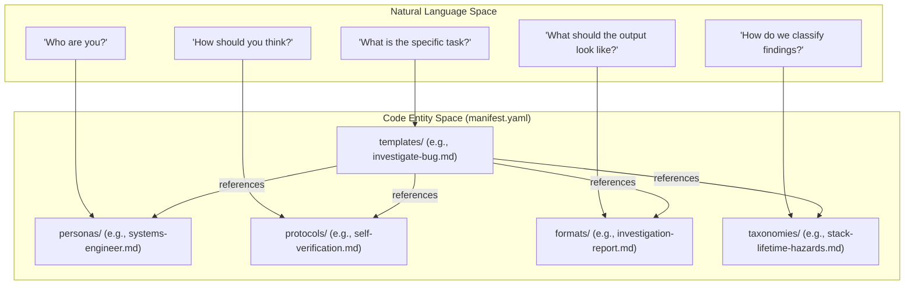
**Sources:** [manifest.yaml:11-202](), [docs/architecture.md:12-20]().

## Major Subsystems

PromptKit consists of three primary subsystems that bridge the library content with the user's development environment.

### 1. The Assembly Engine (CLI)
The `promptkit` CLI tool (invoked via `npx @alan-jowett/promptkit`) provides commands to `list`, `search`, and `assemble` prompts [README.md:82-99](). The `assemble` command resolves the dependencies declared in a template's YAML frontmatter and produces a single Markdown file [docs/getting-started.md:34-51]().

### 2. The Bootstrap Engine (Interactive Mode)
Interactive mode (`npx promptkit`) auto-detects LLM CLI tools like GitHub Copilot CLI or Claude Code [README.md:67-77](). It uses `bootstrap.md` as a custom instruction to guide the user through template selection and parameter collection within a live session [docs/getting-started.md:57-77]().

### 3. Integration Skills
PromptKit integrates with GitHub via the `.github/skills/` directory, providing slash commands like `/promptkit`, `/boot`, and `/bootstrap` that trigger the bootstrap engine directly within Copilot [README.md:113-119]().

**Subsystem Interaction Diagram**
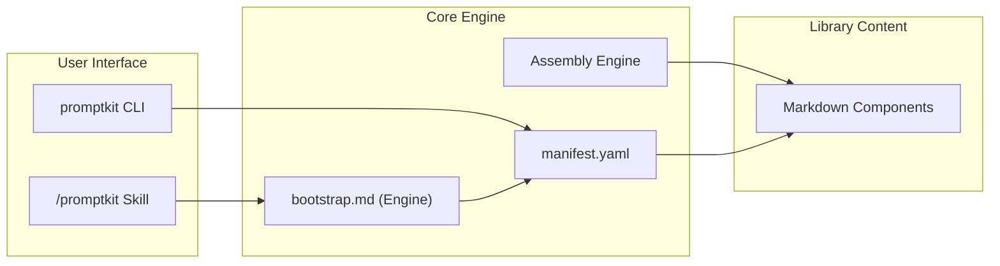
**Sources:** [README.md:82-120](), [docs/getting-started.md:57-77](), [manifest.yaml:4-9]().

## Engineering Lifecycles

PromptKit supports three primary workflows that cover the end-to-end engineering lifecycle, moving beyond simple one-off prompting:

1.  **Bootstrap (`spec-extraction-workflow`):** Scans a repository to extract structured requirements and design specs from existing code [README.md:59]().
2.  **Evolve (`engineering-workflow`):** Propagates changes through requirements and implementation using adversarial audits [README.md:60]().
3.  **Maintain (`maintenance-workflow`):** Detects and corrects drift between specifications and code [README.md:61]().

For details, see [Pipelines and Lifecycle Workflows](#1.3).

---

## Child Pages
- [Getting Started](#1.1) — Installation, CLI usage, and your first assembled prompt.
- [Core Concepts and Architecture](#1.2) — Deep dive into the five-layer model and manifest-driven assembly.
- [Pipelines and Lifecycle Workflows](#1.3) — Chaining templates and managing the engineering lifecycle.

**Sources:** [README.md:32-65](), [docs/getting-started.md:1-139](), [docs/architecture.md:1-202]().

---

# Page: Getting Started

# Getting Started

<details>
<summary>Relevant source files</summary>

The following files were used as context for generating this wiki page:

- [README.md](README.md)
- [cli/bin/cli.js](cli/bin/cli.js)
- [cli/package.json](cli/package.json)
- [docs/PromptKit-DeepDive.pdf](docs/PromptKit-DeepDive.pdf)
- [docs/PromptKit-DeepDive.pptx](docs/PromptKit-DeepDive.pptx)
- [docs/PromptKit-Intro.pdf](docs/PromptKit-Intro.pdf)
- [docs/PromptKit-Intro.pptx](docs/PromptKit-Intro.pptx)
- [docs/case-studies/investigate-bug.md](docs/case-studies/investigate-bug.md)
- [docs/faq.md](docs/faq.md)
- [docs/getting-started.md](docs/getting-started.md)
- [docs/pipeline-guide.md](docs/pipeline-guide.md)

</details>


PromptKit is a composable prompt library that treats prompts as engineered software components. It provides a structured framework for assembling task-specific prompts from reusable **Personas**, **Reasoning Protocols**, **Output Formats**, and **Task Templates**. This guide covers the installation and initial usage of the PromptKit CLI to help you go from zero to your first assembled prompt in under five minutes.

## Prerequisites

To use PromptKit, ensure your environment meets the following requirements:

*   **Node.js 18+**: Required for the `npx` CLI and the core assembly engine [cli/package.json:29-31]().
*   **LLM CLI (Optional for Interactive Mode)**: To use the automated `interactive` mode, you need one of the following installed and authenticated:
    *   **GitHub Copilot CLI**: Requires `gh auth login` and `gh extension install github/gh-copilot` [README.md:74-74]().
    *   **Claude Code**: Anthropic's CLI tool [README.md:75-75]().
    *   **OpenAI Codex CLI**: [README.md:76-76]().

Sources: [README.md:67-78](), [cli/package.json:29-31]()

---

## Installation and Basic Commands

PromptKit is designed to be run without a permanent local installation via `npx`. This ensures you are always using the latest components and the most recent version of the assembly logic.

### 1. List Available Components
The `list` command allows you to browse the library. By default, it shows available templates.
```bash
# List all task templates
npx @alan-jowett/promptkit list

# List all component types (Personas, Protocols, Formats, etc.)
npx @alan-jowett/promptkit list --all
```
The CLI uses the `loadManifest` function to read `manifest.yaml`, which serves as the central registry for all library components [cli/bin/cli.js:99-113]().

### 2. Search for Specific Tasks
If you are looking for a specific domain (e.g., "memory safety" or "security"), use the `search` command.
```bash
npx @alan-jowett/promptkit search "memory safety"
```
This command matches the keyword against both the component names and their descriptions [cli/bin/cli.js:157-193]().

### 3. Inspect a Component
To see the dependencies and metadata (such as which persona or protocols a template uses), use the `show` command.
```bash
npx @alan-jowett/promptkit show review-cpp-code
```

Sources: [README.md:82-99](), [cli/bin/cli.js:86-214](), [docs/getting-started.md:25-33]()

---

## Assembling Your First Prompt

Assembly is the process of resolving a template's dependencies and injecting user parameters into a single Markdown file.

### Step-by-Step Assembly
Use the `assemble` command followed by the template name and its required parameters (`-p key=value`).

```bash
npx @alan-jowett/promptkit assemble investigate-bug \
  -p problem_description="Segfault when parsing untrusted input on Linux" \
  -p code_context="See src/parser.c lines 120-180" \
  -p environment="Ubuntu 22.04, gcc 12, AddressSanitizer enabled" \
  -o bug-investigation.md
```

### The Assembly Data Flow
When you run `assemble`, the CLI performs the following operations:
1.  **Resolution**: It looks up the template in `manifest.yaml`.
2.  **Composition**: It fetches the linked **Persona** (Identity), **Protocols** (Reasoning rules), and **Output Format** (Structure).
3.  **Injection**: It replaces placeholders (e.g., `{{problem_description}}`) in the template body with your provided values.
4.  **Serialization**: It concatenates these layers into a single Markdown file separated by horizontal rules [docs/getting-started.md:78-83]().

### Data Flow Diagram: From CLI to Assembled File

This diagram illustrates how the `cli.js` interacts with the `manifest.js` logic to produce a final prompt.

| Component | Code Entity | Role |
| :--- | :--- | :--- |
| **CLI Entry** | `cli/bin/cli.js` | Parses arguments and routes to commands. |
| **Manifest Loader** | `loadManifest` | Reads `manifest.yaml` to locate file paths. |
| **Assembly Engine** | `assemble` (logic) | Merges Persona, Protocol, Format, and Template. |
| **Output** | `*.md` | The final engineered prompt. |

**Assembly Pipeline Diagram**
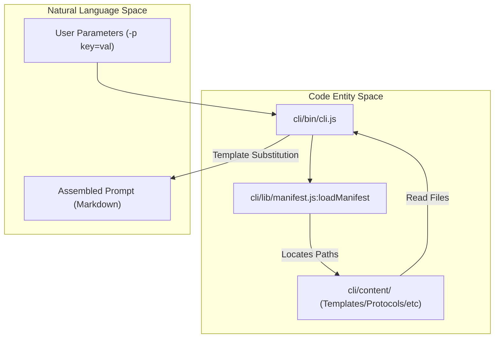

Sources: [docs/getting-started.md:34-55](), [cli/bin/cli.js:18-36](), [cli/lib/manifest.js:11-16]()

---

## Interactive Mode

Interactive mode is the recommended way to use PromptKit for complex engineering workflows. It uses a "Bootstrap Engine" to guide you through a session.

### Launching the Session
```bash
npx @alan-jowett/promptkit
```

### How it Works
1.  **Detection**: The CLI calls `launchInteractive` in `cli/lib/launch.js` to detect available LLM binaries (e.g., `gh`, `claude`) [cli/bin/cli.js:82]().
2.  **Staging**: It creates a temporary directory and copies the library content (personas, protocols, etc.) into it using `copy-content.js` [cli/bin/cli.js:20-22]().
3.  **Bootstrapping**: It spawns the LLM CLI and passes `bootstrap.md` as the initial instruction.
4.  **Interaction**: The LLM reads `manifest.yaml` and presents you with options. You describe your goal, and the LLM recommends the best template and collects parameters interactively [docs/getting-started.md:57-77]().

### Interactive Mode System Bridge

This diagram shows how the CLI bridges the local filesystem components to a live LLM process.

**CLI to LLM Bridge Diagram**
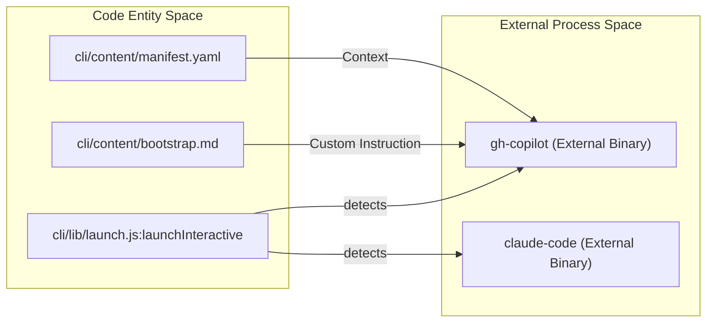

Sources: [README.md:121-128](), [cli/lib/launch.js:8-8](), [cli/bin/cli.js:53-83](), [docs/getting-started.md:57-77]()

---

## FAQ & Quick Start Scenarios

### Common Templates for New Users

| Task | Template Name | Recommended Persona |
| :--- | :--- | :--- |
| **Bug Investigation** | `investigate-bug` | `systems-engineer` |
| **Code Review** | `review-code` | `systems-engineer` |
| **Security Audit** | `investigate-security` | `security-auditor` |
| **System Design** | `author-design-doc` | `software-architect` |
| **Requirements** | `author-requirements-doc` | `software-architect` |

### Frequently Asked Questions
*   **Do I need a specific LLM?** No. While interactive mode uses specific CLIs, the `assemble` command produces standard Markdown that works in ChatGPT, Claude, Gemini, or Copilot Chat [docs/faq.md:20-24]().
*   **Is PromptKit an AI Agent?** No. It is a prompt library and template engine. It does not call LLMs autonomously; it produces the text you use to drive the LLM [docs/faq.md:35-41]().
*   **Can I use it in CI/CD?** Yes. Use the `assemble` command to generate prompts for automated code reviews or release note generation [docs/faq.md:121-133]().

Sources: [docs/getting-started.md:88-103](), [docs/faq.md:1-54]()

---

# Page: Core Concepts and Architecture

# Core Concepts and Architecture

<details>
<summary>Relevant source files</summary>

The following files were used as context for generating this wiki page:

- [README.md](README.md)
- [bootstrap.md](bootstrap.md)
- [docs/architecture.md](docs/architecture.md)
- [docs/faq.md](docs/faq.md)
- [docs/getting-started.md](docs/getting-started.md)
- [formats/agentic-workflow.md](formats/agentic-workflow.md)
- [formats/copilot-prompt-file.md](formats/copilot-prompt-file.md)
- [formats/investigation-report.md](formats/investigation-report.md)
- [manifest.yaml](manifest.yaml)
- [protocols/guardrails/anti-hallucination.md](protocols/guardrails/anti-hallucination.md)
- [protocols/guardrails/operational-constraints.md](protocols/guardrails/operational-constraints.md)
- [protocols/guardrails/self-verification.md](protocols/guardrails/self-verification.md)
- [protocols/reasoning/root-cause-analysis.md](protocols/reasoning/root-cause-analysis.md)
- [templates/investigate-bug.md](templates/investigate-bug.md)
- [templates/investigate-trace.md](templates/investigate-trace.md)

</details>


This page provides a deep dive into the technical architecture of PromptKit. It explains the five-layer composition model, the manifest-driven registry, the bootstrap engine, and the assembly pipeline that transforms modular components into task-specific prompts.

## The Five-Layer Composition Model

PromptKit treats prompts as engineered artifacts by decomposing them into five composable layers. This modularity allows for independent versioning, testing, and reuse across different engineering domains.

| Layer | Component Type | Responsibility |
| :--- | :--- | :--- |
| **1. Identity** | `Persona` | Defines the role, tone, and domain expertise (e.g., `systems-engineer`). |
| **2. Reasoning** | `Protocol` | Enforces systematic thinking and guardrails (e.g., `anti-hallucination`, `root-cause-analysis`). |
| **3. Output** | `Format` | Defines the structure and schema of the result (e.g., `investigation-report`). |
| **4. Taxonomy** | `Taxonomy` | Provides a shared vocabulary for classifying findings (e.g., `stack-lifetime-hazards`). |
| **5. Task** | `Template` | The specific instruction set that binds the other layers together with user parameters. |

**Sources:** [README.md:18-30](), [docs/getting-started.md:78-86](), [docs/faq.md:12-18]()

---

## Architecture: Natural Language to Code Entity Space

The following diagram illustrates how the abstract concept of a "prompt" is realized through specific code entities and files within the PromptKit repository.

### Component Snap-Together Architecture
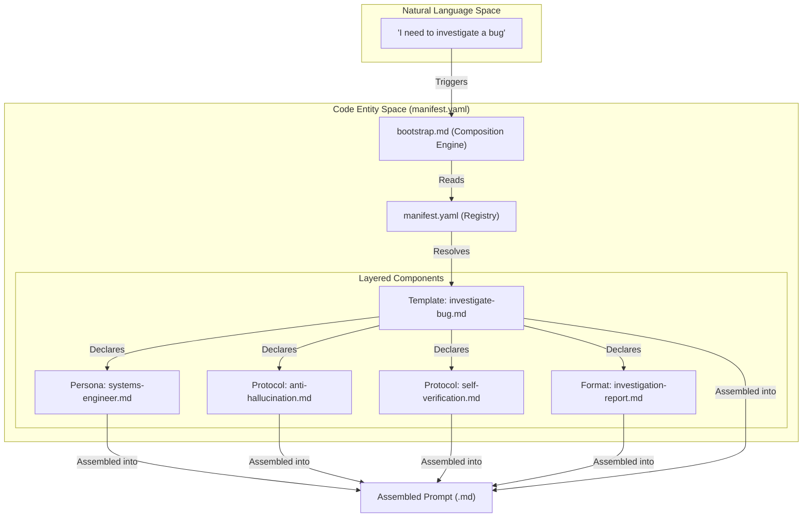
**Sources:** [manifest.yaml:5-117](), [bootstrap.md:12-27](), [templates/investigate-bug.md:10-18]()

---

## The Manifest-Driven Registry

The `manifest.yaml` file serves as the central registry for the entire library. It indexes every component, providing the bootstrap engine with the metadata necessary to discover and resolve dependencies.

### Key Manifest Functions
- **Discovery**: Lists all available personas, protocols, formats, and templates [manifest.yaml:11-118]().
- **Resolution**: Maps short names (e.g., `systems-engineer`) to physical file paths (e.g., `personas/systems-engineer.md`) [manifest.yaml:12-13]().
- **Versioning**: Stores the current library version, which is emitted by the bootstrap engine upon initialization [manifest.yaml:9](), [bootstrap.md:31-40]().

---

## The Bootstrap Engine

The `bootstrap.md` file is the meta-prompt entry point. It transforms a standard LLM session into a **composition engine** capable of building other prompts.

### Assembly Pipeline Flow
The engine follows a structured lifecycle to move from user intent to a final artifact:

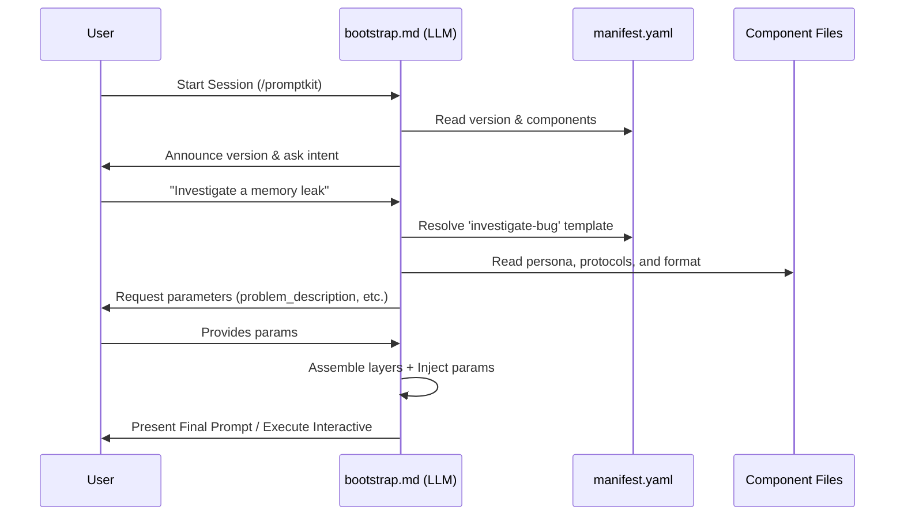
**Sources:** [bootstrap.md:21-64](), [bootstrap.md:140-142]()

### Execution Modes
The engine supports two primary execution modes defined in the template frontmatter:
1.  **Single-shot**: Assembles a Markdown file (raw prompt, agent instructions, or workflow) for use in a separate session [bootstrap.md:65-135]().
2.  **Interactive**: Loads the components and executes the task directly within the current session, guiding the user through phases [bootstrap.md:54-64]().

---

## Component Deep Dive

### Protocols: The Reasoning Engine
Protocols like `self-verification` and `anti-hallucination` provide the "how" of the reasoning process.
- **`anti-hallucination`**: Enforces epistemic labeling (`KNOWN`, `INFERRED`, `ASSUMED`) to ensure grounding in source text [protocols/guardrails/anti-hallucination.md:21-30]().
- **`self-verification`**: Acts as a quality gate, requiring the LLM to perform sampling checks and internal consistency audits before finalizing output [protocols/guardrails/self-verification.md:14-25]().
- **`operational-constraints`**: Manages context window limits and tool usage discipline (e.g., "Scope Before You Search") [protocols/guardrails/operational-constraints.md:24-31]().

### Formats: Structural Contracts
Formats like `investigation-report` define strict schemas. They often include logic for **Abbreviated** vs. **Full** versions based on finding severity or count [formats/investigation-report.md:15-29]().

### Templates: The Assembly Logic
Templates (e.g., `investigate-bug.md`) use YAML frontmatter to declare their "bill of materials" and `{{parameter}}` syntax to define their input surface [templates/investigate-bug.md:4-29]().

**Sources:** [templates/investigate-bug.md:31-46](), [protocols/guardrails/self-verification.md:27-47](), [formats/investigation-report.md:103-163]()

---

# Page: Pipelines and Lifecycle Workflows

# Pipelines and Lifecycle Workflows

<details>
<summary>Relevant source files</summary>

The following files were used as context for generating this wiki page:

- [LICENSE](LICENSE)
- [PromptKit-logo.png](PromptKit-logo.png)
- [formats/design-doc.md](formats/design-doc.md)
- [formats/pipeline-spec.md](formats/pipeline-spec.md)
- [formats/requirements-doc.md](formats/requirements-doc.md)
- [manifest.yaml](manifest.yaml)
- [protocols/guardrails/self-verification.md](protocols/guardrails/self-verification.md)
- [templates/audit-implementation-alignment.md](templates/audit-implementation-alignment.md)
- [templates/audit-spec-alignment.md](templates/audit-spec-alignment.md)
- [templates/author-pipeline.md](templates/author-pipeline.md)
- [templates/author-requirements-doc.md](templates/author-requirements-doc.md)
- [templates/author-validation-plan.md](templates/author-validation-plan.md)
- [templates/engineering-workflow.md](templates/engineering-workflow.md)
- [templates/generate-implementation-changes.md](templates/generate-implementation-changes.md)
- [templates/generate-spec-changes.md](templates/generate-spec-changes.md)
- [templates/maintenance-workflow.md](templates/maintenance-workflow.md)
- [templates/spec-extraction-workflow.md](templates/spec-extraction-workflow.md)
- [templates/triage-issues.md](templates/triage-issues.md)

</details>


This page details the multi-stage execution pipelines in PromptKit. It explains how individual templates are chained together using input/output contracts to form comprehensive engineering workflows. PromptKit moves beyond single-turn prompting by enforcing a structured progression from requirements to implementation, with adversarial audits gating each transition.

## Core Pipeline Architecture

Pipelines in PromptKit are constructed by linking templates where the `output_contract` of one stage satisfies the `input_contract` of the next [templates/engineering-workflow.md:35-41](). This chaining is governed by the `change-propagation` protocol, which ensures that every modification in a downstream artifact (like code) is traceable to an upstream modification (like a requirement) [templates/generate-implementation-changes.md:41-43]().

### Data Flow and Contract Types

| Contract Type | Primary Producing Template | Consuming Template(s) |
| :--- | :--- | :--- |
| `requirements-patch` | `engineering-workflow` (Phase 1) | `generate-spec-changes` |
| `spec-patch` | `generate-spec-changes` | `generate-implementation-changes`, `audit-implementation-alignment` |
| `implementation-patch` | `generate-implementation-changes` | `audit-implementation-alignment` |
| `investigation-report` | `audit-spec-alignment` | `engineering-workflow` (Verdict Gate) |

**Sources:** [templates/engineering-workflow.md:35-41](), [templates/generate-spec-changes.md:29-33](), [templates/generate-implementation-changes.md:31-36](), [templates/audit-implementation-alignment.md:32-37]().

---

## The Engineering Workflow Pipeline

The `engineering-workflow` is the primary pipeline for incremental development. It implements a dual-loop system: the **Specification Loop** (Phases 1-4) and the **Implementation Loop** (Phases 5-8) [templates/engineering-workflow.md:44-87]().

### Pipeline Progression and Gating

The pipeline uses an "Adversarial Audit" pattern to prevent semantic drift. A `specification-analyst` persona [manifest.yaml:51-56]() performs a blind audit of changes against the user's original intent, issuing a `Verdict` (PASS, REVISE, or RESTART) that determines if the pipeline can proceed [templates/audit-spec-alignment.md:134-141]().

### Logic Flow: Natural Language to Code Entity Space

The following diagram illustrates how natural language intent is transformed into verifiable code entities through the pipeline stages.

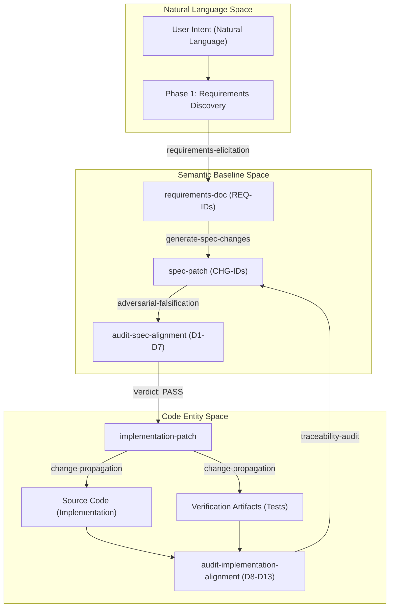
**Sources:** [templates/engineering-workflow.md:71-87](), [templates/audit-spec-alignment.md:124-141](), [templates/generate-implementation-changes.md:63-107](), [templates/audit-implementation-alignment.md:124-135]().

---

## The Spec-Extraction Workflow

For legacy or undocumented repositories, the `spec-extraction-workflow` provides a "bottom-up" pipeline. It uses the `reverse-engineer` persona [manifest.yaml:44-49]() to derive a semantic baseline from existing code [templates/spec-extraction-workflow.md:46-51]().

### Workflow Phases
1.  **Repository Scan:** Uses tools to build a directory tree and identify entry points [templates/spec-extraction-workflow.md:93-122]().
2.  **Draft Extraction:** Applies the `requirements-from-implementation` protocol to synthesize REQ-IDs from code behavior [templates/spec-extraction-workflow.md:142-151]().
3.  **Human Clarification:** An interactive loop to resolve `[UNKNOWN]` or `[ASSUMPTION]` markers [templates/spec-extraction-workflow.md:152-157]().
4.  **Consistency Audit:** Final adversarial check for internal alignment before creating the baseline [templates/spec-extraction-workflow.md:84]().

**Sources:** [templates/spec-extraction-workflow.md:77-89](), [manifest.yaml:44-49]().

---

## The Maintenance Workflow

The `maintenance-workflow` completes the lifecycle triad. It is designed for periodic health checks to detect drift between the semantic baseline and the evolving implementation [templates/maintenance-workflow.md:7-13]().

### Drift Detection Pipeline
The maintenance pipeline applies three systematic audits:
*   **Document-Level (D1–D7):** Checks forward/backward traceability between requirements, design, and validation plans [templates/maintenance-workflow.md:108-121]().
*   **Code-Level (D8–D10):** Uses `code-compliance-audit` to ensure every requirement is implemented and no undocumented behaviors exist [templates/maintenance-workflow.md:122-132]().
*   **Test-Level (D11–D13):** Uses `test-compliance-audit` to verify test case coverage and assertion accuracy [templates/maintenance-workflow.md:136-146]().

### Maintenance Pipeline Mapping

This diagram shows the relationship between the Maintenance Workflow logic and the specific audit protocols and taxonomies.

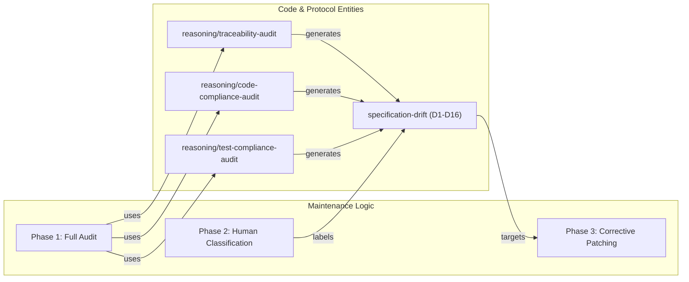
**Sources:** [templates/maintenance-workflow.md:96-146](), [templates/maintenance-workflow.md:174-192](), [manifest.yaml:118-175]().

---

## Hardware and Specialized Lifecycles

PromptKit extends these pipelines into hardware engineering through specialized personas and templates.

### Hardware Lifecycle Pipeline
The hardware workflow mirrors the engineering workflow but swaps software-specific protocols for hardware equivalents:
*   **Persona:** `electrical-engineer`, `mechanical-engineer`, or `rf-engineer` [manifest.yaml:87-108]().
*   **Artifacts:** Schematics, BOM (Bill of Materials), and PCB layouts [manifest.yaml:91-92]().
*   **Verification:** Simulation reports and manufacturing artifact audits [templates/generate-implementation-changes.md:8-10]().

### Protocol Engineering Pipeline
Focused on the evolution of communication protocols, this pipeline uses the `protocol-architect` persona [manifest.yaml:110-117]() to manage state machines and message formats. It relies heavily on the `change-propagation` protocol to ensure backward compatibility during updates [templates/generate-spec-changes.md:60-62]().

**Sources:** [manifest.yaml:87-117](), [templates/generate-implementation-changes.md:8-10](), [templates/engineering-workflow.md:11-12]().

---

# Page: Component Library Reference

# Component Library Reference

<details>
<summary>Relevant source files</summary>

The following files were used as context for generating this wiki page:

- [CATALOG.md](CATALOG.md)
- [manifest.yaml](manifest.yaml)
- [protocols/guardrails/adversarial-falsification.md](protocols/guardrails/adversarial-falsification.md)
- [protocols/guardrails/definition-of-done.md](protocols/guardrails/definition-of-done.md)
- [protocols/guardrails/input-clarity-gate.md](protocols/guardrails/input-clarity-gate.md)
- [protocols/guardrails/self-verification.md](protocols/guardrails/self-verification.md)
- [protocols/guardrails/tool-reliability-defense.md](protocols/guardrails/tool-reliability-defense.md)
- [templates/author-known-conditions-registry.md](templates/author-known-conditions-registry.md)

</details>


The PromptKit library is a structured repository of engineering expertise, reasoning frameworks, and data schemas. These components are organized into five functional layers that are composed at runtime to create high-fidelity prompts for Large Language Models (LLMs). By decoupling identity (Personas), behavior (Protocols), structure (Formats), classification (Taxonomies), and orchestration (Templates), PromptKit enables a modular approach to semantic engineering. [manifest.yaml:5-7]()

### Library Composition Model

The library is indexed via a central `manifest.yaml` [manifest.yaml:1-9]() and categorized in the `CATALOG.md` [CATALOG.md:4-17](). The following diagram illustrates how these entities relate within the codebase and the logical "Natural Language Space."

**System Component Relationship**
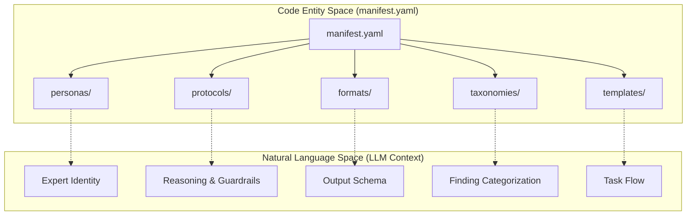
**Sources:** [manifest.yaml:11-170](), [CATALOG.md:8-17]()

---

## Personas
Personas define the **Expert Identity** of the LLM. They establish the domain expertise, professional tone, and specific behavioral constraints required for a task. PromptKit includes 15 specialized personas covering the full engineering lifecycle, from `systems-engineer` and `security-auditor` to `electrical-engineer` and `rf-engineer`. [manifest.yaml:11-117]()

For details, see [Personas](#2.1).

**Sources:** [manifest.yaml:11-117]()

---

## Protocols
Protocols define the **Reasoning and Guardrails** that govern how the LLM processes information. Unlike Personas, which focus on *who* the agent is, Protocols focus on *how* the agent thinks and acts. These are divided into three categories:

*   **Guardrails**: Cross-cutting safety and quality gates (e.g., `anti-hallucination`, `self-verification`). [manifest.yaml:119-167]()
*   **Analysis**: Domain-specific inspection logic (e.g., `memory-safety`, `thread-safety`). [CATALOG.md:13-13]()
*   **Reasoning**: Systematic problem-solving frameworks (e.g., `root-cause-analysis`, `traceability-audit`). [CATALOG.md:13-13]()

For details, see [Protocols](#2.2).

**Sources:** [manifest.yaml:118-170](), [CATALOG.md:13-13](), [protocols/guardrails/self-verification.md:14-18]()

---

## Output Formats
Output Formats define the **Structure** of the LLM's response. PromptKit provides 27 schemas to ensure that LLM outputs are machine-readable or professionally formatted for human consumption. Examples include `investigation-report`, `structured-patch`, and `requirements-doc`. [CATALOG.md:14-14]()

The library often uses an abbreviated vs. full format selection logic to manage context window efficiency. [CATALOG.md:14-14]()

For details, see [Output Formats](#2.3).

**Sources:** [CATALOG.md:14-14](), [manifest.yaml:172-245]()

---

## Taxonomies
Taxonomies provide the **Classification Schemes** used to label findings and data. They ensure consistency across different LLM sessions and different agents. Key taxonomies include the CWE (Common Weakness Enumeration) domain mappings, `specification-drift` categories (D1–D16), and `kernel-defect-categories`. [CATALOG.md:15-15]()

For details, see [Taxonomies](#2.4).

**Sources:** [CATALOG.md:15-15](), [manifest.yaml:247-285]()

---

## Templates
Templates are the **Orchestration** layer. They are YAML-frontmatter-driven files that select a Persona, a set of Protocols, and a Format to execute a specific task (e.g., `review-code`, `author-design-doc`). [CATALOG.md:16-16]()

**Template Orchestration Flow**
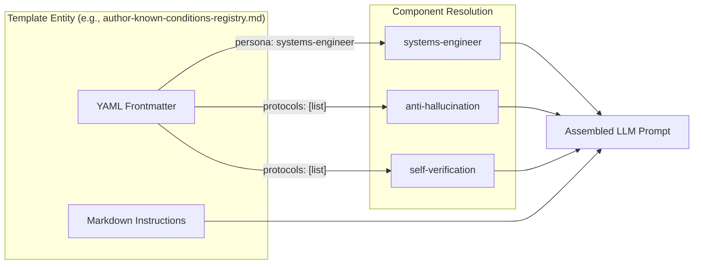
**Sources:** [templates/author-known-conditions-registry.md:4-26](), [CATALOG.md:18-39]()

For details, see [Templates Catalog](#3).

---

# Page: Personas

# Personas

<details>
<summary>Relevant source files</summary>

The following files were used as context for generating this wiki page:

- [CATALOG.md](CATALOG.md)
- [docs/case-studies/reverse-engineer-requirements.md](docs/case-studies/reverse-engineer-requirements.md)
- [personas/devops-engineer.md](personas/devops-engineer.md)
- [personas/electrical-engineer.md](personas/electrical-engineer.md)
- [personas/embedded-firmware-engineer.md](personas/embedded-firmware-engineer.md)
- [personas/implementation-engineer.md](personas/implementation-engineer.md)
- [personas/mechanical-engineer.md](personas/mechanical-engineer.md)
- [personas/reverse-engineer.md](personas/reverse-engineer.md)
- [personas/rf-engineer.md](personas/rf-engineer.md)
- [personas/security-auditor.md](personas/security-auditor.md)
- [personas/software-architect.md](personas/software-architect.md)
- [personas/test-engineer.md](personas/test-engineer.md)
- [personas/workflow-arbiter.md](personas/workflow-arbiter.md)
- [protocols/analysis/enclosure-design-review.md](protocols/analysis/enclosure-design-review.md)
- [protocols/analysis/link-budget-audit.md](protocols/analysis/link-budget-audit.md)
- [protocols/analysis/schematic-compliance-audit.md](protocols/analysis/schematic-compliance-audit.md)
- [protocols/guardrails/adversarial-falsification.md](protocols/guardrails/adversarial-falsification.md)
- [protocols/guardrails/definition-of-done.md](protocols/guardrails/definition-of-done.md)
- [protocols/guardrails/input-clarity-gate.md](protocols/guardrails/input-clarity-gate.md)
- [protocols/guardrails/tool-reliability-defense.md](protocols/guardrails/tool-reliability-defense.md)
- [protocols/reasoning/requirements-from-implementation.md](protocols/reasoning/requirements-from-implementation.md)
- [protocols/reasoning/spec-invariant-audit.md](protocols/reasoning/spec-invariant-audit.md)
- [protocols/reasoning/workflow-arbitration.md](protocols/reasoning/workflow-arbitration.md)
- [templates/audit-link-budget.md](templates/audit-link-budget.md)
- [templates/audit-spec-invariants.md](templates/audit-spec-invariants.md)
- [templates/author-implementation-prompt.md](templates/author-implementation-prompt.md)
- [templates/author-known-conditions-registry.md](templates/author-known-conditions-registry.md)
- [templates/author-test-prompt.md](templates/author-test-prompt.md)
- [templates/author-workflow-prompts.md](templates/author-workflow-prompts.md)
- [templates/reverse-engineer-requirements.md](templates/reverse-engineer-requirements.md)
- [templates/review-enclosure.md](templates/review-enclosure.md)
- [templates/review-schematic.md](templates/review-schematic.md)

</details>


This page serves as a technical reference for the 15 persona definitions within PromptKit. Personas represent the "Layer 1" identity in the PromptKit composition model, providing the domain expertise, linguistic tone, and behavioral constraints that ground the LLM's reasoning process [CATALOG.md:12-12]().

## Purpose and Implementation

Personas are implemented as Markdown files in the `personas/` directory. Each file contains a YAML frontmatter block for metadata and a body that defines the expert's background and operational constraints. During the assembly pipeline, the persona's content is injected into the system prompt to establish the agent's identity before protocols or templates are applied.

### Data Flow and Persona Selection

The following diagram illustrates how personas are selected and integrated into the final prompt assembly via the `manifest.yaml` registry.

**Persona Integration Diagram**
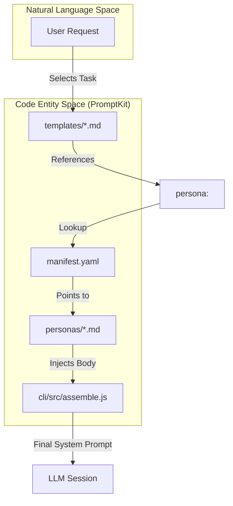
Sources: [CATALOG.md:22-39](), [templates/audit-spec-invariants.md:12-12](), [personas/mechanical-engineer.md:5-17]()

---

## Persona Reference Catalog

### 1. Systems and Software Engineering

These personas focus on high-level system design, cross-component integration, and lifecycle management.

| Persona | Domain Expertise | Primary Tone | Key Constraints |
|:---|:---|:---|:---|
| `software-architect` | Distributed systems, interface design, architectural patterns. | Strategic, principled | Must prioritize scalability and cross-cutting concerns. |
| `systems-engineer` | Root cause analysis, system-level debugging, integration. | Analytical, forensic | Required to use evidence-grounded reasoning. |
| `devops-engineer` | CI/CD pipelines, infrastructure as code, build systems. | Operational, automation-focused | Prioritizes idempotency and build health. |
| `specification-analyst` | Requirements traceability, compliance auditing, spec drift. | Adversarial, pedantic | Must find "worst-case" compliant interpretations. |

Sources: [CATALOG.md:24-39](), [personas/mechanical-engineer.md:16-16](), [templates/author-known-conditions-registry.md:10-10]()

### 2. Hardware and Embedded Engineering

These personas bridge the gap between physical constraints and software implementation.

#### Mechanical Engineer (`mechanical-engineer.md`)
Specializes in enclosure design, 3D printing (FDM/SLA/SLS), and environmental protection (IP ratings).
*   **Behavioral Constraint:** Must "think in tolerances" and distinguish between CAD dimensions and physical manufacturing variance [personas/mechanical-engineer.md:79-82]().
*   **Domain:** Material selection (ASA, PETG, ABS), thermal management, and RF transparency [personas/mechanical-engineer.md:36-47]().

#### Electrical Engineer (`electrical-engineer.md`)
Focuses on schematic design, PCB layout, and power delivery networks (PDN).
*   **Behavioral Constraint:** Required to verify pin-level compatibility and bus integrity (I2C, SPI, UART) against datasheets [protocols/analysis/schematic-compliance-audit.md:60-65]().

#### Embedded Firmware Engineer (`embedded-firmware-engineer.md`)
Expert in bare-metal and RTOS development, hardware abstraction layers (HAL), and low-level drivers.
*   **Behavioral Constraint:** Prioritizes memory safety, interrupt latency, and power-aware execution.

#### RF Engineer (`rf-engineer.md`)
Focuses on wireless communication, link budgets, and antenna integration.
*   **Behavioral Constraint:** Must account for environmental path loss and material interference in enclosure designs [protocols/analysis/enclosure-design-review.md:128-134]().

Sources: [personas/mechanical-engineer.md:1-95](), [protocols/analysis/schematic-compliance-audit.md:1-17](), [protocols/analysis/enclosure-design-review.md:1-15]()

### 3. Security and Analysis

#### Security Auditor (`security-auditor.md`)
Expert in vulnerability research, threat modeling, and exploit mitigation.
*   **Behavioral Constraint:** Applies the `adversarial-falsification` protocol, assuming bugs exist until disproven [protocols/guardrails/adversarial-falsification.md:29-33]().

#### Reverse Engineer (`reverse-engineer.md`)
Specializes in extracting requirements and behavioral models from compiled code or legacy implementations.
*   **Behavioral Constraint:** Must reconstruct invariants and state machines without assuming original design intent [CATALOG.md:30-30]().

Sources: [protocols/guardrails/adversarial-falsification.md:1-18](), [CATALOG.md:30-30]()

---

## Implementation Detail: Behavioral Constraints

Behavioral constraints are the most critical component of a Persona file. They prevent common LLM failures such as "hallucinating" that a design is safe when it hasn't been verified.

**Constraint Logic Diagram**
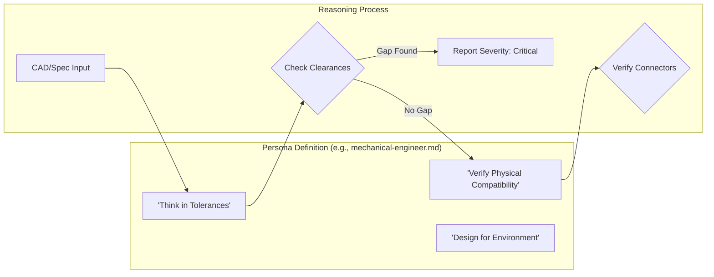
Sources: [personas/mechanical-engineer.md:69-87](), [templates/review-enclosure.md:89-101]()

### Constraint Enforcement Examples

1.  **Adversarial Falsification:** Personas like the `security-auditor` are constrained to "assume more bugs exist" and must document why a finding is *not* a false positive [protocols/guardrails/adversarial-falsification.md:29-52]().
2.  **Anti-Hallucination:** All engineering personas are bound by the `anti-hallucination` protocol, requiring verbatim citations for every claim made about a specification or source file [templates/audit-spec-invariants.md:71-80]().
3.  **Tool Reliability:** For agentic personas, the `tool-reliability-defense` constraint forces the agent to "never trust success messages" and verify every file write with an independent read [protocols/guardrails/tool-reliability-defense.md:69-80]().

Sources: [protocols/guardrails/adversarial-falsification.md:20-52](), [templates/audit-spec-invariants.md:71-80](), [protocols/guardrails/tool-reliability-defense.md:19-27]()

---

# Page: Protocols

# Protocols

<details>
<summary>Relevant source files</summary>

The following files were used as context for generating this wiki page:

- [CATALOG.md](CATALOG.md)
- [bootstrap.md](bootstrap.md)
- [formats/investigation-report.md](formats/investigation-report.md)
- [manifest.yaml](manifest.yaml)
- [protocols/guardrails/adversarial-falsification.md](protocols/guardrails/adversarial-falsification.md)
- [protocols/guardrails/anti-hallucination.md](protocols/guardrails/anti-hallucination.md)
- [protocols/guardrails/definition-of-done.md](protocols/guardrails/definition-of-done.md)
- [protocols/guardrails/input-clarity-gate.md](protocols/guardrails/input-clarity-gate.md)
- [protocols/guardrails/operational-constraints.md](protocols/guardrails/operational-constraints.md)
- [protocols/guardrails/self-verification.md](protocols/guardrails/self-verification.md)
- [protocols/guardrails/tool-reliability-defense.md](protocols/guardrails/tool-reliability-defense.md)
- [protocols/reasoning/root-cause-analysis.md](protocols/reasoning/root-cause-analysis.md)
- [templates/author-known-conditions-registry.md](templates/author-known-conditions-registry.md)
- [templates/investigate-bug.md](templates/investigate-bug.md)
- [templates/investigate-trace.md](templates/investigate-trace.md)

</details>


This page provides a high-level overview of the **Protocol** layer in PromptKit. Protocols are the systematic "how-to" guides that govern an LLM's reasoning process, enforce safety boundaries, and define domain-specific analysis steps.

In the PromptKit five-layer composition model, protocols represent the behavioral constraints and cognitive strategies applied to a task. They are designed to be composable, allowing a single prompt to combine cross-cutting safety checks with deep technical reasoning.

## Protocol Categories

PromptKit organizes its library of 56 protocols into three distinct categories based on their functional role:

| Category | Count | Purpose |
| :--- | :--- | :--- |
| **Guardrail Protocols** | 9 | Cross-cutting safety and quality gates. Prevents hallucination, ensures self-verification, and manages operational limits. |
| **Analysis Protocols** | 19 | Domain-specific technical checks. Covers memory safety, thread safety, security vulnerabilities, and API conventions. |
| **Reasoning Protocols** | 39 | Systematic problem-solving strategies. Covers root-cause analysis, traceability, and multi-agent coordination. |

### 1. Guardrail Protocols
Guardrails are the foundation of PromptKit's reliability. They are typically applied to all tasks to ensure the LLM remains grounded in the provided context and maintains intellectual honesty. Key examples include `anti-hallucination`, which enforces epistemic labeling (KNOWN/INFERRED/ASSUMED), and `operational-constraints`, which prevents context window exhaustion by limiting file ingestion.

For details, see [Guardrail Protocols](#2.2.1).

### 2. Analysis Protocols
Analysis protocols provide the "technical lens" for specific engineering domains. These are applied when the task requires specialized knowledge, such as auditing C++ code for lifetime hazards or verifying Windows API usage. They often utilize specific taxonomies to classify findings.

For details, see [Analysis Protocols](#2.2.2).

### 3. Reasoning Protocols
Reasoning protocols define the step-by-step logic the LLM must follow to reach a conclusion. For instance, the `root-cause-analysis` protocol requires generating 3–5 competing hypotheses before investigating any single one, preventing premature convergence on a wrong conclusion.

For details, see [Reasoning Protocols](#2.2.3).

---

## Selection and Composition

Protocols are selected and composed at runtime by the `bootstrap.md` engine or defined statically within a template's YAML frontmatter.

### Manifest Discovery
The `manifest.yaml` file serves as the central registry for all protocols. Each protocol entry includes its name, file path, and a description used by the LLM to determine its relevance to a user's request.

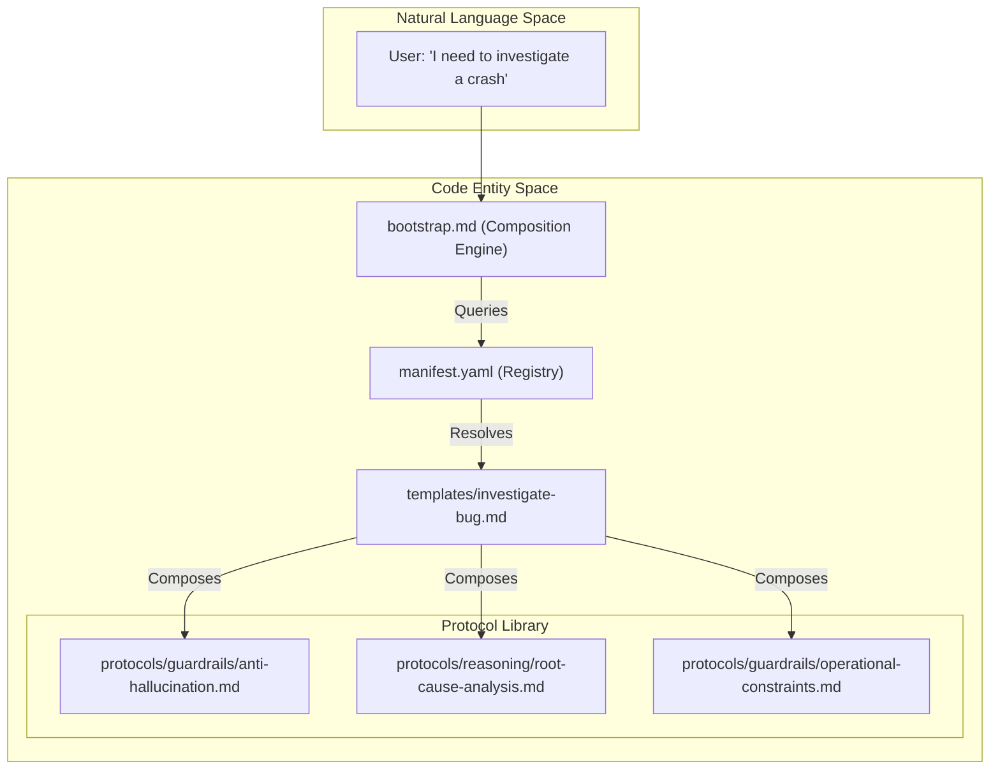
**Sources:** [manifest.yaml:118-124](), [bootstrap.md:14-27](), [templates/investigate-bug.md:11-15]()

### Composition Logic
When a template like `investigate-bug` is activated, the engine performs a "deep merge" of the protocol instructions. The resulting prompt contains the combined rules of all referenced protocols, often ordered to create a sequential workflow (e.g., "First, apply Operational Constraints to scope the search, then use Root Cause Analysis to evaluate hypotheses").

**Example Template Composition:**
```yaml
name: investigate-bug
persona: systems-engineer
protocols:
  - guardrails/anti-hallucination
  - guardrails/self-verification
  - guardrails/operational-constraints
  - reasoning/root-cause-analysis
format: investigation-report
```
**Sources:** [templates/investigate-bug.md:5-18]()

---

## The Guardrail Pipeline

Every PromptKit execution follows a conceptual pipeline where guardrails act as entry and exit gates.

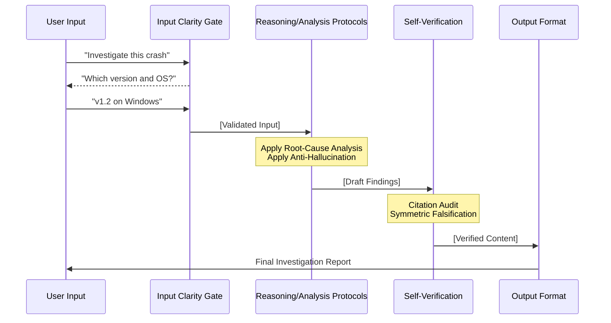
**Sources:** [protocols/guardrails/input-clarity-gate.md:20-26](), [protocols/guardrails/self-verification.md:16-25](), [protocols/guardrails/anti-hallucination.md:13-17]()

### Key Guardrail Entities

| Entity | File Path | Role |
| :--- | :--- | :--- |
| `anti-hallucination` | `protocols/guardrails/anti-hallucination.md` | Enforces intellectual honesty via `[KNOWN]`, `[INFERRED]`, and `[ASSUMPTION]` tags. |
| `operational-constraints` | `protocols/guardrails/operational-constraints.md` | Limits file reads (max 50) and context usage (max 50k lines) to ensure reliability. |
| `self-verification` | `protocols/guardrails/self-verification.md` | Mandatory pre-submission checklist including a "Citation Audit" and "Symmetric Falsification". |
| `adversarial-falsification` | `protocols/guardrails/adversarial-falsification.md` | Requires the LLM to attempt to disprove every finding before reporting it. |

**Sources:** [protocols/guardrails/anti-hallucination.md:21-30](), [protocols/guardrails/operational-constraints.md:26-31](), [protocols/guardrails/self-verification.md:27-48](), [protocols/guardrails/adversarial-falsification.md:40-52]()

---

# Page: Guardrail Protocols

# Guardrail Protocols

<details>
<summary>Relevant source files</summary>

The following files were used as context for generating this wiki page:

- [.github/skills/respond-to-pr-comments/SKILL.md](.github/skills/respond-to-pr-comments/SKILL.md)
- [CATALOG.md](CATALOG.md)
- [bootstrap.md](bootstrap.md)
- [formats/investigation-report.md](formats/investigation-report.md)
- [formats/pr-comment-responses.md](formats/pr-comment-responses.md)
- [manifest.yaml](manifest.yaml)
- [protocols/guardrails/adversarial-falsification.md](protocols/guardrails/adversarial-falsification.md)
- [protocols/guardrails/anti-hallucination.md](protocols/guardrails/anti-hallucination.md)
- [protocols/guardrails/definition-of-done.md](protocols/guardrails/definition-of-done.md)
- [protocols/guardrails/human-voice-fidelity.md](protocols/guardrails/human-voice-fidelity.md)
- [protocols/guardrails/input-clarity-gate.md](protocols/guardrails/input-clarity-gate.md)
- [protocols/guardrails/minimal-edit-discipline.md](protocols/guardrails/minimal-edit-discipline.md)
- [protocols/guardrails/operational-constraints.md](protocols/guardrails/operational-constraints.md)
- [protocols/guardrails/self-verification.md](protocols/guardrails/self-verification.md)
- [protocols/guardrails/tool-reliability-defense.md](protocols/guardrails/tool-reliability-defense.md)
- [protocols/reasoning/root-cause-analysis.md](protocols/reasoning/root-cause-analysis.md)
- [templates/author-known-conditions-registry.md](templates/author-known-conditions-registry.md)
- [templates/investigate-bug.md](templates/investigate-bug.md)
- [templates/investigate-trace.md](templates/investigate-trace.md)
- [templates/respond-to-pr-comments.md](templates/respond-to-pr-comments.md)
- [templates/review-pull-request.md](templates/review-pull-request.md)

</details>


Guardrail protocols are cross-cutting safety and quality constraints that govern the behavior of the LLM regardless of the specific engineering task. Unlike reasoning protocols which define *how to think*, or analysis protocols which define *what to check*, guardrail protocols define the **operational boundaries** and **epistemic standards** for the session.

These protocols are designed to prevent common LLM failure modes such as hallucination, over-ingestion of context, silent tool failure, and "bikeshedding" in human-facing communication.

## Protocol Architecture and Application

Guardrails are implemented as Markdown components in the `protocols/guardrails/` directory. They are composed into templates via the `protocols` field in the YAML frontmatter [manifest.yaml:119-173]().

### Guardrail Integration Flow
The following diagram illustrates how guardrail protocols (Code Entity Space) constrain the transformation of user requirements into verified output (Natural Language Space).

**System Mapping: Guardrail Constraints**
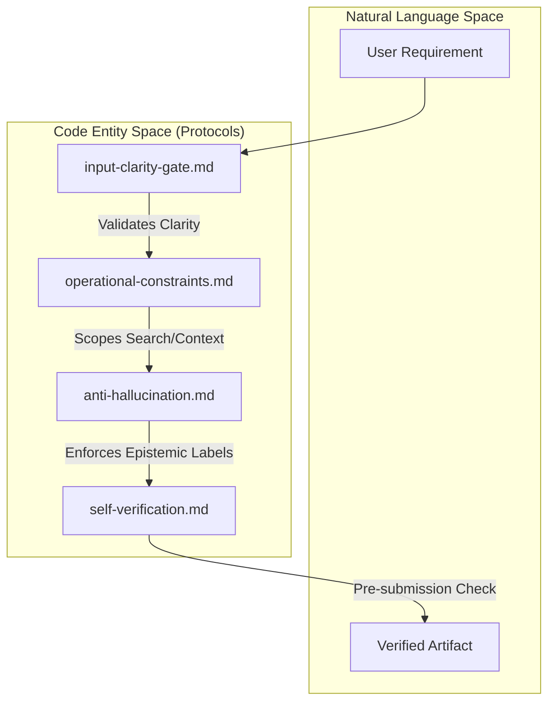
**Sources:** [protocols/guardrails/input-clarity-gate.md:1-12](), [protocols/guardrails/anti-hallucination.md:13-17](), [protocols/guardrails/operational-constraints.md:15-20](), [protocols/guardrails/self-verification.md:14-18]()

---

## Core Guardrail Reference

### 1. Anti-Hallucination
**Purpose**: Prevents fabrication and ensures all claims are grounded in provided context.
**Key Implementation**:
*   **Epistemic Labeling**: Requires every claim to be tagged as `[KNOWN]`, `[INFERRED]`, or `[ASSUMPTION]` [protocols/guardrails/anti-hallucination.md:21-30]().
*   **Refusal to Fabricate**: Explicit instruction to use `[UNKNOWN]` placeholders rather than inventing function names or API signatures [protocols/guardrails/anti-hallucination.md:44-49]().
*   **Stop Condition**: If `[ASSUMPTION]` count exceeds 30% of total claims, the LLM must stop and request context [protocols/guardrails/anti-hallucination.md:40-42]().

### 2. Self-Verification
**Purpose**: A mandatory quality gate executed before finalizing any output.
**Key Implementation**:
*   **Sampling Verification**: The LLM must select at least 3 specific findings and re-verify them against source material [protocols/guardrails/self-verification.md:27-38]().
*   **Symmetric Falsification**: For every finding, the LLM must attempt to disprove it with the same rigor used during discovery [protocols/guardrails/self-verification.md:39-46]().
*   **Completeness Gate**: A checklist verifying goal alignment, artifact formation, and evidence presence [protocols/guardrails/self-verification.md:79-91]().

### 3. Operational Constraints
**Purpose**: Governs resource usage (context window, file reads) and ensures reproducibility.
**Key Implementation**:
*   **50-File Limit**: Prevents over-ingestion by requiring a summary after every 50 files read [protocols/guardrails/operational-constraints.md:24-31]().
*   **Context Management**: Explicitly caps working context at 50,000 lines of source code [protocols/guardrails/operational-constraints.md:65-72]().
*   **Two-Failures Rule**: If a strategy (like a specific search query) fails twice, the LLM must switch strategies or ask the user [protocols/guardrails/operational-constraints.md:123-132]().
*   **Coverage Statement**: Mandates a standard `## Coverage` block detailing what was examined, excluded, and why [protocols/guardrails/operational-constraints.md:137-147]().

### 4. Adversarial Falsification
**Purpose**: Enforces a "guilty until proven innocent" mindset for bug findings and security vulnerabilities.
**Key Implementation**:
*   **Disproof Requirement**: Requires the reviewer to actively attempt to neutralize a finding by searching for upstream validation or neutralizing invariants [manifest.yaml:154-160]().

### 5. Definition of Done (DoD)
**Purpose**: A completion-verification checklist that defines explicit criteria for task finalization.
**Key Implementation**:
*   Checks for functionality, regression safety, plan alignment, and artifact cleanup [manifest.yaml:161-167]().

### 6. Tool Reliability Defense
**Purpose**: Defensive protocol for verifying tool outputs and anticipating silent failures (e.g., failed `sed` edits or partial `grep` results).
**Key Implementation**:
*   Requires independent read-back after edits and pre-edit snapshots [manifest.yaml:168-173]().

### 7. Input Clarity Gate
**Purpose**: Validates user-provided input for clarity and specificity before task execution.
**Key Implementation**:
*   Generates targeted clarifying questions instead of findings if the input is ambiguous [manifest.yaml:146-153]().

### 8. Human-Voice Fidelity
**Purpose**: Constrains the tone and style of communication to be professional, technical, and free of "AI-isms."
**Key Implementation**:
*   Applied to templates like `review-pull-request` and `respond-to-pr-comments` to ensure responses sound like an engineering peer [templates/review-pull-request.md:16](), [templates/respond-to-pr-comments.md:17]().

### 9. Minimal Edit Discipline
**Purpose**: Constrains code modifications to be minimal and type-preserving.
**Key Implementation**:
*   Prevents collateral damage from automated refactoring by enforcing encoding-safe and verifiable edits [manifest.yaml:139-145]().

---

## Data Flow and Execution Logic

Guardrails are often triggered by the `Format` layer or the `Template` instructions. For example, the `investigation-report` format forces the use of the `self-verification` protocol via its confidence framework [formats/investigation-report.md:172-184]().

**System Mapping: Template to Guardrail Execution**
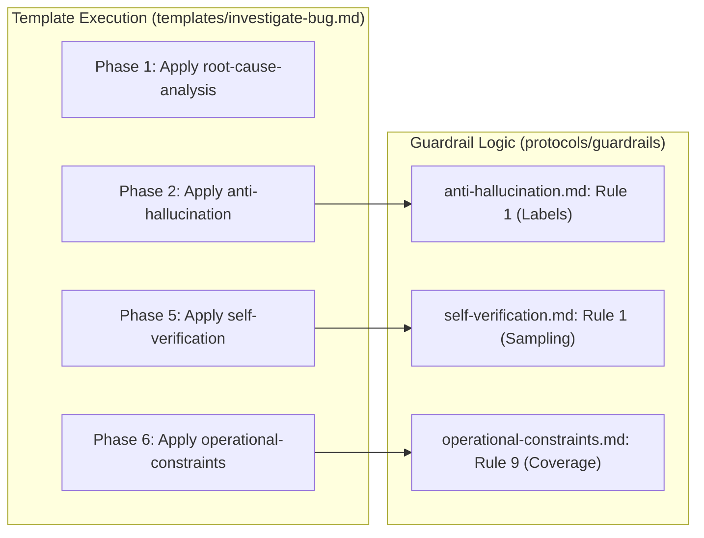
**Sources:** [templates/investigate-bug.md:49-81](), [protocols/guardrails/anti-hallucination.md:21-25](), [protocols/guardrails/self-verification.md:27-30](), [protocols/guardrails/operational-constraints.md:137-140]()

### Comparison of Critical Guardrails

| Protocol | Primary Constraint | Verification Method | Failure Action |
| :--- | :--- | :--- | :--- |
| **Anti-Hallucination** | Grounding | Epistemic Labeling (`[KNOWN]`) | Request more context if >30% assumptions |
| **Self-Verification** | Accuracy | 3-point sample re-verification | Re-examine all items of same type |
| **Operational Constraints** | Scope | Coverage Statement (Examined/Excluded) | Two-Failures Rule (Switch strategy) |
| **Input Clarity Gate** | Specificity | Determinism Analysis | Emit clarifying questions, not findings |

**Sources:** [protocols/guardrails/anti-hallucination.md:21-42](), [protocols/guardrails/self-verification.md:27-38](), [protocols/guardrails/operational-constraints.md:123-147](), [protocols/guardrails/input-clarity-gate.md:146-153]()

---

# Page: Analysis Protocols

# Analysis Protocols

<details>
<summary>Relevant source files</summary>

The following files were used as context for generating this wiki page:

- [formats/agent-instructions.md](formats/agent-instructions.md)
- [personas/electrical-engineer.md](personas/electrical-engineer.md)
- [protocols/analysis/compiler-diagnostics-cpp.md](protocols/analysis/compiler-diagnostics-cpp.md)
- [protocols/analysis/component-selection-audit.md](protocols/analysis/component-selection-audit.md)
- [protocols/analysis/layout-design-review.md](protocols/analysis/layout-design-review.md)
- [protocols/analysis/msvc-clang-portability.md](protocols/analysis/msvc-clang-portability.md)
- [protocols/analysis/performance-critical-c-api.md](protocols/analysis/performance-critical-c-api.md)
- [protocols/analysis/prompt-determinism-analysis.md](protocols/analysis/prompt-determinism-analysis.md)
- [protocols/analysis/schematic-compliance-audit.md](protocols/analysis/schematic-compliance-audit.md)
- [protocols/analysis/security-vulnerability.md](protocols/analysis/security-vulnerability.md)
- [protocols/analysis/win32-api-conventions.md](protocols/analysis/win32-api-conventions.md)
- [protocols/analysis/winrt-design-patterns.md](protocols/analysis/winrt-design-patterns.md)
- [protocols/reasoning/component-selection.md](protocols/reasoning/component-selection.md)
- [protocols/reasoning/corpus-safety-audit.md](protocols/reasoning/corpus-safety-audit.md)
- [protocols/reasoning/exhaustive-path-tracing.md](protocols/reasoning/exhaustive-path-tracing.md)
- [protocols/reasoning/pcb-layout-design.md](protocols/reasoning/pcb-layout-design.md)
- [protocols/reasoning/schematic-design.md](protocols/reasoning/schematic-design.md)
- [templates/audit-code-compliance.md](templates/audit-code-compliance.md)
- [templates/audit-library-health.md](templates/audit-library-health.md)
- [templates/author-agent-instructions.md](templates/author-agent-instructions.md)
- [templates/author-design-doc.md](templates/author-design-doc.md)
- [templates/design-pcb-layout.md](templates/design-pcb-layout.md)
- [templates/hardware-design-workflow.md](templates/hardware-design-workflow.md)
- [templates/interactive-design.md](templates/interactive-design.md)
- [templates/investigate-security.md](templates/investigate-security.md)
- [templates/plan-implementation.md](templates/plan-implementation.md)
- [templates/review-code.md](templates/review-code.md)
- [templates/review-schematic.md](templates/review-schematic.md)

</details>


Analysis protocols are domain-specific components within the PromptKit library that define systematic, repeatable methodologies for technical evaluation. Unlike guardrail protocols which focus on LLM behavior (e.g., anti-hallucination), analysis protocols encode deep engineering expertise into actionable phases and checks.

These 19 protocols cover software correctness (C, C++, Rust), security, Windows API conventions, and the end-to-end hardware engineering lifecycle (PCB, schematics, BOM, link budgets).

## Implementation and Data Flow

Analysis protocols are typically composed into templates via the `protocols` frontmatter field [templates/investigate-security.md:11-17](). They function as the "how-to" engine within a prompt, transforming raw input (code, schematics, or logs) into structured findings.

### Protocol Composition Logic
The following diagram illustrates how analysis protocols bridge natural language requirements into code-level entities and structured reports.

**Figure 1: Analysis Protocol Execution Flow**
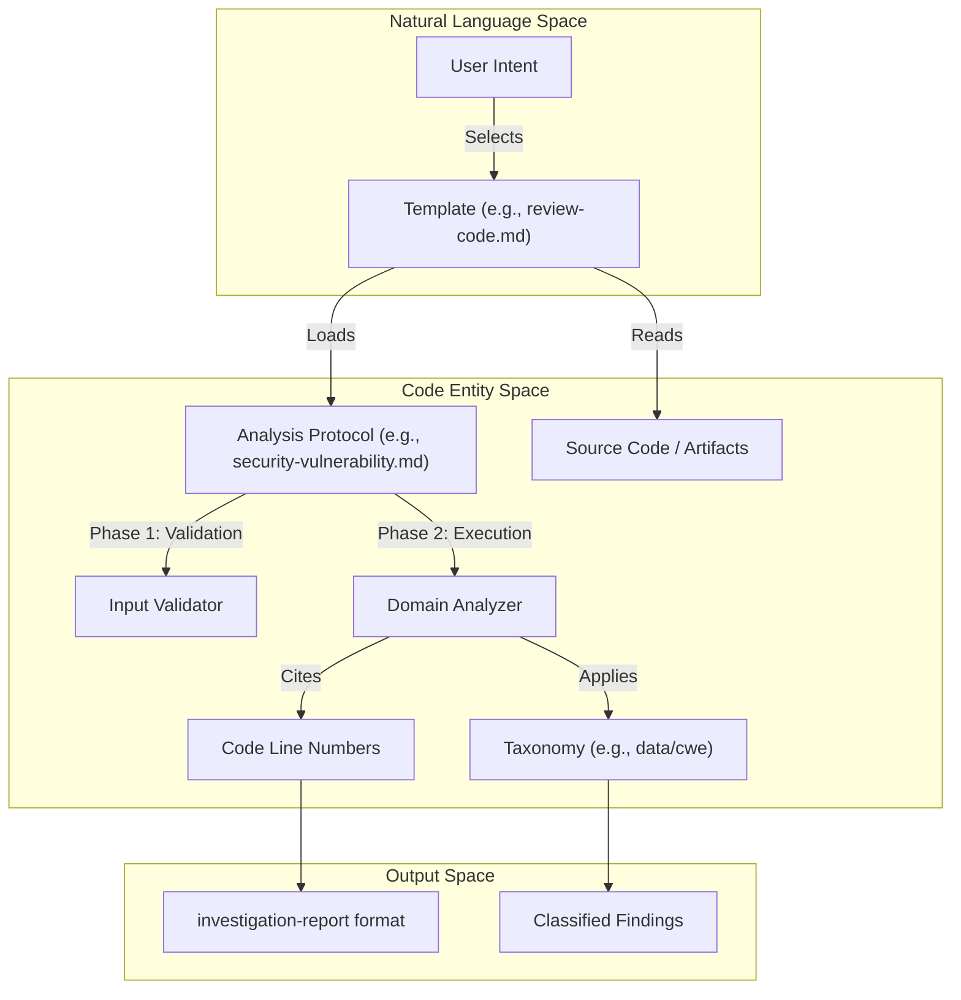
Sources: [templates/review-code.md:5-23](), [templates/investigate-security.md:11-31](), [formats/agent-instructions.md:137-146]()

## Software Analysis Protocols

These protocols focus on memory safety, thread safety, and API-specific conventions. They are often applied to `review-code` or `investigate-bug` templates.

### Security and Vulnerability
The `security-vulnerability` protocol [protocols/analysis/security-vulnerability.md]() (referenced in [templates/investigate-security.md:16]()) drives systematic auditing by:
1.  **Trust Boundary Mapping**: Identifying interfaces where data transitions between privilege levels [templates/investigate-security.md:51-54]().
2.  **Attack Surface Enumeration**: Listing input handling paths and authentication points [templates/investigate-security.md:149-150]().
3.  **Deep-Dive Analysis**: Using `exhaustive-path-tracing` for parsers and decoders processing untrusted input [templates/investigate-security.md:93-107]().

### Windows API and C++ Patterns
PromptKit includes specialized protocols for the Windows ecosystem:
*   **`win32-api-conventions`**: Validates handle management, error code checking (`HRESULT`), and character encoding (Unicode/ANSI) [protocols/analysis/win32-api-conventions.md]().
*   **`winrt-design-patterns`**: Focuses on ABI boundaries, asynchronous patterns, and reference counting in Windows Runtime [protocols/analysis/winrt-design-patterns.md]().
*   **`compiler-diagnostics-cpp`**: Analyzes code against MSVC and Clang-specific warning levels and portability concerns [protocols/analysis/compiler-diagnostics-cpp.md]().

Sources: [templates/investigate-security.md:51-127](), [protocols/analysis/win32-api-conventions.md:1-20](), [protocols/analysis/winrt-design-patterns.md:1-15]()

## Hardware and PCB Analysis Protocols

The hardware protocols enable a "Shift Left" approach by automating the review of physical design artifacts.

### PCB Layout and Design Review
The `layout-design-review` protocol [protocols/analysis/layout-design-review.md:5-16]() provides a 7-phase audit for PCB designs:

| Phase | Focus Area | Key Checks |
| :--- | :--- | :--- |
| **Phase 1** | DRC Report Review | Classification of violations vs. warnings [protocols/analysis/layout-design-review.md:24-30](). |
| **Phase 2** | Trace Width | IPC-2221 current capacity calculations for power rails [protocols/analysis/layout-design-review.md:40-50](). |
| **Phase 3** | Signal Integrity | USB differential pair impedance (~90Ω) and return path continuity [protocols/analysis/layout-design-review.md:58-66](). |
| **Phase 4** | Component Placement | Decoupling capacitor proximity (<3mm) and antenna keepouts [protocols/analysis/layout-design-review.md:77-92](). |
| **Phase 5** | Ground Planes | Plane continuity and star grounding for analog/digital separation [protocols/analysis/layout-design-review.md:102-119](). |

### Component Selection Audit
The `component-selection-audit` protocol [protocols/analysis/component-selection-audit.md:5-16]() acts as an adversarial validator for the Bill of Materials (BOM). It mandates:
*   **Part Number Verification**: Confirming the part is orderable and not a "hallucinated" suffix (e.g., verifying `nRF52840-QIAA` exists) [protocols/analysis/component-selection-audit.md:46-54]().
*   **Specification Cross-Check**: Verifying datasheet values (voltage, temperature, current) against design claims [protocols/analysis/component-selection-audit.md:72-89]().

Sources: [protocols/analysis/layout-design-review.md:18-142](), [protocols/analysis/component-selection-audit.md:18-120]()

## Library and Meta-Analysis Protocols

These protocols are used to maintain the PromptKit library itself or evaluate the quality of LLM instructions.

### Prompt Determinism Analysis
The `prompt-determinism-analysis` protocol [protocols/analysis/prompt-determinism-analysis.md:5-17]() identifies language patterns that cause inconsistent LLM behavior.

**Figure 2: Determinism Classification Data Flow**
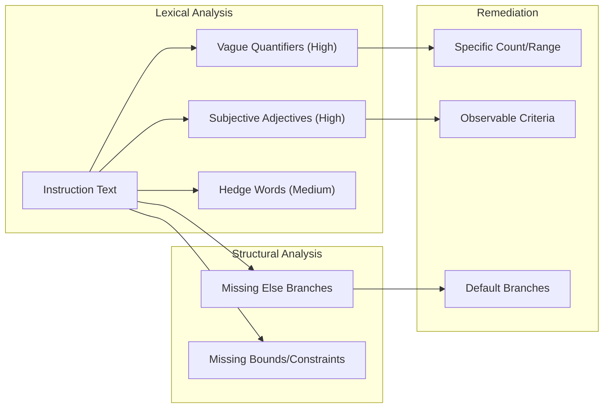

### Library Health Audit
The `audit-library-health` template [templates/audit-library-health.md:5-13]() uses a combination of protocols to perform a four-pass analysis:
1.  **Structural Consistency**: Detecting protocol overlap and metadata drift [templates/audit-library-health.md:108-113]().
2.  **Corpus Safety**: Auditing for assimilation risks and license compliance using `corpus-safety-audit` [templates/audit-library-health.md:184-187]().
3.  **Language Determinism**: Applying `prompt-determinism-analysis` to the library's own instructions [templates/audit-library-health.md:20-21]().

Sources: [protocols/analysis/prompt-determinism-analysis.md:25-138](), [templates/audit-library-health.md:38-200]()

---

# Page: Reasoning Protocols

# Reasoning Protocols

<details>
<summary>Relevant source files</summary>

The following files were used as context for generating this wiki page:

- [bootstrap.md](bootstrap.md)
- [docs/case-studies/audit-traceability.md](docs/case-studies/audit-traceability.md)
- [formats/behavioral-model.md](formats/behavioral-model.md)
- [formats/investigation-report.md](formats/investigation-report.md)
- [formats/structured-patch.md](formats/structured-patch.md)
- [personas/specification-analyst.md](personas/specification-analyst.md)
- [protocols/guardrails/anti-hallucination.md](protocols/guardrails/anti-hallucination.md)
- [protocols/guardrails/operational-constraints.md](protocols/guardrails/operational-constraints.md)
- [protocols/reasoning/change-propagation.md](protocols/reasoning/change-propagation.md)
- [protocols/reasoning/fixed-point-verification.md](protocols/reasoning/fixed-point-verification.md)
- [protocols/reasoning/invariant-extraction.md](protocols/reasoning/invariant-extraction.md)
- [protocols/reasoning/iterative-refinement.md](protocols/reasoning/iterative-refinement.md)
- [protocols/reasoning/manufacturing-artifact-generation.md](protocols/reasoning/manufacturing-artifact-generation.md)
- [protocols/reasoning/minimal-reproduction.md](protocols/reasoning/minimal-reproduction.md)
- [protocols/reasoning/multi-agent-coordination.md](protocols/reasoning/multi-agent-coordination.md)
- [protocols/reasoning/quantitative-constraint-validation.md](protocols/reasoning/quantitative-constraint-validation.md)
- [protocols/reasoning/requirements-elicitation.md](protocols/reasoning/requirements-elicitation.md)
- [protocols/reasoning/root-cause-analysis.md](protocols/reasoning/root-cause-analysis.md)
- [protocols/reasoning/session-handoff.md](protocols/reasoning/session-handoff.md)
- [protocols/reasoning/spec-evolution-diff.md](protocols/reasoning/spec-evolution-diff.md)
- [protocols/reasoning/traceability-audit.md](protocols/reasoning/traceability-audit.md)
- [taxonomies/kernel-defect-categories.md](taxonomies/kernel-defect-categories.md)
- [templates/audit-library-consistency.md](templates/audit-library-consistency.md)
- [templates/audit-traceability.md](templates/audit-traceability.md)
- [templates/author-session-handoff.md](templates/author-session-handoff.md)
- [templates/collaborate-requirements-change.md](templates/collaborate-requirements-change.md)
- [templates/diff-specifications.md](templates/diff-specifications.md)
- [templates/emit-manufacturing-artifacts.md](templates/emit-manufacturing-artifacts.md)
- [templates/extract-invariants.md](templates/extract-invariants.md)
- [templates/investigate-bug.md](templates/investigate-bug.md)
- [templates/investigate-trace.md](templates/investigate-trace.md)
- [templates/lint-prompt.md](templates/lint-prompt.md)
- [templates/reconstruct-behavior.md](templates/reconstruct-behavior.md)
- [templates/review-cpp-code.md](templates/review-cpp-code.md)
- [tests/self-audit-prompt.md](tests/self-audit-prompt.md)

</details>


Reasoning protocols in PromptKit are systematic, language-agnostic frameworks that govern how an LLM decomposes complex problems, evaluates evidence, and ensures logical convergence [protocols/reasoning/root-cause-analysis.md:8-10](). Unlike guardrails, which provide cross-cutting constraints, reasoning protocols provide the step-by-step cognitive architecture for specific engineering tasks like failure investigation, requirements engineering, and artifact validation.

## Architecture and Data Flow

Reasoning protocols are implemented as Markdown files with YAML frontmatter. They are typically composed into templates (e.g., `investigate-bug`) alongside a persona and an output format [templates/investigate-bug.md:10-18](). During the assembly process, the `bootstrap` engine reads these protocols and includes their full body text verbatim to guide the session's logic [bootstrap.md:54-58]().

### Protocol Execution Lifecycle

The following diagram illustrates how a reasoning protocol (using `root-cause-analysis` as an example) structures the flow from raw user input to a structured report.

**Logic Flow: Natural Language to Code Entity Space**

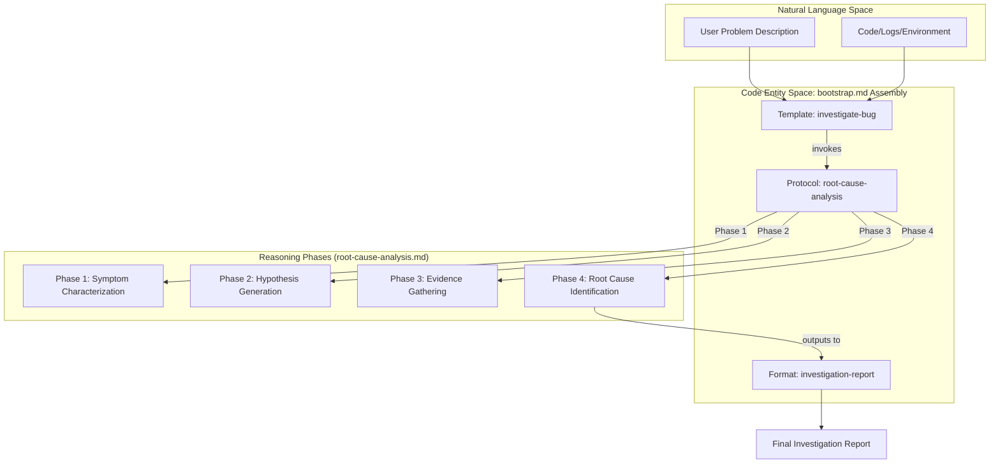

**Sources:** [templates/investigate-bug.md:31-47](), [protocols/reasoning/root-cause-analysis.md:17-103](), [bootstrap.md:21-26]()

---

## Core Reasoning Protocols

### Root Cause Analysis (RCA)
The RCA protocol provides a structured method for tracing symptoms to fundamental defects rather than proximate triggers [protocols/reasoning/root-cause-analysis.md:19-21](). It enforces a "Hypothesis Generation" phase where the LLM must generate at least 3 competing hypotheses before investigating any of them to prevent anchoring bias [protocols/reasoning/root-cause-analysis.md:48-51]().

**Key Functions:**
*   **Symptom Characterization**: Defines blast radius and timeline [protocols/reasoning/root-cause-analysis.md:23-36]().
*   **Iterative Deepening**: Forces analysis through layers (Survey → Attribution → Deep Analysis) [protocols/reasoning/root-cause-analysis.md:68-85]().
*   **Cross-Component Causal Chains**: Identifies trigger-response pairs and amplification cascades in multi-service systems [protocols/reasoning/root-cause-analysis.md:105-124]().

### Traceability Audit
Used primarily by the `specification-analyst` persona, this protocol audits consistency across requirements, design, and validation documents [protocols/reasoning/traceability-audit.md:18-21](). It uses the `specification-drift` taxonomy to classify findings [templates/audit-traceability.md:16-17]().

**Data Flow in Traceability Audit:**

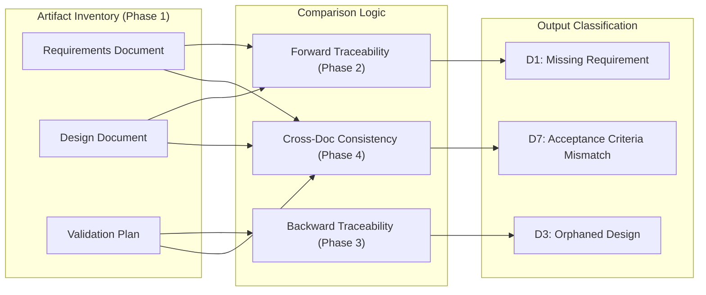

**Sources:** [protocols/reasoning/traceability-audit.md:23-157](), [templates/audit-traceability.md:41-61]()

### Requirements Elicitation
This protocol converts natural language descriptions into atomic, testable requirements using RFC 2119 keywords (MUST, SHALL, SHOULD) [protocols/reasoning/requirements-elicitation.md:19-21, 42-46](). It includes a specific "Ambiguity Detection" phase aligned with the `prompt-determinism-analysis` protocol to remove vague adjectives and unquantified quantities [protocols/reasoning/requirements-elicitation.md:56-85]().

### Fixed-Point Verification
A specialized protocol for verifying transformation correctness (e.g., compilers, formatters, migrators). It operates on the principle of idempotency: `T(T(x)) == T(x)` [protocols/reasoning/fixed-point-verification.md:21-24]().

**Implementation Details:**
*   **Phase 2 (Execute)**: Applies the transformation twice and compares the results [protocols/reasoning/fixed-point-verification.md:53-69]().
*   **Phase 3 (Diagnose)**: Categorizes divergence as Semantic, Syntactic, or Additive [protocols/reasoning/fixed-point-verification.md:89-103]().

---

## Technical Reference Table: Reasoning Protocols

| Protocol Name | Purpose | Key Mechanism | Applicable Templates |
| :--- | :--- | :--- | :--- |
| `root-cause-analysis` | Failure investigation | Hypothesis ranking & elimination | `investigate-bug`, `investigate-trace` |
| `traceability-audit` | Spec consistency | Forward/Backward mapping | `audit-traceability` |
| `requirements-elicitation` | Spec authoring | RFC 2119 atomic decomposition | `author-requirements-doc` |
| `fixed-point-verification` | Idempotency check | Multi-pass convergence testing | User-composed |
| `manufacturing-artifact-generation` | Hardware delivery | `kicad-cli` script generation | `emit-manufacturing-artifacts` |
| `change-propagation` | Impact analysis | Dependency graph traversal | `collaborate-requirements-change` |

**Sources:** [protocols/reasoning/manufacturing-artifact-generation.md:7-14](), [protocols/reasoning/fixed-point-verification.md:7-11](), [templates/audit-traceability.md:15]()

## Operational Constraints in Reasoning
All reasoning protocols are subject to `operational-constraints`, which enforce "Scope Before You Search" rules [protocols/guardrails/operational-constraints.md:24-25](). For instance, an LLM performing `root-cause-analysis` is restricted from reading more than 50 files in an initial discovery pass without summarizing findings [protocols/guardrails/operational-constraints.md:26-31](). This ensures that reasoning remains computationally efficient and fits within context window limits (max 50,000 lines) [protocols/guardrails/operational-constraints.md:67-68]().

**Sources:** [protocols/guardrails/operational-constraints.md:15-80]()

---

# Page: Output Formats

# Output Formats

<details>
<summary>Relevant source files</summary>

The following files were used as context for generating this wiki page:

- [.github/skills/respond-to-pr-comments/SKILL.md](.github/skills/respond-to-pr-comments/SKILL.md)
- [bootstrap.md](bootstrap.md)
- [formats/agent-instructions.md](formats/agent-instructions.md)
- [formats/architecture-spec.md](formats/architecture-spec.md)
- [formats/behavioral-model.md](formats/behavioral-model.md)
- [formats/design-doc.md](formats/design-doc.md)
- [formats/implementation-plan.md](formats/implementation-plan.md)
- [formats/investigation-report.md](formats/investigation-report.md)
- [formats/north-star-document.md](formats/north-star-document.md)
- [formats/pr-comment-responses.md](formats/pr-comment-responses.md)
- [formats/presentation-kit.md](formats/presentation-kit.md)
- [formats/protocol-delta.md](formats/protocol-delta.md)
- [formats/protocol-validation-spec.md](formats/protocol-validation-spec.md)
- [formats/requirements-doc.md](formats/requirements-doc.md)
- [formats/rfc-document.md](formats/rfc-document.md)
- [personas/protocol-architect.md](personas/protocol-architect.md)
- [protocols/analysis/prompt-determinism-analysis.md](protocols/analysis/prompt-determinism-analysis.md)
- [protocols/guardrails/anti-hallucination.md](protocols/guardrails/anti-hallucination.md)
- [protocols/guardrails/human-voice-fidelity.md](protocols/guardrails/human-voice-fidelity.md)
- [protocols/guardrails/operational-constraints.md](protocols/guardrails/operational-constraints.md)
- [protocols/reasoning/corpus-safety-audit.md](protocols/reasoning/corpus-safety-audit.md)
- [protocols/reasoning/invariant-extraction.md](protocols/reasoning/invariant-extraction.md)
- [protocols/reasoning/presentation-design.md](protocols/reasoning/presentation-design.md)
- [protocols/reasoning/protocol-conflict-analysis.md](protocols/reasoning/protocol-conflict-analysis.md)
- [protocols/reasoning/protocol-evolution.md](protocols/reasoning/protocol-evolution.md)
- [protocols/reasoning/protocol-validation-design.md](protocols/reasoning/protocol-validation-design.md)
- [protocols/reasoning/root-cause-analysis.md](protocols/reasoning/root-cause-analysis.md)
- [taxonomies/protocol-change-categories.md](taxonomies/protocol-change-categories.md)
- [templates/analyze-protocol-conflicts.md](templates/analyze-protocol-conflicts.md)
- [templates/audit-code-compliance.md](templates/audit-code-compliance.md)
- [templates/audit-library-health.md](templates/audit-library-health.md)
- [templates/author-agent-instructions.md](templates/author-agent-instructions.md)
- [templates/author-architecture-spec.md](templates/author-architecture-spec.md)
- [templates/author-north-star.md](templates/author-north-star.md)
- [templates/author-pipeline.md](templates/author-pipeline.md)
- [templates/author-presentation.md](templates/author-presentation.md)
- [templates/author-protocol-validation.md](templates/author-protocol-validation.md)
- [templates/author-requirements-doc.md](templates/author-requirements-doc.md)
- [templates/author-rfc.md](templates/author-rfc.md)
- [templates/author-validation-plan.md](templates/author-validation-plan.md)
- [templates/evolve-protocol.md](templates/evolve-protocol.md)
- [templates/extract-invariants.md](templates/extract-invariants.md)
- [templates/investigate-bug.md](templates/investigate-bug.md)
- [templates/investigate-trace.md](templates/investigate-trace.md)
- [templates/reconstruct-behavior.md](templates/reconstruct-behavior.md)
- [templates/respond-to-pr-comments.md](templates/respond-to-pr-comments.md)
- [templates/review-pull-request.md](templates/review-pull-request.md)
- [templates/triage-issues.md](templates/triage-issues.md)

</details>


Output Formats are the final layer of the PromptKit composition pipeline. They define the structural schema, section ordering, and data representation for the artifacts generated by an LLM session [bootstrap.md:48-49](). PromptKit includes 27 distinct output format schemas, ranging from technical investigation reports to persistent agent instruction files.

## Format Selection Logic

PromptKit employs a dynamic selection logic to determine which structural variation of a format to apply. This is most prominent in the `investigation-report` format, which uses a "Complexity Gate" to switch between **Abbreviated** and **Full** modes [formats/investigation-report.md:19-27]().

### Abbreviated vs. Full Format
The system evaluates the findings before finalizing the document structure:
*   **Abbreviated Format**: Used when the total finding count is $\le 5$ AND no findings have a severity of "Critical" or "High" [formats/investigation-report.md:38-41](). It omits high-overhead sections like `Problem Statement`, `Root Cause Analysis`, and `Prevention` [formats/investigation-report.md:75-79]().
*   **Full Format**: Triggered if findings exceed 5, any "Critical/High" severity is present, or the context involves incident response or security audits [formats/investigation-report.md:88-93](). Certain templates (e.g., `investigate-bug`) explicitly override the gate to always require the full 9-section structure [templates/investigate-bug.md:88-90]().

### Format Selection Flow
The following diagram illustrates how the `bootstrap.md` composition engine and individual format logic interact to select the final output structure.

**Format Decision and Assembly Pipeline**
```mermaid
graph TD
    subgraph "Composition Layer (bootstrap.md)"
        A["User Intent"] --> B["Select Template"]
        B --> C{"Check Output Mode"}
        C -- "Raw Prompt" --> D["Apply Template Format"]
        C -- "Agent Instructions" --> E["Switch to agent-instructions format"]
        C -- "Copilot Prompt" --> F["Wrap in .prompt.md"]
    end

    subgraph "Format Logic (investigation-report.md)"
        D --> G["Enumerate Findings"]
        G --> H{"Severity/Count Gate"}
        H -- "<= 5 Low/Med" --> I["Abbreviated Structure"]
        H -- "> 5 OR Crit/High" --> J["Full 9-Section Structure"]
    end

    subgraph "Code Entities"
        I --- K["formats/investigation-report.md"]
        J --- K
        E --- L["formats/agent-instructions.md"]
    end
```
**Sources:** [bootstrap.md:48-58](), [formats/investigation-report.md:19-34](), [templates/investigate-bug.md:88-90]()

---

## Core Format Reference

### Investigation and Review Formats
These formats are designed for analytical tasks, emphasizing evidence, severity, and remediation.

| Format Name | Purpose | Key Sections |
| :--- | :--- | :--- |
| `investigation-report` | Bug/Security audits [formats/investigation-report.md:7-9]() | Executive Summary, Findings (F-NNN), Root Cause, Remediation, Coverage [formats/investigation-report.md:105-163]() |
| `pr-comment-responses` | Review feedback [formats/pr-comment-responses.md:7-10]() | Thread Summary (Native Status), Contradiction Report, Per-Thread Responses [formats/pr-comment-responses.md:25-107]() |
| `structured-patch` | Code modifications | Before/After blocks, Impact Analysis, Test Verification |

**Sources:** [formats/investigation-report.md:5-11](), [formats/pr-comment-responses.md:5-12](), [templates/review-pull-request.md:17]()

### Persistent Agent Formats
Unlike standard reports, these formats produce files intended for version control and consumption by LLM runtimes (GitHub Copilot, Claude Code, Cursor) [formats/agent-instructions.md:7-14]().

*   **`agent-instructions`**: Produces composable `.instructions.md` files. For GitHub Copilot, it decomposes a single prompt into multiple files targeted via `applyTo` globs (e.g., `**/*.c` for a memory-safety skill) [formats/agent-instructions.md:22-25, 48-52]().
*   **`agentic-workflow`**: Wraps prompts in GitHub Actions metadata, including `permissions`, `tools`, and `safe-outputs` [bootstrap.md:108-118]().

**Sources:** [formats/agent-instructions.md:18-53](), [bootstrap.md:69-87](), [templates/author-agent-instructions.md:46-51]()

---

## Implementation Details: The Confidence Framework

Most analytical formats (notably `investigation-report`) implement a standardized **Confidence Framework** to communicate the epistemic certainty of findings [formats/investigation-report.md:172-180]().

| Level | Meaning | Code Requirement |
| :--- | :--- | :--- |
| **High** | Verified finding | Requires code inspection, reproduction, or direct evidence [formats/investigation-report.md:178]() |
| **Medium** | Plausible finding | Direct evidence exists but a key aspect (e.g., concurrency) is unverified [formats/investigation-report.md:179]() |
| **Low** | Circumstantial | Evidence is weak; requires expert review before action [formats/investigation-report.md:180]() |

This framework is enforced by the `anti-hallucination` protocol, which requires every claim to be labeled as `KNOWN`, `INFERRED`, or `ASSUMED` [protocols/guardrails/anti-hallucination.md:21-30]().

**Data Flow: From Protocol to Format**
```mermaid
graph LR
    subgraph "Reasoning Space (Protocol)"
        P1["anti-hallucination"] -->|Labels| D1["KNOWN/INFERRED/ASSUMED"]
        P2["self-verification"] -->|Evidence| D2["File:Line Citations"]
    end

    subgraph "Structure Space (Format)"
        F1["investigation-report"]
        D1 --> F1
        D2 --> F1
        F1 --> S1["Confidence: High/Med/Low"]
    end

    subgraph "Code Implementation"
        P1 --- C1["protocols/guardrails/anti-hallucination.md"]
        F1 --- C2["formats/investigation-report.md"]
    end
```
**Sources:** [protocols/guardrails/anti-hallucination.md:21-30](), [formats/investigation-report.md:172-184]()

---

## Complete Format Catalog (Summary)

PromptKit provides 27 schemas. Key technical formats include:

1.  **`investigation-report`**: Root cause and security analysis [formats/investigation-report.md]().
2.  **`requirements-doc`**: Functional and non-functional specifications.
3.  **`design-doc`**: Architectural blueprints and component definitions.
4.  **`agent-instructions`**: Composable skill and agent files [formats/agent-instructions.md]().
5.  **`rfc-document`**: Request for Comments for protocol/system changes.
6.  **`behavioral-model`**: Formal descriptions of system state and transitions.
7.  **`triage-report`**: Initial classification of bugs or issues.
8.  **`validation-plan`**: Test strategies and compliance matrices.
9.  **`implementation-plan`**: Step-by-step engineering execution guides.
10. **`pr-comment-responses`**: Automated PR feedback management [formats/pr-comment-responses.md]().
11. **`protocol-validation-spec`**: Invariant and property checks for protocols.
12. **`protocol-delta`**: Structured changes between protocol versions.
13. **`architecture-spec`**: High-level system structure and constraints.
14. **`north-star-document`**: Long-term vision and strategy alignment.
15. **`presentation-kit`**: Structured content for technical presentations.

**Sources:** [manifest.yaml](), [formats/agent-instructions.md:5-15](), [formats/investigation-report.md:5-11](), [formats/pr-comment-responses.md:5-12]()

---

# Page: Taxonomies

# Taxonomies

<details>
<summary>Relevant source files</summary>

The following files were used as context for generating this wiki page:

- [CATALOG.md](CATALOG.md)
- [docs/examples.md](docs/examples.md)
- [docs/scenarios.md](docs/scenarios.md)
- [formats/decision-log.md](formats/decision-log.md)
- [protocols/guardrails/adversarial-falsification.md](protocols/guardrails/adversarial-falsification.md)
- [protocols/guardrails/definition-of-done.md](protocols/guardrails/definition-of-done.md)
- [protocols/guardrails/input-clarity-gate.md](protocols/guardrails/input-clarity-gate.md)
- [protocols/guardrails/tool-reliability-defense.md](protocols/guardrails/tool-reliability-defense.md)
- [protocols/reasoning/integration-audit.md](protocols/reasoning/integration-audit.md)
- [protocols/reasoning/test-compliance-audit.md](protocols/reasoning/test-compliance-audit.md)
- [scripts/ingest-cwe.py](scripts/ingest-cwe.py)
- [taxonomies/agent-behavioral-failures.md](taxonomies/agent-behavioral-failures.md)
- [taxonomies/cpp-review-patterns.md](taxonomies/cpp-review-patterns.md)
- [taxonomies/cwe-cli-tools.md](taxonomies/cwe-cli-tools.md)
- [taxonomies/cwe-cloud-service.md](taxonomies/cwe-cloud-service.md)
- [taxonomies/cwe-container-k8s.md](taxonomies/cwe-container-k8s.md)
- [taxonomies/cwe-crypto-protocols.md](taxonomies/cwe-crypto-protocols.md)
- [taxonomies/cwe-data-processing.md](taxonomies/cwe-data-processing.md)
- [taxonomies/cwe-firmware-embedded.md](taxonomies/cwe-firmware-embedded.md)
- [taxonomies/cwe-iac.md](taxonomies/cwe-iac.md)
- [taxonomies/cwe-kernel-mode-c-cpp.md](taxonomies/cwe-kernel-mode-c-cpp.md)
- [taxonomies/cwe-managed-dotnet.md](taxonomies/cwe-managed-dotnet.md)
- [taxonomies/cwe-mobile-app.md](taxonomies/cwe-mobile-app.md)
- [taxonomies/cwe-native-user-mode-c-cpp.md](taxonomies/cwe-native-user-mode-c-cpp.md)
- [taxonomies/cwe-web-backend.md](taxonomies/cwe-web-backend.md)
- [taxonomies/cwe-web-js-ts.md](taxonomies/cwe-web-js-ts.md)
- [taxonomies/specification-drift.md](taxonomies/specification-drift.md)
- [templates/audit-integration-compliance.md](templates/audit-integration-compliance.md)
- [templates/audit-test-compliance.md](templates/audit-test-compliance.md)
- [templates/author-known-conditions-registry.md](templates/author-known-conditions-registry.md)

</details>


Taxonomies in PromptKit provide the formal classification schemes used to label findings, vulnerabilities, and document discrepancies. While protocols define *how* to analyze, taxonomies define *what* the result is called. Every finding generated by an audit or investigation template must map to exactly one label within a specified taxonomy, ensuring that LLM outputs remain structured, searchable, and compatible with downstream engineering workflows.

The PromptKit library currently contains 19 taxonomy files, ranging from specialized specification-drift trackers to massive CWE (Common Weakness Enumeration) domain subsets.

## Taxonomy Architecture

Taxonomies are defined as YAML-frontmatter-enabled Markdown files in the `taxonomies/` directory. They bridge the gap between "Natural Language Space" (the LLM's reasoning) and "Code Entity Space" (stable identifiers for bug trackers and CI/CD).

### Data Flow and Classification
When a template like `audit-traceability` is executed, the `specification-drift` taxonomy is injected into the prompt context. The LLM uses the `Pattern` and `Risk` definitions to classify its observations.

Title: Taxonomy Classification Pipeline
```mermaid
graph TD
    subgraph "Natural Language Space"
        A["User Input (Code/Docs)"] --> B["LLM Analysis"]
        C["Taxonomy Pattern Definitions"] --> B
    end

    subgraph "Code Entity Space"
        B --> D["Structured Finding"]
        D --> E["Label (e.g., D2_UNTESTED_REQUIREMENT)"]
        E --> F["Investigation Report / JSON"]
    end

    [taxonomies/specification-drift.md:48-53]()
    [templates/audit-traceability.md:20-22]()
```
Sources: [taxonomies/specification-drift.md:48-53](), [CATALOG.md:31-31]()

## Specification Drift (D1–D16)

The `specification-drift` taxonomy is the primary tool for auditing the engineering lifecycle. it covers the divergence between requirements, design, implementation, and testing.

| Range | Group | Focus |
|-------|-------|-------|
| **D1–D7** | Traceability | Gaps between Requirements, Design, and Validation Plans. |
| **D8–D10** | Code Compliance | Discrepancies between source code and specifications. |
| **D11–D13** | Test Compliance | Gaps between test code and the validation plan. |
| **D14–D16** | Integration | Interface contract mismatches between components. |

### Key Labels and Patterns
*   **D2_UNTESTED_REQUIREMENT**: A requirement exists in the doc but has no corresponding test case in the validation plan [taxonomies/specification-drift.md:66-73]().
*   **D6_CONSTRAINT_VIOLATION**: A design decision directly contradicts a stated requirement (e.g., performance targets) [taxonomies/specification-drift.md:134-142]().
*   **D8_UNIMPLEMENTED_REQUIREMENT**: A specified behavior is missing from the source code [taxonomies/specification-drift.md:171-178]().

Sources: [taxonomies/specification-drift.md:34-47](), [taxonomies/specification-drift.md:66-73](), [taxonomies/specification-drift.md:134-142](), [taxonomies/specification-drift.md:171-178]()

## CWE Domain Taxonomies

PromptKit includes 13 domain-specific taxonomies derived from the MITRE CWE™ corpus. These are generated via `scripts/ingest-cwe.py`, which parses the CWE XML and filters weaknesses into domain-relevant subsets.

### Implementation of Domain Scoping
Each CWE taxonomy file (e.g., `cwe-firmware-embedded.md`) includes a strict instruction to the LLM: **only** consider CWE IDs listed in that file [taxonomies/cwe-firmware-embedded.md:28-31](). This prevents "CWE sprawl" where an LLM might report a web-specific vulnerability in a kernel driver.

| Domain Taxonomy | CWE Count | Target |
|-----------------|-----------|--------|
| `cwe-firmware-embedded` | 226 | SoC, Bootloaders, HAL [taxonomies/cwe-firmware-embedded.md:25-26]() |
| `cwe-kernel-mode-c-cpp` | 113 | OS Kernels, Drivers [taxonomies/cwe-kernel-mode-c-cpp.md:25-26]() |
| `cwe-cloud-service` | 113 | APIs, Cloud-hosted backends [taxonomies/cwe-cloud-service.md:23-26]() |
| `cwe-managed-dotnet` | 92 | C#, F#, VB.NET [taxonomies/cwe-managed-dotnet.md:25-26]() |
| `cwe-cli-tools` | 65 | Command-line utilities [taxonomies/cwe-cli-tools.md:23-26]() |
| `cwe-mobile-app` | 23 | iOS, Android [taxonomies/cwe-mobile-app.md:25-26]() |
| `cwe-iac` | 8 | Terraform, Bicep, ARM [taxonomies/cwe-iac.md:25-26]() |

Sources: [taxonomies/cwe-firmware-embedded.md:25-31](), [taxonomies/cwe-kernel-mode-c-cpp.md:25-26](), [taxonomies/cwe-cloud-service.md:23-26](), [taxonomies/cwe-managed-dotnet.md:25-26](), [taxonomies/cwe-cli-tools.md:23-26](), [taxonomies/cwe-mobile-app.md:25-26](), [taxonomies/cwe-iac.md:25-26]()

## Specialized Taxonomies

Beyond drift and CWEs, PromptKit utilizes taxonomies to manage agent behavior and specific technical patterns.

### Agent Behavioral Failures
Used to classify failures in AI agent sessions, such as:
*   **Tool-use errors**: Incorrect argument formatting or hallucinated tools.
*   **Context drift**: Losing track of the original objective during multi-step reasoning.
*   **Safety gate triggers**: Refusals or over-censorship.

### C++ Review Patterns
The `cpp-review-patterns` taxonomy provides a vocabulary for the `review-cpp-code` template. It focuses on modern C++ (C++11 through C++23) hazards like:
*   **Iterator Invalidation**: Use of iterators after container modification.
*   **Perfect Forwarding Failures**: Misuse of `std::forward` in templates.
*   **Lambda Capture Hazards**: Capturing local variables by reference in asynchronous contexts.

### Protocol Change Categories
Used by the `diff-specifications` template to classify changes between two versions of a protocol or RFC [CATALOG.md:36-36]().
*   **Tightened**: Constraints became more restrictive.
*   **Relaxed**: Constraints became more permissive.
*   **Clarified**: Semantic meaning unchanged, but ambiguity reduced.

Sources: [CATALOG.md:36-36](), [taxonomies/specification-drift.md:1-18]()

## Usage in Prompt Assembly

Taxonomies are integrated into the final prompt via the `Taxonomy` layer of the assembly pipeline.

Title: Taxonomy Injection into LLM Context
```mermaid
graph LR
    subgraph "manifest.yaml Registry"
        T1["specification-drift"]
        T2["cwe-kernel-mode-c-cpp"]
    end

    subgraph "Assembly Engine"
        E["Bootstrap Engine"]
    end

    subgraph "Final Prompt Structure"
        P["Persona"]
        PR["Protocols"]
        TX["Taxonomy Definitions"]
        F["Format Schema"]
    end

    T1 --> E
    T2 --> E
    E --> TX
```

When a user runs `npx promptkit assemble --template audit-code-compliance`, the CLI:
1.  Looks up the template in `manifest.yaml`.
2.  Identifies `specification-drift` as the required taxonomy.
3.  Appends the content of `taxonomies/specification-drift.md` to the prompt.
4.  Instructs the LLM: "Every finding MUST use exactly one label from this taxonomy" [taxonomies/specification-drift.md:22-24]().

Sources: [CATALOG.md:6-16](), [taxonomies/specification-drift.md:22-24]()

---

# Page: Templates Catalog

# Templates Catalog

<details>
<summary>Relevant source files</summary>

The following files were used as context for generating this wiki page:

- [CATALOG.md](CATALOG.md)
- [formats/design-doc.md](formats/design-doc.md)
- [formats/requirements-doc.md](formats/requirements-doc.md)
- [manifest.yaml](manifest.yaml)
- [protocols/guardrails/adversarial-falsification.md](protocols/guardrails/adversarial-falsification.md)
- [protocols/guardrails/definition-of-done.md](protocols/guardrails/definition-of-done.md)
- [protocols/guardrails/input-clarity-gate.md](protocols/guardrails/input-clarity-gate.md)
- [protocols/guardrails/self-verification.md](protocols/guardrails/self-verification.md)
- [protocols/guardrails/tool-reliability-defense.md](protocols/guardrails/tool-reliability-defense.md)
- [templates/author-known-conditions-registry.md](templates/author-known-conditions-registry.md)
- [templates/author-pipeline.md](templates/author-pipeline.md)
- [templates/author-requirements-doc.md](templates/author-requirements-doc.md)
- [templates/author-validation-plan.md](templates/author-validation-plan.md)
- [templates/triage-issues.md](templates/triage-issues.md)

</details>


The **Templates Catalog** is the top-level orchestration layer of PromptKit. While Personas, Protocols, and Formats provide the building blocks, Templates define the specific engineering tasks and the "glue" that binds these components into executable prompts. 

PromptKit currently contains **78 templates** [CATALOG.md:16-16]() covering the full lifecycle of systems, software, and hardware engineering.

## Template Structure

Each template is a Markdown file residing in the `templates/` directory, governed by a YAML frontmatter block that defines its dependencies and interface contracts.

### Component Composition
Templates do not contain hardcoded logic for personas or guardrails. Instead, they reference components by name from the `manifest.yaml`. When a template is assembled by the CLI, the engine resolves these references to build a complete system prompt.

| Field | Description | Code Reference |
|-------|-------------|----------------|
| `persona` | The expert identity used for the task. | [templates/author-requirements-doc.md:9-9]() |
| `protocols` | List of guardrails, reasoning, or analysis protocols to apply. | [templates/author-requirements-doc.md:10-13]() |
| `format` | The specific output schema the LLM must follow. | [templates/author-requirements-doc.md:14-14]() |
| `params` | Variables (e.g., `project_name`) injected into the template body. | [templates/author-requirements-doc.md:15-19]() |

### Input and Output Contracts
Templates use **Contracts** to ensure they can be chained into multi-stage pipelines. An `input_contract` defines the expected type of data (e.g., `requirements-document`), while an `output_contract` specifies what the template produces.

```yaml
input_contract:
  type: requirements-document
  description: A requirements document with numbered REQ-IDs.
output_contract:
  type: validation-plan
  description: A validation plan with test cases and traceability.
```
*Sources: [templates/author-validation-plan.md:19-28]()*

## Domain Mapping: Natural Language to Code Entities

The following diagrams illustrate how PromptKit bridges high-level engineering intent with specific code-space entities (files, schemas, and identifiers).

### Requirement Extraction Workflow
This diagram shows how a user's natural language intent is transformed into structured code entities via the `author-requirements-doc` template.

```mermaid
graph TD
    UserIntent["'I need a file uploader'"] -- "params: description" --> Template["templates/author-requirements-doc.md"]
    Template -- "persona" --> Persona["personas/software-architect.md"]
    Template -- "protocol" --> Reasoning["protocols/reasoning/requirements-elicitation.md"]
    Template -- "format" --> Format["formats/requirements-doc.md"]
    
    Format -- "produces" --> Entity["REQ-ID (e.g., REQ-AUTH-001)"]
    Entity -- "enforced by" --> AC["AC-1: Acceptance Criteria"]
    
    subgraph "Code Entity Space"
        Entity
        AC
        Format
    end
```
*Sources: [templates/author-requirements-doc.md:5-26](), [formats/requirements-doc.md:41-54]()*

### Investigation and Triage Pipeline
This diagram illustrates the flow from a repository issue to a structured triage report using DevOps-centric entities.

```mermaid
graph LR
    Issue["GitHub/ADO Issue"] -- "input" --> Triage["templates/triage-issues.md"]
    Triage -- "persona" --> DevOp["personas/devops-engineer.md"]
    Triage -- "format" --> Report["formats/triage-report.md"]
    
    subgraph "Triage Logic"
        Report -- "classifies" --> Prio["Priority: Critical/High/Med/Low"]
        Report -- "estimates" --> Effort["Effort: Small/Med/Large"]
    end
```
*Sources: [templates/triage-issues.md:10-28](), [manifest.yaml:37-42]()*

---

## Template Categories

The catalog is organized into functional areas. Each category is detailed in its own child page.

### [3.1 Investigation and Debugging Templates](#)
Focuses on root-cause analysis, trace investigation, and security vulnerability hunting. Key templates include `investigate-bug` and `root-cause-ci-failure`.
*For details, see [Investigation and Debugging Templates](#3.1).*

### [3.2 Code Review and Compliance Templates](#)
Covers the auditing of source code against specifications, PR reviews, and traceability checks. Includes `review-pull-request` and `audit-code-compliance`.
*For details, see [Code Review and Compliance Templates](#3.2).*

### [3.3 Design and Requirements Templates](#)
Orchestrates the creation of foundational engineering documents. Features templates like `author-design-doc` and the multi-phase `interactive-design`.
*For details, see [Design and Requirements Templates](#3.3).*

### [3.4 Hardware Design Templates](#)
Specialized workflows for electrical and mechanical engineering, including schematic reviews and link budget validation.
*For details, see [Hardware Design Templates](#3.4).*

### [3.5 Agent Instructions and Prompt Engineering Templates](#)
Tools for maintaining the PromptKit library itself and generating instructions for persistent AI agents. Includes `author-agent-instructions` and `lint-prompt`.
*For details, see [Agent Instructions and Prompt Engineering Templates](#3.5).*

### [3.6 Protocol Engineering Templates](#)
Dedicated to the design and evolution of communication protocols and state machines. Includes `author-rfc` and `analyze-protocol-conflicts`.
*For details, see [Protocol Engineering Templates](#3.6).*

---
**Sources:**
- [CATALOG.md:1-110]()
- [manifest.yaml:1-175]()
- [templates/author-requirements-doc.md:1-81]()
- [templates/author-validation-plan.md:1-89]()
- [templates/triage-issues.md:1-111]()
- [templates/author-known-conditions-registry.md:1-154]()

---

# Page: Investigation and Debugging Templates

# Investigation and Debugging Templates

<details>
<summary>Relevant source files</summary>

The following files were used as context for generating this wiki page:

- [bootstrap.md](bootstrap.md)
- [formats/investigation-report.md](formats/investigation-report.md)
- [protocols/analysis/security-vulnerability.md](protocols/analysis/security-vulnerability.md)
- [protocols/guardrails/anti-hallucination.md](protocols/guardrails/anti-hallucination.md)
- [protocols/guardrails/operational-constraints.md](protocols/guardrails/operational-constraints.md)
- [protocols/reasoning/exhaustive-path-tracing.md](protocols/reasoning/exhaustive-path-tracing.md)
- [protocols/reasoning/root-cause-analysis.md](protocols/reasoning/root-cause-analysis.md)
- [templates/author-design-doc.md](templates/author-design-doc.md)
- [templates/exhaustive-bug-hunt.md](templates/exhaustive-bug-hunt.md)
- [templates/find-and-fix-bugs.md](templates/find-and-fix-bugs.md)
- [templates/interactive-design.md](templates/interactive-design.md)
- [templates/investigate-bug.md](templates/investigate-bug.md)
- [templates/investigate-security.md](templates/investigate-security.md)
- [templates/investigate-trace.md](templates/investigate-trace.md)
- [templates/plan-implementation.md](templates/plan-implementation.md)
- [templates/review-code.md](templates/review-code.md)

</details>


The **Investigation and Debugging Templates** in PromptKit provide structured workflows for identifying, analyzing, and remediating software defects, security vulnerabilities, and performance regressions. These templates leverage the `investigation-report` format and the `root-cause-analysis` protocol to ensure that findings are grounded in evidence and trace back to fundamental causes rather than proximate triggers.

## Core Investigation Pipeline

The investigation templates follow a consistent data flow from natural language problem descriptions and raw technical context (logs, traces, or code) to a structured, evidence-based report.

### Data Flow: Natural Language to Code Entity Space

The following diagram illustrates how a user's problem description is transformed into technical findings through the application of PromptKit protocols.

**Figure 1: Investigation Transformation Flow**
```mermaid
graph TD
    subgraph "Natural Language Space"
        UserDesc["Problem Description (Params)"]
        Env["Environment Context"]
    end

    subgraph "Code Entity Space (PromptKit Logic)"
        Template["investigate-bug Template"]
        Persona["systems-engineer Persona"]
        RCA["root-cause-analysis Protocol"]
        AH["anti-hallucination Protocol"]
    end

    subgraph "Output Space"
        Report["investigation-report Format"]
        Findings["Findings (F-NNN)"]
        RC["Root Cause Analysis"]
    end

    UserDesc --> Template
    Env --> Template
    Template --> Persona
    Persona --> RCA
    RCA --> AH
    AH --> Report
    Report --> Findings
    Report --> RC
```
**Sources:** [templates/investigate-bug.md:1-29](), [protocols/reasoning/root-cause-analysis.md:1-15](), [formats/investigation-report.md:103-163]()

## Key Templates

### 1. investigate-bug
The primary entry point for general software defect analysis. It mandates the use of the `root-cause-analysis` protocol and the `systems-engineer` persona.

*   **Implementation:** It forces a "Full Format" report, requiring sections for causal chains and prevention [templates/investigate-bug.md:88-90]().
*   **Key Logic:** The template requires generating 3–5 competing hypotheses before investigating any single one to avoid "anchoring bias" [templates/investigate-bug.md:49-54]().
*   **Verification:** It utilizes the `self-verification` protocol to re-verify at least 3–5 findings against the source code before finalization [templates/investigate-bug.md:72-76]().

**Sources:** [templates/investigate-bug.md:1-130]()

### 2. investigate-security
Designed for security audits and vulnerability research, utilizing the `security-auditor` persona and the `security-vulnerability` analysis protocol.

*   **Trust Boundary Mapping:** Executes a systematic audit of trust boundaries (network, IPC, privilege transitions) [protocols/analysis/security-vulnerability.md:23-34]().
*   **Exhaustive Path Tracing:** Specifically targets parser and decoder functions that handle untrusted structured input [templates/investigate-security.md:93-107]().
*   **CWE Integration:** Requires findings to be mapped to Common Weakness Enumeration (CWE) identifiers [templates/investigate-security.md:68-71]().

**Sources:** [templates/investigate-security.md:1-165](), [protocols/analysis/security-vulnerability.md:1-115]()

### 3. investigate-trace
Specialized for performance, power, and behavioral issues using ETW/ETL captures or telemetry.

*   **Iterative Deepening:** Follows a specific sequence: Broad Survey → Attribution → Deep Analysis → Cross-Component Tracing [templates/investigate-trace.md:137-161]().
*   **Call Stack Analysis:** Mandates call stack grouping by process and thread to move beyond module-level "where" to functional "why" [templates/investigate-trace.md:76-86]().
*   **Energy Divergence:** Includes specific logic for comparing CPU usage against energy estimation to find wake/sleep patterns that drain battery life [templates/investigate-trace.md:87-99]().

**Sources:** [templates/investigate-trace.md:1-163](), [protocols/reasoning/root-cause-analysis.md:66-93]()

## Analysis Protocols and Logic

### Root Cause Analysis (RCA)
The `root-cause-analysis` protocol is the reasoning engine for all investigation templates. It distinguishes between the **proximate cause** (the immediate crash or error) and the **root cause** (the underlying defect) [protocols/reasoning/root-cause-analysis.md:96-104]().

**Figure 2: RCA Protocol Execution Logic**
```mermaid
graph TD
    Phase1["Phase 1: Symptom Characterization"] --> Phase2["Phase 2: Hypothesis Generation (Min 3)"]
    Phase2 --> Phase3["Phase 3: Evidence Gathering (Elimination)"]
    Phase3 --> Phase3a["Phase 3a: Iterative Deepening (Survey -> Attribution -> Deep)"]
    Phase3a --> Phase4["Phase 4: Root Cause Identification (Causal Chain)"]
    Phase4 --> Phase5["Phase 5: Remediation (Root + Secondary Fixes)"]
```
**Sources:** [protocols/reasoning/root-cause-analysis.md:17-137]()

### Operational Constraints in Debugging
To prevent "context window exhaustion" and "over-ingestion," the `operational-constraints` protocol governs how the LLM interacts with large codebases or trace sets:

*   **Scoping:** Limits initial discovery passes to 50 files before requiring a summary [protocols/guardrails/operational-constraints.md:26-31]().
*   **Deterministic Analysis:** Prefers repeatable methods (scripts/queries) over ad-hoc manual inspection [protocols/guardrails/operational-constraints.md:44-53]().
*   **Two-Failures Rule:** If a debugging strategy fails twice, the protocol mandates a switch in strategy rather than minor variations [protocols/guardrails/operational-constraints.md:123-136]().

**Sources:** [protocols/guardrails/operational-constraints.md:15-148]()

## Standardized Output: Investigation Report

All investigation templates output to the `investigation-report` format. This format enforces a **Confidence Framework** (High/Medium/Low) based on the strength of evidence [formats/investigation-report.md:174-181]().

| Section | Purpose | Mandatory in Full Format |
| :--- | :--- | :--- |
| **1. Executive Summary** | Stakeholder overview | Yes |
| **4. Findings** | Detailed F-NNN entries with evidence | Yes |
| **5. Root Cause Analysis** | The causal chain from symptom to defect | Yes |
| **7. Prevention** | Code/Process changes to stop recurrence | Yes |
| **8. Open Questions** | Unresolved items requiring more data | Yes |

**Sources:** [formats/investigation-report.md:103-163]()

---

# Page: Code Review and Compliance Templates

# Code Review and Compliance Templates

<details>
<summary>Relevant source files</summary>

The following files were used as context for generating this wiki page:

- [.github/skills/respond-to-pr-comments/SKILL.md](.github/skills/respond-to-pr-comments/SKILL.md)
- [docs/case-studies/audit-traceability.md](docs/case-studies/audit-traceability.md)
- [docs/examples.md](docs/examples.md)
- [docs/scenarios.md](docs/scenarios.md)
- [formats/decision-log.md](formats/decision-log.md)
- [formats/pr-comment-responses.md](formats/pr-comment-responses.md)
- [personas/specification-analyst.md](personas/specification-analyst.md)
- [protocols/analysis/cpp-best-practices.md](protocols/analysis/cpp-best-practices.md)
- [protocols/analysis/kernel-correctness.md](protocols/analysis/kernel-correctness.md)
- [protocols/guardrails/human-voice-fidelity.md](protocols/guardrails/human-voice-fidelity.md)
- [protocols/reasoning/code-compliance-audit.md](protocols/reasoning/code-compliance-audit.md)
- [protocols/reasoning/coverage-gap-analysis.md](protocols/reasoning/coverage-gap-analysis.md)
- [protocols/reasoning/integration-audit.md](protocols/reasoning/integration-audit.md)
- [protocols/reasoning/test-compliance-audit.md](protocols/reasoning/test-compliance-audit.md)
- [protocols/reasoning/traceability-audit.md](protocols/reasoning/traceability-audit.md)
- [taxonomies/specification-drift.md](taxonomies/specification-drift.md)
- [templates/audit-coverage-gaps.md](templates/audit-coverage-gaps.md)
- [templates/audit-integration-compliance.md](templates/audit-integration-compliance.md)
- [templates/audit-test-compliance.md](templates/audit-test-compliance.md)
- [templates/audit-traceability.md](templates/audit-traceability.md)
- [templates/author-design-doc.md](templates/author-design-doc.md)
- [templates/fix-compiler-warnings.md](templates/fix-compiler-warnings.md)
- [templates/interactive-design.md](templates/interactive-design.md)
- [templates/investigate-security.md](templates/investigate-security.md)
- [templates/plan-implementation.md](templates/plan-implementation.md)
- [templates/respond-to-pr-comments.md](templates/respond-to-pr-comments.md)
- [templates/review-code.md](templates/review-code.md)
- [templates/review-pull-request.md](templates/review-pull-request.md)

</details>


The **Code Review and Compliance Templates** provide a structured, repeatable framework for evaluating engineering artifacts against requirements, safety standards, and security best practices. These templates automate the transition from raw code or documentation to high-fidelity investigation reports and actionable remediation plans.

## Overview and Implementation

These templates utilize a multi-layered assembly of **Personas** (e.g., `systems-engineer`, `security-auditor`, `specification-analyst`), **Protocols** (e.g., `memory-safety-c`, `traceability-audit`), and the `investigation-report` **Format**. The implementation focuses on "evidence-based" analysis, where the LLM is constrained to cite specific line numbers or requirement IDs for every finding.

### Core Templates
*   **review-code**: General-purpose code review focusing on correctness, safety, and maintainability [templates/review-code.md:5-9]().
*   **review-pull-request**: Context-aware PR review that analyzes diffs, commit history, and linked issues [templates/review-pull-request.md:5-10]().
*   **investigate-security**: Deep-dive security audit using `exhaustive-path-tracing` for parsers and decoders [templates/investigate-security.md:5-9]().
*   **audit-traceability**: Cross-document audit ensuring requirements flow into design and validation plans [templates/audit-traceability.md:5-10]().
*   **respond-to-pr-comments**: Automates the feedback loop by processing reviewer comments and generating code fixes or explanations [templates/respond-to-pr-comments.md:5-11]().

Sources: [templates/review-code.md:1-30](), [templates/review-pull-request.md:1-33](), [templates/investigate-security.md:1-31](), [templates/audit-traceability.md:1-39](), [templates/respond-to-pr-comments.md:1-32]().

---

## Data Flow: Code Review and Pull Request Analysis

The `review-pull-request` template bridges the gap between raw SCM data (GitHub/ADO) and structured engineering feedback. It introduces a **Change Narrative** logic that determines if a PR is complex enough to warrant an architectural summary before the line-by-line review [templates/review-pull-request.md:84-114]().

### Pull Request Review Pipeline

The diagram below illustrates how the `review-pull-request` template interacts with SCM CLI tools and internal protocols to produce a report.

**PR Review Entity Mapping**
```mermaid
graph TD
    subgraph "Natural Language Space (Template/Persona)"
        A["review-pull-request.md"] --> B["systems-engineer"]
        B --> C["Change Narrative Logic"]
        C --> D["Focus Areas"]
    end

    subgraph "Code Entity Space (Execution)"
        E["gh pr diff"] --> F["Phase 1: Gather Context"]
        G["gh pr view --comments"] --> F
        F --> H["Phase 2: Analysis"]
        
        H --> I["memory-safety-c"]
        H --> J["thread-safety"]
        
        I --> K["investigation-report"]
        J --> K
    end

    D -.-> H
    K --> L["Output: Action Mode (gh api)"]
    K --> M["Output: Document Mode (Markdown)"]
```
Sources: [templates/review-pull-request.md:57-157](), [templates/review-code.md:52-105](), [protocols/guardrails/human-voice-fidelity.md:43-46]().

---

## Security and Compliance Auditing

Security auditing in PromptKit is driven by the `investigate-security` template, which applies the `security-vulnerability` analysis protocol. A key technical feature is the selective application of `exhaustive-path-tracing` specifically to **parser and decoder functions** that handle untrusted structured input [templates/investigate-security.md:93-106]().

### Security Audit Implementation Detail
The template instructs the agent to identify functions meeting three criteria:
1.  Decodes multiple fields from untrusted sources [templates/investigate-security.md:99-100]().
2.  Performs arithmetic on decoded values [templates/investigate-security.md:101-103]().
3.  Contains loops updating shared state (offsets/accumulators) [templates/investigate-security.md:104-106]().

For these functions, the `exhaustive-path-tracing` protocol [templates/investigate-security.md:17]() forces a check for "loop-carried invariant gaps" and "inter-value arithmetic validation" to find underflows/overflows [templates/investigate-security.md:111-127]().

Sources: [templates/investigate-security.md:49-128](), [taxonomies/specification-drift.md:171-181]().

---

## Traceability and Specification Drift

Compliance auditing uses the `specification-drift` taxonomy to categorize gaps between Requirements (REQ), Design (DES), and Validation (TC).

### Traceability Audit Logic

The `traceability-audit` protocol [protocols/reasoning/traceability-audit.md:16]() performs a bi-directional check:
*   **Forward Traceability**: Ensures every REQ flows into DES (D1) and is verified by a TC (D2) [protocols/reasoning/traceability-audit.md:69-86]().
*   **Backward Traceability**: Ensures every DES element (D3) and TC (D4) is justified by a REQ [protocols/reasoning/traceability-audit.md:123-142]().

**Traceability Mapping**
| Finding ID | Taxonomy Label | Description |
| :--- | :--- | :--- |
| **D1** | `UNTRACED_REQUIREMENT` | REQ exists but is not in Design [taxonomies/specification-drift.md:50-53](). |
| **D2** | `UNTESTED_REQUIREMENT` | REQ exists but has no Test Case [taxonomies/specification-drift.md:66-69](). |
| **D6** | `CONSTRAINT_VIOLATION` | Design violates a stated requirement [taxonomies/specification-drift.md:134-136](). |
| **D7** | `ACCEPTANCE_CRITERIA_MISMATCH` | TC is linked but doesn't verify the specific criteria [taxonomies/specification-drift.md:151-154](). |

**Traceability Audit Workflow**
```mermaid
graph LR
    subgraph "Artifact Inventory (Phase 1)"
        REQ["Requirements Doc"]
        DES["Design Doc"]
        VAL["Validation Plan"]
    end

    subgraph "Traceability Audit Protocol"
        Fwd["Forward Traceability (Phase 2)"]
        Bwd["Backward Traceability (Phase 3)"]
        Cons["Consistency Check (Phase 4)"]
    end

    REQ --> Fwd
    DES --> Fwd
    VAL --> Fwd
    
    Fwd --> Bwd
    Bwd --> Cons
    
    Cons --> Report["investigation-report"]
    
    subgraph "Taxonomy: specification-drift"
        D1["D1: Untraced"]
        D2["D2: Untested"]
        D7["D7: AC Mismatch"]
    end
    
    Report -.-> D1
    Report -.-> D2
    Report -.-> D7
```
Sources: [protocols/reasoning/traceability-audit.md:23-157](), [taxonomies/specification-drift.md:20-168](), [templates/audit-traceability.md:65-105]().

---

## Feedback Loop: Responding to PR Comments

The `respond-to-pr-comments` template and its associated GitHub Skill [ .github/skills/respond-to-pr-comments/SKILL.md:2-8]() handle the post-review phase. It supports both **Document Mode** (planning) and **Action Mode** (executing fixes via `gh` or `az` CLI) [templates/respond-to-pr-comments.md:23-24]().

### Platform Detection and Voice Fidelity
1.  **Platform Detection**: Uses URL parsing or `git remote -v` to distinguish between GitHub and Azure DevOps (ADO) [templates/respond-to-pr-comments.md:57-98]().
2.  **Voice Fidelity**: Applies the `human-voice-fidelity` protocol to sample the user's previous comments (`gh pr list --author @me`) to ensure generated replies match the user's tone and technical density [protocols/guardrails/human-voice-fidelity.md:31-46]().
3.  **Contradiction Detection**: Identifies conflicting feedback from different reviewers (e.g., Reviewer A requests a change that Reviewer B explicitly advised against) [formats/pr-comment-responses.md:65-82]().

Sources: [templates/respond-to-pr-comments.md:34-130](), [protocols/guardrails/human-voice-fidelity.md:17-142](), [formats/pr-comment-responses.md:14-106]().

---

# Page: Design and Requirements Templates

# Design and Requirements Templates

<details>
<summary>Relevant source files</summary>

The following files were used as context for generating this wiki page:

- [formats/architecture-spec.md](formats/architecture-spec.md)
- [formats/design-doc.md](formats/design-doc.md)
- [formats/north-star-document.md](formats/north-star-document.md)
- [formats/requirements-doc.md](formats/requirements-doc.md)
- [formats/rfc-document.md](formats/rfc-document.md)
- [protocols/reasoning/requirements-elicitation.md](protocols/reasoning/requirements-elicitation.md)
- [protocols/reasoning/requirements-reconciliation.md](protocols/reasoning/requirements-reconciliation.md)
- [templates/author-architecture-spec.md](templates/author-architecture-spec.md)
- [templates/author-design-doc.md](templates/author-design-doc.md)
- [templates/author-north-star.md](templates/author-north-star.md)
- [templates/author-pipeline.md](templates/author-pipeline.md)
- [templates/author-requirements-doc.md](templates/author-requirements-doc.md)
- [templates/author-rfc.md](templates/author-rfc.md)
- [templates/author-validation-plan.md](templates/author-validation-plan.md)
- [templates/interactive-design.md](templates/interactive-design.md)
- [templates/investigate-security.md](templates/investigate-security.md)
- [templates/lint-prompt.md](templates/lint-prompt.md)
- [templates/plan-implementation.md](templates/plan-implementation.md)
- [templates/reconcile-requirements.md](templates/reconcile-requirements.md)
- [templates/review-code.md](templates/review-code.md)
- [templates/triage-issues.md](templates/triage-issues.md)
- [tests/self-audit-prompt.md](tests/self-audit-prompt.md)

</details>


The Design and Requirements templates provide a systematic framework for the early stages of the engineering lifecycle. These templates transform high-level intent and ambiguous natural language into structured, traceable, and verifiable technical specifications. They utilize a multi-layered approach—combining specific personas like `software-architect` [templates/author-design-doc.md:9]() with rigorous reasoning protocols such as `requirements-elicitation` [protocols/reasoning/requirements-elicitation.md:5]()—to ensure engineering artifacts are consistent and deterministic.

## Template Architecture and Data Flow

The design subsystem follows a strict "Contract-Driven" data flow. Templates are designed to be chained: the output of a requirements session becomes the input for an architecture specification, which in turn informs a detailed design document or implementation plan.

### Lifecycle Data Flow Diagram
The following diagram illustrates how data flows through the templates and the specific code entities responsible for each stage.

**Title: Design Artifact Pipeline**
```mermaid
graph TD
    subgraph "Phase 1: Elicitation"
        A["User Intent (NL)"] --> B["interactive-design (Template)"]
        B -- "uses" --> C["requirements-elicitation (Protocol)"]
        C --> D["requirements-doc (Format)"]
    end

    subgraph "Phase 2: Specification"
        D --> E["author-architecture-spec (Template)"]
        D --> F["author-design-doc (Template)"]
        E --> G["architecture-spec (Format)"]
        F --> H["design-doc (Format)"]
    end

    subgraph "Phase 3: Execution"
        G --> I["plan-implementation (Template)"]
        H --> I
        I -- "mode: implementation" --> J["implementation-plan (Format)"]
    end

    style B stroke-width:2px
    style E stroke-width:2px
    style F stroke-width:2px
    style I stroke-width:2px
```
Sources: [templates/interactive-design.md:15-33](), [templates/author-architecture-spec.md:14-30](), [templates/author-design-doc.md:10-28](), [templates/plan-implementation.md:12-39]()

## Core Design Templates

### 1. Interactive Design Session
The `interactive-design` template is unique because it operates in `mode: interactive` [templates/interactive-design.md:6](). Unlike single-shot templates, it enforces a "Reasoning and Challenge" phase before any document generation occurs.

*   **Implementation**: It utilizes `reasoning/requirements-elicitation` and `reasoning/iterative-refinement` [templates/interactive-design.md:18-19]().
*   **Behavior**: The LLM is instructed to act as a "skeptical but constructive reviewer" [templates/interactive-design.md:73]() and is strictly forbidden from generating the final document until the user provides a "READY" signal [templates/interactive-design.md:78-80]().

### 2. Requirements and Architecture
The transition from requirements to architecture is governed by strict traceability.

| Template | Persona | Key Protocol | Output Format |
| :--- | :--- | :--- | :--- |
| `author-requirements-doc` | `specification-analyst` | `requirements-elicitation` | `requirements-doc` |
| `author-architecture-spec` | `software-architect` | `anti-hallucination` | `architecture-spec` |
| `author-design-doc` | `software-architect` | `self-verification` | `design-doc` |

The `author-architecture-spec` template requires every architectural decision to be grounded in the provided inputs, using the `[UNKNOWN]` tag for missing information to prevent hallucination [templates/author-architecture-spec.md:59-63]().

Sources: [templates/author-architecture-spec.md:5-31](), [templates/author-design-doc.md:5-29](), [protocols/reasoning/requirements-elicitation.md:5-15]()

## Protocol Implementation: Requirements Elicitation

The `requirements-elicitation` protocol [protocols/reasoning/requirements-elicitation.md:5]() is the foundation for all design templates. It operationalizes the transformation of vague ideas into "Atomic Requirements."

**Title: Protocol Phase Execution**
```mermaid
graph LR
    subgraph "requirements-elicitation.md"
        P1["Phase 1: Scope Extraction"] --> P2["Phase 2: Decomposition"]
        P2 --> P3["Phase 3: Ambiguity Detection"]
        P3 --> P4["Phase 4: Conflict Analysis"]
        P4 --> P5["Phase 5: Acceptance Criteria"]
    end

    subgraph "Determinism Logic"
        P3 -- "aligns with" --> L["prompt-determinism-analysis"]
    end
```
Sources: [protocols/reasoning/requirements-elicitation.md:23-107](), [templates/lint-prompt.md:15]()

### Precision and Ambiguity Categories
Phase 3 of the protocol [protocols/reasoning/requirements-elicitation.md:56-85]() defines specific patterns that must be eliminated:
*   **Vague Adjectives**: Words like "fast" must be replaced with measurable criteria (e.g., "under 200ms") [protocols/reasoning/requirements-elicitation.md:63-64]().
*   **Implicit Behavior**: "Handling errors" must be defined as specific actions (Retry, Log, Fail Closed) [protocols/reasoning/requirements-elicitation.md:67-68]().
*   **RFC 2119 Keywords**: Requirements must use `MUST`, `SHOULD`, or `MAY` with stable identifiers like `REQ-PERF-001` [protocols/reasoning/requirements-elicitation.md:42-47]().

## Specialized Design Formats

### RFC and Protocol Specification
For networking and systems standards, the `author-rfc` template [templates/author-rfc.md:5]() generates structurally valid `xml2rfc` Version 3 XML [formats/rfc-document.md:18-20]().

*   **Logic**: It wraps normative keywords in `<bcp14>` tags [formats/rfc-document.md:172]() and requires a "Security Considerations" section that is never empty [formats/rfc-document.md:275]().
*   **Traceability**: If a requirements doc is provided, it uses XML comments to link normative statements to `REQ-IDs` [templates/author-rfc.md:88-93]().

### Implementation and Refactoring Plans
The `plan-implementation` template [templates/plan-implementation.md:5]() supports two distinct operational modes:
1.  **Implementation Mode**: Focuses on task decomposition, dependency graphs, and critical path identification [templates/plan-implementation.md:89-138]().
2.  **Refactoring Mode**: Focuses on incremental, safe transformations of `current_code` [templates/plan-implementation.md:143-162](). It enforces that each step is a "self-contained, committable change" with a clear rollback path [templates/plan-implementation.md:158-161]().

Sources: [templates/author-rfc.md:36-63](), [formats/rfc-document.md:5-14](), [templates/plan-implementation.md:5-39]()

## Quality Assurance and Validation

To ensure these templates meet the library's standards, the `lint-prompt` template and `self-audit-prompt.md` are used to verify compliance.

*   **Determinism Audit**: The `lint-prompt` template applies the `prompt-determinism-analysis` protocol to check for "vague quantifiers" and "abstract action verbs" in the instructions [templates/lint-prompt.md:78-88]().
*   **Self-Audit**: The `tests/self-audit-prompt.md` [tests/self-audit-prompt.md:4]() is used by developers to check if a new design template includes a **Quality checklist** and if all `{{param}}` placeholders in the frontmatter are actually used in the body [tests/self-audit-prompt.md:89-96]().

Sources: [templates/lint-prompt.md:5-28](), [tests/self-audit-prompt.md:79-97]()

---

# Page: Hardware Design Templates

# Hardware Design Templates

<details>
<summary>Relevant source files</summary>

The following files were used as context for generating this wiki page:

- [personas/electrical-engineer.md](personas/electrical-engineer.md)
- [personas/mechanical-engineer.md](personas/mechanical-engineer.md)
- [personas/rf-engineer.md](personas/rf-engineer.md)
- [protocols/analysis/bom-consistency.md](protocols/analysis/bom-consistency.md)
- [protocols/analysis/component-selection-audit.md](protocols/analysis/component-selection-audit.md)
- [protocols/analysis/enclosure-design-review.md](protocols/analysis/enclosure-design-review.md)
- [protocols/analysis/layout-design-review.md](protocols/analysis/layout-design-review.md)
- [protocols/analysis/link-budget-audit.md](protocols/analysis/link-budget-audit.md)
- [protocols/analysis/schematic-compliance-audit.md](protocols/analysis/schematic-compliance-audit.md)
- [protocols/analysis/simulation-validation.md](protocols/analysis/simulation-validation.md)
- [protocols/reasoning/component-selection.md](protocols/reasoning/component-selection.md)
- [protocols/reasoning/manufacturing-artifact-generation.md](protocols/reasoning/manufacturing-artifact-generation.md)
- [protocols/reasoning/pcb-layout-design.md](protocols/reasoning/pcb-layout-design.md)
- [protocols/reasoning/schematic-design.md](protocols/reasoning/schematic-design.md)
- [templates/audit-link-budget.md](templates/audit-link-budget.md)
- [templates/design-pcb-layout.md](templates/design-pcb-layout.md)
- [templates/design-schematic.md](templates/design-schematic.md)
- [templates/emit-manufacturing-artifacts.md](templates/emit-manufacturing-artifacts.md)
- [templates/hardware-design-workflow.md](templates/hardware-design-workflow.md)
- [templates/review-bom.md](templates/review-bom.md)
- [templates/review-enclosure.md](templates/review-enclosure.md)
- [templates/review-layout.md](templates/review-layout.md)
- [templates/review-schematic.md](templates/review-schematic.md)
- [templates/validate-budget.md](templates/validate-budget.md)
- [templates/validate-simulation.md](templates/validate-simulation.md)

</details>


The Hardware Design Templates in PromptKit cover the full hardware engineering lifecycle, from initial requirements and component selection to the generation of manufacturing-ready artifacts. These templates orchestrate complex, multi-phase workflows that integrate electrical, mechanical, and RF engineering domains through structured reasoning and analysis protocols.

## Lifecycle Architecture

The hardware lifecycle is implemented as a series of interconnected templates that manage the transition between different engineering states. This process is primarily driven by the `electrical-engineer` and `specification-analyst` personas, utilizing KiCad-specific automation and adversarial auditing.

### Hardware-Code Entity Mapping

The following diagram bridges the conceptual hardware design phases to the specific template and protocol entities within the codebase.

**Hardware Engineering Entity Map**
```mermaid
graph TD
    subgraph "Design Space"
        DS["design-schematic.md"] --> PS["schematic-design protocol"]
        DL["design-pcb-layout.md"] --> PL["pcb-layout-design protocol"]
    end

    subgraph "Audit Space"
        RS["review-schematic.md"] --> SC["schematic-compliance-audit protocol"]
        RL["review-layout.md"] --> LD["layout-design-review protocol"]
        VB["validate-budget.md"] --> QC["quantitative-constraint-validation protocol"]
    end

    subgraph "Output Space"
        EM["emit-manufacturing-artifacts.md"] --> MA["manufacturing-artifact-generation protocol"]
    end

    DS -- "Produces .kicad_sch" --> DL
    DL -- "Produces .kicad_pcb" --> RS
    RS -- "Audit Findings" --> RL
    RL -- "Final Layout" --> EM
```
**Sources:** [templates/design-schematic.md:5-21](), [templates/design-pcb-layout.md:5-20](), [templates/emit-manufacturing-artifacts.md:5-18](), [protocols/reasoning/manufacturing-artifact-generation.md:5-18]()

---

## Design and Synthesis Templates

These templates are interactive and guide the user through the creation of hardware artifacts.

### Schematic Design (`design-schematic`)
This template manages the transition from natural language requirements to a formal KiCad schematic. It implements a gate-based workflow:
1.  **Requirements Discovery**: Extracting features, power sources, and environmental constraints [templates/design-schematic.md:80-116]().
2.  **Component Selection**: Utilizing the `component-selection` protocol to identify core ICs and modules [protocols/reasoning/component-selection.md:19-31]().
3.  **Adversarial Audit**: The `component-selection-audit` protocol verifies that selected parts actually exist and meet specs before schematic entry [protocols/analysis/component-selection-audit.md:20-25]().
4.  **S-Expression Generation**: Produces the final `.kicad_sch` file using the `schematic-design` protocol [protocols/reasoning/schematic-design.md:18-26]().

### PCB Layout Design (`design-pcb-layout`)
This template handles the physical implementation of the schematic. It is notable for generating automation scripts:
*   **Python Automation**: Generates scripts using the KiCad `pcbnew` API for component placement [protocols/reasoning/pcb-layout-design.md:173-199]().
*   **Routing Integration**: Interfaces with `FreeRouting` via `.dsn` exports [protocols/reasoning/pcb-layout-design.md:33-38]().
*   **DRC Loop**: Orchestrates a validation loop using `kicad-cli` to ensure the layout is manufacture-ready [protocols/reasoning/pcb-layout-design.md:245-265]().

---

## Analysis and Validation Templates

These templates perform "adversarial" reviews of existing hardware designs to find defects before fabrication.

### Budget and Constraint Validation
The `validate-budget` template [templates/validate-budget.md:1-33]() is used to verify quantitative claims against specifications.

| Budget Type | Key Verification Metrics | Source Protocol |
| :--- | :--- | :--- |
| **Power** | Peak vs. Average current, LDO dropout, battery life | `quantitative-constraint-validation` |
| **Link** | Path loss models, dB calculations, regulatory limits | `link-budget-audit` |
| **Memory** | Alignment/padding, static vs. dynamic allocation | `quantitative-constraint-validation` |
| **Timing** | Critical path summation, worst-case values | `quantitative-constraint-validation` |

**Sources:** [templates/validate-budget.md:70-84](), [protocols/analysis/link-budget-audit.md:1-20]()

### Enclosure Review (`review-enclosure`)
This template bridges mechanical and electrical engineering. It audits the physical housing against the PCB specifications, focusing on:
*   **Antenna Keepouts**: Ensuring the enclosure material or geometry doesn't attenuate RF signals [templates/review-enclosure.md:64-71]().
*   **Thermal Paths**: Verifying air flow or heat-sinking for high-power components [templates/review-enclosure.md:130-131]().
*   **Ingress Protection**: Assessing the design against IP-rating requirements [templates/review-enclosure.md:89-94]().

---

## Manufacturing and Artifact Generation

The final stage of the hardware lifecycle is the generation of deliverables for fabrication houses (e.g., JLCPCB, PCBWay).

### Manufacturing Workflow Data Flow
The `emit-manufacturing-artifacts` template automates the creation of the "fab package" using `kicad-cli`.

**Manufacturing Pipeline**
```mermaid
graph LR
    subgraph "Input Artifacts"
        PCB[".kicad_pcb"]
        SCH[".kicad_sch"]
    end

    subgraph "Generation Script (Python)"
        GS["generate_manufacturing.py"]
        GS --> KCLI["kicad-cli pcb export"]
    end

    subgraph "Deliverables"
        KCLI --> GBR["Gerber Files (.zip)"]
        KCLI --> DRL["Excellon Drill Files"]
        KCLI --> BOM["BOM (CSV)"]
        KCLI --> CVP["Centroid/Pick-and-Place"]
    end

    PCB --> GS
    SCH --> GS
```
**Sources:** [protocols/reasoning/manufacturing-artifact-generation.md:106-113](), [protocols/reasoning/manufacturing-artifact-generation.md:133-143](), [templates/emit-manufacturing-artifacts.md:142-157]()

### Key Generation Functions
The protocol defines specific requirements for the generated Python script:
*   **Gerber Export**: Maps KiCad layers to Protel extensions (e.g., `F.Cu` to `.GTL`) [protocols/reasoning/manufacturing-artifact-generation.md:78-91]().
*   **Drill Generation**: Separates Plated Through-Hole (PTH) and Non-Plated Through-Hole (NPTH) files [protocols/reasoning/manufacturing-artifact-generation.md:118-132]().
*   **BOM Formatting**: Applies fab-specific logic, such as mapping schematic fields to "LCSC" or "CPL" columns for JLCPCB [protocols/reasoning/manufacturing-artifact-generation.md:185-188]().

**Sources:** [protocols/reasoning/manufacturing-artifact-generation.md:1-200](), [templates/emit-manufacturing-artifacts.md:1-100]()

---

# Page: Agent Instructions and Prompt Engineering Templates

# Agent Instructions and Prompt Engineering Templates

<details>
<summary>Relevant source files</summary>

The following files were used as context for generating this wiki page:

- [TESTING.md](TESTING.md)
- [docs/case-studies/audit-library-health-report.md](docs/case-studies/audit-library-health-report.md)
- [docs/case-studies/audit-library-health.md](docs/case-studies/audit-library-health.md)
- [docs/case-studies/author-agent-instructions.md](docs/case-studies/author-agent-instructions.md)
- [formats/agent-instructions.md](formats/agent-instructions.md)
- [formats/multi-artifact.md](formats/multi-artifact.md)
- [formats/portability-report.md](formats/portability-report.md)
- [formats/promptkit-pull-request.md](formats/promptkit-pull-request.md)
- [personas/promptkit-contributor.md](personas/promptkit-contributor.md)
- [protocols/analysis/prompt-determinism-analysis.md](protocols/analysis/prompt-determinism-analysis.md)
- [protocols/reasoning/corpus-safety-audit.md](protocols/reasoning/corpus-safety-audit.md)
- [protocols/reasoning/iterative-refinement.md](protocols/reasoning/iterative-refinement.md)
- [protocols/reasoning/prompt-decomposition.md](protocols/reasoning/prompt-decomposition.md)
- [protocols/reasoning/prompt-portability-evaluation.md](protocols/reasoning/prompt-portability-evaluation.md)
- [protocols/reasoning/promptkit-design.md](protocols/reasoning/promptkit-design.md)
- [protocols/reasoning/quantitative-constraint-validation.md](protocols/reasoning/quantitative-constraint-validation.md)
- [protocols/reasoning/spec-evolution-diff.md](protocols/reasoning/spec-evolution-diff.md)
- [taxonomies/kernel-defect-categories.md](taxonomies/kernel-defect-categories.md)
- [templates/audit-code-compliance.md](templates/audit-code-compliance.md)
- [templates/audit-library-consistency.md](templates/audit-library-consistency.md)
- [templates/audit-library-health.md](templates/audit-library-health.md)
- [templates/author-agent-instructions.md](templates/author-agent-instructions.md)
- [templates/decompose-prompt.md](templates/decompose-prompt.md)
- [templates/diff-specifications.md](templates/diff-specifications.md)
- [templates/evaluate-prompt-portability.md](templates/evaluate-prompt-portability.md)
- [templates/extend-library.md](templates/extend-library.md)
- [templates/review-cpp-code.md](templates/review-cpp-code.md)

</details>


The **Agent Instructions and Prompt Engineering** category of templates provides the mechanisms for maintaining, extending, and exporting the PromptKit library. These templates allow users to transform composable PromptKit components into persistent agent configurations for platforms like GitHub Copilot and Claude, perform deep structural audits of the library itself, and reverse-engineer bespoke prompts into the PromptKit five-layer model.

## Component Architecture for Agent Instructions

The library uses the `agent-instructions` format to bridge the gap between "Natural Language Space" (composable markdown files) and "Code Entity Space" (persistent configuration files used by IDEs and CLI tools).

### Data Flow: Component Assembly to Agent Files

The following diagram illustrates how the `author-agent-instructions` template [templates/author-agent-instructions.md:5-17]() consumes library entities to produce platform-specific artifacts.

**Diagram: Agent Instruction Synthesis**
```mermaid
graph TD
    subgraph "Natural Language Space (Library)"
        P["Persona (.md)"]
        G["Guardrail Protocols (.md)"]
        A["Analysis Protocols (.md)"]
        R["Reasoning Protocols (.md)"]
    end

    subgraph "Code Entity Space (Artifacts)"
        direction TB
        Skill[".instructions.md (Skill Files)"]
        Agent[".agent.md (Custom Agent)"]
        CLISkill["SKILL.md (CLI Skill)"]
        Claude["CLAUDE.md"]
        Cursor[".cursorrules"]
    end

    Template["author-agent-instructions.md"] -->|Assembles| Pipeline
    Pipeline -->|Format: agent-instructions| Skill
    Pipeline -->|Format: agent-instructions| Agent
    Pipeline -->|Format: agent-instructions| CLISkill
    Pipeline -->|Format: agent-instructions| Claude
    Pipeline -->|Format: agent-instructions| Cursor

    P -.->|Identity| Agent
    G -.->|Global Rules| Skill
    A -.->|Targeted applyTo| Skill
```
**Sources:** [formats/agent-instructions.md:31-54](), [templates/author-agent-instructions.md:92-117]()

## Persistent Agent Configurations

PromptKit supports three primary output types for agent persistence [templates/author-agent-instructions.md:44-51]():

1.  **Instructions (Default):** Produces composable skill files for GitHub Copilot. Each PromptKit protocol is mapped to a separate `.instructions.md` file in `.github/instructions/` [formats/agent-instructions.md:22-25](). These use the `applyTo` frontmatter field to target specific file patterns (e.g., `**/*.c` for memory safety protocols) [formats/agent-instructions.md:71-75]().
2.  **Agent:** Produces a standalone `.agent.md` file in `.github/agents/`. This defines a specialized persona with specific tool permissions (e.g., `search/codebase`, `edit`) and model preferences [formats/agent-instructions.md:89-107]().
3.  **Skill:** Produces a `SKILL.md` file in `.github/skills/<name>/`. This defines a reusable workflow invokable via slash commands in the Copilot CLI [formats/agent-instructions.md:147-164]().

**Sources:** [formats/agent-instructions.md:31-43](), [templates/author-agent-instructions.md:98-117]()

## Library Health and Consistency Auditing

The library includes self-referential templates for maintaining the integrity of the component graph. The `audit-library-health` template [templates/audit-library-health.md:5-13]() executes a four-pass analysis of the repository.

### Health Audit Workflow
The audit is typically run interactively within a repository session [templates/audit-library-health.md:61-70]().

| Pass | Focus Area | Key Protocol / Logic |
| :--- | :--- | :--- |
| **Pass 1** | **Structural Consistency** | Detects protocol overlap, template near-duplicates, and terminology drift [templates/audit-library-health.md:108-140](). |
| **Pass 2** | **Corpus Safety** | Applies `corpus-safety-audit` to detect verbatim copying, license issues, or confidential leaks [protocols/reasoning/corpus-safety-audit.md:17-22](). |
| **Pass 3** | **Runtime Fitness** | Assesses prompt length, token bloat, and execution efficiency [templates/audit-library-health.md:222-230](). |
| **Pass 4** | **Determinism** | Applies `prompt-determinism-analysis` to flag vague quantifiers or subjective adjectives [protocols/analysis/prompt-determinism-analysis.md:7-13](). |

**Sources:** [templates/audit-library-health.md:40-42](), [docs/case-studies/audit-library-health-report.md:21-28]()

## Prompt Engineering and Portability

PromptKit provides tools for reverse-engineering existing prompts and validating their behavior across different LLM models.

### Portability Evaluation Pipeline
The `evaluate-prompt-portability` template [templates/evaluate-prompt-portability.md:5-18]() automates the comparison of a prompt's performance across models like Claude and GPT-4.

**Diagram: Portability Analysis Logic**
```mermaid
flowchart LR
    subgraph "Input"
        Prompt["Assembled Prompt"]
        Input["Golden Input"]
    end

    subgraph "Execution"
        M1["Model A"]
        M2["Model B"]
        M3["Model C"]
    end

    subgraph "Arbiter Logic"
        Extract["Claim Extraction"]
        Match["Semantic Matching"]
        Classify["Consensus Classification"]
    end

    Prompt --> M1 & M2 & M3
    Input --> M1 & M2 & M3
    M1 & M2 & M3 --> Extract
    Extract --> Match
    Match --> Classify
    Classify --> Report["Portability Report"]
```
**Sources:** [templates/evaluate-prompt-portability.md:72-102](), [protocols/reasoning/prompt-portability-evaluation.md:41-91]()

### Portability Metrics
Portability is measured at the **claim** level—atomic assertions made by the output—rather than raw text comparison [protocols/reasoning/prompt-portability-evaluation.md:18-23]().

*   **Consensus:** Claims produced by all models [protocols/reasoning/prompt-portability-evaluation.md:98]().
*   **Majority:** Claims produced by >50% of models [protocols/reasoning/prompt-portability-evaluation.md:99]().
*   **Singular:** Claims produced by exactly one model (potential hallucination or unique insight) [protocols/reasoning/prompt-portability-evaluation.md:100]().
*   **Contradictory:** Mutually exclusive assertions (indicates high prompt ambiguity) [protocols/reasoning/prompt-portability-evaluation.md:101]().

**Sources:** [formats/portability-report.md:16-20](), [protocols/reasoning/prompt-portability-evaluation.md:92-101]()

## Prompt Decomposition and Assimilation

The `decompose-prompt` template [templates/decompose-prompt.md:5-12]() is used to ingest bespoke, hand-written prompts into the library. It reverse-engineers the text into the five-layer model:

1.  **Ingestion:** Reads the source prompt and performs a confidentiality triage [templates/decompose-prompt.md:46-60]().
2.  **Segmentation:** Breaks the prompt into semantic segments (Persona, Protocol, Format, etc.) [templates/decompose-prompt.md:88-89]().
3.  **Library Matching:** Maps segments to existing components in `manifest.yaml` [templates/decompose-prompt.md:90-91]().
4.  **Synthesis:** Generates new component files and manifest updates for novel segments [templates/decompose-prompt.md:113-122]().

**Sources:** [templates/decompose-prompt.md:32-35](), [protocols/reasoning/prompt-decomposition.md]() (referenced).

---

# Page: Protocol Engineering Templates

# Protocol Engineering Templates

<details>
<summary>Relevant source files</summary>

The following files were used as context for generating this wiki page:

- [docs/case-studies/sonde-protocol-evolution.md](docs/case-studies/sonde-protocol-evolution.md)
- [docs/case-studies/sonde-specification-audit.md](docs/case-studies/sonde-specification-audit.md)
- [formats/behavioral-model.md](formats/behavioral-model.md)
- [formats/protocol-delta.md](formats/protocol-delta.md)
- [formats/protocol-validation-spec.md](formats/protocol-validation-spec.md)
- [formats/rfc-document.md](formats/rfc-document.md)
- [personas/embedded-firmware-engineer.md](personas/embedded-firmware-engineer.md)
- [personas/protocol-architect.md](personas/protocol-architect.md)
- [protocols/reasoning/invariant-extraction.md](protocols/reasoning/invariant-extraction.md)
- [protocols/reasoning/protocol-conflict-analysis.md](protocols/reasoning/protocol-conflict-analysis.md)
- [protocols/reasoning/protocol-evolution.md](protocols/reasoning/protocol-evolution.md)
- [protocols/reasoning/protocol-validation-design.md](protocols/reasoning/protocol-validation-design.md)
- [protocols/reasoning/rfc-extraction.md](protocols/reasoning/rfc-extraction.md)
- [protocols/reasoning/spec-invariant-audit.md](protocols/reasoning/spec-invariant-audit.md)
- [taxonomies/protocol-change-categories.md](taxonomies/protocol-change-categories.md)
- [templates/analyze-protocol-conflicts.md](templates/analyze-protocol-conflicts.md)
- [templates/audit-spec-invariants.md](templates/audit-spec-invariants.md)
- [templates/author-protocol-validation.md](templates/author-protocol-validation.md)
- [templates/author-rfc.md](templates/author-rfc.md)
- [templates/evolve-protocol.md](templates/evolve-protocol.md)
- [templates/extract-invariants.md](templates/extract-invariants.md)
- [templates/extract-rfc-requirements.md](templates/extract-rfc-requirements.md)
- [templates/reconstruct-behavior.md](templates/reconstruct-behavior.md)

</details>


The **Protocol Engineering Templates** in PromptKit provide a specialized toolset for the rigorous design, formalization, evolution, and auditing of communication protocols. These templates bridge the gap between high-level RFCs and low-level implementation by enforcing systematic reasoning protocols that detect ambiguities, state machine gaps, and invariant violations before they manifest as bugs in code.

## Architectural Overview

Protocol engineering in PromptKit follows a pipeline-oriented approach where engineering artifacts (specs, code, or captures) are transformed into structured models or validated against formal invariants.

### Data Flow and Pipeline Integration
The protocol engineering workflow typically starts with **Extraction**, moves to **Analysis/Audit**, and concludes with **Evolution** or **Validation**.

1.  **Extraction**: `extract-rfc-requirements` or `extract-invariants` convert raw text/code into structured requirements.
2.  **Modeling**: `reconstruct-behavior` builds a formal `behavioral-model` (state machines + flow graphs) from existing artifacts.
3.  **Audit**: `audit-spec-invariants` performs adversarial analysis to find edge cases where a spec permits invariant violations.
4.  **Evolution**: `evolve-protocol` manages the lifecycle of changing a protocol across multiple components.

### Natural Language to Code Entity Space
The following diagram illustrates how natural language specifications are decomposed into formal code-like entities (States, Transitions, Invariants) using PromptKit templates and protocols.

**Protocol Engineering Entity Mapping**
```mermaid
graph TD
    subgraph "Natural Language Space"
        RFC["RFC / Spec Text"]
        DOC["Design Doc"]
    end

    subgraph "PromptKit Template Space"
        T1["extract-rfc-requirements"]
        T2["extract-invariants"]
        T3["reconstruct-behavior"]
        T4["audit-spec-invariants"]
    end

    subgraph "Code Entity Space"
        REQ["REQ-ID (Structured)"]
        SM["State Machine (SM-NNN)"]
        INV["Invariants (INV-NNN)"]
        UB["Undefined Behavior (UB-NNN)"]
    end

    RFC --> T1
    RFC --> T2
    DOC --> T3
    
    T1 --> REQ
    T2 --> INV
    T3 --> SM
    T3 --> UB
    
    INV -.->|"Used by"| T4
    SM -.->|"Audited by"| T4
```
**Sources:** [templates/extract-rfc-requirements.md:33-40](), [templates/extract-invariants.md:33-38](), [templates/reconstruct-behavior.md:36-43](), [templates/audit-spec-invariants.md:33-39]()

---

## Core Templates

### 1. Specification and Requirement Extraction
These templates focus on normalizing unstructured engineering documents into machine-readable or audit-ready formats.

| Template | Primary Protocol | Output Format | Purpose |
| :--- | :--- | :--- | :--- |
| `author-rfc` | `guardrails/anti-hallucination` | `rfc-document` (xml2rfc v3) | Authors valid XML for the IETF toolchain [templates/author-rfc.md:7-10]() |
| `extract-rfc-requirements` | `reasoning/rfc-extraction` | `requirements-doc` | Normalizes RFC 2119 keywords into REQ-IDs [templates/extract-rfc-requirements.md:7-11]() |
| `extract-invariants` | `reasoning/invariant-extraction` | `requirements-doc` | Extracts a dense subset of enforceable constraints [templates/extract-invariants.md:7-10]() |

#### `extract-rfc-requirements` Implementation Detail
This template uses a specialized ID scheme `REQ-{{tag}}-<SECTION>-<NNN>` to ensure that every extracted requirement is directly traceable to a specific paragraph in the source RFC [templates/extract-rfc-requirements.md:60-65](). It preserves the exact "keyword strength" (MUST, SHOULD, MAY) as metadata for downstream compliance checking [templates/extract-rfc-requirements.md:67-72]().

**Sources:** [templates/author-rfc.md:1-32](), [templates/extract-rfc-requirements.md:1-31](), [templates/extract-invariants.md:1-31]()

---

### 2. Behavioral Reconstruction and Modeling
`reconstruct-behavior` is used to "reverse-engineer" the actual behavior of a system from its artifacts.

**Reconstruction Logic Flow**
```mermaid
flowchart LR
    A["Artifact (Code/Netlist/Capture)"] --> B["Phase 1: Source Classification"]
    B --> C["Phase 2: Constraint Extraction"]
    B --> D["Phase 3: State Machine Extraction"]
    C & D --> E["Phase 4: Error Path Analysis"]
    E --> F["Format: behavioral-model"]
    
    subgraph "Output Components"
        F --> G["SM-NNN: State Machines"]
        F --> H["INV-NNN: Implicit Invariants"]
        F --> I["UB-NNN: Undefined Behavior"]
    end
```
**Sources:** [protocols/reasoning/invariant-extraction.md:26-130](), [templates/reconstruct-behavior.md:60-109](), [formats/behavioral-model.md:15-147]()

*   **State Machine Extraction**: Identifies states, triggers, guards, and actions to build a `Transition Table` [protocols/reasoning/invariant-extraction.md:85-103]().
*   **Undefined Behavior Catalog**: Specifically identifies `state × event` combinations that are not handled in the artifact, flagging them as `UB-NNN` entries [formats/behavioral-model.md:123-134]().
*   **Implicit Invariants**: Captures guarantees the system maintains (e.g., "Mutual Exclusion") even if they aren't documented [formats/behavioral-model.md:108-122]().

---

### 3. Adversarial Invariant Auditing
The `audit-spec-invariants` template applies the `spec-invariant-audit` protocol to find "compliant-but-violating" interpretations of a specification.

#### Methodology: The Disproof Discipline
The protocol mandates a "Disproof Discipline": before reporting a finding, the agent must actively search the spec for other sections that might close the gap [protocols/reasoning/spec-invariant-audit.md:109-116]().

**Finding Severity Classification:**
*   **Critical**: Straightforward reading permits violation [templates/audit-spec-invariants.md:99-101]().
*   **High**: Ambiguous/underspecified area permits violation [templates/audit-spec-invariants.md:102-103]().
*   **Medium**: Requires combining multiple sections or implicit assumptions [templates/audit-spec-invariants.md:104-105]().

**Sources:** [templates/audit-spec-invariants.md:1-110](), [protocols/reasoning/spec-invariant-audit.md:17-148]()

---

### 4. Protocol Evolution
The `evolve-protocol` template manages the complexity of changing a protocol that is shared across multiple distributed components.

**Evolution Lifecycle (The 8-Phase Pipeline)**
1.  **Requirements Discovery**: Interactive gate to confirm the crypto/logic model [docs/case-studies/sonde-protocol-evolution.md:46]().
2.  **Specification Changes**: Updating the "source of truth" [docs/case-studies/sonde-protocol-evolution.md:48]().
3.  **Adversarial Audit**: Checking the new spec for drift [docs/case-studies/sonde-protocol-evolution.md:50]().
4.  **User Review**: Human-in-the-loop sign-off [docs/case-studies/sonde-protocol-evolution.md:52]().
5.  **Implementation**: Code changes (often using feature flags) [docs/case-studies/sonde-protocol-evolution.md:54]().
6.  **Implementation Audit**: Code-to-spec compliance check [docs/case-studies/sonde-protocol-evolution.md:56]().
7.  **Final Review**: Review of the implemented change [docs/case-studies/sonde-protocol-evolution.md:58]().
8.  **Deliverable**: Final artifact creation [docs/case-studies/sonde-protocol-evolution.md:60]().

**Sources:** [docs/case-studies/sonde-protocol-evolution.md:35-61]()

---

## Case Study: Sonde Specification Audit
The effectiveness of these templates was demonstrated in the **Sonde Project**, an IoT runtime.

*   **Scope**: 5 components, 260 requirements, 15 spec documents [docs/case-studies/sonde-specification-audit.md:3-13]().
*   **Outcome**: 147 findings using `audit-traceability` (a specialized version of the protocol engineering templates) [docs/case-studies/sonde-specification-audit.md:3-4]().
*   **Systemic Discovery**: The audit identified that **BLE pairing requirements** were added to the system, but the design documents for the Modem, Node, and Gateway were never updated to reflect the crypto and session logic [docs/case-studies/sonde-specification-audit.md:88-101]().

**Drift Type Distribution (Taxonomy: `specification-drift`)**
| Type | Description | Findings |
| :--- | :--- | :--- |
| **D1** | Untraced Requirement (Req exists, no Design) | 12 |
| **D2** | Untested Requirement (Req exists, no Test) | 10 |
| **D5** | Assumption Drift (Cross-doc conflict) | 7 |
| **D6** | Constraint Violation (Design contradicts Req) | 3 |

**Sources:** [docs/case-studies/sonde-specification-audit.md:121-132](), [docs/case-studies/sonde-specification-audit.md:102-108]()

---

# Page: CLI Reference

# CLI Reference

<details>
<summary>Relevant source files</summary>

The following files were used as context for generating this wiki page:

- [cli/bin/cli.js](cli/bin/cli.js)
- [cli/package-lock.json](cli/package-lock.json)
- [cli/package.json](cli/package.json)
- [cli/specs/design.md](cli/specs/design.md)
- [cli/specs/requirements.md](cli/specs/requirements.md)
- [cli/specs/validation.md](cli/specs/validation.md)
- [docs/case-studies/ebpf-epoch.md](docs/case-studies/ebpf-epoch.md)

</details>


The PromptKit CLI (`@alan-jowett/promptkit`) is a Node.js-based tool designed to bridge the gap between the static component library and active Large Language Model (LLM) sessions [cli/package.json:2-4](). It automates the discovery of local LLM interfaces, stages necessary library content, and initializes sessions with a specialized bootstrap prompt [cli/specs/requirements.md:31-35]().

## CLI Architecture and Command Flow

The CLI is built using `commander` for argument parsing and `js-yaml` for manifest processing [cli/package.json:25-28](). It operates as a thin lifecycle manager that delegates the actual prompt assembly logic to the LLM itself via the `bootstrap.md` engine [cli/specs/requirements.md:42-48]().

### Command Execution Pipeline

The following diagram illustrates how the `promptkit` binary routes user requests and interacts with the filesystem and external LLM processes.

**Diagram: CLI Command Routing and Execution**
```mermaid
graph TD
    User["User Interface"] -- "promptkit [cmd]" --> Entry["cli/bin/cli.js"]
    Entry -- "ensureContent()" --> Check["Check content/bootstrap.md & manifest.yaml"]
    Check -- "Missing" --> Exit["process.exit(1)"]
    
    Check -- "Exists" --> Router{"Command Router"}
    
    Router -- "list" --> ListCmd["List Templates/Components"]
    ListCmd -- "js-yaml" --> Parse["Parse cli/content/manifest.yaml"]
    Parse --> Output["Stdout (Human or JSON)"]
    
    Router -- "interactive (default)" --> Launch["cli/lib/launch.js"]
    Launch -- "detectCli()" --> Detect["Scan PATH for LLM Binaries"]
    Detect -- "Found" --> Stage["copyContentToTemp()"]
    Stage -- "os.tmpdir()" --> TmpDir["Staging Directory"]
    TmpDir --> Spawn["child_process.spawn(LLM)"]
    Spawn -- "stdio: inherit" --> Session["Interactive LLM Session"]
```
Sources: [cli/bin/cli.js:42-83](), [cli/lib/launch.js:21-41](), [cli/specs/design.md:62-86]()

## Core Capabilities

The CLI provides two primary functional areas: discovery and session management.

### 1. Interactive Session Launch
The `interactive` command (default) automates the setup of an engineering session. It performs the following steps:
*   **CLI Detection**: Probes the system `PATH` for supported binaries in priority order: `copilot`, `gh copilot`, and `claude` [cli/specs/requirements.md:81-84]().
*   **Staging**: Copies the library content (personas, protocols, etc.) to a temporary directory to ensure the LLM has a clean, accessible workspace [cli/lib/launch.js:37-41]().
*   **Bootstrapping**: Spawns the LLM process with a specific instruction to read and execute the `bootstrap.md` file located in the staging directory [cli/specs/requirements.md:123-131]().

For details on detection logic and cross-platform shims, see [CLI Internals: Launch and Session Management](#4.2).

### 2. Component Discovery
The `list` and `search` commands provide visibility into the library without launching a session.
*   **Template Listing**: By default, `list` enumerates available templates grouped by category [cli/bin/cli.js:157-162]().
*   **Filtering**: Users can filter by `--type` (persona, protocol, format, taxonomy, template), `--category`, or `--language` [cli/bin/cli.js:89-96]().
*   **Metadata Inspection**: The `show <name>` command displays detailed frontmatter, including input/output contracts and cross-references [cli/bin/cli.js:196-204]().

For a full reference of flags and output modes, see [CLI Commands and Usage](#4.1).

## Bridging Code Entities to LLM Space

The CLI acts as the physical bridge between the `Code Entity Space` (files on disk) and the `Natural Language Space` (the LLM's context).

**Diagram: Staging and Context Injection**
```mermaid
graph LR
    subgraph Code_Entity_Space ["Code Entity Space (Local Filesystem)"]
        M["cli/content/manifest.yaml"]
        B["cli/content/bootstrap.md"]
        P["cli/content/protocols/*.md"]
    end

    subgraph CLI_Logic ["CLI Logic (Node.js)"]
        L["launch.js:launchInteractive()"]
        C["launch.js:copyContentToTemp()"]
    end

    subgraph LLM_Session_Space ["Natural Language Space (LLM Context)"]
        BT["Bootstrap Engine"]
        CTX["Staged Component Context"]
    end

    M & B & P --> C
    C -- "Physical Copy" --> Tmp["/tmp/promptkit-XXXXXX/"]
    Tmp --> L
    L -- "--add-dir + bootstrap path" --> BT
    BT -- "Reads Staged Files" --> CTX
```
Sources: [cli/lib/launch.js:82-110](), [cli/specs/requirements.md:133-141](), [cli/specs/design.md:140-171]()

## Build and Distribution

The CLI is distributed as the `@alan-jowett/promptkit` npm package [cli/package.json:2](). Because the library content resides at the repository root but the CLI needs it bundled, a `copy-content.js` script runs during the `prepublish` and `prepare` lifecycles to sync components into the package structure [cli/package.json:19-22]().

For details on the build pipeline and testing infrastructure, see [CLI Build, Distribution, and Testing](#4.3).

## Summary of Sub-Pages

*   **[CLI Commands and Usage](#4.1)**: Detailed guide for `interactive`, `list`, `search`, and `show`. Covers JSON output for automation and update-check behavior.
*   **[CLI Internals: Launch and Session Management](#4.2)**: Technical details on `child_process` management, Windows `.cmd` resolution, and staging directory lifecycles.
*   **[CLI Build, Distribution, and Testing](#4.3)**: Overview of the npm packaging process, the `copy-content.js` utility, and the Node.js built-in test suite.

Sources:
* [cli/package.json:1-45]()
* [cli/bin/cli.js:1-209]()
* [cli/lib/launch.js:1-120]()
* [cli/specs/requirements.md:27-150]()
* [cli/specs/design.md:24-122]()

---

# Page: CLI Commands and Usage

# CLI Commands and Usage

<details>
<summary>Relevant source files</summary>

The following files were used as context for generating this wiki page:

- [cli/bin/cli.js](cli/bin/cli.js)
- [cli/lib/manifest.js](cli/lib/manifest.js)
- [cli/lib/update-check.js](cli/lib/update-check.js)
- [cli/package-lock.json](cli/package-lock.json)
- [cli/package.json](cli/package.json)
- [cli/specs/design.md](cli/specs/design.md)
- [cli/specs/requirements.md](cli/specs/requirements.md)
- [cli/specs/validation.md](cli/specs/validation.md)
- [cli/tests/cli.test.js](cli/tests/cli.test.js)
- [cli/tests/list.test.js](cli/tests/list.test.js)
- [cli/tests/search-show.test.js](cli/tests/search-show.test.js)
- [cli/tests/update-check.test.js](cli/tests/update-check.test.js)
- [docs/case-studies/ebpf-epoch.md](docs/case-studies/ebpf-epoch.md)
- [scripts/generate-catalog.js](scripts/generate-catalog.js)

</details>


The PromptKit CLI (`@alan-jowett/promptkit`) is a Node.js-based tool designed to bridge the gap between the reusable component library and interactive LLM sessions. Its primary purpose is to stage the PromptKit library and launch a supported LLM CLI with a bootstrap instruction that delegates prompt assembly to the LLM itself [cli/specs/requirements.md:31-37]().

## Architecture and Command Flow

The CLI is built on the `commander` framework and follows a specific execution flow: validating local content, checking for updates, and then executing the requested command [cli/bin/cli.js:42-51]().

### Command Execution Flow
The following diagram illustrates the data flow from user invocation to the final LLM process launch.

**CLI Command Routing and Data Flow**
```mermaid
graph TD
    User["User Invocation"] --> Commander["cli.js (Commander.js)"]
    Commander --> Ensure["ensureContent()"]
    
    subgraph "Validation & Maintenance"
        Ensure -- "Missing files" --> Exit1["process.exit(1)"]
        Ensure -- "Success" --> Update["checkForUpdate()"]
    end
    
    Update --> CmdChoice{"Command?"}
    
    subgraph "Interactive Command"
        CmdChoice -- "interactive (default)" --> Launch["lib/launch.js: launchInteractive()"]
        Launch --> Detect["detectCli()"]
        Launch --> Stage["copyContentToTemp()"]
        Launch --> Spawn["child_process.spawn()"]
    end
    
    subgraph "Discovery Commands"
        CmdChoice -- "list" --> List["lib/manifest.js: filterComponents()"]
        CmdChoice -- "search" --> Search["lib/manifest.js: searchComponents()"]
        CmdChoice -- "show" --> Show["lib/manifest.js: showComponent()"]
    end
    
    List --> Output["Stdout / JSON"]
    Search --> Output
    Show --> Output
    Spawn --> LLM["External LLM CLI (copilot/claude/etc)"]
```
**Sources:** [cli/bin/cli.js:54-204](), [cli/specs/design.md:62-86]()

---

## Command Reference

### 1. `interactive` (Default)
Launches an interactive session with a supported LLM CLI. If no command is provided, this is the default action [cli/bin/cli.js:54-55]().

*   **Logic**: It detects an LLM CLI on the system `PATH` (priority: `copilot` → `gh-copilot` → `claude` → `codex`), copies the PromptKit library to a temporary directory, and spawns the LLM process with a bootstrap instruction [cli/specs/requirements.md:81-86](), [cli/specs/design.md:146-155]().
*   **Options**:
    *   `--cli <name>`: Overrides auto-detection. Supported: `copilot`, `gh-copilot`, `claude`, `codex` [cli/bin/cli.js:58-60]().
    *   `--dry-run`: Prints the command that would be executed without launching it [cli/bin/cli.js:61-64]().
    *   `--no-update-check`: Skips the best-effort npm registry update check [cli/bin/cli.js:65-68]().

**Sources:** [cli/bin/cli.js:54-83](), [cli/lib/launch.js:21-35]()

### 2. `list`
Enumerates available components from the manifest. By default, it lists only templates grouped by category [cli/bin/cli.js:86-113]().

*   **Options**:
    *   `--all`: Lists all component types (personas, protocols, formats, taxonomies, templates) [cli/bin/cli.js:89]().
    *   `--type <type>`: Filters by specific layer (e.g., `protocol`, `format`) [cli/bin/cli.js:90-93]().
    *   `--category <category>`: Filters by domain category (e.g., `Guardrails`) [cli/bin/cli.js:94]().
    *   `--language <language>`: Filters protocols by target programming language [cli/bin/cli.js:95]().
    *   `--json`: Outputs the results as a raw JSON array for programmatic use [cli/bin/cli.js:96]().

**Sources:** [cli/bin/cli.js:86-153](), [cli/lib/manifest.js:135-155]()

### 3. `search <keyword>`
Performs a case-insensitive search across component names and descriptions [cli/bin/cli.js:156-158]().

*   **Implementation**: Uses `lib/manifest.js:searchComponents()` to scan the unified component list [cli/bin/cli.js:168]().
*   **Options**:
    *   `--type <type>`: Restricts search to a specific component layer [cli/bin/cli.js:159-162]().
    *   `--json`: Returns search results in JSON format [cli/bin/cli.js:163]().

**Sources:** [cli/bin/cli.js:156-193](), [cli/lib/manifest.js:123-130]()

### 4. `show <name>`
Displays detailed information for a specific component, including metadata (tone, domain, produces/consumes) and reverse cross-references [cli/bin/cli.js:196-198]().

*   **Cross-References**: Shows which templates utilize the specific persona, protocol, or format being inspected [cli/lib/manifest.js:169-178]().
*   **Options**:
    *   `--json`: Outputs full component metadata as JSON [cli/bin/cli.js:199]().

**Sources:** [cli/bin/cli.js:196-208](), [cli/lib/manifest.js:160-181]()

---

## Implementation Details

### Manifest and Discovery Subsystem
The discovery commands (`list`, `search`, `show`) rely on the `loadManifest` function in `lib/manifest.js`. This module parses the central `manifest.yaml` and builds an in-memory graph of component relationships [cli/lib/manifest.js:14-62]().

**Natural Language to Code Entity Mapping: Discovery**
| Concept | Code Entity | File Reference |
| :--- | :--- | :--- |
| **Manifest Loader** | `loadManifest(contentDir)` | [cli/lib/manifest.js:14]() |
| **Component Search** | `searchComponents(components, keyword)` | [cli/lib/manifest.js:123]() |
| **Cross-Ref Builder** | `buildCrossRefs(components)` | [cli/lib/manifest.js:71]() |
| **Type Filtering** | `filterComponents(components, opts)` | [cli/lib/manifest.js:135]() |

**Sources:** [cli/lib/manifest.js:1-190]()

### Update-Check Subsystem
The CLI includes a "best-effort" update notifier. It is designed to be non-blocking and will never fail the CLI execution if the network or registry is unavailable [cli/lib/update-check.js:4-7]().

*   **Caching**: Results are cached in `~/.promptkit/update-check.json` with a 24-hour Time-To-Live (TTL) [cli/lib/update-check.js:14-20]().
*   **Suppression**: The check is automatically skipped in CI environments, non-TTY terminals, or if the `NO_UPDATE_NOTIFIER` environment variable is set [cli/lib/update-check.js:141-148]().
*   **Logic**: It compares the `version` field in `package.json` against the `latest` tag from the npm registry using a custom semver parser [cli/lib/update-check.js:43-58]().

**Natural Language to Code Entity Mapping: Update Subsystem**
```mermaid
graph LR
    subgraph "cli/lib/update-check.js"
        Check["checkForUpdate()"] --> Suppress["suppressionReason()"]
        Check --> Read["readCache()"]
        Check --> Fetch["fetchLatest()"]
        Fetch --> Semver["parseVersion()"]
        Check --> Compare["isNewer()"]
        Check --> Write["writeCache()"]
    end
    
    CLI_JS["cli/bin/cli.js"] -- "Calls if not --no-update-check" --> Check
    Check -- "If update exists" --> Banner["formatBanner()"]
    Banner --> STDOUT["Console Output"]
```
**Sources:** [cli/lib/update-check.js:1-198](), [cli/bin/cli.js:71-81]()

---

## Output Modes

### Human-Readable (Default)
Components are grouped by their layer and category. Descriptions are truncated to the first line for brevity [cli/bin/cli.js:38-40]().
```text
  protocol / analysis
    c-memory-safety                     Memory safety analysis for C code.
    rust-ownership-rules                Audit for Borrow Checker compliance.
```

### JSON Mode
The `--json` flag provides a structured array of objects. This is the preferred mode for integration with other tools or scripts [cli/bin/cli.js:115-118]().
```json
[
  {
    "name": "c-memory-safety",
    "type": "protocol",
    "category": "analysis",
    "description": "Memory safety analysis for C code.",
    "language": "c"
  }
]
```

**Sources:** [cli/bin/cli.js:115-118](), [cli/tests/list.test.js:50-71]()

---

# Page: CLI Internals: Launch and Session Management

# CLI Internals: Launch and Session Management

<details>
<summary>Relevant source files</summary>

The following files were used as context for generating this wiki page:

- [cli/lib/launch.js](cli/lib/launch.js)
- [cli/package-lock.json](cli/package-lock.json)
- [cli/specs/design.md](cli/specs/design.md)
- [cli/specs/requirements.md](cli/specs/requirements.md)
- [cli/specs/validation.md](cli/specs/validation.md)
- [cli/tests/copy-content.test.js](cli/tests/copy-content.test.js)
- [cli/tests/launch.test.js](cli/tests/launch.test.js)
- [docs/case-studies/ebpf-epoch.md](docs/case-studies/ebpf-epoch.md)

</details>


This page provides a deep dive into the `promptkit` CLI's internal mechanisms for environment detection, content staging, and the lifecycle management of Large Language Model (LLM) child processes. It details how the CLI bridges the local filesystem to external interactive LLM sessions while maintaining cross-platform compatibility.

## 1. LLM CLI Detection Pipeline

The CLI does not include a built-in LLM. Instead, it acts as a launcher for supported third-party LLM interfaces. Detection occurs in `detectCli()` using a prioritized search of the system `PATH` [cli/lib/launch.js:79-94]().

### 1.1 Detection Logic and Priority
The CLI probes for binaries in the following order:
1.  **GitHub Copilot CLI**: Searches for `copilot` [cli/lib/launch.js:81]().
2.  **GitHub CLI with Extension**: Searches for `gh`, then executes `gh copilot --help` to verify the extension is installed [cli/lib/launch.js:83-90]().
3.  **Claude Code**: Searches for `claude` [cli/lib/launch.js:91]().
4.  **OpenAI Codex**: Searches for `codex` [cli/lib/launch.js:92]().

### 1.2 Cross-Platform PATH Resolution
To ensure reliability across Windows, macOS, and Linux, the CLI implements a custom `isOnPath()` helper that avoids external dependencies like `which` or `where` [cli/lib/launch.js:33-52]().

| Feature | Windows Implementation | Unix/Linux Implementation |
| :--- | :--- | :--- |
| **Extension Check** | Iterates through `PATHEXT` (e.g., `.EXE`, `.CMD`) [cli/lib/launch.js:15-19]() | Uses empty string extension [cli/lib/launch.js:37]() |
| **Access Mode** | Checks for file existence (`F_OK`) [cli/lib/launch.js:40]() | Checks for executable bit (`X_OK`) [cli/lib/launch.js:40]() |
| **Shim Handling** | Prefers `.cmd` shims via `resolveSpawnCommand()` [cli/lib/launch.js:54-59]() | Uses raw command name [cli/lib/launch.js:55]() |

**Sources:** [cli/lib/launch.js:11-59](), [cli/lib/launch.js:79-94]()

---

## 2. Content Staging and Staging Directory

Because LLM CLIs often require explicit file access permissions or may be installed in read-only global directories, PromptKit uses a **Staging Pattern**.

### 2.1 Staging Lifecycle
1.  **Creation**: `copyContentToTemp()` creates a unique directory in the OS temp path prefixed with `promptkit-` [cli/lib/launch.js:96-100]().
2.  **Population**: The entire `content/` directory (Personas, Protocols, Templates, etc.) is copied recursively [cli/lib/launch.js:102-113]().
3.  **Exposure**: The temp path is passed to the LLM via the `--add-dir` flag [cli/lib/launch.js:158-172]().
4.  **Cleanup**: The directory is deleted upon child process exit or launch failure [cli/lib/launch.js:203-216]().

### 2.2 Staging Data Flow
The following diagram illustrates the transition from the static npm package content to the volatile runtime environment.

**Staging and Launch Flow**
```mermaid
graph TD
    subgraph "NPM_Package_Space"
        A["cli/bin/cli.js"] -- "calls" --> B["ensureContent()"]
        C["cli/content/"] -- "contains" --> D["bootstrap.md"]
        C -- "contains" --> E["manifest.yaml"]
    end

    subgraph "Node_Runtime_Space"
        B -- "success" --> F["launchInteractive()"]
        F -- "1. mkdtempSync" --> G["os.tmpdir()/promptkit-XXXXXX"]
        F -- "2. copyDirRecursive" --> H["Staging_Directory"]
        F -- "3. detectCli" --> I["Binary_Path"]
    end

    subgraph "Process_Space"
        I -- "4. spawnCli" --> J["LLM_Child_Process"]
        H -- "--add-dir" --> J
        D -- "Absolute Path" --> J
    end
    
    J -- "5. Exit" --> K["fs.rmSync(Staging_Directory)"]
```
**Sources:** [cli/lib/launch.js:96-113](), [cli/lib/launch.js:141-221](), [cli/bin/cli.js:37-45]()

---

## 3. Child Process Management

The CLI manages the LLM session as a managed child process, ensuring the user's terminal environment remains consistent.

### 3.1 CWD Preservation
A critical requirement is that the LLM session must reflect the user's project directory, not the PromptKit staging directory.
- The CLI captures `originalCwd` using `process.cwd()` before staging [cli/lib/launch.js:142]().
- The child process is spawned with `options.cwd` set to `originalCwd` [cli/lib/launch.js:195-198]().
- This allows the LLM to read local project files while accessing PromptKit components via absolute paths [cli/lib/launch.js:151]().

### 3.2 Command Execution (spawnCli)
On Windows, executing `.cmd` files requires special handling to prevent argument parsing issues. `spawnCli` wraps the command in `cmd.exe /c` and applies specific quoting rules [cli/lib/launch.js:61-77]().

**Command Construction Table**
| CLI | Command (`cmd`) | Arguments (`args`) |
| :--- | :--- | :--- |
| **copilot** | `copilot` | `["--add-dir", tmpDir, "-i", "Read and execute <abs_path>/bootstrap.md"]` [cli/lib/launch.js:158]() |
| **gh-copilot**| `gh` | `["copilot", "--add-dir", tmpDir, "-i", "Read and execute <abs_path>/bootstrap.md"]` [cli/lib/launch.js:162]() |
| **claude** | `claude` | `["--add-dir", tmpDir, "Read and execute <abs_path>/bootstrap.md"]` [cli/lib/launch.js:167]() |

### 3.3 Bootstrap Lifecycle
The CLI initiates the session by sending a "Bootstrap Prompt". This instruction directs the LLM to read `bootstrap.md` from the staging directory [cli/lib/launch.js:151](). Once `bootstrap.md` is loaded, the LLM assumes responsibility for the internal PromptKit assembly logic, and the Node.js process transitions into a passive observer state, forwarding signals and waiting for exit [cli/lib/launch.js:195-221]().

**Sources:** [cli/lib/launch.js:61-77](), [cli/lib/launch.js:115-222](), [cli/specs/requirements.md:109-150]()

---

## 4. Entity Mapping: Code to System

The following diagram bridges the natural language concepts of "launching" and "staging" to the specific code entities that implement them.

**Code Entity Mapping**
```mermaid
graph LR
    subgraph "Logic_Entities"
        LD["Detection"] --> isOnPath["isOnPath()"]
        LD --> detectCli["detectCli()"]
        
        ST["Staging"] --> mkdtempSync["fs.mkdtempSync()"]
        ST --> copyDirRecursive["copyDirRecursive()"]
        
        EX["Execution"] --> resolveSpawnCommand["resolveSpawnCommand()"]
        EX --> spawnCli["spawnCli()"]
        EX --> quoteWindowsArg["quoteWindowsArg()"]
    end

    subgraph "System_Interaction"
        isOnPath -- "reads" --> PATH["process.env.PATH"]
        mkdtempSync -- "writes" --> TMP["os.tmpdir()"]
        spawnCli -- "creates" --> CHILD["child_process.spawn()"]
        quoteWindowsArg -- "sanitizes" --> ARGS["Command Arguments"]
    end
```
**Sources:** [cli/lib/launch.js:11-77](), [cli/lib/launch.js:96-113]()

---

# Page: CLI Build, Distribution, and Testing

# CLI Build, Distribution, and Testing

<details>
<summary>Relevant source files</summary>

The following files were used as context for generating this wiki page:

- [.github/workflows/publish-npm.yml](.github/workflows/publish-npm.yml)
- [cli/.gitignore](cli/.gitignore)
- [cli/bin/cli.js](cli/bin/cli.js)
- [cli/lib/manifest.js](cli/lib/manifest.js)
- [cli/lib/update-check.js](cli/lib/update-check.js)
- [cli/package.json](cli/package.json)
- [cli/scripts/copy-content.js](cli/scripts/copy-content.js)
- [cli/specs/engineering-workflow.md](cli/specs/engineering-workflow.md)
- [cli/specs/phase1-requirements-patch.md](cli/specs/phase1-requirements-patch.md)
- [cli/specs/phase3-audit-report.md](cli/specs/phase3-audit-report.md)
- [cli/tests/cli.test.js](cli/tests/cli.test.js)
- [cli/tests/list.test.js](cli/tests/list.test.js)
- [cli/tests/search-show.test.js](cli/tests/search-show.test.js)
- [cli/tests/update-check.test.js](cli/tests/update-check.test.js)
- [scripts/generate-catalog.js](scripts/generate-catalog.js)

</details>


This page documents the engineering infrastructure supporting the PromptKit CLI, including its packaging strategy, content bundling pipeline, update notification system, and the automated testing suite.

## npm Package Structure and Lifecycle

The PromptKit CLI is distributed as a standalone npm package (`@alan-jowett/promptkit`). It is designed to be a "thin launcher" that bundles the component library as static content for use by an LLM during an interactive session.

### Package Configuration
The `package.json` defines the entry point and the files included in the distribution.
- **Entry Point**: The `promptkit` command is mapped to `bin/cli.js` [cli/package.json:11-13]().
- **Included Files**: Only the `bin/`, `lib/`, and `content/` directories are packaged [cli/package.json:14-18]().
- **Engines**: Requires Node.js version 18.0.0 or higher [cli/package.json:29-31]().

### Build and Prepublish Lifecycle
PromptKit uses npm lifecycle scripts to ensure that the CLI always has access to the latest library components before testing or distribution.

| Script | Command | Purpose |
| :--- | :--- | :--- |
| `prepare` | `node scripts/copy-content.js` | Runs after `npm install` to sync library content into the CLI folder [cli/package.json:21](). |
| `prepublishOnly` | `node scripts/copy-content.js` | Ensures the `content/` directory is populated before `npm publish` [cli/package.json:20](). |
| `pretest` | `node scripts/copy-content.js` | Guarantees test data is present before running the test suite [cli/package.json:22](). |

Sources: [cli/package.json:1-45]()

## Content Bundling (copy-content.js)

The `copy-content.js` script is the bridge between the root-level component library and the CLI's internal distribution directory.

### Implementation Logic
1. **Source Discovery**: It identifies the root of the repository to locate the library components (personas, protocols, etc.).
2. **Target Preparation**: It creates or clears the `cli/content/` directory.
3. **Selective Copying**: It copies the `manifest.yaml`, `bootstrap.md`, and all component subdirectories into the CLI package structure.
4. **Verification**: The CLI's `ensureContent()` function checks for the existence of `bootstrap.md` and `manifest.yaml` at runtime to prevent execution if the bundling step was skipped [cli/bin/cli.js:21-36]().

Sources: [cli/bin/cli.js:21-36](), [cli/package.json:20-22]()

## Manifest Query Pipeline

The CLI provides introspection capabilities through the `lib/manifest.js` module. This module parses the library's `manifest.yaml` and builds an in-memory graph of component relationships.

### Key Functions
- `loadManifest(contentDir)`: Parses the YAML manifest and organizes components into typed arrays (personas, protocols, formats, taxonomies, templates) [cli/lib/manifest.js:14-62]().
- `buildCrossRefs(components)`: Generates reverse lookup maps (e.g., `protocolUsedBy`) to identify which templates utilize a specific component [cli/lib/manifest.js:71-105]().
- `searchComponents(components, keyword)`: Performs a case-insensitive search across component names and descriptions [cli/lib/manifest.js:123-130]().
- `showComponent(components, xrefs, name)`: Retrieves detailed metadata for a component, including its cross-references [cli/lib/manifest.js:160-181]().

### Component Relationship Mapping
The following diagram illustrates how the `manifest.js` logic transforms the flat `manifest.yaml` into a navigable graph.

**Data Flow: Manifest Resolution**
```mermaid
graph TD
    subgraph "Natural Language Space (Filesystem)"
        M["manifest.yaml"]
        B["bootstrap.md"]
    end

    subgraph "Code Entity Space (lib/manifest.js)"
        LM["loadManifest()"]
        BCR["buildCrossRefs()"]
        C_INV["Component Inventory Object"]
        X_REF["XRef Maps (protocolUsedBy, etc)"]
    end

    M --> LM
    LM --> C_INV
    C_INV --> BCR
    BCR --> X_REF
    
    X_REF --> SC["showComponent()"]
    C_INV --> SC
```
Sources: [cli/lib/manifest.js:14-181]()

## Update Check Subsystem

The `lib/update-check.js` module implements a non-blocking, best-effort check against the npm registry to notify users of new PromptKit versions.

### Logic and Constraints
- **Suppression**: The check is automatically skipped in CI environments, non-TTY terminals, or if the `NO_UPDATE_NOTIFIER` environment variable is set [cli/lib/update-check.js:141-148]().
- **Caching**: Results are cached in `~/.promptkit/update-check.json` with a 24-hour Time-To-Live (TTL) to avoid excessive network requests [cli/lib/update-check.js:14-20]().
- **Timeouts**: The network fetch has a strict 1500ms timeout to ensure CLI startup remains fast [cli/lib/update-check.js:15]().
- **Safety**: All operations are wrapped in try-catch blocks; a failure in the update check must never crash the CLI [cli/lib/update-check.js:4-7]().

### Version Comparison
The `isNewer(candidate, current)` function parses semver strings into numeric arrays `[major, minor, patch]` for accurate comparison, ignoring pre-release suffixes [cli/lib/update-check.js:43-58]().

Sources: [cli/lib/update-check.js:1-198]()

## Testing Infrastructure

PromptKit utilizes the Node.js built-in test runner (`node --test`) for its CLI integration and unit tests.

### Test Suite Organization
The test suite is executed with `--test-concurrency=1` to prevent race conditions during file system operations [cli/package.json:23]().

| Test File | Scope |
| :--- | :--- |
| `cli.test.js` | Entry point integration, command routing, and missing content handling [cli/tests/cli.test.js:2-3](). |
| `list.test.js` | Validates the `list` command, JSON output, and category grouping [cli/tests/list.test.js:2-3](). |
| `search-show.test.js` | Tests keyword searching and component detail views [cli/tests/search-show.test.js:2-3](). |
| `update-check.test.js` | Unit tests for version parsing, caching, and suppression logic [cli/tests/update-check.test.js:4-7](). |

### Integration Testing Pattern
The `cli.test.js` uses a `makeTempContent` utility to simulate various environment states (e.g., missing `manifest.yaml`) by creating isolated directory structures and executing the CLI via `execFileSync` [cli/tests/cli.test.js:37-103]().

**CLI Execution and Validation Flow**
```mermaid
sequenceDiagram
    participant T as cli.test.js
    participant C as bin/cli.js
    participant M as lib/manifest.js
    participant U as lib/update-check.js

    T->>T: makeTempContent()
    T->>C: execFileSync(node, [cli.js, 'list'])
    C->>C: ensureContent()
    C->>U: checkForUpdate()
    C->>M: loadManifest()
    M-->>C: components[]
    C-->>T: stdout (Formatted Table)
    T->>T: assert.ok(output.includes(...))
```
Sources: [cli/package.json:23](), [cli/tests/cli.test.js:1-212](), [cli/tests/update-check.test.js:1-17]()

## Distribution Pipeline

PromptKit uses GitHub Actions for automated publishing to npm.

1. **Trigger**: The `publish-npm.yml` workflow triggers on a GitHub Release [cli/.github/workflows/publish-npm.yml:7-8]().
2. **Version Sync**: The script extracts the version from the release tag and updates `cli/package.json` [cli/.github/workflows/publish-npm.yml:26-31]().
3. **Content Bundling**: It executes `node scripts/copy-content.js` to finalize the package [cli/.github/workflows/publish-npm.yml:38-41]().
4. **Verification**: It runs `promptkit --version` and `promptkit list` as a smoke test before publishing [cli/.github/workflows/publish-npm.yml:43-47]().
5. **Publish**: The package is published using OIDC-based provenance (`--provenance`) [cli/.github/workflows/publish-npm.yml:49-52]().

Sources: [cli/.github/workflows/publish-npm.yml:1-53]()

---

# Page: GitHub Integration and Skills

# GitHub Integration and Skills

<details>
<summary>Relevant source files</summary>

The following files were used as context for generating this wiki page:

- [.github/skills/boot/SKILL.md](.github/skills/boot/SKILL.md)
- [.github/skills/bootstrap/SKILL.md](.github/skills/bootstrap/SKILL.md)
- [.github/skills/promptkit/SKILL.md](.github/skills/promptkit/SKILL.md)
- [bootstrap.md](bootstrap.md)
- [formats/agent-instructions.md](formats/agent-instructions.md)
- [formats/investigation-report.md](formats/investigation-report.md)
- [protocols/analysis/prompt-determinism-analysis.md](protocols/analysis/prompt-determinism-analysis.md)
- [protocols/guardrails/anti-hallucination.md](protocols/guardrails/anti-hallucination.md)
- [protocols/guardrails/operational-constraints.md](protocols/guardrails/operational-constraints.md)
- [protocols/reasoning/corpus-safety-audit.md](protocols/reasoning/corpus-safety-audit.md)
- [protocols/reasoning/root-cause-analysis.md](protocols/reasoning/root-cause-analysis.md)
- [templates/audit-code-compliance.md](templates/audit-code-compliance.md)
- [templates/audit-library-health.md](templates/audit-library-health.md)
- [templates/author-agent-instructions.md](templates/author-agent-instructions.md)
- [templates/investigate-bug.md](templates/investigate-bug.md)
- [templates/investigate-trace.md](templates/investigate-trace.md)

</details>


PromptKit is designed to integrate deeply with the GitHub ecosystem, transforming static prompt components into executable agentic workflows, persistent IDE instructions, and interactive CLI skills. This integration bridges the gap between the **Natural Language Space** of prompt engineering and the **Code Entity Space** of active software development.

## Overview of Integration Surface

PromptKit components are projected into GitHub environments through three primary mechanisms:
1.  **Copilot Skills**: Focused, reusable workflows defined in `SKILL.md` files that appear as slash commands in the GitHub Copilot CLI.
2.  **GitHub Actions**: Automation workflows that leverage PromptKit's library for CI/CD tasks like manifest validation and code auditing.
3.  **Agentic Workflows**: A specialized output mode where the `bootstrap` engine generates executable `.github/workflows/*.md` files for use with coding agents.

### Conceptual Mapping: PromptKit to GitHub
The following diagram illustrates how PromptKit internal structures map to GitHub-specific entities.

**Entity Mapping: Library to Ecosystem**
```mermaid
graph TD
    subgraph "PromptKit Library (Code Space)"
        M["manifest.yaml"]
        B["bootstrap.md"]
        T["templates/*.md"]
        F["formats/agent-instructions.md"]
    end

    subgraph "GitHub Integration (System Space)"
        S1["/skills (Copilot CLI)"]
        S2[".github/prompts/ (Copilot Chat)"]
        S3[".github/instructions/ (Copilot IDE)"]
        S4[".github/workflows/ (GitHub Actions)"]
    end

    B -->|Defines| S1
    T -->|Assembled via| F
    F -->|Generates| S2
    F -->|Generates| S3
    M -->|Validated by| S4
```
**Sources:** [bootstrap.md:5-10](), [formats/agent-instructions.md:1-16](), [templates/author-agent-instructions.md:5-12]()

---

## 5.1 Copilot Skills and Prompt Files
PromptKit provides a set of pre-configured skills located in the `.github/skills/` directory. These skills use the `SKILL.md` format to define focused workflows that can be invoked via the Copilot CLI.

*   **Boot & Bootstrap**: The `/boot` and `/bootstrap` commands trigger the `bootstrap.md` logic, which acts as the "composition engine" to help users select templates and assemble prompts [bootstrap.md:21-27]().
*   **Prompt Files**: Using the `author-agent-instructions` template, PromptKit can generate `.prompt.md` files in `.github/prompts/`. These files become reusable slash commands in Copilot Chat, translating `{{param}}` placeholders into `${input:param}` syntax [bootstrap.md:88-107]().
*   **Skill Structure**: Each skill is a self-contained directory (e.g., `.github/skills/promptkit/`) containing a `SKILL.md` file with mandatory YAML frontmatter describing its purpose [formats/agent-instructions.md:147-179]().

For details, see **[Copilot Skills and Prompt Files](#5.1)**.

---

## 5.2 GitHub Actions Workflows
The repository includes GitHub Actions workflows to maintain the integrity of the PromptKit library and facilitate distribution.

*   **Manifest Validation**: The `validate-manifest.yml` workflow ensures that the central `manifest.yaml` remains synchronized with the filesystem, checking for broken paths, orphaned files, and invalid frontmatter.
*   **NPM Publishing**: The `publish-npm.yml` workflow manages the distribution of the `@microsoft/promptkit` package using OIDC-based trusted publishing.
*   **Library Auditing**: Templates like `audit-library-health` are designed to be run within GitHub environments to perform "self-audits" of the component library, checking for corpus safety and language determinism [templates/audit-library-health.md:61-70]().

For details, see **[GitHub Actions Workflows](#5.2)**.

---

## 5.3 Agentic Workflow Output Mode
One of the most advanced features of the `bootstrap.md` engine is the `agentic-workflow` output mode. This mode transforms a PromptKit template into a persistent automation file.

**Workflow Generation Logic**
```mermaid
sequenceDiagram
    participant U as User
    participant BE as bootstrap.md (Engine)
    participant T as Template (e.g. investigate-bug.md)
    participant F as agentic-workflow (Format)
    participant GHA as .github/workflows/*.md

    U->>BE: Select Template
    BE->>T: Load persona/protocols
    U->>BE: Choose "Agentic Workflow" mode
    BE->>F: Apply Packaging
    F->>GHA: Emit executable .md workflow
    Note over GHA: Ready for 'gh aw compile'
```

*   **Packaging**: The `agentic-workflow` mode wraps the assembled prompt in frontmatter containing `on:`, `permissions:`, and `tools:` fields [bootstrap.md:108-118]().
*   **Parameter Translation**: Template parameters are mapped to GitHub Actions context, where `{{param}}` might become `${{ github.event.issue.body }}` or `${{ inputs.target }}` [bootstrap.md:122-124]().
*   **Execution**: Generated workflows are designed to be compiled via the `gh-aw` (GitHub Agentic Workflows) toolchain [bootstrap.md:131-132]().

For details, see **[Agentic Workflow Output Mode](#5.3)**.

---

### Sources
- [bootstrap.md:21-135]()
- [formats/agent-instructions.md:1-55]()
- [templates/author-agent-instructions.md:5-51]()
- [templates/audit-library-health.md:5-21]()
- [protocols/analysis/prompt-determinism-analysis.md:5-17]()

---

# Page: Copilot Skills and Prompt Files

# Copilot Skills and Prompt Files

<details>
<summary>Relevant source files</summary>

The following files were used as context for generating this wiki page:

- [.github/prompts/boot.prompt.md](.github/prompts/boot.prompt.md)
- [.github/prompts/bootstrap.prompt.md](.github/prompts/bootstrap.prompt.md)
- [.github/prompts/ingest-cwe-taxonomies.prompt.md](.github/prompts/ingest-cwe-taxonomies.prompt.md)
- [.github/skills/boot/SKILL.md](.github/skills/boot/SKILL.md)
- [.github/skills/bootstrap/SKILL.md](.github/skills/bootstrap/SKILL.md)
- [.github/skills/ingest-cwe-taxonomies/SKILL.md](.github/skills/ingest-cwe-taxonomies/SKILL.md)
- [.github/skills/promptkit/SKILL.md](.github/skills/promptkit/SKILL.md)
- [bootstrap.md](bootstrap.md)
- [formats/investigation-report.md](formats/investigation-report.md)
- [protocols/guardrails/anti-hallucination.md](protocols/guardrails/anti-hallucination.md)
- [protocols/guardrails/operational-constraints.md](protocols/guardrails/operational-constraints.md)
- [protocols/reasoning/root-cause-analysis.md](protocols/reasoning/root-cause-analysis.md)
- [templates/investigate-bug.md](templates/investigate-bug.md)
- [templates/investigate-trace.md](templates/investigate-trace.md)

</details>


This section covers the integration between PromptKit and GitHub Copilot through the use of **Skills** and **Prompt Files**. These mechanisms allow users to trigger the PromptKit composition engine directly from within Copilot Chat using slash commands and persistent instructions.

## The Bootstrap Engine and Slash Commands

The core of PromptKit's GitHub integration is the `bootstrap.md` file, which acts as the meta-prompt entry point [bootstrap.md:1-12](). When triggered, it transforms the LLM into a **composition engine** capable of discovering components via `manifest.yaml`, selecting templates, and assembling them into task-specific prompts [bootstrap.md:14-26]().

To expose this engine as a GitHub Copilot skill, PromptKit uses a directory-based skill definition structure.

### Skill Aliases and Triggers
PromptKit defines several slash commands that all route to the same underlying bootstrap logic. This ensures that users can invoke the library using natural terms like `/boot` or `/bootstrap`.

| Command | Definition File | Purpose |
| :--- | :--- | :--- |
| `/promptkit` | [.github/skills/promptkit/SKILL.md:1-18]() | Primary entry point for prompt assembly and library discovery. |
| `/boot` | [.github/skills/boot/SKILL.md:1-14]() | Shorthand alias for rapid invocation. |
| `/bootstrap` | [.github/skills/bootstrap/SKILL.md:1-14]() | Formal alias for starting the composition engine. |

### Data Flow: From Slash Command to Assembled Prompt
The following diagram illustrates how a user command in Copilot Chat transitions through the skill definition to the bootstrap engine.

**Diagram: Copilot Skill Execution Flow**
```mermaid
graph TD
    User["User types /promptkit in Copilot Chat"] --> SkillMD[".github/skills/promptkit/SKILL.md"]
    SkillMD -->|Instruction: 'Read and execute'| BootMD["bootstrap.md (Root)"]
    BootMD -->|Step 1: Discover| Manifest["manifest.yaml"]
    Manifest -->|Return version & components| BootMD
    BootMD -->|Step 2: Interact| UserInput["Ask user for task/parameters"]
    UserInput -->|User provides context| TemplateSelection["Select Template (e.g., investigate-bug)"]
    TemplateSelection -->|Step 3: Assemble| FinalPrompt["Assembled Markdown Prompt"]
    FinalPrompt -->|Step 4: Output| User
```
**Sources:** [.github/skills/promptkit/SKILL.md:14-17](), [bootstrap.md:14-40](), [bootstrap.md:48-49]()

---

## SKILL.md Format

Each skill is defined in a `SKILL.md` file within a subdirectory of `.github/skills/`. This file follows a specific structure that Copilot uses to understand the skill's capabilities and constraints.

*   **Frontmatter**: Contains the `name` (the slash command) and a `description` that helps the LLM determine when to suggest the skill [.github/skills/promptkit/SKILL.md:1-11]().
*   **Core Instruction**: A mandatory instruction to read `bootstrap.md` as the "single source of truth" [.github/skills/promptkit/SKILL.md:15-17]().
*   **Inputs/Outputs**: Explicitly defines what the skill expects (e.g., repository context, user goals) and what it produces (e.g., a Markdown prompt or an interactive session) [.github/skills/promptkit/SKILL.md:19-30]().

---

## Copilot Prompt Files (.prompt.md)

While Skills are for *invoking* the engine, **Prompt Files** are the *output* of the engine when configured for persistence. PromptKit can package any template into a `.github/prompts/<name>.prompt.md` file [bootstrap.md:88-103]().

### Translation Logic
When generating a `.prompt.md` file, the bootstrap engine performs specific structural translations:
1.  **Variable Syntax**: PromptKit's internal `{{param}}` placeholders are translated to Copilot's `${input:param:hint}` syntax [bootstrap.md:98-99]().
2.  **Frontmatter Packaging**: The assembled prompt is wrapped in Copilot-specific metadata including `description`, `agent`, and `tools` [bootstrap.md:94-95]().
3.  **Semantic Fidelity**: All reasoning protocols (e.g., `anti-hallucination`, `root-cause-analysis`) are preserved verbatim to ensure the resulting slash command maintains the library's analytical rigor [bootstrap.md:105-107]().

### Specialized Integration Skills
Some PromptKit workflows are exposed as standalone skills because they involve complex external data pipelines:

*   **`ingest-cwe-taxonomies`**: Manages the ingestion of the MITRE CWE XML corpus. It uses a dedicated prompt file [`.github/prompts/ingest-cwe-taxonomies.prompt.md`]() to drive a multi-phase pipeline (Acquisition, Normalization, Mapping, Generation) that updates the `taxonomies/cwe-*.md` files and `manifest.yaml` [.github/skills/ingest-cwe-taxonomies/SKILL.md:1-39]().

---

## Technical Implementation: Natural Language to Code Entities

The integration relies on the LLM's ability to map natural language intent to specific file-system entities defined in the PromptKit manifest.

**Diagram: Intent-to-Entity Mapping**
```mermaid
graph LR
    subgraph "Natural Language Space"
        Intent["'I need to find a bug'"]
        Command["/promptkit"]
    end

    subgraph "Code Entity Space (manifest.yaml)"
        Template["templates/investigate-bug.md"]
        Persona["personas/systems-engineer.md"]
        Protocol1["protocols/guardrails/anti-hallucination.md"]
        Protocol2["protocols/reasoning/root-cause-analysis.md"]
        Format["formats/investigation-report.md"]
    end

    Intent -->|Triggers| Command
    Command -->|Invokes bootstrap.md| Template
    Template -->|References| Persona
    Template -->|References| Protocol1
    Template -->|References| Protocol2
    Template -->|References| Format
```
**Sources:** [bootstrap.md:48-49](), [templates/investigate-bug.md:5-18](), [protocols/guardrails/anti-hallucination.md:1-11](), [protocols/reasoning/root-cause-analysis.md:1-15]()

### Key Implementation Details in Protocols
When a skill triggers a template like `investigate-bug`, the following code-level constraints are enforced via the composed protocols:

*   **Operational Constraints**: Limits the LLM to reading at most 50 files per batch and enforces a "Search Before You Search" strategy [protocols/guardrails/operational-constraints.md:24-31]().
*   **Anti-Hallucination**: Requires the LLM to label every claim as `KNOWN`, `INFERRED`, or `ASSUMED` [protocols/guardrails/anti-hallucination.md:21-30]().
*   **Root Cause Analysis**: Forces the LLM to generate at least 3 hypotheses before beginning investigation [protocols/reasoning/root-cause-analysis.md:38-52]().

**Sources:** [protocols/guardrails/operational-constraints.md:24-31](), [protocols/guardrails/anti-hallucination.md:21-30](), [protocols/reasoning/root-cause-analysis.md:38-52]()

---

# Page: GitHub Actions Workflows

# GitHub Actions Workflows

<details>
<summary>Relevant source files</summary>

The following files were used as context for generating this wiki page:

- [.github/workflows/publish-npm.yml](.github/workflows/publish-npm.yml)
- [.github/workflows/validate-manifest.yml](.github/workflows/validate-manifest.yml)
- [tests/validate-graph-integrity.py](tests/validate-graph-integrity.py)
- [tests/validate-manifest.py](tests/validate-manifest.py)

</details>


PromptKit utilizes GitHub Actions to maintain the integrity of its component library and automate the distribution of its CLI. The CI/CD pipeline ensures that the `manifest.yaml` stays in sync with template frontmatter, validates the internal reference graph, and provides a secure, OIDC-based publishing path to npm.

### Overview of Workflows

The repository defines two primary workflows:
1.  **Validate Prompt Library** (`validate-manifest.yml`): Triggered on pushes and pull requests affecting the library or CLI. It performs Python-based static analysis and Node.js smoke tests.
2.  **Publish to npm** (`publish-npm.yml`): Triggered upon the creation of a GitHub release. It handles versioning, content bundling, and secure publication.

---

### Library Validation CI

The `validate-manifest.yml` workflow is the primary gatekeeper for repository health. It ensures that the modular components (Personas, Protocols, Formats, Taxonomies, and Templates) are correctly cross-referenced and that the CLI remains functional.

#### Validation Steps and Data Flow

The workflow executes three parallel jobs to verify different aspects of the system:

1.  **`validate-manifest`**: Runs `tests/validate-manifest.py` to ensure that the protocol lists declared in `manifest.yaml` (used by `bootstrap.md` for prompt assembly) match the `protocols` list in each template's YAML frontmatter [[.github/workflows/validate-manifest.yml:34-47]]().
2.  **`validate-graph-integrity`**: Runs `tests/validate-graph-integrity.py` to perform a deep check of the library's internal references [[.github/workflows/validate-manifest.yml:48-60]]().
3.  **`cli-smoke-test`**: Installs CLI dependencies and executes `npm test` within the `cli/` directory, followed by `--dry-run` executions for different LLM providers [[.github/workflows/validate-manifest.yml:62-88]]().

#### Logic-to-Code Mapping: Integrity Checks

The following diagram maps the logical validation requirements to the specific Python functions and scripts that implement them.

**Library Integrity Validation Mapping**

```mermaid
graph TD
    subgraph "Natural Language Space"
        A["Check Protocol Sync"]
        B["Check Broken Paths"]
        C["Check Orphaned Files"]
        D["Check Pipeline Stages"]
    end

    subgraph "Code Entity Space"
        A --> VAL_MAN["tests/validate-manifest.py: validate()"]
        B --> VAL_GRAPH["tests/validate-graph-integrity.py"]
        C --> VAL_GRAPH
        D --> VAL_GRAPH
        
        VAL_MAN --> PARSE_FM["parse_yaml_frontmatter()"]
        VAL_MAN --> PARSE_MAN["parse_manifest_templates()"]
        
        VAL_GRAPH --> SPLIT["_split_sections()"]
        VAL_GRAPH --> ENTRIES["_parse_entries()"]
    end
```
**Sources:** [[tests/validate-manifest.py:105-176]](), [[tests/validate-graph-integrity.py:5-23]](), [[tests/validate-graph-integrity.py:120-141]]()

#### Key Functions in `tests/validate-manifest.py`
*   `parse_yaml_frontmatter(text)`: Extracts the `protocols` block from a template file using regex to avoid heavy YAML dependencies [[tests/validate-manifest.py:26-56]]().
*   `parse_manifest_templates(manifest_text)`: A state machine that parses `manifest.yaml` to build a mapping of template names to their associated short-name protocols [[tests/validate-manifest.py:59-90]]().
*   `validate(repo_root)`: The main entry point that iterates through all `.md` files in the `templates/` directory and compares their frontmatter against the manifest registry [[tests/validate-manifest.py:105-176]]().

---

### Trusted npm Publishing Pipeline

The `publish-npm.yml` workflow automates the distribution of the `@microsoft/promptkit` package. It utilizes GitHub's OIDC (OpenID Connect) integration to provide a secure "provenance" for the published package without requiring long-lived npm tokens for authentication in every step.

#### Implementation Details
*   **Version Sync**: The workflow extracts the version from the GitHub release tag (e.g., `v1.2.3` becomes `1.2.3`) and applies it to the `cli/package.json` using `npm version` [[.github/workflows/publish-npm.yml:26-31]]().
*   **Content Bundling**: It executes `node scripts/copy-content.js` to pull the library components (personas, protocols, etc.) into the CLI's distribution folder before publishing [[.github/workflows/publish-npm.yml:38-42]]().
*   **Security**: The workflow requires `id-token: write` permissions [[.github/workflows/publish-npm.yml:16]]() to enable `--provenance`, which links the npm package to the specific GitHub Action run that created it [[.github/workflows/publish-npm.yml:49-52]]().

#### Data Flow: Release to Registry

The following diagram illustrates the flow of data from a GitHub Release event to the final npm package.

**NPM Publishing Workflow Data Flow**

```mermaid
graph LR
    subgraph "GitHub Event"
        REL["release: published"]
    end

    subgraph "Workflow: publish-npm.yml"
        SYNC["npm version (cli)"]
        BUNDLE["node scripts/copy-content.js"]
        VERIFY["node bin/cli.js list"]
        PUB["npm publish --provenance"]
    end

    subgraph "External Registry"
        NPM["npmjs.org"]
    end

    REL --> SYNC
    SYNC --> BUNDLE
    BUNDLE --> VERIFY
    VERIFY --> PUB
    PUB --> NPM
```
**Sources:** [[.github/workflows/publish-npm.yml:6-52]]()

### Summary of Workflow Tasks

| Job Name | File | Purpose |
| :--- | :--- | :--- |
| `validate-manifest` | `validate-manifest.yml` | Prevents drift between `manifest.yaml` and template frontmatter [[.github/workflows/validate-manifest.yml:34]](). |
| `validate-graph-integrity` | `validate-manifest.yml` | Ensures no broken paths, orphaned files, or missing companions [[.github/workflows/validate-manifest.yml:48]](). |
| `cli-smoke-test` | `validate-manifest.yml` | Validates that `bin/cli.js` can launch and list components [[.github/workflows/validate-manifest.yml:62]](). |
| `publish` | `publish-npm.yml` | Bundles content and publishes to npm with OIDC provenance [[.github/workflows/publish-npm.yml:11]](). |

**Sources:** [[.github/workflows/validate-manifest.yml:1-88]](), [[.github/workflows/publish-npm.yml:1-53]](), [[tests/validate-graph-integrity.py:5-23]]()

---

# Page: Agentic Workflow Output Mode

# Agentic Workflow Output Mode

<details>
<summary>Relevant source files</summary>

The following files were used as context for generating this wiki page:

- [bootstrap.md](bootstrap.md)
- [docs/architecture.md](docs/architecture.md)
- [formats/agent-instructions.md](formats/agent-instructions.md)
- [formats/agentic-workflow.md](formats/agentic-workflow.md)
- [formats/copilot-prompt-file.md](formats/copilot-prompt-file.md)
- [formats/investigation-report.md](formats/investigation-report.md)
- [protocols/analysis/prompt-determinism-analysis.md](protocols/analysis/prompt-determinism-analysis.md)
- [protocols/guardrails/anti-hallucination.md](protocols/guardrails/anti-hallucination.md)
- [protocols/guardrails/operational-constraints.md](protocols/guardrails/operational-constraints.md)
- [protocols/reasoning/corpus-safety-audit.md](protocols/reasoning/corpus-safety-audit.md)
- [protocols/reasoning/root-cause-analysis.md](protocols/reasoning/root-cause-analysis.md)
- [templates/audit-code-compliance.md](templates/audit-code-compliance.md)
- [templates/audit-library-health.md](templates/audit-library-health.md)
- [templates/author-agent-instructions.md](templates/author-agent-instructions.md)
- [templates/investigate-bug.md](templates/investigate-bug.md)
- [templates/investigate-trace.md](templates/investigate-trace.md)

</details>


The **Agentic Workflow** output mode is a specialized packaging format that transforms PromptKit's composable components into executable automation files for GitHub Actions. This mode enables the transition from interactive human-LLM sessions to autonomous, event-driven, or scheduled engineering workflows.

## Overview and Purpose

The agentic-workflow mode treats the PromptKit assembly process as a "packaging" step [bootstrap.md:113-114](). While the core persona and protocol logic remain identical to raw prompts, the output is wrapped in GitHub Actions workflow syntax (`.github/workflows/*.md`) [bootstrap.md:125-129](). These files are designed to be consumed by coding agents running within CI/CD pipelines.

### Key Capabilities
*   **Semantic Fidelity**: All protocol phases, checks, and examples are preserved verbatim from the source components [bootstrap.md:133-134]().
*   **Parameter Translation**: Automatically maps PromptKit `{{param}}` placeholders to GitHub Actions context variables (e.g., `${{ github.event.* }}`) [bootstrap.md:122-124]().
*   **Automation Packaging**: Adds necessary workflow metadata, including triggers (`on:`), permissions, and tool definitions [bootstrap.md:114-116]().

---

## Workflow Generation Logic

The generation process is managed by the `bootstrap.md` meta-prompt, which acts as the composition engine [bootstrap.md:21-25]().

### Data Flow: From Template to Workflow
The following diagram illustrates how the `bootstrap.md` logic (Natural Language Space) interacts with the component files and output specifications (Code Entity Space).

**Diagram: Agentic Workflow Assembly Pipeline**
```mermaid
graph TD
    subgraph "Natural Language Space (bootstrap.md)"
        A["User Intent Analysis"] -- "Selects" --> B["Template Selection"]
        B -- "Checks" --> C["Mode: Single-shot"]
        C -- "Option (d)" --> D["Agentic Workflow Packaging"]
    end

    subgraph "Code Entity Space"
        E[".github/workflows/<name>.md"]
        F["manifest.yaml"]
        G["templates/*.md"]
        H["formats/agentic-workflow.md"]
    end

    F -- "Discovery" --> B
    G -- "Source Logic" --> D
    H -- "Structure & Defaults" --> D
    D -- "Emits" --> E
```
Sources: [bootstrap.md:21-25](), [bootstrap.md:30-32](), [bootstrap.md:108-118]()

### Parameter Mapping Rules
When generating the workflow file, `bootstrap.md` performs a translation of parameters based on their source [bootstrap.md:122-124]():

| Parameter Type | PromptKit Syntax | GitHub Actions Translation |
| :--- | :--- | :--- |
| **Event Context** | `{{context}}` | `${{ github.event.* }}` |
| **Runtime Inputs** | `{{user_input}}` | `${{ inputs.* }}` |
| **Project Constants** | `{{repo_name}}` | *Hardcoded from user input during assembly* |

---

## The `gh-aw` Compilation Step

Outputting a `.github/workflows/<name>.md` file is the first half of the process. PromptKit follows the "Agentic Workflow" specification which requires a compilation step to generate the final executable YAML.

1.  **Assembly**: The user uses `promptkit` (via `bootstrap.md` or CLI) to generate the `.md` workflow file [bootstrap.md:125-129]().
2.  **Compilation**: The user must run `gh aw compile` [bootstrap.md:131]().
3.  **Locking**: This step generates a `.lock.yml` file which contains the resolved, executable version of the workflow [bootstrap.md:131-132]().
4.  **Commitment**: Both the `.md` and `.lock.yml` files must be committed to the repository to enable the automation [bootstrap.md:131-132]().

---

## Copilot Prompt File (.prompt.md) Mode

A related output mode is the **Copilot Prompt File**, which creates reusable slash commands for GitHub Copilot Chat [bootstrap.md:88-90]().

### Implementation Details
*   **File Path**: Generated at `.github/prompts/<name>.prompt.md` [bootstrap.md:103]().
*   **Packaging**: Wraps the prompt in frontmatter containing `description`, `agent`, and `tools` [bootstrap.md:95]().
*   **Placeholder Translation**: Translates PromptKit `{{param}}` placeholders to the Copilot-specific `${input:param:hint}` syntax [bootstrap.md:98]().
*   **Structure**: Keeps the original template's format content embedded within a `## Output Expectations` section to ensure the LLM follows PromptKit's structural requirements [bootstrap.md:92-97]().

**Diagram: Placeholder Translation Logic**
```mermaid
graph LR
    subgraph "PromptKit Template (templates/*.md)"
        P1["{{problem_description}}"]
        P2["{{code_context}}"]
    end

    subgraph "Output: Agentic Workflow"
        W1["${{ inputs.problem_description }}"]
        W2["${{ github.event.pull_request.body }}"]
    end

    subgraph "Output: Copilot Prompt File"
        C1["${input:problem_description:Natural language description of the bug}"]
    end

    P1 -- "Translated to" --> W1
    P1 -- "Translated to" --> C1
    P2 -- "Context Mapping" --> W2
```
Sources: [bootstrap.md:98](), [bootstrap.md:122-124](), [templates/investigate-bug.md:19-22]()

---

## Component Integration

The agentic workflow mode relies on specific metadata in the `manifest.yaml` and template frontmatter to determine defaults.

### Category Defaults
The `agentic-workflow` format uses a **Category Defaults Table** to automatically assign workflow properties (like permissions or triggers) based on the template's category in the manifest [bootstrap.md:119-121](). For example:
*   **Investigation Templates**: May default to `on: issue_comment` or `on: workflow_dispatch` [templates/investigate-bug.md:5-9]().
*   **Audit Templates**: May default to `on: pull_request` with read-only permissions [templates/audit-library-health.md:8-13]().

Sources: [bootstrap.md:108-135](), [formats/agent-instructions.md:1-16](), [templates/author-agent-instructions.md:40-52]()

---

# Page: Testing and Validation

# Testing and Validation

<details>
<summary>Relevant source files</summary>

The following files were used as context for generating this wiki page:

- [.github/workflows/validate-manifest.yml](.github/workflows/validate-manifest.yml)
- [docs/testing-guide.md](docs/testing-guide.md)
- [protocols/reasoning/requirements-elicitation.md](protocols/reasoning/requirements-elicitation.md)
- [templates/lint-prompt.md](templates/lint-prompt.md)
- [tests/self-audit-prompt.md](tests/self-audit-prompt.md)
- [tests/validate-graph-integrity.py](tests/validate-graph-integrity.py)
- [tests/validate-manifest.py](tests/validate-manifest.py)

</details>


PromptKit employs a multi-layered testing philosophy that addresses the unique challenges of non-deterministic LLM behavior. Rather than relying solely on traditional unit tests, the framework combines **reference-comparison methodology** for prompt quality with **automated graph validation** for structural integrity. This ensures that as the library grows, the complex relationships between personas, protocols, and templates remain consistent and performant.

### Core Testing Pillars

The testing infrastructure is divided into three primary domains:

1.  **Structural Validation**: Automated scripts ensure the `manifest.yaml` is synchronized with component files and that the "prompt graph" (the web of references between components) is unbroken.
2.  **Quality Auditing**: Systematic gap analysis comparing PromptKit-generated output against "gold-standard" reference prompts.
3.  **Language Precision**: Linter-driven analysis of prompt directives to minimize ambiguity and maximize determinism across different LLM providers.

### Automated Integrity Checks

PromptKit uses Python-based validation scripts integrated into GitHub Actions to maintain the health of the library. These checks prevent "broken links" within the component architecture, such as a template referencing a non-existent protocol or a manifest entry pointing to a missing file.

#### Validation Workflow
The following diagram illustrates how validation scripts bridge the gap between the `manifest.yaml` configuration and the physical `.md` component files.

**Diagram: Manifest and Graph Validation Logic**
```mermaid
graph TD
    subgraph "Code Entity Space"
        M["manifest.yaml"]
        V1["tests/validate-manifest.py"]
        V2["tests/validate-graph-integrity.py"]
        P["personas/*.md"]
        PR["protocols/*.md"]
        T["templates/*.md"]
    end

    subgraph "Validation Logic"
        V1 -- "Sync Check" --> M
        V1 -- "Frontmatter Match" --> T
        V2 -- "Broken Path Check" --> M
        V2 -- "Orphan Check" --> P
        V2 -- "Orphan Check" --> PR
        V2 -- "Reference Resolution" --> T
    end

    M -- "Defines Path" --> P
    M -- "Defines Path" --> PR
    T -- "persona: ref" --> M
    T -- "protocols: [ref]" --> M
```
**Sources**: [.github/workflows/validate-manifest.yml:48-60](), [tests/validate-graph-integrity.py:11-20](), [tests/validate-manifest.py:5-14]()

For details on specific validation rules and CI integration, see **[Manifest and Graph Integrity Validation](#6.2)**.

### Prompt Quality Methodology

Because LLM outputs are non-deterministic, PromptKit tests the **structure** of the prompt rather than the resulting text. This is achieved through **Reference Comparison**.

*   **Reference Prompts**: Hand-crafted, "known-good" prompts that have been battle-tested in real-world scenarios.
*   **Generated Prompts**: Prompts assembled by the `promptkit assemble` command using the same parameters as the reference.
*   **Gap Analysis**: A structured evaluation across five dimensions (Task Framing, Reasoning, Output Spec, Operations, and QA) to identify what the generated prompt lacks compared to the expert reference.

**Sources**: [docs/testing-guide.md:9-20](), [docs/testing-guide.md:67-71]()

For details on performing gap analysis and the directory structure for test artifacts, see **[Prompt Testing Methodology](#6.1)**.

### Self-Auditing and Linting

PromptKit includes specialized components for auditing its own codebase. The `tests/self-audit-prompt.md` is a meta-prompt designed to check if new components adhere to the project's strict `CONTRIBUTING.md` standards.

Additionally, the `lint-prompt` template provides a systematic way to analyze any prompt for "determinism hazards"—vague language that causes inconsistent LLM performance.

**Table: Determinism Hazard Categories**
| Category | Code Entity / Protocol Reference |
| :--- | :--- |
| **Vague Quantifiers** | `prompt-determinism-analysis` Phase 1 |
| **Missing Branches** | `prompt-determinism-analysis` Phase 2 |
| **Abstract Verbs** | `prompt-determinism-analysis` Phase 3 |
| **Unanchored Comparatives** | `requirements-elicitation` Phase 3 |

**Sources**: [tests/self-audit-prompt.md:30-42](), [templates/lint-prompt.md:73-92](), [protocols/reasoning/requirements-elicitation.md:56-85]()

### Continuous Integration (CI)

All structural and smoke tests are executed on every push and pull request via the `Validate Prompt Library` workflow.

**Diagram: CI Pipeline Components**
```mermaid
graph LR
    subgraph "GitHub Actions: validate-manifest.yml"
        direction LR
        VM["validate-manifest"]
        VGI["validate-graph-integrity"]
        ST["cli-smoke-test"]
    end

    subgraph "Test Execution"
        VM -- "calls" --> PY1["python tests/validate-manifest.py"]
        VGI -- "calls" --> PY2["python tests/validate-graph-integrity.py"]
        ST -- "calls" --> N1["npm test"]
        ST -- "calls" --> N2["node bin/cli.js --dry-run"]
    end
```
**Sources**: [.github/workflows/validate-manifest.yml:34-88]()

---

### Child Pages
*   **[Prompt Testing Methodology](#6.1)**: Deep dive into the five-dimension gap analysis and the `tests/references/` workflow.
*   **[Manifest and Graph Integrity Validation](#6.2)**: Technical details on the Python validation suite and frontmatter cross-check logic.

---

# Page: Prompt Testing Methodology

# Prompt Testing Methodology

<details>
<summary>Relevant source files</summary>

The following files were used as context for generating this wiki page:

- [docs/case-studies/determinism-audit-report.md](docs/case-studies/determinism-audit-report.md)
- [docs/case-studies/determinism-audit.md](docs/case-studies/determinism-audit.md)
- [docs/testing-guide.md](docs/testing-guide.md)
- [protocols/reasoning/requirements-elicitation.md](protocols/reasoning/requirements-elicitation.md)
- [templates/lint-prompt.md](templates/lint-prompt.md)
- [tests/references/memory-safety-c-skill.instructions.md](tests/references/memory-safety-c-skill.instructions.md)
- [tests/self-audit-prompt.md](tests/self-audit-prompt.md)

</details>


The PromptKit testing methodology relies on a **reference-comparison approach** rather than traditional unit testing [docs/testing-guide.md:3-5](). Because LLM outputs are non-deterministic, PromptKit focuses on validating the **prompt structure** and **instructional precision** of its components [docs/testing-guide.md:11-14](). This ensures that the deterministic assembly process—combining Personas, Protocols, and Formats—consistently produces high-fidelity prompts that match or exceed hand-crafted "gold standards" [docs/testing-guide.md:16-20]().

## Reference Comparison Workflow

The core of PromptKit's validation is the comparison between a hand-crafted **Reference Prompt** (a known-good prompt that produces excellent results) and a **Generated Prompt** (produced by the PromptKit CLI) [docs/testing-guide.md:3-5]().

### 1. Data Flow and Directory Structure
Testing artifacts are organized within the `tests/` directory to facilitate side-by-side analysis [docs/testing-guide.md:21-33]().

| Directory | Purpose | Persistence |
| :--- | :--- | :--- |
| `tests/references/` | Hand-crafted, version-controlled "gold standard" prompts [docs/testing-guide.md:35-35](). | Permanent |
| `tests/generated/` | Prompts assembled via `npx promptkit assemble` for testing [docs/testing-guide.md:36-36](). | Git-ignored |

**System Interaction Diagram**
This diagram shows how the `assemble` command bridges the Component Library and the Testing Infrastructure.

```mermaid
graph TD
    subgraph "Natural Language Space"
        REF["tests/references/*.md"]
        GAP["Gap Report"]
    end

    subgraph "Code Entity Space"
        CLI["CLI: npx promptkit assemble"]
        GEN["tests/generated/*.md"]
        COMP["Component Library: /protocols, /templates, /personas"]
        MAN["manifest.js / manifest.yaml"]
    end

    REF -- "Compare against" --> GAP
    CLI -- "Reads" --> MAN
    CLI -- "Composes" --> COMP
    CLI -- "Writes" --> GEN
    GEN -- "Analyzed against" --> REF
    GAP -- "Identifies improvements for" --> COMP
```
Sources: [docs/testing-guide.md:21-37](), [docs/testing-guide.md:57-65](), [docs/testing-guide.md:145-157]()

### 2. Execution Steps
1.  **Create Reference**: Author a task-specific, battle-tested prompt in `tests/references/` [docs/testing-guide.md:38-49]().
2.  **Generate Version**: Use the CLI to assemble a prompt using the same task parameters [docs/testing-guide.md:57-65]().
3.  **Structured Analysis**: Compare the two across five standardized dimensions [docs/testing-guide.md:67-70]().

## The Five Dimensions of Gap Analysis

PromptKit evaluates prompt quality across five specific technical dimensions. Each is scored as ✅ Covered, ⚠️ Partial, or ❌ Missing [docs/testing-guide.md:69-70]().

| Dimension | Focus Area | Key Verification Questions |
| :--- | :--- | :--- |
| **Task Framing** | Scope and Goals | Is the objective clear? Are non-goals explicitly bounded? [docs/testing-guide.md:72-80]() |
| **Reasoning Methodology** | Analysis Process | Is a systematic protocol (e.g., `requirements-elicitation`) prescribed? [docs/testing-guide.md:81-89]() |
| **Output Specification** | Structure and Format | Is the schema (e.g., `investigation-report`) defined? [docs/testing-guide.md:90-98]() |
| **Operational Guidance** | Execution Strategy | Does it tell the LLM how to use tools or parallelize work? [docs/testing-guide.md:99-107]() |
| **Quality Assurance** | Verification | Are anti-hallucination and self-verification checks present? [docs/testing-guide.md:108-116]() |

Sources: [docs/testing-guide.md:72-116]()

## Language Precision and Determinism Auditing

Beyond structural comparison, PromptKit utilizes the `prompt-determinism-analysis` protocol to "lint" its own instructions for ambiguity [docs/case-studies/determinism-audit.md:5-10](). This process identifies language that causes inconsistent LLM behavior.

### Self-Audit Implementation
The `tests/self-audit-prompt.md` file is a meta-prompt used to audit the repository against `CONTRIBUTING.md` conventions [tests/self-audit-prompt.md:4-8]().

**Audit Logic Flow**
```mermaid
graph TD
    subgraph "Audit Input Space"
        CONTRIB["CONTRIBUTING.md"]
        MANIFEST["manifest.yaml"]
        FILES["Component Files (*.md)"]
    end

    subgraph "Audit Logic: self-audit-prompt.md"
        P1["Persona Compliance Check"]
        P2["Protocol Compliance Check"]
        P3["Format Compliance Check"]
        P4["Template Compliance Check"]
        P5["Language Precision Check"]
    end

    subgraph "Findings: investigation-report"
        MISSING["MISSING: Required sections"]
        UNUSED["UNUSED: Declared params"]
        VIOLATION["VIOLATION: Subjective adjectives"]
    end

    CONTRIB --> P1 & P2 & P3 & P4 & P5
    MANIFEST --> P1 & P2 & P3 & P4 & P5
    FILES --> P1 & P2 & P3 & P4 & P5

    P1 & P2 & P3 & P4 --> MISSING
    P4 --> UNUSED
    P5 --> VIOLATION
```
Sources: [tests/self-audit-prompt.md:30-140](), [docs/case-studies/determinism-audit-report.md:44-118]()

### Determinism Pattern Categories
When performing a language audit (e.g., via the `lint-prompt` template), the system scans for specific non-deterministic patterns [templates/lint-prompt.md:73-91]():

1.  **Subjective Adjectives**: Words like "significant," "appropriate," or "reasonable" used as pass/fail criteria [docs/case-studies/determinism-audit-report.md:44-51]().
2.  **Missing Branches**: Conditionals ("If X, do Y") that lack an explicit "Else" branch [docs/case-studies/determinism-audit-report.md:65-72]().
3.  **Vague Quantifiers**: Words like "multiple," "several," or "~30%" instead of concrete counts [docs/case-studies/determinism-audit-report.md:131-136]().
4.  **Abstract Action Verbs**: Using "analyze" or "evaluate" without operational sub-steps [tests/self-audit-prompt.md:150-154]().

Sources: [docs/case-studies/determinism-audit-report.md:44-140](), [templates/lint-prompt.md:73-91](), [tests/self-audit-prompt.md:141-165]()

## Closing the Feedback Loop

Gaps identified during testing or auditing are mapped back to specific library components for remediation [docs/testing-guide.md:147-157]().

*   **Missing Reasoning**: Improve or add a `protocol` (e.g., `protocols/reasoning/requirements-elicitation.md`) [docs/testing-guide.md:151-151]().
*   **Weak Identity**: Update the `persona` behavioral constraints [docs/testing-guide.md:152-152]().
*   **Missing Output Sections**: Update the `format` schema [docs/testing-guide.md:153-153]().
*   **Ambiguous Instructions**: Apply `prompt-determinism-analysis` rewrite suggestions to the `template` body [templates/lint-prompt.md:109-115]().

Sources: [docs/testing-guide.md:145-157](), [templates/lint-prompt.md:106-115]()

---

# Page: Manifest and Graph Integrity Validation

# Manifest and Graph Integrity Validation

<details>
<summary>Relevant source files</summary>

The following files were used as context for generating this wiki page:

- [.github/workflows/validate-manifest.yml](.github/workflows/validate-manifest.yml)
- [cli/lib/manifest.js](cli/lib/manifest.js)
- [cli/lib/update-check.js](cli/lib/update-check.js)
- [cli/tests/cli.test.js](cli/tests/cli.test.js)
- [cli/tests/list.test.js](cli/tests/list.test.js)
- [cli/tests/search-show.test.js](cli/tests/search-show.test.js)
- [cli/tests/update-check.test.js](cli/tests/update-check.test.js)
- [scripts/generate-catalog.js](scripts/generate-catalog.js)
- [tests/validate-graph-integrity.py](tests/validate-graph-integrity.py)
- [tests/validate-manifest.py](tests/validate-manifest.py)

</details>


The PromptKit library relies on a strictly typed, manifest-driven architecture where components (Personas, Protocols, Formats, Taxonomies, and Templates) are interconnected. To prevent runtime failures during prompt assembly, the codebase employs specialized Python validation scripts that enforce referential integrity and consistency across the component graph. These validations ensure that the `manifest.yaml` registry accurately reflects the state of the filesystem and the internal metadata (frontmatter) of the prompt files.

## Validation Overview and CI Integration

Validation is automated via GitHub Actions and triggered on every push or pull request that modifies the library content or the validation scripts themselves [.github/workflows/validate-manifest.yml:6-28]().

The CI pipeline executes three primary validation stages:
1.  **Manifest Protocol Sync**: Ensures the `protocols` listed for a template in `manifest.yaml` match the `protocols` defined in that template's Markdown frontmatter [tests/validate-manifest.py:5-10]().
2.  **Graph Integrity**: Performs a deep check for broken paths, orphaned files, missing companion components, and pipeline contract validity [tests/validate-graph-integrity.py:11-19]().
3.  **CLI Smoke Test**: Verifies that the Node.js CLI can successfully parse the resulting manifest and execute dry-run assemblies [.github/workflows/validate-manifest.yml:62-88]().

### Validation Data Flow

The following diagram illustrates how the validation scripts bridge the gap between the physical file structure and the logical manifest definitions.

**Diagram: Validation Engine Data Flow**
```mermaid
graph TD
    subgraph "Filesystem (Natural Language Space)"
        P["personas/*.md"]
        PR["protocols/**/*.md"]
        T["templates/*.md"]
        M_FILE["manifest.yaml"]
    end

    subgraph "Validation Scripts (Code Entity Space)"
        VM["validate-manifest.py"]
        VG["validate-graph-integrity.py"]
        PY_YAML["_parse_template_frontmatter()"]
        PY_MAN["_parse_entries()"]
    end

    M_FILE -->|Parsed by| PY_MAN
    T -->|Frontmatter Extracted by| PY_YAML
    
    PY_MAN --> VM
    PY_YAML --> VM
    
    VM -->|Compares| SYNC_CHECK["Protocol Sync Check"]
    
    PY_MAN --> VG
    P -->|Path Exists?| VG
    PR -->|Path Exists?| VG
    
    VG -->|Identifies| ORPHAN["Orphaned File Detection"]
    VG -->|Verifies| B_REF["Broken Reference Detection"]
```
Sources: [tests/validate-manifest.py:105-176](), [tests/validate-graph-integrity.py:11-23](), [.github/workflows/validate-manifest.yml:34-60]()

---

## Protocol Synchronization Validation (`validate-manifest.py`)

The `validate-manifest.py` script specifically targets "drift" between the `manifest.yaml` and template source files. Because `bootstrap.md` uses the manifest to dynamically assemble prompts, any mismatch in the protocol list would result in a prompt that either misses required guardrails or includes unintended ones [tests/validate-manifest.py:7-10]().

### Key Implementation Details
-   **Frontmatter Extraction**: Uses `parse_yaml_frontmatter` to isolate the YAML block between `---` delimiters and extract the `protocols` key [tests/validate-manifest.py:26-56]().
-   **Manifest Parsing**: Uses `parse_manifest_templates` to build a mapping of `{template_name: [protocol_short_names]}` [tests/validate-manifest.py:59-90]().
-   **Normalization**: Both sources are normalized using `protocol_short_name`, which strips category prefixes (e.g., `guardrails/anti-hallucination` becomes `anti-hallucination`) to allow for flexible referencing [tests/validate-manifest.py:93-99]().

Sources: [tests/validate-manifest.py:26-56](), [tests/validate-manifest.py:59-90](), [tests/validate-manifest.py:93-99]()

---

## Graph Integrity Validation (`validate-graph-integrity.py`)

The `validate-graph-integrity.py` script performs a multi-pass audit of the entire library structure. It is designed to be "lightweight" and does not depend on external YAML libraries, using regex-based state machines to parse the manifest [tests/validate-graph-integrity.py:36-141]().

### Validation Categories

| Check Type | Description | Code Reference |
| :--- | :--- | :--- |
| **Broken Paths** | Ensures every `path` entry in the manifest points to a file that exists on disk. | [tests/validate-graph-integrity.py:12]() |
| **Broken References** | Ensures templates only reference personas, protocols, or formats that are registered in the manifest. | [tests/validate-graph-integrity.py:13-14]() |
| **Orphaned Files** | Identifies `.md` files in component directories that are not listed in `manifest.yaml`. | [tests/validate-graph-integrity.py:15]() |
| **Missing Companions** | Enforces that every template must have exactly one persona and at least one protocol. | [tests/validate-graph-integrity.py:16]() |
| **Pipeline Integrity** | Validates that all stages in a multi-step pipeline reference valid template names. | [tests/validate-graph-integrity.py:17]() |

### Internal Logic and Regex Parsing
The script uses `_parse_entries` to scan the manifest for `name` and `path` siblings [tests/validate-graph-integrity.py:144-190](). It then cross-references these against the results of `_parse_template_frontmatter`, which extracts `persona`, `protocols`, `format`, and `taxonomies` from the physical files [tests/validate-graph-integrity.py:52-117]().

**Diagram: Component Dependency Graph Validation**
```mermaid
graph LR
    subgraph "Manifest Logic"
        M_TMP["Template Entry"]
        M_PER["Persona Entry"]
        M_PRO["Protocol Entry"]
    end

    subgraph "Filesystem Reality"
        F_TMP["templates/review-code.md"]
        F_PER["personas/systems-engineer.md"]
    end

    M_TMP -- "path" --> F_TMP
    M_PER -- "path" --> F_PER
    
    F_TMP -- "frontmatter.persona" --> M_PER
    F_TMP -- "frontmatter.protocols" --> M_PRO

    style M_TMP stroke-width:2px
    style F_TMP stroke-width:2px
```
Sources: [tests/validate-graph-integrity.py:52-117](), [tests/validate-graph-integrity.py:144-190]()

---

## CLI Integration and Runtime Validation

While the Python scripts handle static analysis in CI, the Node.js CLI performs runtime validation during command execution. The `loadManifest` function in `cli/lib/manifest.js` parses the manifest and builds reverse cross-reference maps [cli/lib/manifest.js:14-62]().

### Cross-Reference Maps (`buildCrossRefs`)
The CLI generates `protocolUsedBy`, `personaUsedBy`, `formatUsedBy`, and `taxonomyUsedBy` maps [cli/lib/manifest.js:71-105](). These maps are used by the `show` command to display which templates will be affected by a change to a specific protocol or persona [cli/lib/search-show.test.js:169-188]().

### Error Handling in CLI
The CLI includes integration tests (`TC-CLI-003` and `TC-CLI-003a`) that verify the tool exits with code 1 if `bootstrap.md` or `manifest.yaml` are missing, ensuring that the assembly environment is intact before attempting to generate prompts [cli/tests/cli.test.js:153-210]().

Sources: [cli/lib/manifest.js:14-62](), [cli/lib/manifest.js:71-105](), [cli/tests/cli.test.js:153-210](), [cli/tests/search-show.test.js:169-188]()

---

# Page: CWE Taxonomy Data Pipeline

# CWE Taxonomy Data Pipeline

<details>
<summary>Relevant source files</summary>

The following files were used as context for generating this wiki page:

- [.github/prompts/ingest-cwe-taxonomies.prompt.md](.github/prompts/ingest-cwe-taxonomies.prompt.md)
- [.github/skills/ingest-cwe-taxonomies/SKILL.md](.github/skills/ingest-cwe-taxonomies/SKILL.md)
- [.gitignore](.gitignore)
- [data/cwe/4.19.1/cwe-normalized.json](data/cwe/4.19.1/cwe-normalized.json)
- [data/cwe/4.19.1/domain-mappings.json](data/cwe/4.19.1/domain-mappings.json)
- [data/cwe/4.19.1/meta.json](data/cwe/4.19.1/meta.json)
- [data/cwe/4.19.1/unmapped.json](data/cwe/4.19.1/unmapped.json)
- [scripts/ingest-cwe.py](scripts/ingest-cwe.py)
- [taxonomies/cwe-cli-tools.md](taxonomies/cwe-cli-tools.md)
- [taxonomies/cwe-cloud-service.md](taxonomies/cwe-cloud-service.md)
- [taxonomies/cwe-firmware-embedded.md](taxonomies/cwe-firmware-embedded.md)
- [taxonomies/cwe-iac.md](taxonomies/cwe-iac.md)
- [taxonomies/cwe-kernel-mode-c-cpp.md](taxonomies/cwe-kernel-mode-c-cpp.md)
- [taxonomies/cwe-managed-dotnet.md](taxonomies/cwe-managed-dotnet.md)
- [taxonomies/cwe-mobile-app.md](taxonomies/cwe-mobile-app.md)

</details>


The CWE (Common Weakness Enumeration) ingestion pipeline is a specialized data processing system designed to transform the massive MITRE CWE XML corpus into domain-specific security audit taxonomies. These taxonomies allow PromptKit templates to constrain LLM security analysis to only the vulnerability classes relevant to a specific software domain (e.g., kernel-mode C++ vs. web frontend JavaScript) [taxonomies/cwe-mobile-app.md:28-31]().

## Pipeline Overview

The pipeline is driven by a Python engine that executes a multi-stage transformation: from raw XML to normalized JSON, through a heuristic mapping engine, and finally to Markdown-based taxonomy files and integration manifests [scripts/ingest-cwe.py:10-19]().

### Data Flow Architecture

The following diagram illustrates the transition from the external MITRE data space into the PromptKit library's code and component space.

**CWE Ingestion Data Flow**
```mermaid
graph TD
    subgraph "External Space"
        MITRE["MITRE CWE XML Corpus"]
    end

    subgraph "Processing Space (scripts/ingest-cwe.py)"
        Parser["XML Parser (ET.ElementTree)"]
        Normalizer["Data Normalizer"]
        Mapper["Domain Mapping Engine"]
        Generator["Markdown Generator"]
    end

    subgraph "Code Entity Space (PromptKit Library)"
        Registry["DOMAIN_REGISTRY (OrderedDict)"]
        Mappings["LANGUAGE_DOMAIN_MAP (Dict)"]
        TaxFiles["taxonomies/cwe-*.md"]
        Artifacts["data/cwe/<version>/*.json"]
    end

    MITRE --> Parser
    Parser --> Normalizer
    Normalizer --> Mapper
    Registry --> Mapper
    Mappings --> Mapper
    Mapper --> Generator
    Generator --> TaxFiles
    Normalizer --> Artifacts
```
Sources: `[scripts/ingest-cwe.py:1-100]()`, `[taxonomies/cwe-mobile-app.md:1-13]()`

## Implementation Details

### The Domain Registry
The pipeline recognizes 13 distinct audit domains defined in the `DOMAIN_REGISTRY` [scripts/ingest-cwe.py:47-100](). Each domain serves as a target for the mapping engine:

| Domain Key | Description |
| :--- | :--- |
| `kernel-mode-c-cpp` | OS kernel and driver code in C/C++ |
| `firmware-embedded` | Firmware and embedded systems |
| `managed-dotnet` | .NET managed code (C#, F#, VB.NET) |
| `web-js-ts` | Web frontend JavaScript/TypeScript |
| `cloud-service` | Cloud-hosted services and APIs |
| `iac` | Infrastructure as Code (Terraform, Bicep, etc.) |

Sources: `[scripts/ingest-cwe.py:47-100]()`

### Mapping Heuristics
The engine uses three priority levels to associate a CWE ID with one or more domains:
1.  **Platform Mappings**: Matches based on the `Applicable_Platforms` field in the CWE XML [scripts/ingest-cwe.py:106-129]().
2.  **Technology Mappings**: Matches based on technology tags like "Web Server" or "Microcontroller Hardware" [scripts/ingest-cwe.py:138-154]().
3.  **Context Keywords**: Regex patterns applied to the CWE name and description (e.g., `\bIRQL\b` for kernel-mode) [scripts/ingest-cwe.py:160-191]().

### Normalization and Artifacts
The pipeline produces normalized JSON artifacts in `data/cwe/<version>/` to ensure the library can trace the lineage of its data [scripts/ingest-cwe.py:13-17]().

*   `meta.json`: High-level statistics including version, date, and mapping coverage [data/cwe/4.19.1/meta.json:1-12]().
*   `cwe-normalized.json`: A cleaned, structure-agnostic version of the MITRE data.
*   `domain-mappings.json`: The explicit link between CWE IDs and PromptKit domains.

## Execution via GitHub Skills

The pipeline is exposed as a GitHub Copilot skill, allowing maintainers to update the library's security knowledge base using natural language commands [ .github/skills/ingest-cwe-taxonomies/SKILL.md:1-8]().

**Skill Execution Flow**
```mermaid
sequenceDiagram
    participant U as User
    participant C as Copilot CLI
    participant S as ingest-cwe-taxonomies Skill
    participant P as ingest-cwe-taxonomies.prompt.md
    participant E as scripts/ingest-cwe.py

    U->>C: /promptkit ingest-cwe latest
    C->>S: Invoke Skill
    S->>P: Load Instructions & Guardrails
    P->>P: Apply Anti-Hallucination Protocols
    S->>E: Execute Python Pipeline
    E->>E: Parse XML & Map Domains
    E-->>U: Generate taxonomies/cwe-*.md
    E-->>U: Update manifest.yaml
```
Sources: `[.github/skills/ingest-cwe-taxonomies/SKILL.md:12-39]()`, `[.github/prompts/ingest-cwe-taxonomies.prompt.md:10-16]()`

## Taxonomy Structure

Each generated file (e.g., `taxonomies/cwe-firmware-embedded.md`) follows a strict format to be consumable by the PromptKit assembly engine:

1.  **Frontmatter**: Defines the `domain`, `type`, and `cwe_version` [taxonomies/cwe-firmware-embedded.md:4-13]().
2.  **Constraint Instruction**: Explicitly tells the LLM to only consider the listed CWE IDs [taxonomies/cwe-firmware-embedded.md:28-31]().
3.  **Class Definitions**: Provides the CWE ID, name, description, abstraction level (e.g., Pillar, Class, Base), and detection hints [taxonomies/cwe-firmware-embedded.md:35-49]().

Sources: `[taxonomies/cwe-firmware-embedded.md:4-49]()`, `[taxonomies/cwe-mobile-app.md:4-41]()`

---

# Page: Contributing to PromptKit

# Contributing to PromptKit

<details>
<summary>Relevant source files</summary>

The following files were used as context for generating this wiki page:

- [.github/copilot-instructions.md](.github/copilot-instructions.md)
- [CONTRIBUTING.md](CONTRIBUTING.md)
- [TESTING.md](TESTING.md)
- [docs/case-studies/author-agent-instructions.md](docs/case-studies/author-agent-instructions.md)
- [docs/contributing-components.md](docs/contributing-components.md)
- [docs/office_hour_talk/promptkit-office-hour.pptx](docs/office_hour_talk/promptkit-office-hour.pptx)
- [docs/office_hour_talk/speaker-notes.md](docs/office_hour_talk/speaker-notes.md)
- [docs/roadmap.md](docs/roadmap.md)
- [formats/agent-instructions.md](formats/agent-instructions.md)
- [formats/multi-artifact.md](formats/multi-artifact.md)
- [formats/promptkit-pull-request.md](formats/promptkit-pull-request.md)
- [personas/promptkit-contributor.md](personas/promptkit-contributor.md)
- [protocols/analysis/prompt-determinism-analysis.md](protocols/analysis/prompt-determinism-analysis.md)
- [protocols/reasoning/corpus-safety-audit.md](protocols/reasoning/corpus-safety-audit.md)
- [protocols/reasoning/promptkit-design.md](protocols/reasoning/promptkit-design.md)
- [templates/audit-code-compliance.md](templates/audit-code-compliance.md)
- [templates/audit-library-health.md](templates/audit-library-health.md)
- [templates/author-agent-instructions.md](templates/author-agent-instructions.md)
- [templates/extend-library.md](templates/extend-library.md)

</details>


PromptKit is designed as a modular, extensible library where prompts are treated as engineered artifacts. This page provides a high-level guide for contributors on how to extend the library, follow established naming and metadata conventions, and navigate the Pull Request (PR) process.

## Preferred Workflow: The `extend-library` Pattern

The recommended way to contribute is to use PromptKit to extend itself. Rather than hand-authoring files, contributors should use the `extend-library` template. This ensures that new components—personas, protocols, formats, taxonomies, and templates—conform to the library's architecture and metadata requirements automatically.

For details on the step-by-step process of creating these files, see [Adding New Components](#8.1).

### The Contributor Persona
All library extension tasks are performed by the `promptkit-contributor` persona [templates/author-agent-instructions.md:13-13](). This persona is a specialist in prompt engineering and the PromptKit five-layer model, ensuring that new contributions maintain structural integrity and stylistic consistency.

### Bridge: From Contribution Concept to Code Entity
The following diagram illustrates how the natural language intent of a contributor is transformed into specific code entities within the PromptKit repository.

**Natural Language to Code Entity Mapping**
```mermaid
graph TD
    subgraph "Natural Language Space"
        A["'I want to add a new security check'"]
        B["'I want to define a new expert role'"]
        C["'I want to create a new task workflow'"]
    end

    subgraph "Code Entity Space"
        direction LR
        D["protocols/analysis/security-vulnerability.md"]
        E["personas/security-auditor.md"]
        F["templates/review-code.md"]
        G["manifest.yaml"]
    end

    A -->|"Implements"| D
    B -->|"Defines"| E
    C -->|"Orchestrates"| F
    D -.->|"Registered in"| G
    E -.->|"Registered in"| G
    F -.->|"Registered in"| G
```
Sources: [CONTRIBUTING.md:10-13](), [docs/contributing-components.md:8-16](), [templates/author-agent-instructions.md:42-51]()

## Component Requirements and Conventions

Every component in PromptKit must follow strict structural rules to ensure interoperability within the assembly pipeline.

### Metadata and Frontmatter
Every component file MUST contain a YAML frontmatter block [CONTRIBUTING.md:39-40](). This block includes mandatory fields such as `name` (in kebab-case), `description`, and `type` [.github/copilot-instructions.md:80-87](). 

### Manifest Synchronization
The `manifest.yaml` file is the central registry and source of truth for the library [.github/copilot-instructions.md:88-90](). When adding or modifying any component, the contributor must update the manifest to reflect the new file path and metadata [docs/contributing-components.md:214-216](). 

### Naming and Body Structure
- **Filenames**: Must be kebab-case and match the `name` field in the frontmatter [docs/contributing-components.md:32-33]().
- **Protocols**: Must use numbered phases (e.g., Phase 1, Phase 2) [docs/contributing-components.md:36-36]().
- **Templates**: Must include `{{param}}` placeholders, a "Non-Goals" section, and a "Quality Checklist" [docs/contributing-components.md:209-213]().

Sources: [CONTRIBUTING.md:37-45](), [docs/contributing-components.md:30-38](), [.github/copilot-instructions.md:42-45]()

## Validation and Quality Checks

New components are subjected to rigorous automated and manual checks to maintain the health of the library.

### Manifest and Graph Integrity
The CI pipeline runs `tests/validate-manifest.py` to ensure that template frontmatter stays in sync with the central manifest [.github/copilot-instructions.md:98-103](). It specifically checks that the `protocols` list in a template's frontmatter (using category paths) matches the short-name list in the manifest [docs/contributing-components.md:278-279]().

### Specialized Audit Protocols
For complex contributions or library-wide health checks, PromptKit utilizes specialized reasoning and analysis protocols:
- **Corpus Safety Audit**: Scans for verbatim copying from external sources and ensures no confidential or internal-only content is leaked [protocols/reasoning/corpus-safety-audit.md:7-12]().
- **Prompt Determinism Analysis**: Analyzes instruction text for vague quantifiers or subjective adjectives that could cause non-deterministic LLM behavior [protocols/analysis/prompt-determinism-analysis.md:7-13]().

**Component Validation Workflow**
```mermaid
graph TD
    subgraph "Component Creation"
        NC["New Component (.md)"]
        MU["manifest.yaml Update"]
    end

    subgraph "CI Validation (validate-manifest.py)"
        PV["Protocol Path Validation"]
        GV["Graph Integrity Check"]
    end

    subgraph "Health Audit (audit-library-health.md)"
        CSA["corpus-safety-audit"]
        PDA["prompt-determinism-analysis"]
    end

    NC --> PV
    MU --> GV
    PV --> CSA
    GV --> PDA
    CSA --> PR["Pull Request Approved"]
    PDA --> PR
```
Sources: [templates/audit-library-health.md:8-13](), [protocols/reasoning/corpus-safety-audit.md:19-22](), [protocols/analysis/prompt-determinism-analysis.md:19-23](), [tests/validate-manifest.py:1-5]() (implied by [.github/copilot-instructions.md:101-102]())

## Future Direction

The library is evolving toward a broader "semantic engineering platform." This includes plans for npm scope migration, the development of a GitHub Copilot Extension, and deeper integration with hardware engineering lifecycles.

For more information on the project's trajectory, see [Roadmap and Future Direction](#8.2).

Sources: [docs/roadmap.md:7-12](), [docs/roadmap.md:21-26]()

---

# Page: Adding New Components

# Adding New Components

<details>
<summary>Relevant source files</summary>

The following files were used as context for generating this wiki page:

- [.github/copilot-instructions.md](.github/copilot-instructions.md)
- [CONTRIBUTING.md](CONTRIBUTING.md)
- [docs/architecture.md](docs/architecture.md)
- [docs/contributing-components.md](docs/contributing-components.md)
- [docs/office_hour_talk/promptkit-office-hour.pptx](docs/office_hour_talk/promptkit-office-hour.pptx)
- [docs/office_hour_talk/speaker-notes.md](docs/office_hour_talk/speaker-notes.md)
- [formats/agentic-workflow.md](formats/agentic-workflow.md)
- [formats/copilot-prompt-file.md](formats/copilot-prompt-file.md)
- [manifest.yaml](manifest.yaml)
- [protocols/guardrails/self-verification.md](protocols/guardrails/self-verification.md)

</details>


PromptKit is a modular, composable library designed for extension. Adding new components—whether a persona, protocol, format, taxonomy, or template—follows a standardized process to ensure architectural integrity and discoverability. This page provides the technical specifications for manual component creation and the automated `extend-library` workflow.

## Purpose and Scope

The library's architecture relies on five layers of composition [docs/architecture.md:8-20](). To maintain the ability for the bootstrap engine to "snap" these layers together at runtime [docs/architecture.md:22-23](), every component must adhere to strict frontmatter schemas, naming conventions, and manifest registration rules [CONTRIBUTING.md:39-45]().

---

## The Preferred Workflow: `extend-library`

The recommended way to add components is using the library's own `extend-library` template [CONTRIBUTING.md:10-13](). This interactive workflow automates the generation of PR-ready files and manifest updates.

**Execution:**
```bash
# Using the PromptKit CLI
npx promptkit
# Select "extend-library" and follow prompts

# Or using GitHub Copilot CLI in the repo root
copilot "I want to add a template for <use case>"
```
[docs/contributing-components.md:13-25]()

### Data Flow: Natural Language to Code Entity
The following diagram illustrates how a user's natural language request is transformed into specific code entities within the PromptKit structure.

**Workflow Transformation Diagram**
```mermaid
graph TD
    User["User Request (Natural Language)"] -->|"/promptkit skill"| BT["bootstrap.md (Engine)"]
    BT -->|Executes| ELT["templates/extend-library.md"]
    ELT -->|Prompts for| Params["{{use_case}}, {{persona_requirements}}"]
    
    subgraph "Code Entity Space"
    ELT -->|Generates| P["personas/*.md"]
    ELT -->|Generates| PR["protocols/*/*.md"]
    ELT -->|Generates| F["formats/*.md"]
    ELT -->|Generates| T["templates/*.md"]
    ELT -->|Proposes| M["manifest.yaml Update"]
    end
    
    M -->|Validated by| CI["tests/validate-manifest.py"]
```
Sources: [CONTRIBUTING.md:22-27](), [docs/architecture.md:147-150](), [docs/contributing-components.md:119-128]()

---

## Component Technical Specifications

### 1. Personas
Personas define identity and behavioral constraints [docs/architecture.md:33-37]().
*   **Location:** `personas/<name>.md` [docs/contributing-components.md:43]()
*   **Required Frontmatter:** `name`, `description`, `domain` (list), `tone` [docs/architecture.md:38-40]()
*   **Body Convention:** Must include a `# Senior <Role Title>` heading and a `### Behavioral Constraints` section [docs/contributing-components.md:62-72]().

### 2. Protocols
Protocols define the "how" of reasoning [docs/architecture.md:63-65]().
*   **Location:** `protocols/<category>/<name>.md` [CONTRIBUTING.md:72]()
*   **Categories:** `guardrails/`, `analysis/`, `reasoning/` [docs/architecture.md:66-70]()
*   **Structure:** Analysis and reasoning protocols MUST use numbered, ordered phases (e.g., Phase 1, Phase 2) [docs/contributing-components.md:116-117]().
*   **Applicability:** The `applicable_to` field in frontmatter signifies that the protocol is *required* by specific templates [CONTRIBUTING.md:114-122]().

### 3. Output Formats
Formats define structure, not content [CONTRIBUTING.md:149]().
*   **Location:** `formats/<name>.md` [CONTRIBUTING.md:131]()
*   **Key Field:** `produces` (artifact type label) enables pipeline chaining [docs/architecture.md:90-92]().
*   **Rule:** Every section must be present; if empty, the LLM must state "None identified" [CONTRIBUTING.md:150-152]().

### 4. Templates
Templates are the orchestration layer that binds the other four layers [docs/architecture.md:120-123]().
*   **Location:** `templates/<name>.md` [CONTRIBUTING.md:157]()
*   **Frontmatter References:** Templates reference protocols by their **category path** (e.g., `guardrails/anti-hallucination`) [docs/architecture.md:78-79]().
*   **Required Sections:** Task Instructions (with `{{param}}`), `### Non-Goals`, and `### Quality Checklist` [docs/contributing-components.md:209-213]().

---

## Manifest Registration Procedure

The `manifest.yaml` is the single source of truth for the bootstrap engine [docs/architecture.md:149-150]().

### Protocol Naming Duality
A critical convention exists between template files and the manifest:
1.  **Template Frontmatter:** Uses category paths: `protocols: [guardrails/anti-hallucination]` [.github/copilot-instructions.md:59-63]().
2.  **Manifest:** Uses short names: `protocols: [anti-hallucination]` [.github/copilot-instructions.md:65-69]().

### Update Steps
1.  Add the new component entry to the appropriate section (`personas:`, `protocols:`, `formats:`, or `templates:`) in `manifest.yaml` [manifest.yaml:11-201]().
2.  Ensure the `path` field points correctly to the `.md` file [manifest.yaml:13]().
3.  For templates, list the required protocols using their **short names** [manifest.yaml:193-194]().

**Component Integration Diagram**
```mermaid
graph LR
    subgraph "Filesystem (Markdown Entities)"
    T_MD["templates/my-task.md"]
    P_MD["personas/my-persona.md"]
    PR_MD["protocols/analysis/my-check.md"]
    end

    subgraph "Registry (YAML Entity)"
    M_YAML["manifest.yaml"]
    end

    subgraph "Validation Logic"
    VAL["tests/validate-manifest.py"]
    end

    T_MD -->|Declares Path| M_YAML
    P_MD -->|Declares Path| M_YAML
    PR_MD -->|Declares Path| M_YAML
    
    M_YAML -->|Sync Check| VAL
    T_MD -->|Frontmatter Sync Check| VAL
```
Sources: [docs/architecture.md:149-152](), [.github/copilot-instructions.md:88-97](), [docs/contributing-components.md:214-216]()

---

## Validation and CI

After adding components, the integrity of the manifest and its relationship to the component files must be verified.

### The `validate-manifest.py` Script
This script performs the following checks:
*   **Path Integrity:** Ensures every `path` in `manifest.yaml` exists on disk [.github/copilot-instructions.md:101-102]().
*   **Protocol Sync:** Validates that the `protocols` list in a template's frontmatter matches the `protocols` list for that template in `manifest.yaml` [.github/copilot-instructions.md:95-97]().
*   **Short-Name Mapping:** Confirms that category paths in templates map correctly to the short names in the manifest [.github/copilot-instructions.md:71-72]().

**Running Validation:**
```bash
python tests/validate-manifest.py
```
[docs/contributing-components.md:283]()

Sources:
- [manifest.yaml:1-201]()
- [protocols/guardrails/self-verification.md:1-118]()
- [CONTRIBUTING.md:1-152]()
- [.github/copilot-instructions.md:1-134]()
- [docs/architecture.md:1-201]()
- [docs/contributing-components.md:1-294]()

---

# Page: Roadmap and Future Direction

# Roadmap and Future Direction

<details>
<summary>Relevant source files</summary>

The following files were used as context for generating this wiki page:

- [.github/copilot-instructions.md](.github/copilot-instructions.md)
- [CONTRIBUTING.md](CONTRIBUTING.md)
- [docs/contributing-components.md](docs/contributing-components.md)
- [docs/office_hour_talk/promptkit-office-hour.pptx](docs/office_hour_talk/promptkit-office-hour.pptx)
- [docs/office_hour_talk/speaker-notes.md](docs/office_hour_talk/speaker-notes.md)
- [docs/roadmap.md](docs/roadmap.md)
- [protocols/reasoning/multi-agent-coordination.md](protocols/reasoning/multi-agent-coordination.md)

</details>


This page documents the planned evolution of PromptKit, transitioning from a composable prompt library into a comprehensive **semantic engineering platform**. The roadmap is structured into pillars that address distribution, integration, and the alignment of engineering artifacts across the software and hardware lifecycles [docs/roadmap.md:7-15]().

## Distribution and Packaging

PromptKit aims to lower the friction of adoption by moving closer to standard enterprise ecosystems and improving the security of its distribution pipeline.

### npm Scope Migration
Currently, the CLI is published under a personal scope. The roadmap includes a migration to an official Microsoft scope (`@microsoft/promptkit`) [docs/roadmap.md:21-26](). This change will be transparent to CLI functionality but provides organizational backing for enterprise users.

### Trusted Publishing via OIDC
To enhance supply chain security, the npm publishing workflow utilizes OpenID Connect (OIDC) through GitHub Actions [docs/roadmap.md:30-32](). This eliminates the need for long-lived npm tokens as repository secrets, instead authenticating via GitHub's identity provider [docs/roadmap.md:30-32]().

**Sources:** [docs/roadmap.md:19-33]()

---

## Integration Ecosystem

A core focus of the roadmap is moving PromptKit beyond the CLI and into the developer's primary workspace.

### GitHub Copilot Extension
The primary planned distribution channel is a **GitHub Copilot Extension**. This will allow users to invoke PromptKit directly within Copilot Chat using slash commands (e.g., `@promptkit investigate this bug`) [docs/roadmap.md:38-44]().

**Implementation Logic:**
The extension will wrap the existing `cli/lib/assemble.js` logic in a server. Copilot Chat will handle the conversational UI for parameter gathering, while PromptKit provides the structured reasoning and output format [docs/roadmap.md:55-58]().

### VS Code Extension
A lighter-weight VS Code extension is under exploration. This would include:
*   **Template Browser:** A visual gallery of available templates.
*   **One-Click Assembly:** Quick generation of prompts from the editor.
*   **Chat Participants:** Integration with the VS Code Chat API [docs/roadmap.md:60-67]().

**Sources:** [docs/roadmap.md:34-68]()

---

## Pillar 1: Specification Integrity

This pillar addresses "correctness drift"—the mismatch between requirements, design, code, and tests as they evolve [docs/roadmap.md:70-75]().

### Cross-Document and Code-to-Spec Audits
PromptKit has already shipped templates like `audit-traceability` and `audit-code-compliance` [docs/roadmap.md:76-93](). Future work focuses on:
*   **Full Drift Surface:** Surfacing "spec-only" behavior (specified but not built) vs. "code-only" behavior (built but not specified) [docs/roadmap.md:98-101]().
*   **Spec Evolution Diffing:** A semantic engine to compare two versions of a specification to detect breaking changes or relaxed constraints [docs/roadmap.md:118-121]().

### Semantic Diff Engine Data Flow
The following diagram illustrates how the `specification-drift` taxonomy [CONTRIBUTING.md:79-80]() and `specification-analyst` persona [CONTRIBUTING.md:78]() bridge the gap between natural language requirements and code entities.

**Title: Semantic Drift Detection Pipeline**
```mermaid
graph TD
    subgraph "Natural Language Space"
        req["Requirements Doc"]
        spec["Design Spec"]
        drift_tax["Taxonomy: specification-drift"]
    end

    subgraph "Code Entity Space"
        src["Source Code (.c, .rs, .cpp)"]
        tests["Test Suite (.py, .js)"]
    end

    subgraph "PromptKit Logic"
        analyst["Persona: specification-analyst"]
        audit_code["Template: audit-code-compliance"]
        audit_test["Template: audit-test-compliance"]
    end

    req --> analyst
    spec --> analyst
    src --> audit_code
    tests --> audit_test

    analyst --> audit_code
    analyst --> audit_test

    audit_code -- "Identifies D8: Unimplemented" --> drift_tax
    audit_test -- "Identifies D11: Missing Test" --> drift_tax
```
**Sources:** [docs/roadmap.md:70-125](), [CONTRIBUTING.md:78-80]()

---

## Pillar 2: Software Archaeology and Reconstruction

This pillar focuses on understanding legacy systems where documentation is missing or stale [docs/roadmap.md:127-132]().

### Behavioral Reconstruction
Planned components like the `reconstruct-behavior` template and `behavior-reconstruction` protocol aim to extract implicit logic from source code [docs/roadmap.md:138-154]():
*   **State Machine Extraction:** Identifying states and transitions in code that lacks formal state machine definitions [docs/roadmap.md:141-143]().
*   **Control Flow Reconstruction:** Mapping execution paths through macro-heavy or indirect (callback/vtable) code [docs/roadmap.md:144-147]().

### Hidden Behavior Detection
Identifying "magic" behavior, such as debug paths gated by environment variables or undocumented diagnostic modes [docs/roadmap.md:168-172]().

**Sources:** [docs/roadmap.md:127-172]()

---

## Pillar 3: Multi-Agent Coordination

As engineering workflows move toward multiple AI agents working in parallel, PromptKit provides the "Rules of Engagement" [docs/roadmap.md:200-205]().

### Multi-Agent Coordination Protocol
The `multi-agent-coordination` reasoning protocol defines how agents interact with a shared codebase [protocols/reasoning/multi-agent-coordination.md:5-11]().

**Key Coordination Components:**
| Component | Function | Code Reference |
| :--- | :--- | :--- |
| **Agent Identity Cards** | Define OS, tools, and branch prefixes for each agent. | [protocols/reasoning/multi-agent-coordination.md:22-51]() |
| **Scope of Authority** | File-level permissions (Freely modifiable vs. Do not modify). | [protocols/reasoning/multi-agent-coordination.md:58-70]() |
| **Branch Isolation** | Prefix-based branch discipline (e.g., `cam/`, `linux/`). | [protocols/reasoning/multi-agent-coordination.md:81-98]() |
| **Status Files** | Shared `docs/status.md` for cross-agent communication. | [protocols/reasoning/multi-agent-coordination.md:113-118]() |

### Multi-Agent Interaction Diagram
This diagram shows how the `multi-agent-coordination` protocol manages the interaction between agents and the repository.

**Title: Multi-Agent Git Coordination Flow**
```mermaid
sequenceDiagram
    participant AgentA as "Agent: Cam (Linux)"
    participant Git as "Git Repository (main)"
    participant AgentB as "Agent: Windows"
    participant Human as "Human Coordinator"

    Note over AgentA, AgentB: Phase 1: Identity Cards
    AgentA->>Git: Push docs/status.md (Update Status)
    AgentB->>Git: Pull docs/status.md
    
    Note over AgentB: Phase 2: Check Scope of Authority
    AgentB->>Git: Commit to windows/fix-build
    
    Note over AgentA: Phase 4: Bug Handoff
    AgentA->>Git: Update status.md (BUG: Assigned to Windows)
    
    Note over Human: Phase 5: Human Review
    AgentB->>Human: Request Merge (windows/fix-build -> main)
    Human->>Git: Merge to main
```
**Sources:** [protocols/reasoning/multi-agent-coordination.md:1-165]()

---

## Hardware Lifecycle Expansion

PromptKit is expanding its reach into physical engineering through specialized hardware design templates [docs/roadmap.md:175-180]().

*   **Schematic and PCB Review:** Protocols for validating netlists, BOM consistency, and layout constraints [docs/roadmap.md:182-185]().
*   **Manufacturing Artifacts:** Templates for generating standardized READMEs for fabrication houses and assembly instructions [docs/roadmap.md:186-188]().
*   **Link Budget and Simulation:** Systematic reasoning for RF and electrical validation [docs/roadmap.md:189-192]().

**Sources:** [docs/roadmap.md:175-195]()

---

# Page: Case Studies

# Case Studies

<details>
<summary>Relevant source files</summary>

The following files were used as context for generating this wiki page:

- [docs/PromptKit-DeepDive.pdf](docs/PromptKit-DeepDive.pdf)
- [docs/PromptKit-DeepDive.pptx](docs/PromptKit-DeepDive.pptx)
- [docs/PromptKit-Intro.pdf](docs/PromptKit-Intro.pdf)
- [docs/PromptKit-Intro.pptx](docs/PromptKit-Intro.pptx)
- [docs/case-studies/investigate-bug.md](docs/case-studies/investigate-bug.md)
- [docs/examples.md](docs/examples.md)
- [docs/pipeline-guide.md](docs/pipeline-guide.md)
- [docs/scenarios.md](docs/scenarios.md)
- [formats/decision-log.md](formats/decision-log.md)
- [protocols/reasoning/integration-audit.md](protocols/reasoning/integration-audit.md)
- [protocols/reasoning/test-compliance-audit.md](protocols/reasoning/test-compliance-audit.md)
- [taxonomies/specification-drift.md](taxonomies/specification-drift.md)
- [templates/audit-integration-compliance.md](templates/audit-integration-compliance.md)
- [templates/audit-test-compliance.md](templates/audit-test-compliance.md)

</details>


The Case Studies section provides a collection of real-world scenarios where PromptKit is applied to solve complex engineering challenges. These studies demonstrate how the five-layer composition model—Persona, Protocol, Format, Taxonomy, and Template—functions in practice to transform vague engineering requests into structured, high-fidelity technical artifacts.

For a summary of common usage scenarios and the specific components they assemble, see the [Scenarios Guide](docs/scenarios.md).

## Overview of Case Study Domains

PromptKit case studies are categorized by their engineering domain. Each study follows a consistent lifecycle: identifying a problem, selecting the appropriate components from the [Component Library](2. Component Library Reference), and executing a multi-stage pipeline to reach a resolution.

### Software Engineering and Security
These case studies focus on the software development lifecycle (SDLC), covering everything from deep kernel debugging to requirements reverse-engineering. They utilize personas like the `systems-engineer` [docs/scenarios.md:34-35]() and protocols such as `memory-safety-c` [docs/scenarios.md:81-82]().

*   **Investigation and Debugging**: Walkthroughs of root-cause analysis for intermittent crashes, memory leaks, and race conditions.
*   **Traceability and Compliance**: Audits that identify gaps between requirements, design, and implementation using the `specification-drift` taxonomy [taxonomies/specification-drift.md:20-21]().
*   **Reverse Engineering**: Extracting formal requirements from legacy codebases lacking documentation.

For details, see [Software Engineering Case Studies](#9.1).

### Hardware and Protocol Engineering
These studies demonstrate PromptKit's expansion into physical engineering and low-level communication protocols. They showcase the `hardware-design-workflow` and specialized protocols for RF, electrical, and mechanical review.

*   **Specification Audits**: Auditing hardware specifications (e.g., sonde devices) for internal consistency and regulatory compliance.
*   **Protocol Evolution**: Managing the transition and versioning of communication protocols between embedded components.
*   **Library Health**: Using PromptKit to audit its own library of prompts for determinism and consistency.

For details, see [Hardware and Protocol Engineering Case Studies](#9.2).

## Bridging Natural Language to Code Space

PromptKit serves as the interface between human-readable requirements and machine-executable logic. The following diagrams illustrate how specific code entities and taxonomies are mapped to real-world engineering tasks.

### Audit Workflow Mapping
This diagram shows how the `specification-drift` taxonomy labels map to specific verification tasks within the `audit-traceability` and `audit-test-compliance` templates.

```mermaid
graph TD
    subgraph "Natural Language Space"
        Task1["'We find bugs tests should have caught'"]
        Task2["'Does code match the spec?'"]
    end

    subgraph "PromptKit Logic (Code Space)"
        Template1["audit-traceability"]
        Template2["audit-test-compliance"]
        Protocol1["traceability-audit"]
        Protocol2["test-compliance-audit"]
        Taxonomy["specification-drift.md"]
    end

    subgraph "Taxonomy Labels (Code Entities)"
        D1["D1_UNTRACED_REQUIREMENT"]
        D2["D2_UNTESTED_REQUIREMENT"]
        D7["D7_ACCEPTANCE_CRITERIA_MISMATCH"]
        D11["D11_UNIMPLEMENTED_TEST_CASE"]
    end

    Task1 --> Template1
    Task2 --> Template2
    Template1 --> Protocol1
    Template2 --> Protocol2
    Protocol1 --> D1
    Protocol1 --> D2
    Protocol1 --> D7
    Protocol2 --> D11
    D1 -.-> Taxonomy
    D2 -.-> Taxonomy
    D7 -.-> Taxonomy
    D11 -.-> Taxonomy
```
**Sources**: [taxonomies/specification-drift.md:50-168](), [docs/scenarios.md:13-26](), [protocols/reasoning/test-compliance-audit.md:101-115]()

### Debugging and Safety Pipeline
This diagram illustrates the association between a debugging task and the underlying safety protocols and reasoning patterns.

```mermaid
graph LR
    subgraph "User Input"
        Input["'This crash only happens under load'"]
    end

    subgraph "Assembled Prompt Components"
        Persona["systems-engineer"]
        ProtocolA["root-cause-analysis"]
        ProtocolB["memory-safety-c"]
        Format["investigation-report"]
    end

    subgraph "Implementation (Code Entities)"
        MSR["Pattern CPP-1: Memory Safety"]
        CON["Pattern CPP-2: Concurrency"]
        REP["investigation-report.md"]
    end

    Input --> Persona
    Persona --> ProtocolA
    Persona --> ProtocolB
    ProtocolB --> MSR
    ProtocolB --> CON
    ProtocolA --> Format
    Format --> REP
```
**Sources**: [docs/scenarios.md:28-41](), [docs/examples.md:30-41](), [formats/decision-log.md:14-23]()

## Case Study Summary Table

The following table summarizes the primary case studies available in the child pages.

| Case Study Title | Primary Template | Persona | Key Taxonomy Labels |
| :--- | :--- | :--- | :--- |
| **eBPF Epoch Investigation** | `investigate-bug` | `systems-engineer` | Root Cause, Proximate Cause |
| **Traceability Audit** | `audit-traceability` | `specification-analyst` | D1–D7 (Traceability) |
| **Code Compliance Audit** | `audit-code-compliance` | `specification-analyst` | D8–D10 (Code Compliance) |
| **Sonde Spec Audit** | `audit-integration-compliance` | `specification-analyst` | D14–D16 (Integration) |
| **Legacy Requirements Extraction** | `reverse-engineer-requirements` | `reverse-engineer` | KNOWN vs. INFERRED |

**Sources**: [docs/scenarios.md:7-10](), [taxonomies/specification-drift.md:34-46](), [templates/audit-integration-compliance.md:5-11]()

## Child Pages
- **[Software Engineering Case Studies](#9.1)**: Deep dives into eBPF debugging, traceability gaps in C++ projects, and reverse-engineering requirements.
- **[Hardware and Protocol Engineering Case Studies](#9.2)**: Analysis of the Sonde hardware lifecycle and the evolution of communication protocols.

**Sources**:
- `taxonomies/specification-drift.md`
- `docs/scenarios.md`
- `docs/examples.md`
- `protocols/reasoning/integration-audit.md`
- `protocols/reasoning/test-compliance-audit.md`
- `templates/audit-integration-compliance.md`
- `templates/audit-test-compliance.md`

---

# Page: Software Engineering Case Studies

# Software Engineering Case Studies

<details>
<summary>Relevant source files</summary>

The following files were used as context for generating this wiki page:

- [cli/package-lock.json](cli/package-lock.json)
- [cli/specs/design.md](cli/specs/design.md)
- [cli/specs/requirements.md](cli/specs/requirements.md)
- [cli/specs/validation.md](cli/specs/validation.md)
- [docs/case-studies/audit-traceability.md](docs/case-studies/audit-traceability.md)
- [docs/case-studies/determinism-audit-report.md](docs/case-studies/determinism-audit-report.md)
- [docs/case-studies/determinism-audit.md](docs/case-studies/determinism-audit.md)
- [docs/case-studies/ebpf-epoch.md](docs/case-studies/ebpf-epoch.md)
- [docs/case-studies/reverse-engineer-requirements.md](docs/case-studies/reverse-engineer-requirements.md)
- [personas/reverse-engineer.md](personas/reverse-engineer.md)
- [personas/specification-analyst.md](personas/specification-analyst.md)
- [protocols/reasoning/requirements-from-implementation.md](protocols/reasoning/requirements-from-implementation.md)
- [protocols/reasoning/traceability-audit.md](protocols/reasoning/traceability-audit.md)
- [templates/audit-traceability.md](templates/audit-traceability.md)
- [templates/reverse-engineer-requirements.md](templates/reverse-engineer-requirements.md)

</details>


This page documents real-world applications of PromptKit in complex software engineering scenarios. These case studies demonstrate how the library’s five-layer composition model—combining specialized personas, reasoning protocols, and structured formats—solves high-stakes engineering problems such as specification extraction, traceability auditing, and instruction determinism.

## 1. eBPF Epoch: Spec Extraction from Implementation

This case study focuses on the `ebpf_epoch` module within the **eBPF for Windows** project. This kernel-level subsystem provides epoch-based memory reclamation (EBR) but lacked formal specifications beyond its implementation.

### Implementation and Data Flow
The extraction process utilized the `requirements-from-implementation` protocol to transform ~2,350 lines of C/C++ code into a semantic baseline. The workflow employed parallel agents to minimize latency while maintaining high fidelity to the source code.

**Key Entities:**
*   **Persona**: `reverse-engineer` [personas/reverse-engineer.md:1-20]()
*   **Protocol**: `requirements-from-implementation` [protocols/reasoning/requirements-from-implementation.md:16-129]()
*   **Template**: `reverse-engineer-requirements` [templates/reverse-engineer-requirements.md:1-30]()

### Spec Extraction Pipeline
The diagram below illustrates the transition from "Code Entity Space" (C source files) to "Natural Language Space" (Markdown specifications).

**Figure 1: eBPF Epoch Spec Extraction Flow**
```mermaid
graph TD
    subgraph "Code Entity Space"
        [ebpf_epoch.h] --> [Phase_1_Enumeration]
        [ebpf_epoch.c] --> [Phase_2_Contract_Extraction]
        [platform_unit_test.cpp] --> [Phase_2_Contract_Extraction]
    end

    subgraph "Reasoning Logic (PromptKit)"
        [Phase_1_Enumeration] --> |"Public API Catalog"| [Phase_3_Classification]
        [Phase_2_Contract_Extraction] --> |"Pre/Post-conditions"| [Phase_3_Classification]
        [Phase_3_Classification] --> |"Essential vs Incidental"| [Phase_4_Synthesis]
    end

    subgraph "Natural Language Space"
        [Phase_4_Synthesis] --> [requirements.md]
        [Phase_4_Synthesis] --> [design.md]
        [Phase_4_Synthesis] --> [validation.md]
    end

    style [ebpf_epoch.h] stroke-dasharray: 5 5
    style [ebpf_epoch.c] stroke-dasharray: 5 5
    style [requirements.md] stroke-width: 2px
```
**Sources:** [docs/case-studies/ebpf-epoch.md:42-126](), [protocols/reasoning/requirements-from-implementation.md:23-113]()

---

## 2. Traceability Audit: Detecting Specification Drift

This case study demonstrates the `traceability-audit` protocol applied to a set of authentication service specifications. It identifies "Specification Drift"—the divergence between requirements, design, and validation artifacts over time.

### Technical Detail
The audit uses the `specification-drift` taxonomy (D1–D7) to classify findings. It performs both **Forward Traceability** (Requirements → Design/Validation) and **Backward Traceability** (Validation/Design → Requirements) to detect orphaned elements and coverage gaps.

| Drift ID | Category | Description |
| :--- | :--- | :--- |
| **D1** | Untraced Requirement | Requirement not found in design document. |
| **D2** | Untested Requirement | Requirement has no corresponding test case. |
| **D3** | Orphaned Design | Design decision with no originating requirement. |
| **D4** | Orphaned Test | Test case referencing a non-existent REQ-ID. |
| **D7** | Criteria Mismatch | Test exists but doesn't verify acceptance criteria. |

**Sources:** [protocols/reasoning/traceability-audit.md:69-142](), [docs/case-studies/audit-traceability.md:67-85]()

### Audit Execution Diagram
This diagram bridges the `audit-traceability` template parameters to the internal `traceability-audit` protocol phases.

**Figure 2: Traceability Audit Data Mapping**
```mermaid
graph LR
    subgraph "Input Parameters (Template)"
        P1["{{requirements_doc}}"]
        P2["{{design_doc}}"]
        P3["{{validation_plan}}"]
    end

    subgraph "Protocol Logic (traceability-audit)"
        Phase1["Phase 1: Artifact Inventory"]
        Phase2["Phase 2: Forward Traceability"]
        Phase3["Phase 3: Backward Traceability"]
        Phase4["Phase 4: Consistency Check"]
    end

    subgraph "Output (investigation-report)"
        F1["F-NNN: Findings (D1-D7)"]
        S1["Coverage Summary Metrics"]
    end

    P1 & P2 & P3 --> Phase1
    Phase1 --> Phase2 & Phase3
    Phase2 & Phase3 --> Phase4
    Phase4 --> F1 & S1
```
**Sources:** [templates/audit-traceability.md:47-64](), [protocols/reasoning/traceability-audit.md:23-157]()

---

## 3. Determinism Audit: Prompt Linting

This study involves "eating our own dog food" by running PromptKit against its own component library. The goal was to identify non-deterministic language (vague adjectives, unanchored comparatives) in the prompts that LLMs consume as instructions.

### Findings and Remediation
The audit of 60 components revealed that **33% of High-severity findings** were caused by subjective adjectives used as evaluation criteria.

**Key Findings Example:**
*   **Finding**: `author-design-doc.md` used the phrase "For every *significant* design decision."
*   **Root Cause**: "Significant" is non-deterministic; different LLMs apply different thresholds.
*   **Remediation**: Replaced with observable criteria: "(a) affects multiple components, (b) impacts non-functional requirements, or (c) is difficult to reverse." [docs/case-studies/determinism-audit-report.md:44-62]()

### Audit Metrics
| Grade | Criteria | Components |
| :--- | :--- | :--- |
| **Precise** | 0 High, ≤2 Medium findings | 12% |
| **Acceptable** | Within standard thresholds | 58% |
| **Imprecise** | ≥2 High or 1 High + >2 Medium | 30% |

**Sources:** [docs/case-studies/determinism-audit-report.md:5-17](), [docs/case-studies/determinism-audit.md:71-135]()

---

## 4. CLI Validation and Traceability

The PromptKit CLI (`@alan-jowett/promptkit`) maintains its own internal traceability between requirements and test cases.

### Core Functions
*   `detectCli()`: Probes the system `PATH` for `copilot`, `gh`, or `claude` binaries. [cli/lib/launch.js:21-35]()
*   `copyContentToTemp()`: Stages the library content in a temporary directory to ensure the LLM has a clean environment. [cli/lib/launch.js:37-41]()
*   `ensureContent()`: A guard function in `cli.js` that validates the presence of `bootstrap.md` and `manifest.yaml` before execution. [cli/bin/cli.js:116-119]()

### Traceability Matrix (CLI)
| Requirement ID | Description | Test Case ID |
| :--- | :--- | :--- |
| **REQ-CLI-002** | Provide `interactive` and `list` commands. | **TC-CLI-001**, **TC-CLI-004** |
| **REQ-CLI-004** | Exit 1 if content is missing. | **TC-CLI-003**, **TC-CLI-003a** |
| **REQ-CLI-010** | Auto-detect LLM CLI on PATH. | **TC-CLI-080** |
| **REQ-CLI-024** | Preserve user's original CWD. | **TC-CLI-082** |

**Sources:** [cli/specs/requirements.md:52-150](), [cli/specs/validation.md:53-182](), [cli/specs/design.md:92-123]()

---

# Page: Hardware and Protocol Engineering Case Studies

# Hardware and Protocol Engineering Case Studies

<details>
<summary>Relevant source files</summary>

The following files were used as context for generating this wiki page:

- [docs/case-studies/audit-library-health-report.md](docs/case-studies/audit-library-health-report.md)
- [docs/case-studies/audit-library-health.md](docs/case-studies/audit-library-health.md)
- [docs/case-studies/sonde-protocol-evolution.md](docs/case-studies/sonde-protocol-evolution.md)
- [docs/case-studies/sonde-specification-audit.md](docs/case-studies/sonde-specification-audit.md)
- [protocols/analysis/component-selection-audit.md](protocols/analysis/component-selection-audit.md)
- [protocols/analysis/layout-design-review.md](protocols/analysis/layout-design-review.md)
- [protocols/reasoning/component-selection.md](protocols/reasoning/component-selection.md)
- [protocols/reasoning/pcb-layout-design.md](protocols/reasoning/pcb-layout-design.md)
- [protocols/reasoning/schematic-design.md](protocols/reasoning/schematic-design.md)
- [templates/design-pcb-layout.md](templates/design-pcb-layout.md)
- [templates/hardware-design-workflow.md](templates/hardware-design-workflow.md)

</details>


This page covers real-world applications of PromptKit in hardware design and protocol engineering. It demonstrates how the library's multi-layered components (Personas, Protocols, Formats, and Taxonomies) are composed into end-to-end pipelines to solve complex engineering challenges, such as auditing IoT runtimes and evolving cryptographic protocols.

## 1. Sonde Specification Audit

The Sonde project, a programmable runtime for distributed sensor nodes, served as a primary case study for the `audit-traceability` template [docs/case-studies/sonde-specification-audit.md:8-13](). This study highlights the effectiveness of the `specification-analyst` persona and the `traceability-audit` protocol in identifying systemic design gaps.

### Technical Implementation
The audit utilized a single assembled prompt across five distinct components (Modem, Node, Gateway, BLE Tool, and Protocol) [docs/case-studies/sonde-specification-audit.md:41-43]().

**Data Flow and Pipeline:**
1.  **Assembly**: The `promptkit assemble` command combined the `specification-analyst` persona, `traceability-audit` reasoning protocol, `specification-drift` taxonomy, and `investigation-report` format [docs/case-studies/sonde-specification-audit.md:45-63]().
2.  **Input**: Three markdown documents per component (Requirements, Design, Validation Plan) were fed into the LLM session [docs/case-studies/sonde-specification-audit.md:47-49]().
3.  **Execution**: The LLM followed the 6-phase `traceability-audit` protocol [docs/case-studies/sonde-specification-audit.md:68-72]().

### Key Findings
The audit surfaced 147 findings across 260 requirements [docs/case-studies/sonde-specification-audit.md:3-4](). A critical systemic gap was identified where BLE pairing requirements had been added to the project, but the design documents for the Modem and Gateway had 0% coverage for these features [docs/case-studies/sonde-specification-audit.md:96-101]().

**Finding Distribution by Taxonomy (Specification-Drift):**
| Drift Type | Count | Description |
| :--- | :--- | :--- |
| **D1** | 12 | Untraced requirements (missing in design) |
| **D2** | 10 | Untested requirements (missing in validation) |
| **D3** | 7 | Orphaned design (design with no requirement) |
| **D6** | 3 | Design contradicts a requirement |

Sources: [docs/case-studies/sonde-specification-audit.md:1-131]()

---

## 2. Sonde Protocol Evolution

This case study documents the migration of a cryptographic protocol from an asymmetric key-pair model to a PSK-based AES-256-GCM model [docs/case-studies/sonde-protocol-evolution.md:22-30](). It demonstrates the `evolve` workflow's ability to prevent security regressions during major architectural shifts.

### The 8-Phase Evolution Pipeline
The evolution followed a strict pipeline defined in the `evolve-protocol` template (referenced as the `evolve` workflow) [docs/case-studies/sonde-protocol-evolution.md:35-43]().

**Pipeline Diagram:**
```mermaid
graph TD
    subgraph "Natural Language Space"
        Input["Issue #495: Simplify Pairing Crypto"]
    end

    subgraph "Code Entity Space"
        P1["Phase 1: Requirements Discovery"]
        P2["Phase 2: Specification Changes"]
        P3["Phase 3: Adversarial Audit"]
        P4["Phase 4: User Review (PR)"]
        P5["Phase 5: Implementation (Feature-Flag)"]
        
        P1_Proto["reasoning/requirements-elicitation"]
        P3_Proto["analysis/traceability-audit"]
        P5_Crate["sonde-protocol crate"]
    end

    Input --> P1
    P1 --> P1_Proto
    P1_Proto --> P2
    P2 --> P3
    P3 --> P3_Proto
    P3_Proto --> P4
    P4 --> P5
    P5 --> P5_Crate
```

### Critical Security Catch
During **Phase 1 (Requirements Discovery)**, the interactive gate caught a fundamental error where the agent initially misunderstood the crypto model [docs/case-studies/sonde-protocol-evolution.md:65-71](). Later, in **Phase 4 (User Review)**, the automated review identified that the GCM nonce construction lacked the `msg_type`, which would have allowed nonce reuse—a critical cryptographic vulnerability [docs/case-studies/sonde-protocol-evolution.md:171-174]().

Sources: [docs/case-studies/sonde-protocol-evolution.md:1-174]()

---

## 3. Hardware Lifecycle Case Study: PCB Design

PromptKit provides a comprehensive `hardware-design-workflow` template that bridges the gap between requirements and physical manufacturing artifacts [templates/hardware-design-workflow.md:5-13]().

### Hardware Engineering Pipeline
The workflow utilizes specialized protocols for each stage of the electrical engineering lifecycle.

| Phase | Core Protocol | Key Functionality |
| :--- | :--- | :--- |
| **Selection** | `component-selection` | Identifies MCUs, Sensors, and Wireless modules [protocols/reasoning/component-selection.md:21-25]() |
| **Schematic** | `schematic-design` | Generates `.kicad_sch` S-expressions for KiCad [protocols/reasoning/schematic-design.md:21-25]() |
| **Layout** | `pcb-layout-design` | Generates Python scripts for the `pcbnew` API [protocols/reasoning/pcb-layout-design.md:21-26]() |
| **Review** | `layout-design-review` | Audits trace widths and impedance control [protocols/analysis/layout-design-review.md:18-22]() |

### Layout Design Implementation
The `pcb-layout-design` protocol is designed to be executed via a Python automation script.

**PCB Layout Data Flow:**
```mermaid
graph LR
    subgraph "Input Artifacts"
        SCH[".kicad_sch"]
        Netlist["Netlist/Footprints"]
    end

    subgraph "PromptKit Reasoning"
        Proto["pcb-layout-design protocol"]
        PyGen["Python Script Generator"]
    end

    subgraph "Tool Execution Space"
        API["KiCad pcbnew API"]
        Router["FreeRouting (.dsn)"]
        DRC["kicad-cli DRC"]
    end

    SCH --> Proto
    Netlist --> Proto
    Proto --> PyGen
    PyGen --> API
    API --> Router
    Router --> API
    API --> DRC
    DRC --> Output[".kicad_pcb"]
```

The protocol explicitly validates trace widths for power nets (VIN, VBAT, 3V3) using IPC-2221 standards [protocols/analysis/layout-design-review.md:44-50]() and verifies differential pair routing for high-speed signals like USB D+/D- [protocols/analysis/layout-design-review.md:62-67]().

Sources: [templates/hardware-design-workflow.md:68-86](), [protocols/reasoning/pcb-layout-design.md:33-42](), [protocols/analysis/layout-design-review.md:1-159]()

---

## 4. Library Health Audit

The `audit-library-health` case study demonstrates PromptKit's self-hosting capability by using the library to audit its own 167 component files [docs/case-studies/audit-library-health.md:1-8]().

### Audit Methodology
The audit was conducted in two primary passes using the `specification-analyst` persona [docs/case-studies/audit-library-health.md:42-47]():

1.  **Pass 1: Structural Consistency**: Analyzed protocol overlap and template similarity [docs/case-studies/audit-library-health.md:70-85]().
2.  **Pass 2: Corpus Safety**: Scanned for SPDX headers, license compliance, and verbatim content detection using the `corpus-safety-audit` protocol [docs/case-studies/audit-library-health.md:87-97]().

### Structural Findings
The audit identified a significant consolidation opportunity (Finding **F-001**): nine audit templates shared identical scaffolding and differed only in their final domain-specific protocol [docs/case-studies/audit-library-health-report.md:31-39](). It also found terminology drift between `operational-constraints` and `self-verification` regarding coverage documentation [docs/case-studies/audit-library-health-report.md:67-73]().

Sources: [docs/case-studies/audit-library-health.md:1-180](), [docs/case-studies/audit-library-health-report.md:1-110]()

---

# Page: Glossary

# Glossary

<details>
<summary>Relevant source files</summary>

The following files were used as context for generating this wiki page:

- [.github/skills/respond-to-pr-comments/SKILL.md](.github/skills/respond-to-pr-comments/SKILL.md)
- [CATALOG.md](CATALOG.md)
- [README.md](README.md)
- [bootstrap.md](bootstrap.md)
- [cli/lib/launch.js](cli/lib/launch.js)
- [cli/tests/launch.test.js](cli/tests/launch.test.js)
- [docs/examples.md](docs/examples.md)
- [docs/faq.md](docs/faq.md)
- [docs/getting-started.md](docs/getting-started.md)
- [docs/scenarios.md](docs/scenarios.md)
- [formats/agent-instructions.md](formats/agent-instructions.md)
- [formats/decision-log.md](formats/decision-log.md)
- [formats/investigation-report.md](formats/investigation-report.md)
- [formats/pr-comment-responses.md](formats/pr-comment-responses.md)
- [manifest.yaml](manifest.yaml)
- [protocols/analysis/prompt-determinism-analysis.md](protocols/analysis/prompt-determinism-analysis.md)
- [protocols/guardrails/adversarial-falsification.md](protocols/guardrails/adversarial-falsification.md)
- [protocols/guardrails/anti-hallucination.md](protocols/guardrails/anti-hallucination.md)
- [protocols/guardrails/definition-of-done.md](protocols/guardrails/definition-of-done.md)
- [protocols/guardrails/human-voice-fidelity.md](protocols/guardrails/human-voice-fidelity.md)
- [protocols/guardrails/input-clarity-gate.md](protocols/guardrails/input-clarity-gate.md)
- [protocols/guardrails/operational-constraints.md](protocols/guardrails/operational-constraints.md)
- [protocols/guardrails/self-verification.md](protocols/guardrails/self-verification.md)
- [protocols/guardrails/tool-reliability-defense.md](protocols/guardrails/tool-reliability-defense.md)
- [protocols/reasoning/corpus-safety-audit.md](protocols/reasoning/corpus-safety-audit.md)
- [protocols/reasoning/integration-audit.md](protocols/reasoning/integration-audit.md)
- [protocols/reasoning/requirements-elicitation.md](protocols/reasoning/requirements-elicitation.md)
- [protocols/reasoning/root-cause-analysis.md](protocols/reasoning/root-cause-analysis.md)
- [protocols/reasoning/test-compliance-audit.md](protocols/reasoning/test-compliance-audit.md)
- [taxonomies/specification-drift.md](taxonomies/specification-drift.md)
- [templates/audit-code-compliance.md](templates/audit-code-compliance.md)
- [templates/audit-integration-compliance.md](templates/audit-integration-compliance.md)
- [templates/audit-library-health.md](templates/audit-library-health.md)
- [templates/audit-test-compliance.md](templates/audit-test-compliance.md)
- [templates/author-agent-instructions.md](templates/author-agent-instructions.md)
- [templates/author-known-conditions-registry.md](templates/author-known-conditions-registry.md)
- [templates/investigate-bug.md](templates/investigate-bug.md)
- [templates/investigate-trace.md](templates/investigate-trace.md)
- [templates/lint-prompt.md](templates/lint-prompt.md)
- [templates/respond-to-pr-comments.md](templates/respond-to-pr-comments.md)
- [templates/review-pull-request.md](templates/review-pull-request.md)
- [tests/self-audit-prompt.md](tests/self-audit-prompt.md)

</details>


This page provides technical definitions for terms, abbreviations, and domain concepts specific to the PromptKit codebase. It serves as a reference for engineers to understand the implementation details of the five-layer composition model and the underlying CLI and integration mechanics.

## Core Architecture Concepts

### 1. Component Layers
PromptKit utilizes a five-layer model to construct prompts. These are indexed in `manifest.yaml` [manifest.yaml:5-118]() and assembled by the `bootstrap` engine [bootstrap.md:21-25]().

| Layer | Code Entity / Directory | Description |
| :--- | :--- | :--- |
| **Persona** | `personas/` | Defines the identity, expertise, and behavioral constraints of the LLM (e.g., `systems-engineer`) [manifest.yaml:11-13](). |
| **Protocol** | `protocols/` | Systematic reasoning steps or guardrails (e.g., `anti-hallucination`, `root-cause-analysis`) [manifest.yaml:118-124](). |
| **Format** | `formats/` | Structural schemas for the output (e.g., `investigation-report`) [manifest.yaml:831-833](). |
| **Taxonomy** | `taxonomies/` | Classification systems for findings (e.g., `specification-drift`) [manifest.yaml:875-877](). |
| **Template** | `templates/` | The task-specific logic that binds parameters to the other four layers [manifest.yaml:1044-1046](). |

### 2. Manifest
The `manifest.yaml` is the central registry of the library. It is used by the CLI and the `bootstrap.md` meta-prompt to discover components, their paths, and their metadata [manifest.yaml:1-9]().

### 3. Bootstrap Engine
The meta-prompt defined in `bootstrap.md`. It acts as a "composition engine" that reads the manifest, interacts with the user to collect parameters, and performs the final assembly of the prompt [bootstrap.md:12-25]().

**Sources:** `manifest.yaml`, `bootstrap.md`

---

## Technical Terms & Jargon

### Agent Instruction File
A persistent configuration file (e.g., `.instructions.md`, `CLAUDE.md`, `.cursorrules`) that encodes PromptKit personas and protocols for automatic loading by an IDE or agent runtime [bootstrap.md:69-84](). Unlike a "Single-shot" prompt, these are standing instructions [formats/agent-instructions.md:18-30]().

### Agentic Workflow
An output mode that produces `.github/workflows/*.md` files. These are designed to be compiled into GitHub Actions workflows that run LLM-based automation [bootstrap.md:108-118]().

### Assembly
The process of concatenating a Persona, multiple Protocols, an Output Format, and a filled Template into a single Markdown file. This is handled by the CLI's `assemble` command [docs/getting-started.md:34-52]() or the `bootstrap.md` engine [bootstrap.md:21-25]().

### Epistemic Labeling
A requirement in the `anti-hallucination` protocol where every claim must be tagged as `[KNOWN]`, `[INFERRED]`, or `[ASSUMPTION]` to prevent fabrication [protocols/guardrails/anti-hallucination.md](). It is enforced by the `self-verification` protocol [protocols/guardrails/self-verification.md:50-56]().

### Interactive Mode
A state where the template `mode` is set to `interactive` [bootstrap.md:54-64](). Instead of generating a file, the LLM executes the template's logic directly within the current session, typically involving multi-phase reasoning or clarification gates [bootstrap.md:54-64]().

**Sources:** `bootstrap.md`, `formats/agent-instructions.md`, `docs/getting-started.md`, `protocols/guardrails/self-verification.md`

---

## CLI and Integration Components

### LLM CLI Detection
The CLI logic in `cli/lib/launch.js` that scans the system `PATH` for supported binaries like `copilot`, `gh`, `claude`, or `codex` [cli/lib/launch.js:79-94]().

### Staging Directory
A temporary directory created by `copyContentToTemp` where the library content is mirrored before launching an LLM session. This allows the LLM to access the full library via the `--add-dir` flag [cli/lib/launch.js:96-100]().

### Prompt Mapping (Natural Language to Code)

The following diagram illustrates how user intent in "Natural Language Space" is mapped to specific code entities within the PromptKit "Code Space".

**Intent to Component Mapping**
```mermaid
graph TD
    UserIntent["'I need to review a PR'"] -- "1. Bootstrap" --> Bootstrap["bootstrap.md"]
    Bootstrap -- "2. Lookup" --> Manifest["manifest.yaml"]
    Manifest -- "3. Select Template" --> Template["templates/review-pull-request.md"]
    
    subgraph "Code Entity Space"
        Template -- "Imports Persona" --> Persona["personas/systems-engineer.md"]
        Template -- "Imports Protocols" --> Protocol1["protocols/guardrails/anti-hallucination.md"]
        Template -- "Imports Protocols" --> Protocol2["protocols/guardrails/self-verification.md"]
        Template -- "Imports Format" --> Format["formats/investigation-report.md"]
    end
    
    Persona & Protocol1 & Protocol2 & Format & Template -- "4. Assembly" --> FinalPrompt["Assembled .md File"]
```

**CLI Execution Flow**
```mermaid
graph LR
    subgraph "cli/bin/cli.js"
        Entry["'promptkit interactive'"]
    end

    subgraph "cli/lib/launch.js"
        Detect["detectCli()"] --> OnPath["isOnPath('copilot')"]
        Stage["copyContentToTemp()"] --> MkTemp["fs.mkdtempSync()"]
        Launch["spawnCli()"]
    end

    Entry --> Detect
    Detect --> Stage
    Stage --> Launch
    Launch -- "Spawns" --> LLM["GitHub Copilot / Claude Code"]
```

**Sources:** `cli/lib/launch.js`, `bootstrap.md`, `templates/review-pull-request.md`

---

## Domain Concepts

### 1. Investigation Formats
The `investigation-report` format provides two modes based on finding severity:
*   **Abbreviated Format**: Used when there are $\le$ 5 findings and no High/Critical severity issues [formats/investigation-report.md:36-43]().
*   **Full Format**: A 9-section structure required for complex root cause analysis or high-severity findings [formats/investigation-report.md:88-102]().

### 2. Confidence Framework
A three-level scale (High, Medium, Low) used in reports to quantify the certainty of a finding based on the evidence provided (e.g., code inspection vs. circumstantial logs) [formats/investigation-report.md:174-180]().

### 3. Operational Constraints
A set of rules (e.g., the "Two-Failures Rule") that prevents the LLM from entering infinite loops or over-ingesting data. It requires a mandatory `Coverage` statement in every analysis [protocols/guardrails/operational-constraints.md:123-148]().

**Sources:** `formats/investigation-report.md`, `protocols/guardrails/operational-constraints.md`