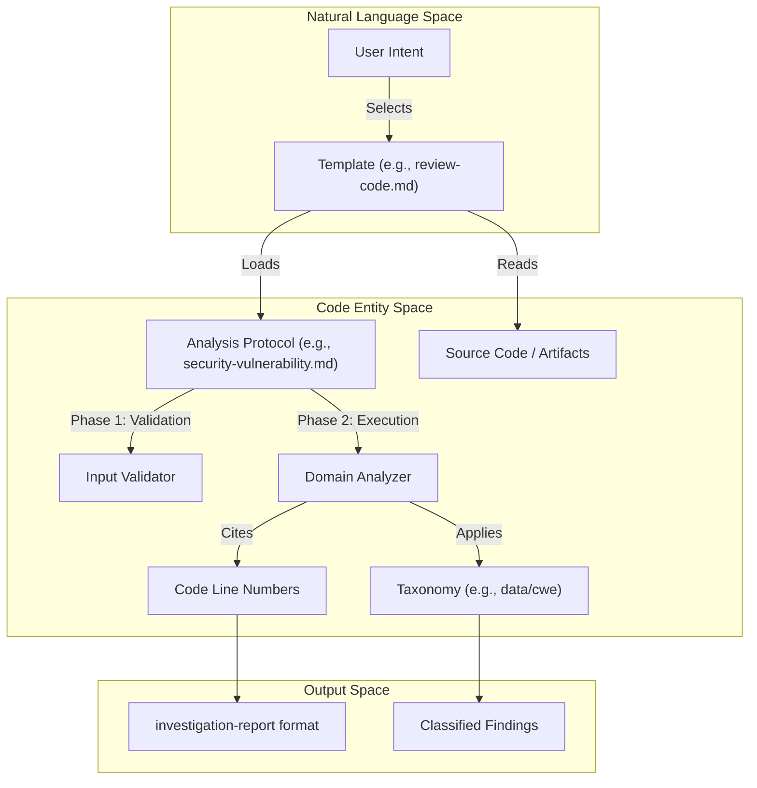
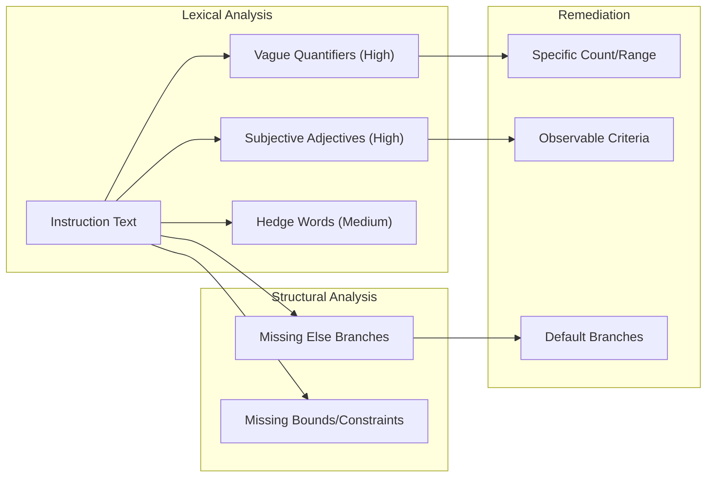

<!-- source: DeepWiki mcp.deepwiki.com · repo microsoft/PromptKit · extra page Analysis Protocols · fetched 2026-10-26 -->

# Analysis Protocols

Relevant source files

The following files were used as context for generating this wiki page:

- [formats/agent-instructions.md](formats/agent-instructions.md)
- [personas/electrical-engineer.md](personas/electrical-engineer.md)
- [protocols/analysis/compiler-diagnostics-cpp.md](protocols/analysis/compiler-diagnostics-cpp.md)
- [protocols/analysis/component-selection-audit.md](protocols/analysis/component-selection-audit.md)
- [protocols/analysis/layout-design-review.md](protocols/analysis/layout-design-review.md)
- [protocols/analysis/msvc-clang-portability.md](protocols/analysis/msvc-clang-portability.md)
- [protocols/analysis/performance-critical-c-api.md](protocols/analysis/performance-critical-c-api.md)
- [protocols/analysis/prompt-determinism-analysis.md](protocols/analysis/prompt-determinism-analysis.md)
- [protocols/analysis/schematic-compliance-audit.md](protocols/analysis/schematic-compliance-audit.md)
- [protocols/analysis/security-vulnerability.md](protocols/analysis/security-vulnerability.md)
- [protocols/analysis/win32-api-conventions.md](protocols/analysis/win32-api-conventions.md)
- [protocols/analysis/winrt-design-patterns.md](protocols/analysis/winrt-design-patterns.md)
- [protocols/reasoning/component-selection.md](protocols/reasoning/component-selection.md)
- [protocols/reasoning/corpus-safety-audit.md](protocols/reasoning/corpus-safety-audit.md)
- [protocols/reasoning/exhaustive-path-tracing.md](protocols/reasoning/exhaustive-path-tracing.md)
- [protocols/reasoning/pcb-layout-design.md](protocols/reasoning/pcb-layout-design.md)
- [protocols/reasoning/schematic-design.md](protocols/reasoning/schematic-design.md)
- [templates/audit-code-compliance.md](templates/audit-code-compliance.md)
- [templates/audit-library-health.md](templates/audit-library-health.md)
- [templates/author-agent-instructions.md](templates/author-agent-instructions.md)
- [templates/author-design-doc.md](templates/author-design-doc.md)
- [templates/design-pcb-layout.md](templates/design-pcb-layout.md)
- [templates/hardware-design-workflow.md](templates/hardware-design-workflow.md)
- [templates/interactive-design.md](templates/interactive-design.md)
- [templates/investigate-security.md](templates/investigate-security.md)
- [templates/plan-implementation.md](templates/plan-implementation.md)
- [templates/review-code.md](templates/review-code.md)
- [templates/review-schematic.md](templates/review-schematic.md)

Analysis protocols are domain-specific components within the PromptKit library that define systematic, repeatable methodologies for technical evaluation. Unlike guardrail protocols which focus on LLM behavior (e.g., anti-hallucination), analysis protocols encode deep engineering expertise into actionable phases and checks.

These 19 protocols cover software correctness (C, C++, Rust), security, Windows API conventions, and the end-to-end hardware engineering lifecycle (PCB, schematics, BOM, link budgets).

## Implementation and Data Flow

Analysis protocols are typically composed into templates via the `protocols` frontmatter field [templates/investigate-security.md:11-17](). They function as the "how-to" engine within a prompt, transforming raw input (code, schematics, or logs) into structured findings.

### Protocol Composition Logic
The following diagram illustrates how analysis protocols bridge natural language requirements into code-level entities and structured reports.

**Figure 1: Analysis Protocol Execution Flow**

Sources: [templates/review-code.md:5-23](), [templates/investigate-security.md:11-31](), [formats/agent-instructions.md:137-146]()

## Software Analysis Protocols

These protocols focus on memory safety, thread safety, and API-specific conventions. They are often applied to `review-code` or `investigate-bug` templates.

### Security and Vulnerability
The `security-vulnerability` protocol [protocols/analysis/security-vulnerability.md]() (referenced in [templates/investigate-security.md:16]()) drives systematic auditing by:
1.  **Trust Boundary Mapping**: Identifying interfaces where data transitions between privilege levels [templates/investigate-security.md:51-54]().
2.  **Attack Surface Enumeration**: Listing input handling paths and authentication points [templates/investigate-security.md:149-150]().
3.  **Deep-Dive Analysis**: Using `exhaustive-path-tracing` for parsers and decoders processing untrusted input [templates/investigate-security.md:93-107]().

### Windows API and C++ Patterns
PromptKit includes specialized protocols for the Windows ecosystem:
*   **`win32-api-conventions`**: Validates handle management, error code checking (`HRESULT`), and character encoding (Unicode/ANSI) [protocols/analysis/win32-api-conventions.md]().
*   **`winrt-design-patterns`**: Focuses on ABI boundaries, asynchronous patterns, and reference counting in Windows Runtime [protocols/analysis/winrt-design-patterns.md]().
*   **`compiler-diagnostics-cpp`**: Analyzes code against MSVC and Clang-specific warning levels and portability concerns [protocols/analysis/compiler-diagnostics-cpp.md]().

Sources: [templates/investigate-security.md:51-127](), [protocols/analysis/win32-api-conventions.md:1-20](), [protocols/analysis/winrt-design-patterns.md:1-15]()

## Hardware and PCB Analysis Protocols

The hardware protocols enable a "Shift Left" approach by automating the review of physical design artifacts.

### PCB Layout and Design Review
The `layout-design-review` protocol [protocols/analysis/layout-design-review.md:5-16]() provides a 7-phase audit for PCB designs:

| Phase | Focus Area | Key Checks |
| :--- | :--- | :--- |
| **Phase 1** | DRC Report Review | Classification of violations vs. warnings [protocols/analysis/layout-design-review.md:24-30](). |
| **Phase 2** | Trace Width | IPC-2221 current capacity calculations for power rails [protocols/analysis/layout-design-review.md:40-50](). |
| **Phase 3** | Signal Integrity | USB differential pair impedance (~90Ω) and return path continuity [protocols/analysis/layout-design-review.md:58-66](). |
| **Phase 4** | Component Placement | Decoupling capacitor proximity (<3mm) and antenna keepouts [protocols/analysis/layout-design-review.md:77-92](). |
| **Phase 5** | Ground Planes | Plane continuity and star grounding for analog/digital separation [protocols/analysis/layout-design-review.md:102-119](). |

### Component Selection Audit
The `component-selection-audit` protocol [protocols/analysis/component-selection-audit.md:5-16]() acts as an adversarial validator for the Bill of Materials (BOM). It mandates:
*   **Part Number Verification**: Confirming the part is orderable and not a "hallucinated" suffix (e.g., verifying `nRF52840-QIAA` exists) [protocols/analysis/component-selection-audit.md:46-54]().
*   **Specification Cross-Check**: Verifying datasheet values (voltage, temperature, current) against design claims [protocols/analysis/component-selection-audit.md:72-89]().

Sources: [protocols/analysis/layout-design-review.md:18-142](), [protocols/analysis/component-selection-audit.md:18-120]()

## Library and Meta-Analysis Protocols

These protocols are used to maintain the PromptKit library itself or evaluate the quality of LLM instructions.

### Prompt Determinism Analysis
The `prompt-determinism-analysis` protocol [protocols/analysis/prompt-determinism-analysis.md:5-17]() identifies language patterns that cause inconsistent LLM behavior.

**Figure 2: Determinism Classification Data Flow**

### Library Health Audit
The `audit-library-health` template [templates/audit-library-health.md:5-13]() uses a combination of protocols to perform a four-pass analysis:
1.  **Structural Consistency**: Detecting protocol overlap and metadata drift [templates/audit-library-health.md:108-113]().
2.  **Corpus Safety**: Auditing for assimilation risks and license compliance using `corpus-safety-audit` [templates/audit-library-health.md:184-187]().
3.  **Language Determinism**: Applying `prompt-determinism-analysis` to the library's own instructions [templates/audit-library-health.md:20-21]().

Sources: [protocols/analysis/prompt-determinism-analysis.md:25-138](), [templates/audit-library-health.md:38-200]()

---

