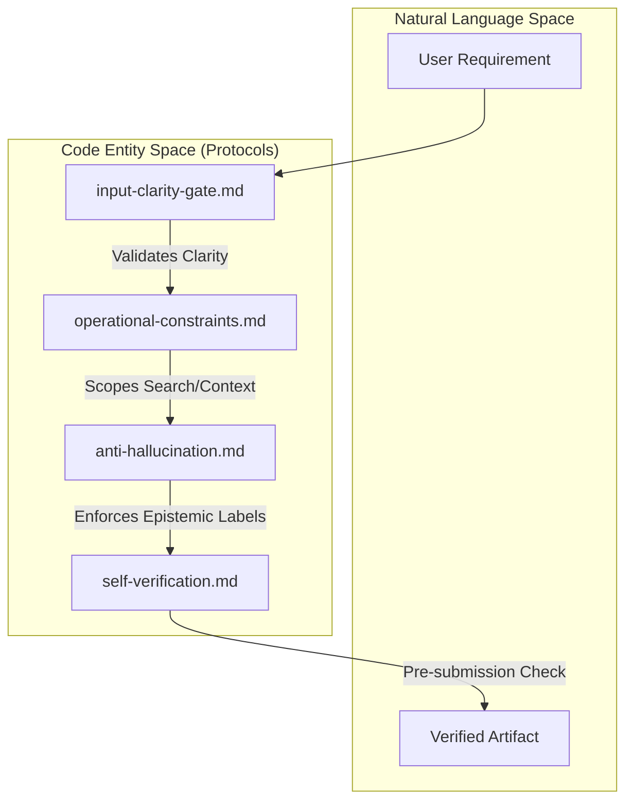
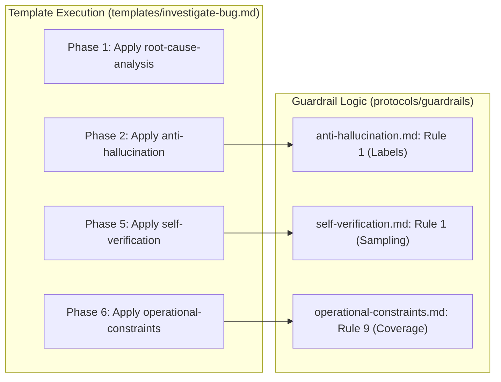

<!-- source: DeepWiki mcp.deepwiki.com · repo microsoft/PromptKit · extra page Guardrail Protocols · fetched 2026-10-26 -->

# Guardrail Protocols

Relevant source files

The following files were used as context for generating this wiki page:

- [.github/skills/respond-to-pr-comments/SKILL.md](.github/skills/respond-to-pr-comments/SKILL.md)
- [CATALOG.md](CATALOG.md)
- [bootstrap.md](bootstrap.md)
- [formats/investigation-report.md](formats/investigation-report.md)
- [formats/pr-comment-responses.md](formats/pr-comment-responses.md)
- [manifest.yaml](manifest.yaml)
- [protocols/guardrails/adversarial-falsification.md](protocols/guardrails/adversarial-falsification.md)
- [protocols/guardrails/anti-hallucination.md](protocols/guardrails/anti-hallucination.md)
- [protocols/guardrails/definition-of-done.md](protocols/guardrails/definition-of-done.md)
- [protocols/guardrails/human-voice-fidelity.md](protocols/guardrails/human-voice-fidelity.md)
- [protocols/guardrails/input-clarity-gate.md](protocols/guardrails/input-clarity-gate.md)
- [protocols/guardrails/minimal-edit-discipline.md](protocols/guardrails/minimal-edit-discipline.md)
- [protocols/guardrails/operational-constraints.md](protocols/guardrails/operational-constraints.md)
- [protocols/guardrails/self-verification.md](protocols/guardrails/self-verification.md)
- [protocols/guardrails/tool-reliability-defense.md](protocols/guardrails/tool-reliability-defense.md)
- [protocols/reasoning/root-cause-analysis.md](protocols/reasoning/root-cause-analysis.md)
- [templates/author-known-conditions-registry.md](templates/author-known-conditions-registry.md)
- [templates/investigate-bug.md](templates/investigate-bug.md)
- [templates/investigate-trace.md](templates/investigate-trace.md)
- [templates/respond-to-pr-comments.md](templates/respond-to-pr-comments.md)
- [templates/review-pull-request.md](templates/review-pull-request.md)

Guardrail protocols are cross-cutting safety and quality constraints that govern the behavior of the LLM regardless of the specific engineering task. Unlike reasoning protocols which define *how to think*, or analysis protocols which define *what to check*, guardrail protocols define the **operational boundaries** and **epistemic standards** for the session.

These protocols are designed to prevent common LLM failure modes such as hallucination, over-ingestion of context, silent tool failure, and "bikeshedding" in human-facing communication.

## Protocol Architecture and Application

Guardrails are implemented as Markdown components in the `protocols/guardrails/` directory. They are composed into templates via the `protocols` field in the YAML frontmatter [manifest.yaml:119-173]().

### Guardrail Integration Flow
The following diagram illustrates how guardrail protocols (Code Entity Space) constrain the transformation of user requirements into verified output (Natural Language Space).

**System Mapping: Guardrail Constraints**

**Sources:** [protocols/guardrails/input-clarity-gate.md:1-12](), [protocols/guardrails/anti-hallucination.md:13-17](), [protocols/guardrails/operational-constraints.md:15-20](), [protocols/guardrails/self-verification.md:14-18]()

---

## Core Guardrail Reference

### 1. Anti-Hallucination
**Purpose**: Prevents fabrication and ensures all claims are grounded in provided context.
**Key Implementation**:
*   **Epistemic Labeling**: Requires every claim to be tagged as `[KNOWN]`, `[INFERRED]`, or `[ASSUMPTION]` [protocols/guardrails/anti-hallucination.md:21-30]().
*   **Refusal to Fabricate**: Explicit instruction to use `[UNKNOWN]` placeholders rather than inventing function names or API signatures [protocols/guardrails/anti-hallucination.md:44-49]().
*   **Stop Condition**: If `[ASSUMPTION]` count exceeds 30% of total claims, the LLM must stop and request context [protocols/guardrails/anti-hallucination.md:40-42]().

### 2. Self-Verification
**Purpose**: A mandatory quality gate executed before finalizing any output.
**Key Implementation**:
*   **Sampling Verification**: The LLM must select at least 3 specific findings and re-verify them against source material [protocols/guardrails/self-verification.md:27-38]().
*   **Symmetric Falsification**: For every finding, the LLM must attempt to disprove it with the same rigor used during discovery [protocols/guardrails/self-verification.md:39-46]().
*   **Completeness Gate**: A checklist verifying goal alignment, artifact formation, and evidence presence [protocols/guardrails/self-verification.md:79-91]().

### 3. Operational Constraints
**Purpose**: Governs resource usage (context window, file reads) and ensures reproducibility.
**Key Implementation**:
*   **50-File Limit**: Prevents over-ingestion by requiring a summary after every 50 files read [protocols/guardrails/operational-constraints.md:24-31]().
*   **Context Management**: Explicitly caps working context at 50,000 lines of source code [protocols/guardrails/operational-constraints.md:65-72]().
*   **Two-Failures Rule**: If a strategy (like a specific search query) fails twice, the LLM must switch strategies or ask the user [protocols/guardrails/operational-constraints.md:123-132]().
*   **Coverage Statement**: Mandates a standard `## Coverage` block detailing what was examined, excluded, and why [protocols/guardrails/operational-constraints.md:137-147]().

### 4. Adversarial Falsification
**Purpose**: Enforces a "guilty until proven innocent" mindset for bug findings and security vulnerabilities.
**Key Implementation**:
*   **Disproof Requirement**: Requires the reviewer to actively attempt to neutralize a finding by searching for upstream validation or neutralizing invariants [manifest.yaml:154-160]().

### 5. Definition of Done (DoD)
**Purpose**: A completion-verification checklist that defines explicit criteria for task finalization.
**Key Implementation**:
*   Checks for functionality, regression safety, plan alignment, and artifact cleanup [manifest.yaml:161-167]().

### 6. Tool Reliability Defense
**Purpose**: Defensive protocol for verifying tool outputs and anticipating silent failures (e.g., failed `sed` edits or partial `grep` results).
**Key Implementation**:
*   Requires independent read-back after edits and pre-edit snapshots [manifest.yaml:168-173]().

### 7. Input Clarity Gate
**Purpose**: Validates user-provided input for clarity and specificity before task execution.
**Key Implementation**:
*   Generates targeted clarifying questions instead of findings if the input is ambiguous [manifest.yaml:146-153]().

### 8. Human-Voice Fidelity
**Purpose**: Constrains the tone and style of communication to be professional, technical, and free of "AI-isms."
**Key Implementation**:
*   Applied to templates like `review-pull-request` and `respond-to-pr-comments` to ensure responses sound like an engineering peer [templates/review-pull-request.md:16](), [templates/respond-to-pr-comments.md:17]().

### 9. Minimal Edit Discipline
**Purpose**: Constrains code modifications to be minimal and type-preserving.
**Key Implementation**:
*   Prevents collateral damage from automated refactoring by enforcing encoding-safe and verifiable edits [manifest.yaml:139-145]().

---

## Data Flow and Execution Logic

Guardrails are often triggered by the `Format` layer or the `Template` instructions. For example, the `investigation-report` format forces the use of the `self-verification` protocol via its confidence framework [formats/investigation-report.md:172-184]().

**System Mapping: Template to Guardrail Execution**

**Sources:** [templates/investigate-bug.md:49-81](), [protocols/guardrails/anti-hallucination.md:21-25](), [protocols/guardrails/self-verification.md:27-30](), [protocols/guardrails/operational-constraints.md:137-140]()

### Comparison of Critical Guardrails

| Protocol | Primary Constraint | Verification Method | Failure Action |
| :--- | :--- | :--- | :--- |
| **Anti-Hallucination** | Grounding | Epistemic Labeling (`[KNOWN]`) | Request more context if >30% assumptions |
| **Self-Verification** | Accuracy | 3-point sample re-verification | Re-examine all items of same type |
| **Operational Constraints** | Scope | Coverage Statement (Examined/Excluded) | Two-Failures Rule (Switch strategy) |
| **Input Clarity Gate** | Specificity | Determinism Analysis | Emit clarifying questions, not findings |

**Sources:** [protocols/guardrails/anti-hallucination.md:21-42](), [protocols/guardrails/self-verification.md:27-38](), [protocols/guardrails/operational-constraints.md:123-147](), [protocols/guardrails/input-clarity-gate.md:146-153]()

---

