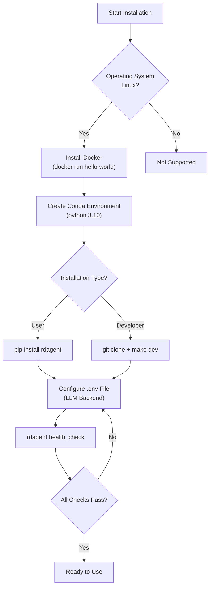
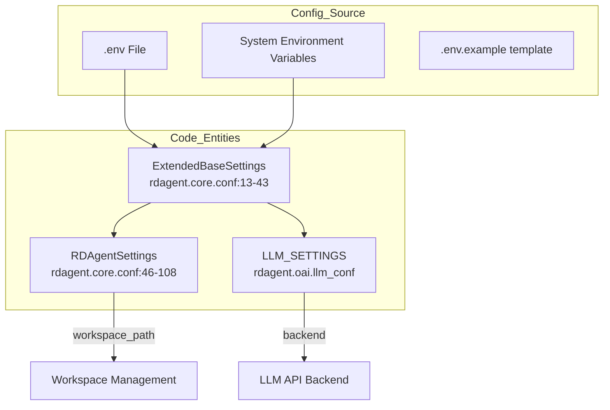
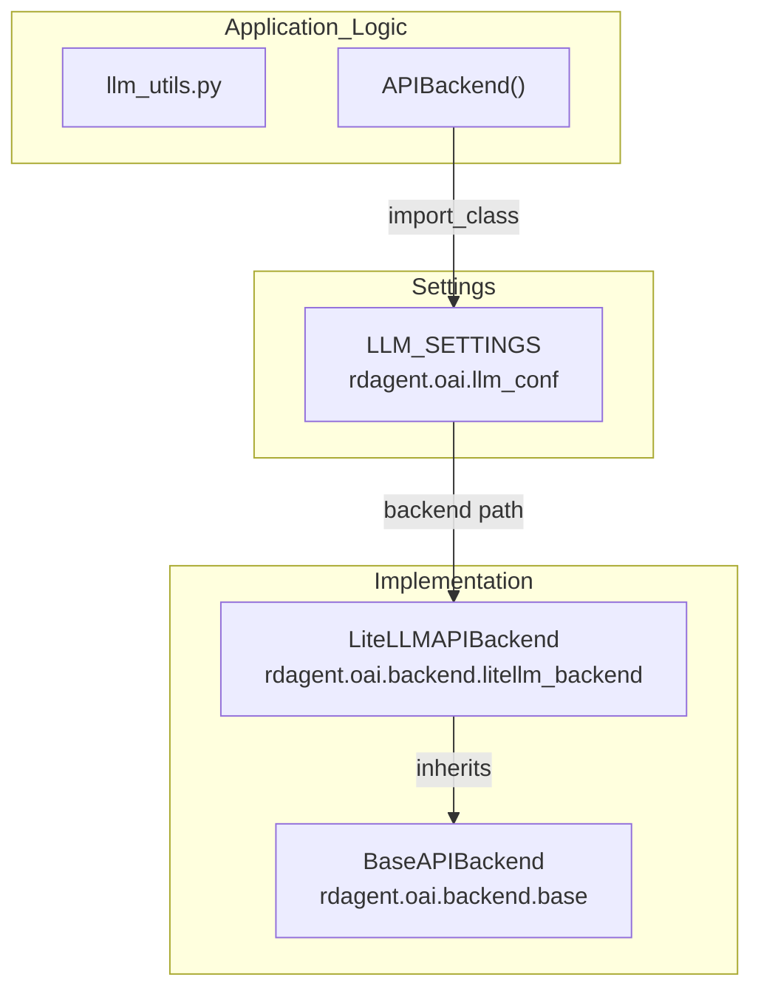

<!-- source: DeepWiki mcp.deepwiki.com · repo microsoft/RD-Agent · page 1.1 Installation and Configuration · fetched 2026-10-26 -->

# Installation and Configuration

<details>
<summary>Relevant source files</summary>

The following files were used as context for generating this wiki page:

- [.devcontainer/Dockerfile](.devcontainer/Dockerfile)
- [.devcontainer/README.md](.devcontainer/README.md)
- [.devcontainer/devcontainer.json](.devcontainer/devcontainer.json)
- [.devcontainer/env](.devcontainer/env)
- [.env.example](.env.example)
- [.readthedocs.yaml](.readthedocs.yaml)
- [README.md](README.md)
- [docs/installation_and_configuration.rst](docs/installation_and_configuration.rst)
- [rdagent/core/conf.py](rdagent/core/conf.py)
- [rdagent/core/utils.py](rdagent/core/utils.py)
- [rdagent/oai/llm_utils.py](rdagent/oai/llm_utils.py)
- [rdagent/scenarios/qlib/factor_experiment_loader/pdf_loader.py](rdagent/scenarios/qlib/factor_experiment_loader/pdf_loader.py)
- [rdagent/scenarios/qlib/factor_experiment_loader/prompts.yaml](rdagent/scenarios/qlib/factor_experiment_loader/prompts.yaml)
- [rdagent/utils/fmt.py](rdagent/utils/fmt.py)
- [requirements/docs.txt](requirements/docs.txt)
- [requirements/torch.txt](requirements/torch.txt)
- [test/oai/test_completion.py](test/oai/test_completion.py)

</details>


## Purpose and Scope

This document provides comprehensive instructions for installing RD-Agent and configuring its execution environment. It covers system prerequisites, installation procedures, environment setup, Docker configuration, and LLM backend integration. 

RD-Agent operates as an automated research and development system that executes code in isolated environments and communicates with LLM backends. Proper installation and configuration are essential prerequisites for all scenarios.

**Platform Support**: RD-Agent currently supports **Linux only** [README.md:17-17](). Windows and macOS are not officially supported.

---

## Installation Flow Overview



**Diagram**: Installation workflow from system requirements through verification.

Sources: [docs/installation_and_configuration.rst:5-15](), [README.md:17-17]()

---

## System Requirements

### Operating System
RD-Agent is designed exclusively for **Linux** platforms [README.md:17-17](). This constraint exists because the execution environment relies on Docker containerization and Linux-specific system calls for process isolation.

### Python Environment
Supported Python versions:
- **Python 3.10** (Recommended) [README.md:19-19](), [.readthedocs.yaml:12-12]()

### Docker Requirement
Docker is **mandatory** for most scenarios as RD-Agent executes generated code in isolated containers.

**Critical Setup Steps**:
1. Install Docker following [official Docker documentation](https://docs.docker.com/engine/install).
2. Configure Docker to run **without sudo** for the current user [docs/installation_and_configuration.rst:14-14]().
3. Verify installation: `docker run hello-world` [docs/installation_and_configuration.rst:14-14]().

Sources: [docs/installation_and_configuration.rst:13-14](), [README.md:17-19]()

---

## Installation Methods

### User Installation (PyPI)
For users who want to run RD-Agent scenarios without modifying the codebase:
```bash
pip install rdagent
```
Sources: [docs/installation_and_configuration.rst:10-10]()

### Developer Installation (Source)
For contributors or users wanting the latest features:
```bash
git clone https://github.com/microsoft/RD-Agent
cd RD-Agent
# Devcontainer users: the postCreateCommand runs 'make dev' automatically
make dev
```
Sources: [docs/installation_and_configuration.rst:11-11](), [.devcontainer/devcontainer.json:28-28]()

---

## Environment Setup

### Conda Environment Creation
Create an isolated Python environment using Conda:
```bash
# Create environment (Python 3.10 recommended)
conda create -n rdagent python=3.10
# Activate environment
conda activate rdagent
```

### Configuration Architecture
RD-Agent uses a sophisticated configuration system based on `Pydantic` and `ExtendedBaseSettings`.



**Diagram**: Configuration inheritance and data flow. `ExtendedBaseSettings` customizes Pydantic sources to walk up the class hierarchy for environment variable prefixes [rdagent/core/conf.py:16-43]().

Sources: [rdagent/core/conf.py:13-109](), [.env.example:1-8]()

---

## LLM Backend Configuration

RD-Agent integrates with LLMs primarily through `LiteLLM`, allowing support for OpenAI, Azure, DeepSeek, and many others.

### Backend Architecture



**Diagram**: Dynamic backend selection. `get_api_backend` uses `import_class` to instantiate the backend specified in `LLM_SETTINGS.backend` [rdagent/oai/llm_utils.py:35-41]().

Sources: [rdagent/oai/llm_utils.py:35-45](), [rdagent/core/utils.py:75-88]()

### Configuration Examples

#### Pattern 1: Unified OpenAI Base
```bash
CHAT_MODEL=gpt-4o 
EMBEDDING_MODEL=text-embedding-3-small
OPENAI_API_BASE=<your_unified_api_base>
OPENAI_API_KEY=<your_openai_api_key>
```
Sources: [docs/installation_and_configuration.rst:28-33]()

#### Pattern 2: DeepSeek with SiliconFlow Embeddings
DeepSeek often requires specific environment variables for `LiteLLM`.
```bash
CHAT_MODEL=deepseek/deepseek-chat 
DEEPSEEK_API_KEY=<your_deepseek_api_key>

# SiliconFlow for embeddings (prefixed with litellm_proxy)
EMBEDDING_MODEL=litellm_proxy/BAAI/bge-m3
LITELLM_PROXY_API_KEY=<your_siliconflow_api_key>
LITELLM_PROXY_API_BASE=https://api.siliconflow.cn/v1
```
Sources: [docs/installation_and_configuration.rst:62-69]()

---

## Execution Environment Selection

RD-Agent supports different environments for running generated code, controlled by environment variables like `DS_CODER_COSTEER_ENV_TYPE` [.devcontainer/env:41-41]().

### Docker vs Conda

| Feature | Docker Environment | Conda Environment |
| :--- | :--- | :--- |
| **Isolation** | High (Containerized) | Medium (Process-level) |
| **Config Key** | `docker` | `conda` |
| **GPU Support** | Supported [rdagent/utils/env.py] | Local system dependent |
| **Use Case** | Data Science, Quant [rdagent/utils/env.py] | Local dev/debugging |

### Devcontainer Setup
For a seamless development experience, a `.devcontainer` is provided. It mounts the host workspace and configures GPU access.
- **Dockerfile**: Based on `ubuntu:22.04` with Python 3.10 [.devcontainer/Dockerfile]().
- **Mounts**: Mounts local Kaggle data paths to `/tmp/kaggle` [.devcontainer/devcontainer.json:13-15]().
- **Environment**: Loads default settings from `.devcontainer/env` [.devcontainer/devcontainer.json:24-24]().

Sources: [.devcontainer/devcontainer.json:1-30](), [.devcontainer/env:1-48]()

---

## Configuration Reference

### Global Settings (`RD_AGENT_SETTINGS`)
Defined in [rdagent/core/conf.py:46-108]().

| Variable | Description | Default |
| :--- | :--- | :--- |
| `WORKSPACE_PATH` | Base directory for R&D workspaces | `./git_ignore_folder/RD-Agent_workspace` |
| `MULTI_PROC_N` | Number of processes for parallel execution | `1` |
| `CACHE_WITH_PICKLE` | Whether to use pickle-based result caching | `True` |
| `STDOUT_CONTEXT_LEN` | Max lines of stdout to keep in context | `400` |

### LLM Settings (`LLM_SETTINGS`)
Managed via `LLM_SETTINGS` singleton [rdagent/oai/llm_conf.py]().

| Variable | Description |
| :--- | :--- |
| `CHAT_MODEL` | The model name passed to LiteLLM |
| `EMBEDDING_MODEL` | The model name for vectorization |
| `REASONING_THINK_RM` | If `True`, removes `<think>` tags from reasoning models |

Sources: [rdagent/core/conf.py:46-109](), [docs/installation_and_configuration.rst:102-106](), [.env.example:1-61]()

---

