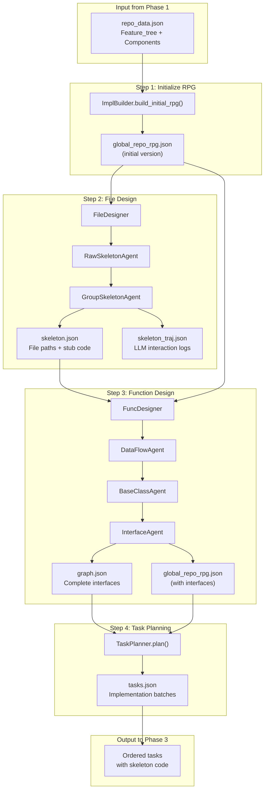
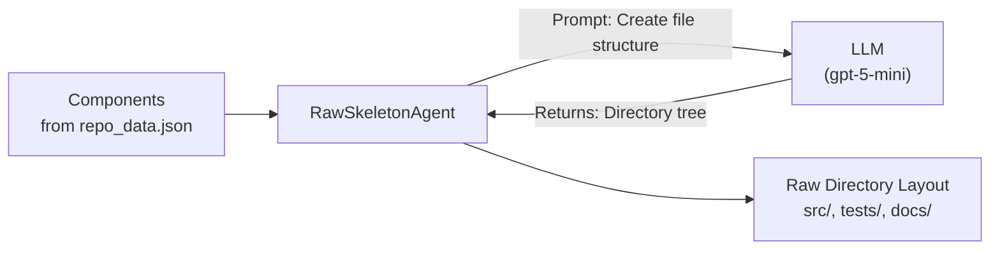
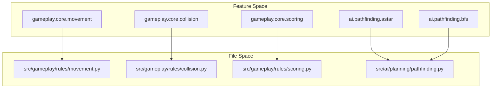
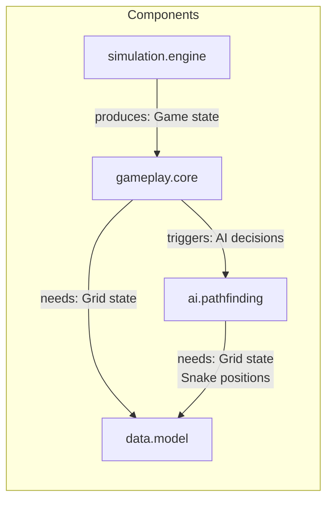
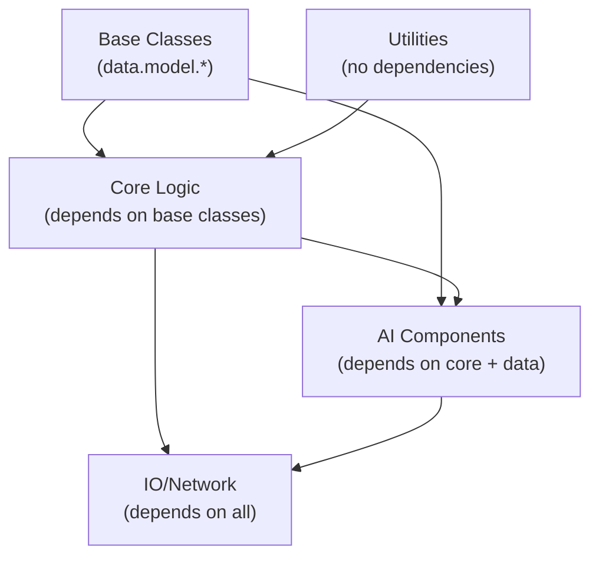
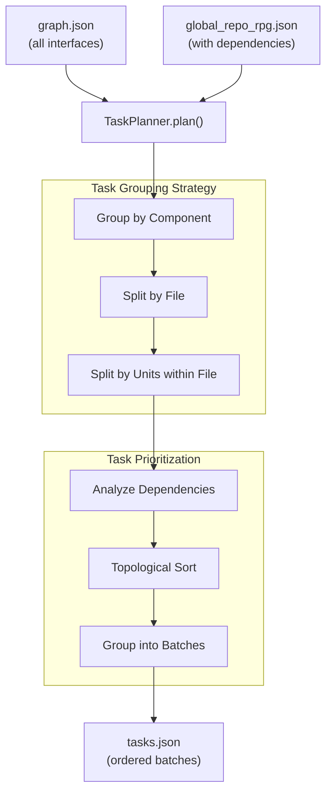
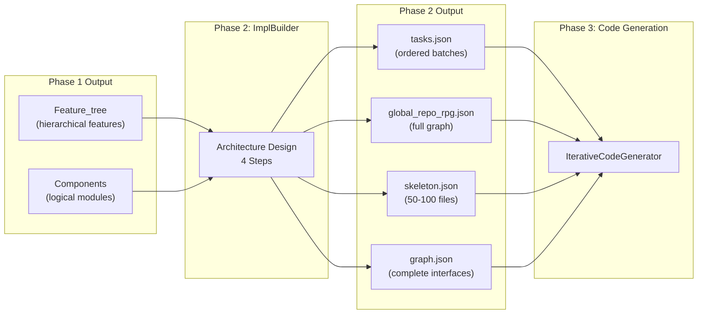

<!-- source: DeepWiki mcp.deepwiki.com · repo microsoft/RPG-ZeroRepo · page 3.2 Phase 2: Architecture Design · fetched 2026-10-26 -->

# Phase 2: Architecture Design

<details>
<summary>Relevant source files</summary>

The following files were used as context for generating this wiki page:

- [README.md](README.md)
- [configs/checkpoint_config.yaml](configs/checkpoint_config.yaml)
- [configs/file_design_config.yaml](configs/file_design_config.yaml)
- [configs/func_design_config.yaml](configs/func_design_config.yaml)

</details>


## Purpose and Scope

Phase 2 transforms the feature-based planning from Phase 1 into a concrete architectural design that can be implemented. This phase takes the `Feature_tree` and `Component` decomposition produced by [Phase 1: Feature Planning](#3.1) and generates:

1. A complete file/directory skeleton with 50-100+ files
2. Full interface definitions (function signatures, class structures, type hints, docstrings)
3. A dependency graph capturing data flow between components
4. An ordered set of implementation tasks ready for [Phase 3: Code Generation](#3.3)

This page provides an overview of the entire architecture design process. For detailed information about the two main sub-processes, see:
- [File Design Process](#3.2.1) - Details on `RawSkeletonAgent` and `GroupSkeletonAgent`
- [Function Design Process](#3.2.2) - Details on `DataFlowAgent`, `BaseClassAgent`, and `InterfaceAgent`

The module is located at `zerorepo/rpg_gen/impl_level/` with entry point `ImplBuilder.run()`.

**Sources:** [README.md:176-281]()

---

## Phase 2 Architecture Overview

The following diagram illustrates how Phase 2 bridges the gap between high-level features and concrete implementation artifacts:

**Diagram: Phase 2 Data Flow and Agent Pipeline**



**Sources:** [README.md:176-281](), [configs/checkpoint_config.yaml:9-13]()

---

## Step 1: Initial RPG Construction

The first step converts the Component-based feature decomposition from Phase 1 into a graph structure called the **Repository Planning Graph (RPG)**. This graph will be incrementally enriched throughout Phase 2.

### RPG Structure

The RPG is a hierarchical graph where:
- **Directory nodes** represent components and nested directories
- **Leaf nodes** represent individual features that need to be implemented
- **Edges** capture relationships (contains, depends-on, implements)

### Construction Process

The `ImplBuilder.build_initial_rpg()` method:

1. Creates a root node for the repository
2. For each Component from Phase 1, creates a directory node
3. For each feature in the Component's `refactored_subtree`, creates feature leaf nodes
4. Establishes parent-child relationships matching the hierarchy

**Example RPG Structure (Initial):**

```json
{
  "nodes": [
    {
      "id": "root",
      "type": "repository",
      "name": "SnakeGame"
    },
    {
      "id": "gameplay.core",
      "type": "component",
      "name": "gameplay.core",
      "parent": "root"
    },
    {
      "id": "gameplay.core.movement",
      "type": "feature",
      "name": "movement",
      "description": "Handle snake movement including direction changes",
      "parent": "gameplay.core"
    }
  ],
  "edges": [
    {
      "from": "root",
      "to": "gameplay.core",
      "type": "contains"
    },
    {
      "from": "gameplay.core",
      "to": "gameplay.core.movement",
      "type": "implements"
    }
  ]
}
```

### Output Files

| File | Content |
|------|---------|
| `global_repo_rpg.json` | Initial RPG with component and feature nodes |

**Sources:** [README.md:183-187](), [configs/checkpoint_config.yaml:16]()

---

## Step 2: File Design (Skeleton Generation)

The `FileDesigner` converts the abstract component structure into a concrete file and directory layout. This happens in two phases:

### Phase 2a: Raw Skeleton Generation

The `RawSkeletonAgent` generates a high-level directory structure:

**Diagram: Raw Skeleton Agent Flow**



**Output Example:**
```
SnakeGame/
├── src/
│   ├── ai/
│   ├── gameplay/
│   ├── data/
│   ├── io/
│   ├── simulation/
│   └── network/
├── tests/
│   └── (mirrors src)
└── pyproject.toml
```

### Phase 2b: Group Skeleton Generation

The `GroupSkeletonAgent` refines the layout by:
1. Assigning specific features to concrete file paths
2. Creating module files (`__init__.py`)
3. Generating initial stub code for each file

**Diagram: Feature to File Mapping**



### Configuration

Controlled by `configs/file_design_config.yaml`:

| Agent | Max Steps | Max Retry | Design Context Window |
|-------|-----------|-----------|----------------------|
| `raw_skeleton` | 5 | 3 | 10 |
| `group_skeleton` | 20 | 3 | 20 |

### Output Files

The `skeleton.json` file contains the complete file structure with stub code:

```json
{
  "src/gameplay/rules/movement.py": {
    "file_path": "src/gameplay/rules/movement.py",
    "features": ["movement", "direction changes"],
    "stub_code": "# Movement handling\n\nclass SnakeMovement:\n    pass\n",
    "imports": [],
    "dependencies": []
  },
  "src/ai/planning/pathfinding.py": {
    "file_path": "src/ai/planning/pathfinding.py",
    "features": ["astar", "bfs flood fill"],
    "stub_code": "# Pathfinding algorithms\n\nclass PathfindingEngine:\n    pass\n",
    "imports": [],
    "dependencies": []
  }
}
```

For complete details, see [File Design Process](#3.2.1).

**Sources:** [README.md:189-219](), [configs/file_design_config.yaml]()

---

## Step 3: Function Design (Interface Generation)

The `FuncDesigner` transforms stub code into complete interface definitions with function signatures, type hints, and docstrings. This happens in three phases executed sequentially:

### Phase 3a: Data Flow Analysis

The `DataFlowAgent` identifies dependencies between components by analyzing which features need to share data.

**Diagram: Data Flow Identification**



**Output:** A dependency graph showing which components exchange data and what data structures are needed.

### Phase 3b: Base Class Design

The `BaseClassAgent` designs shared data structures and base classes that multiple components will use.

**Example Output:**
```python
# src/data/model/grid.py
from typing import List, Tuple, Optional

class GridState:
    """Represents the game grid state."""
    
    def __init__(self, width: int, height: int):
        """
        Initialize grid state.
        
        Args:
            width: Grid width in cells
            height: Grid height in cells
        """
        self.width = width
        self.height = height
        self.occupancy: List[List[Optional[str]]] = [[None] * width for _ in range(height)]
    
    def get_cell(self, x: int, y: int) -> Optional[str]:
        """Get the occupant of a cell."""
        ...
```

### Phase 3c: Interface Design

The `InterfaceAgent` processes each file in topological order (respecting dependencies) and generates complete interfaces:

**Diagram: Interface Generation Order**



For each file, the agent generates:

| Element | Description |
|---------|-------------|
| **Classes** | Complete class definitions with methods |
| **Functions** | Standalone functions with signatures |
| **Type Hints** | Full type annotations for all parameters and returns |
| **Docstrings** | Google-style docstrings describing purpose, args, returns, raises |
| **Imports** | Required imports from standard library and other project files |

**Example Interface Output in `graph.json`:**

```json
{
  "src/ai/planning/pathfinding.py": {
    "file_code": "from typing import List, Tuple\nfrom src.data.model.grid import GridState\n\nclass AStarPathfinder:\n    \"\"\"A* pathfinding implementation.\"\"\"\n    \n    def __init__(self, grid: GridState):\n        \"\"\"Initialize pathfinder with grid.\n        \n        Args:\n            grid: The game grid state\n        \"\"\"\n        ...\n    \n    def find_path(self, start: Tuple[int, int], goal: Tuple[int, int]) -> List[Tuple[int, int]]:\n        \"\"\"Find shortest path from start to goal.\n        \n        Args:\n            start: Starting coordinates (x, y)\n            goal: Goal coordinates (x, y)\n        \n        Returns:\n            List of coordinates representing the path\n        \n        Raises:\n            PathNotFoundError: If no valid path exists\n        \"\"\"\n        ...\n",
    "units": ["class AStarPathfinder"],
    "units_to_features": {
      "class AStarPathfinder": ["astar pathfinding"]
    },
    "units_to_code": {
      "class AStarPathfinder": "class AStarPathfinder:\n    ..."
    }
  }
}
```

### Configuration

Controlled by `configs/func_design_config.yaml`:

| Agent | Max Steps | Max Retry | Design Context Window |
|-------|-----------|-----------|----------------------|
| `data_flow` | 10 | 3 | 30 |
| `base_classes` | 10 | 3 | 30 |
| `interfaces` | 30 | 3 | 30 |

### RPG Update

After interface design, the `global_repo_rpg.json` is updated with:
- File nodes with their complete interface code
- Function/class nodes as children of file nodes
- Dependency edges between files and functions

For complete details, see [Function Design Process](#3.2.2).

**Sources:** [README.md:221-246](), [configs/func_design_config.yaml]()

---

## Step 4: Task Planning

The `TaskPlanner` converts the complete interface design into executable implementation tasks. Each task represents one or more units (classes/functions) in a single file that can be implemented together.

### Planning Process

**Diagram: Task Planning Flow**



### Task Structure

Each task in `tasks.json` contains:

| Field | Description |
|-------|-------------|
| `task_id` | Unique identifier for the task |
| `file_path` | Target file path (e.g., `src/ai/planning/pathfinding.py`) |
| `units_key` | List of units to implement (e.g., `["class AStarPathfinder"]`) |
| `unit_to_code` | Skeleton code for each unit |
| `unit_to_features` | Features implemented by each unit |
| `priority` | Implementation order (0 = highest) |
| `subtree` | Component this task belongs to (e.g., `ai.pathfinding`) |
| `task_type` | Always `"implementation"` |

### Batching Strategy

Tasks are grouped into batches by component to enable parallel execution:

```json
{
  "planned_batches_dict": {
    "data.model": {
      "src/data/model/grid.py": [
        {
          "task_id": "src_data_model_grid.py_GridState_20260101_120000",
          "file_path": "src/data/model/grid.py",
          "units_key": ["class GridState"],
          "unit_to_code": {
            "class GridState": "class GridState:\n    def __init__(self, width: int, height: int):\n        ..."
          },
          "unit_to_features": {
            "class GridState": ["grid management", "occupancy map"]
          },
          "priority": 0,
          "subtree": "data.model",
          "task_type": "implementation"
        }
      ],
      "src/data/model/cache.py": [...]
    },
    "gameplay.core": {
      "src/gameplay/rules/movement.py": [
        {
          "task_id": "src_gameplay_rules_movement.py_SnakeMovement_20260101_120030",
          "file_path": "src/gameplay/rules/movement.py",
          "units_key": ["class SnakeMovement"],
          "unit_to_code": {...},
          "priority": 1,
          "subtree": "gameplay.core",
          "task_type": "implementation"
        }
      ]
    }
  }
}
```

### Output Files

| File | Content |
|------|---------|
| `tasks.json` | All implementation tasks grouped by component |

**Sources:** [README.md:248-280]()

---

## Configuration Reference

Phase 2 behavior is controlled by multiple configuration files:

### Main Configuration

In `zerorepo_config.yaml`, the `impl_level` section:

```yaml
impl_level:
  file_design_cfg_path: "configs/file_design_config.yaml"
  func_design_cfg_path: "configs/func_design_config.yaml"
```

### File Design Configuration

The `file_design_config.yaml` controls skeleton generation:

| Section | Parameter | Default | Description |
|---------|-----------|---------|-------------|
| `raw_skeleton` | `max_steps` | 5 | Maximum design iterations |
| `raw_skeleton` | `max_retry` | 3 | Retries on LLM failure |
| `raw_skeleton` | `design_context_window` | 10 | Context size for design prompts |
| `group_skeleton` | `max_steps` | 20 | Maximum design iterations |
| `group_skeleton` | `max_retry` | 3 | Retries on LLM failure |
| `group_skeleton` | `design_context_window` | 20 | Context size for design prompts |

### Function Design Configuration

The `func_design_config.yaml` controls interface generation:

| Section | Parameter | Default | Description |
|---------|-----------|---------|-------------|
| `data_flow` | `max_steps` | 10 | Maximum design iterations |
| `data_flow` | `design_context_window` | 30 | Context size for design prompts |
| `base_classes` | `max_steps` | 10 | Maximum design iterations |
| `base_classes` | `design_context_window` | 30 | Context size for design prompts |
| `interfaces` | `max_steps` | 30 | Maximum design iterations |
| `interfaces` | `design_context_window` | 30 | Context size for design prompts |

For detailed configuration options, see [Configuration System](#4).

**Sources:** [configs/file_design_config.yaml](), [configs/func_design_config.yaml]()

---

## Checkpoint Files

Phase 2 produces several checkpoint files that enable resumability and feed Phase 3:

### Core Design Artifacts

| File | Phase | Size | Content |
|------|-------|------|---------|
| `skeleton.json` | File Design | ~50-200 KB | Complete file/directory structure with stub code |
| `skeleton_traj.json` | File Design | ~1-5 MB | LLM interaction logs from skeleton generation |
| `graph.json` | Function Design | ~500 KB - 2 MB | Complete interface definitions for all files |
| `tasks.json` | Task Planning | ~1-10 MB | Implementation tasks grouped by component |

### RPG Evolution

The `global_repo_rpg.json` file evolves through Phase 2:

| Stage | Content |
|-------|---------|
| After Step 1 | Component and feature nodes |
| After Step 2 | File nodes added with paths |
| After Step 3 | Function/class nodes added with interfaces |

**Example RPG Node Evolution:**

```json
{
  "nodes": [
    {
      "id": "src/ai/planning/pathfinding.py",
      "type": "file",
      "path": "src/ai/planning/pathfinding.py",
      "parent": "ai.pathfinding",
      "interfaces": {
        "class AStarPathfinder": {
          "code": "class AStarPathfinder:\n    ...",
          "features": ["astar pathfinding"]
        }
      }
    },
    {
      "id": "src/ai/planning/pathfinding.py::AStarPathfinder",
      "type": "class",
      "parent": "src/ai/planning/pathfinding.py",
      "signature": "class AStarPathfinder:",
      "methods": ["__init__", "find_path"]
    }
  ]
}
```

### State Tracking

The `task_manager_state.json` tracks Phase 2 progress:

```json
{
  "build_skeleton": true,
  "build_function": true,
  "plan_tasks": true,
  "last_updated": "2026-02-09T14:30:00"
}
```

For complete checkpoint information, see [Checkpoint File Reference](#5.1) and [Resume and Recovery](#5.2).

**Sources:** [README.md:383-399](), [configs/checkpoint_config.yaml:9-13]()

---

## Input/Output Summary

### Phase 2 Inputs

**From Phase 1:**
- `repo_data.json` with `Feature_tree` and `Component` fields
- Repository name and purpose

### Phase 2 Outputs

**To Phase 3:**
- `tasks.json` - Ordered implementation tasks
- `global_repo_rpg.json` - Complete RPG with interfaces
- `skeleton.json` - File structure reference
- `graph.json` - Interface definitions

**Diagram: Phase 2 Input/Output Contract**



**Sources:** [README.md:176-281]()

---

