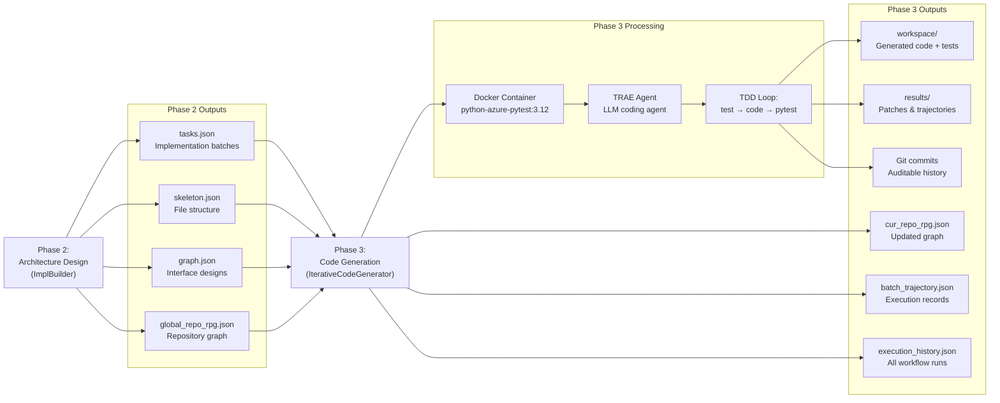
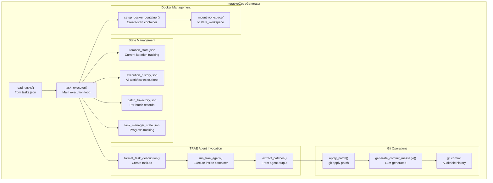
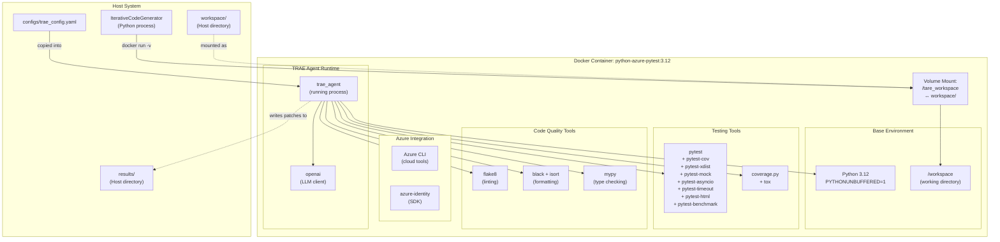
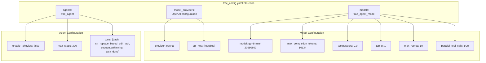
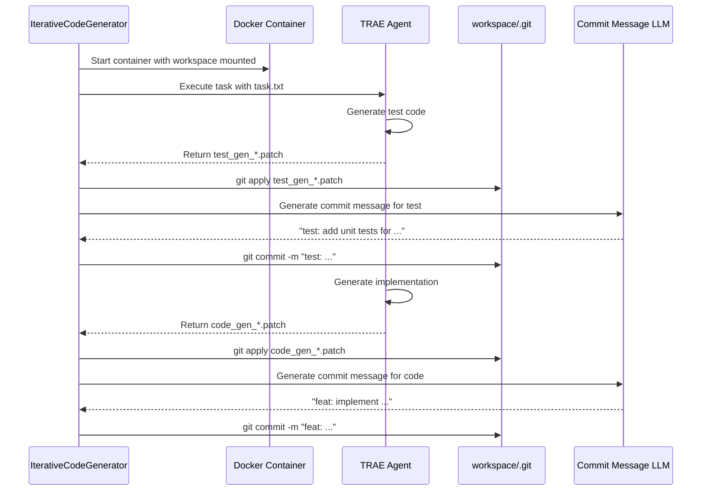
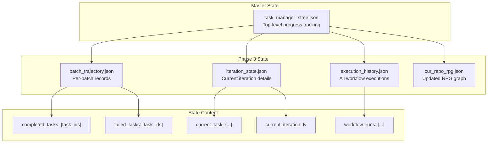

<!-- source: DeepWiki mcp.deepwiki.com · repo microsoft/RPG-ZeroRepo · page 3.3 Phase 3: Code Generation · fetched 2026-10-26 -->

# Phase 3: Code Generation

<details>
<summary>Relevant source files</summary>

The following files were used as context for generating this wiki page:

- [README.md](README.md)
- [configs/trae_config.yaml](configs/trae_config.yaml)
- [configs/zerorepo_config.yaml](configs/zerorepo_config.yaml)
- [dockerfile/Dockerfile](dockerfile/Dockerfile)

</details>


## Purpose and Scope

Phase 3 is the final stage of the RPG-ZeroRepo pipeline, responsible for transforming the architectural designs from Phase 2 into actual executable code. This phase executes implementation tasks inside a Docker container, using the TRAE agent (an LLM-powered coding agent) to iteratively generate tests and code following a test-driven development (TDD) workflow.

This document covers the overall architecture of Phase 3, the `IterativeCodeGenerator` component, Docker execution environment setup, and how the TRAE agent integrates with the system. For detailed information about the TDD loop mechanics, see [Test-Driven Development Workflow](#3.3.1). For workflow types and error handling strategies, see [Workflow Types and Error Handling](#3.3.2).

**Sources:** [README.md:284-351](), [zerorepo_config.yaml:50-72](), [trae_config.yaml:1-28]()

---

## Phase 3 in the Pipeline

Phase 3 receives structured implementation tasks from Phase 2 and produces a complete, tested repository with git history tracking each implementation step.

### Pipeline Position



**Sources:** [README.md:176-281](), [README.md:284-351]()

---

## Input: Task Structure

Phase 3 consumes `tasks.json`, which contains implementation batches organized by component subtree. Each batch specifies one or more files to implement, along with the code units (classes/functions), their skeleton code, and associated features.

### Task JSON Structure

| Field | Type | Description |
|-------|------|-------------|
| `planned_batches_dict` | dict | Top-level dictionary mapping subtree names to file batches |
| `task_id` | str | Unique identifier for the task (e.g., `"src_io_persistence_serialization.py_..."`) |
| `file_path` | str | Path to the file being implemented (e.g., `"src/io/persistence/serialization.py"`) |
| `units_key` | list[str] | List of units to implement (e.g., `["class HighScoreBinarySerializer"]`) |
| `unit_to_code` | dict | Maps each unit to its skeleton code with signatures and docstrings |
| `unit_to_features` | dict | Maps each unit to the features it implements |
| `priority` | int | Task priority (0 = highest) |
| `subtree` | str | Component subtree this task belongs to (e.g., `"io.input_persistence"`) |
| `task_type` | str | Type of task (typically `"implementation"`) |

**Example:**

```json
{
  "planned_batches_dict": {
    "io.input_persistence": {
      "src/io/persistence/serialization.py": [
        {
          "task_id": "src_io_persistence_serialization.py_...",
          "file_path": "src/io/persistence/serialization.py",
          "units_key": ["class HighScoreBinarySerializer"],
          "unit_to_code": {
            "class HighScoreBinarySerializer": "class HighScoreBinarySerializer:\n    def serialize(self, entries) -> bytes: ..."
          },
          "unit_to_features": {
            "class HighScoreBinarySerializer": ["high score binary serialization"]
          },
          "priority": 0,
          "subtree": "io.input_persistence",
          "task_type": "implementation"
        }
      ]
    }
  }
}
```

**Sources:** [README.md:248-280]()

---

## IterativeCodeGenerator Architecture

The `IterativeCodeGenerator` is the main orchestrator for Phase 3, located in the `zerorepo/code_gen/` module. It manages task execution, Docker container lifecycle, TRAE agent invocations, and state tracking.

### Component Overview



**Sources:** [README.md:286-287](), [zerorepo_config.yaml:53-72]()

### Configuration Parameters

The `code_generation` section in `zerorepo_config.yaml` controls Phase 3 behavior:

| Parameter | Default | Description |
|-----------|---------|-------------|
| `docker.enabled` | `true` | Whether to use Docker for execution |
| `docker.image` | `"python-azure-pytest:3.12"` | Docker image name |
| `docker.container_name` | `"zerorepo_2"` | Container name for management |
| `docker.force_rebuild` | `true` | Rebuild container on each run |
| `docker.workspace` | `"/tare_workspace"` | Mount point inside container |
| `trae_agent.trae_config` | `"./configs/trae_config.yaml"` | Path to TRAE agent configuration |
| `trae_agent.max_iterations` | `5` | Maximum TDD iterations per task |
| `trae_agent.max_retries_per_workflow` | `3` | Retries for failed workflows |
| `trae_agent.workflow_timeout` | `1800` | Timeout per workflow (seconds) |
| `trae_agent.max_retries` | `3` | Global retry limit |
| `trae_agent.retry_delay` | `5` | Delay between retries (seconds) |

**Sources:** [zerorepo_config.yaml:53-72]()

---

## Docker Execution Environment

Phase 3 executes all code generation inside a Docker container to provide a consistent, isolated environment with all necessary development tools pre-installed.

### Container Architecture



**Sources:** [dockerfile/Dockerfile:1-32](), [zerorepo_config.yaml:54-60]()

### Dockerfile Components

The Docker image is built from `dockerfile/Dockerfile` and includes:

**Base Image:**
- `python:3.12` - Python 3.12 runtime

**System Packages:**
- `ca-certificates` - SSL certificate support
- `curl` - HTTP client
- Azure CLI - Installed via Microsoft's install script

**Python Packages:**

| Category | Packages |
|----------|----------|
| Testing Framework | `pytest`, `pytest-cov`, `pytest-xdist`, `pytest-mock`, `pytest-asyncio`, `pytest-timeout`, `pytest-html`, `pytest-benchmark` |
| Coverage & Quality | `coverage`, `tox` |
| Linting | `flake8` |
| Formatting | `black`, `isort` |
| Type Checking | `mypy` |
| Cloud Integration | `azure-identity` |
| LLM Client | `openai` |

**Environment:**
- `WORKDIR /workspace` - Default working directory
- `PYTHONUNBUFFERED=1` - Ensures real-time logging output

**Sources:** [dockerfile/Dockerfile:1-32]()

---

## TRAE Agent Integration

The TRAE (Test-driven Refinement for Autonomous Engineering) agent is an LLM-powered coding agent that executes inside the Docker container. It receives task descriptions and uses a set of tools to generate code.

### Agent Configuration

The agent is configured via `trae_config.yaml`:



**Sources:** [trae_config.yaml:1-28]()

### Agent Tools

The TRAE agent has four tools at its disposal:

| Tool | Purpose | Usage Examples |
|------|---------|----------------|
| `bash` | Execute shell commands | `pytest tests/`, `git commit`, `pip install` |
| `str_replace_based_edit_tool` | Edit files by replacing text | Create/modify source files, write tests |
| `sequentialthinking` | Structured reasoning mode | Plan implementation strategy, debug errors |
| `task_done` | Signal task completion | Indicate successful implementation |

**Tool Details:**

**`bash`** - Provides shell access for:
- Running pytest test suites
- Creating git commits
- Installing dependencies via pip
- Running linters and formatters
- Executing any system command

**`str_replace_based_edit_tool`** - File editing tool that:
- Creates new files
- Performs precise text replacements
- Maintains code structure
- Handles multi-file edits

**`sequentialthinking`** - Reasoning tool that enables:
- Step-by-step problem decomposition
- Planning before implementation
- Error analysis and debugging
- Strategy refinement

**`task_done`** - Completion signal that:
- Indicates successful task completion
- Triggers patch extraction
- Ends the agent's execution loop

**Sources:** [trae_config.yaml:6-10](), [README.md:286-351]()

### Agent Model Parameters

| Parameter | Value | Purpose |
|-----------|-------|---------|
| `model` | `gpt-5-mini-20250807` | LLM used for code generation |
| `max_completion_tokens` | `16134` | Maximum output length per response |
| `temperature` | `0.0` | Deterministic output (no randomness) |
| `top_p` | `1` | Nucleus sampling threshold |
| `top_k` | `0` | No top-k sampling |
| `max_retries` | `10` | Retry failed API calls up to 10 times |
| `parallel_tool_calls` | `true` | Allow concurrent tool invocations |
| `max_steps` | `300` | Maximum agent steps per task |

**Sources:** [trae_config.yaml:19-28]()

---

## Task Execution Flow

Each implementation task follows a structured flow from task specification to generated code with git history.

### High-Level Execution Flow

```mermaid
graph TB
    Start["Task from tasks.json"]
    
    subgraph "Preparation"
        LoadTask["Load task metadata<br/>(file_path, units_key, unit_to_code)"]
        FormatDesc["Format task description<br/>Create task.txt"]
        InitWorkspace["Initialize workspace<br/>Create file structure"]
    end
    
    subgraph "Docker Execution"
        StartContainer["Start Docker container<br/>python-azure-pytest:3.12"]
        MountWorkspace["Mount workspace/<br/>to /tare_workspace"]
        CopyConfig["Copy trae_config.yaml<br/>into container"]
        LaunchAgent["Launch TRAE agent<br/>with task.txt"]
    end
    
    subgraph "TRAE Agent Processing"
        ReadTask["Read task description"]
        TDDLoop["Execute TDD Loop<br/>(see page 3.3.1)"]
        GeneratePatches["Generate patches:<br/>test_*.patch, code_*.patch"]
        TaskComplete["Signal task_done"]
    end
    
    subgraph "Post-Processing"
        ExtractPatches["Extract patches from<br/>agent trajectory"]
        ApplyTest["Apply test patch<br/>git apply test_*.patch"]
        CommitTest["Generate commit message<br/>(via LLM)"]
        GitCommitTest["git commit 'test: ...'"]
        ApplyCode["Apply code patch<br/>git apply code_*.patch"]
        CommitCode["Generate commit message<br/>(via LLM)"]
        GitCommitCode["git commit 'feat: ...'"]
    end
    
    subgraph "State Updates"
        UpdateIter["Update iteration_state.json"]
        UpdateExec["Append to execution_history.json"]
        UpdateBatch["Update batch_trajectory.json"]
        UpdateTask["Update task_manager_state.json"]
    end
    
    End["Task Complete"]
    
    Start --> LoadTask
    LoadTask --> FormatDesc
    FormatDesc --> InitWorkspace
    InitWorkspace --> StartContainer
    StartContainer --> MountWorkspace
    MountWorkspace --> CopyConfig
    CopyConfig --> LaunchAgent
    LaunchAgent --> ReadTask
    ReadTask --> TDDLoop
    TDDLoop --> GeneratePatches
    GeneratePatches --> TaskComplete
    TaskComplete --> ExtractPatches
    ExtractPatches --> ApplyTest
    ApplyTest --> CommitTest
    CommitTest --> GitCommitTest
    GitCommitTest --> ApplyCode
    ApplyCode --> CommitCode
    CommitCode --> GitCommitCode
    GitCommitCode --> UpdateIter
    UpdateIter --> UpdateExec
    UpdateExec --> UpdateBatch
    UpdateBatch --> UpdateTask
    UpdateTask --> End
```



**Sources:** [README.md:291-351]()

---

## Output Artifacts

Phase 3 generates multiple output artifacts tracking code generation progress and results.

### Output Directory Structure

```
my_project/
├── workspace/                          # Generated repository
│   ├── .git/                          # Git repository (auto-initialized)
│   ├── src/                           # Source code
│   ├── tests/                         # Test files
│   ├── pyproject.toml                 # Python project config
│   └── README.md                      # Generated documentation
├── results/                            # Agent execution results
│   ├── test_gen_1770643795/           # Test generation run
│   │   ├── task.txt                   # Task description
│   │   ├── test_gen_1770643795.json   # Full trajectory
│   │   └── test_gen_1770643795.patch  # Test code patch
│   ├── code_gen_1770644020/           # Code generation run
│   │   ├── task.txt                   # Task description
│   │   ├── code_gen_1770644020.json   # Full trajectory
│   │   └── code_gen_1770644020.patch  # Implementation patch
│   └── ...                            # Additional runs
└── checkpoints/                        # State tracking
    ├── cur_repo_rpg.json              # Current RPG state
    ├── batch_trajectory.json          # Per-batch execution records
    ├── execution_history.json         # Flat list of all executions
    ├── iteration_state.json           # Current iteration state
    └── task_manager_state.json        # Overall progress tracking
```

**Sources:** [README.md:327-340](), [README.md:395-399]()

### Checkpoint Files

| File | Purpose | Content |
|------|---------|---------|
| `cur_repo_rpg.json` | Current RPG state | Updated RPG graph with implementation status |
| `batch_trajectory.json` | Batch execution records | Per-batch: trajectories, commits, pass/fail status |
| `execution_history.json` | All workflow executions | Flat list of every workflow run with metadata |
| `iteration_state.json` | Current iteration state | Active batch progress, current iteration number |
| `task_manager_state.json` | Overall progress | Completed/failed tasks, phase completion flags |

**Sources:** [README.md:395-399]()

### Result File Structure

Each TRAE agent invocation produces three files:

**`task.txt`** - The task description sent to the agent, containing:
- File path to implement
- Unit names (classes/functions)
- Skeleton code with signatures
- Feature descriptions
- Context from related files

**`*_gen_<timestamp>.json`** - Complete agent trajectory containing:
- All LLM interactions (prompts and responses)
- Tool calls (bash commands, file edits)
- Agent reasoning steps
- Error messages and recovery attempts
- Final completion status

**`*_gen_<timestamp>.patch`** - Unified diff patch containing:
- File changes in git patch format
- Line-by-line modifications
- New file creations
- Can be applied with `git apply`

**Sources:** [README.md:327-340]()

---

## Git Commit History

Phase 3 creates a detailed git history in the `workspace/` repository, with commits generated after each successful test and code patch application.

### Commit Message Generation

After each patch is successfully applied, a separate LLM call generates a conventional commit message following best practices:

**Test Commits:**
```
test: add unit tests for HighScoreBinarySerializer
```

**Feature Commits:**
```
feat: implement HighScoreBinarySerializer binary encoding/decoding
```

**Fix Commits:**
```
fix: correct deserialization of optional player_name field
```

The commit messages follow the [Conventional Commits](https://www.conventionalcommits.org) specification, making the history readable and enabling automated changelog generation.

**Sources:** [README.md:342-350]()

### Commit Workflow



**Sources:** [README.md:291-350]()

---

## State Management

Phase 3 maintains multiple state files to track progress and enable resumption from failures.

### State File Hierarchy



**Sources:** [README.md:354-379](), [README.md:395-399]()

### task_manager_state.json

The master state file tracks overall pipeline progress:

```json
{
  "feature_selection": true,
  "feature_refactoring": true,
  "build_skeleton": true,
  "build_function": true,
  "plan_tasks": true,
  "code_generation": false,
  "completed_tasks": ["batch_id_1", "batch_id_2"],
  "failed_tasks": [],
  "current_task": {
    "task_id": "src_io_persistence_serialization.py_...",
    "file_path": "src/io/persistence/serialization.py",
    "subtree": "io.input_persistence"
  },
  "last_updated": "2026-02-09T13:56:20"
}
```

**Key Fields:**
- Phase completion flags (`feature_selection`, `feature_refactoring`, etc.)
- `completed_tasks` - List of successfully completed task IDs
- `failed_tasks` - List of failed task IDs (for potential retry)
- `current_task` - Details of the active task being executed
- `last_updated` - Timestamp of last state update

**Sources:** [README.md:359-374]()

### Resume Capability

When the pipeline is run with `--resume`:
1. Loads `task_manager_state.json`
2. Skips all completed phases (e.g., feature planning, architecture design)
3. Resumes code generation from `current_task` or next uncompleted task
4. Can retry `failed_tasks` if configured
5. Continues until all tasks are complete or max iterations reached

This enables:
- Recovery from failures without losing progress
- Incremental development (add more tasks later)
- Debugging specific task batches
- Cost savings by avoiding redundant LLM calls

**Sources:** [README.md:354-379]()

---

## Performance Considerations

### Iteration Limits

Phase 3 has configurable limits to prevent runaway execution:

| Limit Type | Configuration | Default | Purpose |
|------------|---------------|---------|---------|
| Max Iterations | `trae_agent.max_iterations` | `5` | Maximum TDD cycles per task |
| Max Retries per Workflow | `trae_agent.max_retries_per_workflow` | `3` | Retries for individual workflow types |
| Workflow Timeout | `trae_agent.workflow_timeout` | `1800` | Seconds before workflow is terminated |
| Agent Max Steps | `agents.trae_agent.max_steps` | `300` | Maximum agent steps per invocation |
| Model Max Retries | `models.trae_agent_model.max_retries` | `10` | API call retry limit |

**Sources:** [zerorepo_config.yaml:68-71](), [trae_config.yaml:5](), [trae_config.yaml:27]()

### Resource Usage

**Docker Container:**
- Image size: ~1.5GB (Python 3.12 + tools)
- Memory: Configurable via Docker settings
- CPU: Shared with host system
- Disk: Workspace directory size + git history

**TRAE Agent:**
- LLM tokens: ~16K per completion (configurable)
- Network: API calls to OpenAI/Azure
- Execution time: Varies by task complexity (minutes to hours)

**Sources:** [dockerfile/Dockerfile:1-32](), [trae_config.yaml:23]()

---

## Integration with Other Components

Phase 3 interacts with multiple system components:

### Upstream Dependencies

| Component | Provides | Used For |
|-----------|----------|----------|
| Phase 2 (ImplBuilder) | `tasks.json` | Task definitions and implementation order |
| Phase 2 (ImplBuilder) | `skeleton.json` | File structure and directory layout |
| Phase 2 (ImplBuilder) | `graph.json` | Complete interface designs |
| Phase 2 (ImplBuilder) | `global_repo_rpg.json` | Repository planning graph |

### Downstream Outputs

| Artifact | Used By | Purpose |
|----------|---------|---------|
| `workspace/` | Evaluation (RepoCraft) | Generated repository for quality assessment |
| Git history | Analysis tools | Code evolution and debugging |
| `results/` patches | Manual review | Inspect individual generation steps |
| `cur_repo_rpg.json` | Future enhancements | Track implementation status in RPG |

**Sources:** [README.md:176-351]()

---

## Summary

Phase 3 completes the RPG-ZeroRepo pipeline by:

1. **Loading Tasks** - Reading structured implementation tasks from `tasks.json`
2. **Docker Execution** - Running code generation in an isolated, reproducible environment
3. **TRAE Agent** - Using an LLM-powered agent with tools (bash, file editing, reasoning, completion)
4. **TDD Loop** - Iteratively generating tests, implementing code, and validating with pytest
5. **Git History** - Creating auditable commits with LLM-generated conventional commit messages
6. **State Tracking** - Maintaining checkpoint files for progress tracking and resumption
7. **Output Generation** - Producing a complete, tested repository with detailed execution logs

The phase is fully resumable, handles errors gracefully (see [Workflow Types and Error Handling](#3.3.2)), and maintains detailed state to support debugging and analysis.

For detailed information about the TDD loop mechanics, iteration strategies, and test validation, see [Test-Driven Development Workflow](#3.3.1).

**Sources:** [README.md:284-351](), [zerorepo_config.yaml:50-72](), [trae_config.yaml:1-28](), [dockerfile/Dockerfile:1-32]()

---

