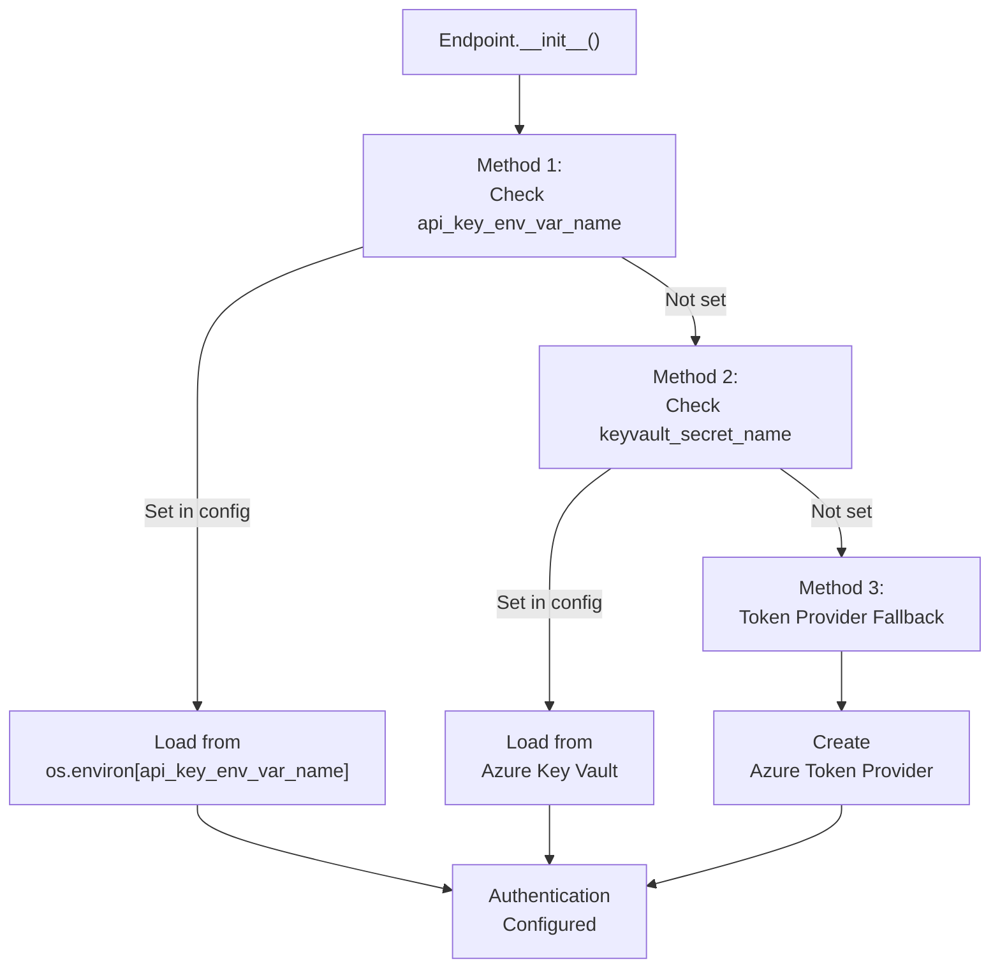
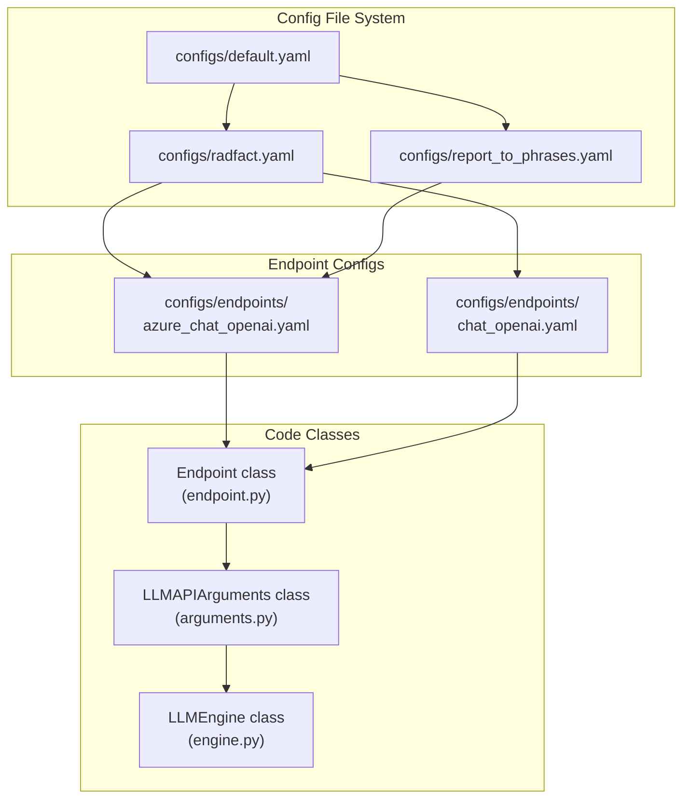
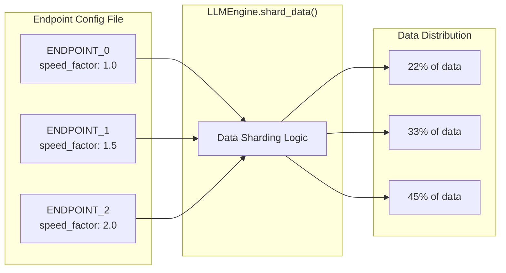

<!-- source: DeepWiki mcp.deepwiki.com · repo microsoft/RadFact · page 2.3 Configuration Setup · fetched 2026-10-26 -->

# Configuration Setup

<details>
<summary>Relevant source files</summary>

The following files were used as context for generating this wiki page:

- [README.md](README.md)
- [configs/default.yaml](configs/default.yaml)
- [configs/endpoints/azure_chat_openai.yaml](configs/endpoints/azure_chat_openai.yaml)
- [configs/endpoints/chat_openai.yaml](configs/endpoints/chat_openai.yaml)

</details>


This page guides you through the initial configuration required to use RadFact. You will set up LLM endpoint connections and configure authentication credentials. This is a prerequisite before running any RadFact evaluations.

For comprehensive configuration reference documentation, see [Configuration](#6). For information about advanced Hydra configuration patterns, see [Configuration System](#6.1).

---

## Overview

RadFact requires access to a Large Language Model (LLM) via API endpoints. Before running evaluations, you must configure:

1. **Endpoint definitions** - URL, model type, and processing parameters
2. **Authentication credentials** - API keys or Azure authentication
3. **Task-specific endpoint selection** - Which endpoint to use for which RadFact task

RadFact uses [Hydra](https://hydra.cc) for configuration management, with endpoint configurations stored in [`configs/endpoints/`](configs/endpoints). Two tasks require LLM access:
- **Report-to-phrases conversion** - Converting narrative reports to structured phrases (configured in [`configs/report_to_phrases.yaml`](configs/report_to_phrases.yaml))
- **Entailment verification** - Core RadFact metric computation (configured in [`configs/radfact.yaml`](configs/radfact.yaml))

**Sources**: [README.md:48-92](), [configs/default.yaml:1-28]()

---

## Authentication Methods

RadFact supports three authentication methods, checked in order until one succeeds. The authentication logic is implemented in the `Endpoint` class.



**Figure 1: Authentication Method Selection Flow**

### Method 1: Environment Variable (Recommended for Development)

Set the API key in an environment variable and reference it in your endpoint config:

```bash
export API_KEY="your-api-key-here"
```

In the endpoint config file, specify the environment variable name:

```yaml
ENDPOINT_0:
  api_key_env_var_name: "API_KEY"
```

For multiple endpoints with different keys:

```bash
export API_KEY_AZURE_0="key-for-endpoint-0"
export API_KEY_AZURE_1="key-for-endpoint-1"
```

### Method 2: Azure Key Vault (Recommended for Production)

Configure RadFact to retrieve the API key from Azure Key Vault:

1. Create `config.json` in the repository root with your AzureML workspace details:

```json
{
  "subscription_id": "your-subscription-id",
  "resource_group": "your-resource-group",
  "workspace_name": "your-workspace-name"
}
```

2. Add `config.json` to `.gitignore` (already included by default)

3. Store your API key in the workspace's Key Vault

4. Reference the secret name in your endpoint config:

```yaml
ENDPOINT_0:
  keyvault_secret_name: "your-secret-name"
```

**Note**: The `config.json` file can be downloaded from your AzureML workspace in the Azure Portal.

### Method 3: Azure Token Provider (Automatic Fallback)

If neither environment variable nor Key Vault is configured, RadFact automatically creates an Azure AD token provider for `AZURE_CHAT_OPENAI` endpoints. This requires:

- Valid Azure credentials configured locally (e.g., via `az login`)
- Appropriate permissions to access the Azure OpenAI resource

This method only works with `AZURE_CHAT_OPENAI` endpoint types, not `CHAT_OPENAI`.

**Sources**: [README.md:54-64](), [src/radfact/llm_utils/endpoint.py:38]()

---

## Endpoint Configuration Files

Endpoint configurations are stored in [`configs/endpoints/`](configs/endpoints) and define connection parameters for LLM APIs.



**Figure 2: Configuration File Hierarchy and Code Mapping**

### Endpoint Types

RadFact supports two endpoint types via LangChain (version 0.1.4):

| Endpoint Type | Use Case | LangChain Class |
|--------------|----------|-----------------|
| `AZURE_CHAT_OPENAI` | GPT models on Azure OpenAI | `AzureChatOpenAI` |
| `CHAT_OPENAI` | Custom models (e.g., Llama-3) on Azure or OpenAI | `ChatOpenAI` |

### Configuration Parameters

Each endpoint definition includes the following parameters:

| Parameter | Required | Description | Default |
|-----------|----------|-------------|---------|
| `type` | Yes | Endpoint type: `AZURE_CHAT_OPENAI` or `CHAT_OPENAI` | - |
| `url` | Yes | API endpoint URL | - |
| `deployment_name` | Yes | Model deployment name | - |
| `api_key_env_var_name` | No | Environment variable name containing API key | `"API_KEY"` |
| `keyvault_secret_name` | No | Azure Key Vault secret name | - |
| `speed_factor` | No | Relative speed for load balancing across endpoints | `1.0` |
| `num_parallel_processes` | No | Number of parallel workers for this endpoint | `1` |

**Sources**: [configs/endpoints/azure_chat_openai.yaml:1-40](), [configs/endpoints/chat_openai.yaml:1-40](), [README.md:70-87]()

---

## Creating Your First Endpoint Configuration

### Step 1: Choose a Template

RadFact provides two template configurations:

- **[`configs/endpoints/azure_chat_openai.yaml`](configs/endpoints/azure_chat_openai.yaml)** - For Azure OpenAI GPT models
- **[`configs/endpoints/chat_openai.yaml`](configs/endpoints/chat_openai.yaml)** - For custom models like Llama-3

### Step 2: Edit the Configuration

Create or modify an endpoint configuration file:

**For Azure OpenAI (GPT-4):**

```yaml
ENDPOINT_0:
  type: "AZURE_CHAT_OPENAI"
  url: "https://your-resource.openai.azure.com/"
  deployment_name: "gpt-4"
  api_key_env_var_name: "API_KEY_AZURE_0"
  speed_factor: 1.0
  num_parallel_processes: 1
```

**For Custom Models (Llama-3):**

```yaml
ENDPOINT_0:
  type: "CHAT_OPENAI"
  url: "https://your-endpoint-url.com/"
  deployment_name: "llama3-70b"
  api_key_env_var_name: "API_KEY_CHAT_0"
  speed_factor: 1.0
  num_parallel_processes: 10
```

### Step 3: Configure Task-Specific Endpoints

Edit [`configs/radfact.yaml`](configs/radfact.yaml) and [`configs/report_to_phrases.yaml`](configs/report_to_phrases.yaml) to specify which endpoint config to use:

**configs/radfact.yaml:**
```yaml
defaults:
  - /default
  - override /endpoints: chat_openai  # Use chat_openai.yaml
```

**configs/report_to_phrases.yaml:**
```yaml
defaults:
  - /default
  - override /endpoints: azure_chat_openai  # Use azure_chat_openai.yaml
```

**Sources**: [README.md:66-92](), [configs/radfact.yaml](), [configs/report_to_phrases.yaml]()

---

## Multiple Endpoints Configuration

RadFact can parallelize processing across multiple endpoints for improved throughput. The `LLMEngine` class automatically shards data based on `speed_factor` values.



**Figure 3: Multi-Endpoint Data Sharding by speed_factor**

**Example configuration with multiple endpoints:**

```yaml
ENDPOINT_0:
  type: "AZURE_CHAT_OPENAI"
  url: "https://eastus.openai.azure.com/"
  deployment_name: "gpt-4"
  api_key_env_var_name: "API_KEY_AZURE_0"
  speed_factor: 1.0

ENDPOINT_1:
  type: "AZURE_CHAT_OPENAI"
  url: "https://westus.openai.azure.com/"
  deployment_name: "gpt-4"
  api_key_env_var_name: "API_KEY_AZURE_1"
  speed_factor: 1.33

ENDPOINT_2:
  type: "AZURE_CHAT_OPENAI"
  url: "https://northeurope.openai.azure.com/"
  deployment_name: "gpt-4"
  api_key_env_var_name: "API_KEY_AZURE_2"
  speed_factor: 3.66
```

The `LLMEngine` distributes data proportionally: 
- ENDPOINT_0 receives ~17% (1.0 / 5.99)
- ENDPOINT_1 receives ~22% (1.33 / 5.99)
- ENDPOINT_2 receives ~61% (3.66 / 5.99)

**Sources**: [README.md:86-87](), [configs/endpoints/azure_chat_openai.yaml:25-39](), [src/radfact/llm_utils/engine/engine.py:50]()

---

## Testing Your Configuration

After configuring endpoints and authentication, verify the setup works correctly by running the test script:

```bash
python src/radfact/cli/run_radfact_test_examples.py
```

This script:
1. Loads your endpoint configuration from [`configs/radfact.yaml`](configs/radfact.yaml)
2. Runs entailment verification on example data
3. Compares results against expected outputs (obtained using Llama-3-70B-Instruct)

**Expected behavior**: The script should complete without authentication errors and produce metrics similar to the reference values.

**Common issues**:
- `Authentication failed` - Check your API key or Azure credentials
- `Endpoint not responding` - Verify the `url` and `deployment_name` are correct
- `Connection timeout` - Check network access and firewall rules

**Note**: This test only verifies entailment verification. It does not test the report-to-phrases conversion step, which uses a separate endpoint configured in [`configs/report_to_phrases.yaml`](configs/report_to_phrases.yaml).

**Sources**: [README.md:94-98]()

---

## Configuration Parameters Reference

The following table maps configuration parameters to their corresponding code entities:

| Configuration Parameter | Config File Location | Python Class/Module | Description |
|------------------------|---------------------|---------------------|-------------|
| `type` | `configs/endpoints/*.yaml` | `Endpoint.type` | Determines which LangChain model class to instantiate |
| `url` | `configs/endpoints/*.yaml` | `Endpoint.url` | API endpoint base URL |
| `deployment_name` | `configs/endpoints/*.yaml` | `Endpoint.deployment_name` | Model deployment identifier |
| `api_key_env_var_name` | `configs/endpoints/*.yaml` | `Endpoint.api_key_env_var_name` | Environment variable name for API key |
| `keyvault_secret_name` | `configs/endpoints/*.yaml` | `Endpoint.keyvault_secret_name` | Azure Key Vault secret name |
| `speed_factor` | `configs/endpoints/*.yaml` | `Endpoint.speed_factor` | Used by `LLMEngine.shard_data()` |
| `num_parallel_processes` | `configs/endpoints/*.yaml` | `Endpoint.num_parallel_processes` | Used by `LLMEngine.__init__()` |
| `api_version` | `configs/default.yaml` | `LLMAPIArguments.api_version` | Azure OpenAI API version |
| `temperature` | `configs/default.yaml` | `LLMAPIArguments.temperature` | LLM sampling temperature |
| `max_tokens` | `configs/default.yaml` | `LLMAPIArguments.max_tokens` | Maximum tokens in response |
| `batch_size` | `configs/default.yaml` | `LLMEngine.batch_size` | Batch size for incremental saves |

**Sources**: [configs/default.yaml:1-28](), [src/radfact/llm_utils/endpoint.py](), [src/radfact/llm_utils/engine/arguments.py]()

---

## Next Steps

Once your configuration is working:

1. Run your first RadFact evaluation - see [Quick Start](#2.2)
2. Understand the input data formats - see [Input Data Formats](#4.3)
3. Learn about advanced configuration options - see [Configuration System](#6.1)
4. Configure caching for better performance - see [Caching System](#5.4)

For production deployments, consider:
- Using Azure Key Vault for credential management (see [Authentication](#6.3))
- Setting up Redis caching (see [Caching System](#5.4))
- Configuring multiple endpoints for high throughput (see [Parallel Processing](#5.5))

**Sources**: [README.md:25-189]()

---

