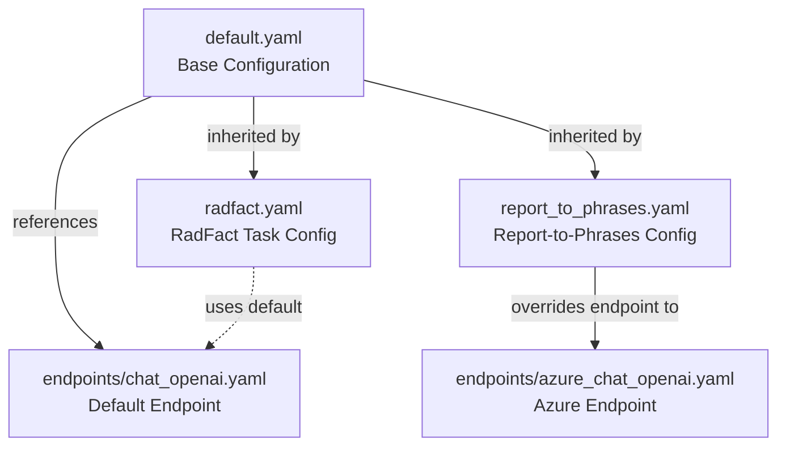
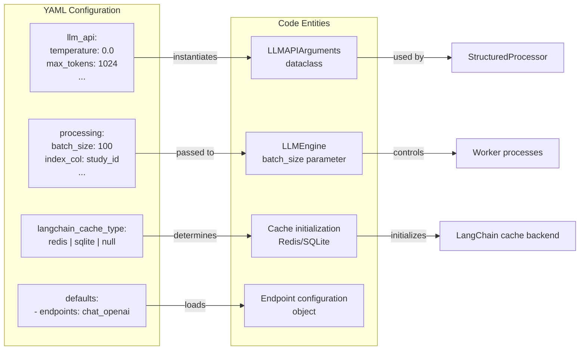
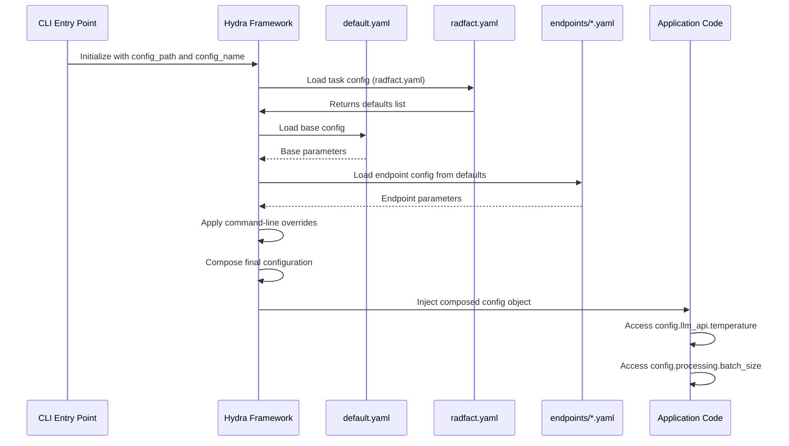

<!-- source: DeepWiki mcp.deepwiki.com · repo microsoft/RadFact · page 6.1 Configuration System · fetched 2026-10-26 -->

# Configuration System

<details>
<summary>Relevant source files</summary>

The following files were used as context for generating this wiki page:

- [configs/default.yaml](configs/default.yaml)
- [configs/radfact.yaml](configs/radfact.yaml)
- [configs/report_to_phrases.yaml](configs/report_to_phrases.yaml)

</details>


## Purpose and Scope

This document explains RadFact's configuration management system built on the Hydra framework. It covers the hierarchical configuration file structure, configuration composition and override mechanisms, and the main configuration groups (LLM API settings, processing parameters, and cache configuration).

For details on configuring specific LLM endpoints (Azure OpenAI, custom OpenAI), see [Endpoint Configuration](#6.2). For authentication setup, see [Authentication](#6.3). For detailed parameter tuning, see [Processing Parameters](#6.4).

## Hydra Configuration Framework

RadFact uses [Hydra](https://hydra.cc) for configuration management, providing a flexible system for composing and overriding configuration values. Hydra enables:

- **Hierarchical composition**: Configs can inherit from and override other configs
- **Structured configuration**: Type-safe configuration with validation
- **Command-line overrides**: Modify any parameter without editing files
- **Multiple deployment scenarios**: Different configs for development, production, and testing

The configuration system separates concerns into distinct YAML files, allowing users to customize specific aspects without modifying the entire configuration.

**Sources:** [configs/default.yaml:1-28](), [configs/radfact.yaml:1-7](), [configs/report_to_phrases.yaml:1-11]()

## Configuration File Structure

RadFact's configuration consists of three levels:

| Level | File | Purpose |
|-------|------|---------|
| Base | `configs/default.yaml` | Default values for all parameters used across both CLI tools |
| Task-specific | `configs/radfact.yaml` | Configuration for RadFact evaluation (`run_radfact`) |
| Task-specific | `configs/report_to_phrases.yaml` | Configuration for report preprocessing (`run_report_to_phrases`) |

### Mermaid: Configuration File Hierarchy



**Sources:** [configs/default.yaml:1-3](), [configs/radfact.yaml:3-6](), [configs/report_to_phrases.yaml:3-6]()

## Configuration Composition

Hydra uses a `defaults` list to specify which configurations to compose. The composition order determines override precedence:

### default.yaml Defaults

```yaml
defaults:
  - endpoints: chat_openai
  - _self_
```

This specifies:
1. Include the `endpoints/chat_openai.yaml` configuration group
2. `_self_` marker indicates where the current file's content should be merged (last position means highest priority)

**Sources:** [configs/default.yaml:1-3]()

### radfact.yaml Defaults

```yaml
defaults:
  - default
  - override endpoints: chat_openai
  - _self_
```

This composition:
1. Inherits all settings from `default.yaml`
2. Explicitly confirms the `chat_openai` endpoint (uses `override` keyword for clarity)
3. Places `_self_` last to allow task-specific overrides

**Sources:** [configs/radfact.yaml:3-6]()

### report_to_phrases.yaml Defaults

```yaml
defaults:
  - default
  - override endpoints: azure_chat_openai
  - _self_
```

This composition:
1. Inherits from `default.yaml`
2. **Overrides** the endpoint to use `azure_chat_openai` instead of `chat_openai`
3. Adds task-specific dataset configuration

**Sources:** [configs/report_to_phrases.yaml:3-6]()

## Core Configuration Parameters

The `default.yaml` file defines three main configuration groups that are used throughout RadFact:

### LLM API Parameters (`llm_api`)

These parameters control how RadFact interacts with language models:

| Parameter | Default | Description |
|-----------|---------|-------------|
| `api_version` | `"2023-07-01-preview"` | Azure OpenAI API version |
| `max_retries` | `10` | Maximum retry attempts for failed requests |
| `temperature` | `0.0` | Sampling temperature (0.0 = deterministic) |
| `max_tokens` | `1024` | Maximum tokens in generated responses |
| `n_completions` | `1` | Number of completions per request |
| `top_p` | `1.0` | Nucleus sampling parameter |
| `frequency_penalty` | `0.0` | Penalty for token frequency |
| `presence_penalty` | `0.0` | Penalty for token presence |
| `stop` | `null` | Stop sequences |
| `timeout` | `null` | Request timeout in seconds |

These map to the `LLMAPIArguments` class used by the `StructuredProcessor`.

**Sources:** [configs/default.yaml:5-15]()

### Processing Parameters (`processing`)

These parameters control dataset processing and output management:

| Parameter | Default | Description |
|-----------|---------|-------------|
| `index_col` | `"study_id"` | Column name used as unique identifier in input data |
| `batch_size` | `100` | Number of records to process before writing incremental outputs |
| `start_index` | `0` | Starting row index for processing (enables resumption) |
| `end_index` | `null` | Ending row index (null = process until end) |
| `output_filename` | `"outputs.json"` | Name of final aggregated output file |

These map to processing logic in the `LLMEngine` class.

**Sources:** [configs/default.yaml:17-22]()

### Cache Configuration (`langchain_cache_type`)

This parameter determines the caching backend:

| Value | Behavior |
|-------|----------|
| `null` | No caching (every request hits the LLM) |
| `"sqlite"` | Local SQLite cache at `~/.langchain.db` (development) |
| `"redis"` | Distributed Redis cache (production, shared across runs) |

The cache type is passed to the caching system initialization. See [Caching System](#5.4) for implementation details.

**Sources:** [configs/default.yaml:24-27]()

## Mermaid: Configuration to Code Mapping



**Sources:** [configs/default.yaml:5-27]()

## Configuration Override Mechanisms

Hydra provides multiple ways to override configuration values:

### 1. Command-Line Overrides

Override any parameter directly from the command line:

```bash
# Override temperature
run_radfact input.csv llm_api.temperature=0.5

# Override batch size
run_radfact input.csv processing.batch_size=50

# Override endpoint group
run_radfact input.csv endpoints=azure_chat_openai

# Multiple overrides
run_radfact input.csv llm_api.temperature=0.5 processing.batch_size=50
```

### 2. Config File Overrides

Create a new task-specific config file that inherits and overrides defaults:

```yaml
defaults:
  - default
  - override endpoints: azure_chat_openai
  - _self_

llm_api:
  temperature: 0.3  # Override specific parameter
  
processing:
  batch_size: 200   # Override batch size
```

### 3. Environment-Specific Overrides

Hydra supports config groups for different environments (though not explicitly used in RadFact's current structure):

```yaml
defaults:
  - default
  - endpoints: azure_chat_openai
  - optional environment: production  # Load production overrides if available
```

**Sources:** [configs/radfact.yaml:1-7](), [configs/report_to_phrases.yaml:1-11]()

## Mermaid: Runtime Configuration Resolution



**Sources:** [configs/default.yaml:1-28](), [configs/radfact.yaml:1-7]()

## Configuration Composition Example

Here's how configuration values are resolved when running `run_radfact` with command-line overrides:

### Step-by-Step Resolution

1. **Load `radfact.yaml`**:
   - Specifies `defaults: [default, override endpoints: chat_openai, _self_]`

2. **Load `default.yaml`**:
   - Sets `llm_api.temperature = 0.0`
   - Sets `processing.batch_size = 100`
   - Specifies `defaults: [endpoints: chat_openai]`

3. **Load `endpoints/chat_openai.yaml`**:
   - Adds endpoint-specific configuration (see [Endpoint Configuration](#6.2))

4. **Apply `radfact.yaml` overrides**:
   - `radfact.yaml` has no parameter overrides, so defaults remain

5. **Apply command-line overrides**:
   - `llm_api.temperature=0.5` → temperature becomes `0.5`
   - Original `batch_size` of `100` remains unchanged

### Final Configuration

```yaml
llm_api:
  temperature: 0.5      # From command line
  max_tokens: 1024      # From default.yaml
  max_retries: 10       # From default.yaml
  # ... other parameters from default.yaml

processing:
  batch_size: 100       # From default.yaml
  index_col: study_id   # From default.yaml
  # ... other parameters

# ... endpoint configuration from endpoints/chat_openai.yaml
```

**Sources:** [configs/default.yaml:1-28](), [configs/radfact.yaml:1-7]()

## Task-Specific Configurations

### RadFact Evaluation Config

The `radfact.yaml` configuration is minimal, inheriting almost everything from `default.yaml`. This is appropriate since RadFact evaluation primarily needs default settings with the flexibility to override via command line.

**Key characteristic**: Uses `chat_openai` endpoint by default (suitable for development with standard OpenAI API).

**Sources:** [configs/radfact.yaml:1-7]()

### Report-to-Phrases Config

The `report_to_phrases.yaml` configuration demonstrates two customizations:

1. **Endpoint override**: Changes to `azure_chat_openai` (production Azure deployment)
2. **Dataset specification**: Adds a `dataset` section with task-specific parameters

```yaml
dataset:
  name: reports_to_phrases
  csv_path: "<your_path_to_cxr_reports>"
```

This shows how task-specific configs can add new configuration groups not present in the base config.

**Sources:** [configs/report_to_phrases.yaml:1-11]()

## Configuration Best Practices

### When to Use Command-Line Overrides

Command-line overrides are appropriate for:
- One-off experiments with different parameters
- Automated scripts that vary a single parameter
- Quick testing without modifying config files

```bash
run_radfact data.csv llm_api.temperature=0.5
```

### When to Create New Config Files

Create new config files for:
- Recurring configurations (e.g., production vs. development)
- Different deployment environments
- Task-specific parameter sets

```yaml
# configs/radfact_production.yaml
defaults:
  - radfact
  - override endpoints: azure_chat_openai
  - _self_

langchain_cache_type: redis

llm_api:
  max_retries: 20  # More aggressive retries in production
```

### Endpoint Selection

The choice between `chat_openai` and `azure_chat_openai` endpoints typically depends on:
- **Development**: `chat_openai` (standard OpenAI API, simpler authentication)
- **Production**: `azure_chat_openai` (enterprise Azure deployment, better compliance)

See [Endpoint Configuration](#6.2) for detailed endpoint setup.

**Sources:** [configs/radfact.yaml:1-7](), [configs/report_to_phrases.yaml:1-7]()

## Related Configuration Topics

- **[Endpoint Configuration](#6.2)**: Detailed setup for Azure OpenAI and custom OpenAI endpoints
- **[Authentication](#6.3)**: Configuring API keys, Azure Key Vault, and token providers
- **[Processing Parameters](#6.4)**: Deep dive into LLM parameters and processing settings
- **[System Overview](#5.1)**: How configuration integrates with the overall architecture

**Sources:** [configs/default.yaml:1-28](), [configs/radfact.yaml:1-7](), [configs/report_to_phrases.yaml:1-11]()

---

