# Page: Home

# Home

<details>
<summary>Relevant source files</summary>

The following files were used as context for generating this wiki page:

- [README.md](README.md)
- [pyproject.toml](pyproject.toml)

</details>


## Purpose and Scope

This wiki documents RadFact, an LLM-based evaluation framework for AI-generated radiology reports. RadFact provides a suite of six metrics to evaluate both text-only and grounded (bounding-box annotated) radiology reports against ground-truth references using large language model entailment verification.

For installation and setup instructions, see [Getting Started](#2). For detailed architectural information, see [Architecture](#5). For usage instructions, see [User Guide](#4).

**Sources**: [README.md:1-6]()

## What is RadFact?

RadFact is an automated evaluation metric that measures the quality of AI-generated radiology reports by comparing them to ground-truth references. Unlike traditional lexical metrics (BLEU, ROUGE), RadFact leverages the logical reasoning capabilities of large language models to determine semantic entailment between reports.

### Problem Statement

Evaluating generated medical reports requires understanding whether findings are:
- **Factually correct** (no hallucinations)
- **Complete** (no omissions)  
- **Properly grounded** (bounding boxes correctly localize findings)

Traditional metrics fail at this because they measure surface-level text similarity rather than semantic correctness.

### RadFact Metrics

RadFact provides six metrics organized into three categories:

| Category | Precision Metric | Recall Metric | Evaluates |
|----------|------------------|---------------|-----------|
| **Logical** | Fraction of generated sentences entailed by ground-truth | Fraction of ground-truth sentences entailed by generation | Text-only correctness and completeness |
| **Grounding** | Fraction of correctly-generated findings also correctly grounded | Fraction of correctly-captured findings also correctly grounded | Grounding quality for correct findings |
| **Spatial** | Fraction of all grounded generations both logically and spatially entailed | Fraction of all grounded ground-truths both logically and spatially entailed | Overall grounding performance |

Precision metrics use ground-truth as reference; recall metrics use generation as reference. This bidirectional evaluation captures both hallucinations (low precision) and omissions (low recall).

**Sources**: [README.md:190-222]()

## System Architecture Overview

RadFact is organized into four major layers: user interface, core evaluation logic, LLM processing infrastructure, and external services.

### High-Level Component Structure

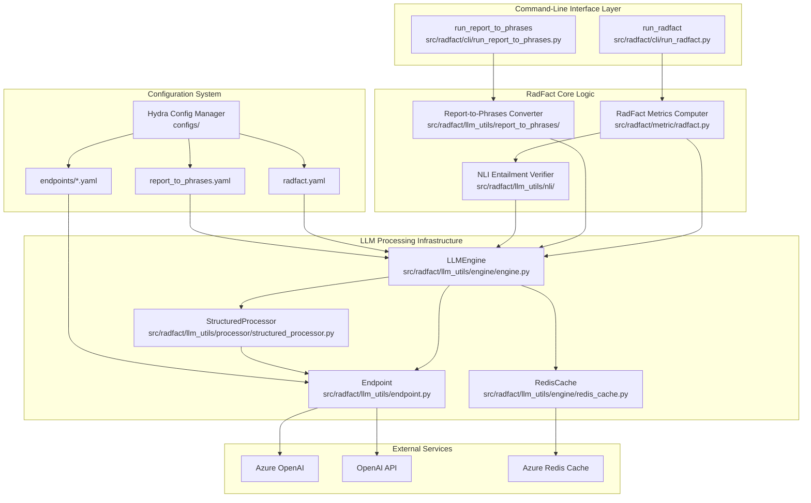

**Description**: This diagram shows how RadFact's major components relate to actual code files. The CLI layer provides two entry points (`run_radfact` and `run_report_to_phrases`) that invoke the core evaluation logic. The `LLMEngine` class orchestrates parallel LLM queries across multiple endpoints, using `StructuredProcessor` for prompt management and `RedisCache` for response caching. Configuration is managed via Hydra with task-specific YAML files.

**Sources**: [README.md:1-100](), [src/radfact/llm_utils/engine/engine.py](), [src/radfact/llm_utils/processor/structured_processor.py](), [src/radfact/llm_utils/engine/redis_cache.py](), [pyproject.toml:86-88]()

### Evaluation Pipeline Data Flow

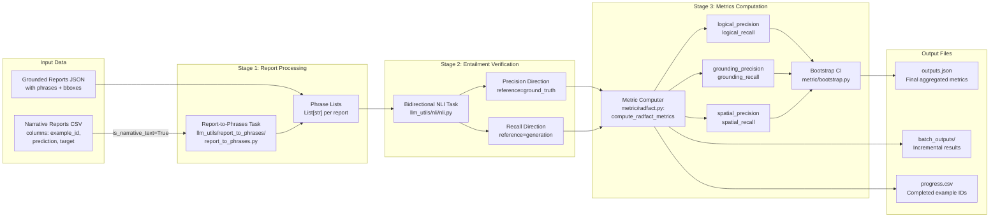

**Description**: This diagram illustrates the three-stage evaluation pipeline with exact code file locations. Stage 1 converts narrative reports to phrase lists using `report_to_phrases.py`. Stage 2 performs bidirectional entailment verification via `nli.py`, checking both precision (using ground-truth as reference) and recall (using generation as reference). Stage 3 computes the six metrics in `radfact.py` and optionally generates bootstrap confidence intervals. Results are written incrementally to `batch_outputs/` and aggregated into `outputs.json`.

**Sources**: [README.md:131-189](), [README.md:190-222](), [src/radfact/metric/radfact.py](), [src/radfact/llm_utils/nli/nli.py](), [src/radfact/llm_utils/report_to_phrases/report_to_phrases.py]()

## Key Components

### CLI Entry Points

RadFact provides two command-line tools defined in [pyproject.toml:86-88]():

- **`run_radfact`**: Main evaluation command that computes all six RadFact metrics
  - Implementation: [src/radfact/cli/run_radfact.py]()
  - Accepts CSV (narrative reports) or JSON (grounded reports)
  - Supports optional bootstrapping for confidence intervals
  
- **`run_report_to_phrases`**: Standalone report-to-phrases conversion
  - Implementation: [src/radfact/cli/run_report_to_phrases.py]()
  - Useful for pre-processing narrative reports offline

**Sources**: [pyproject.toml:86-88](), [README.md:131-189]()

### Core Evaluation Logic

The `radfact.metric` module implements metric computation:

- **`RadFact` class** [src/radfact/metric/radfact.py](): Main orchestrator that coordinates report-to-phrases conversion and entailment verification
- **`compute_radfact_metrics()` function**: Computes the six metrics from entailment results
- **`bootstrap.py`**: Implements bootstrap resampling for confidence intervals

**Sources**: [src/radfact/metric/radfact.py]()

### LLM Processing Infrastructure

The `radfact.llm_utils` package provides the LLM processing infrastructure:

#### LLMEngine: Parallel Processing Orchestrator

The `LLMEngine` class [src/radfact/llm_utils/engine/engine.py]() manages parallel processing across multiple LLM endpoints:

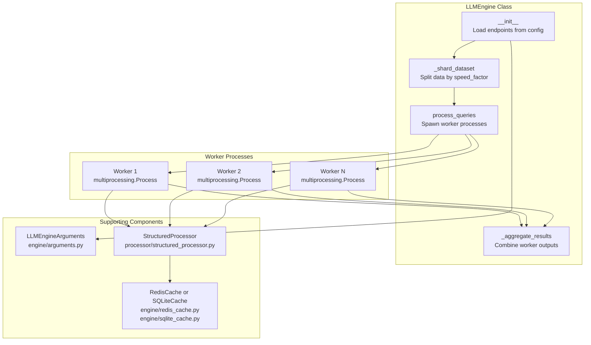

**Description**: The `LLMEngine` shards the input dataset across available endpoints based on their `speed_factor` configuration parameter. Each worker process runs independently, using a `StructuredProcessor` instance to query its assigned endpoint. The cache is shared across workers to avoid redundant API calls. Results are incrementally saved and aggregated at completion.

**Sources**: [src/radfact/llm_utils/engine/engine.py](), [src/radfact/llm_utils/engine/arguments.py]()

#### StructuredProcessor: Prompt and Response Handler

The `StructuredProcessor` class [src/radfact/llm_utils/processor/structured_processor.py]() handles:
- **Prompt formatting**: Combines system message, few-shot examples, and query
- **LLM invocation**: Calls LangChain chat models
- **Response parsing**: Extracts structured outputs from LLM responses
- **Retry logic**: Handles transient failures

**Sources**: [src/radfact/llm_utils/processor/structured_processor.py]()

#### Caching System

Two cache implementations are provided:
- **`RedisCache`** [src/radfact/llm_utils/engine/redis_cache.py](): Distributed cache using Azure Redis Cache, suitable for production
- **`SQLiteCache`** [src/radfact/llm_utils/engine/sqlite_cache.py](): Local file-based cache, suitable for development

Both implement endpoint URL normalization to maximize cache hits across different Azure regions.

**Sources**: [src/radfact/llm_utils/engine/redis_cache.py](), [src/radfact/llm_utils/engine/sqlite_cache.py]()

### Configuration System

RadFact uses Hydra for hierarchical configuration management [configs/]():

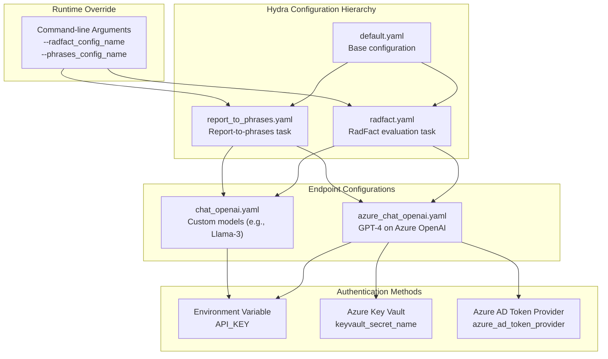

**Description**: Configuration files are organized hierarchically. Task-specific configs (`radfact.yaml`, `report_to_phrases.yaml`) inherit from `default.yaml` and specify which endpoint configurations to use. Endpoint configs define the LLM URL, deployment name, and authentication method. Users can override any configuration via command-line arguments.

**Sources**: [configs/default.yaml](), [configs/radfact.yaml](), [configs/report_to_phrases.yaml](), [configs/endpoints/](), [README.md:48-93]()

## Execution Flow

The typical execution flow for evaluating a set of reports:

1. **User invokes CLI**: `run_radfact --input_path data.csv --is_narrative_text`
2. **Hydra loads configuration**: Reads `configs/radfact.yaml` and endpoint configs
3. **RadFact initializes**: Creates `RadFact` instance with LLM endpoints
4. **Stage 1 (if narrative)**: Converts reports to phrases using `report_to_phrases` task
5. **Stage 2**: Performs bidirectional entailment verification using `nli` task
   - Precision direction: ground-truth as reference
   - Recall direction: generation as reference
6. **Stage 3**: Computes six metrics from entailment results
7. **Bootstrap (optional)**: Generates confidence intervals via resampling
8. **Output**: Writes `outputs.json` with metrics and CI

Throughout execution, the `LLMEngine`:
- Shards data across endpoints based on `speed_factor`
- Spawns parallel workers (one per endpoint)
- Checks cache before making LLM API calls
- Writes incremental results to `batch_outputs/` and `progress.csv`
- Aggregates worker outputs into final `outputs.json`

**Sources**: [README.md:131-189](), [src/radfact/llm_utils/engine/engine.py]()

## External Dependencies

RadFact integrates with several external services and libraries:

### Azure Services
- **Azure OpenAI**: LLM endpoints for GPT-4 models
- **Azure Redis Cache**: Distributed caching for LLM responses
- **Azure Key Vault**: Secure credential storage
- **Azure ML**: Optional experiment tracking via MLflow

### Key Python Libraries
- **LangChain** (0.2.17): LLM orchestration and chat model abstractions
- **Hydra** (1.3.2): Hierarchical configuration management
- **Pandas/NumPy**: Data manipulation and metrics computation
- **Redis**: Cache client library

**Sources**: [pyproject.toml:41-60](), [README.md:48-93]()

## Output Structure

RadFact produces a structured output directory for each run:

```
outputs/radfact/run_YYYYMMDD_HHMMSS/
├── batch_outputs/           # Incremental results per batch
│   ├── outputs_0_100.json
│   ├── outputs_100_200.json
│   └── ...
├── progress/                # Progress tracking per worker
│   ├── subset_0_500.csv
│   └── ...
├── skipped/                 # Failed queries per worker
│   ├── subset_0_500.csv
│   └── ...
├── outputs.json            # Final aggregated metrics
├── progress.csv            # Aggregated progress
└── skipped.csv             # Aggregated failures
```

The `outputs.json` file contains:
- Six RadFact metrics (with optional bootstrap confidence intervals)
- Per-example entailment results
- `num_llm_failures`: Count of queries that failed

**Sources**: [README.md:100-130]()

## Next Steps

- **To install RadFact**: See [Installation](#2.1)
- **To run your first evaluation**: See [Quick Start](#2.2)
- **To configure LLM endpoints**: See [Configuration Setup](#2.3)
- **To understand the metrics**: See [RadFact Metrics](#3.1)
- **To learn about the architecture**: See [Architecture](#5)

**Sources**: [README.md:1-274]()

---

# Page: Getting Started

# Getting Started

<details>
<summary>Relevant source files</summary>

The following files were used as context for generating this wiki page:

- [Makefile](Makefile)
- [README.md](README.md)
- [dev_environment.yaml](dev_environment.yaml)

</details>


This page provides an overview of the steps required to set up and run RadFact for the first time. It covers installation, endpoint configuration, and running your first evaluation. For detailed instructions on each step, refer to the child pages: [Installation](#2.1), [Quick Start](#2.2), and [Configuration Setup](#2.3).

RadFact is designed to evaluate AI-generated radiology reports using large language models (LLMs) for entailment verification. Before you can run evaluations, you must install dependencies, configure LLM endpoints with authentication, and prepare your input data.

## Setup Workflow

The following diagram shows the high-level workflow for getting RadFact operational:

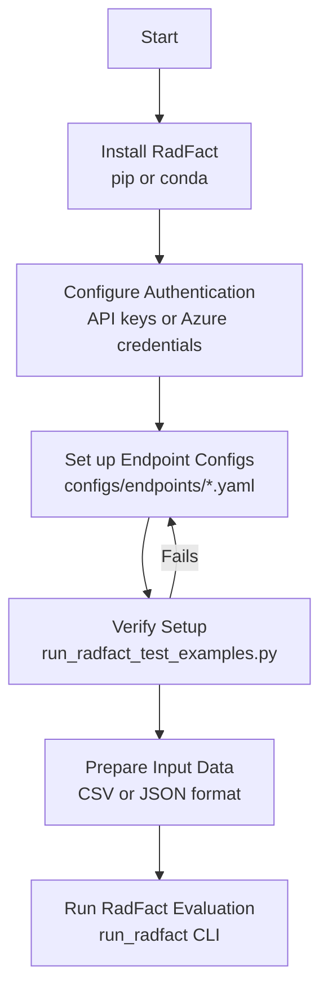

**Sources**: [README.md:25-98]()

Each step in this workflow is critical:

1. **Installation**: Install the `radfact` package and its dependencies
2. **Authentication**: Set up credentials for accessing LLM endpoints  
3. **Endpoint Configuration**: Configure which LLM(s) to use via YAML files
4. **Verification**: Confirm endpoints work correctly with test examples
5. **Data Preparation**: Format your reports according to expected schemas
6. **Execution**: Run evaluations using the CLI commands

## Prerequisites

Before beginning, ensure you have:

| Requirement | Description | Notes |
|-------------|-------------|-------|
| Python 3.10+ | Python runtime environment | Required by dependencies |
| LLM API Access | Access to Azure OpenAI or compatible endpoint | GPT-4 or Llama-3-70B recommended |
| API Credentials | API keys or Azure authentication | See [Configuration Setup](#2.3) |
| Input Data | Radiology reports in CSV or JSON format | See [Input Data Formats](#4.3) |

**Sources**: [README.md:27-46](), [dev_environment.yaml:24]()

## Key Components and Code Entities

The following diagram maps the setup workflow to specific code entities and configuration files in the RadFact codebase:

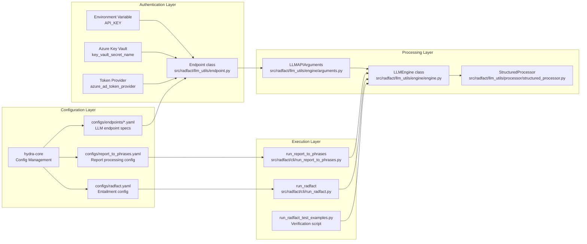

**Sources**: [README.md:48-93](), [src/radfact/llm_utils/endpoint.py:38](), [src/radfact/llm_utils/engine/arguments.py]()

### Component Descriptions

| Component | File Path | Purpose |
|-----------|-----------|---------|
| `run_radfact` | [src/radfact/cli/run_radfact.py]() | Main CLI for running RadFact evaluations |
| `run_report_to_phrases` | [src/radfact/cli/run_report_to_phrases.py]() | CLI for converting narrative reports to phrases |
| `LLMEngine` | [src/radfact/llm_utils/engine/engine.py:50]() | Orchestrates parallel LLM processing across endpoints |
| `StructuredProcessor` | [src/radfact/llm_utils/processor/structured_processor.py]() | Handles prompt construction and LLM query/response parsing |
| `Endpoint` | [src/radfact/llm_utils/endpoint.py:38]() | Manages endpoint configuration and authentication |
| `LLMAPIArguments` | [src/radfact/llm_utils/engine/arguments.py]() | Configures LLM API parameters from endpoint objects |

**Sources**: [README.md:64](), [README.md:100]()

## Configuration Files

RadFact uses Hydra for hierarchical configuration management. The key configuration files are:

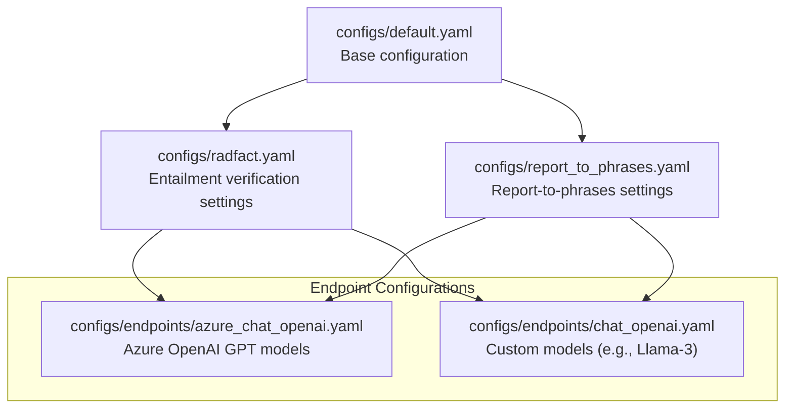

**Sources**: [README.md:66-93]()

### Endpoint Configuration Structure

Each endpoint configuration file in `configs/endpoints/` follows this structure:

| Field | Type | Description | Example |
|-------|------|-------------|---------|
| `type` | string | Endpoint type | `"AZURE_CHAT_OPENAI"` or `"CHAT_OPENAI"` |
| `url` | string | API endpoint URL | `"https://...openai.azure.com"` |
| `deployment_name` | string | Model deployment name | `"gpt-4"` or `"llama3-70b"` |
| `api_key_env_var_name` | string | Environment variable for API key | `"API_KEY"` (default) |
| `keyvault_secret_name` | string | Optional Azure Key Vault secret name | For production deployments |
| `speed_factor` | float | Relative speed for load balancing | `1.0` (default) |
| `num_parallel_processes` | int | Parallel workers per endpoint | `10` |

**Sources**: [README.md:70-88]()

## Authentication Methods

RadFact supports three authentication methods, checked in this order:

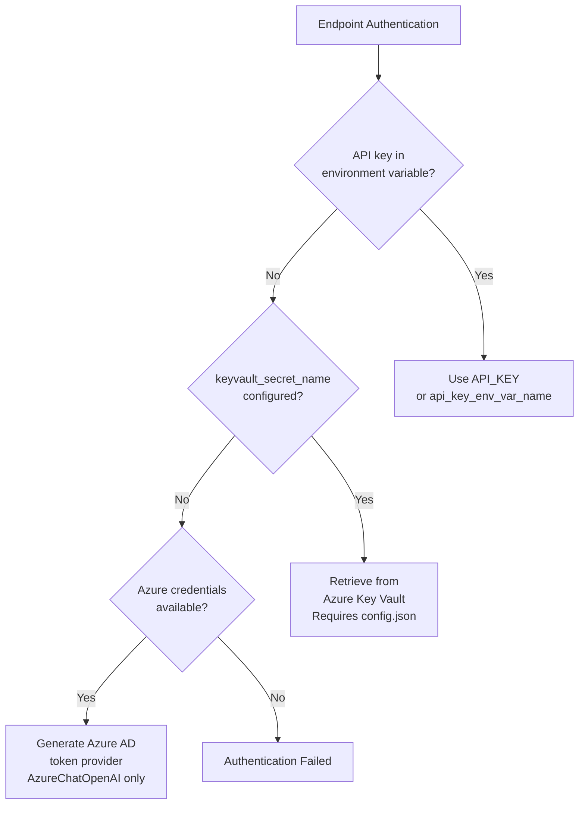

**Sources**: [README.md:54-63]()

### Method 1: Environment Variable (Simplest)

Set an environment variable with your API key:

```bash
export API_KEY="your-api-key-here"
```

If using multiple endpoints with different keys, specify unique environment variable names in each endpoint config via `api_key_env_var_name`.

### Method 2: Azure Key Vault (Recommended for Production)

Requires:
1. An `config.json` file in the repository root with keys: `subscription_id`, `resource_group`, `workspace_name`
2. The `key_vault_secret_name` field specified in the endpoint configuration

The `Endpoint` class at [src/radfact/llm_utils/endpoint.py:38]() retrieves secrets from the default Key Vault of the AzureML workspace.

### Method 3: Azure Token Provider (Fallback)

If neither API key method is configured, RadFact falls back to token-based authentication using Azure AD credentials. This only works with `AzureChatOpenAI` endpoints and requires proper Azure credentials to be available in the environment.

**Sources**: [README.md:54-64](), [src/radfact/llm_utils/endpoint.py:38]()

## Verification Step

Before running full evaluations, verify your endpoint configuration is working correctly:

```bash
python src/radfact/cli/run_radfact_test_examples.py
```

This script runs a small set of test examples through the entailment verification pipeline. The expected results were obtained using `Llama-3-70B-Instruct`. If results differ significantly from expectations, your LLM may not be suitable for RadFact evaluation.

**Note**: This only tests entailment verification, not the report-to-phrases conversion step.

**Sources**: [README.md:94-98]()

## Command-Line Interface

Once setup is complete, RadFact provides two main CLI commands:

### `run_radfact` - Run Evaluations

For narrative (non-grounded) reports:
```bash
run_radfact --input_path examples/findings_generation_examples.csv --is_narrative_text
```

For grounded reports with bounding boxes:
```bash
run_radfact --input_path examples/grounded_reporting_examples.json
```

### `run_report_to_phrases` - Convert Reports to Phrases

For narrative reports that need to be converted to structured phrases:
```bash
run_report_to_phrases dataset.csv_path=path/to/reports.csv
```

See [Quick Start](#2.2) for detailed examples and [CLI Commands](#8.1) for complete reference documentation.

**Sources**: [README.md:132-189]()

## Output Directory Structure

RadFact creates a timestamped output directory for each run. The `LLMEngine` class manages batch processing and intermediate result caching:

```
outputs/radfact/run_20240814_075225/
├── batch_outputs/           # Intermediate results per batch
│   ├── outputs_0_100.json
│   └── outputs_1000_1100.json
├── progress/                # Processing progress per endpoint
│   ├── subset_0_240.csv
│   └── subset_800_1100.csv
├── skipped/                 # Failed queries (set as NOT ENTAILED)
│   ├── subset_0_240.csv
│   └── subset_800_1100.csv
├── outputs.json             # Final aggregated results
├── progress.csv             # Overall progress tracking
└── skipped.csv              # Overall skipped examples
```

**Sources**: [README.md:100-129]()

The `outputs.json` file contains the final metrics. The `skipped.csv` file tracks any LLM failures - if this is large, results may not be reliable. RadFact defaults to marking failed queries as NOT ENTAILED.

## Next Steps

Now that you understand the setup workflow and key components:

1. **[Installation](#2.1)**: Install RadFact using pip or conda
2. **[Quick Start](#2.2)**: Run your first evaluation with example data  
3. **[Configuration Setup](#2.3)**: Configure LLM endpoints and authentication in detail

For understanding what RadFact computes, see [Core Concepts](#3). For details on input formats, see [Input Data Formats](#4.3).

**Sources**: [README.md:7-23]()

---

# Page: Installation

# Installation

<details>
<summary>Relevant source files</summary>

The following files were used as context for generating this wiki page:

- [Makefile](Makefile)
- [README.md](README.md)
- [dev_environment.yaml](dev_environment.yaml)
- [pyproject.toml](pyproject.toml)

</details>


This document provides detailed instructions for installing RadFact and setting up your environment. It covers both quick installation for evaluation use and full development setup for contributors.

For information about configuring LLM endpoints and authentication after installation, see [Configuration Setup](#2.3). To start running evaluations immediately after installation, see [Quick Start](#2.2).

## Prerequisites

RadFact requires Python 3.10 or higher. The system has been tested on Linux environments and requires the following base dependencies:

- Python 3.10+
- pip 23.0.1 or higher (for simple installation)
- conda/mamba (optional, for development setup)
- Docker (optional, for environment locking)

**Sources:** [README.md:27-46](), [pyproject.toml:33](), [dev_environment.yaml:24]()

## Installation Methods Overview

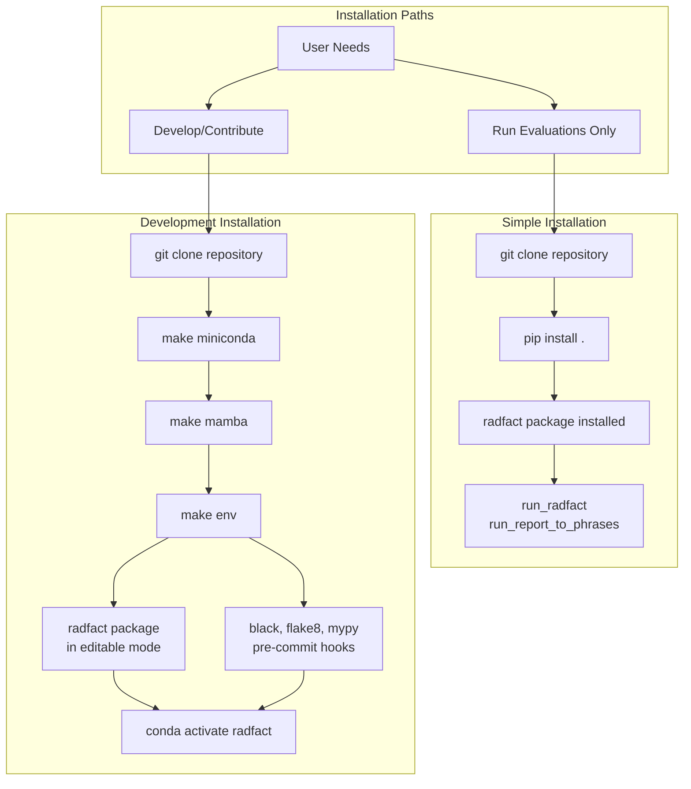

**RadFact Installation Decision Tree**

**Sources:** [README.md:27-46](), [Makefile:11-46]()

## Simple Installation (pip)

For users who want to run RadFact evaluations without modifying the codebase:

### Step 1: Clone the Repository

```bash
git clone https://github.com/microsoft/RadFact
cd RadFact
```

### Step 2: Install with pip

```bash
pip install .
```

This installs the `radfact` package and all runtime dependencies defined in [pyproject.toml:41-60](). The installation creates two CLI entry points:

| Command | Entry Point Definition | Source File |
|---------|----------------------|-------------|
| `run_radfact` | `radfact.cli.run_radfact:main` | [src/radfact/cli/run_radfact.py]() |
| `run_report_to_phrases` | `radfact.cli.run_report_to_phrases:main` | [src/radfact/cli/run_report_to_phrases.py]() |

**Sources:** [README.md:29-35](), [pyproject.toml:86-88]()

### Core Dependencies Installed

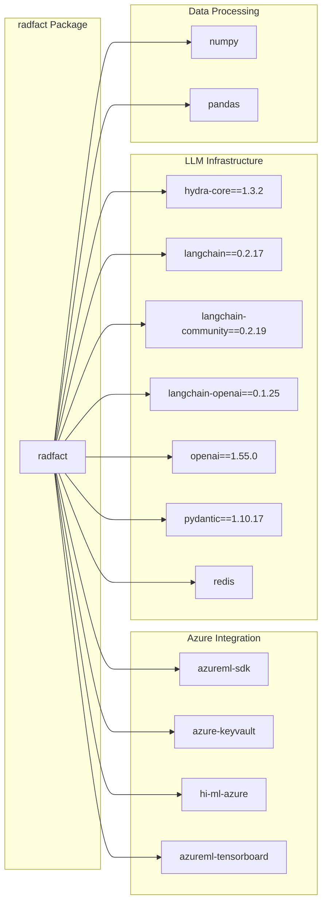

**Package Dependency Structure from pyproject.toml**

**Sources:** [pyproject.toml:41-60]()

## Development Installation (Conda)

For contributors who need a reproducible development environment with code quality tools:

### Step 1: Install Miniconda

If you don't have conda installed:

```bash
make miniconda
```

This downloads and installs Miniconda3-latest from [Makefile:11-13](). The installer script will be placed in the current directory.

**Sources:** [Makefile:11-13](), [README.md:40]()

### Step 2: Install Mamba (Fast Solver)

```bash
make mamba
```

This installs the libmamba solver for faster dependency resolution, as defined in [Makefile:16-19](). It updates the base conda environment and configures conda to use the libmamba solver.

**Sources:** [Makefile:16-19](), [README.md:41]()

### Step 3: Create the Conda Environment

```bash
make env
conda activate radfact
```

The `make env` target executes the following steps from [Makefile:22-28]():

1. Removes any existing `radfact` environment
2. Creates a new environment from [dev_environment.yaml]()
3. Installs the radfact package in editable mode via `setup_packages_with_deps`

**Sources:** [Makefile:22-28](), [README.md:42-46]()

### Environment Contents

The [dev_environment.yaml]() defines a locked environment with 370+ packages. Key components include:

| Category | Key Packages | Purpose |
|----------|-------------|---------|
| **Base** | python=3.10.15, pip, setuptools | Core Python environment |
| **Azure** | azure-cli, azure-identity, azure-ai-ml | Azure service integration |
| **LLM** | langchain, openai, tiktoken | LLM API interaction |
| **Development** | black, flake8, mypy, pre-commit | Code quality tools |
| **ML/Data** | numpy, pandas, scikit-learn, mlflow | Data processing and experiment tracking |
| **Testing** | pytest, mock, pytest-lazy-fixture | Test infrastructure |

**Sources:** [dev_environment.yaml:1-370]()

### Editable Installation Details

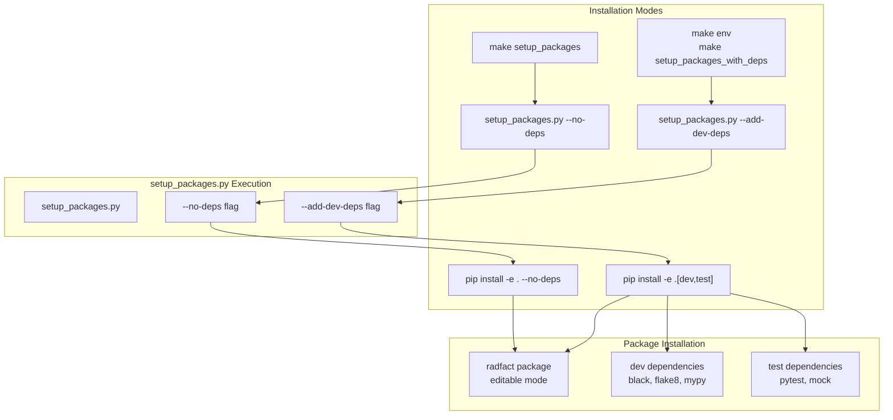

**Package Installation Flow via setup_packages.py**

The editable installation allows you to modify the source code without reinstalling. Changes to Python files in [src/radfact/]() are immediately reflected when running `run_radfact` or `run_report_to_phrases`.

**Sources:** [Makefile:40-46](), [README.md:46](), [pyproject.toml:62-82]()

## Environment Locking (Advanced)

For maintainers who need to update the locked environment file:

### Docker-Based Locking Process

```bash
make env_lock
```

This executes a multi-step process defined in [Makefile:70-87]():

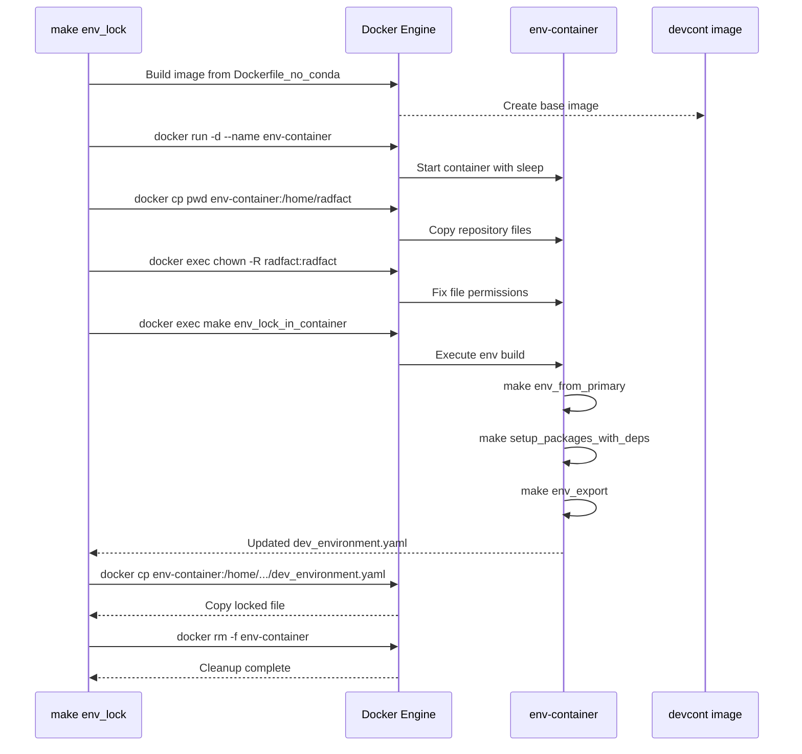

**Docker-Based Environment Locking Process**

The locking process:
1. Builds a Docker image from [Dockerfile_no_conda]()
2. Creates an environment from [primary_deps.yaml]()
3. Installs all packages with their dependencies
4. Exports the complete locked environment to [dev_environment.yaml]()

**Sources:** [Makefile:67-87]()

### Environment Export Mechanism

The `env_export` target ([Makefile:61-63]()) filters out local packages from the conda export:

```bash
conda env export --no-builds -n radfact | \
    grep -v "^prefix" | \
    grep -Ev "\s(azure-utils|llm-utils|radfact)==" \
    >> dev_environment.yaml
```

This ensures that only external dependencies are locked, not the radfact package itself which is installed in editable mode.

**Sources:** [Makefile:50-63]()

## Installation Verification

After installation, verify that the CLI commands are available:

```bash
run_radfact --help
run_report_to_phrases --help
```

These commands should display help text defined in [src/radfact/cli/run_radfact.py]() and [src/radfact/cli/run_report_to_phrases.py]() respectively.

For a quick test of the entailment verification system, run:

```bash
python src/radfact/cli/run_radfact_test_examples.py
```

This executes test cases with known expected outputs using the configured LLM endpoint. Note that this requires endpoint configuration to be completed (see [Configuration Setup](#2.3)).

**Sources:** [README.md:94-98](), [README.md:136-160]()

## Package Structure

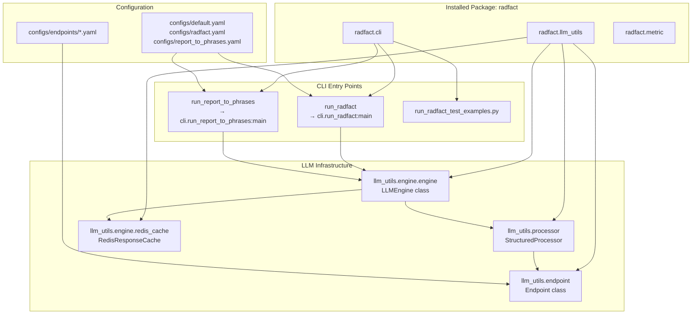

**Installed Package Structure and Entry Points**

**Sources:** [pyproject.toml:86-88](), [README.md:136-189]()

## Troubleshooting

### Common Installation Issues

| Issue | Symptom | Solution |
|-------|---------|----------|
| **Missing Python version** | `python: command not found` | Install Python 3.10+ or activate conda environment |
| **Permission errors** | `Permission denied` during pip install | Use `pip install --user .` or virtual environment |
| **Conda solver timeout** | Environment creation hangs | Run `make mamba` to install faster libmamba solver |
| **Docker permission denied** | `make env_lock` fails with permission error | Add user to docker group or use `sudo` |
| **Import errors after install** | `ModuleNotFoundError: radfact` | Verify installation with `pip list \| grep radfact` |

### Verifying Dependency Installation

Check that key dependencies are installed:

```bash
python -c "import langchain; print(langchain.__version__)"  # Should be 0.2.17
python -c "import hydra; print(hydra.__version__)"          # Should be 1.3.2
python -c "import openai; print(openai.__version__)"        # Should be 1.55.0
```

**Sources:** [pyproject.toml:49-54](), [dev_environment.yaml:209-266]()

### Development Tools Verification

If using the development installation, verify code quality tools:

```bash
make blackcheck  # Run black in check mode
make flake8      # Run flake8 linter
make mypy        # Run mypy type checker
```

These commands are defined in [Makefile:101-117]() and should execute without errors on a fresh installation.

**Sources:** [Makefile:101-117]()

## Next Steps

After successful installation:

1. **Quick Start**: Run your first evaluation → See [Quick Start](#2.2)
2. **Configure Endpoints**: Set up LLM access → See [Configuration Setup](#2.3)
3. **Development**: Set up code quality tools → See [Development Setup](#7.1)

**Sources:** [README.md:7-24]()

---

# Page: Quick Start

# Quick Start

<details>
<summary>Relevant source files</summary>

The following files were used as context for generating this wiki page:

- [README.md](README.md)
- [configs/radfact.yaml](configs/radfact.yaml)
- [examples/findings_generation_examples.csv](examples/findings_generation_examples.csv)

</details>


This guide walks you through running your first RadFact evaluation using the provided example datasets. You will learn how to evaluate both narrative radiology reports and grounded reports with bounding boxes, and understand the basic output format.

**Prerequisites**: This guide assumes you have completed [Installation](#2.1). For detailed endpoint configuration, see [Configuration Setup](#2.3).

**Scope**: This guide covers the minimal steps to run RadFact on example data. For detailed configuration options, input format specifications, and metric interpretation, see the [User Guide](#4) section.

---

## Example Datasets

RadFact includes two example datasets demonstrating different input formats:

| File | Type | Description | Columns/Fields |
|------|------|-------------|----------------|
| `examples/findings_generation_examples.csv` | Narrative reports | CSV with 19 example pairs of predicted and ground-truth radiology findings | `example_id`, `prediction`, `target` |
| `examples/grounded_reporting_examples.json` | Grounded reports | JSON with phrases and bounding boxes | `report_id`, `grounded_phrases` array with `phrase` and `boxes` |

**Sources**: [examples/findings_generation_examples.csv:1-22](), [README.md:174-174]()

---

## Running Your First Evaluation: Narrative Reports

The simplest way to run RadFact is with narrative text reports. This uses the `run_radfact` command with the `--is_narrative_text` flag:

```bash
run_radfact \
  --input_path examples/findings_generation_examples.csv \
  --is_narrative_text \
  --output_dir outputs/my_first_run
```

This command:
1. Reads the CSV file containing predicted and target reports
2. Converts each narrative report into structured phrases using an LLM
3. Performs bidirectional entailment verification
4. Computes logical precision and recall metrics
5. Saves results to `outputs/my_first_run/outputs.json`

**Expected output structure**:
```
outputs/my_first_run/
├── batch_outputs/          # Incremental results per batch
│   └── outputs_0_19.json
├── progress/               # Processing progress per worker
│   └── subset_0_19.csv
├── outputs.json           # Final aggregated metrics
└── progress.csv           # Overall progress tracking
```

**Sources**: [README.md:162-166](), [README.md:136-160]()

---

## Running a Grounded Report Evaluation

To evaluate reports that include bounding box annotations, omit the `--is_narrative_text` flag:

```bash
run_radfact \
  --input_path examples/grounded_reporting_examples.json \
  --output_dir outputs/grounded_run
```

This evaluates both textual correctness and grounding quality, producing all six RadFact metrics:
- Logical precision/recall (text-only)
- Grounding precision/recall (grounding quality of entailed sentences)
- Spatial precision/recall (combined text and grounding)

**Sources**: [README.md:168-172](), [README.md:197-206]()

---

## Execution Flow: From Input to Metrics

The following diagram shows how the `run_radfact` CLI processes your data through the RadFact pipeline:

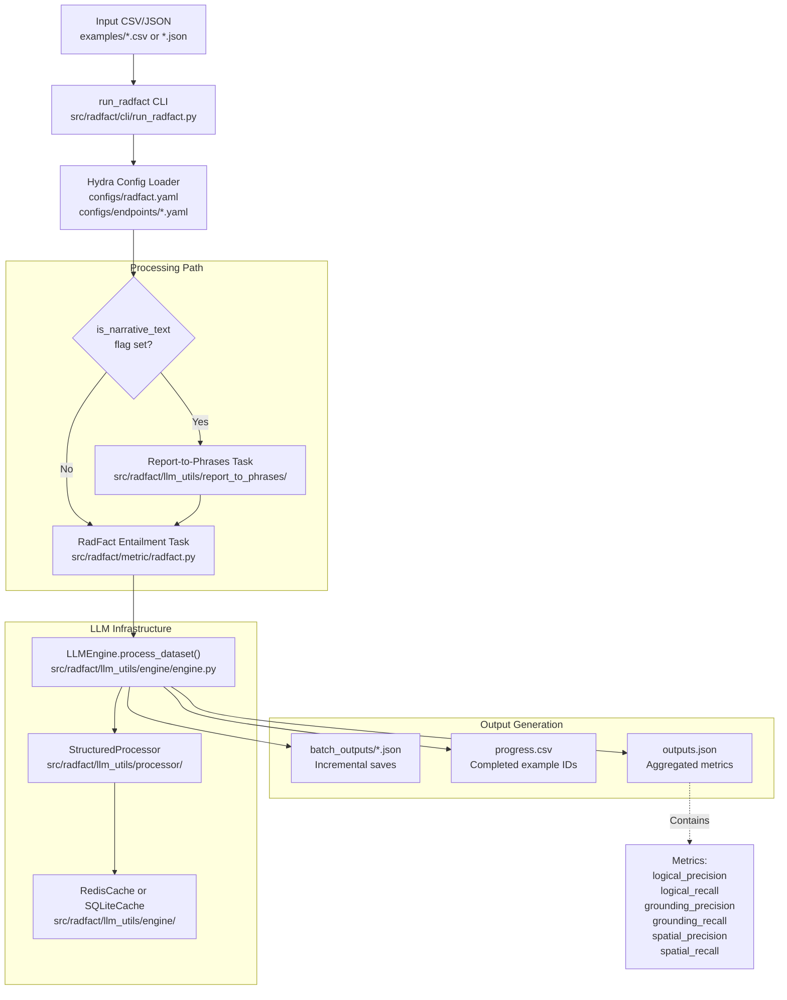

**Key code entities**:
- CLI entry point: [src/radfact/cli/run_radfact.py]()
- Configuration loading: [configs/radfact.yaml:1-7]()
- Report-to-phrases conversion: [src/radfact/llm_utils/report_to_phrases/]()
- RadFact metric computation: [src/radfact/metric/radfact.py]()
- Parallel processing engine: [src/radfact/llm_utils/engine/engine.py:50-]()

**Sources**: [README.md:132-178](), [README.md:190-222]()

---

## Understanding the Output

The primary output is `outputs.json`, which contains:

```json
{
  "logical_precision": 0.85,
  "logical_recall": 0.78,
  "grounding_precision": 0.92,
  "grounding_recall": 0.88,
  "spatial_precision": 0.80,
  "spatial_recall": 0.71,
  "num_llm_failures": 2,
  "bootstrap_ci": {
    "logical_precision": [0.82, 0.88],
    "logical_recall": [0.74, 0.82]
  }
}
```

**Key fields**:
- **logical_precision**: Fraction of generated sentences entailed by ground truth
- **logical_recall**: Fraction of ground-truth sentences entailed by generated report
- **grounding_precision/recall**: Grounding quality for logically entailed sentences (grounded reports only)
- **spatial_precision/recall**: Combined text and grounding quality (grounded reports only)
- **num_llm_failures**: Count of queries where the LLM failed (these default to NOT ENTAILED)
- **bootstrap_ci**: 95% confidence intervals (if `--bootstrap_samples > 0`)

⚠️ **Important**: If `num_llm_failures` is high, the results may be unreliable. Failed examples are logged and saved in the `skipped/` directory.

**Sources**: [README.md:176-178](), [README.md:197-207]()

---

## Data Flow: Input Format to Code Processing

This diagram maps the input data structure to the code entities that process them:

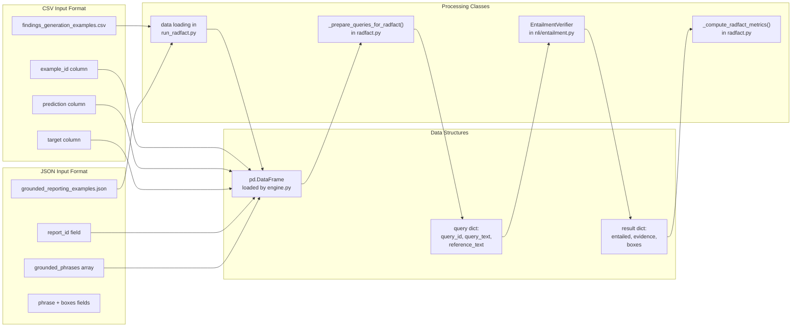

**Key code mappings**:
- CSV columns → pandas DataFrame: Loaded by CLI and passed to engine
- `query_text` / `reference_text` fields: Created by `_prepare_queries_for_radfact()` in [src/radfact/metric/radfact.py]()
- `entailed` / `evidence` results: Returned by `EntailmentVerifier` in [src/radfact/llm_utils/nli/entailment.py]()
- Final metrics: Computed by `_compute_radfact_metrics()` in [src/radfact/metric/radfact.py]()

**Sources**: [README.md:143-148](), [README.md:174-174](), [src/radfact/cli/run_radfact.py]()

---

## Controlling Bootstrap Confidence Intervals

By default, RadFact computes 95% confidence intervals using 500 bootstrap samples:

```bash
# Default: 500 bootstrap samples
run_radfact --input_path examples/findings_generation_examples.csv --is_narrative_text

# Custom number of samples
run_radfact --input_path examples/findings_generation_examples.csv \
  --is_narrative_text \
  --bootstrap_samples 1000

# Disable bootstrapping for faster execution
run_radfact --input_path examples/findings_generation_examples.csv \
  --is_narrative_text \
  --bootstrap_samples 0
```

**Sources**: [README.md:158-160](), [README.md:176-176]()

---

## Common Issues During First Run

### Authentication Errors

If you see authentication errors, you need to configure your LLM endpoints:

```bash
# Quick fix: Set API key as environment variable
export API_KEY="your-api-key-here"

# Then rerun
run_radfact --input_path examples/findings_generation_examples.csv --is_narrative_text
```

For detailed endpoint configuration including Azure OpenAI, Key Vault, and token-based authentication, see [Configuration Setup](#2.3) and [Endpoint Configuration](#6.2).

### LLM Failures

Monitor the `num_llm_failures` field in `outputs.json`. If this number is high:
1. Check endpoint rate limits and timeout settings
2. Review logs for specific error messages
3. Examine the `skipped/` directory to see which examples failed

**Sources**: [README.md:178-178](), [README.md:54-64]()

---

## Verifying Entailment Quality

Before running large evaluations, verify that your LLM performs entailment verification correctly:

```bash
python src/radfact/cli/run_radfact_test_examples.py
```

This script runs on curated test examples with expected results. If your LLM produces significantly different results, it may not be suitable for RadFact evaluation.

**Note**: This test validates entailment verification only, not the report-to-phrases conversion step.

**Sources**: [README.md:94-98]()

---

## Next Steps

After completing your first evaluation:

1. **Configure endpoints**: Set up Azure OpenAI or custom LLM endpoints - see [Configuration Setup](#2.3)
2. **Understand metrics**: Learn what each RadFact metric measures - see [RadFact Metrics](#3.1)
3. **Prepare your data**: Format your own reports for evaluation - see [Input Data Formats](#4.3)
4. **Customize processing**: Adjust batch sizes, parallel workers, and LLM parameters - see [Configuration Reference](#8.2)

For a deeper understanding of how RadFact performs entailment verification and computes metrics, see [Evaluation Pipeline](#3.2) and [Entailment Verification](#3.3).

**Sources**: [README.md:25-189]()

---

# Page: Configuration Setup

# Configuration Setup

<details>
<summary>Relevant source files</summary>

The following files were used as context for generating this wiki page:

- [README.md](README.md)
- [configs/default.yaml](configs/default.yaml)
- [configs/endpoints/azure_chat_openai.yaml](configs/endpoints/azure_chat_openai.yaml)
- [configs/endpoints/chat_openai.yaml](configs/endpoints/chat_openai.yaml)

</details>


This page guides you through the initial configuration required to use RadFact. You will set up LLM endpoint connections and configure authentication credentials. This is a prerequisite before running any RadFact evaluations.

For comprehensive configuration reference documentation, see [Configuration](#6). For information about advanced Hydra configuration patterns, see [Configuration System](#6.1).

---

## Overview

RadFact requires access to a Large Language Model (LLM) via API endpoints. Before running evaluations, you must configure:

1. **Endpoint definitions** - URL, model type, and processing parameters
2. **Authentication credentials** - API keys or Azure authentication
3. **Task-specific endpoint selection** - Which endpoint to use for which RadFact task

RadFact uses [Hydra](https://hydra.cc) for configuration management, with endpoint configurations stored in [`configs/endpoints/`](configs/endpoints). Two tasks require LLM access:
- **Report-to-phrases conversion** - Converting narrative reports to structured phrases (configured in [`configs/report_to_phrases.yaml`](configs/report_to_phrases.yaml))
- **Entailment verification** - Core RadFact metric computation (configured in [`configs/radfact.yaml`](configs/radfact.yaml))

**Sources**: [README.md:48-92](), [configs/default.yaml:1-28]()

---

## Authentication Methods

RadFact supports three authentication methods, checked in order until one succeeds. The authentication logic is implemented in the `Endpoint` class.

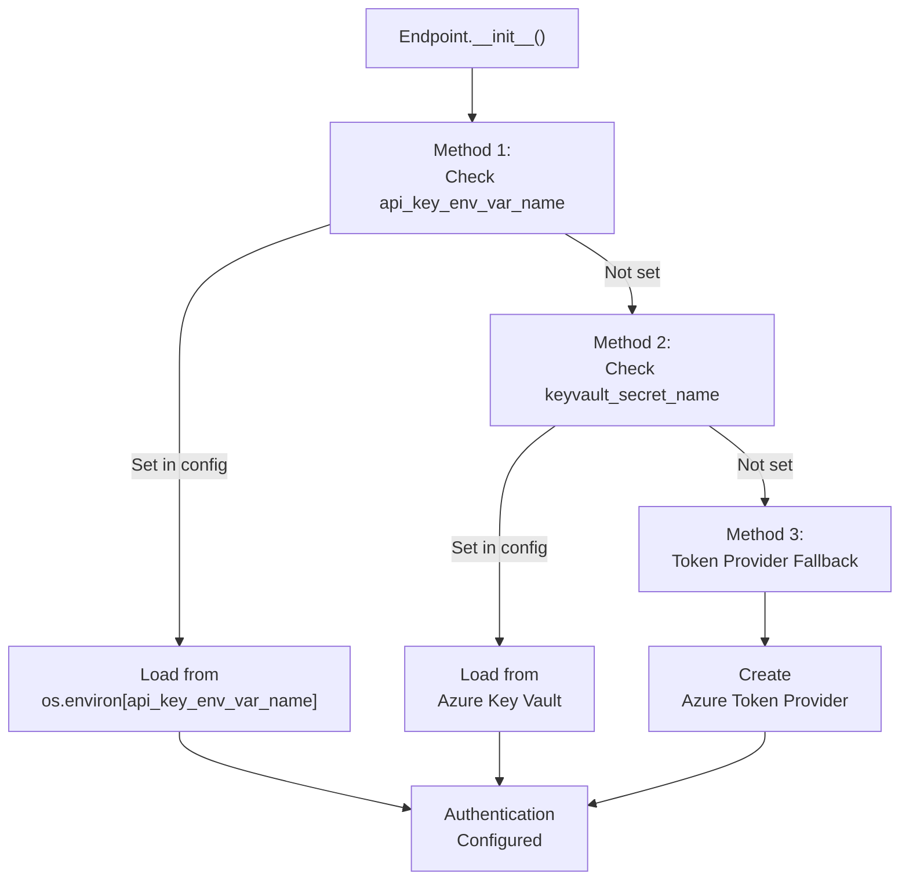

**Figure 1: Authentication Method Selection Flow**

### Method 1: Environment Variable (Recommended for Development)

Set the API key in an environment variable and reference it in your endpoint config:

```bash
export API_KEY="your-api-key-here"
```

In the endpoint config file, specify the environment variable name:

```yaml
ENDPOINT_0:
  api_key_env_var_name: "API_KEY"
```

For multiple endpoints with different keys:

```bash
export API_KEY_AZURE_0="key-for-endpoint-0"
export API_KEY_AZURE_1="key-for-endpoint-1"
```

### Method 2: Azure Key Vault (Recommended for Production)

Configure RadFact to retrieve the API key from Azure Key Vault:

1. Create `config.json` in the repository root with your AzureML workspace details:

```json
{
  "subscription_id": "your-subscription-id",
  "resource_group": "your-resource-group",
  "workspace_name": "your-workspace-name"
}
```

2. Add `config.json` to `.gitignore` (already included by default)

3. Store your API key in the workspace's Key Vault

4. Reference the secret name in your endpoint config:

```yaml
ENDPOINT_0:
  keyvault_secret_name: "your-secret-name"
```

**Note**: The `config.json` file can be downloaded from your AzureML workspace in the Azure Portal.

### Method 3: Azure Token Provider (Automatic Fallback)

If neither environment variable nor Key Vault is configured, RadFact automatically creates an Azure AD token provider for `AZURE_CHAT_OPENAI` endpoints. This requires:

- Valid Azure credentials configured locally (e.g., via `az login`)
- Appropriate permissions to access the Azure OpenAI resource

This method only works with `AZURE_CHAT_OPENAI` endpoint types, not `CHAT_OPENAI`.

**Sources**: [README.md:54-64](), [src/radfact/llm_utils/endpoint.py:38]()

---

## Endpoint Configuration Files

Endpoint configurations are stored in [`configs/endpoints/`](configs/endpoints) and define connection parameters for LLM APIs.

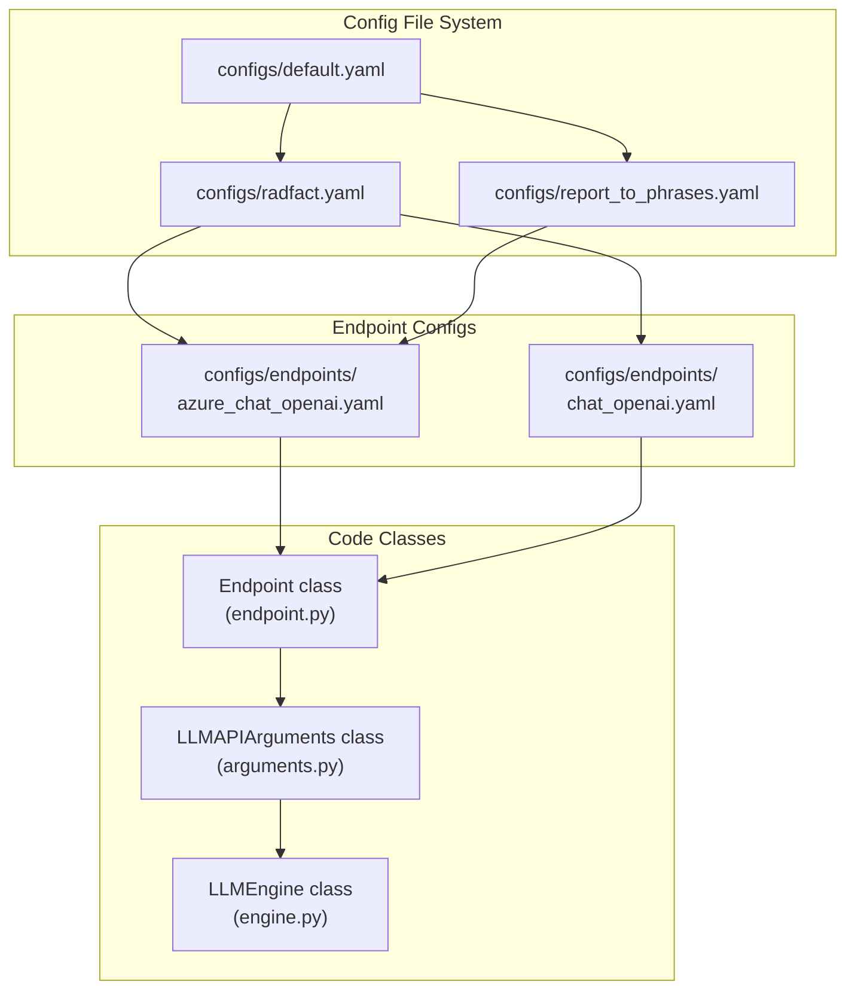

**Figure 2: Configuration File Hierarchy and Code Mapping**

### Endpoint Types

RadFact supports two endpoint types via LangChain (version 0.1.4):

| Endpoint Type | Use Case | LangChain Class |
|--------------|----------|-----------------|
| `AZURE_CHAT_OPENAI` | GPT models on Azure OpenAI | `AzureChatOpenAI` |
| `CHAT_OPENAI` | Custom models (e.g., Llama-3) on Azure or OpenAI | `ChatOpenAI` |

### Configuration Parameters

Each endpoint definition includes the following parameters:

| Parameter | Required | Description | Default |
|-----------|----------|-------------|---------|
| `type` | Yes | Endpoint type: `AZURE_CHAT_OPENAI` or `CHAT_OPENAI` | - |
| `url` | Yes | API endpoint URL | - |
| `deployment_name` | Yes | Model deployment name | - |
| `api_key_env_var_name` | No | Environment variable name containing API key | `"API_KEY"` |
| `keyvault_secret_name` | No | Azure Key Vault secret name | - |
| `speed_factor` | No | Relative speed for load balancing across endpoints | `1.0` |
| `num_parallel_processes` | No | Number of parallel workers for this endpoint | `1` |

**Sources**: [configs/endpoints/azure_chat_openai.yaml:1-40](), [configs/endpoints/chat_openai.yaml:1-40](), [README.md:70-87]()

---

## Creating Your First Endpoint Configuration

### Step 1: Choose a Template

RadFact provides two template configurations:

- **[`configs/endpoints/azure_chat_openai.yaml`](configs/endpoints/azure_chat_openai.yaml)** - For Azure OpenAI GPT models
- **[`configs/endpoints/chat_openai.yaml`](configs/endpoints/chat_openai.yaml)** - For custom models like Llama-3

### Step 2: Edit the Configuration

Create or modify an endpoint configuration file:

**For Azure OpenAI (GPT-4):**

```yaml
ENDPOINT_0:
  type: "AZURE_CHAT_OPENAI"
  url: "https://your-resource.openai.azure.com/"
  deployment_name: "gpt-4"
  api_key_env_var_name: "API_KEY_AZURE_0"
  speed_factor: 1.0
  num_parallel_processes: 1
```

**For Custom Models (Llama-3):**

```yaml
ENDPOINT_0:
  type: "CHAT_OPENAI"
  url: "https://your-endpoint-url.com/"
  deployment_name: "llama3-70b"
  api_key_env_var_name: "API_KEY_CHAT_0"
  speed_factor: 1.0
  num_parallel_processes: 10
```

### Step 3: Configure Task-Specific Endpoints

Edit [`configs/radfact.yaml`](configs/radfact.yaml) and [`configs/report_to_phrases.yaml`](configs/report_to_phrases.yaml) to specify which endpoint config to use:

**configs/radfact.yaml:**
```yaml
defaults:
  - /default
  - override /endpoints: chat_openai  # Use chat_openai.yaml
```

**configs/report_to_phrases.yaml:**
```yaml
defaults:
  - /default
  - override /endpoints: azure_chat_openai  # Use azure_chat_openai.yaml
```

**Sources**: [README.md:66-92](), [configs/radfact.yaml](), [configs/report_to_phrases.yaml]()

---

## Multiple Endpoints Configuration

RadFact can parallelize processing across multiple endpoints for improved throughput. The `LLMEngine` class automatically shards data based on `speed_factor` values.

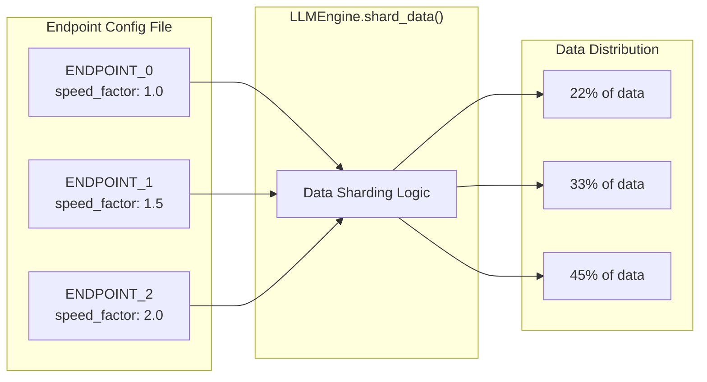

**Figure 3: Multi-Endpoint Data Sharding by speed_factor**

**Example configuration with multiple endpoints:**

```yaml
ENDPOINT_0:
  type: "AZURE_CHAT_OPENAI"
  url: "https://eastus.openai.azure.com/"
  deployment_name: "gpt-4"
  api_key_env_var_name: "API_KEY_AZURE_0"
  speed_factor: 1.0

ENDPOINT_1:
  type: "AZURE_CHAT_OPENAI"
  url: "https://westus.openai.azure.com/"
  deployment_name: "gpt-4"
  api_key_env_var_name: "API_KEY_AZURE_1"
  speed_factor: 1.33

ENDPOINT_2:
  type: "AZURE_CHAT_OPENAI"
  url: "https://northeurope.openai.azure.com/"
  deployment_name: "gpt-4"
  api_key_env_var_name: "API_KEY_AZURE_2"
  speed_factor: 3.66
```

The `LLMEngine` distributes data proportionally: 
- ENDPOINT_0 receives ~17% (1.0 / 5.99)
- ENDPOINT_1 receives ~22% (1.33 / 5.99)
- ENDPOINT_2 receives ~61% (3.66 / 5.99)

**Sources**: [README.md:86-87](), [configs/endpoints/azure_chat_openai.yaml:25-39](), [src/radfact/llm_utils/engine/engine.py:50]()

---

## Testing Your Configuration

After configuring endpoints and authentication, verify the setup works correctly by running the test script:

```bash
python src/radfact/cli/run_radfact_test_examples.py
```

This script:
1. Loads your endpoint configuration from [`configs/radfact.yaml`](configs/radfact.yaml)
2. Runs entailment verification on example data
3. Compares results against expected outputs (obtained using Llama-3-70B-Instruct)

**Expected behavior**: The script should complete without authentication errors and produce metrics similar to the reference values.

**Common issues**:
- `Authentication failed` - Check your API key or Azure credentials
- `Endpoint not responding` - Verify the `url` and `deployment_name` are correct
- `Connection timeout` - Check network access and firewall rules

**Note**: This test only verifies entailment verification. It does not test the report-to-phrases conversion step, which uses a separate endpoint configured in [`configs/report_to_phrases.yaml`](configs/report_to_phrases.yaml).

**Sources**: [README.md:94-98]()

---

## Configuration Parameters Reference

The following table maps configuration parameters to their corresponding code entities:

| Configuration Parameter | Config File Location | Python Class/Module | Description |
|------------------------|---------------------|---------------------|-------------|
| `type` | `configs/endpoints/*.yaml` | `Endpoint.type` | Determines which LangChain model class to instantiate |
| `url` | `configs/endpoints/*.yaml` | `Endpoint.url` | API endpoint base URL |
| `deployment_name` | `configs/endpoints/*.yaml` | `Endpoint.deployment_name` | Model deployment identifier |
| `api_key_env_var_name` | `configs/endpoints/*.yaml` | `Endpoint.api_key_env_var_name` | Environment variable name for API key |
| `keyvault_secret_name` | `configs/endpoints/*.yaml` | `Endpoint.keyvault_secret_name` | Azure Key Vault secret name |
| `speed_factor` | `configs/endpoints/*.yaml` | `Endpoint.speed_factor` | Used by `LLMEngine.shard_data()` |
| `num_parallel_processes` | `configs/endpoints/*.yaml` | `Endpoint.num_parallel_processes` | Used by `LLMEngine.__init__()` |
| `api_version` | `configs/default.yaml` | `LLMAPIArguments.api_version` | Azure OpenAI API version |
| `temperature` | `configs/default.yaml` | `LLMAPIArguments.temperature` | LLM sampling temperature |
| `max_tokens` | `configs/default.yaml` | `LLMAPIArguments.max_tokens` | Maximum tokens in response |
| `batch_size` | `configs/default.yaml` | `LLMEngine.batch_size` | Batch size for incremental saves |

**Sources**: [configs/default.yaml:1-28](), [src/radfact/llm_utils/endpoint.py](), [src/radfact/llm_utils/engine/arguments.py]()

---

## Next Steps

Once your configuration is working:

1. Run your first RadFact evaluation - see [Quick Start](#2.2)
2. Understand the input data formats - see [Input Data Formats](#4.3)
3. Learn about advanced configuration options - see [Configuration System](#6.1)
4. Configure caching for better performance - see [Caching System](#5.4)

For production deployments, consider:
- Using Azure Key Vault for credential management (see [Authentication](#6.3))
- Setting up Redis caching (see [Caching System](#5.4))
- Configuring multiple endpoints for high throughput (see [Parallel Processing](#5.5))

**Sources**: [README.md:25-189]()

---

# Page: Core Concepts

# Core Concepts

<details>
<summary>Relevant source files</summary>

The following files were used as context for generating this wiki page:

- [README.md](README.md)

</details>


## Purpose and Scope

This page introduces the fundamental concepts underlying the RadFact evaluation framework. It covers the core principles of entailment-based evaluation, report representations, and how RadFact computes metrics at multiple levels (logical, grounding, and spatial). For detailed explanations of specific metrics and their computation, see [RadFact Metrics](#3.1). For implementation details of the evaluation stages, see [Evaluation Pipeline](#3.2) and [Entailment Verification](#3.3).

## Report Representation

RadFact evaluates AI-generated radiology reports against ground-truth references. Reports exist in two fundamental formats:

| Format | Structure | Use Case | Example Source |
|--------|-----------|----------|----------------|
| **Narrative Text** | Unstructured paragraph(s) with multiple findings | Traditional radiology report generation | [examples/findings_generation_examples.csv:1-10]() |
| **Grounded Phrases** | List of structured sentences, each describing one finding with optional bounding boxes | Grounded report generation with spatial localization | [examples/grounded_reporting_examples.json:1-50]() |

### Phrase Structure

RadFact operates on **phrases** as the atomic unit of evaluation. A phrase is a single sentence describing at most one finding. This representation enables precise entailment verification at the finding level.

```
Narrative Report:
"There is a large consolidation in the right lower lobe. No pleural effusion is seen."

↓ Converted to Phrases ↓

Phrase List:
1. "There is a large consolidation in the right lower lobe."
2. "No pleural effusion is seen."
```

For grounded reports, each phrase may include bounding box coordinates:

```json
{
  "text": "There is a large consolidation in the right lower lobe.",
  "bbox": [[x1, y1], [x2, y2], [x3, y3], [x4, y4]]
}
```

**Sources**: [README.md:1-6](), [README.md:190-223](), [examples/findings_generation_examples.csv](), [examples/grounded_reporting_examples.json]()

### Code Representation

The following diagram maps report concepts to their code entity representations:

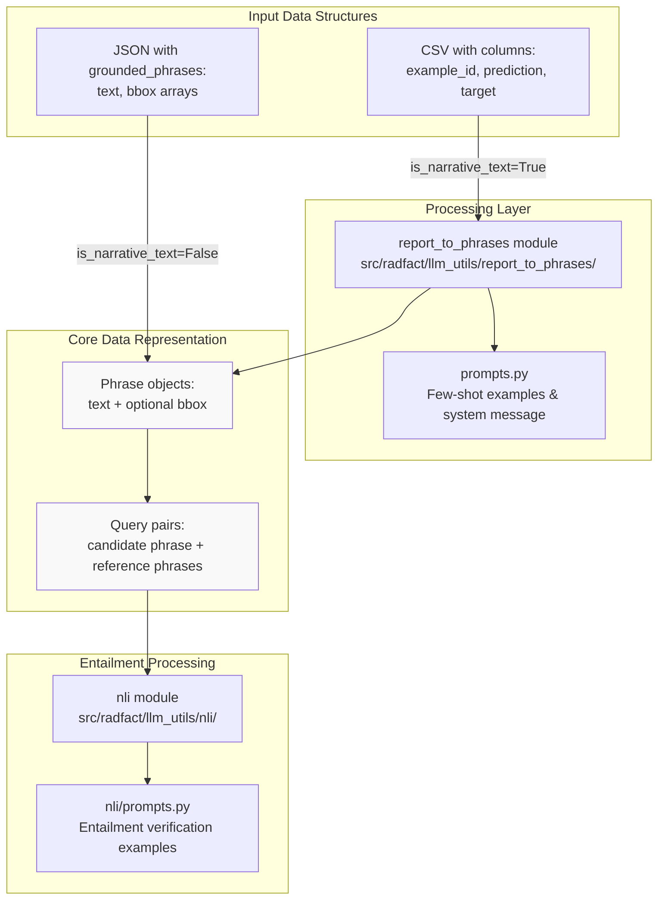

**Sources**: [README.md:144-174](), [src/radfact/llm_utils/report_to_phrases/](), [src/radfact/llm_utils/nli/]()

## Entailment-Based Evaluation

RadFact's core innovation is using **logical entailment verification** via large language models to evaluate report quality. Entailment is a logical relationship where one statement (the premise) necessarily implies another statement (the hypothesis).

### Entailment Definition

Given:
- **Reference sentences**: Ground-truth findings from the reference report
- **Candidate sentence**: A finding from the generated report

A candidate sentence is **logically entailed** if its meaning is necessarily implied by the reference sentences. The LLM determines entailment and provides **evidence** (which reference sentences support the candidate).

**Example**:
```
Reference: "Moderate cardiomegaly is present."
Candidate: "The heart is enlarged."
Result: ENTAILED (evidence: "Moderate cardiomegaly is present.")
```

**Sources**: [README.md:190-223]()

### Bidirectional Evaluation

RadFact computes entailment in **both directions** to capture precision and recall:

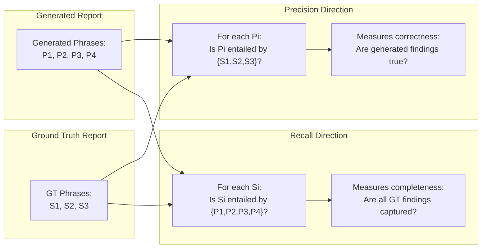

**Sources**: [README.md:194-195](), [README.md:198-206]()

### Entailment Query Structure

Each entailment query follows this pattern:

```
System Message: [Few-shot examples of entailment verification]

Query:
Candidate: "There is a large consolidation in the right lower lobe."
Reference: [
  "No acute cardiopulmonary process.",
  "The lungs are clear bilaterally.",
  "Heart size is normal."
]
Question: Is the candidate sentence entailed? If yes, provide evidence.

Response:
{
  "entailed": false,
  "evidence": []
}
```

The LLM is instructed to return structured JSON with `entailed` (boolean) and `evidence` (list of supporting reference sentences).

**Sources**: [README.md:216-220](), [src/radfact/llm_utils/nli/prompts.py]()

## Evaluation Levels

RadFact evaluates reports at three hierarchical levels, producing six distinct metrics:

### 1. Logical Level (Text-Only)

**Logical entailment** considers only the textual content, ignoring any spatial information:

- **Logical Precision**: Fraction of generated phrases logically entailed by ground-truth
- **Logical Recall**: Fraction of ground-truth phrases logically entailed by generated report

These metrics apply to **all reports** (both narrative and grounded).

### 2. Grounding Level (Conditional)

**Grounding entailment** evaluates spatial localization quality for findings that are **already logically entailed**:

- **Grounding Precision**: Of logically-entailed generated phrases with boxes, what fraction has correct spatial localization?
- **Grounding Recall**: Of logically-entailed ground-truth phrases with boxes, what fraction has correct spatial localization?

### 3. Spatial Level (Unconditional)

**Spatial entailment** combines logical and spatial requirements for **all grounded phrases**:

- **Spatial Precision**: Fraction of all generated grounded phrases that are both logically AND spatially entailed
- **Spatial Recall**: Fraction of all ground-truth grounded phrases that are both logically AND spatially entailed

```mermaid
graph TD
    subgraph "Phrase Classification"
        PHRASE["Phrase with bbox"]
        LOG{"Logically<br/>Entailed?"}
        SPATIAL{"Spatially<br/>Entailed?"}
    end
    
    subgraph "Metric Contributions"
        BOTH["Counts toward:<br/>✓ Logical<br/>✓ Grounding<br/>✓ Spatial"]
        LOG_ONLY["Counts toward:<br/>✓ Logical<br/>✗ Grounding<br/>✗ Spatial"]
        NEITHER["Counts toward:<br/>✗ Logical<br/>N/A Grounding<br/>✗ Spatial"]
    end
    
    PHRASE --> LOG
    LOG -->|"Yes"| SPATIAL
    LOG -->|"No"| NEITHER
    SPATIAL -->|"Yes"| BOTH
    SPATIAL -->|"No"| LOG_ONLY
```

**Sources**: [README.md:196-208](), [README.md:220-222]()

### Spatial Entailment Definition

A phrase with bounding box is **spatially entailed** if:

1. It is **logically entailed** (has evidence sentences)
2. Its bounding box has **pixel precision ≥ 0.5** with respect to the union of evidence bounding boxes

Pixel precision is computed as:
```
pixel_precision = area(candidate_bbox ∩ union_evidence_bboxes) / area(candidate_bbox)
```

If ≥50% of the candidate box's pixels fall within the evidence boxes, spatial entailment is satisfied.

**Sources**: [README.md:218-221]()

## RadFact Metrics Summary

The six metrics provide complementary views of report quality:

| Metric | Formula | Interpretation | Applies To |
|--------|---------|----------------|------------|
| **Logical Precision** | #logically_entailed_generated / #generated | Truthfulness: no hallucinations | All reports |
| **Logical Recall** | #logically_entailed_gt / #gt | Completeness: no omissions | All reports |
| **Grounding Precision** | #spatially_entailed_generated / #logically_entailed_generated_with_boxes | Of correct findings, how many are well-grounded? | Grounded reports |
| **Grounding Recall** | #spatially_entailed_gt / #logically_entailed_gt_with_boxes | Of captured findings, how many are well-grounded? | Grounded reports |
| **Spatial Precision** | #spatially_entailed_generated / #generated_with_boxes | Penalizes boxes on incorrect/extra findings | Grounded reports |
| **Spatial Recall** | #spatially_entailed_gt / #gt_with_boxes | Penalizes missing boxes or incorrect findings | Grounded reports |

**Sources**: [README.md:196-208]()

## Processing Pipeline Overview

RadFact's evaluation pipeline consists of two main stages:

```mermaid
graph TD
    subgraph "Input"
        NAR_IN["Narrative Reports<br/>CSV: example_id, prediction, target"]
        GROUND_IN["Grounded Reports<br/>JSON: grounded_phrases with bboxes"]
    end
    
    subgraph "Stage 1: Phrase Extraction"
        RTP_CHECK{"Narrative<br/>text?"}
        RTP_TASK["LLM Task:<br/>Convert report → phrases<br/>src/radfact/llm_utils/report_to_phrases/"]
        SKIP["Use phrases<br/>directly"]
    end
    
    subgraph "Stage 2: Entailment Verification"
        PREC_ENT["Precision Queries:<br/>For each gen phrase,<br/>query with GT as reference"]
        REC_ENT["Recall Queries:<br/>For each GT phrase,<br/>query with gen as reference"]
        NLI_MODULE["nli module:<br/>src/radfact/llm_utils/nli/"]
    end
    
    subgraph "Stage 3: Metrics Computation"
        LOGICAL["Compute logical<br/>precision/recall"]
        SPATIAL_COMP["Compute grounding &<br/>spatial precision/recall"]
        METRICS["Six RadFact metrics<br/>+ confidence intervals"]
    end
    
    NAR_IN --> RTP_CHECK
    GROUND_IN --> RTP_CHECK
    
    RTP_CHECK -->|"Yes"| RTP_TASK
    RTP_CHECK -->|"No"| SKIP
    
    RTP_TASK --> PREC_ENT
    SKIP --> PREC_ENT
    
    PREC_ENT --> NLI_MODULE
    REC_ENT --> NLI_MODULE
    
    PREC_ENT --> REC_ENT
    
    NLI_MODULE --> LOGICAL
    NLI_MODULE --> SPATIAL_COMP
    
    LOGICAL --> METRICS
    SPATIAL_COMP --> METRICS
```

**Sources**: [README.md:190-223](), [README.md:132-178]()

### Code Entity Mapping

The following table maps pipeline stages to their code implementations:

| Pipeline Stage | Primary Module/File | Key Classes/Functions | Configuration |
|----------------|---------------------|----------------------|---------------|
| CLI Entry | [src/radfact/cli/run_radfact.py]() | `main()` function | [configs/radfact.yaml]() |
| Phrase Extraction | [src/radfact/llm_utils/report_to_phrases/]() | Processor with prompts | [configs/report_to_phrases.yaml]() |
| Entailment Verification | [src/radfact/llm_utils/nli/]() | NLI processor with prompts | Part of radfact.yaml |
| LLM Orchestration | [src/radfact/llm_utils/engine/engine.py]() | `LLMEngine` class | `endpoints` config section |
| Structured Queries | [src/radfact/llm_utils/processor/structured_processor.py]() | `StructuredProcessor` class | `llm_api_args` section |
| Metrics Computation | [src/radfact/]() | Core RadFact logic | `bootstrap_samples` parameter |

**Sources**: [src/radfact/cli/run_radfact.py](), [configs/radfact.yaml](), [configs/report_to_phrases.yaml]()

## Data Structures

### Query-Response Flow

The following diagram shows how data flows through the entailment verification process:

```mermaid
graph TB
    subgraph "Input Preparation"
        PHRASES["Phrase Lists:<br/>generated_phrases[], gt_phrases[]"]
        BUILD_QUERIES["Build Query Objects:<br/>{candidate, references[], direction}"]
    end
    
    subgraph "LLM Processing"
        ENGINE["LLMEngine.run()<br/>Parallel processing across endpoints"]
        PROCESSOR["StructuredProcessor.run()<br/>Format prompt + parse response"]
        CACHE["RedisCache / SQLiteCache<br/>Check/store LLM responses"]
        LLM["LLM Endpoint:<br/>Returns {entailed, evidence}"]
    end
    
    subgraph "Response Processing"
        PARSE["Parse JSON response:<br/>entailed: bool<br/>evidence: list"]
        SPATIAL["Compute spatial entailment:<br/>If bboxes exist, check overlap"]
        LABEL["Label each phrase:<br/>logically_entailed: bool<br/>spatially_entailed: bool | null"]
    end
    
    subgraph "Metrics Aggregation"
        COUNT["Count entailed phrases<br/>by direction & type"]
        COMPUTE["Compute six metrics:<br/>logical, grounding, spatial"]
        BOOTSTRAP["Optional bootstrap<br/>confidence intervals"]
    end
    
    PHRASES --> BUILD_QUERIES
    BUILD_QUERIES --> ENGINE
    
    ENGINE --> PROCESSOR
    PROCESSOR --> CACHE
    CACHE -->|"Cache miss"| LLM
    LLM --> CACHE
    CACHE --> PROCESSOR
    
    PROCESSOR --> PARSE
    PARSE --> SPATIAL
    SPATIAL --> LABEL
    
    LABEL --> COUNT
    COUNT --> COMPUTE
    COMPUTE --> BOOTSTRAP
```

**Sources**: [src/radfact/llm_utils/engine/engine.py](), [src/radfact/llm_utils/processor/structured_processor.py](), [README.md:100-130]()

### Intermediate Outputs

During processing, RadFact creates several intermediate data structures:

```
Phrase Object:
{
  "text": str,
  "bbox": [[x1,y1], [x2,y2], [x3,y3], [x4,y4]] | null
}

Query Object:
{
  "query_id": str,
  "candidate": Phrase,
  "references": [Phrase, ...],
  "direction": "precision" | "recall"
}

Entailment Result:
{
  "query_id": str,
  "entailed": bool,
  "evidence": [str, ...],  // Evidence phrase texts
  "evidence_bboxes": [bbox, ...] | null,
  "spatially_entailed": bool | null  // null if no bboxes
}
```

**Sources**: [README.md:216-222]()

## Key Design Principles

### 1. Few-Shot Learning

RadFact uses ~10 few-shot examples for both report-to-phrases conversion and entailment verification. This approach:
- Provides clear task specification to the LLM
- Handles domain-specific medical terminology
- Establishes consistent output formatting

**Sources**: [README.md:210-228]()

### 2. Structured Output

All LLM queries expect JSON-formatted responses with defined schemas. The `StructuredProcessor` class handles:
- Prompt formatting with few-shot examples
- Output parsing and validation
- Error handling for malformed responses

**Sources**: [src/radfact/llm_utils/processor/structured_processor.py]()

### 3. Failure Handling

When LLM queries fail (timeout, rate limit, parsing error), RadFact defaults to marking the phrase as **NOT ENTAILED**. This conservative approach:
- Prevents artificially inflated metrics
- Ensures reproducibility
- Tracks failures in `num_llm_failures` output field

The number of failures should be monitored; high failure rates indicate unreliable results.

**Sources**: [README.md:178]()

### 4. Caching for Efficiency

All LLM responses are cached (Redis or SQLite) with endpoint-normalized keys. This:
- Reduces API costs for repeated queries
- Enables interrupted processing resumption
- Supports incremental dataset evaluation

**Sources**: [README.md:100-130](), [src/radfact/llm_utils/engine/redis_cache.py]()

## Relationship to Other Components

This page introduced the core concepts. For implementation details, see:

- **[RadFact Metrics](#3.1)**: Detailed metric definitions, formulas, and interpretation
- **[Evaluation Pipeline](#3.2)**: Step-by-step pipeline execution and data flow
- **[Entailment Verification](#3.3)**: Deep dive into LLM-based entailment logic
- **[LLM Engine](#5.2)**: Parallel processing architecture for LLM queries
- **[Structured Processor](#5.3)**: Prompt engineering and response parsing
- **[Input Data Formats](#4.3)**: Detailed specifications for CSV and JSON inputs

**Sources**: Table of Contents structure

---

# Page: RadFact Metrics

# RadFact Metrics

<details>
<summary>Relevant source files</summary>

The following files were used as context for generating this wiki page:

- [README.md](README.md)

</details>


## Purpose and Scope

This page provides a detailed technical explanation of the six metrics that comprise the RadFact evaluation suite: logical precision/recall, grounding precision/recall, and spatial precision/recall. These metrics quantify the quality of AI-generated radiology reports by evaluating both textual correctness and spatial grounding accuracy.

For information about how these metrics are computed through the evaluation pipeline, see [Evaluation Pipeline](#3.2). For details on the entailment verification mechanism that underlies metric computation, see [Entailment Verification](#3.3).

**Sources:** [README.md:1-228]()

## Metrics Overview

RadFact is not a single metric but a suite of six complementary measures that capture different aspects of report quality. The metrics are organized into three categories:

1. **Logical metrics** (text-only): Evaluate semantic correctness and completeness without considering spatial grounding
2. **Grounding metrics** (conditional): Evaluate grounding quality specifically for sentences that are logically correct
3. **Spatial metrics** (comprehensive): Evaluate both logical and spatial correctness together for all grounded sentences

```mermaid
graph TD
    subgraph "Input Reports"
        GT["Ground Truth Report<br/>(Reference)"]
        GEN["Generated Report<br/>(Candidate)"]
    end
    
    subgraph "Directional Evaluation"
        PREC_DIR["Precision Direction<br/>Gen → GT"]
        REC_DIR["Recall Direction<br/>GT → Gen"]
    end
    
    subgraph "Metric Categories"
        LOG["Logical Metrics<br/>Text-only evaluation"]
        GRD["Grounding Metrics<br/>Conditional on logical entailment"]
        SPA["Spatial Metrics<br/>Comprehensive evaluation"]
    end
    
    subgraph "Six RadFact Metrics"
        LP["Logical Precision"]
        LR["Logical Recall"]
        GP["Grounding Precision"]
        GR["Grounding Recall"]
        SP["Spatial Precision"]
        SR["Spatial Recall"]
    end
    
    GT --> REC_DIR
    GEN --> PREC_DIR
    
    PREC_DIR --> LOG
    REC_DIR --> LOG
    PREC_DIR --> GRD
    REC_DIR --> GRD
    PREC_DIR --> SPA
    REC_DIR --> SPA
    
    LOG --> LP
    LOG --> LR
    GRD --> GP
    GRD --> GR
    SPA --> SP
    SPA --> SR
```

**Title:** RadFact Metrics Taxonomy

**Sources:** [README.md:196-209]()

## Metric Definitions Table

The following table provides formal definitions and interpretations for each metric:

| Metric | Definition | Interpretation | Requires Grounding |
|--------|-----------|----------------|-------------------|
| **Logical Precision** | Fraction of generated sentences that are logically entailed by the ground-truth report | Measures truthfulness: penalizes incorrect or fabricated findings | No |
| **Logical Recall** | Fraction of ground-truth sentences that are logically entailed by the generated report | Measures completeness: penalizes missed or omitted findings | No |
| **Grounding Precision** | Among logically-entailed generated sentences with boxes, fraction that are also spatially entailed | For correctly-generated findings, how often are boxes also correct? | Yes |
| **Grounding Recall** | Among logically-entailed ground-truth sentences with boxes, fraction that are also spatially entailed | For correctly-captured findings, how often are boxes also correct? | Yes |
| **Spatial Precision** | Fraction of all grounded generated sentences that are both logically AND spatially entailed | Captures both incorrect boxes and boxes for incorrect sentences | Yes |
| **Spatial Recall** | Fraction of all grounded ground-truth sentences that are both logically AND spatially entailed | Captures both missing boxes and missed findings entirely | Yes |

**Sources:** [README.md:196-209]()

## Logical Metrics

### Logical Precision

Logical precision measures the **truthfulness** of generated reports by computing the fraction of generated sentences that are logically supported by the ground-truth report.

**Formal Definition:**
```
Logical Precision = (# generated sentences entailed by GT) / (# total generated sentences)
```

**What it captures:**
- Incorrectly generated findings (hallucinations)
- Findings that contradict the ground truth
- Extraneous or fabricated observations

**What it does NOT consider:**
- Spatial grounding information (bounding boxes)
- Completeness of the report

**Directional evaluation:** Uses the ground-truth report as the reference and queries whether each generated sentence is entailed by any sentence(s) in the ground truth.

**Sources:** [README.md:200]()

### Logical Recall

Logical recall measures the **completeness** of generated reports by computing the fraction of ground-truth sentences that are logically captured in the generated report.

**Formal Definition:**
```
Logical Recall = (# GT sentences entailed by generated) / (# total GT sentences)
```

**What it captures:**
- Missing findings from the report
- Incomplete descriptions
- Omitted observations present in ground truth

**What it does NOT consider:**
- Spatial grounding information (bounding boxes)
- Correctness of additional generated content

**Directional evaluation:** Uses the generated report as the reference and queries whether each ground-truth sentence is entailed by any sentence(s) in the generated report.

**Sources:** [README.md:201]()

## Grounding Metrics

Grounding metrics evaluate the quality of spatial localization (bounding boxes) **conditional on logical correctness**. These metrics only consider sentences that were already determined to be logically entailed.

### Grounding Precision

**Formal Definition:**
```
Grounding Precision = (# logically-entailed generated sentences with spatially-correct boxes) / 
                      (# logically-entailed generated sentences with boxes)
```

**What it captures:**
- Among correctly-generated findings, how often are the bounding boxes also correct?
- Quality of box placement for truthful statements

**Denominator:** Only includes generated sentences that are:
1. Logically entailed by the ground truth
2. Have associated bounding boxes

**Sources:** [README.md:202]()

### Grounding Recall

**Formal Definition:**
```
Grounding Recall = (# logically-entailed GT sentences with spatially-correct boxes) / 
                   (# logically-entailed GT sentences with boxes)
```

**What it captures:**
- Among correctly-captured findings, how often are the bounding boxes also correct?
- Quality of box placement for findings that were successfully described

**Denominator:** Only includes ground-truth sentences that are:
1. Logically entailed by the generated report
2. Have associated bounding boxes

**Sources:** [README.md:203]()

## Spatial Metrics

Spatial metrics provide a **comprehensive evaluation** of both logical and spatial correctness together. Unlike grounding metrics, these consider ALL grounded sentences, including those that are logically incorrect.

### Spatial Precision

**Formal Definition:**
```
Spatial Precision = (# generated sentences both logically AND spatially entailed) / 
                    (# all grounded generated sentences)
```

**What it captures:**
- Unnecessary bounding boxes for incorrect or fabricated findings
- Boxes associated with logically-incorrect sentences
- Overall precision when considering both text and boxes together

**Why it matters:** Grounding precision alone doesn't penalize extraneous boxes on incorrect sentences (e.g., boxes for hallucinated findings). Spatial precision captures this by using all grounded sentences as the denominator.

**Sources:** [README.md:204]()

### Spatial Recall

**Formal Definition:**
```
Spatial Recall = (# GT sentences both logically AND spatially entailed) / 
                 (# all grounded GT sentences)
```

**What it captures:**
- Missing bounding boxes for findings in the reference
- Findings that were either described incorrectly OR not described at all
- Overall recall when considering both text and boxes together

**Why it matters:** Grounding recall alone doesn't capture failures where a finding is entirely missed or incorrectly described. Spatial recall captures this by using all grounded ground-truth sentences as the denominator.

**Sources:** [README.md:205]()

## Spatial Entailment Computation

Spatial entailment is a key component of grounding and spatial metrics. A sentence with a bounding box is considered spatially entailed when its box is **sufficiently contained** within the union of boxes from its supporting evidence sentences.

```mermaid
graph TD
    subgraph "Input"
        SENT["Candidate Sentence<br/>with Bounding Box"]
        EVID["Evidence Sentences<br/>from Reference Report"]
    end
    
    subgraph "Box Operations"
        UNION["Compute Union of<br/>Evidence Boxes"]
        OVERLAP["Compute Intersection<br/>of Candidate & Union"]
    end
    
    subgraph "Pixel Precision Calculation"
        PP["Pixel Precision =<br/>intersection_area / candidate_box_area"]
    end
    
    subgraph "Threshold Check"
        THRESH["Is Pixel Precision ≥ 0.5?"]
        SE_YES["Spatially Entailed: YES"]
        SE_NO["Spatially Entailed: NO"]
    end
    
    SENT --> OVERLAP
    EVID --> UNION
    UNION --> OVERLAP
    OVERLAP --> PP
    PP --> THRESH
    THRESH -->|"≥ 0.5"| SE_YES
    THRESH -->|"< 0.5"| SE_NO
```

**Title:** Spatial Entailment Decision Process

**Implementation details:**
- A candidate box must have at least 50% of its pixels within the union of evidence boxes
- The pixel precision threshold of 0.5 is fixed in the implementation
- Boxes are represented as coordinates on the radiology image
- Evidence sentences are identified during the entailment verification step

**Sources:** [README.md:219-220]()

## Metric Computation Flow

The following diagram bridges natural language concepts to the code entities that implement the metric computation:

```mermaid
graph TB
    subgraph "CLI Entry Point"
        CLI["run_radfact CLI<br/>src/radfact/cli/run_radfact.py"]
    end
    
    subgraph "Data Processing"
        INPUT["Input Data<br/>CSV or JSON with<br/>example_id, prediction, target"]
        PHRASES["Phrase Extraction<br/>(if narrative text)"]
    end
    
    subgraph "Bidirectional Entailment"
        ENT_PREC["Precision Direction<br/>Query: Is gen_sentence<br/>entailed by GT?"]
        ENT_REC["Recall Direction<br/>Query: Is GT_sentence<br/>entailed by gen?"]
        LLM["LLMEngine<br/>src/radfact/llm_utils/engine/engine.py"]
    end
    
    subgraph "Entailment Results"
        PREC_RESULTS["Per-sentence results<br/>- logically_entailed: bool<br/>- evidence: List[str]<br/>- has_bbox: bool"]
        REC_RESULTS["Per-sentence results<br/>- logically_entailed: bool<br/>- evidence: List[str]<br/>- has_bbox: bool"]
    end
    
    subgraph "Spatial Processing"
        SPATIAL["Spatial Entailment Check<br/>pixel_precision ≥ 0.5"]
    end
    
    subgraph "Metric Aggregation"
        LOGIC["Compute Logical P/R<br/>from entailment flags"]
        GROUND["Compute Grounding P/R<br/>conditional on logical entailment"]
        SPAT["Compute Spatial P/R<br/>from joint logical+spatial"]
    end
    
    subgraph "Output"
        METRICS["Six Metrics:<br/>logical_precision<br/>logical_recall<br/>grounding_precision<br/>grounding_recall<br/>spatial_precision<br/>spatial_recall"]
        BOOTSTRAP["Bootstrap CI<br/>(optional)"]
    end
    
    CLI --> INPUT
    INPUT --> PHRASES
    PHRASES --> ENT_PREC
    PHRASES --> ENT_REC
    
    ENT_PREC --> LLM
    ENT_REC --> LLM
    
    LLM --> PREC_RESULTS
    LLM --> REC_RESULTS
    
    PREC_RESULTS --> SPATIAL
    REC_RESULTS --> SPATIAL
    
    PREC_RESULTS --> LOGIC
    REC_RESULTS --> LOGIC
    
    SPATIAL --> GROUND
    SPATIAL --> SPAT
    
    LOGIC --> METRICS
    GROUND --> METRICS
    SPAT --> METRICS
    
    METRICS --> BOOTSTRAP
    BOOTSTRAP --> OUTPUT["outputs.json"]
```

**Title:** Code-Level Metric Computation Pipeline

**Sources:** [README.md:132-179](), [README.md:216-221]()

## Metric Relationships

Understanding how the six metrics relate to each other is crucial for interpreting results:

```mermaid
graph LR
    subgraph "Logical Layer (Text-Only)"
        LP["Logical<br/>Precision"]
        LR["Logical<br/>Recall"]
    end
    
    subgraph "Grounding Layer (Conditional)"
        GP["Grounding<br/>Precision"]
        GR["Grounding<br/>Recall"]
    end
    
    subgraph "Spatial Layer (Comprehensive)"
        SP["Spatial<br/>Precision"]
        SR["Spatial<br/>Recall"]
    end
    
    LP -.->|"Filter to logically<br/>entailed with boxes"| GP
    GP -.->|"Expand to all<br/>grounded sentences"| SP
    
    LR -.->|"Filter to logically<br/>entailed with boxes"| GR
    GR -.->|"Expand to all<br/>grounded sentences"| SR
    
    LP -->|"Upper bound"| SP
    LR -->|"Upper bound"| SR
    GP -->|"Quality signal"| SP
    GR -->|"Quality signal"| SR
```

**Title:** Metric Relationships and Dependencies

**Key relationships:**
- **Spatial Precision ≤ Logical Precision**: Every spatially-entailed sentence must also be logically-entailed
- **Spatial Recall ≤ Logical Recall**: Every spatially-entailed sentence must also be logically-entailed
- **Grounding metrics have restricted denominators**: Only consider logically-correct sentences with boxes
- **Spatial metrics have comprehensive denominators**: Consider all sentences with boxes

**Sources:** [README.md:196-209]()

## Bootstrap Confidence Intervals

RadFact computes bootstrap confidence intervals for all six metrics to quantify statistical uncertainty in the evaluation.

**Implementation:**
- Controlled via `--bootstrap_samples` CLI argument (default: 500)
- Set to 0 to disable bootstrapping
- Uses standard bootstrap resampling with replacement
- Provides 95% confidence intervals by default

**Output format:**
```json
{
  "logical_precision": 0.85,
  "logical_precision_ci_lower": 0.82,
  "logical_precision_ci_upper": 0.88,
  "logical_recall": 0.78,
  "logical_recall_ci_lower": 0.74,
  "logical_recall_ci_upper": 0.82,
  ...
}
```

**Sources:** [README.md:158-159](), [README.md:176]()

## Handling LLM Failures

When the LLM performing entailment verification fails (due to timeouts, rate limits, or other errors), RadFact adopts a **conservative fallback strategy**:

**Default behavior:** Failed queries are set as **NOT ENTAILED**

**Rationale:** This conservative approach prevents artificially inflated metrics due to missing data

**Monitoring:**
- The `num_llm_failures` key in the output JSON tracks the number of failures
- Failed queries are logged with warnings: `WARNING: No response for example {query_id}. Setting as NOT ENTAILED`
- Failed queries are saved in the `skipped/` directory under the run folder

**When to be concerned:** If a significant number of queries fail, the metrics may be unreliable and the evaluation should be re-run or investigated.

**Sources:** [README.md:178]()

## Metric Computation Example

Consider a simple example to illustrate how metrics are computed:

**Ground Truth Report (3 sentences):**
1. "Small left pleural effusion." [bbox: (10,20,50,60)]
2. "Cardiomegaly."
3. "No pneumothorax."

**Generated Report (3 sentences):**
1. "Small left pleural effusion." [bbox: (12,22,48,58)]
2. "Enlarged cardiac silhouette."
3. "Right lower lobe consolidation." [bbox: (70,80,90,100)]

**After entailment verification:**

| Direction | Sentence | Logically Entailed | Has Box | Spatially Entailed |
|-----------|----------|-------------------|---------|-------------------|
| Precision (Gen→GT) | Gen sentence 1 | ✓ | ✓ | ✓ (overlap with GT #1) |
| Precision | Gen sentence 2 | ✓ | ✗ | N/A |
| Precision | Gen sentence 3 | ✗ | ✓ | ✗ |
| Recall (GT→Gen) | GT sentence 1 | ✓ | ✓ | ✓ (overlap with Gen #1) |
| Recall | GT sentence 2 | ✓ | ✗ | N/A |
| Recall | GT sentence 3 | ✗ | ✗ | N/A |

**Metric calculations:**
- **Logical Precision**: 2/3 = 0.667 (sentences 1 & 2 entailed)
- **Logical Recall**: 2/3 = 0.667 (sentences 1 & 2 entailed)
- **Grounding Precision**: 1/1 = 1.0 (only sentence 1 is logically entailed with box, and it's spatially entailed)
- **Grounding Recall**: 1/1 = 1.0 (only sentence 1 is logically entailed with box, and it's spatially entailed)
- **Spatial Precision**: 1/2 = 0.5 (sentence 1 passes both checks, sentence 3 fails; denominator = 2 grounded gen sentences)
- **Spatial Recall**: 1/1 = 1.0 (sentence 1 passes both checks; denominator = 1 grounded GT sentence)

**Sources:** [README.md:196-221]()

---

# Page: Evaluation Pipeline

# Evaluation Pipeline

<details>
<summary>Relevant source files</summary>

The following files were used as context for generating this wiki page:

- [README.md](README.md)
- [configs/radfact.yaml](configs/radfact.yaml)
- [configs/report_to_phrases.yaml](configs/report_to_phrases.yaml)

</details>


## Purpose and Scope

This document describes the RadFact evaluation pipeline architecture, including the two-stage processing flow (report-to-phrases conversion and entailment verification), data transformations, and how the pipeline handles both grounded and non-grounded radiology reports. 

For detailed explanations of the six RadFact metrics computed by this pipeline, see [RadFact Metrics](#3.1). For a deep dive into the entailment verification algorithms and LLM prompting strategies, see [Entailment Verification](#3.3). For practical instructions on running the pipeline, see [Running RadFact Evaluation](#4.1).

## Pipeline Architecture

RadFact implements a multi-stage evaluation pipeline that processes radiology reports through distinct transformation stages. The pipeline architecture varies based on whether the input is narrative text or structured grounded phrases.

```mermaid
graph TD
    subgraph "Input Layer"
        NAR["Narrative Reports<br/>(CSV with columns:<br/>example_id, prediction, target)"]
        GRD["Grounded Reports<br/>(JSON with sentences<br/>and bounding boxes)"]
    end
    
    subgraph "Stage 1: Phrase Extraction"
        RTP["run_report_to_phrases<br/>LLM Task:<br/>narrative → phrase list"]
        SKIP["Skip Stage<br/>(Already phrases)"]
    end
    
    subgraph "Stage 2: Bidirectional Entailment"
        PREC_DIR["Precision Direction<br/>Query: Generated sentences<br/>Reference: Ground truth"]
        REC_DIR["Recall Direction<br/>Query: Ground truth sentences<br/>Reference: Generated"]
    end
    
    subgraph "Stage 3: Metrics Aggregation"
        LOGIC["Logical Metrics<br/>precision/recall"]
        GROUND["Grounding Metrics<br/>precision/recall"]
        SPATIAL["Spatial Metrics<br/>precision/recall"]
        BOOT["Bootstrap CI<br/>(optional)"]
    end
    
    subgraph "Output"
        OUT["outputs.json<br/>Six metrics + metadata"]
    end
    
    NAR --> RTP
    GRD --> SKIP
    RTP --> PREC_DIR
    SKIP --> PREC_DIR
    RTP --> REC_DIR
    SKIP --> REC_DIR
    
    PREC_DIR --> LOGIC
    PREC_DIR --> GROUND
    PREC_DIR --> SPATIAL
    REC_DIR --> LOGIC
    REC_DIR --> GROUND
    REC_DIR --> SPATIAL
    
    LOGIC --> BOOT
    GROUND --> BOOT
    SPATIAL --> BOOT
    BOOT --> OUT
```

**Sources**: [README.md:190-222](), Diagram 2 from system overview

## Stage 1: Report to Phrases Conversion

The first stage converts narrative radiology reports into structured lists of individual sentences, where each sentence describes at most one finding. This stage is **conditionally executed** based on the `--is_narrative_text` flag in the `run_radfact` CLI command.

### When Stage 1 is Required

| Input Type | Stage 1 Execution | Configuration |
|------------|-------------------|---------------|
| Narrative findings text (CSV) | **Required** | `run_radfact --input_path file.csv --is_narrative_text` |
| Grounded phrases (JSON) | **Skipped** | `run_radfact --input_path file.json` |

### Report to Phrases Task Configuration

The conversion task is configured via [configs/report_to_phrases.yaml:1-11]() which specifies:
- The LLM endpoint to use (typically Azure OpenAI GPT-4)
- Few-shot examples for the conversion task
- Output format requirements

```mermaid
graph LR
    subgraph "Input Format"
        CSV["CSV with columns:<br/>example_id<br/>prediction<br/>target"]
    end
    
    subgraph "LLM Processing"
        PROMPT["System Message +<br/>~10 Few-shot Examples"]
        LLM["GPT-4 or similar<br/>(configured in<br/>report_to_phrases.yaml)"]
    end
    
    subgraph "Output Format"
        PHRASES["List of sentences:<br/>['Finding 1.', 'Finding 2.', ...]<br/>Each describes ≤1 finding"]
    end
    
    CSV --> PROMPT
    PROMPT --> LLM
    LLM --> PHRASES
```

The standalone CLI command `run_report_to_phrases` [README.md:180-189]() can execute this stage independently:

```bash
run_report_to_phrases dataset.csv_path=<path_to_reports>
```

This allows offline preprocessing of narrative reports before running the full evaluation pipeline.

**Sources**: [README.md:180-189](), [README.md:212-213](), [configs/report_to_phrases.yaml:1-11]()

## Stage 2: Bidirectional Entailment Verification

The core of the RadFact pipeline performs entailment verification in **two directions** to compute both precision and recall metrics. This bidirectional approach distinguishes RadFact from single-direction evaluation metrics.

### Precision Direction

In the precision direction, the pipeline verifies whether sentences in the **generated report** are entailed by the **ground truth report**. This measures correctness and penalizes hallucinations.

```
Query Report: Generated sentences (predictions)
Reference Report: Ground truth sentences (targets)
Question: "Is each generated sentence logically supported by the ground truth?"
```

### Recall Direction

In the recall direction, the pipeline verifies whether sentences in the **ground truth report** are entailed by the **generated report**. This measures completeness and penalizes omissions.

```
Query Report: Ground truth sentences (targets)
Reference Report: Generated sentences (predictions)
Question: "Is each ground truth sentence captured by the generated report?"
```

### Entailment Query Structure

For each sentence in the query report, the pipeline:
1. Constructs an LLM prompt with the sentence and all reference report sentences
2. Queries the LLM (configured in [configs/radfact.yaml:1-7]()): "Is this sentence entailed?"
3. If entailed, requests supporting evidence sentences from the reference report
4. For grounded reports, checks spatial entailment using bounding box overlap

```mermaid
graph TD
    subgraph "Per-Sentence Entailment Query"
        SENT["Candidate Sentence<br/>(from query report)"]
        REF["All Reference Sentences<br/>(from reference report)"]
        PROMPT["LLM Prompt:<br/>'Is sentence entailed?<br/>If yes, provide evidence'"]
    end
    
    subgraph "LLM Response"
        ENT_STATUS["Entailment Status:<br/>ENTAILED | NOT_ENTAILED"]
        EVIDENCE["Evidence Sentences<br/>(if entailed)"]
    end
    
    subgraph "Spatial Check (Grounded Only)"
        BBOX_QUERY["Query sentence bbox"]
        BBOX_EVIDENCE["Union of evidence bboxes"]
        OVERLAP["Pixel precision ≥ 0.5?"]
    end
    
    SENT --> PROMPT
    REF --> PROMPT
    PROMPT --> ENT_STATUS
    ENT_STATUS --> EVIDENCE
    EVIDENCE --> BBOX_QUERY
    BBOX_QUERY --> OVERLAP
    BBOX_EVIDENCE --> OVERLAP
```

**Sources**: [README.md:209-222](), [README.md:216-220]()

## Stage 3: Metrics Computation and Aggregation

After both entailment directions complete, the pipeline aggregates the per-sentence results into six RadFact metrics. Each sentence is labeled with:
- **Logical entailment**: ENTAILED or NOT_ENTAILED
- **Spatial entailment**: ENTAILED, NOT_ENTAILED, or NOT_APPLICABLE (if no bounding box)

### Metrics Computation Logic

| Metric | Numerator | Denominator | Grounding Required |
|--------|-----------|-------------|-------------------|
| **Logical Precision** | Generated sentences that are logically entailed | All generated sentences | No |
| **Logical Recall** | Ground truth sentences that are logically entailed | All ground truth sentences | No |
| **Grounding Precision** | Generated sentences that are both logically AND spatially entailed | Generated sentences that are logically entailed (with bboxes) | Yes |
| **Grounding Recall** | Ground truth sentences that are both logically AND spatially entailed | Ground truth sentences that are logically entailed (with bboxes) | Yes |
| **Spatial Precision** | Generated sentences that are both logically AND spatially entailed | All generated sentences (with bboxes) | Yes |
| **Spatial Recall** | Ground truth sentences that are both logically AND spatially entailed | All ground truth sentences (with bboxes) | Yes |

### Bootstrap Confidence Intervals

The pipeline optionally computes bootstrap confidence intervals for each metric via the `--bootstrap_samples` parameter [README.md:158-159]():

```bash
run_radfact --input_path file.csv --bootstrap_samples 500
```

Setting `--bootstrap_samples 0` disables bootstrapping. The default value is 500 samples.

**Sources**: [README.md:158-159](), [README.md:198-208]()

## Pipeline Execution Flow with CLI and Configuration

The following diagram maps the execution flow from CLI invocation through configuration loading to processing completion, using actual code entities from the codebase.

```mermaid
sequenceDiagram
    participant USER as "User"
    participant CLI as "run_radfact CLI<br/>(src/radfact/cli/run_radfact.py)"
    participant HYDRA as "Hydra Config System"
    participant RTP_CFG as "report_to_phrases.yaml"
    participant RF_CFG as "radfact.yaml"
    participant ENGINE as "LLMEngine"
    participant PROC as "StructuredProcessor"
    participant OUT as "outputs.json"
    
    USER->>CLI: "run_radfact --input_path file.csv<br/>--is_narrative_text"
    CLI->>HYDRA: "Load configurations"
    
    alt is_narrative_text == True
        HYDRA->>RTP_CFG: "Load report_to_phrases config"
        RTP_CFG-->>CLI: "Endpoint + prompt config"
        CLI->>ENGINE: "Stage 1: Convert narrative to phrases"
        ENGINE->>PROC: "Process each report"
        PROC-->>ENGINE: "Phrase lists"
    end
    
    HYDRA->>RF_CFG: "Load radfact config"
    RF_CFG-->>CLI: "Endpoint + entailment config"
    
    CLI->>ENGINE: "Stage 2: Precision direction<br/>(Generated → GT)"
    ENGINE->>PROC: "Entailment queries"
    PROC-->>ENGINE: "Entailment results"
    
    CLI->>ENGINE: "Stage 2: Recall direction<br/>(GT → Generated)"
    ENGINE->>PROC: "Entailment queries"
    PROC-->>ENGINE: "Entailment results"
    
    CLI->>CLI: "Stage 3: Aggregate metrics<br/>+ Bootstrap CI"
    CLI->>OUT: "Write metrics JSON"
    OUT-->>USER: "Six metrics + metadata"
```

### Configuration Override Mechanism

The pipeline uses [Hydra configuration management]() with hierarchical overrides:

1. **Base configuration**: [configs/default.yaml]() (not shown but referenced)
2. **Task-specific configuration**: 
   - [configs/radfact.yaml:1-7]() for entailment verification
   - [configs/report_to_phrases.yaml:1-11]() for phrase conversion
3. **Endpoint configuration**: Override via `endpoints: <name>`
   - `azure_chat_openai` for GPT-4 models
   - `chat_openai` for custom models (e.g., Llama-3)

**Sources**: [README.md:132-160](), [configs/radfact.yaml:1-7](), [configs/report_to_phrases.yaml:1-11]()

## Data Transformations Through the Pipeline

The pipeline transforms data through multiple representations. Understanding these transformations is essential for interpreting intermediate outputs and debugging.

```mermaid
graph LR
    subgraph "Input Data Formats"
        CSV_IN["CSV Format<br/>Columns: example_id,<br/>prediction, target"]
        JSON_IN["JSON Format<br/>{sentences: [{text, bbox}]}"]
    end
    
    subgraph "Intermediate Representations"
        PHRASES["Phrase Lists<br/>List[str] per report"]
        ENT_QUERIES["Entailment Queries<br/>Dict[query_id, {sentence,<br/>reference_sentences}]"]
        ENT_RESULTS["Entailment Results<br/>Dict[query_id, {entailed,<br/>evidence, bbox_overlap}]"]
    end
    
    subgraph "Final Output"
        METRICS["Metrics Dictionary<br/>{logical_precision: float,<br/>logical_recall: float,<br/>grounding_precision: float,<br/>grounding_recall: float,<br/>spatial_precision: float,<br/>spatial_recall: float,<br/>num_llm_failures: int}"]
    end
    
    CSV_IN --> PHRASES
    JSON_IN --> ENT_QUERIES
    PHRASES --> ENT_QUERIES
    ENT_QUERIES --> ENT_RESULTS
    ENT_RESULTS --> METRICS
```

### Key Data Structures

**Phrase List Format** (after Stage 1):
```
[
  "Small bilateral pleural effusions.",
  "Mild pulmonary edema.",
  "No pneumothorax."
]
```

**Grounded Report Format** (JSON input):
```json
{
  "example_id": "001",
  "prediction": {
    "sentences": [
      {"text": "Small bilateral pleural effusions.", "bbox": [x, y, w, h]},
      {"text": "Mild pulmonary edema.", "bbox": null}
    ]
  },
  "target": {
    "sentences": [...]
  }
}
```

**Sources**: [README.md:144-148](), [README.md:162-174]()

## Error Handling and Skipped Queries

The pipeline implements fault-tolerant processing with explicit handling of LLM failures. When the LLM endpoint fails to respond (due to timeouts, rate limits, or other errors), the pipeline adopts a conservative default behavior.

### Default Behavior for Failed Queries

⚠️ **Important**: Failed queries are treated as **NOT_ENTAILED** by default [README.md:178](). This conservative approach prevents artificially inflating metrics when the LLM is unavailable, but may underestimate performance if failures are frequent.

### Failure Tracking

The pipeline tracks failures in multiple locations:
- **Runtime**: Warning logs for each failure: `WARNING: No response for example {query_id}. Setting as NOT ENTAILED`
- **Intermediate storage**: `outputs/radfact/run_<timestamp>/skipped/` directory contains failed queries per worker
- **Final output**: `outputs.json` includes `num_llm_failures` field with total failure count
- **Summary file**: `skipped.csv` aggregates all skipped queries across workers

The directory structure for a run is [README.md:102-129]():

```
outputs/radfact/run_20240814_075225/
├── batch_outputs/          # Incremental results per batch
├── progress/               # Completed query IDs per worker
├── skipped/                # Failed queries per worker
├── outputs.json           # Final aggregated metrics
├── progress.csv           # Overall progress tracking
└── skipped.csv            # All skipped queries
```

**Sources**: [README.md:178-179](), [README.md:102-129]()

## Pipeline Resumability and Incremental Processing

The pipeline writes intermediate results incrementally, enabling fault tolerance and resumability. The `LLMEngine` class manages batch processing with automatic progress tracking [README.md:100-103]().

### Incremental Output Strategy

1. **Batch outputs**: Results saved in chunks to `batch_outputs/outputs_{start}_{end}.json`
2. **Progress tracking**: Each worker maintains `progress/subset_{start}_{end}.csv` with completed query IDs
3. **Final aggregation**: Engine aggregates all batch outputs into `outputs.json` after all workers complete

This architecture allows the pipeline to recover from interruptions by resuming from the last completed batch rather than reprocessing the entire dataset.

**Sources**: [README.md:100-130]()

---

# Page: Entailment Verification

# Entailment Verification

<details>
<summary>Relevant source files</summary>

The following files were used as context for generating this wiki page:

- [README.md](README.md)
- [src/radfact/llm_utils/processor/structured_processor.py](src/radfact/llm_utils/processor/structured_processor.py)

</details>


## Purpose and Scope

This page provides a detailed technical explanation of how RadFact performs entailment verification using large language models (LLMs). Entailment verification is the core mechanism that determines whether sentences in generated reports are logically supported by ground-truth reports, and whether bounding boxes are spatially consistent.

For information about the metrics computed from entailment results, see [RadFact Metrics](#3.1). For an overview of how entailment verification fits into the complete evaluation workflow, see [Evaluation Pipeline](#3.2). For implementation details of the parallel processing infrastructure that executes entailment queries, see [LLM Engine](#5.2).

---

## Overview

Entailment verification is a bidirectional natural language inference (NLI) task that determines whether statements in one report are logically supported by statements in another report. RadFact uses an LLM configured with few-shot examples to perform this verification, querying the model with candidate sentences and reference reports to determine entailment status and evidence.

The verification process operates in two directions:

1. **Precision Direction**: Generated report sentences → Ground-truth report (reference)
2. **Recall Direction**: Ground-truth report sentences → Generated report (reference)

For grounded reports containing bounding boxes, RadFact additionally verifies **spatial entailment** by checking whether bounding boxes associated with entailed sentences are geometrically consistent with the evidence boxes.

**Sources**: [README.md:194-222]()

---

## Entailment Verification Workflow

The following diagram illustrates the complete entailment verification process from input phrases to computed metrics:

```mermaid
graph TB
    subgraph "Input Data"
        GEN["Generated Phrases<br/>(candidate sentences)"]
        GT["Ground Truth Phrases<br/>(reference sentences)"]
    end
    
    subgraph "Precision Direction Processing"
        PREC_QUERY["Build NLI Queries:<br/>gen_sentence + all_gt_sentences"]
        PREC_LLM["LLM Entailment Check<br/>(StructuredProcessor)"]
        PREC_RESULT["NLI Response:<br/>is_entailed, evidence_indices"]
    end
    
    subgraph "Recall Direction Processing"
        REC_QUERY["Build NLI Queries:<br/>gt_sentence + all_gen_sentences"]
        REC_LLM["LLM Entailment Check<br/>(StructuredProcessor)"]
        REC_RESULT["NLI Response:<br/>is_entailed, evidence_indices"]
    end
    
    subgraph "Spatial Verification"
        SPATIAL_CHECK["Check Bounding Box<br/>Containment"]
        SPATIAL_METRIC["Pixel Precision > 0.5<br/>(50% overlap threshold)"]
    end
    
    subgraph "Output Labeling"
        LOGIC_LABEL["Label Each Sentence:<br/>logically_entailed = True/False"]
        SPATIAL_LABEL["Label Grounded Sentences:<br/>spatially_entailed = True/False"]
        METRICS["Compute RadFact Metrics:<br/>logical_prec, logical_rec,<br/>grounding_prec, grounding_rec,<br/>spatial_prec, spatial_rec"]
    end
    
    GEN --> PREC_QUERY
    GT --> PREC_QUERY
    PREC_QUERY --> PREC_LLM
    PREC_LLM --> PREC_RESULT
    
    GT --> REC_QUERY
    GEN --> REC_QUERY
    REC_QUERY --> REC_LLM
    REC_LLM --> REC_RESULT
    
    PREC_RESULT --> LOGIC_LABEL
    REC_RESULT --> LOGIC_LABEL
    
    PREC_RESULT --> SPATIAL_CHECK
    REC_RESULT --> SPATIAL_CHECK
    SPATIAL_CHECK --> SPATIAL_METRIC
    SPATIAL_METRIC --> SPATIAL_LABEL
    
    LOGIC_LABEL --> METRICS
    SPATIAL_LABEL --> METRICS
```

**Sources**: [README.md:194-222]()

---

## Bidirectional Entailment Architecture

RadFact performs entailment verification bidirectionally to capture both precision and recall aspects of report quality. The following diagram maps the conceptual process to the actual code structures:

```mermaid
graph LR
    subgraph "Precision: Generated -> Ground Truth"
        GEN_SENT["gen_phrases[i]<br/>(candidate)"]
        GT_REF["gt_phrases<br/>(reference)"]
        PREC_PROC["StructuredProcessor<br/>with NLI prompt"]
        PREC_OUT["EntailmentResult<br/>{is_entailed, evidence}"]
    end
    
    subgraph "Recall: Ground Truth -> Generated"
        GT_SENT["gt_phrases[i]<br/>(candidate)"]
        GEN_REF["gen_phrases<br/>(reference)"]
        REC_PROC["StructuredProcessor<br/>with NLI prompt"]
        REC_OUT["EntailmentResult<br/>{is_entailed, evidence}"]
    end
    
    subgraph "Query Construction"
        NLI_QUERY["NLIQuery<br/>{candidate_sentence,<br/>reference_sentences}"]
    end
    
    subgraph "LLM Processing"
        PROMPT_TEMPLATE["QueryTemplate<br/>system_prompt + few_shot_examples"]
        LLM_CHAIN["query_template | model | parser"]
    end
    
    GEN_SENT --> NLI_QUERY
    GT_REF --> NLI_QUERY
    GT_SENT --> NLI_QUERY
    GEN_REF --> NLI_QUERY
    
    NLI_QUERY --> PROMPT_TEMPLATE
    PROMPT_TEMPLATE --> LLM_CHAIN
    
    LLM_CHAIN --> PREC_PROC
    LLM_CHAIN --> REC_PROC
    
    PREC_PROC --> PREC_OUT
    REC_PROC --> REC_OUT
```

**Key Code Entities**:
- `StructuredProcessor[QueryT, ResultT]` in [src/radfact/llm_utils/processor/structured_processor.py:114]()
- `QueryTemplate` in [src/radfact/llm_utils/processor/structured_processor.py:58]()
- Few-shot examples referenced in [README.md:227]() from `llm_utils.nli.prompts`

**Sources**: [README.md:194-222](), [src/radfact/llm_utils/processor/structured_processor.py:114-234]()

---

## Logical Entailment Verification

### Query Format

For each candidate sentence, RadFact constructs a Natural Language Inference (NLI) query containing:

1. **Candidate Sentence**: The sentence being evaluated for entailment
2. **Reference Sentences**: All sentences from the reference report
3. **System Prompt**: Instructions describing the entailment verification task
4. **Few-Shot Examples**: Approximately 10 hand-labeled examples demonstrating the task

The query asks the LLM: "Is this candidate sentence entailed by the reference sentences? If yes, which reference sentences provide supporting evidence?"

### Response Format

The LLM returns a structured response (typically JSON or YAML) containing:

| Field | Type | Description |
|-------|------|-------------|
| `is_entailed` | `bool` | Whether the candidate sentence is logically entailed |
| `evidence_indices` | `list[int]` | Indices of reference sentences that support the entailment (if entailed) |
| `explanation` | `str` (optional) | Reasoning for the entailment decision |

### Processing Pipeline

```mermaid
sequenceDiagram
    participant Caller as "RadFact Main"
    participant SP as "StructuredProcessor"
    participant QT as "QueryTemplate"
    participant Model as "LLM (AzureChatOpenAI)"
    participant Parser as "PydanticOutputParser"
    
    Caller->>SP: run(nli_query, query_id)
    SP->>QT: format_messages(query=nli_query)
    QT->>QT: Build system message
    QT->>QT: Add few-shot examples<br/>(HumanMessage, AIMessage pairs)
    QT->>QT: Add candidate query<br/>(HumanMessage)
    QT-->>SP: List[BaseMessage]
    
    SP->>Model: invoke(messages)
    Model-->>SP: Raw LLM response (str)
    
    SP->>Parser: parse(response)
    alt Valid Response
        Parser-->>SP: EntailmentResult object
        SP->>SP: validate_result_fn (if set)
        SP-->>Caller: EntailmentResult
    else Parsing Error
        Parser-->>SP: Exception
        SP->>SP: Write error log
        SP-->>Caller: None (failure)
    end
```

**Key Methods**:
- `StructuredProcessor.run()` in [src/radfact/llm_utils/processor/structured_processor.py:208]()
- `QueryTemplate.format_messages()` in [src/radfact/llm_utils/processor/structured_processor.py:99]()
- `QueryTemplate.prepare_few_shot_examples()` in [src/radfact/llm_utils/processor/structured_processor.py:83]()

**Sources**: [src/radfact/llm_utils/processor/structured_processor.py:58-234](), [README.md:211-219]()

---

## Spatial Entailment Verification

For grounded reports where sentences have associated bounding boxes, RadFact performs spatial entailment verification after logical entailment is confirmed.

### Spatial Entailment Definition

A candidate sentence with bounding box is **spatially entailed** if:

1. The sentence is **logically entailed** (determined by LLM)
2. The sentence has an associated bounding box
3. The candidate bounding box is **sufficiently contained** within the union of evidence bounding boxes

### Geometric Containment Calculation

RadFact uses a **pixel precision threshold** of 0.5 to determine spatial entailment:

```
pixel_precision = area(candidate_box ∩ union(evidence_boxes)) / area(candidate_box)

spatially_entailed = (pixel_precision > 0.5)
```

This means at least 50% of the pixels in the candidate bounding box must overlap with evidence boxes for spatial entailment to be satisfied.

### Spatial Verification Process

```mermaid
graph TB
    ENT_RESULT["EntailmentResult:<br/>is_entailed=True<br/>evidence_indices=[2,5]"]
    
    CHECK_BBOX["Check if candidate<br/>has bounding box"]
    
    EXTRACT_EV["Extract evidence boxes:<br/>bbox_gt[2], bbox_gt[5]"]
    
    UNION["Compute union:<br/>union_box = merge(evidence_boxes)"]
    
    INTERSECT["Compute intersection:<br/>overlap = candidate_box ∩ union_box"]
    
    PRECISION["Calculate pixel precision:<br/>area(overlap) / area(candidate_box)"]
    
    THRESHOLD{"precision > 0.5?"}
    
    SPATIAL_TRUE["spatially_entailed = True"]
    SPATIAL_FALSE["spatially_entailed = False"]
    SPATIAL_NA["spatially_entailed = N/A<br/>(no bounding box)"]
    
    ENT_RESULT --> CHECK_BBOX
    CHECK_BBOX -->|Has bbox| EXTRACT_EV
    CHECK_BBOX -->|No bbox| SPATIAL_NA
    EXTRACT_EV --> UNION
    UNION --> INTERSECT
    INTERSECT --> PRECISION
    PRECISION --> THRESHOLD
    THRESHOLD -->|Yes| SPATIAL_TRUE
    THRESHOLD -->|No| SPATIAL_FALSE
```

**Sources**: [README.md:217-221]()

---

## Few-Shot Examples and Prompts

### System Prompt Structure

The system prompt for entailment verification consists of:

1. **Task Description**: Clear instructions on what entailment means in the medical reporting context
2. **Output Schema**: JSON/YAML schema for the expected response format (added by `PydanticOutputParser`)
3. **Guidelines**: Specific rules for determining entailment (e.g., handling negations, specificity requirements)

### Few-Shot Example Format

Each few-shot example in the prompt is formatted as a pair of messages:

| Message Type | Content |
|--------------|---------|
| `HumanMessage` | Formatted NLI query with candidate sentence and reference sentences |
| `AIMessage` | Expected structured response (entailment result with evidence) |

The few-shot examples are sourced from a private dataset ("USMix") and manually labeled by a consultant radiologist. They demonstrate:
- Positive entailment cases with evidence selection
- Negative entailment cases (contradictions, lack of support)
- Edge cases (partial matches, specificity mismatches)

### Example Construction in Code

```mermaid
graph LR
    EX_INPUT["example.input<br/>(NLIQuery)"]
    EX_OUTPUT["example.output<br/>(EntailmentResult)"]
    
    FORMAT_IN["format_query_fn<br/>(query → str)"]
    FORMAT_OUT["format_output_fn<br/>(result → str)"]
    
    HUMAN["HumanMessage<br/>(formatted query)"]
    AI["AIMessage<br/>(formatted result)"]
    
    EX_INPUT --> FORMAT_IN
    EX_OUTPUT --> FORMAT_OUT
    
    FORMAT_IN --> HUMAN
    FORMAT_OUT --> AI
    
    HUMAN --> PROMPT
    AI --> PROMPT
    
    PROMPT["Full Chat Prompt:<br/>SystemMessage +<br/>few_shot_messages +<br/>current query"]
```

**Key Methods**:
- `QueryTemplate.prepare_few_shot_examples()` in [src/radfact/llm_utils/processor/structured_processor.py:83-97]()
- `format_query_fn` and `format_output_fn` configured in [src/radfact/llm_utils/processor/structured_processor.py:125-126]()

**Sources**: [README.md:223-228](), [src/radfact/llm_utils/processor/structured_processor.py:83-111]()

---

## Output Parsing and Validation

### Parser Configuration

The `StructuredProcessor` supports two output formats:

| Format | Parser Class | Use Case |
|--------|-------------|----------|
| JSON | `PydanticOutputParser` | Default format, strict schema validation |
| YAML | `YamlOutputParser` | Alternative format, more human-readable |

The parser is configured in [src/radfact/llm_utils/processor/structured_processor.py:169-178]():

```python
match self.output_format:
    case FormatStyleOptions.YAML:
        self.parser = YamlOutputParser(pydantic_object=result_type)
    case FormatStyleOptions.JSON:
        self.parser = PydanticOutputParser(pydantic_object=result_type)
```

### Parsing Chain

The complete processing chain is assembled using LangChain's pipe operator:

```python
chain = self.query_template | self.model | self.parser
response: ResultT = chain.invoke({_QUERY_KEY: query})
```

This chain:
1. Formats the query into chat messages (`query_template`)
2. Sends messages to the LLM (`model`)
3. Parses the response into a structured Pydantic object (`parser`)

### Validation

After parsing, an optional `validate_result_fn` can perform additional validation:

```python
if self.validate_result_fn:
    self.validate_result_fn(query, response)
```

This allows for task-specific validation beyond schema compliance, such as:
- Verifying evidence indices are within valid range
- Checking logical consistency between fields
- Ensuring required fields are not empty

**Sources**: [src/radfact/llm_utils/processor/structured_processor.py:208-220](), [src/radfact/llm_utils/processor/structured_processor.py:169-178]()

---

## Error Handling and Failure Modes

### Failure Classification

When entailment verification fails, RadFact tracks failures and applies default behavior:

| Failure Type | Cause | Default Behavior |
|--------------|-------|------------------|
| Parsing Error | LLM output doesn't match schema | Set as **NOT ENTAILED** |
| Timeout | LLM request exceeds time limit | Set as **NOT ENTAILED** |
| Rate Limit | API quota exceeded | Set as **NOT ENTAILED** |
| Validation Error | Output fails custom validation | Set as **NOT ENTAILED** |

### Error Logging

The `StructuredProcessor` maintains error statistics and optionally writes detailed error logs:

```mermaid
graph TB
    EXCEPTION["Exception during<br/>LLM query"]
    
    INCREMENT["Increment<br/>num_failures counter"]
    
    CHECK_LOG{"log_dir<br/>configured?"}
    
    WRITE_FILE["Write to<br/>error_{query_id}.txt"]
    
    FORMAT["Format error message:<br/>exception + query_id +<br/>formatted_query"]
    
    RETURN["Return None<br/>(indicates failure)"]
    
    EXCEPTION --> INCREMENT
    INCREMENT --> CHECK_LOG
    CHECK_LOG -->|Yes| FORMAT
    FORMAT --> WRITE_FILE
    CHECK_LOG -->|No| RETURN
    WRITE_FILE --> RETURN
```

**Error Log Contents** (written to `log_dir/error_{query_id}.txt`):
- Exception type and message
- Query ID for tracking
- Formatted query text sent to LLM
- Stack trace (if available)

**Statistics Tracking**:
- `num_failures`: Count of failed queries in [src/radfact/llm_utils/processor/structured_processor.py:193]()
- `num_success`: Count of successful queries in [src/radfact/llm_utils/processor/structured_processor.py:194]()
- Retrieved via `get_processor_stats()` in [src/radfact/llm_utils/processor/structured_processor.py:222]()

### Warning Messages

RadFact logs warnings for failed queries:

```
WARNING: No response for example {query_id}. Setting as NOT ENTAILED
```

The total number of failures is reported in the final metrics dictionary under the key `num_llm_failures`.

**Sources**: [src/radfact/llm_utils/processor/structured_processor.py:199-220](), [README.md:178]()

---

## Configuration

### LLM Selection for Entailment

The LLM used for entailment verification is configured in `configs/radfact.yaml` under the `override endpoints` section. According to the MAIRA-2 paper, RadFact uses `LLama-3-70B-Instruct` for this task, configured as a `ChatOpenAI` endpoint.

### Key Parameters

| Parameter | Location | Description | Default |
|-----------|----------|-------------|---------|
| `temperature` | Endpoint config | Controls randomness of LLM outputs | Task-dependent |
| `max_tokens` | Endpoint config | Maximum response length | Task-dependent |
| `use_schema_in_system_prompt` | Processor init | Whether to include schema in prompt | `True` |
| `output_format` | Processor init | Output format (JSON/YAML) | `FormatStyleOptions.JSON` |
| `few_shot_examples` | Processor init | Examples for in-context learning | Task-specific |

### Model Requirements

For reliable entailment verification, the LLM must:
1. Support structured output generation (JSON/YAML)
2. Perform well on natural language inference tasks
3. Handle medical terminology accurately
4. Follow few-shot examples consistently

**Verification Test**: Run `python src/radfact/cli/run_radfact_test_examples.py` to confirm the configured LLM produces expected entailment results on test cases.

**Sources**: [README.md:89-97](), [src/radfact/llm_utils/processor/structured_processor.py:120-153]()

---

## Summary

Entailment verification is the core mechanism that powers RadFact's evaluation capabilities. By leveraging LLMs with carefully constructed few-shot prompts, RadFact determines:

1. **Logical Entailment**: Whether candidate sentences are supported by reference sentences
2. **Evidence Extraction**: Which specific reference sentences provide support
3. **Spatial Entailment**: Whether bounding boxes are geometrically consistent (for grounded reports)

The implementation uses the `StructuredProcessor` class to handle LLM interactions with robust error handling, structured output parsing, and comprehensive logging. The bidirectional verification approach (precision and recall directions) enables computation of the six RadFact metrics that capture different aspects of report quality.

**Sources**: [README.md:194-228](), [src/radfact/llm_utils/processor/structured_processor.py:114-234]()

---

# Page: User Guide

# User Guide

<details>
<summary>Relevant source files</summary>

The following files were used as context for generating this wiki page:

- [README.md](README.md)
- [pyproject.toml](pyproject.toml)

</details>


This guide provides practical instructions for using RadFact to evaluate AI-generated radiology reports. It covers the main workflows, CLI commands, and usage patterns for different evaluation scenarios.

**Scope**: This page provides an overview of RadFact usage workflows and CLI tools. For detailed instructions on specific tasks, see the child pages: [Running RadFact Evaluation](#4.1), [Report to Phrases Conversion](#4.2), [Input Data Formats](#4.3), and [Understanding Outputs](#4.4). For initial setup instructions, see [Getting Started](#2).

## Overview of Usage Scenarios

RadFact supports two primary evaluation scenarios, each with a different input format and processing pipeline:

| Scenario | Input Type | Input Format | Processing Steps | Use Case |
|----------|-----------|--------------|------------------|----------|
| **Narrative Report Evaluation** | Unstructured narrative text | CSV with columns: `example_id`, `prediction`, `target` | 1. Convert reports to phrases<br/>2. Perform entailment verification | Evaluating traditional report generation systems that produce paragraph-style findings |
| **Grounded Report Evaluation** | Structured phrases with bounding boxes | JSON with phrase lists and bbox coordinates | 1. Perform entailment verification (phrases already structured) | Evaluating grounded reporting systems that produce findings with spatial annotations |

**Sources**: [README.md:162-174](), [README.md:3-6]()

## Basic Workflows

### Workflow for Narrative Reports

```mermaid
graph LR
    Input["Narrative Reports<br/>(CSV file)"]
    CLI1["run_radfact<br/>--is_narrative_text"]
    RTP["Report-to-Phrases<br/>Conversion<br/>(LLM Task)"]
    ENT["Entailment<br/>Verification<br/>(LLM Task)"]
    Metrics["Logical Metrics<br/>(precision/recall)"]
    Output["outputs.json"]
    
    Input --> CLI1
    CLI1 --> RTP
    RTP --> ENT
    ENT --> Metrics
    Metrics --> Output
```

**Workflow for Narrative Reports**: The system first converts narrative reports into structured phrase lists using an LLM, then performs bidirectional entailment verification. This produces logical precision and recall metrics only (no grounding metrics since there are no bounding boxes).

**Sources**: [README.md:162-166](), [README.md:89-92]()

### Workflow for Grounded Reports

```mermaid
graph LR
    Input["Grounded Reports<br/>(JSON file with bboxes)"]
    CLI2["run_radfact"]
    ENT["Entailment<br/>Verification<br/>(LLM Task)"]
    LogMetrics["Logical Metrics<br/>(precision/recall)"]
    SpatialMetrics["Spatial Metrics<br/>(grounding quality)"]
    Output["outputs.json"]
    
    Input --> CLI2
    CLI2 --> ENT
    ENT --> LogMetrics
    ENT --> SpatialMetrics
    LogMetrics --> Output
    SpatialMetrics --> Output
```

**Workflow for Grounded Reports**: The system directly performs entailment verification on pre-structured phrases (with optional bounding boxes), computing all six RadFact metrics: logical precision/recall, grounding precision/recall, and spatial precision/recall.

**Sources**: [README.md:168-172](), [README.md:196-206]()

## CLI Commands Overview

RadFact provides two main CLI entry points defined in [pyproject.toml:86-88]():

```mermaid
graph TB
    subgraph "CLI Entry Points"
        RF["run_radfact<br/>(run_radfact.py)"]
        RTP["run_report_to_phrases<br/>(run_report_to_phrases.py)"]
    end
    
    subgraph "run_radfact Parameters"
        INPUT["--input_path<br/>(required)"]
        NARRATIVE["--is_narrative_text<br/>(flag)"]
        RADFACT_CFG["--radfact_config_name<br/>(optional)"]
        PHRASES_CFG["--phrases_config_name<br/>(optional)"]
        OUTPUT["--output_dir<br/>(optional)"]
        BOOTSTRAP["--bootstrap_samples<br/>(default: 500)"]
    end
    
    subgraph "run_report_to_phrases Parameters"
        DATASET["dataset.csv_path<br/>(hydra override)"]
        RTP_CFG["config file:<br/>report_to_phrases.yaml"]
    end
    
    RF --> INPUT
    RF --> NARRATIVE
    RF --> RADFACT_CFG
    RF --> PHRASES_CFG
    RF --> OUTPUT
    RF --> BOOTSTRAP
    
    RTP --> DATASET
    RTP --> RTP_CFG
```

**CLI Commands Structure**: The `run_radfact` command serves as the primary evaluation tool, while `run_report_to_phrases` is a standalone utility for preprocessing narrative reports offline. Both commands utilize Hydra for configuration management.

**Sources**: [README.md:136-160](), [README.md:182-188](), [pyproject.toml:86-88]()

### Command: `run_radfact`

The main evaluation command that computes RadFact metrics for a dataset.

**Basic Usage**:

```bash
# Narrative reports (requires report-to-phrases conversion)
run_radfact --input_path findings_generation_examples.csv --is_narrative_text

# Grounded reports (pre-structured phrases with bboxes)
run_radfact --input_path grounded_reporting_examples.json
```

**Key Parameters**:

| Parameter | Type | Required | Description |
|-----------|------|----------|-------------|
| `--input_path` | string | Yes | Path to CSV (narrative) or JSON (grounded) input file |
| `--is_narrative_text` | flag | No | Set when input contains narrative text requiring phrase conversion |
| `--radfact_config_name` | string | No | Custom config for entailment verification (default: `radfact.yaml`) |
| `--phrases_config_name` | string | No | Custom config for report-to-phrases conversion (default: `report_to_phrases.yaml`) |
| `--output_dir` | string | No | Directory for output files (default: `outputs/radfact/`) |
| `--bootstrap_samples` | int | No | Number of bootstrap samples for confidence intervals (default: 500, set 0 to disable) |

**Sources**: [README.md:136-160]()

### Command: `run_report_to_phrases`

A standalone utility for converting narrative reports into structured phrase lists, which can be run offline before RadFact evaluation.

**Basic Usage**:

```bash
run_report_to_phrases dataset.csv_path=/path/to/reports.csv
```

**Configuration**: This command uses Hydra overrides and is configured via [configs/report_to_phrases.yaml](). The primary parameter is `dataset.csv_path` which specifies the input CSV file containing narrative reports.

**Sources**: [README.md:182-188]()

## Typical Usage Patterns

### Pattern 1: Quick Evaluation of Narrative Reports

Use this pattern when you have narrative findings and want immediate results with default settings:

```bash
run_radfact \
  --input_path examples/findings_generation_examples.csv \
  --is_narrative_text
```

This executes both report-to-phrases conversion and entailment verification in a single pipeline.

**Sources**: [README.md:164-166]()

### Pattern 2: Two-Stage Evaluation (Preprocess Then Evaluate)

Use this pattern for large datasets where you want to cache the phrase conversion results:

```bash
# Stage 1: Convert reports to phrases
run_report_to_phrases dataset.csv_path=my_reports.csv

# Stage 2: Evaluate using pre-converted phrases
run_radfact --input_path outputs/report_to_phrases/run_*/outputs.json
```

This approach allows inspection and validation of the phrase conversion before running the more expensive entailment verification.

**Sources**: [README.md:180-188]()

### Pattern 3: Grounded Report Evaluation

Use this pattern when evaluating systems that produce bounding boxes:

```bash
run_radfact \
  --input_path examples/grounded_reporting_examples.json \
  --output_dir my_evaluation_results/
```

This computes all six RadFact metrics including grounding and spatial metrics.

**Sources**: [README.md:168-172]()

### Pattern 4: Evaluation Without Confidence Intervals

Use this pattern for faster evaluation when statistical significance testing is not required:

```bash
run_radfact \
  --input_path data.json \
  --bootstrap_samples 0
```

This skips bootstrap sampling, significantly reducing computation time.

**Sources**: [README.md:176-177]()

## Data Flow Through CLI Commands

```mermaid
graph TB
    subgraph "Input Layer"
        CSV["CSV File<br/>narrative reports"]
        JSON["JSON File<br/>grounded reports"]
    end
    
    subgraph "CLI Processing"
        MAIN["run_radfact.py<br/>main()"]
        HYDRA["Hydra Config<br/>Initialization"]
        VALIDATE["Input Validation"]
    end
    
    subgraph "Core Processing"
        RTP_MODULE["report_to_phrases<br/>module"]
        RADFACT_MODULE["radfact metrics<br/>computation"]
        ENGINE["LLMEngine<br/>parallel processing"]
    end
    
    subgraph "Output Layer"
        BATCH["batch_outputs/<br/>incremental saves"]
        PROGRESS["progress.csv<br/>tracking"]
        FINAL["outputs.json<br/>final metrics"]
    end
    
    CSV --> MAIN
    JSON --> MAIN
    MAIN --> HYDRA
    HYDRA --> VALIDATE
    
    VALIDATE -->|"if is_narrative_text"| RTP_MODULE
    VALIDATE -->|"always"| RADFACT_MODULE
    RTP_MODULE --> RADFACT_MODULE
    RADFACT_MODULE --> ENGINE
    
    ENGINE --> BATCH
    ENGINE --> PROGRESS
    ENGINE --> FINAL
```

**Data Flow Architecture**: The CLI commands parse inputs, initialize Hydra configurations, validate input formats, then route data through the appropriate processing modules. The `LLMEngine` orchestrates parallel LLM calls and manages incremental output persistence.

**Sources**: [README.md:100-130](), [pyproject.toml:86-88]()

## Prerequisites and Setup

Before using RadFact CLI commands, ensure the following are configured:

1. **LLM Endpoints**: At least one endpoint must be configured in [configs/endpoints/](). See [Configuration Setup](#2.3) for details.

2. **Authentication**: API keys or Azure credentials must be available. See [Authentication](#6.3) for options.

3. **Installation**: The `radfact` package must be installed: `pip install .` or via conda environment. See [Installation](#2.1).

4. **Test Verification**: Run `python src/radfact/cli/run_radfact_test_examples.py` to confirm entailment verification is working correctly with your endpoints.

**Sources**: [README.md:48-98]()

## Error Handling and Warnings

RadFact implements defensive error handling for LLM failures:

**⚠️ LLM Failures**: When an LLM query fails (due to timeouts, rate limits, or errors), RadFact sets the entailment result as **NOT ENTAILED** by default. The system tracks these failures in:

- `skipped/` directory under the run folder
- `num_llm_failures` key in the output metrics
- Warning logs: `WARNING: No response for example {query_id}. Setting as NOT ENTAILED`

**Impact**: If a significant number of queries fail, results will not be reliable. Always check the `num_llm_failures` count in your output.

**Sources**: [README.md:178-179]()

## Next Steps

For detailed information on specific aspects of using RadFact:

- **[Running RadFact Evaluation](#4.1)**: Complete guide to the `run_radfact` CLI with all parameters and examples
- **[Report to Phrases Conversion](#4.2)**: Detailed usage of `run_report_to_phrases` and configuration options
- **[Input Data Formats](#4.3)**: Specifications for CSV and JSON input formats
- **[Understanding Outputs](#4.4)**: Interpreting metrics, confidence intervals, and output files

For configuration and deployment topics:

- **[Configuration Setup](#2.3)**: Initial endpoint and authentication setup
- **[Endpoint Configuration](#6.2)**: Advanced endpoint configuration for multiple LLMs
- **[Processing Parameters](#6.4)**: Tuning LLM parameters and parallel processing settings

---

# Page: Running RadFact Evaluation

# Running RadFact Evaluation

<details>
<summary>Relevant source files</summary>

The following files were used as context for generating this wiki page:

- [.vscode/launch.json](.vscode/launch.json)
- [README.md](README.md)
- [pyproject.toml](pyproject.toml)

</details>


This page provides a complete guide to running the RadFact evaluation using the `run_radfact` CLI command. It covers command syntax, execution modes, configuration options, and the evaluation workflow from input to output.

For information about preprocessing narrative reports into phrases, see [Report to Phrases Conversion](#4.2). For detailed specifications of input file formats, see [Input Data Formats](#4.3). For interpreting the evaluation results, see [Understanding Outputs](#4.4).

## Overview

The `run_radfact` command is the primary entry point for evaluating radiology reports using RadFact metrics. It accepts either narrative text reports (which are first converted to phrases) or pre-structured grounded reports (already formatted as phrase lists with optional bounding boxes), performs bidirectional entailment verification using LLMs, and outputs a comprehensive set of precision and recall metrics.

The command is registered as a console script in [pyproject.toml:87]() and invokes `radfact.cli.run_radfact:main`.

**Sources**: [README.md:132-179](), [pyproject.toml:86-88]()

## Command Syntax and Arguments

The `run_radfact` command provides several configuration options through command-line arguments:

```bash
run_radfact --input_path <path> [options]
```

### Required Arguments

| Argument | Description |
|----------|-------------|
| `--input_path` | Path to CSV file (for narrative text) or JSON file (for grounded reports) containing the samples to evaluate |

### Optional Arguments

| Argument | Default | Description |
|----------|---------|-------------|
| `--is_narrative_text` | `False` | Flag indicating input contains narrative text reports that need phrase conversion |
| `--radfact_config_name` | `radfact` | Name of the Hydra config file for entailment verification (in `configs/` directory) |
| `--phrases_config_name` | `report_to_phrases` | Name of the Hydra config file for report-to-phrases conversion |
| `--output_dir` | `outputs/radfact/` | Directory where results and intermediate files will be saved |
| `--bootstrap_samples` | `500` | Number of bootstrap samples for confidence interval computation (set to 0 to disable) |

**Sources**: [README.md:136-160]()

## Execution Modes

RadFact supports two distinct execution modes based on the input data type:

### Mode 1: Narrative Text Evaluation

For ungrounded narrative reports (e.g., free-text findings sections):

```bash
run_radfact --input_path examples/findings_generation_examples.csv --is_narrative_text
```

This mode performs two-stage processing:
1. **Report-to-Phrases Conversion**: Uses an LLM to split narrative reports into individual sentences
2. **Entailment Verification**: Evaluates logical precision and recall

Expected input format: CSV with columns `example_id`, `prediction`, `target`.

### Mode 2: Grounded Report Evaluation

For grounded reports (phrase lists with bounding boxes):

```bash
run_radfact --input_path examples/grounded_reporting_examples.json
```

This mode skips phrase conversion and directly performs entailment verification with spatial grounding evaluation, producing all six RadFact metrics (logical, grounding, and spatial precision/recall).

Expected input format: JSON with structured phrase lists and bounding box annotations.

**Sources**: [README.md:162-174](), [.vscode/launch.json:41-51]()

## Execution Flow

The following diagram illustrates the complete execution flow from CLI invocation to final output generation:

### RadFact Execution Pipeline

```mermaid
graph TB
    CLI["run_radfact CLI<br/>(pyproject.toml:87)"]
    MAIN["main() function<br/>(src/radfact/cli/run_radfact.py)"]
    PARSE["Argument Parsing<br/>--input_path, --is_narrative_text"]
    
    subgraph "Configuration Loading"
        HYDRA["Hydra Config Loader"]
        RADFACT_CFG["radfact.yaml<br/>(entailment config)"]
        PHRASES_CFG["report_to_phrases.yaml<br/>(conversion config)"]
    end
    
    subgraph "Data Loading"
        LOAD_CSV["Load CSV<br/>(narrative mode)"]
        LOAD_JSON["Load JSON<br/>(grounded mode)"]
        DATASET["Dataset with<br/>predictions & targets"]
    end
    
    subgraph "Stage 1: Phrase Conversion (if narrative)"
        RTP_ENGINE["LLMEngine<br/>(report_to_phrases endpoint)"]
        RTP_PROC["StructuredProcessor<br/>(phrase extraction)"]
        PHRASE_LIST["Structured phrase lists"]
    end
    
    subgraph "Stage 2: Entailment Verification"
        ENT_ENGINE["LLMEngine<br/>(radfact endpoint)"]
        ENT_PROC["StructuredProcessor<br/>(entailment queries)"]
        BIDIR["Bidirectional Processing"]
        PREC_DIR["Precision: Gen → GT"]
        REC_DIR["Recall: GT → Gen"]
    end
    
    subgraph "Stage 3: Metrics Computation"
        COMPUTE["Compute 6 metrics:<br/>logical, grounding, spatial"]
        BOOTSTRAP["Bootstrap CI<br/>(if enabled)"]
    end
    
    subgraph "Output Generation"
        BATCH["batch_outputs/<br/>incremental results"]
        PROGRESS["progress.csv<br/>completion tracking"]
        SKIPPED["skipped/<br/>failed queries"]
        FINAL["outputs.json<br/>final metrics"]
    end
    
    CLI --> MAIN
    MAIN --> PARSE
    PARSE --> HYDRA
    
    HYDRA --> RADFACT_CFG
    HYDRA --> PHRASES_CFG
    
    PARSE -->|"--is_narrative_text"| LOAD_CSV
    PARSE -->|"default"| LOAD_JSON
    LOAD_CSV --> DATASET
    LOAD_JSON --> DATASET
    
    DATASET -->|"if narrative"| RTP_ENGINE
    RTP_ENGINE --> RTP_PROC
    RTP_PROC --> PHRASE_LIST
    
    DATASET -->|"if grounded"| PHRASE_LIST
    PHRASE_LIST --> ENT_ENGINE
    
    ENT_ENGINE --> ENT_PROC
    ENT_PROC --> BIDIR
    BIDIR --> PREC_DIR
    BIDIR --> REC_DIR
    
    PREC_DIR --> COMPUTE
    REC_DIR --> COMPUTE
    COMPUTE --> BOOTSTRAP
    
    ENT_ENGINE --> BATCH
    ENT_ENGINE --> PROGRESS
    ENT_ENGINE --> SKIPPED
    
    BOOTSTRAP --> FINAL
```

**Sources**: [README.md:132-179](), [.vscode/launch.json:41-51](), Diagram 2 and Diagram 6 from system overview

## Configuration and Customization

### Using Custom Configuration Files

RadFact uses Hydra for configuration management. You can provide custom config files for different aspects of the evaluation:

```bash
run_radfact --input_path data.csv \
  --radfact_config_name my_custom_radfact \
  --phrases_config_name my_custom_phrases
```

Custom config files must:
- Follow the same structure as [configs/radfact.yaml]() and [configs/report_to_phrases.yaml]()
- Be placed in the `configs/` directory for Hydra to locate them
- Specify endpoint configurations under `override endpoints:`

### Controlling Bootstrap Sampling

Confidence intervals are computed using bootstrapping by default with 500 samples. To adjust:

```bash
# Use 1000 bootstrap samples
run_radfact --input_path data.csv --bootstrap_samples 1000

# Disable bootstrapping
run_radfact --input_path data.csv --bootstrap_samples 0
```

**Sources**: [README.md:149-158](), [README.md:176]()

## Output Directory Structure

When executing RadFact, outputs are organized in a timestamped run directory:

### Output Directory Layout

```mermaid
graph TB
    ROOT["outputs/radfact/run_YYYYMMDD_HHMMSS/"]
    
    BATCH["batch_outputs/"]
    BATCH_FILES["outputs_0_100.json<br/>outputs_100_200.json<br/>..."]
    
    PROGRESS_DIR["progress/"]
    PROGRESS_FILES["subset_0_240.csv<br/>subset_240_480.csv<br/>..."]
    
    SKIP_DIR["skipped/"]
    SKIP_FILES["subset_0_240.csv<br/>subset_240_480.csv<br/>..."]
    
    FINAL["outputs.json<br/>(final aggregated metrics)"]
    PROGRESS_MASTER["progress.csv<br/>(master progress tracker)"]
    SKIP_MASTER["skipped.csv<br/>(master skipped tracker)"]
    
    ROOT --> BATCH
    ROOT --> PROGRESS_DIR
    ROOT --> SKIP_DIR
    ROOT --> FINAL
    ROOT --> PROGRESS_MASTER
    ROOT --> SKIP_MASTER
    
    BATCH --> BATCH_FILES
    PROGRESS_DIR --> PROGRESS_FILES
    SKIP_DIR --> SKIP_FILES
```

| File/Directory | Purpose |
|----------------|---------|
| `outputs.json` | Final aggregated metrics for all samples |
| `progress.csv` | Master tracking of completed samples across all endpoints |
| `skipped.csv` | Master tracking of failed/skipped samples |
| `batch_outputs/` | Incremental results saved per batch for fault tolerance |
| `progress/` | Per-endpoint progress tracking files |
| `skipped/` | Per-endpoint skipped query records |

The batch outputs enable resumption if processing is interrupted, as the `LLMEngine` can skip already-completed samples based on the progress files.

**Sources**: [README.md:102-129]()

## Error Handling and LLM Failures

⚠️ **Important**: When the LLM performing entailment verification fails to respond (due to timeouts, rate limits, or other endpoint issues), RadFact defaults to treating these queries as **NOT ENTAILED**.

### Monitoring Failures

The system tracks failures in multiple locations:

1. **Console Warnings**: During execution, you'll see warnings like:
   ```
   WARNING: No response for example {query_id}. Setting as NOT ENTAILED
   ```

2. **Final Metrics**: The `outputs.json` file contains `num_llm_failures` indicating the total count of failed queries

3. **Skipped Directory**: Failed queries are logged to `skipped/` with details for review

### Impact on Results

If a significant number of queries fail, the evaluation results will be unreliable because:
- Failed precision queries artificially lower precision scores (incorrect findings treated as not entailed)
- Failed recall queries artificially lower recall scores (missed findings treated as not captured)

**Best Practices**:
- Monitor the `num_llm_failures` value in `outputs.json`
- Review the `skipped.csv` file to identify patterns in failures
- Consider re-running with different endpoint configurations if failures are excessive
- Ensure endpoint rate limits and timeouts are appropriately configured (see [Configuration Setup](#2.3))

**Sources**: [README.md:178]()

## Debug and Development Configurations

For development and debugging, VS Code launch configurations are provided:

### Debug Configuration

```json
{
    "name": "Debug run_radfact",
    "program": "src/radfact/cli/run_radfact.py",
    "args": [
        "--input_path=examples/findings_generation_examples.csv",
        "--is_narrative_text"
    ]
}
```

This allows stepping through the execution with breakpoints. The configuration uses `"justMyCode": false` to enable debugging into library code.

**Sources**: [.vscode/launch.json:41-51]()

## Example Invocations

### Complete Example: Narrative Text with Custom Bootstrap

```bash
run_radfact \
  --input_path data/patient_findings.csv \
  --is_narrative_text \
  --output_dir custom_outputs/ \
  --bootstrap_samples 1000 \
  --radfact_config_name radfact \
  --phrases_config_name report_to_phrases
```

### Complete Example: Grounded Reports with No Bootstrap

```bash
run_radfact \
  --input_path data/grounded_reports.json \
  --bootstrap_samples 0 \
  --output_dir results/no_bootstrap/
```

### Minimal Example: Using All Defaults

```bash
run_radfact --input_path examples/grounded_reporting_examples.json
```

This uses default configurations from [configs/radfact.yaml]() and [configs/report_to_phrases.yaml](), saves to `outputs/radfact/`, and computes 500 bootstrap samples.

**Sources**: [README.md:162-173](), [.vscode/launch.json:41-51]()

## Execution Workflow Summary

The following sequence diagram shows the detailed interaction between components during a typical RadFact evaluation:

### Component Interaction Sequence

```mermaid
sequenceDiagram
    participant User
    participant CLI as "run_radfact CLI"
    participant Parser as "Argument Parser"
    participant Hydra as "Hydra Config"
    participant Loader as "Data Loader"
    participant RTPEngine as "LLMEngine<br/>(phrases)"
    participant EntEngine as "LLMEngine<br/>(entailment)"
    participant Metrics as "Metrics Computer"
    participant FS as "File System"
    
    User->>CLI: run_radfact --input_path data.csv --is_narrative_text
    CLI->>Parser: Parse arguments
    Parser->>Hydra: Load radfact.yaml, report_to_phrases.yaml
    Hydra-->>Parser: Config objects with endpoints
    
    Parser->>Loader: Load input file
    Loader-->>Parser: Dataset (predictions, targets)
    
    alt Narrative Text Mode
        Parser->>RTPEngine: Convert reports to phrases
        RTPEngine->>RTPEngine: Shard data across endpoints
        loop For each phrase conversion query
            RTPEngine->>FS: Check cache (Redis/SQLite)
            alt Cache miss
                RTPEngine->>RTPEngine: Query LLM with few-shot examples
            end
            RTPEngine->>FS: Save to batch_outputs/
        end
        RTPEngine-->>Parser: Phrase lists
    end
    
    Parser->>EntEngine: Perform entailment verification
    EntEngine->>EntEngine: Shard data by speed_factor
    
    par Precision Direction
        EntEngine->>EntEngine: Query: Gen → GT
    and Recall Direction
        EntEngine->>EntEngine: Query: GT → Gen
    end
    
    loop For each entailment query
        EntEngine->>FS: Check cache
        alt Cache miss
            EntEngine->>EntEngine: Query LLM
        end
        alt LLM failure
            EntEngine->>FS: Log to skipped/
            EntEngine->>EntEngine: Set as NOT ENTAILED
        end
        EntEngine->>FS: Update progress.csv
    end
    
    EntEngine-->>Parser: Entailment results
    Parser->>Metrics: Compute metrics
    Metrics->>Metrics: Calculate logical, grounding, spatial
    Metrics->>Metrics: Bootstrap confidence intervals
    Metrics->>FS: Write outputs.json
    Metrics-->>CLI: Final metrics
    CLI-->>User: Display results
```

**Sources**: [README.md:132-179](), Diagram 6 from system overview

---

# Page: Report to Phrases Conversion

# Report to Phrases Conversion

<details>
<summary>Relevant source files</summary>

The following files were used as context for generating this wiki page:

- [README.md](README.md)
- [configs/report_to_phrases.yaml](configs/report_to_phrases.yaml)
- [pyproject.toml](pyproject.toml)

</details>


## Purpose and Scope

This page describes the report-to-phrases conversion system in RadFact, which transforms narrative radiology reports into structured lists of individual sentences. This preprocessing step is required when evaluating narrative (ungrounded) radiology reports and can be performed as a standalone operation before running RadFact evaluation.

For information about running the complete RadFact evaluation pipeline, see [Running RadFact Evaluation](#4.1). For details about the overall evaluation pipeline architecture, see [Evaluation Pipeline](#3.2). For input data format specifications, see [Input Data Formats](#4.3).

**Sources:** [README.md:1-274](), [configs/report_to_phrases.yaml:1-11]()

---

## Overview

Report-to-phrases conversion is an LLM-powered preprocessing step that breaks down narrative radiology reports into individual sentences, where each sentence describes at most one finding. This structured format is necessary for RadFact's entailment verification system to operate effectively.

### When Report-to-Phrases Conversion is Required

| Scenario | Conversion Required? | Reason |
|----------|---------------------|---------|
| Narrative findings reports (CSV input) | ✅ Yes | Reports must be split into individual sentences for entailment verification |
| Grounded reports with phrase lists (JSON input) | ❌ No | Reports are already formatted as structured phrase lists |
| Pre-processed phrase lists | ❌ No | Phrases are already in the required format |

**Sources:** [README.md:162-173](), [README.md:213-214]()

---

## System Architecture

The report-to-phrases conversion system operates as a specialized instance of the LLM processing infrastructure, using few-shot prompting to guide an LLM in breaking down narrative text.

```mermaid
graph TB
    subgraph "Input"
        CSV["Narrative Reports CSV<br/>columns: example_id,<br/>prediction, target"]
    end
    
    subgraph "CLI Layer"
        CLI["run_report_to_phrases<br/>Command"]
        SCRIPT["src/radfact/cli/<br/>run_report_to_phrases.py"]
    end
    
    subgraph "Configuration"
        CFG["configs/<br/>report_to_phrases.yaml"]
        DEFAULT["configs/default.yaml"]
        ENDPOINT_CFG["configs/endpoints/<br/>azure_chat_openai.yaml"]
    end
    
    subgraph "LLM Processing"
        ENGINE["LLMEngine<br/>Parallel Processing"]
        PROCESSOR["StructuredProcessor<br/>Prompt + Parser"]
        PROMPTS["llm_utils.report_to_phrases<br/>.prompts module"]
    end
    
    subgraph "LLM Service"
        GPT4["Azure OpenAI GPT-4<br/>Few-shot Examples"]
    end
    
    subgraph "Output"
        BATCH["batch_outputs/<br/>*.json"]
        PROGRESS["progress.csv"]
        FINAL["outputs.json<br/>Structured Phrases"]
    end
    
    CSV --> CLI
    CLI --> SCRIPT
    SCRIPT --> CFG
    CFG --> DEFAULT
    CFG --> ENDPOINT_CFG
    
    SCRIPT --> ENGINE
    ENGINE --> PROCESSOR
    PROCESSOR --> PROMPTS
    PROCESSOR --> GPT4
    
    ENGINE --> BATCH
    ENGINE --> PROGRESS
    ENGINE --> FINAL
```

**Diagram: Report-to-Phrases Conversion System Architecture**

This diagram shows the complete flow from narrative CSV input through the CLI, configuration system, LLM processing infrastructure, and final output generation. The system reuses the core `LLMEngine` and `StructuredProcessor` components but configures them specifically for the phrase extraction task.

**Sources:** [README.md:180-189](), [configs/report_to_phrases.yaml:1-11](), [pyproject.toml:87-88]()

---

## Technical Implementation

### Processing Flow

```mermaid
sequenceDiagram
    participant User
    participant CLI as run_report_to_phrases
    participant Hydra as Hydra Config System
    participant Engine as LLMEngine
    participant Processor as StructuredProcessor
    participant Prompts as report_to_phrases.prompts
    participant LLM as Azure OpenAI GPT-4
    participant Cache as Redis Cache
    participant FS as File System
    
    User->>CLI: Execute with csv_path
    CLI->>Hydra: Load report_to_phrases.yaml
    Hydra->>Hydra: Merge with default.yaml
    Hydra->>Hydra: Load endpoint config
    Hydra-->>CLI: Configuration object
    
    CLI->>Engine: Initialize with dataset
    Engine->>Engine: Shard CSV by speed_factor
    
    loop For each narrative report
        Engine->>Processor: Process report
        Processor->>Prompts: Get system message
        Processor->>Prompts: Get few-shot examples
        Processor->>Processor: Format prompt
        
        Processor->>Cache: Check cache key
        alt Cache Hit
            Cache-->>Processor: Cached phrases
        else Cache Miss
            Processor->>LLM: Send prompt with examples
            LLM-->>Processor: Phrase list response
            Processor->>Cache: Store response
        end
        
        Processor->>Processor: Parse LLM output
        Processor-->>Engine: Structured phrases
    end
    
    Engine->>FS: Write batch_outputs/*.json
    Engine->>FS: Update progress.csv
    Engine->>FS: Write final outputs.json
    Engine-->>CLI: Processing complete
    CLI-->>User: Display results
```

**Diagram: Report-to-Phrases Processing Sequence**

This sequence diagram illustrates the detailed processing flow, showing how narrative reports are transformed into phrase lists through LLM interaction with caching optimization.

**Sources:** [README.md:100-129](), [README.md:180-189]()

---

## Using the CLI

The `run_report_to_phrases` command provides a straightforward interface for converting narrative reports to phrase lists.

### Basic Usage

```bash
run_report_to_phrases dataset.csv_path=<path_to_reports.csv>
```

The command invokes the script at [src/radfact/cli/run_report_to_phrases.py]() and uses Hydra for configuration management. The `dataset.csv_path` parameter overrides the default path specified in [configs/report_to_phrases.yaml:10]().

### Input Requirements

The input CSV file must contain the following columns:

| Column | Description | Required |
|--------|-------------|----------|
| `example_id` | Unique identifier for each report | ✅ Yes |
| `prediction` | Generated/predicted report text (narrative) | ✅ Yes |
| `target` | Ground truth reference report text (narrative) | ✅ Yes |

Example format (see [examples/findings_generation_examples.csv]()):

```csv
example_id,prediction,target
report_001,"The heart is normal in size. No pleural effusion.","Heart size normal. Lungs are clear."
report_002,"Mild cardiomegaly noted. Clear lungs.","Cardiomegaly present. No infiltrate."
```

**Sources:** [README.md:180-189](), [README.md:144-146]()

---

## Configuration

### Configuration File Structure

The report-to-phrases system uses a hierarchical configuration structure with Hydra:

```yaml
# configs/report_to_phrases.yaml
defaults:
  - default                              # Base configuration
  - override endpoints: azure_chat_openai  # Endpoint selection
  - _self_                               # Current file overrides

dataset:
  name: reports_to_phrases
  csv_path: "<your_path_to_cxr_reports>"
```

**Configuration layers:**

1. **Base configuration** ([configs/default.yaml]()): Defines shared LLM parameters and engine settings
2. **Endpoint configuration** ([configs/endpoints/azure_chat_openai.yaml]()): Specifies LLM endpoint details
3. **Task configuration** ([configs/report_to_phrases.yaml:1-11]()): Task-specific overrides

**Sources:** [configs/report_to_phrases.yaml:1-11](), [README.md:66-93]()

### Endpoint Selection

The default configuration uses `azure_chat_openai` for GPT-4 models. According to the MAIRA-2 paper, GPT-4 was used for this task. The endpoint can be changed by modifying line 5 in [configs/report_to_phrases.yaml:5]():

```yaml
- override endpoints: chat_openai  # For custom OpenAI-compatible models
```

### Command-Line Overrides

Hydra allows runtime configuration overrides:

```bash
# Override dataset path
run_report_to_phrases dataset.csv_path=/path/to/data.csv

# Override endpoint configuration
run_report_to_phrases endpoints=chat_openai

# Override multiple parameters
run_report_to_phrases dataset.csv_path=/data/reports.csv \
                      llm_api_args.temperature=0.0 \
                      llm_engine_args.batch_size=50
```

**Sources:** [configs/report_to_phrases.yaml:1-11](), [README.md:66-93]()

---

## Few-Shot Prompting

The report-to-phrases conversion uses few-shot learning to guide the LLM in properly segmenting reports. The prompts are defined in the `llm_utils.report_to_phrases.prompts` module.

### Prompt Components

| Component | Purpose | Location |
|-----------|---------|----------|
| System message | Instructs LLM on the task and desired output format | `llm_utils.report_to_phrases.prompts` |
| Few-shot examples | ~10 examples showing narrative reports → phrase lists | `llm_utils.report_to_phrases.prompts` |
| Input template | Formats the narrative report for processing | `StructuredProcessor` |

### Example Format

The few-shot examples demonstrate the desired transformation:

**Input (Narrative):**
```
The heart is enlarged. There is pulmonary edema. A small left pleural effusion is present.
```

**Output (Phrases):**
```json
[
  "The heart is enlarged.",
  "There is pulmonary edema.",
  "A small left pleural effusion is present."
]
```

Each phrase describes at most one finding and is grammatically complete.

**Sources:** [README.md:223-226]()

---

## Output Format

### Directory Structure

The conversion process generates outputs with the following structure:

```
outputs/report_to_phrases/run_<timestamp>/
├── batch_outputs/
│   ├── outputs_0_100.json
│   ├── outputs_100_200.json
│   └── ...
├── progress/
│   ├── subset_0_240.csv
│   └── ...
├── skipped/
│   ├── subset_0_240.csv
│   └── ...
├── outputs.json              # Final aggregated results
├── progress.csv              # Overall progress tracking
└── skipped.csv               # Failed conversions
```

**Sources:** [README.md:102-129]()

### Output Schema

The final `outputs.json` file contains structured phrase data for each input report:

```json
{
  "report_001": {
    "example_id": "report_001",
    "prediction_phrases": [
      "The heart is normal in size.",
      "No pleural effusion is seen."
    ],
    "target_phrases": [
      "Heart size is within normal limits.",
      "The lungs are clear."
    ],
    "metadata": {
      "timestamp": "2024-08-14T07:52:25",
      "llm_model": "gpt-4",
      "processing_time_ms": 1250
    }
  }
}
```

### Key Fields

| Field | Type | Description |
|-------|------|-------------|
| `example_id` | string | Unique identifier from input CSV |
| `prediction_phrases` | list[string] | Structured phrases from the `prediction` column |
| `target_phrases` | list[string] | Structured phrases from the `target` column |
| `metadata` | object | Processing metadata including timestamp and model |

**Sources:** [README.md:102-129]()

---

## Integration with RadFact Evaluation

Once reports are converted to phrases, the output can be used directly in RadFact evaluation.

### Workflow Options

```mermaid
graph LR
    subgraph "Option 1: Inline Conversion"
        CSV1["Narrative CSV"]
        RADFACT1["run_radfact<br/>--is_narrative_text"]
        RTP1["Internal Report-to-Phrases"]
        EVAL1["Entailment Verification"]
        OUTPUT1["RadFact Metrics"]
        
        CSV1 --> RADFACT1
        RADFACT1 --> RTP1
        RTP1 --> EVAL1
        EVAL1 --> OUTPUT1
    end
    
    subgraph "Option 2: Pre-processing"
        CSV2["Narrative CSV"]
        RTP2["run_report_to_phrases"]
        PHRASES["phrases.json"]
        RADFACT2["run_radfact"]
        EVAL2["Entailment Verification"]
        OUTPUT2["RadFact Metrics"]
        
        CSV2 --> RTP2
        RTP2 --> PHRASES
        PHRASES --> RADFACT2
        RADFACT2 --> EVAL2
        EVAL2 --> OUTPUT2
    end
```

**Diagram: Integration Workflow Options**

### Option 1: Inline Conversion (Recommended for Initial Use)

```bash
run_radfact --input_path reports.csv --is_narrative_text
```

This approach performs report-to-phrases conversion automatically as part of the RadFact evaluation. The `--is_narrative_text` flag triggers the conversion step using the configuration from [configs/report_to_phrases.yaml]().

**Advantages:**
- Single command execution
- Automatic integration
- Simpler workflow

**Sources:** [README.md:162-166](), [README.md:89-92]()

### Option 2: Separate Pre-processing (Recommended for Production)

```bash
# Step 1: Convert reports to phrases
run_report_to_phrases dataset.csv_path=reports.csv

# Step 2: Run RadFact with phrase output
run_radfact --input_path outputs/report_to_phrases/run_<timestamp>/outputs.json
```

This approach separates the conversion and evaluation steps, allowing for intermediate inspection and caching.

**Advantages:**
- Inspect phrase quality before evaluation
- Reuse converted phrases for multiple evaluations
- Better error handling and debugging
- Production-friendly workflow

**Sources:** [README.md:180-189](), [README.md:168-172]()

---

## Handling Failures

The LLM-based conversion process may fail for some reports due to endpoint timeouts, rate limits, or parsing errors.

### Failure Tracking

| File | Purpose | Format |
|------|---------|--------|
| `skipped.csv` | Top-level summary of all failed conversions | CSV with `example_id` |
| `skipped/subset_*.csv` | Worker-specific failure logs | CSV with `example_id` and error details |
| `progress.csv` | Successfully processed reports | CSV with `example_id` |

### Handling Strategy

When a conversion fails:

1. **Default behavior**: The report is marked as skipped and excluded from evaluation
2. **Warning logged**: `WARNING: No response for example {example_id}. Report skipped.`
3. **Tracking**: The `example_id` is recorded in `skipped.csv`

### Recovery

To retry failed conversions:

```bash
# Resume processing from the same run directory
run_report_to_phrases dataset.csv_path=reports.csv \
                      llm_engine_args.output_dir=outputs/report_to_phrases/run_<timestamp>
```

The engine automatically skips completed examples based on `progress.csv` and retries only the failed ones.

**Sources:** [README.md:178](), [README.md:118-129]()

---

## Performance Considerations

### Parallel Processing

The report-to-phrases conversion leverages the `LLMEngine` for parallel processing across multiple endpoints and workers. Configuration is controlled through endpoint settings:

```yaml
# configs/endpoints/azure_chat_openai.yaml
ENDPOINT_EXAMPLE:
  speed_factor: 1.0              # Relative endpoint speed
  num_parallel_processes: 10      # Parallel workers per endpoint
```

**Key parameters:**
- `speed_factor`: Controls data sharding proportionally across endpoints
- `num_parallel_processes`: Number of concurrent requests per endpoint

**Sources:** [README.md:86-87](), [README.md:100-129]()

### Caching

Response caching significantly reduces processing time and cost for repeated conversions. The system uses Redis or SQLite to cache LLM responses.

**Cache key structure:**
```
report_to_phrases:<endpoint_normalized_url>:<report_text_hash>
```

Caching is transparent and automatic. Cached responses are retrieved instantly, bypassing the LLM entirely.

**Sources:** [README.md:100-102]()

### Throughput Estimation

Typical processing rates (approximate):

| Configuration | Reports/Minute | Notes |
|---------------|----------------|-------|
| Single endpoint, 1 worker | 5-10 | Sequential processing |
| Single endpoint, 10 workers | 40-60 | Parallel processing |
| Multiple endpoints, 10 workers each | 80-120+ | Multi-endpoint sharding |

Actual throughput depends on endpoint latency, report length, and rate limits.

**Sources:** [README.md:100-102]()

---

## Sources Summary

This page was informed by the following primary sources:
- [README.md:1-274]() - Overall system documentation
- [configs/report_to_phrases.yaml:1-11]() - Task configuration
- [pyproject.toml:87-88]() - CLI command definition

---

# Page: Input Data Formats

# Input Data Formats

<details>
<summary>Relevant source files</summary>

The following files were used as context for generating this wiki page:

- [README.md](README.md)
- [examples/findings_generation_examples.csv](examples/findings_generation_examples.csv)

</details>


## Purpose and Scope

This document specifies the expected input data formats for RadFact evaluation. RadFact accepts two distinct input formats depending on whether the reports include spatial grounding information (bounding boxes). This page covers the structure, required fields, and format specifications for both narrative and grounded reports.

For information about running RadFact with these inputs, see [Running RadFact Evaluation](#4.1). For details on converting narrative reports to phrase lists, see [Report to Phrases Conversion](#4.2). For interpreting the outputs produced by RadFact, see [Understanding Outputs](#4.4).

---

## Overview of Input Types

RadFact supports two input formats, each serving different evaluation scenarios:

| Input Type | Format | Use Case | Required Fields | Grounding Support |
|------------|--------|----------|-----------------|-------------------|
| **Narrative Reports** | CSV | Traditional report generation evaluation without spatial grounding | `example_id`, `prediction`, `target` | ❌ |
| **Grounded Reports** | JSON | Grounded report generation evaluation with bounding boxes | `example_id`, `prediction`, `target`, plus bounding box metadata | ✔️ |

The input type is specified via the `--is_narrative_text` flag when invoking the `run_radfact` CLI command [README.md:144-147](). When this flag is present, RadFact expects a CSV file with narrative text. When absent, RadFact expects a JSON file with grounded phrases and bounding boxes.

**Sources:** [README.md:144-174]()

---

## Narrative Reports Format (CSV)

### File Structure

Narrative reports are provided as CSV files with three required columns. Each row represents one evaluation example containing a generated report (`prediction`) and its corresponding ground truth report (`target`).

```csv
example_id,prediction,target
0,"Generated report text...","Ground truth report text..."
1,"Another generated report...","Another ground truth report..."
```

### Field Specifications

| Field | Type | Description | Constraints |
|-------|------|-------------|-------------|
| `example_id` | Integer or String | Unique identifier for the evaluation sample | Must be unique within the dataset |
| `prediction` | String | The model-generated radiology report (narrative text) | Free-form text; will be converted to phrases by RadFact |
| `target` | String | The ground truth radiology report (narrative text) | Free-form text; will be converted to phrases by RadFact |

### Processing Pipeline

When narrative CSV files are provided with the `--is_narrative_text` flag, RadFact performs an initial conversion step to transform the free-form narrative text into structured phrase lists. This conversion uses an LLM configured in [configs/report_to_phrases.yaml]().

```mermaid
graph LR
    CSV["CSV File<br/>(findings_generation_examples.csv)"]
    LOAD["Load Dataset<br/>read_csv()"]
    RTP["Report to Phrases<br/>LLM Conversion"]
    PHRASES["Phrase Lists<br/>Structured Sentences"]
    ENT["Entailment<br/>Verification"]
    
    CSV --> LOAD
    LOAD --> RTP
    RTP --> PHRASES
    PHRASES --> ENT
    
    CSV -.-> |"example_id<br/>prediction<br/>target"| LOAD
    LOAD -.-> |"DataFrame with<br/>3 columns"| RTP
```

### Example Format

The following example from [examples/findings_generation_examples.csv]() demonstrates the expected CSV structure:

```csv
example_id,prediction,target
0,"The lungs are well expanded. Noted presence of the large nodular density in the right midlung field measuring 3.5 x 3.5 cm. This is a new finding. The cardiac size is mildly enlarged. With mild atherosclerotic changes of the aorta.","The bony structures are intact. Degenerative changes spine noted. There is indistinctness of the right hemidiaphragm suggesting subpulmonic effusion. Ovoid density superimposed lung fields in the mid and lower lung fields."
3,"The heart, lungs and mediastinal structures are within normal limits. There are no osseous abnormalities.","The heart, lungs and mediastinal structures are within normal limits. There are no osseous abnormalities."
```

**Sources:** [README.md:162-174](), [examples/findings_generation_examples.csv:1-22]()

---

## Grounded Reports Format (JSON)

### File Structure

Grounded reports are provided as JSON files where reports are already structured as phrase lists, with each phrase potentially associated with one or more bounding boxes indicating spatial grounding on the corresponding radiology image.

The JSON file contains an array of objects, each representing one evaluation example with structured phrases and bounding box coordinates.

### Field Specifications

Each JSON object in the array must contain the following structure:

| Field | Type | Description | Required |
|-------|------|-------------|----------|
| `example_id` | String/Integer | Unique identifier for the evaluation sample | ✔️ |
| `prediction` | Array of Objects | List of predicted phrases with optional bounding boxes | ✔️ |
| `prediction[].text` | String | The phrase text describing a finding | ✔️ |
| `prediction[].boxes` | Array of Objects | Bounding boxes grounding this phrase (empty array if no grounding) | ✔️ |
| `target` | Array of Objects | List of ground truth phrases with optional bounding boxes | ✔️ |
| `target[].text` | String | The phrase text describing a finding | ✔️ |
| `target[].boxes` | Array of Objects | Bounding boxes grounding this phrase (empty array if no grounding) | ✔️ |

### Bounding Box Format

Each bounding box object within the `boxes` array contains pixel coordinates defining a rectangular region:

| Field | Type | Description | Units |
|-------|------|-------------|-------|
| `x_min` | Float | Left edge of the bounding box | Pixels |
| `y_min` | Float | Top edge of the bounding box | Pixels |
| `x_max` | Float | Right edge of the bounding box | Pixels |
| `y_max` | Float | Bottom edge of the bounding box | Pixels |

Coordinates follow the image coordinate system where (0, 0) is the top-left corner of the image.

### Conceptual Structure

```json
[
  {
    "example_id": "sample_001",
    "prediction": [
      {
        "text": "Small nodule in the right upper lobe",
        "boxes": [
          {"x_min": 120.5, "y_min": 80.3, "x_max": 145.7, "y_max": 105.2}
        ]
      },
      {
        "text": "Cardiac size is normal",
        "boxes": []
      }
    ],
    "target": [
      {
        "text": "Nodular opacity right upper lobe measuring 2 cm",
        "boxes": [
          {"x_min": 118.0, "y_min": 78.5, "x_max": 148.2, "y_max": 108.1}
        ]
      },
      {
        "text": "Heart size within normal limits",
        "boxes": []
      }
    ]
  }
]
```

### Processing Pipeline

Grounded reports bypass the report-to-phrases conversion step since they are already structured as phrase lists. They proceed directly to entailment verification.

```mermaid
graph LR
    JSON["JSON File<br/>(grounded_reporting_examples.json)"]
    LOAD["Load Dataset<br/>json.load()"]
    PARSE["Parse Structure<br/>Extract phrases + boxes"]
    ENT["Entailment<br/>Verification"]
    SPATIAL["Spatial Entailment<br/>Box Overlap Check"]
    
    JSON --> LOAD
    LOAD --> PARSE
    PARSE --> ENT
    ENT --> SPATIAL
    
    JSON -.-> |"example_id<br/>prediction array<br/>target array"| LOAD
    PARSE -.-> |"phrases with<br/>bbox metadata"| ENT
    ENT -.-> |"logical entailment<br/>+ evidence boxes"| SPATIAL
```

**Sources:** [README.md:168-174]()

---

## Data Flow from Input to Processing

The following diagram shows how input files map to code entities and processing stages in the RadFact pipeline:

```mermaid
graph TB
    subgraph "Input Files"
        CSV["CSV File<br/>findings_generation_examples.csv"]
        JSON["JSON File<br/>grounded_reporting_examples.json"]
    end
    
    subgraph "CLI Entry Point"
        CLI["run_radfact CLI<br/>src/radfact/cli/run_radfact.py"]
        FLAG["--is_narrative_text flag"]
    end
    
    subgraph "Data Loading"
        LOADER["Data Loader"]
        DF["pandas.DataFrame<br/>columns: example_id, prediction, target"]
        DICT["List[Dict]<br/>keys: example_id, prediction, target"]
    end
    
    subgraph "Processing Stage"
        RTP["Report to Phrases<br/>LLMEngine + StructuredProcessor"]
        PHRASES["Phrase Lists<br/>structured sentences"]
        DIRECT["Direct to Entailment<br/>already phrases + boxes"]
    end
    
    subgraph "Entailment Verification"
        ENGINE["LLMEngine<br/>llm_utils/engine/engine.py"]
        PROC["StructuredProcessor<br/>llm_utils/processor/structured_processor.py"]
    end
    
    CSV --> CLI
    JSON --> CLI
    FLAG -.-> |"present"| CSV
    FLAG -.-> |"absent"| JSON
    
    CLI --> LOADER
    LOADER --> DF
    LOADER --> DICT
    
    DF --> RTP
    RTP --> PHRASES
    PHRASES --> ENGINE
    
    DICT --> DIRECT
    DIRECT --> ENGINE
    
    ENGINE --> PROC
```

**Sources:** [README.md:132-174]()

---

## Field-to-Code Mapping

Understanding how input fields map to internal data structures helps ensure correct data preparation:

```mermaid
graph TB
    subgraph "CSV Fields"
        CSV_ID["example_id"]
        CSV_PRED["prediction"]
        CSV_TGT["target"]
    end
    
    subgraph "JSON Fields"
        JSON_ID["example_id"]
        JSON_PRED["prediction[]"]
        JSON_TGT["target[]"]
        JSON_TEXT["text"]
        JSON_BOXES["boxes[]"]
        JSON_COORDS["x_min, y_min, x_max, y_max"]
    end
    
    subgraph "Internal Processing"
        QUERY_ID["query_id<br/>Track progress"]
        CAND_REPORT["candidate_report<br/>Sentences to verify"]
        REF_REPORT["reference_report<br/>Evidence source"]
        BBOX_META["bbox_metadata<br/>Spatial grounding"]
    end
    
    subgraph "LLMEngine Processing"
        SHARD["Data Sharding<br/>by speed_factor"]
        BATCH["Batch Processing<br/>batch_outputs/"]
        PROGRESS["Progress Tracking<br/>progress.csv"]
    end
    
    CSV_ID --> QUERY_ID
    CSV_PRED --> CAND_REPORT
    CSV_TGT --> REF_REPORT
    
    JSON_ID --> QUERY_ID
    JSON_PRED --> CAND_REPORT
    JSON_TGT --> REF_REPORT
    JSON_TEXT --> CAND_REPORT
    JSON_BOXES --> BBOX_META
    JSON_COORDS --> BBOX_META
    
    QUERY_ID --> SHARD
    CAND_REPORT --> SHARD
    REF_REPORT --> SHARD
    BBOX_META --> SHARD
    
    SHARD --> BATCH
    SHARD --> PROGRESS
```

**Sources:** [README.md:100-129]()

---

## Common Requirements

### File Encoding
- All input files must use UTF-8 encoding
- Line endings can be Unix (LF) or Windows (CRLF)

### Data Validation
- All `example_id` values must be unique within a dataset
- Empty or null values in `prediction` or `target` fields may cause processing errors
- For grounded reports, the `boxes` array can be empty (indicating no grounding for that phrase)
- Bounding box coordinates must satisfy: `x_min < x_max` and `y_min < y_max`

### Size Considerations
- Large datasets are automatically sharded by the `LLMEngine` across available endpoints [README.md:100-129]()
- Progress is tracked incrementally in `progress.csv` to support resumption after interruptions
- Batch outputs are written to `batch_outputs/` directory for fault tolerance

### Processing Behavior
- **CSV with narrative text:** Requires the `--is_narrative_text` flag. RadFact first converts each report to a phrase list using an LLM configured in [configs/report_to_phrases.yaml]()
- **JSON with grounded phrases:** Omit the `--is_narrative_text` flag. RadFact directly performs entailment verification
- Failed LLM queries during processing are marked as "not entailed" by default, with warnings logged and failures tracked in `skipped/` directory [README.md:178]()

**Sources:** [README.md:132-178]()

---

## Example File Locations

RadFact provides example input files demonstrating both formats:

| Format | Example File | Location |
|--------|-------------|----------|
| Narrative Reports (CSV) | `findings_generation_examples.csv` | [examples/findings_generation_examples.csv]() |
| Grounded Reports (JSON) | `grounded_reporting_examples.json` | [examples/grounded_reporting_examples.json]() |

These examples can be used to test RadFact installation and configuration:

```bash
# Test with narrative reports
run_radfact --input_path examples/findings_generation_examples.csv --is_narrative_text

# Test with grounded reports
run_radfact --input_path examples/grounded_reporting_examples.json
```

**Sources:** [README.md:174](), [examples/findings_generation_examples.csv:1-22]()

---

# Page: Understanding Outputs

# Understanding Outputs

<details>
<summary>Relevant source files</summary>

The following files were used as context for generating this wiki page:

- [README.md](README.md)
- [src/radfact/llm_utils/engine/engine.py](src/radfact/llm_utils/engine/engine.py)

</details>


This document explains how to interpret the output files generated by RadFact evaluation runs. After running `run_radfact`, you will find several files and directories containing intermediate results, final metrics, progress tracking, and failure information.

For information about running RadFact evaluations, see [Running RadFact Evaluation](#4.1). For details about the metrics themselves, see [RadFact Metrics](#3.1).

---

## Output Directory Structure

RadFact organizes all outputs under a timestamped run directory. The structure is created by the `LLMEngine` class and provides fault tolerance through incremental saving.

```mermaid
graph TB
    ROOT["outputs/radfact/"]
    RUN["run_YYYYMMDD_HHMMSS/"]
    BATCH["batch_outputs/"]
    PROG_DIR["progress/"]
    SKIP_DIR["skipped/"]
    
    BATCH_FILES["outputs_0_100.json<br/>outputs_100_200.json<br/>..."]
    PROG_FILES["subset_0_300.csv<br/>subset_300_600.csv<br/>..."]
    SKIP_FILES["subset_0_300.csv<br/>subset_300_600.csv<br/>..."]
    
    FINAL_OUTPUT["outputs.json"]
    FINAL_PROGRESS["progress.csv"]
    FINAL_SKIPPED["skipped.csv"]
    
    ROOT --> RUN
    RUN --> BATCH
    RUN --> PROG_DIR
    RUN --> SKIP_DIR
    RUN --> FINAL_OUTPUT
    RUN --> FINAL_PROGRESS
    RUN --> FINAL_SKIPPED
    
    BATCH --> BATCH_FILES
    PROG_DIR --> PROG_FILES
    SKIP_DIR --> SKIP_FILES
```

**Directory Structure**

| Directory/File | Purpose | Created By |
|---------------|---------|------------|
| `outputs/radfact/` | Root output directory | CLI configuration |
| `run_YYYYMMDD_HHMMSS/` | Timestamped run directory | `LLMEngine.get_run_id()` |
| `batch_outputs/` | Incremental batch results | `LLMEngine.batch_output_folder` |
| `progress/` | Per-worker progress tracking | `DataSubset.save_progress()` |
| `skipped/` | Per-worker failure tracking | `DataSubset.save_skipped()` |
| `outputs.json` | Final aggregated results | `LLMEngine.aggregate_outputs()` |
| `progress.csv` | Aggregated progress across workers | `LLMEngine.aggregate_status_csvs()` |
| `skipped.csv` | Aggregated failures across workers | `LLMEngine.aggregate_status_csvs()` |

**Sources**: [src/radfact/llm_utils/engine/engine.py:50-127](), [README.md:102-130]()

---

## Output Generation Flow

The following diagram shows how RadFact generates outputs through parallel processing:

```mermaid
sequenceDiagram
    participant Engine as LLMEngine
    participant Worker1 as "Worker Process 1"
    participant Worker2 as "Worker Process 2"
    participant FS as "File System"
    
    Engine->>Engine: "Shard dataset by speed_factor"
    Engine->>Worker1: "Start process (data subset 1)"
    Engine->>Worker2: "Start process (data subset 2)"
    
    par "Parallel Processing"
        loop "For each batch"
            Worker1->>Worker1: "Process batch_size rows"
            Worker1->>FS: "Write batch_outputs/outputs_0_100.json"
            Worker1->>FS: "Update progress/subset_0_300.csv"
        end
    and
        loop "For each batch"
            Worker2->>Worker2: "Process batch_size rows"
            Worker2->>FS: "Write batch_outputs/outputs_300_400.json"
            Worker2->>FS: "Update progress/subset_300_600.csv"
        end
    end
    
    Worker1->>FS: "Write skipped/subset_0_300.csv"
    Worker2->>FS: "Write skipped/subset_300_600.csv"
    
    Engine->>Engine: "Wait for all workers"
    Engine->>FS: "Read all batch_outputs/*.json"
    Engine->>FS: "Write outputs.json (aggregated)"
    Engine->>FS: "Write progress.csv (aggregated)"
    Engine->>FS: "Write skipped.csv (aggregated)"
```

**Sources**: [src/radfact/llm_utils/engine/engine.py:338-362](), [src/radfact/llm_utils/engine/engine.py:262-296]()

---

## The outputs.json File

The `outputs.json` file is the primary output containing all evaluation results. Its structure depends on whether you evaluated narrative reports or grounded reports.

### Structure for Narrative Reports

```json
[
  {
    "example_id": "sample_001",
    "logical_precision": 0.857,
    "logical_recall": 0.750,
    "num_generated_phrases": 7,
    "num_ground_truth_phrases": 8,
    "num_llm_failures": 0
  },
  {
    "example_id": "sample_002",
    "logical_precision": 1.000,
    "logical_recall": 0.875,
    "num_generated_phrases": 4,
    "num_ground_truth_phrases": 8,
    "num_llm_failures": 0
  }
]
```

### Structure for Grounded Reports

For grounded reports with bounding boxes, the output includes additional spatial metrics:

```json
[
  {
    "example_id": "sample_001",
    "logical_precision": 0.857,
    "logical_recall": 0.750,
    "grounding_precision": 0.833,
    "grounding_recall": 0.667,
    "spatial_precision": 0.714,
    "spatial_recall": 0.500,
    "num_generated_phrases": 7,
    "num_ground_truth_phrases": 8,
    "num_llm_failures": 0
  }
]
```

### Per-Sample Metrics Fields

| Field | Type | Description |
|-------|------|-------------|
| `example_id` | string | Unique identifier matching input data |
| `logical_precision` | float | Fraction of generated phrases entailed by ground truth |
| `logical_recall` | float | Fraction of ground truth phrases entailed by generated report |
| `grounding_precision` | float | Fraction of logically-entailed generated phrases also spatially entailed |
| `grounding_recall` | float | Fraction of logically-entailed ground truth phrases also spatially entailed |
| `spatial_precision` | float | Fraction of all generated phrases both logically and spatially entailed |
| `spatial_recall` | float | Fraction of all ground truth phrases both logically and spatially entailed |
| `num_generated_phrases` | int | Total number of phrases in generated report |
| `num_ground_truth_phrases` | int | Total number of phrases in ground truth report |
| `num_llm_failures` | int | Number of entailment queries that failed for this sample |

**Sources**: [README.md:196-206](), [src/radfact/llm_utils/engine/engine.py:298-311]()

---

## Metrics Computation and Aggregation

The individual per-sample metrics in `outputs.json` can be aggregated to compute dataset-level statistics. The CLI automatically computes bootstrapped confidence intervals for these aggregated metrics.

```mermaid
graph LR
    subgraph "Per-Sample Results"
        S1["Sample 1:<br/>logical_precision=0.85<br/>logical_recall=0.75"]
        S2["Sample 2:<br/>logical_precision=1.00<br/>logical_recall=0.88"]
        S3["Sample N:<br/>logical_precision=0.67<br/>logical_recall=0.80"]
    end
    
    subgraph "Aggregation"
        MEAN["Mean Calculation"]
        BOOT["Bootstrap Sampling<br/>(n=500 by default)"]
    end
    
    subgraph "Dataset-Level Metrics"
        AGG_MEAN["Mean Metrics"]
        CI["95% Confidence Intervals"]
    end
    
    S1 --> MEAN
    S2 --> MEAN
    S3 --> MEAN
    
    S1 --> BOOT
    S2 --> BOOT
    S3 --> BOOT
    
    MEAN --> AGG_MEAN
    BOOT --> CI
```

### Bootstrap Confidence Intervals

By default, RadFact computes 95% confidence intervals using 500 bootstrap samples. This can be configured via the `--bootstrap_samples` CLI argument:

```bash
# Default: 500 bootstrap samples
run_radfact --input_path data.csv --is_narrative_text

# Custom: 1000 bootstrap samples
run_radfact --input_path data.csv --is_narrative_text --bootstrap_samples 1000

# Disable bootstrapping
run_radfact --input_path data.csv --is_narrative_text --bootstrap_samples 0
```

The confidence intervals are displayed in the console output and can be used to assess the statistical significance of differences between systems.

**Sources**: [README.md:137-178](), [README.md:175-178]()

---

## Progress Tracking

The `progress.csv` file tracks which examples have been successfully processed. This enables resumability if processing is interrupted.

### Progress File Structure

```csv
example_id
sample_001
sample_002
sample_003
```

The file contains a single column listing the IDs of all successfully processed examples. The `DataSubset` class uses this to skip already-processed examples on resume:

```mermaid
graph TD
    START["Worker starts"]
    LOAD["Load progress.csv if exists"]
    FILTER["Filter dataset to unprocessed IDs"]
    PROCESS["Process remaining examples"]
    UPDATE["Append to progress.csv after each batch"]
    
    START --> LOAD
    LOAD --> FILTER
    FILTER --> PROCESS
    PROCESS --> UPDATE
```

**Key Implementation Details**:
- Progress is saved after each batch via `on_batch_end()` at [src/radfact/llm_utils/engine/engine.py:245-255]()
- Individual workers maintain their own progress files in the `progress/` directory
- Final aggregation combines all worker progress files into a single `progress.csv`
- The `DataSubset` class tracks processed IDs in memory via the `processed_ids` set

**Sources**: [src/radfact/llm_utils/engine/engine.py:227-233](), [src/radfact/llm_utils/engine/data_subset.py]()

---

## Understanding Failures and Skipped Items

RadFact may skip examples due to LLM endpoint failures (timeouts, rate limits, etc.). Understanding these failures is critical for interpreting results.

### The skipped.csv File

```csv
example_id
sample_042
sample_137
```

This file lists all examples that were skipped due to processing failures. Each worker maintains its own skipped file, which are aggregated at the end.

### Failure Handling Strategy

```mermaid
graph TD
    QUERY["Send entailment query to LLM"]
    SUCCESS{"Response<br/>received?"}
    PARSE["Parse response"]
    SAVE["Save result"]
    FAIL["Mark as NOT ENTAILED"]
    SKIP["Add to skipped_ids"]
    WARN["Log WARNING"]
    
    QUERY --> SUCCESS
    SUCCESS -->|"Yes"| PARSE
    SUCCESS -->|"No (timeout/error)"| FAIL
    PARSE --> SAVE
    FAIL --> SKIP
    SKIP --> WARN
```

**Important**: When an LLM query fails, RadFact defaults to treating the query as **NOT ENTAILED**. This is a conservative approach that may bias results.

### Interpreting num_llm_failures

The `num_llm_failures` field in `outputs.json` indicates how many entailment queries failed for each example. High failure counts suggest:

1. **Endpoint Issues**: Timeouts, rate limits, or connectivity problems
2. **Query Complexity**: Very long reports may exceed token limits
3. **Reliability Concerns**: Results may not be trustworthy if many failures occurred

**Warning from Documentation**: If failures occur in a significant number of cases, the results will not be reliable. The aggregated `num_llm_failures` across all samples should be checked.

**Sources**: [README.md:177-178](), [src/radfact/llm_utils/engine/engine.py:240-243]()

---

## Batch Output Files

The `batch_outputs/` directory contains incremental results saved after each batch. These files serve as checkpoints and are aggregated into the final `outputs.json`.

### Batch File Naming Convention

Files are named using the pattern: `outputs_{start_index}_{end_index}.json`

Example:
```
batch_outputs/
├── outputs_0_100.json      # First batch (rows 0-99)
├── outputs_100_200.json    # Second batch (rows 100-199)
├── outputs_200_300.json    # Third batch (rows 200-299)
└── outputs_300_350.json    # Final partial batch
```

### Batch Processing Configuration

The batch size is controlled by the `processing.batch_size` configuration parameter:

```yaml
# configs/radfact.yaml
processing:
  batch_size: 100  # Save progress every 100 examples
```

**Trade-offs**:
- **Larger batches**: Fewer file writes, less overhead, but more work lost on failure
- **Smaller batches**: More frequent checkpointing, safer, but more I/O overhead

**Sources**: [src/radfact/llm_utils/engine/engine.py:245-255](), [README.md:102-130]()

---

## Processor Statistics

The `LLMEngine` aggregates statistics from all workers after processing completes. These statistics are stored in `aggregated_processor_stats` and provide insights into LLM behavior.

### Statistics Collection

```mermaid
graph LR
    W1["Worker 1<br/>Processor Stats"]
    W2["Worker 2<br/>Processor Stats"]
    WN["Worker N<br/>Processor Stats"]
    
    AGG["Aggregate Stats<br/>via aggregate_processor_stats()"]
    
    ENGINE["LLMEngine<br/>aggregated_processor_stats"]
    
    W1 --> AGG
    W2 --> AGG
    WN --> AGG
    
    AGG --> ENGINE
```

### Typical Processor Statistics

The `StructuredProcessor` may track:
- Total number of queries sent
- Total tokens consumed
- Average response time
- Cache hit rate (if caching enabled)
- Parse success rate

These statistics are processor-specific and collected via the `get_processor_stats()` method defined in the `BaseProcessor` interface.

**Sources**: [src/radfact/llm_utils/engine/engine.py:324-333](), [src/radfact/llm_utils/processor/base_processor.py]()

---

## Output Location Configuration

By default, outputs are saved to `outputs/radfact/` relative to the current working directory. This can be customized via the `--output_dir` CLI argument:

```bash
# Default location
run_radfact --input_path data.csv --is_narrative_text
# Outputs to: outputs/radfact/run_YYYYMMDD_HHMMSS/

# Custom location
run_radfact --input_path data.csv --is_narrative_text --output_dir /path/to/custom/dir
# Outputs to: /path/to/custom/dir/run_YYYYMMDD_HHMMSS/
```

The `LLMEngine` supports two output folders:
- `progress_output_folder`: Where incremental results are saved during processing
- `final_output_folder`: Optional separate location for the final `outputs.json`

If `final_output_folder` is not specified, the final output is also saved to `progress_output_folder`.

**Sources**: [src/radfact/llm_utils/engine/engine.py:65-107](), [src/radfact/llm_utils/engine/engine.py:304-311]()

---

## Reading Outputs Programmatically

To analyze outputs in Python:

```python
import json
import pandas as pd

# Load final results
with open('outputs/radfact/run_20240814_075225/outputs.json', 'r') as f:
    results = json.load(f)

# Convert to DataFrame for analysis
df = pd.DataFrame(results)

# Compute aggregate metrics
mean_logical_precision = df['logical_precision'].mean()
mean_logical_recall = df['logical_recall'].mean()

# Check for high failure rates
high_failure_samples = df[df['num_llm_failures'] > 3]
total_failures = df['num_llm_failures'].sum()

print(f"Mean Logical Precision: {mean_logical_precision:.3f}")
print(f"Mean Logical Recall: {mean_logical_recall:.3f}")
print(f"Total LLM Failures: {total_failures}")
print(f"Samples with >3 failures: {len(high_failure_samples)}")
```

**Sources**: [src/radfact/llm_utils/engine/engine.py:298-311]()

---

## Troubleshooting Output Issues

### Missing outputs.json

**Symptom**: The run directory exists but `outputs.json` is missing.

**Cause**: Processing was interrupted before aggregation completed.

**Solution**: Check `batch_outputs/` for partial results. If present, these can be manually aggregated.

### High num_llm_failures

**Symptom**: Many samples have `num_llm_failures > 0`.

**Causes**:
1. Endpoint rate limits being exceeded
2. Network connectivity issues
3. Timeout settings too aggressive
4. Invalid authentication credentials

**Solution**: 
- Review `skipped.csv` to identify affected samples
- Check endpoint logs for error messages
- Increase `num_parallel_processes` carefully (may worsen rate limiting)
- Verify authentication setup (see [Authentication](#6.3))

### Incomplete Progress

**Symptom**: `progress.csv` shows fewer examples than expected.

**Cause**: Processing still in progress or crashed before completion.

**Solution**: 
- Check if worker processes are still running
- Review logs for crash information
- Restart the run (it will resume from `progress.csv`)

**Sources**: [README.md:177-178](), [src/radfact/llm_utils/engine/engine.py:324-333]()

---

# Page: Architecture

# Architecture

<details>
<summary>Relevant source files</summary>

The following files were used as context for generating this wiki page:

- [README.md](README.md)
- [src/radfact/llm_utils/engine/engine.py](src/radfact/llm_utils/engine/engine.py)

</details>


This document provides a technical overview of RadFact's internal architecture, focusing on the major components, their relationships, and how data flows through the system. This page covers the high-level structure and design patterns. For detailed information about specific subsystems, see:

- [System Overview](#5.1) - Visual representation of component interactions
- [LLM Engine](#5.2) - Details on parallel processing orchestration
- [Structured Processor](#5.3) - LLM interaction and prompt handling
- [Caching System](#5.4) - Redis and SQLite caching implementation
- [Parallel Processing](#5.5) - Data sharding and worker management
- [Azure Integration](#5.6) - Azure service integration patterns

## Architectural Principles

RadFact is designed around three core principles:

1. **Parallel Processing**: Data is sharded across multiple LLM endpoints based on throughput, enabling efficient processing of large datasets
2. **Fault Tolerance**: Incremental progress tracking and caching ensure that failed runs can be resumed without losing work
3. **Configuration-Driven**: Hydra-based configuration management allows flexible deployment across different LLM providers and environments

**Sources**: [README.md:1-275](), [src/radfact/llm_utils/engine/engine.py:50-362]()

## Layered Architecture

The system is organized into five distinct architectural layers:

```mermaid
graph TB
    subgraph Layer1["User Interface Layer"]
        CLI1["run_radfact<br/>(CLI entry point)"]
        CLI2["run_report_to_phrases<br/>(CLI entry point)"]
    end
    
    subgraph Layer2["Application Layer"]
        RF["RadFact Metrics<br/>Computation"]
        RTP["Report to Phrases<br/>Conversion"]
    end
    
    subgraph Layer3["Processing Infrastructure"]
        ENGINE["LLMEngine<br/>(engine.py)"]
        PROC["BaseProcessor /<br/>StructuredProcessor"]
        SUBSET["DataSubset<br/>(data_subset.py)"]
    end
    
    subgraph Layer4["Configuration & Caching"]
        HYDRA["Hydra ConfigStore"]
        CACHE["Redis / SQLite<br/>LangChain Cache"]
        ARGS["LLMEngineArguments<br/>LLMAPIArguments"]
    end
    
    subgraph Layer5["External Services"]
        AZURE["Azure OpenAI"]
        OPENAI["ChatOpenAI"]
        REDIS_SVC["Azure Redis Cache"]
    end
    
    CLI1 --> RF
    CLI2 --> RTP
    RF --> ENGINE
    RTP --> ENGINE
    
    ENGINE --> PROC
    ENGINE --> SUBSET
    PROC --> CACHE
    
    HYDRA --> ARGS
    ARGS --> ENGINE
    ENGINE --> CACHE
    
    PROC --> AZURE
    PROC --> OPENAI
    CACHE --> REDIS_SVC
```

**Layer 1 - User Interface**: Command-line entry points that parse arguments and initialize the application. Implemented in [src/radfact/cli/run_radfact.py]() and [src/radfact/cli/run_report_to_phrases.py]().

**Layer 2 - Application Logic**: Task-specific business logic for computing RadFact metrics or converting reports to phrases. These modules orchestrate the overall evaluation workflow.

**Layer 3 - Processing Infrastructure**: Core execution engine that handles parallel processing, data sharding, and batch management. The `LLMEngine` class coordinates multiple workers, each processing a `DataSubset`.

**Layer 4 - Configuration & Caching**: Configuration management via Hydra and response caching via LangChain. The `LLMEngineArguments` and `LLMAPIArguments` classes encapsulate processing parameters.

**Layer 5 - External Services**: LLM providers and caching infrastructure. Supports both Azure OpenAI and standard OpenAI-compatible endpoints.

**Sources**: [README.md:1-275](), [src/radfact/llm_utils/engine/engine.py:1-362]()

## Core Component Architecture

The following diagram maps the major classes and their relationships:

```mermaid
graph TB
    subgraph CLI["CLI Layer"]
        run_radfact["run_radfact.py"]
        run_phrases["run_report_to_phrases.py"]
    end
    
    subgraph Engine["LLMEngine (engine.py:50)"]
        engine_init["__init__()"]
        shard["shard_dataset()"]
        run_worker["run_worker()"]
        aggregate["post_run_aggregation()"]
    end
    
    subgraph Processor["Processing Layer"]
        base_proc["BaseProcessor<br/>(base_processor.py)"]
        struct_proc["StructuredProcessor<br/>(structured_processor.py)"]
    end
    
    subgraph Data["Data Management"]
        data_subset["DataSubset<br/>(data_subset.py)"]
        progress["processed_ids: set"]
        skipped["skipped_ids: set"]
    end
    
    subgraph Config["Configuration"]
        endpoint["Endpoint<br/>(endpoint.py)"]
        llm_engine_args["LLMEngineArguments<br/>(arguments.py)"]
        llm_api_args["LLMAPIArguments<br/>(arguments.py)"]
    end
    
    subgraph Cache["Caching"]
        redis_cache["RedisCache<br/>(redis_cache.py)"]
        sqlite_cache["SQLiteCache<br/>(langchain)"]
    end
    
    run_radfact --> engine_init
    run_phrases --> engine_init
    
    engine_init --> llm_engine_args
    engine_init --> llm_api_args
    engine_init --> base_proc
    
    shard --> data_subset
    run_worker --> struct_proc
    run_worker --> data_subset
    
    data_subset --> progress
    data_subset --> skipped
    
    struct_proc --> redis_cache
    struct_proc --> sqlite_cache
    
    llm_api_args --> endpoint
    endpoint --> redis_cache
```

| Component | File Path | Key Responsibilities |
|-----------|-----------|---------------------|
| `LLMEngine` | [src/radfact/llm_utils/engine/engine.py:50-362]() | Orchestrates parallel processing, manages workers, aggregates results |
| `BaseProcessor` | [src/radfact/llm_utils/processor/base_processor.py]() | Abstract interface for LLM query processing |
| `StructuredProcessor` | [src/radfact/llm_utils/processor/structured_processor.py]() | Concrete processor with prompt templates and output parsing |
| `DataSubset` | [src/radfact/llm_utils/engine/data_subset.py]() | Manages a shard of data with progress tracking |
| `Endpoint` | [src/radfact/llm_utils/endpoint.py]() | Encapsulates LLM endpoint configuration and authentication |
| `LLMEngineArguments` | [src/radfact/llm_utils/engine/arguments.py]() | Processing parameters (batch size, output file, etc.) |
| `LLMAPIArguments` | [src/radfact/llm_utils/engine/arguments.py]() | LLM-specific parameters (temperature, max_tokens, etc.) |

**Sources**: [src/radfact/llm_utils/engine/engine.py:1-362](), [README.md:48-130]()

## Data Flow Architecture

The following sequence shows how data flows from user input to final metrics output:

```mermaid
sequenceDiagram
    participant User
    participant CLI as "run_radfact CLI"
    participant Hydra as "Hydra ConfigStore"
    participant Engine as "LLMEngine"
    participant Shard as "DataSubset"
    participant Worker as "run_worker()"
    participant Proc as "StructuredProcessor"
    participant Cache as "Redis/SQLite Cache"
    participant LLM as "Azure OpenAI / ChatOpenAI"
    participant FS as "File System"
    
    User->>CLI: Execute with input CSV/JSON
    CLI->>Hydra: Load configs (radfact.yaml)
    Hydra-->>CLI: DictConfig object
    
    CLI->>Engine: Initialize with cfg + DataFrame
    Engine->>Engine: get_weighted_splits()
    Engine->>Engine: shard_dataset()
    
    par Worker 1
        Engine->>Worker: spawn Process 1
        Worker->>Shard: Load DataSubset 1
        loop Batch Processing
            Worker->>Proc: run(query, query_id)
            Proc->>Cache: Check cache
            alt Cache Hit
                Cache-->>Proc: Return cached response
            else Cache Miss
                Proc->>LLM: Send prompt
                LLM-->>Proc: LLM response
                Proc->>Cache: Store response
            end
            Proc-->>Worker: Parsed output
            Worker->>Shard: Update processed_ids
            Worker->>FS: Write batch_outputs/*.json
        end
        Worker->>FS: Save progress.csv
        Worker->>FS: Save skipped.csv
    and Worker 2
        Engine->>Worker: spawn Process 2
        Note over Worker: Similar processing
    and Worker N
        Engine->>Worker: spawn Process N
        Note over Worker: Similar processing
    end
    
    Engine->>Engine: post_run_aggregation()
    Engine->>FS: Write outputs.json
    Engine-->>CLI: Return aggregated outputs
    CLI-->>User: Display metrics
```

**Key Data Flow Stages**:

1. **Configuration Loading** ([line 67-91](src/radfact/llm_utils/engine/engine.py:67-91)): Hydra loads task-specific config and endpoint definitions
2. **Dataset Sharding** ([line 193-216](src/radfact/llm_utils/engine/engine.py:193-216)): Dataset split proportionally based on endpoint `speed_factor`
3. **Parallel Worker Execution** ([line 262-296](src/radfact/llm_utils/engine/engine.py:262-296)): Each worker processes its assigned `DataSubset`
4. **Cache-Aware Processing**: LLM queries check cache first to avoid redundant API calls
5. **Incremental Persistence**: Results written to `batch_outputs/` after each batch
6. **Progress Tracking**: `processed_ids` and `skipped_ids` tracked per worker
7. **Final Aggregation** ([line 298-334](src/radfact/llm_utils/engine/engine.py:298-334)): All batch outputs merged into single `outputs.json`

**Sources**: [src/radfact/llm_utils/engine/engine.py:262-362](), [README.md:100-130]()

## Parallel Processing Model

RadFact uses a multi-process architecture for parallel execution:

```mermaid
graph TB
    subgraph Main["Main Process"]
        DF["DataFrame<br/>(N rows)"]
        SHARD_LOGIC["get_weighted_splits()<br/>engine.py:162"]
    end
    
    subgraph Sharding["Data Sharding"]
        SHARD1["DataSubset 1<br/>(indices 0-500)"]
        SHARD2["DataSubset 2<br/>(indices 501-800)"]
        SHARD3["DataSubset 3<br/>(indices 801-1000)"]
    end
    
    subgraph Workers["Worker Processes (multiprocessing.Process)"]
        W1["Worker 1<br/>PID: 12345"]
        W2["Worker 2<br/>PID: 12346"]
        W3["Worker 3<br/>PID: 12347"]
    end
    
    subgraph Endpoints["LLM Endpoints"]
        EP1["Azure OpenAI East<br/>speed_factor: 2.0"]
        EP2["Azure OpenAI West<br/>speed_factor: 1.5"]
        EP3["Custom Llama-3<br/>speed_factor: 1.0"]
    end
    
    subgraph Output["Output Files"]
        BATCH1["batch_outputs/<br/>outputs_0_500.json"]
        BATCH2["batch_outputs/<br/>outputs_501_800.json"]
        BATCH3["batch_outputs/<br/>outputs_801_1000.json"]
        PROGRESS["progress.csv<br/>(aggregated)"]
        FINAL["outputs.json<br/>(final)"]
    end
    
    DF --> SHARD_LOGIC
    SHARD_LOGIC -->|"500 rows<br/>(2.0/4.5 * 1000)"| SHARD1
    SHARD_LOGIC -->|"333 rows<br/>(1.5/4.5 * 1000)"| SHARD2
    SHARD_LOGIC -->|"167 rows<br/>(1.0/4.5 * 1000)"| SHARD3
    
    SHARD1 --> W1
    SHARD2 --> W2
    SHARD3 --> W3
    
    W1 --> EP1
    W2 --> EP2
    W3 --> EP3
    
    W1 --> BATCH1
    W2 --> BATCH2
    W3 --> BATCH3
    
    BATCH1 --> FINAL
    BATCH2 --> FINAL
    BATCH3 --> FINAL
    
    W1 --> PROGRESS
    W2 --> PROGRESS
    W3 --> PROGRESS
```

**Parallel Processing Implementation Details**:

- **Process Spawning** ([line 349-358](src/radfact/llm_utils/engine/engine.py:349-358)): Uses `multiprocessing.Process` for true parallelism
- **Data Sharding Algorithm** ([line 162-178](src/radfact/llm_utils/engine/engine.py:162-178)): Proportional assignment based on `speed_factor` with remainder distribution
- **Worker Isolation**: Each worker has its own `DataSubset`, preventing race conditions
- **Shared State**: `multiprocessing.Manager.dict()` used for returning results ([line 103-106](src/radfact/llm_utils/engine/engine.py:103-106))
- **Progress Tracking**: Per-worker CSV files aggregated at end ([line 324-328](src/radfact/llm_utils/engine/engine.py:324-328))
- **Batch Processing** ([line 269-292](src/radfact/llm_utils/engine/engine.py:269-292)): Reduces memory footprint and enables incremental saves

**Sources**: [src/radfact/llm_utils/engine/engine.py:162-362](), [README.md:100-130]()

## Configuration Architecture

RadFact uses Hydra for hierarchical configuration management:

```mermaid
graph TB
    subgraph Hydra["Hydra Framework"]
        CONFIG_DIR["configs/"]
        DEFAULT["default.yaml"]
    end
    
    subgraph Task["Task Configs"]
        RADFACT["radfact.yaml<br/>(entailment verification)"]
        PHRASES["report_to_phrases.yaml<br/>(report conversion)"]
    end
    
    subgraph Endpoints["Endpoint Configs (configs/endpoints)"]
        AZURE1["azure_chat_openai.yaml<br/>type: AZURE_CHAT_OPENAI"]
        OPENAI1["chat_openai.yaml<br/>type: CHAT_OPENAI"]
    end
    
    subgraph Runtime["Runtime Objects"]
        DICT_CFG["DictConfig<br/>(OmegaConf)"]
        ENGINE_ARGS["LLMEngineArguments<br/>(processing params)"]
        API_ARGS["LLMAPIArguments<br/>(LLM params)"]
        ENDPOINT_OBJ["Endpoint objects<br/>(url, auth, speed_factor)"]
    end
    
    subgraph Auth["Authentication"]
        ENV["Environment Variables<br/>(API_KEY)"]
        KEYVAULT["Azure Key Vault<br/>(key_vault_secret_name)"]
        TOKEN["Azure AD Token<br/>(azure_ad_token_provider)"]
    end
    
    CONFIG_DIR --> DEFAULT
    DEFAULT --> RADFACT
    DEFAULT --> PHRASES
    
    RADFACT --> AZURE1
    RADFACT --> OPENAI1
    PHRASES --> AZURE1
    
    RADFACT --> DICT_CFG
    PHRASES --> DICT_CFG
    
    DICT_CFG --> ENGINE_ARGS
    DICT_CFG --> API_ARGS
    DICT_CFG --> ENDPOINT_OBJ
    
    ENDPOINT_OBJ --> ENV
    ENDPOINT_OBJ --> KEYVAULT
    ENDPOINT_OBJ --> TOKEN
```

**Configuration Hierarchy**:

| Level | Files | Purpose |
|-------|-------|---------|
| Base | [configs/default.yaml]() | Shared defaults for all tasks |
| Task | [configs/radfact.yaml](), [configs/report_to_phrases.yaml]() | Task-specific overrides (which endpoint, output files) |
| Endpoint | [configs/endpoints/*.yaml]() | LLM endpoint definitions (URL, auth, throughput) |

**Key Configuration Classes**:

- `LLMEngineArguments` ([src/radfact/llm_utils/engine/arguments.py]()):
  - `batch_size`: Number of rows processed before saving
  - `start_index` / `end_index`: Dataset slice to process
  - `output_filename`: Final output file name
  
- `LLMAPIArguments` ([src/radfact/llm_utils/engine/arguments.py]()):
  - `temperature`: LLM temperature parameter
  - `max_tokens`: Maximum response length
  - `model_name`: Specific model deployment

- `Endpoint` ([src/radfact/llm_utils/endpoint.py:38]()):
  - `url`: Base URL for API
  - `deployment_name`: Model deployment identifier
  - `speed_factor`: Relative throughput for sharding
  - `num_parallel_processes`: Endpoint-specific parallelism
  - `redis_cache`: Redis cache name for this endpoint

**Sources**: [README.md:48-93](), [src/radfact/llm_utils/engine/arguments.py](), [src/radfact/llm_utils/endpoint.py]()

## File System Organization

The system produces a structured output directory hierarchy:

```
outputs/radfact/
└── run_20240814_075225/          # Run ID with timestamp
    ├── batch_outputs/             # Incremental batch results
    │   ├── outputs_0_100.json
    │   ├── outputs_100_200.json
    │   └── outputs_200_300.json
    ├── progress/                  # Per-worker progress files
    │   ├── subset_0_150.csv       # Worker 1 progress
    │   ├── subset_150_250.csv     # Worker 2 progress
    │   └── subset_250_300.csv     # Worker 3 progress
    ├── skipped/                   # Per-worker skipped IDs
    │   ├── subset_0_150.csv
    │   ├── subset_150_250.csv
    │   └── subset_250_300.csv
    ├── outputs.json               # Final aggregated results
    ├── progress.csv               # Aggregated progress
    └── skipped.csv                # Aggregated skipped IDs
```

**File Generation Logic**:

- **Run ID** ([line 158-160](src/radfact/llm_utils/engine/engine.py:158-160)): Timestamp-based unique identifier
- **Batch Outputs** ([line 245-255](src/radfact/llm_utils/engine/engine.py:245-255)): Written after each batch completes
- **Progress Tracking** ([line 229-233](src/radfact/llm_utils/engine/engine.py:229-233)): Per-worker CSV files with processed IDs
- **Final Aggregation** ([line 298-311](src/radfact/llm_utils/engine/engine.py:298-311)): All batch files merged into `outputs.json`

**Sources**: [README.md:100-130](), [src/radfact/llm_utils/engine/engine.py:38-127]()

## Extension Points

The architecture provides several extension points for customization:

1. **Custom Processors**: Implement `BaseProcessor` interface for new LLM interaction patterns
2. **Endpoint Types**: Add new endpoint types by extending `Endpoint` class and updating configuration schema
3. **Cache Backends**: Switch between Redis, SQLite, or implement custom cache via LangChain interface
4. **Output Formats**: Override `on_batch_end()` and `aggregate_outputs()` for custom output handling
5. **Progress Callbacks**: Implement custom logging by overriding `on_processing_step()` and `on_skip_step()`

For implementation details of each subsystem, refer to the relevant sub-pages listed at the beginning of this document.

**Sources**: [src/radfact/llm_utils/engine/engine.py:50-362](), [src/radfact/llm_utils/processor/base_processor.py]()

---

# Page: System Overview

# System Overview

<details>
<summary>Relevant source files</summary>

The following files were used as context for generating this wiki page:

- [README.md](README.md)
- [dev_environment.yaml](dev_environment.yaml)
- [pyproject.toml](pyproject.toml)

</details>


## Purpose and Scope

This page provides a high-level technical overview of RadFact's architecture, describing how major components interact to evaluate radiology reports. It covers the system's layered structure, data flow, and key subsystems. For detailed information about specific components:

- For LLM parallel processing implementation details, see [LLM Engine](#5.2)
- For prompt handling and output parsing, see [Structured Processor](#5.3)
- For response caching mechanisms, see [Caching System](#5.4)
- For data sharding and worker coordination, see [Parallel Processing](#5.5)
- For Azure service integration, see [Azure Integration](#5.6)

---

## System Architecture

RadFact is structured as a multi-layered system with clear separation between user interface, business logic, infrastructure, and external services. The architecture supports both standalone and Azure-integrated deployments.

```mermaid
graph TB
    subgraph "CLI Layer"
        CLI_RF["run_radfact<br/>(run_radfact.py)"]
        CLI_RTP["run_report_to_phrases<br/>(run_report_to_phrases.py)"]
    end
    
    subgraph "Core Logic Layer"
        RF_COMPUTE["compute_radfact_metrics()<br/>(radfact.py)"]
        RTP_PROCESS["report_to_phrases()<br/>(report_to_phrases.py)"]
        NLI_VERIFY["verify_entailment()<br/>(nli.py)"]
        METRICS["RadFactMetrics<br/>(radfact.py)"]
    end
    
    subgraph "LLM Infrastructure Layer"
        ENGINE["LLMEngine<br/>(engine.py)"]
        STRUCT_PROC["StructuredProcessor<br/>(structured_processor.py)"]
        PROMPT_HANDLER["PromptHandler<br/>(prompt_handler.py)"]
    end
    
    subgraph "Caching & Storage"
        REDIS_CACHE["RedisCache<br/>(redis_cache.py)"]
        SQLITE_CACHE["SQLiteCache<br/>(sqlite_cache.py)"]
        BATCH_WRITER["BatchWriter<br/>(engine.py)"]
    end
    
    subgraph "Configuration System"
        HYDRA_MGR["Hydra ConfigStore<br/>(configs)"]
        ENDPOINT_CFG["Endpoint configs<br/>(endpoints)"]
        ARGS["LLMEngineArguments<br/>LLMAPIArguments<br/>(arguments.py)"]
    end
    
    subgraph "External Services"
        AZURE_OAI["Azure OpenAI API"]
        OPENAI_API["OpenAI API"]
        AZURE_REDIS["Azure Redis"]
    end
    
    CLI_RF --> RF_COMPUTE
    CLI_RTP --> RTP_PROCESS
    RF_COMPUTE --> NLI_VERIFY
    RF_COMPUTE --> METRICS
    RTP_PROCESS --> ENGINE
    NLI_VERIFY --> ENGINE
    
    ENGINE --> STRUCT_PROC
    STRUCT_PROC --> PROMPT_HANDLER
    ENGINE --> REDIS_CACHE
    ENGINE --> SQLITE_CACHE
    ENGINE --> BATCH_WRITER
    
    HYDRA_MGR --> ENDPOINT_CFG
    HYDRA_MGR --> ARGS
    ARGS --> ENGINE
    
    STRUCT_PROC --> AZURE_OAI
    STRUCT_PROC --> OPENAI_API
    REDIS_CACHE --> AZURE_REDIS
```

**Sources:** [README.md:1-275](), [src/radfact/cli/run_radfact.py](), [src/radfact/cli/run_report_to_phrases.py](), [src/radfact/llm_utils/engine/engine.py]()

---

## Component Layers

### CLI Layer

The system exposes two command-line entry points defined in [pyproject.toml:86-88]():

| Command | Entry Point | Purpose |
|---------|------------|---------|
| `run_radfact` | `radfact.cli.run_radfact:main` | Computes RadFact metrics for evaluation |
| `run_report_to_phrases` | `radfact.cli.run_report_to_phrases:main` | Converts narrative reports to phrase lists |

Both CLIs use Hydra for configuration management, loading settings from [configs/radfact.yaml]() and [configs/report_to_phrases.yaml]() respectively.

**Sources:** [pyproject.toml:86-88](), [README.md:132-189]()

### Core Logic Layer

The core evaluation logic resides in [src/radfact/metric/](). Key components include:

- **`compute_radfact_metrics()`** in [src/radfact/metric/radfact.py](): Orchestrates the two-stage evaluation pipeline
- **`verify_entailment()`** in [src/radfact/llm_utils/nli/nli.py](): Performs bidirectional entailment verification using LLMs
- **`report_to_phrases()`** in [src/radfact/llm_utils/report_to_phrases/report_to_phrases.py](): Converts narrative reports to structured phrases
- **`RadFactMetrics`** class: Data structure holding the six computed metrics (logical precision/recall, grounding precision/recall, spatial precision/recall)

**Sources:** [README.md:190-228](), [src/radfact/metric/radfact.py](), [src/radfact/llm_utils/nli/nli.py]()

### LLM Infrastructure Layer

The LLM infrastructure provides parallel processing, caching, and prompt management:

```mermaid
graph LR
    subgraph "LLM Processing Pipeline"
        INPUT["Input Dataset<br/>(CSV/JSON)"]
        ENGINE["LLMEngine<br/>engine.py"]
        WORKERS["Worker Processes<br/>(multiprocessing)"]
        PROC["StructuredProcessor<br/>structured_processor.py"]
        HANDLER["PromptHandler<br/>prompt_handler.py"]
        PARSER["OutputParser<br/>structured_processor.py"]
        OUTPUT["Structured Output<br/>(JSON)"]
    end
    
    INPUT --> ENGINE
    ENGINE -->|"shard by speed_factor"| WORKERS
    WORKERS --> PROC
    PROC --> HANDLER
    HANDLER --> LLM["LLM API"]
    LLM --> PARSER
    PARSER --> OUTPUT
```

- **`LLMEngine`** [src/radfact/llm_utils/engine/engine.py:50](): Manages parallel workers, data sharding, and result aggregation
- **`StructuredProcessor`** [src/radfact/llm_utils/processor/structured_processor.py](): Handles LLM API calls with retry logic and structured output parsing
- **`PromptHandler`**: Formats prompts with few-shot examples and system messages

**Sources:** [src/radfact/llm_utils/engine/engine.py](), [src/radfact/llm_utils/processor/structured_processor.py](), [README.md:100-129]()

### Caching Layer

Two caching implementations optimize LLM API costs and latency:

| Cache Type | Implementation | Use Case |
|------------|---------------|----------|
| **RedisCache** | [src/radfact/llm_utils/engine/redis_cache.py]() | Distributed caching for Azure deployments |
| **SQLiteCache** | [src/radfact/llm_utils/engine/sqlite_cache.py]() | Local caching for development/testing |

Both implement endpoint URL normalization to maximize cache hits across different Azure regions [src/radfact/llm_utils/engine/redis_cache.py]().

**Sources:** [src/radfact/llm_utils/engine/redis_cache.py](), [src/radfact/llm_utils/engine/sqlite_cache.py](), [README.md:100-129]()

### Configuration System

RadFact uses Hydra for hierarchical configuration management:

```mermaid
graph TB
    subgraph "Configuration Hierarchy"
        DEFAULT["configs/default.yaml"]
        TASK_RADFACT["configs/radfact.yaml"]
        TASK_RTP["configs/report_to_phrases.yaml"]
        
        subgraph "Endpoint Configs"
            AZURE_EP["configs/endpoints/<br/>azure_chat_openai.yaml"]
            OPENAI_EP["configs/endpoints/<br/>chat_openai.yaml"]
        end
        
        subgraph "Configuration Classes"
            ENGINE_ARGS["LLMEngineArguments<br/>(arguments.py)"]
            API_ARGS["LLMAPIArguments<br/>(arguments.py)"]
            ENDPOINT_OBJ["Endpoint<br/>(endpoint.py)"]
        end
    end
    
    DEFAULT --> TASK_RADFACT
    DEFAULT --> TASK_RTP
    TASK_RADFACT --> AZURE_EP
    TASK_RADFACT --> OPENAI_EP
    TASK_RTP --> AZURE_EP
    
    AZURE_EP --> ENDPOINT_OBJ
    OPENAI_EP --> ENDPOINT_OBJ
    ENDPOINT_OBJ --> API_ARGS
    API_ARGS --> ENGINE_ARGS
```

Configuration objects defined in [src/radfact/llm_utils/engine/arguments.py]() provide type-safe access to settings. The `Endpoint` class [src/radfact/llm_utils/endpoint.py:38]() handles authentication across multiple methods.

**Sources:** [README.md:48-92](), [src/radfact/llm_utils/engine/arguments.py](), [src/radfact/llm_utils/endpoint.py](), [configs/]()

---

## Data Flow Through the System

The following diagram shows how data flows from input to final metrics output:

```mermaid
sequenceDiagram
    participant User
    participant run_radfact as "run_radfact CLI<br/>(run_radfact.py)"
    participant compute_radfact as "compute_radfact_metrics()<br/>(radfact.py)"
    participant rtp as "report_to_phrases()<br/>(report_to_phrases.py)"
    participant nli as "verify_entailment()<br/>(nli.py)"
    participant engine as "LLMEngine<br/>(engine.py)"
    participant processor as "StructuredProcessor<br/>(structured_processor.py)"
    participant cache as "RedisCache/SQLiteCache"
    participant llm as "LLM API"
    
    User->>run_radfact: "Execute with --input_path"
    run_radfact->>compute_radfact: "Load dataset, config"
    
    alt Narrative Text Input
        compute_radfact->>rtp: "Convert reports to phrases"
        rtp->>engine: "Process batch"
        engine->>processor: "Format prompts"
        processor->>cache: "Check cache"
        alt Cache Miss
            processor->>llm: "API request"
            llm-->>processor: "Phrase lists"
            processor->>cache: "Store result"
        end
        processor-->>rtp: "Structured output"
    end
    
    compute_radfact->>nli: "Verify entailment (precision)"
    nli->>engine: "Process candidate phrases"
    engine->>processor: "Format entailment queries"
    processor->>cache: "Check cache"
    alt Cache Miss
        processor->>llm: "Entailment query"
        llm-->>processor: "Entailment + evidence"
        processor->>cache: "Store result"
    end
    
    compute_radfact->>nli: "Verify entailment (recall)"
    nli->>engine: "Process reference phrases"
    
    compute_radfact->>compute_radfact: "Compute 6 metrics"
    compute_radfact->>compute_radfact: "Bootstrap confidence intervals"
    compute_radfact-->>run_radfact: "RadFactMetrics object"
    run_radfact-->>User: "Write outputs.json"
```

**Sources:** [README.md:190-228](), [src/radfact/cli/run_radfact.py](), [src/radfact/metric/radfact.py](), [src/radfact/llm_utils/engine/engine.py]()

---

## Key Subsystems and Code Mappings

### Parallel Processing Subsystem

The `LLMEngine` class coordinates parallel processing across multiple endpoints:

```mermaid
graph TB
    subgraph "LLMEngine Internals"
        DATASET["Input Dataset<br/>(pandas DataFrame)"]
        SHARD["_shard_data()<br/>(engine.py)"]
        
        subgraph "Worker Pool"
            W1["Worker 1<br/>Endpoint A"]
            W2["Worker 2<br/>Endpoint B"]
            WN["Worker N<br/>Endpoint N"]
        end
        
        PROGRESS["progress.csv<br/>(completed IDs)"]
        BATCH["batch_outputs/<br/>(incremental results)"]
        AGGREGATE["_aggregate_results()<br/>(engine.py)"]
        FINAL["outputs.json"]
    end
    
    DATASET --> SHARD
    SHARD -->|"speed_factor weighting"| W1
    SHARD --> W2
    SHARD --> WN
    
    W1 --> PROGRESS
    W2 --> PROGRESS
    WN --> PROGRESS
    
    W1 --> BATCH
    W2 --> BATCH
    WN --> BATCH
    
    BATCH --> AGGREGATE
    AGGREGATE --> FINAL
```

Key methods in [src/radfact/llm_utils/engine/engine.py:50]():
- `_shard_data()`: Partitions dataset proportional to endpoint `speed_factor`
- `_run_worker()`: Executes queries for a data subset
- `_aggregate_results()`: Merges worker outputs into final results

**Sources:** [src/radfact/llm_utils/engine/engine.py](), [README.md:100-129]()

### Authentication and Endpoint Management

The `Endpoint` class [src/radfact/llm_utils/endpoint.py:38]() supports three authentication tiers:

```mermaid
graph TD
    ENDPOINT["Endpoint Object<br/>(endpoint.py)"]
    
    AUTH1["Environment Variable<br/>API_KEY"]
    AUTH2["Azure Key Vault<br/>(config.json + secret_name)"]
    AUTH3["Azure AD Token Provider<br/>(fallback for AzureChatOpenAI)"]
    
    LANGCHAIN["LangChain Model<br/>(AzureChatOpenAI or ChatOpenAI)"]
    
    ENDPOINT -->|"1. Check api_key_env_var_name"| AUTH1
    ENDPOINT -->|"2. Check keyvault_secret_name"| AUTH2
    ENDPOINT -->|"3. Fallback (Azure only)"| AUTH3
    
    AUTH1 --> LANGCHAIN
    AUTH2 --> LANGCHAIN
    AUTH3 --> LANGCHAIN
```

Configuration in [configs/endpoints/]() specifies:
- `type`: "AZURE_CHAT_OPENAI" or "CHAT_OPENAI"
- `url`: API endpoint URL
- `deployment_name`: Model deployment identifier
- `api_key_env_var_name`: Environment variable for API key
- `keyvault_secret_name`: Azure Key Vault secret name (optional)
- `speed_factor`: Relative throughput for data sharding
- `num_parallel_processes`: Parallel request limit per endpoint

**Sources:** [src/radfact/llm_utils/endpoint.py:38](), [src/radfact/llm_utils/engine/arguments.py](), [README.md:54-92]()

### Output Management and Fault Tolerance

The engine implements incremental saving for fault tolerance:

```mermaid
graph LR
    subgraph "Output Directory Structure"
        RUN_DIR["outputs/radfact/<br/>run_YYYYMMDD_HHMMSS/"]
        
        subgraph "Incremental Outputs"
            BATCH_DIR["batch_outputs/"]
            BATCH_FILES["outputs_0_100.json<br/>outputs_100_200.json<br/>..."]
        end
        
        subgraph "Progress Tracking"
            PROG_DIR["progress/"]
            PROG_FILES["subset_0_240.csv<br/>subset_240_480.csv<br/>..."]
        end
        
        subgraph "Error Tracking"
            SKIP_DIR["skipped/"]
            SKIP_FILES["subset_0_240.csv<br/>..."]
        end
        
        FINAL["outputs.json<br/>(aggregated results)"]
        PROGRESS_CSV["progress.csv<br/>(all completed)"]
        SKIPPED_CSV["skipped.csv<br/>(all failures)"]
    end
    
    RUN_DIR --> BATCH_DIR
    BATCH_DIR --> BATCH_FILES
    RUN_DIR --> PROG_DIR
    PROG_DIR --> PROG_FILES
    RUN_DIR --> SKIP_DIR
    SKIP_DIR --> SKIP_FILES
    RUN_DIR --> FINAL
    RUN_DIR --> PROGRESS_CSV
    RUN_DIR --> SKIPPED_CSV
```

The `BatchWriter` in [src/radfact/llm_utils/engine/engine.py]() handles incremental writes. Workers checkpoint progress to enable resumption after failures.

**Sources:** [README.md:100-129](), [src/radfact/llm_utils/engine/engine.py]()

---

## Integration Points

### LangChain Integration

RadFact integrates with LangChain v0.2.17 for LLM abstraction:

- **`AzureChatOpenAI`**: For Azure-deployed GPT models
- **`ChatOpenAI`**: For custom deployments (e.g., Llama-3 on Azure)

Dependencies specified in [pyproject.toml:41-60]():
```
langchain==0.2.17
langchain-community==0.2.19
langchain-openai==0.1.25
openai==1.55.0
```

**Sources:** [pyproject.toml:41-60](), [README.md:48-53]()

### Azure ML Integration

The system integrates with Azure ML workspace via [dev_environment.yaml:44-154]():

- **`azureml-sdk==1.58.0`**: Workspace management
- **`azureml-mlflow==1.58.0.post3`**: Experiment tracking
- **`azure-identity==1.14.1`**: Authentication
- **`azure-keyvault==4.2.0`**: Secret management

Workspace configuration loaded from `config.json` in project root [src/radfact/llm_utils/endpoint.py:38]().

**Sources:** [dev_environment.yaml:44-154](), [pyproject.toml:41-60](), [src/radfact/llm_utils/endpoint.py:38]()

---

## Summary

RadFact's architecture provides:

1. **Modularity**: Clear separation between CLI, business logic, infrastructure, and external services
2. **Scalability**: Parallel processing across multiple LLM endpoints with proportional load distribution
3. **Fault Tolerance**: Incremental output saving and progress tracking enable resumption after failures
4. **Flexibility**: Hydra-based configuration supports diverse deployment scenarios
5. **Cost Optimization**: Redis/SQLite caching minimizes redundant LLM API calls
6. **Azure Integration**: Native support for Azure OpenAI, Key Vault, Redis, and ML services

The system is designed to process large-scale radiology report evaluations efficiently while maintaining reliability and cost-effectiveness.

**Sources:** [README.md:1-275](), [src/radfact/llm_utils/engine/engine.py](), [src/radfact/llm_utils/processor/structured_processor.py](), [pyproject.toml:1-89]()

---

# Page: LLM Engine

# LLM Engine

<details>
<summary>Relevant source files</summary>

The following files were used as context for generating this wiki page:

- [README.md](README.md)
- [src/radfact/llm_utils/engine/arguments.py](src/radfact/llm_utils/engine/arguments.py)
- [src/radfact/llm_utils/engine/engine.py](src/radfact/llm_utils/engine/engine.py)

</details>


## Purpose and Scope

The LLM Engine is RadFact's parallel processing infrastructure that orchestrates LLM API calls across multiple endpoints. It handles dataset sharding, worker process management, result aggregation, and fault tolerance through incremental output saves and progress tracking. This document covers the `LLMEngine` class and its associated argument classes that enable efficient, large-scale LLM processing.

For information about the specific processor that handles individual LLM queries, see [Structured Processor](#5.3). For details on the caching layer, see [Caching System](#5.4). For an overview of the complete parallel processing strategy, see [Parallel Processing](#5.5).

**Sources:** [src/radfact/llm_utils/engine/engine.py:1-362](), [README.md:100-130]()

## System Architecture

The LLM Engine implements a multi-process architecture where a single `LLMEngine` instance spawns multiple worker processes, each assigned to a specific endpoint. Data is sharded proportionally based on endpoint speed factors, and workers process their assigned subsets independently.

```mermaid
graph TB
    subgraph "Main Process"
        Engine["LLMEngine"]
        Config["DictConfig<br/>(from Hydra)"]
        DataFrame["pd.DataFrame<br/>(input dataset)"]
        ShardingLogic["get_weighted_splits()<br/>shard_dataset()"]
    end
    
    subgraph "Worker Processes (multiprocessing.Process)"
        Worker1["run_worker()<br/>Process 1"]
        Worker2["run_worker()<br/>Process 2"]
        WorkerN["run_worker()<br/>Process N"]
    end
    
    subgraph "Per-Worker State"
        DS1["DataSubset<br/>start=0, end=300"]
        DS2["DataSubset<br/>start=300, end=700"]
        DSN["DataSubset<br/>start=700, end=1000"]
        
        Proc1["BaseProcessor<br/>+ LLM Model 1"]
        Proc2["BaseProcessor<br/>+ LLM Model 2"]
        ProcN["BaseProcessor<br/>+ LLM Model N"]
    end
    
    subgraph "Shared State (multiprocessing.Manager)"
        ReturnSubsets["return_dataset_subsets<br/>manager.dict()"]
        ReturnOutputs["return_raw_outputs<br/>manager.dict()"]
        ReturnStats["return_processor_stats<br/>manager.dict()"]
    end
    
    subgraph "File System Outputs"
        BatchFolder["batch_outputs/<br/>outputs_0_100.json<br/>outputs_100_200.json"]
        ProgressFolder["progress/<br/>subset_0_300.csv<br/>subset_300_700.csv"]
        SkippedFolder["skipped/<br/>subset_0_300.csv<br/>subset_300_700.csv"]
        FinalOutput["outputs.json<br/>(aggregated)"]
    end
    
    Config --> Engine
    DataFrame --> Engine
    Engine --> ShardingLogic
    
    ShardingLogic --> DS1
    ShardingLogic --> DS2
    ShardingLogic --> DSN
    
    Engine -->|"spawn & start()"| Worker1
    Engine -->|"spawn & start()"| Worker2
    Engine -->|"spawn & start()"| WorkerN
    
    Worker1 --> DS1
    Worker1 --> Proc1
    Worker2 --> DS2
    Worker2 --> Proc2
    WorkerN --> DSN
    WorkerN --> ProcN
    
    Worker1 -->|"write results"| ReturnSubsets
    Worker1 -->|"write results"| ReturnOutputs
    Worker1 -->|"write results"| ReturnStats
    Worker2 --> ReturnSubsets
    Worker2 --> ReturnOutputs
    Worker2 --> ReturnStats
    WorkerN --> ReturnSubsets
    WorkerN --> ReturnOutputs
    WorkerN --> ReturnStats
    
    Worker1 -->|"incremental save"| BatchFolder
    Worker2 -->|"incremental save"| BatchFolder
    WorkerN -->|"incremental save"| BatchFolder
    
    DS1 -->|"save_progress()"| ProgressFolder
    DS1 -->|"save_skipped()"| SkippedFolder
    DS2 --> ProgressFolder
    DS2 --> SkippedFolder
    DSN --> ProgressFolder
    DSN --> SkippedFolder
    
    Engine -->|"post_run_aggregation()"| FinalOutput
    BatchFolder -->|"aggregate_outputs()"| FinalOutput
```

**Sources:** [src/radfact/llm_utils/engine/engine.py:50-362](), [src/radfact/llm_utils/engine/engine.py:103-106]()

## Core Components

### LLMEngine Class

The `LLMEngine` class is defined at [src/radfact/llm_utils/engine/engine.py:50-362]() and serves as the orchestrator for all parallel LLM processing operations.

| Property/Method | Purpose | Return Type |
|----------------|---------|-------------|
| `__init__()` | Initialize engine with config, processor, dataset, and output folders | `None` |
| `run()` | Execute complete parallel processing pipeline | `Any` (list of processor outputs) |
| `shard_dataset()` | Divide dataset across endpoints by speed factor | `DictOfShards` |
| `run_worker()` | Process assigned data subset in a worker process | `None` |
| `aggregate_outputs()` | Combine batch outputs into final JSON file | `int` (num processed) |
| `run_output_folder` | Property returning the run-specific output directory | `Path` |
| `batch_output_folder` | Property returning the batch outputs subdirectory | `Path` |

**Key initialization parameters:**

```python
def __init__(
    self,
    cfg: DictConfig,                    # Hydra configuration
    processor: BaseProcessor[Any, Any], # Processor handling LLM queries
    dataset_df: pd.DataFrame,           # Input data
    progress_output_folder: Path,       # Incremental saves location
    final_output_folder: Path | None,   # Final aggregated output location
    row_to_query_fn: Callable,          # Transform DataFrame row to query
    verbose: bool = False
)
```

**Sources:** [src/radfact/llm_utils/engine/engine.py:50-107]()

### LLMAPIArguments Class

The `LLMAPIArguments` class at [src/radfact/llm_utils/engine/arguments.py:76-117]() encapsulates LLM API configuration and creates `ChatOpenAI` or `AzureChatOpenAI` model instances.

```mermaid
classDiagram
    class OpenaiAPIArguments {
        +Endpoint endpoint
        +str api_version
        +int max_retries
        +float timeout
        +set_endpoint(endpoint)
        +get_params() dict
        +get_model() ChatOpenAI|AzureChatOpenAI*
    }
    
    class LLMAPIArguments {
        +float temperature
        +int max_tokens
        +float top_p
        +float frequency_penalty
        +float presence_penalty
        +list stop
        +int n_completions
        +get_chat_completion_params() dict
        +get_model() ChatOpenAI|AzureChatOpenAI
    }
    
    class LLMEngineArguments {
        +str index_col
        +int batch_size
        +int start_index
        +int end_index
        +str dataset_name
        +str output_filename
    }
    
    class Endpoint {
        +EndpointType type
        +str url
        +str deployment_name
        +float speed_factor
        +int num_parallel_processes
    }
    
    OpenaiAPIArguments <|-- LLMAPIArguments
    LLMAPIArguments --> Endpoint : uses
    
    note for OpenaiAPIArguments "Abstract base class"
    note for LLMAPIArguments "Creates actual LLM instances<br/>Handles AZURE_CHAT_OPENAI<br/>and CHAT_OPENAI types"
    note for LLMEngineArguments "Controls dataset processing<br/>parameters"
```

**Configuration mapping:**

The `get_params()` method at [src/radfact/llm_utils/engine/arguments.py:32-67]() maps internal configuration to LangChain API parameters:

| EndpointType | Required Parameters | Authentication |
|--------------|-------------------|----------------|
| `AZURE_CHAT_OPENAI` | `deployment_name`, `azure_endpoint`, `openai_api_version` | `openai_api_key` or `azure_ad_token_provider` |
| `CHAT_OPENAI` | `model`, `base_url` | `openai_api_key` |

**Sources:** [src/radfact/llm_utils/engine/arguments.py:1-136]()

### LLMEngineArguments Class

The `LLMEngineArguments` class at [src/radfact/llm_utils/engine/arguments.py:120-136]() controls dataset processing behavior:

| Field | Default | Purpose |
|-------|---------|---------|
| `index_col` | (required) | Column name for unique row identifiers |
| `batch_size` | 100 | Number of rows processed before incremental save |
| `start_index` | 0 | Starting row for dataset slice |
| `end_index` | `None` | Ending row for dataset slice (None = end of dataset) |
| `dataset_name` | `None` | Optional dataset identifier |
| `output_filename` | `"output.json"` | Name for final aggregated output file |

**Sources:** [src/radfact/llm_utils/engine/arguments.py:120-136]()

## Data Sharding Strategy

The LLM Engine implements proportional data sharding based on endpoint speed factors, ensuring efficient workload distribution across heterogeneous endpoints.

### Weighted Splitting Algorithm

The `get_weighted_splits()` method at [src/radfact/llm_utils/engine/engine.py:162-178]() implements a proportional allocation algorithm:

```mermaid
flowchart TD
    Start["Start with dataset length N<br/>and endpoints with speeds [s1, s2, ..., sn]"]
    CalcTotal["Calculate total_speed = Σ(speeds)"]
    CalcProp["Calculate proportional_assignments[i] = (speeds[i] / total_speed) * N"]
    Floor["assigned_items[i] = floor(proportional_assignments[i])"]
    CalcRemaining["remaining = N - Σ(assigned_items)"]
    CheckRemaining{"remaining > 0?"}
    FindMax["Find index with max fractional part:<br/>fractional_parts[i] = proportional_assignments[i] - assigned_items[i]"]
    Increment["assigned_items[idx] += 1<br/>fractional_parts[idx] = 0"]
    DecrementRemaining["remaining -= 1"]
    Validate["Assert: Σ(assigned_items) == N"]
    Return["Return dict mapping endpoint_url -> assigned_items[i]"]
    
    Start --> CalcTotal
    CalcTotal --> CalcProp
    CalcProp --> Floor
    Floor --> CalcRemaining
    CalcRemaining --> CheckRemaining
    CheckRemaining -->|"Yes"| FindMax
    FindMax --> Increment
    Increment --> DecrementRemaining
    DecrementRemaining --> CheckRemaining
    CheckRemaining -->|"No"| Validate
    Validate --> Return
```

**Example:**
- Dataset: 1000 rows
- Endpoints: 
  - A (speed_factor=2.0) → 400 rows
  - B (speed_factor=3.0) → 600 rows
  - Total speed = 5.0

**Sources:** [src/radfact/llm_utils/engine/engine.py:162-178]()

### Dataset Sharding Implementation

The `shard_dataset()` method at [src/radfact/llm_utils/engine/engine.py:193-216]() creates `DataSubset` instances for each endpoint:

```python
def shard_dataset(self) -> DictOfShards:
    weighted_splits = self.get_weighted_splits()
    i_start = 0
    dataset_shards: DictOfShards = {}
    for url, split_size in weighted_splits.items():
        i_end = i_start + split_size
        dataset_shards[url] = DataSubset(
            df=self.dataset_df.iloc[i_start:i_end],
            start_index=i_start,
            end_index=i_end,
            index_col=self.processing_args.index_col,
            output_folder=self.run_output_folder,
        )
        i_start = i_end
```

**Validation:** Two validation checks ensure correctness:
- `validate_sharding_overlap()` at [src/radfact/llm_utils/engine/engine.py:180-185]() ensures no overlapping indices between shards
- `validate_sharding_length()` at [src/radfact/llm_utils/engine/engine.py:187-191]() verifies total shard length equals dataset length

**Sources:** [src/radfact/llm_utils/engine/engine.py:180-216]()

## Worker Process Lifecycle

Each worker process follows a structured lifecycle with initialization, processing, and cleanup phases.

```mermaid
sequenceDiagram
    participant Engine as LLMEngine
    participant Process as multiprocessing.Process
    participant Worker as run_worker()
    participant Subset as DataSubset
    participant Processor as BaseProcessor
    participant LLM as LangChain Model
    participant FS as File System
    
    Engine->>Process: spawn Process(target=run_worker, args=(subset, worker_id))
    Engine->>Process: start()
    
    Process->>Worker: Execute in separate process
    Worker->>Worker: on_worker_start(worker_id)
    Note over Worker: Set endpoint, initialize LLM model
    Worker->>Processor: set_model(llm_api_args.get_model())
    
    loop For each batch in dataset_subset
        loop For each row in batch
            Worker->>Subset: Read row from df.iloc[i]
            Worker->>Worker: query = row_to_query(row)
            Worker->>Processor: run(query, query_id)
            Processor->>LLM: invoke() with prompt
            LLM-->>Processor: response
            
            alt Response received
                Processor-->>Worker: output (BaseModelWithId or dict)
                Worker->>Worker: on_processing_step(query_id, subset)
                Note over Worker: Add to processed_ids
            else No response
                Processor-->>Worker: None
                Worker->>Worker: on_skip_step(query_id, subset)
                Note over Worker: Add to skipped_ids
            end
        end
        
        Worker->>Worker: on_batch_end(batch_start, batch_end, subset, batch_outputs)
        Worker->>FS: Write batch_outputs/outputs_X_Y.json
        Worker->>FS: Write progress/subset_X_Y.csv
        Worker->>FS: Write skipped/subset_X_Y.csv
    end
    
    Worker->>Worker: on_worker_end(dataset_subset)
    Worker->>Worker: return_dataset_subsets[worker_id] = dataset_subset
    Worker->>Worker: return_raw_outputs[worker_id] = raw_outputs
    Worker->>Worker: return_processor_stats[worker_id] = processor.get_processor_stats()
    
    Process-->>Engine: join() - process completes
```

**Sources:** [src/radfact/llm_utils/engine/engine.py:262-296]()

### Worker Initialization

The `on_worker_start()` method at [src/radfact/llm_utils/engine/engine.py:218-225]() configures the worker's LLM endpoint:

```python
def on_worker_start(self, worker_id: str) -> None:
    endpoint = self.endpoints[worker_id]
    logger.info(f"Started process {os.getpid()} for endpoint {endpoint.url} "
                f"with speed factor {endpoint.speed_factor}")
    self.llm_api_args.set_endpoint(endpoint)
    self.processor.set_model(model=self.llm_api_args.get_model())
```

**Sources:** [src/radfact/llm_utils/engine/engine.py:218-225]()

### Batch Processing Loop

The main processing loop at [src/radfact/llm_utils/engine/engine.py:267-292]() iterates through batches:

```python
for i in range(0, len(dataset_subset) + batch_size, batch_size):
    j = min(i + batch_size, len(dataset_subset))
    batch = dataset_subset.df.iloc[i:j]
    batch_outputs: OutputsType = []
    
    for _, row in tqdm(batch.iterrows(), total=len(batch), desc=worker_id):
        query = self.row_to_query(row)
        query_id = row[dataset_subset.index_col]
        output = self.processor.run(query=query, query_id=query_id)
        
        if output is not None:
            # Process successful output
            raw_outputs.append(output)
            output_dict = output.dict() if isinstance(output, BaseModel) else output.copy()
            output_dict[dataset_subset.index_col] = query_id
            batch_outputs.append(output_dict)
            self.on_processing_step(processed_id=query_id, dataset_subset=dataset_subset)
        else:
            # Handle failed query
            self.on_skip_step(skipped_id=query_id, dataset_subset=dataset_subset)
    
    self.on_batch_end(i, j, dataset_subset, batch_outputs)
```

**Sources:** [src/radfact/llm_utils/engine/engine.py:267-292]()

### Progress Tracking

Three callback methods track progress and handle failures:

| Method | Trigger | Action |
|--------|---------|--------|
| `on_processing_step()` | Successful query | Add `query_id` to `dataset_subset.processed_ids` |
| `on_skip_step()` | Failed query | Add `query_id` to `dataset_subset.skipped_ids` |
| `on_batch_end()` | End of batch | Save batch outputs and progress CSVs |

**Sources:** [src/radfact/llm_utils/engine/engine.py:235-256]()

## Output Management

The LLM Engine maintains a structured output directory hierarchy for incremental saves and final aggregation.

### Output Directory Structure

The `run_output_folder` property at [src/radfact/llm_utils/engine/engine.py:114-127]() creates a timestamped run directory:

```
outputs/radfact/run_20240814_075225/
├── batch_outputs/
│   ├── outputs_0_100.json
│   ├── outputs_100_200.json
│   └── outputs_900_1000.json
├── progress/
│   ├── subset_0_300.csv
│   ├── subset_300_700.csv
│   └── subset_700_1000.csv
├── skipped/
│   ├── subset_0_300.csv
│   ├── subset_300_700.csv
│   └── subset_700_1000.csv
├── outputs.json          # Final aggregated output
├── progress.csv          # Aggregated progress
└── skipped.csv           # Aggregated skipped IDs
```

**Key constants:**
- `OUTPUT_FILES_PREFIX = "outputs"` at [src/radfact/llm_utils/engine/engine.py:59]()
- `PROGRESS_FILENAME = "progress.csv"` at [src/radfact/llm_utils/engine/engine.py:60]()
- `SKIPPED_FILENAME = "skipped.csv"` at [src/radfact/llm_utils/engine/engine.py:62]()

**Sources:** [src/radfact/llm_utils/engine/engine.py:59-127](), [README.md:100-130]()

### Incremental Batch Saves

The `on_batch_end()` method at [src/radfact/llm_utils/engine/engine.py:245-256]() performs incremental saves:

```python
def on_batch_end(self, batch_start: int, batch_end: int, 
                 dataset_subset: DataSubset, batch_outputs: list[dict[str, Any]]) -> None:
    if len(batch_outputs) > 0:
        start = dataset_subset.start_index + batch_start
        end = dataset_subset.start_index + batch_end
        output_file = self.batch_output_folder / f"{self.OUTPUT_FILES_PREFIX}_{start}_{end}.json"
        
        with output_file.open("w", encoding="utf-8") as f:
            json.dump(batch_outputs, f, **self.json_args)
        
        dataset_subset.save_progress()
        dataset_subset.save_skipped()
```

**Benefits:**
- **Fault tolerance**: Progress preserved across crashes/interruptions
- **Memory efficiency**: Batch outputs flushed to disk regularly
- **Monitoring**: Real-time progress tracking via filesystem

**Sources:** [src/radfact/llm_utils/engine/engine.py:245-256]()

### Post-Run Aggregation

The `post_run_aggregation()` method at [src/radfact/llm_utils/engine/engine.py:324-333]() combines all outputs:

```mermaid
flowchart LR
    subgraph "Batch Outputs"
        B1["outputs_0_100.json"]
        B2["outputs_100_200.json"]
        BN["outputs_900_1000.json"]
    end
    
    subgraph "Progress Files"
        P1["subset_0_300.csv"]
        P2["subset_300_700.csv"]
        P3["subset_700_1000.csv"]
    end
    
    subgraph "Skipped Files"
        S1["subset_0_300.csv"]
        S2["subset_300_700.csv"]
        S3["subset_700_1000.csv"]
    end
    
    subgraph "Aggregation Methods"
        AggOutputs["aggregate_outputs()"]
        AggProgress["aggregate_status_csvs()<br/>(PROGRESS)"]
        AggSkipped["aggregate_status_csvs()<br/>(SKIPPED)"]
        AggStats["aggregate_processor_stats()"]
    end
    
    subgraph "Final Files"
        FinalJSON["outputs.json"]
        FinalProgress["progress.csv"]
        FinalSkipped["skipped.csv"]
    end
    
    B1 --> AggOutputs
    B2 --> AggOutputs
    BN --> AggOutputs
    AggOutputs --> FinalJSON
    
    P1 --> AggProgress
    P2 --> AggProgress
    P3 --> AggProgress
    AggProgress --> FinalProgress
    
    S1 --> AggSkipped
    S2 --> AggSkipped
    S3 --> AggSkipped
    AggSkipped --> FinalSkipped
    
    AggStats -.->|"stored in memory"| FinalJSON
```

**Implementation:**

```python
def post_run_aggregation(self) -> None:
    len_aggregate = self.aggregate_outputs()
    self.aggregated_processor_stats = self.processor.aggregate_processor_stats(
        dict(self.return_processor_stats)
    )
    self.aggregate_status_csvs(self.PROGRESS_FILE_ATTRIBUTE, self.PROGRESS_FILENAME)
    self.aggregate_status_csvs(self.SKIPPED_FILE_ATTRIBUTE, self.SKIPPED_FILENAME)
    
    len_processed = sum(
        len(dataset_subset.processed_ids) 
        for dataset_subset in self.return_dataset_subsets.values()
    )
    assert len_aggregate == len_processed
```

**Sources:** [src/radfact/llm_utils/engine/engine.py:298-333]()

## Cache Configuration

The LLM Engine supports three caching modes configured via the `langchain_cache_type` parameter:

### Cache Types

The `set_llm_cache()` method at [src/radfact/llm_utils/engine/engine.py:132-156]() configures the global LangChain cache:

| Cache Type | Implementation | Use Case |
|-----------|---------------|----------|
| `None` or `""` | No caching | Testing, debugging |
| `"redis"` | `RedisCache` via `get_redis_cache()` | Production (distributed, persistent) |
| `"sqlite"` | `SQLiteCache` | Development (local, file-based) |

**Redis cache initialization:**

```python
case "redis":
    redis_cache_per_endpoint = {
        name: endpoint.redis_cache 
        for name, endpoint in self.endpoints.items()
    }
    unique_cache_names = set(redis_cache_per_endpoint.values())
    if len(unique_cache_names) > 1:
        raise ValueError("Expected all endpoints to have the same cache")
    
    redis_cache_name = next(iter(unique_cache_names))
    if len(redis_cache_name) > 0:
        try:
            set_llm_cache(get_redis_cache(redis_cache_name=redis_cache_name))
        except Exception:
            logger.warning("Failed to connect to Redis cache. Continuing without cache.")
```

**Key constraint:** All endpoints must share the same Redis cache instance for consistency.

**Sources:** [src/radfact/llm_utils/engine/engine.py:132-156](), [README.md:48-98]()

## Integration Points

### Endpoint Configuration

The `LLMEngine` retrieves endpoints via utility functions:

```python
self.endpoints = get_endpoints_dict_sorted_by_speed(cfg, descending=False)
self.endpoints = replicate_same_endpoint_n_times(self.endpoints)
```

- `get_endpoints_dict_sorted_by_speed()`: Sorts endpoints by `speed_factor` (slowest first)
- `replicate_same_endpoint_n_times()`: Replicates endpoints with `num_parallel_processes > 1`

**Sources:** [src/radfact/llm_utils/engine/engine.py:85-86]()

### Processor Integration

The engine accepts any `BaseProcessor[Any, Any]` implementation and calls:

| Method | When Called | Purpose |
|--------|-------------|---------|
| `set_model(model)` | Worker initialization | Configure processor with endpoint-specific LLM |
| `run(query, query_id)` | Each data row | Execute LLM query and return structured output |
| `get_processor_stats()` | Worker completion | Retrieve processor-specific metrics |
| `aggregate_processor_stats(stats_dict)` | Post-run | Combine statistics from all workers |

**Sources:** [src/radfact/llm_utils/engine/engine.py:225](), [src/radfact/llm_utils/engine/engine.py:277](), [src/radfact/llm_utils/engine/engine.py:296](), [src/radfact/llm_utils/engine/engine.py:326]()

### Multiprocessing Shared State

The engine uses `multiprocessing.Manager()` to share results between workers:

```python
manager = multiprocessing.Manager()
self.return_dataset_subsets = manager.dict()  # Worker ID -> DataSubset
self.return_raw_outputs = manager.dict()      # Worker ID -> list[outputs]
self.return_processor_stats = manager.dict()  # Worker ID -> stats dict
```

Workers write to these dictionaries at [src/radfact/llm_utils/engine/engine.py:294-296]():

```python
self.return_dataset_subsets[worker_id] = dataset_subset
self.return_raw_outputs[worker_id] = raw_outputs
self.return_processor_stats[worker_id] = self.processor.get_processor_stats()
```

**Sources:** [src/radfact/llm_utils/engine/engine.py:103-106](), [src/radfact/llm_utils/engine/engine.py:294-296]()

### CLI Integration

The engine is invoked from CLI scripts:

```python
# From run_radfact.py or run_report_to_phrases.py
engine = LLMEngine(
    cfg=cfg,
    processor=structured_processor,
    dataset_df=df,
    progress_output_folder=Path("outputs") / task_name,
    final_output_folder=Path(cfg.output_dir) if cfg.output_dir else None,
    row_to_query_fn=lambda row: format_query(row),
    verbose=True
)

outputs = engine.run()  # Returns list of processor outputs
```

**Sources:** [README.md:131-189]()

## Error Handling and Fault Tolerance

### Failed Query Handling

When `processor.run()` returns `None` (indicating LLM failure), the engine:

1. Adds the `query_id` to `dataset_subset.skipped_ids` at [src/radfact/llm_utils/engine/engine.py:291]()
2. Saves the skipped ID to `skipped/subset_X_Y.csv`
3. Continues processing remaining queries

**Warning from README:** *"Some queries may fail due to the endpoint limitations (timeouts, rate limits, etc.). When the LLM performing entailment verification fails, we set these examples as not-entailed by default. If this occurs in a significant number of cases, the results will not be reliable."*

**Sources:** [src/radfact/llm_utils/engine/engine.py:290-291](), [README.md:178]()

### Resumability

The engine supports resuming interrupted runs:

- Progress tracking via `progress.csv` enables skipping already-processed IDs
- Batch outputs persist on disk, allowing partial result recovery
- Each run gets a unique timestamped directory (`run_YYYYMMDD_HHMMSS`)

**Sources:** [README.md:100-130]()

## Configuration Example

Typical configuration in `configs/radfact.yaml`:

```yaml
processing:
  index_col: "example_id"
  batch_size: 100
  output_filename: "outputs.json"

llm_api:
  temperature: 0.0
  max_tokens: 1024
  timeout: 120.0

langchain_cache_type: "redis"

endpoints:
  override: azure_chat_openai  # Or chat_openai
```

**Sources:** [README.md:66-92](), [src/radfact/llm_utils/engine/arguments.py:1-136]()

---

# Page: Structured Processor

# Structured Processor

<details>
<summary>Relevant source files</summary>

The following files were used as context for generating this wiki page:

- [src/radfact/llm_utils/engine/arguments.py](src/radfact/llm_utils/engine/arguments.py)
- [src/radfact/llm_utils/processor/structured_processor.py](src/radfact/llm_utils/processor/structured_processor.py)

</details>


## Purpose and Scope

The `StructuredProcessor` is a core component responsible for managing LLM interactions with structured input/output requirements. It handles prompt construction, few-shot example formatting, LLM invocation, response parsing into Pydantic models, and error handling. This processor enables RadFact's entailment verification and report-to-phrases conversion tasks by providing a robust interface between application logic and language models.

For information about how multiple `StructuredProcessor` instances are orchestrated in parallel, see [LLM Engine](#5.2). For details on caching LLM responses, see [Caching System](#5.4).

**Sources**: [src/radfact/llm_utils/processor/structured_processor.py:1-234]()

---

## Core Responsibilities

The `StructuredProcessor` class provides the following functionality:

| Responsibility | Description | Key Code |
|---|---|---|
| **Query Formatting** | Transforms typed input queries into formatted prompts | `format_query_fn` parameter |
| **Prompt Construction** | Assembles system prompts, few-shot examples, and queries | `QueryTemplate.format_messages()` |
| **LLM Invocation** | Executes the constructed prompt against a language model | `chain.invoke()` in `run()` |
| **Response Parsing** | Parses LLM responses into structured Pydantic models | `PydanticOutputParser` / `YamlOutputParser` |
| **Validation** | Validates parsed results against custom rules | `validate_result_fn` parameter |
| **Error Handling** | Logs failures and returns None for failed queries | `_write_error()` method |
| **Statistics Tracking** | Maintains success/failure counts | `num_success`, `num_failures` |

**Sources**: [src/radfact/llm_utils/processor/structured_processor.py:114-234]()

---

## Architecture Overview

The following diagram shows how the `StructuredProcessor` components interact to process a single query:

```mermaid
graph TB
    subgraph "Input Layer"
        Query["QueryT<br/>(Generic Input Type)"]
        QueryID["query_id: str"]
    end
    
    subgraph "StructuredProcessor Components"
        FormatQueryFn["format_query_fn<br/>Callable[[QueryT], str]"]
        QueryTemplate["QueryTemplate<br/>(BaseChatPromptTemplate)"]
        SystemPrompt["system_prompt: str<br/>+ Schema Instructions"]
        FewShot["few_shot_examples<br/>Iterable[Example]"]
        FormatOutputFn["format_output_fn<br/>Callable[[ResultT], str]"]
    end
    
    subgraph "Langchain Integration"
        Chain["chain = QueryTemplate | model | parser"]
        Model["BaseLanguageModel<br/>(from arguments.py)"]
        Parser["PydanticOutputParser[ResultT]<br/>or YamlOutputParser[ResultT]"]
    end
    
    subgraph "Validation & Logging"
        ValidateFn["validate_result_fn<br/>Callable[[QueryT, ResultT], None]"]
        ErrorLog["log_dir / error_{query_id}.txt"]
        Stats["num_success / num_failures"]
    end
    
    subgraph "Output Layer"
        Result["ResultT | None<br/>(Pydantic BaseModel)"]
    end
    
    Query --> FormatQueryFn
    FormatQueryFn --> QueryTemplate
    SystemPrompt --> QueryTemplate
    FewShot --> QueryTemplate
    FormatOutputFn --> QueryTemplate
    
    QueryTemplate --> Chain
    Model --> Chain
    Parser --> Chain
    
    Chain --> ValidateFn
    ValidateFn -->|Success| Stats
    ValidateFn -->|Failure| ErrorLog
    ValidateFn --> Result
    
    ErrorLog --> Stats
```

**Sources**: [src/radfact/llm_utils/processor/structured_processor.py:114-234]()

---

## Generic Type System

The `StructuredProcessor` uses Python generics to provide type safety for different query/result pairs:

```mermaid
graph LR
    subgraph "Generic Types"
        QueryT["QueryT<br/>(TypeVar bound to input type)"]
        ResultT["ResultT<br/>(TypeVar bound to BaseModel)"]
    end
    
    subgraph "Concrete Usage in RadFact"
        EntailmentQuery["EntailmentQuery<br/>(Pydantic model)"]
        EntailmentResult["EntailmentResult<br/>(Pydantic model)"]
        ReportQuery["Report text: str"]
        PhraseList["PhraseList<br/>(Pydantic model)"]
    end
    
    QueryT -.->|Instantiated as| EntailmentQuery
    QueryT -.->|Instantiated as| ReportQuery
    ResultT -.->|Instantiated as| EntailmentResult
    ResultT -.->|Instantiated as| PhraseList
    
    EntailmentQuery --> EntailmentResult
    ReportQuery --> PhraseList
```

The `QueryT` type parameter can be any type (e.g., `str`, `pd.Series`, or a Pydantic `BaseModel`), while `ResultT` must be a Pydantic `BaseModel` to enable structured parsing.

**Sources**: [src/radfact/llm_utils/processor/structured_processor.py:10-24]()

---

## QueryTemplate Component

The `QueryTemplate` class ([src/radfact/llm_utils/processor/structured_processor.py:58-112]()) extends Langchain's `BaseChatPromptTemplate` to construct chat-based prompts:

### Message Assembly

```mermaid
sequenceDiagram
    participant Caller
    participant QueryTemplate
    participant FormatFns as "Format Functions"
    participant Messages as "Message List"
    
    Caller->>QueryTemplate: format_messages(query=QueryT)
    QueryTemplate->>Messages: Add SystemMessage(system_prompt)
    
    alt Few-shot examples exist
        loop For each example
            QueryTemplate->>FormatFns: format_query_fn(example.input)
            FormatFns-->>QueryTemplate: Formatted input string
            QueryTemplate->>Messages: Add HumanMessage
            QueryTemplate->>FormatFns: format_output_fn(example.output)
            FormatFns-->>QueryTemplate: Formatted output string
            QueryTemplate->>Messages: Add AIMessage
        end
    end
    
    QueryTemplate->>FormatFns: format_query_fn(query)
    FormatFns-->>QueryTemplate: Formatted query string
    QueryTemplate->>Messages: Add HumanMessage(query)
    
    QueryTemplate-->>Caller: List[BaseMessage]
```

### Key Methods

| Method | Purpose | Returns |
|---|---|---|
| `format_messages()` | Assembles complete prompt from system prompt, examples, and query | `list[BaseMessage]` |
| `prepare_few_shot_examples()` | Converts examples into HumanMessage/AIMessage pairs | `list[BaseMessage]` |

**Sources**: [src/radfact/llm_utils/processor/structured_processor.py:58-112]()

---

## Output Parsing

The processor supports two output formats, determined by the `output_format` parameter:

```mermaid
graph TD
    subgraph "Output Format Selection"
        FormatEnum["FormatStyleOptions<br/>(Enum)"]
        JSON["JSON<br/>(default)"]
        YAML["YAML"]
    end
    
    subgraph "Parser Instantiation"
        PydanticParser["PydanticOutputParser[ResultT]<br/>line 174"]
        YamlParser["YamlOutputParser[ResultT]<br/>line 172"]
    end
    
    subgraph "Parser Functionality"
        Schema["get_format_instructions()<br/>Generates schema description"]
        Parse["parse(text: str)<br/>Parses LLM response"]
    end
    
    FormatEnum --> JSON
    FormatEnum --> YAML
    
    JSON --> PydanticParser
    YAML --> YamlParser
    
    PydanticParser --> Schema
    PydanticParser --> Parse
    YamlParser --> Schema
    YamlParser --> Parse
```

Both parsers provide:
- **Schema generation**: `get_format_instructions()` produces a string describing the expected output structure, appended to the system prompt ([line 180-181]())
- **Response parsing**: Converts the LLM's text response into a `ResultT` instance, raising exceptions on malformed output

**Sources**: [src/radfact/llm_utils/processor/structured_processor.py:28-49, 169-182]()

---

## Processing Flow

The `run()` method ([src/radfact/llm_utils/processor/structured_processor.py:208-220]()) executes the complete processing pipeline:

```mermaid
flowchart TD
    Start["run(query: QueryT, query_id: str)"] --> CheckModel{Model set?}
    CheckModel -->|No| Error["AssertionError"]
    CheckModel -->|Yes| BuildChain["Build chain:<br/>query_template | model | parser"]
    
    BuildChain --> Invoke["chain.invoke({'query': query})"]
    Invoke --> Parse{Parsing<br/>successful?}
    
    Parse -->|Yes| Validate{validate_result_fn<br/>exists?}
    Parse -->|No| CatchException
    
    Validate -->|Yes| RunValidate["validate_result_fn(query, response)"]
    Validate -->|No| Success
    
    RunValidate --> ValidResult{Validation<br/>passed?}
    ValidResult -->|Yes| Success["Increment num_success<br/>Return ResultT"]
    ValidResult -->|No| CatchException
    
    CatchException["Catch Exception"] --> WriteError["_write_error(ex, query, query_id)"]
    WriteError --> IncrementFail["Increment num_failures"]
    IncrementFail --> ReturnNone["Return None"]
    
    Success --> End["End"]
    ReturnNone --> End
    Error --> End
```

### Error Logging

When processing fails, the `_write_error()` method ([line 199-206]()) creates detailed error logs:

| Condition | Behavior |
|---|---|
| `log_dir` is set | Writes `error_{query_id}.txt` containing exception and formatted query |
| `log_dir` is None | Only logs to stdout (via implicit exception handling) |

**Sources**: [src/radfact/llm_utils/processor/structured_processor.py:199-220]()

---

## Initialization and Configuration

The `StructuredProcessor` constructor accepts the following parameters:

### Required Parameters

| Parameter | Type | Purpose |
|---|---|---|
| `query_type` | `type[QueryT]` | Type of input query for type checking |
| `result_type` | `type[ResultT]` | Pydantic model class for structured output |
| `system_prompt` | `str \| Path` | Instructions for the LLM (file path or string) |
| `format_query_fn` | `Callable[[QueryT], str]` | Function to convert query to human message |

### Optional Parameters

| Parameter | Type | Default | Purpose |
|---|---|---|---|
| `format_output_fn` | `Callable[[ResultT], str] \| None` | `None` | Custom output formatter (defaults to JSON/YAML) |
| `model` | `BaseLanguageModel \| None` | `None` | Langchain model (can be set later via `set_model()`) |
| `log_dir` | `Path \| None` | `None` | Directory for error logs |
| `few_shot_examples` | `Iterable[Example] \| None` | `None` | Examples to include in prompt |
| `validate_result_fn` | `Callable \| None` | `None` | Custom validation logic |
| `use_schema_in_system_prompt` | `bool` | `True` | Append schema to system prompt |
| `output_format` | `FormatStyleOptions` | `JSON` | Output format (JSON or YAML) |

### Initialization Flow

```mermaid
graph TD
    Init["__init__(...)"] --> ReadPrompt{system_prompt<br/>is Path?}
    ReadPrompt -->|Yes| LoadFile["system_prompt.read_text()"]
    ReadPrompt -->|No| UseString["Use string directly"]
    
    LoadFile --> SetFormatter
    UseString --> SetFormatter
    
    SetFormatter{format_output_fn<br/>provided?}
    SetFormatter -->|No| DefaultFormatter["simple_formatter<br/>with output_format"]
    SetFormatter -->|Yes| CustomFormatter["Use provided function"]
    
    DefaultFormatter --> CreateParser
    CustomFormatter --> CreateParser
    
    CreateParser{output_format?}
    CreateParser -->|JSON| PydanticParser["PydanticOutputParser"]
    CreateParser -->|YAML| YamlParserObj["YamlOutputParser"]
    
    PydanticParser --> AddSchema
    YamlParserObj --> AddSchema
    
    AddSchema{use_schema_in_system_prompt?}
    AddSchema -->|True| AppendSchema["system_prompt += parser.get_format_instructions()"]
    AddSchema -->|False| SkipSchema["Keep original prompt"]
    
    AppendSchema --> CreateTemplate
    SkipSchema --> CreateTemplate
    
    CreateTemplate["Create QueryTemplate<br/>with all components"] --> InitStats["Initialize stats:<br/>num_failures=0<br/>num_success=0"]
    InitStats --> Done["Ready for processing"]
```

**Sources**: [src/radfact/llm_utils/processor/structured_processor.py:120-195]()

---

## Integration with LLMEngine

The `StructuredProcessor` is instantiated and managed by the `LLMEngine` (see [LLM Engine](#5.2)). The engine:

1. Creates processor instances with task-specific configurations
2. Calls `set_model()` to inject the appropriate language model from `LLMAPIArguments`
3. Invokes `run()` for each query in the dataset
4. Collects statistics via `get_processor_stats()` and `aggregate_processor_stats()`

### Model Injection from Arguments

The language model is constructed from `LLMAPIArguments` ([src/radfact/llm_utils/engine/arguments.py:76-117]()):

```mermaid
graph LR
    subgraph "Configuration"
        LLMAPIArgs["LLMAPIArguments<br/>(dataclass)"]
        Endpoint["endpoint: Endpoint"]
        Params["temperature, max_tokens,<br/>top_p, etc."]
    end
    
    subgraph "Model Creation"
        GetModel["get_model()"]
        AzureChat["AzureChatOpenAI"]
        OpenAIChat["ChatOpenAI"]
    end
    
    subgraph "Processor"
        SetModel["processor.set_model()"]
        InternalModel["self.model: BaseLanguageModel"]
    end
    
    LLMAPIArgs --> GetModel
    Endpoint --> GetModel
    Params --> GetModel
    
    GetModel -->|Azure endpoint| AzureChat
    GetModel -->|OpenAI endpoint| OpenAIChat
    
    AzureChat --> SetModel
    OpenAIChat --> SetModel
    SetModel --> InternalModel
```

The `LLMAPIArguments` class provides:
- **Endpoint configuration**: Azure or standard OpenAI endpoints
- **API parameters**: Temperature, max_tokens, top_p, etc.
- **Authentication**: API keys or Azure AD token providers
- **Retry logic**: Configurable max_retries and timeout

**Sources**: [src/radfact/llm_utils/engine/arguments.py:76-117](), [src/radfact/llm_utils/processor/structured_processor.py:196-197]()

---

## Statistics and Monitoring

The processor tracks processing outcomes through simple counters:

### Statistics Collection

| Attribute | Type | Purpose |
|---|---|---|
| `num_success` | `int` | Count of successfully processed queries |
| `num_failures` | `int` | Count of failed queries (parsing or validation errors) |

### Statistics Methods

```mermaid
graph TD
    subgraph "Instance Level"
        GetStats["get_processor_stats()"]
        InstanceDict["{'num_failures': int,<br/>'num_success': int}"]
    end
    
    subgraph "Aggregation Level"
        AggregateStats["aggregate_processor_stats(<br/>stats_per_processor)"]
        SumCounts["Sum counts across<br/>all processors"]
        AggregatedDict["{'num_failures': total,<br/>'num_success': total}"]
    end
    
    GetStats --> InstanceDict
    InstanceDict --> AggregateStats
    AggregateStats --> SumCounts
    SumCounts --> AggregatedDict
```

The `aggregate_processor_stats()` method ([line 228-233]()) is used by the `LLMEngine` to combine statistics from multiple worker processes running in parallel.

**Sources**: [src/radfact/llm_utils/processor/structured_processor.py:222-234]()

---

## Example Component Interfaces

The `Example` protocol ([line 51-55]()) defines the interface for few-shot examples:

```python
class Example(Protocol, Generic[QueryT, ResultT]):
    input: QueryT
    output: ResultT
```

Any object with `input` and `output` attributes can serve as a few-shot example. The processor uses `format_query_fn` to format `input` and `format_output_fn` to format `output` when constructing the prompt.

**Sources**: [src/radfact/llm_utils/processor/structured_processor.py:51-55]()

---

## Code Entity Reference

### Main Classes

| Class | Location | Purpose |
|---|---|---|
| `StructuredProcessor[QueryT, ResultT]` | [structured_processor.py:114]() | Main processor class |
| `QueryTemplate[QueryT, ResultT]` | [structured_processor.py:58]() | Prompt template with few-shot support |
| `Example[QueryT, ResultT]` | [structured_processor.py:51]() | Protocol for few-shot examples |
| `FormatStyleOptions` | [structured_processor.py:28]() | Enum for JSON/YAML output formats |
| `LLMAPIArguments` | [arguments.py:76]() | Configuration for language model |

### Key Methods

| Method | Class | Purpose |
|---|---|---|
| `run(query, query_id)` | `StructuredProcessor` | Process a single query |
| `format_messages(**kwargs)` | `QueryTemplate` | Assemble complete prompt |
| `prepare_few_shot_examples(examples)` | `QueryTemplate` | Convert examples to messages |
| `get_processor_stats()` | `StructuredProcessor` | Retrieve success/failure counts |
| `set_model(model)` | `StructuredProcessor` | Inject language model |

### Key Constants

| Constant | Value | Purpose |
|---|---|---|
| `_QUERY_KEY` | `"query"` | Dict key for query in prompt template |
| `NUM_FAILURES` | `"num_failures"` | Stats dict key |
| `NUM_SUCCESS` | `"num_success"` | Stats dict key |

**Sources**: [src/radfact/llm_utils/processor/structured_processor.py:1-234](), [src/radfact/llm_utils/engine/arguments.py:76-117]()

---

# Page: Caching System

# Caching System

<details>
<summary>Relevant source files</summary>

The following files were used as context for generating this wiki page:

- [README.md](README.md)
- [configs/default.yaml](configs/default.yaml)
- [src/radfact/llm_utils/engine/redis_cache.py](src/radfact/llm_utils/engine/redis_cache.py)

</details>


## Purpose and Scope

This document describes the caching infrastructure used by RadFact to optimize Large Language Model (LLM) API calls. The caching system stores LLM responses to avoid redundant API requests, reducing costs and improving processing speed.

For information about how the caching system integrates with the broader LLM processing infrastructure, see [LLM Engine](#5.2) and [Structured Processor](#5.3). For Azure-specific integration details, see [Azure Integration](#5.6).

**Sources**: [src/radfact/llm_utils/engine/redis_cache.py:1-61](), [configs/default.yaml:24-27]()

---

## Overview

The caching system intercepts LLM API calls and stores responses based on the prompt and model configuration. When the same prompt is encountered again with the same model settings, the cached response is returned instead of making a new API call. This is particularly valuable for RadFact because:

1. **Cost Reduction**: LLM API calls are expensive. Caching eliminates redundant calls during re-runs or when processing datasets with duplicate examples
2. **Speed**: Cached responses are retrieved in milliseconds versus seconds for API calls
3. **Reproducibility**: Cached responses ensure consistent results across multiple evaluation runs
4. **Fault Tolerance**: When resuming failed processing jobs, completed queries are retrieved from cache

The system supports two backend implementations:
- **Redis Cache**: Distributed cache suitable for production Azure deployments, shared across multiple processing runs
- **SQLite Cache**: Local file-based cache at `~/.langchain.db` for development environments

**Sources**: [README.md:100-130](), [configs/default.yaml:24-27]()

---

## Cache Architecture

```mermaid
graph TB
    subgraph "LLM Processing Layer"
        PROC["StructuredProcessor"]
        ENGINE["LLMEngine"]
    end
    
    subgraph "LangChain Integration"
        LC_CACHE["langchain.cache<br/>Global Cache"]
        LC_API["LangChain LLM APIs<br/>AzureChatOpenAI/ChatOpenAI"]
    end
    
    subgraph "Cache Backend Selection"
        CONFIG["langchain_cache_type<br/>(default.yaml)"]
        FACTORY["Cache Factory Logic"]
    end
    
    subgraph "Redis Backend"
        REDIS_CLASS["RedisCacheWithoutEndpoint"]
        REDIS_FUNC["get_redis_cache()"]
        AZURE_REDIS["Azure Redis Cache<br/>redis.Redis client"]
        AAD_AUTH["Azure AD Authentication<br/>get_credential()"]
    end
    
    subgraph "SQLite Backend"
        SQLITE["SQLiteCache<br/>~/.langchain.db"]
    end
    
    ENGINE --> PROC
    PROC --> LC_API
    LC_API --> LC_CACHE
    
    CONFIG --> FACTORY
    FACTORY -->|"type='redis'"| REDIS_FUNC
    FACTORY -->|"type='sqlite'"| SQLITE
    FACTORY -->|"type=null"| LC_CACHE
    
    REDIS_FUNC --> AAD_AUTH
    REDIS_FUNC --> AZURE_REDIS
    REDIS_FUNC --> REDIS_CLASS
    REDIS_CLASS --> LC_CACHE
    SQLITE --> LC_CACHE
    
    style LC_CACHE fill:#f9f9f9
    style REDIS_CLASS fill:#f9f9f9
```

**Diagram: Cache Architecture and Backend Selection**

The caching system integrates with LangChain's global cache mechanism. The `langchain_cache_type` configuration parameter determines which backend is used. When set to `"redis"`, the system instantiates a `RedisCacheWithoutEndpoint` object connected to Azure Redis. When set to `"sqlite"`, LangChain uses its built-in SQLite cache. When set to `null` (default), no caching is used.

**Sources**: [src/radfact/llm_utils/engine/redis_cache.py:24-61](), [configs/default.yaml:24-27]()

---

## Cache Backend Comparison

| Feature | Redis Cache | SQLite Cache | No Cache |
|---------|-------------|--------------|----------|
| **Backend Class** | `RedisCacheWithoutEndpoint` | `langchain_community.cache.SQLiteCache` | N/A |
| **Configuration Value** | `langchain_cache_type: "redis"` | `langchain_cache_type: "sqlite"` | `langchain_cache_type: null` |
| **Storage Location** | Azure Redis service | `~/.langchain.db` file | N/A |
| **Shared Across Runs** | ✅ Yes (distributed) | ❌ No (per-machine) | N/A |
| **Authentication** | Azure AD tokens | None | N/A |
| **Use Case** | Production, AzureML experiments | Local development | Testing with fresh responses |
| **Setup Complexity** | High (Azure resources) | Low (automatic) | None |

**Sources**: [configs/default.yaml:24-27](), [src/radfact/llm_utils/engine/redis_cache.py:35-61]()

---

## Cache Key Generation and Endpoint Normalization

### Standard LangChain Cache Keys

LangChain generates cache keys by hashing the combination of:
1. The prompt text sent to the LLM
2. The LLM configuration string (serialized JSON containing model parameters)

This approach creates a problem for RadFact when using multiple Azure OpenAI endpoints across different regions: each endpoint has a different URL, causing the LLM configuration string to differ even when all other parameters are identical.

### Endpoint Normalization

The `RedisCacheWithoutEndpoint` class solves this by removing endpoint URLs from cache keys:

```mermaid
graph LR
    subgraph "Cache Key Generation Flow"
        PROMPT["Prompt Text"]
        LLM_STRING["LLM Config String<br/>{model: gpt-4,<br/>azure_endpoint: eastus.openai.azure.com,<br/>temperature: 0.0}"]
        NORMALIZE["remove_endpoint_from_json_string()"]
        STRIPPED["Stripped Config<br/>{model: gpt-4,<br/>temperature: 0.0}"]
        HASH["Hash Function"]
        KEY["Cache Key"]
    end
    
    PROMPT --> HASH
    LLM_STRING --> NORMALIZE
    NORMALIZE --> STRIPPED
    STRIPPED --> HASH
    HASH --> KEY
```

**Diagram: Cache Key Normalization Process**

The `remove_endpoint_from_json_string()` function uses a regex pattern to strip the `azure_endpoint` (for `AzureChatOpenAI`) or `api_endpoint` (for `ChatOpenAI`) fields from the LLM configuration string before hashing. This ensures that queries to `gpt-4-eastus` and `gpt-4-westus` can share cached responses.

**Sources**: [src/radfact/llm_utils/engine/redis_cache.py:17-32]()

### Implementation Details

The `RedisCacheWithoutEndpoint` class overrides the `_key()` static method:

```mermaid
classDiagram
    class RedisCache {
        +_key(prompt: str, llm_string: str) str
        +lookup(prompt: str, llm_string: str)
        +update(prompt: str, llm_string: str, return_val)
    }
    
    class RedisCacheWithoutEndpoint {
        +_key(prompt: str, llm_string: str) str
    }
    
    RedisCache <|-- RedisCacheWithoutEndpoint
    
    note for RedisCacheWithoutEndpoint "Removes endpoint URLs from\nllm_string before computing hash"
```

**Diagram: RedisCacheWithoutEndpoint Class Hierarchy**

The implementation at [src/radfact/llm_utils/engine/redis_cache.py:28-32]() delegates to the parent class's `_key()` method after removing endpoint information:

```python
@staticmethod
def _key(prompt: str, llm_string: str) -> str:
    return RedisCache._key(prompt, remove_endpoint_from_json_string(llm_string))
```

The regex pattern at [src/radfact/llm_utils/engine/redis_cache.py:20]() matches both endpoint formats:
- `"azure_endpoint": "https://..."` (used by `AzureChatOpenAI`)
- `"api_endpoint": "https://..."` (used by `ChatOpenAI`)

**Sources**: [src/radfact/llm_utils/engine/redis_cache.py:17-32]()

---

## Azure Redis Integration

### Connection Setup

The `get_redis_cache()` function establishes connections to Azure Redis using Azure AD authentication:

```mermaid
sequenceDiagram
    participant Caller
    participant get_redis_cache
    participant get_credential
    participant Azure_AD
    participant Redis_Client
    participant RedisCacheWithoutEndpoint
    
    Caller->>get_redis_cache: get_redis_cache("my-cache")
    get_redis_cache->>get_credential: Get Azure credential
    get_credential->>Azure_AD: Request token
    Azure_AD-->>get_credential: Return token
    get_credential-->>get_redis_cache: Return credential
    
    get_redis_cache->>get_redis_cache: Extract object ID from token
    get_redis_cache->>Redis_Client: Create redis.Redis(host, port, username, password=token)
    get_redis_cache->>Redis_Client: Test connection with testkey
    Redis_Client-->>get_redis_cache: Connection successful
    
    get_redis_cache->>RedisCacheWithoutEndpoint: Create cache object
    RedisCacheWithoutEndpoint-->>Caller: Return cache
```

**Diagram: Azure Redis Connection Establishment**

The connection process at [src/radfact/llm_utils/engine/redis_cache.py:35-61]() involves several steps:

1. **Credential Acquisition**: Uses `get_credential()` from [radfact.azure_utils.auth]() to obtain Azure credentials (managed identity in AzureML, default credentials locally)
2. **Token Generation**: Requests an access token for the `https://redis.azure.com/.default` scope
3. **Username Extraction**: Parses the Azure AD object ID from the token using `extract_object_id_from_token()`
4. **Client Creation**: Instantiates `redis.Redis` with SSL enabled on port 6380
5. **Connection Test**: Writes a test key-value pair to verify authentication
6. **Cache Wrapper**: Returns a `RedisCacheWithoutEndpoint` instance wrapping the Redis client

**Sources**: [src/radfact/llm_utils/engine/redis_cache.py:35-61]()

### Authentication Flow

Azure Redis authentication uses token-based access control:

| Component | Purpose | Code Reference |
|-----------|---------|----------------|
| `get_credential()` | Obtains Azure credential (managed identity or default) | [radfact.azure_utils.auth]() |
| `extract_object_id_from_token()` | Parses OID field from JWT token to get username | [radfact.azure_utils.auth]() |
| Redis username | Azure AD object ID of the authenticated identity | [src/radfact/llm_utils/engine/redis_cache.py:46]() |
| Redis password | Azure AD access token | [src/radfact/llm_utils/engine/redis_cache.py:52]() |
| Redis URL | `{redis_cache_name}.redis.cache.windows.net` | [src/radfact/llm_utils/engine/redis_cache.py:47]() |

The Redis client configuration at [src/radfact/llm_utils/engine/redis_cache.py:49-55]() uses:
- Port 6380 (standard Azure Redis SSL port)
- SSL enabled (`ssl=True`)
- Token-based authentication (no API key needed)

**Sources**: [src/radfact/llm_utils/engine/redis_cache.py:35-61]()

---

## Configuration

### Cache Type Configuration

The cache backend is configured via the `langchain_cache_type` parameter in [configs/default.yaml:24-27]():

```yaml
# The type of cache that should be set for langchain. This can be either "redis" or "sqlite".
# Sqlite cache is useful for local development, it will be written to ~/.langchain.db
# Redis cache is useful to share state across many evaluation runs in AzureML
langchain_cache_type: null
```

The configuration accepts three values:
- `"redis"`: Use Azure Redis cache (requires Azure resources)
- `"sqlite"`: Use local SQLite cache at `~/.langchain.db`
- `null`: Disable caching (default)

**Sources**: [configs/default.yaml:24-27]()

### Azure Redis Configuration

When using Redis caching, the system requires:

| Requirement | Description | How to Provide |
|-------------|-------------|----------------|
| Azure Credentials | Managed identity (AzureML) or default Azure credentials (local) | Azure CLI login or managed identity |
| Redis Cache Name | Name of the Azure Redis instance (without `.redis.cache.windows.net` suffix) | Passed to `get_redis_cache()` function |
| Network Access | Access to `*.redis.cache.windows.net:6380` | Azure VNet or public endpoint |
| Azure Permissions | Permissions to generate tokens for Redis scope | Azure RBAC roles |

The Redis cache name is passed directly to the `get_redis_cache()` function, typically during LLM engine initialization.

**Sources**: [src/radfact/llm_utils/engine/redis_cache.py:35-42]()

---

## Cache Behavior in LLM Processing

### Integration with LLMEngine

The caching system is transparent to the core processing logic. The `LLMEngine` and `StructuredProcessor` interact with LangChain's LLM APIs, which automatically check the global cache:

```mermaid
graph TB
    subgraph "Processing Request"
        WORKER["LLMEngine Worker"]
        PROC["StructuredProcessor"]
        LANGCHAIN["LangChain LLM"]
    end
    
    subgraph "Cache Lookup"
        CACHE["langchain.cache"]
        CHECK{{"Cache Hit?"}}
    end
    
    subgraph "API Call"
        API["Azure OpenAI API"]
        RESPONSE["LLM Response"]
    end
    
    subgraph "Cache Storage"
        STORE["Store in Cache"]
    end
    
    WORKER --> PROC
    PROC --> LANGCHAIN
    LANGCHAIN --> CACHE
    CACHE --> CHECK
    
    CHECK -->|"Yes"| RESPONSE
    CHECK -->|"No"| API
    API --> RESPONSE
    RESPONSE --> STORE
    STORE --> CACHE
    
    RESPONSE --> PROC
```

**Diagram: Cache Integration in Request Flow**

The cache operates at the LangChain level, meaning all LLM calls benefit from caching without explicit cache checks in RadFact code. The integration is configured globally before processing begins.

**Sources**: [README.md:100-130](), [src/radfact/llm_utils/engine/redis_cache.py:1-61]()

### Cache Effectiveness

The endpoint normalization feature significantly improves cache hit rates:

**Without Endpoint Normalization**:
- Request to `gpt-4` on East US endpoint: Cache miss
- Request to `gpt-4` on West US endpoint: Cache miss (different endpoint URL in key)
- **Hit Rate Impact**: Divided by number of unique endpoints

**With Endpoint Normalization**:
- Request to `gpt-4` on East US endpoint: Cache miss
- Request to `gpt-4` on West US endpoint: Cache hit (endpoint URL removed from key)
- **Hit Rate Impact**: Maximized across all endpoints with same model

This is particularly valuable when using the `LLMEngine` with multiple endpoints configured via `speed_factor`, as described in [Parallel Processing](#5.5).

**Sources**: [src/radfact/llm_utils/engine/redis_cache.py:17-32]()

### Cost and Performance Impact

The caching system provides substantial benefits during RadFact evaluation:

| Scenario | Without Cache | With Cache |
|----------|---------------|------------|
| **Re-running same dataset** | Full API costs | Near-zero cost (cache hits) |
| **Resuming failed jobs** | Reprocess completed items | Skip completed items via cache |
| **Multiple endpoints** | Duplicate calls across endpoints | Shared cache across endpoints |
| **Bootstrap iterations** | N × cost for N bootstrap samples | ~1× cost (samples share prompts) |
| **Response time** | Seconds per query | Milliseconds per cache hit |

The `num_llm_failures` metric in the outputs indicates queries that failed and were set as not-entailed. These failures are **not cached**, ensuring that transient errors can be retried on subsequent runs.

**Sources**: [README.md:178]()

---

## Summary

The RadFact caching system provides:

1. **Dual Backend Support**: Redis for distributed Azure scenarios, SQLite for local development
2. **Endpoint Normalization**: Maximizes cache hits across multiple Azure regions by removing endpoint URLs from cache keys
3. **Azure AD Integration**: Secure token-based authentication for Azure Redis
4. **Transparent Operation**: Integrates with LangChain's global cache, requiring no changes to processing logic
5. **Cost Optimization**: Eliminates redundant LLM API calls, particularly valuable for large-scale evaluations

The key implementation classes are:
- `RedisCacheWithoutEndpoint` at [src/radfact/llm_utils/engine/redis_cache.py:24-33]()
- `get_redis_cache()` at [src/radfact/llm_utils/engine/redis_cache.py:35-61]()
- `remove_endpoint_from_json_string()` at [src/radfact/llm_utils/engine/redis_cache.py:17-21]()

Configuration is managed through [configs/default.yaml:24-27]() via the `langchain_cache_type` parameter.

**Sources**: [src/radfact/llm_utils/engine/redis_cache.py:1-61](), [configs/default.yaml:24-27](), [README.md:100-130]()

---

# Page: Parallel Processing

# Parallel Processing

<details>
<summary>Relevant source files</summary>

The following files were used as context for generating this wiki page:

- [README.md](README.md)
- [src/radfact/llm_utils/engine/engine.py](src/radfact/llm_utils/engine/engine.py)

</details>


This document describes the parallel processing mechanisms used by RadFact to efficiently process large datasets across multiple LLM endpoints. It covers the data sharding algorithm, worker process management, incremental batch processing, and throughput optimization strategies. For an overview of the `LLMEngine` architecture and its responsibilities, see [LLM Engine](#5.2). For details on caching mechanisms that complement parallel processing, see [Caching System](#5.4).

## Overview

The parallel processing system enables RadFact to distribute workload across multiple LLM endpoints based on their relative throughput, spawn independent worker processes for each endpoint, and aggregate results while maintaining fault tolerance. The core implementation resides in the `LLMEngine` class [src/radfact/llm_utils/engine/engine.py:50-362]().

**Sources:** [src/radfact/llm_utils/engine/engine.py:50-362]()

## Data Sharding Algorithm

The data sharding algorithm distributes the input dataset across multiple endpoints proportionally to their `speed_factor` configuration parameter. This ensures that faster endpoints receive more data to process, optimizing overall throughput.

### Weighted Split Computation

The `get_weighted_splits()` method [src/radfact/llm_utils/engine/engine.py:162-178]() implements a proportional allocation algorithm:

```mermaid
flowchart TD
    START["get_weighted_splits()"] --> COLLECT["Collect speed_factor<br/>from all endpoints"]
    COLLECT --> COMPUTE["Compute proportional<br/>assignments:<br/>speeds / total_speed * length"]
    COMPUTE --> FLOOR["Floor assignments to<br/>integer values"]
    FLOOR --> REMAINING["Calculate remaining items<br/>length - sum(assigned_items)"]
    REMAINING --> DISTRIBUTE["Distribute remaining items<br/>to endpoints with highest<br/>fractional parts"]
    DISTRIBUTE --> VALIDATE["Validate:<br/>sum(splits) == length"]
    VALIDATE --> RETURN["Return dict:<br/>endpoint_url -> num_samples"]
```

The algorithm ensures:
1. Each endpoint receives work proportional to its `speed_factor`
2. All samples are assigned (no remainder)
3. Integer assignments are computed using a fractional part prioritization strategy

**Sources:** [src/radfact/llm_utils/engine/engine.py:162-178]()

### Dataset Sharding Process

The `shard_dataset()` method [src/radfact/llm_utils/engine/engine.py:193-216]() creates `DataSubset` objects for each endpoint:

| Step | Method | Purpose |
|------|--------|---------|
| 1. Compute splits | `get_weighted_splits()` | Determine sample count per endpoint |
| 2. Create subsets | `DataSubset.__init__()` | Wrap DataFrame slice with metadata |
| 3. Validate overlap | `validate_sharding_overlap()` | Ensure disjoint subsets |
| 4. Validate length | `validate_sharding_length()` | Confirm total length matches |

Each `DataSubset` [src/radfact/llm_utils/engine/data_subset.py]() contains:
- A DataFrame slice (`df`)
- Start and end indices in the original dataset
- Sets for tracking `processed_ids` and `skipped_ids`
- Output folder paths for progress and skipped files

**Sources:** [src/radfact/llm_utils/engine/engine.py:193-216](), [README.md:86-87]()

### Sharding Validation

Two validation checks ensure data integrity:

```mermaid
graph LR
    SHARDS["dataset_shards<br/>(Dict of DataSubsets)"] --> V1["validate_sharding_overlap()"]
    SHARDS --> V2["validate_sharding_length()"]
    
    V1 --> CHECK1["For all pairs of endpoints:<br/>assert intersection(indices) == ∅"]
    V2 --> CHECK2["assert sum(len(shard)) == len(dataset_df)"]
    
    CHECK1 --> FAIL1["Raise ValueError if<br/>overlapping IDs found"]
    CHECK2 --> FAIL2["Raise ValueError if<br/>total length mismatch"]
```

**Sources:** [src/radfact/llm_utils/engine/engine.py:180-192]()

## Worker Process Architecture

RadFact uses Python's `multiprocessing` module to spawn independent worker processes for each endpoint. Each worker operates on its assigned `DataSubset` without shared state.

### Process Creation and Lifecycle

```mermaid
sequenceDiagram
    participant Engine as LLMEngine.run()
    participant Shard as shard_dataset()
    participant Process as multiprocessing.Process
    participant Worker as run_worker()
    participant Processor as BaseProcessor
    
    Engine->>Shard: Create shards
    Shard-->>Engine: dataset_subsets dict
    
    loop For each endpoint
        Engine->>Process: Process(target=run_worker,<br/>args=(subset, endpoint_url))
        Engine->>Process: process.start()
    end
    
    par Worker 1
        Process->>Worker: Execute in separate process
        Worker->>Worker: on_worker_start(worker_id)
        Worker->>Processor: set_model(endpoint)
        Worker->>Worker: Process batch loop
        Worker->>Worker: on_worker_end(subset)
    and Worker 2
        Process->>Worker: Execute in separate process
        Worker->>Worker: on_worker_start(worker_id)
        Worker->>Processor: set_model(endpoint)
        Worker->>Worker: Process batch loop
        Worker->>Worker: on_worker_end(subset)
    and Worker N
        Process->>Worker: Execute in separate process
        Worker->>Worker: on_worker_start(worker_id)
        Worker->>Processor: set_model(endpoint)
        Worker->>Worker: Process batch loop
        Worker->>Worker: on_worker_end(subset)
    end
    
    Engine->>Process: process.join() for all
    Engine->>Engine: post_run_aggregation()
```

The `run()` method [src/radfact/llm_utils/engine/engine.py:338-361]() orchestrates the parallel execution:

1. Creates a list of `multiprocessing.Process` objects
2. Starts all processes
3. Waits for completion using `process.join()`
4. Aggregates results

**Sources:** [src/radfact/llm_utils/engine/engine.py:338-361]()

### Worker Initialization

The `on_worker_start()` method [src/radfact/llm_utils/engine/engine.py:218-225]() configures each worker:

```python
# Simplified logic from engine.py:218-225
def on_worker_start(self, worker_id: str) -> None:
    endpoint = self.endpoints[worker_id]
    self.llm_api_args.set_endpoint(endpoint)
    self.processor.set_model(model=self.llm_api_args.get_model())
```

Each worker receives:
- A unique `worker_id` (endpoint URL)
- An isolated `BaseProcessor` instance
- LLM API configuration via `LLMAPIArguments`

**Sources:** [src/radfact/llm_utils/engine/engine.py:218-225]()

### Inter-Process Communication

The engine uses a `multiprocessing.Manager()` to share results between workers and the main process:

```mermaid
graph TB
    MANAGER["multiprocessing.Manager()"] --> DICT1["return_dataset_subsets<br/>(manager.dict)"]
    MANAGER --> DICT2["return_raw_outputs<br/>(manager.dict)"]
    MANAGER --> DICT3["return_processor_stats<br/>(manager.dict)"]
    
    WORKER1["Worker 1"] --> DICT1
    WORKER1 --> DICT2
    WORKER1 --> DICT3
    
    WORKER2["Worker 2"] --> DICT1
    WORKER2 --> DICT2
    WORKER2 --> DICT3
    
    WORKERN["Worker N"] --> DICT1
    WORKERN --> DICT2
    WORKERN --> DICT3
    
    DICT1 --> AGG["post_run_aggregation()"]
    DICT2 --> AGG
    DICT3 --> AGG
```

The three managed dictionaries store:
- `return_dataset_subsets`: Final `DataSubset` objects with progress tracking
- `return_raw_outputs`: Unprocessed output objects from the processor
- `return_processor_stats`: Statistics from each processor instance

**Sources:** [src/radfact/llm_utils/engine/engine.py:103-106](), [src/radfact/llm_utils/engine/engine.py:294-296]()

## Incremental Processing and Fault Tolerance

The worker processing loop implements incremental batch processing with automatic checkpointing to enable fault tolerance and progress resumption.

### Batch Processing Loop

The `run_worker()` method [src/radfact/llm_utils/engine/engine.py:262-296]() processes data in batches:

```mermaid
flowchart TD
    START["run_worker(dataset_subset, worker_id)"] --> INIT["on_worker_start(worker_id)"]
    INIT --> BATCH_LOOP["For i in range(0, len(subset), batch_size)"]
    
    BATCH_LOOP --> SLICE["batch = df.iloc[i:j]"]
    SLICE --> ROW_LOOP["For each row in batch"]
    
    ROW_LOOP --> CONVERT["query = row_to_query(row)"]
    CONVERT --> PROCESS["output = processor.run(query, query_id)"]
    
    PROCESS --> CHECK{"output != None?"}
    CHECK -->|Yes| ADD["Add to batch_outputs"]
    ADD --> ON_PROC["on_processing_step(id, subset)"]
    CHECK -->|No| ON_SKIP["on_skip_step(id, subset)"]
    
    ON_PROC --> NEXT["Next row"]
    ON_SKIP --> NEXT
    NEXT --> ROW_LOOP
    
    ROW_LOOP --> BATCH_END["on_batch_end(i, j, subset, outputs)"]
    BATCH_END --> SAVE["Save batch_outputs/*.json<br/>Update progress.csv"]
    SAVE --> BATCH_LOOP
    
    BATCH_LOOP --> END_WORKER["on_worker_end(dataset_subset)"]
    END_WORKER --> RETURN["Return via manager.dict"]
```

Key batch processing parameters from configuration:
- `batch_size`: Number of samples processed before checkpointing [src/radfact/llm_utils/engine/engine.py:267]()
- `index_col`: Column name for unique identifiers [src/radfact/llm_utils/engine/engine.py:207]()

**Sources:** [src/radfact/llm_utils/engine/engine.py:262-296]()

### Incremental Checkpointing

The `on_batch_end()` method [src/radfact/llm_utils/engine/engine.py:245-255]() saves intermediate results:

| Output Type | File Pattern | Content | Purpose |
|-------------|-------------|---------|---------|
| Batch outputs | `batch_outputs/outputs_{start}_{end}.json` | Processed results for range | Recovery on failure |
| Progress CSV | `progress/subset_{start}_{end}.csv` | Successfully processed IDs | Track completion |
| Skipped CSV | `skipped/subset_{start}_{end}.csv` | Failed/skipped IDs | Error tracking |

Each batch write is atomic, enabling the system to resume from the last completed batch if a worker crashes.

**Sources:** [src/radfact/llm_utils/engine/engine.py:245-255](), [README.md:102-129]()

### Progress Tracking

The engine maintains two sets per `DataSubset`:

```python
# From DataSubset class (referenced in engine.py)
processed_ids: set[str]  # Successfully processed query IDs
skipped_ids: set[str]    # Failed or skipped query IDs
```

The `on_processing_step()` and `on_skip_step()` methods [src/radfact/llm_utils/engine/engine.py:235-243]() update these sets after each query:

```mermaid
graph LR
    QUERY["processor.run(query, query_id)"] --> CHECK{"output?"}
    CHECK -->|"Not None"| PROC["on_processing_step()"]
    CHECK -->|"None"| SKIP["on_skip_step()"]
    
    PROC --> ADD_PROC["processed_ids.add(query_id)"]
    SKIP --> ADD_SKIP["skipped_ids.add(query_id)"]
    
    ADD_PROC --> LOG_PROC["Log progress stats"]
    ADD_SKIP --> LOG_SKIP["Log skipped stats"]
```

**Sources:** [src/radfact/llm_utils/engine/engine.py:235-243]()

## Throughput Management

The parallel processing system optimizes throughput through multiple mechanisms:

### Speed Factor Configuration

Each endpoint defines a `speed_factor` parameter [README.md:86-87]() that represents its relative throughput. The sharding algorithm uses this to allocate work proportionally:

```mermaid
graph TD
    EP1["Endpoint A<br/>speed_factor: 2.0<br/>40% of dataset"] 
    EP2["Endpoint B<br/>speed_factor: 1.5<br/>30% of dataset"]
    EP3["Endpoint C<br/>speed_factor: 1.5<br/>30% of dataset"]
    
    DATASET["Full Dataset<br/>1000 samples"] --> SHARD["get_weighted_splits()"]
    
    SHARD --> EP1
    SHARD --> EP2
    SHARD --> EP3
    
    EP1 --> W1["400 samples"]
    EP2 --> W2["300 samples"]
    EP3 --> W3["300 samples"]
```

This ensures faster endpoints are not idle while slower ones process data.

**Sources:** [README.md:86-87](), [src/radfact/llm_utils/engine/engine.py:162-178]()

### Endpoint Replication

The `replicate_same_endpoint_n_times()` function [src/radfact/llm_utils/engine/endpoint_utils.py]() creates multiple worker processes for a single endpoint based on `num_parallel_processes`:

```python
# Simplified logic
if endpoint.num_parallel_processes > 1:
    for i in range(endpoint.num_parallel_processes):
        replicated_endpoints[f"{url}_replica_{i}"] = endpoint.copy()
```

This enables parallel queries to the same endpoint, further increasing throughput for endpoints that support concurrent connections.

**Sources:** [src/radfact/llm_utils/engine/engine.py:86](), [README.md:87]()

### Endpoint Sorting

The `get_endpoints_dict_sorted_by_speed()` function [src/radfact/llm_utils/engine/endpoint_utils.py]() sorts endpoints by `speed_factor` in ascending order (slowest first) [src/radfact/llm_utils/engine/engine.py:85](). This ensures consistent ordering during sharding.

**Sources:** [src/radfact/llm_utils/engine/engine.py:85]()

## Result Aggregation

After all workers complete, the engine aggregates results from distributed worker outputs into unified files.

### Aggregation Pipeline

```mermaid
flowchart TD
    WORKERS["All worker processes<br/>complete (process.join())"] --> POST["post_run_aggregation()"]
    
    POST --> AGG_OUT["aggregate_outputs()"]
    POST --> AGG_STATS["aggregate_processor_stats()"]
    POST --> AGG_PROG["aggregate_status_csvs()<br/>(progress)"]
    POST --> AGG_SKIP["aggregate_status_csvs()<br/>(skipped)"]
    
    AGG_OUT --> READ["Read all batch_outputs/*.json"]
    READ --> CONCAT["Concatenate all outputs"]
    CONCAT --> WRITE["Write run_output_folder/outputs.json"]
    CONCAT --> WRITE2["Write final_output_folder/outputs.json"]
    
    AGG_PROG --> READ_PROG["Read all progress/*.csv"]
    READ_PROG --> CONCAT_PROG["pd.concat(progress_dfs)"]
    CONCAT_PROG --> WRITE_PROG["Write progress.csv"]
    
    AGG_SKIP --> READ_SKIP["Read all skipped/*.csv"]
    READ_SKIP --> CONCAT_SKIP["pd.concat(skipped_dfs)"]
    CONCAT_SKIP --> WRITE_SKIP["Write skipped.csv"]
```

The `post_run_aggregation()` method [src/radfact/llm_utils/engine/engine.py:324-333]() coordinates this process and validates that the aggregated output count matches the processed count across all workers.

**Sources:** [src/radfact/llm_utils/engine/engine.py:324-333]()

### Output File Structure

The final aggregated outputs are written to two locations:

1. **Run output folder** (`outputs/radfact/run_YYYYMMDD_HHMMSS/`):
   - `outputs.json`: All processed results
   - `progress.csv`: All successfully processed IDs
   - `skipped.csv`: All failed/skipped IDs
   - `batch_outputs/`: Individual batch files (preserved)

2. **Final output folder** (optional, user-specified):
   - `outputs.json`: Copy of aggregated results

The output filename is configurable via `processing.output_filename` [src/radfact/llm_utils/engine/engine.py:308]().

**Sources:** [src/radfact/llm_utils/engine/engine.py:298-311](), [README.md:102-129]()

### Statistics Aggregation

The `aggregate_processor_stats()` method collects statistics from all processor instances:

```mermaid
graph LR
    W1_STATS["Worker 1 Stats"] --> AGG["processor.aggregate_processor_stats()"]
    W2_STATS["Worker 2 Stats"] --> AGG
    WN_STATS["Worker N Stats"] --> AGG
    
    AGG --> MERGED["Merged statistics dict"]
    MERGED --> ENGINE["engine.aggregated_processor_stats"]
```

This allows tracking metrics like cache hit rates, total API calls, and processing times across all workers.

**Sources:** [src/radfact/llm_utils/engine/engine.py:326]()

---

# Page: Azure Integration

# Azure Integration

<details>
<summary>Relevant source files</summary>

The following files were used as context for generating this wiki page:

- [configs/endpoints/azure_chat_openai.yaml](configs/endpoints/azure_chat_openai.yaml)
- [dev_environment.yaml](dev_environment.yaml)
- [src/radfact/llm_utils/engine/redis_cache.py](src/radfact/llm_utils/engine/redis_cache.py)

</details>


## Purpose and Scope

This document describes how RadFact integrates with Microsoft Azure cloud services to provide production-ready LLM evaluation capabilities. RadFact leverages multiple Azure services for LLM inference, caching, authentication, and experiment tracking.

For information about configuring specific Azure endpoints, see [Endpoint Configuration](#6.2). For authentication setup details, see [Authentication](#6.3). For the overall system architecture, see [System Overview](#5.1).

**Sources:** README.md, dev_environment.yaml

---

## Azure Services Architecture

The following diagram shows the Azure services RadFact integrates with and their relationships to core system components:

```mermaid
graph TB
    subgraph "RadFact Core"
        ENGINE["LLMEngine<br/>(engine.py)"]
        PROCESSOR["StructuredProcessor<br/>(structured_processor.py)"]
        CLI["CLI Tools<br/>(run_radfact.py)"]
    end
    
    subgraph "Azure AI Services"
        AOAI["Azure OpenAI Service<br/>GPT-4 Deployments"]
        AML["Azure ML Workspace<br/>Experiment Tracking"]
    end
    
    subgraph "Azure Data Services"
        REDIS["Azure Redis Cache<br/>(RedisCacheWithoutEndpoint)"]
        BLOB["Azure Blob Storage<br/>Large Dataset Storage"]
        COSMOS["Azure Cosmos DB<br/>NoSQL Data Store"]
    end
    
    subgraph "Azure Security"
        AAD["Azure Active Directory<br/>(get_credential)"]
        KEYVAULT["Azure Key Vault<br/>(keyvault_secret_name)"]
    end
    
    subgraph "Azure Infrastructure"
        IDENTITY["Managed Identity<br/>(extract_object_id_from_token)"]
        TOKEN["Token Provider<br/>(get_token)"]
    end
    
    CLI --> ENGINE
    ENGINE --> PROCESSOR
    
    PROCESSOR --> AOAI
    PROCESSOR --> REDIS
    ENGINE --> AML
    
    AAD --> TOKEN
    AAD --> IDENTITY
    TOKEN --> AOAI
    TOKEN --> REDIS
    IDENTITY --> REDIS
    
    KEYVAULT --> PROCESSOR
    AAD --> KEYVAULT
    
    ENGINE --> BLOB
    AML --> BLOB
```

**Sources:** dev_environment.yaml:44-151, redis_cache.py:1-61, configs/endpoints/azure_chat_openai.yaml:1-40

---

## Azure OpenAI Integration

RadFact uses Azure OpenAI Service to access GPT-4 models for entailment verification and report-to-phrases conversion. The integration supports multiple Azure OpenAI deployments across different regions.

### Configuration Structure

Azure OpenAI endpoints are configured via [configs/endpoints/azure_chat_openai.yaml:1-40](). Each endpoint specifies:

| Parameter | Description | Example |
|-----------|-------------|---------|
| `type` | Endpoint type identifier | `"AZURE_CHAT_OPENAI"` |
| `url` | Azure OpenAI endpoint URL | `"https://your-resource.openai.azure.com"` |
| `deployment_name` | Model deployment name | `"gpt-4"` |
| `api_key_env_var_name` | Environment variable for API key | `"API_KEY_AZURE_0"` |
| `keyvault_secret_name` | Key Vault secret name (optional) | `"openai-api-key"` |
| `speed_factor` | Relative throughput weight | `1.0` |
| `num_parallel_processes` | Parallel workers per endpoint | `1` |

### Multi-Region Support

RadFact can distribute load across multiple Azure OpenAI deployments in different regions. The `LLMEngine` shards data based on `speed_factor` values to optimize throughput:

```yaml
ENDPOINT_0:
  type: "AZURE_CHAT_OPENAI"
  url: "https://eastus-resource.openai.azure.com"
  deployment_name: "gpt-4"
  speed_factor: 1.0

ENDPOINT_1:
  type: "AZURE_CHAT_OPENAI"
  url: "https://westus-resource.openai.azure.com"
  deployment_name: "gpt-4"
  speed_factor: 1.33
```

**Sources:** configs/endpoints/azure_chat_openai.yaml:1-40, README.md

---

## Azure Redis Cache Integration

RadFact uses Azure Redis Cache to store LLM responses and avoid redundant API calls. The caching implementation is in [src/radfact/llm_utils/engine/redis_cache.py:1-61]().

### RedisCacheWithoutEndpoint Class

The `RedisCacheWithoutEndpoint` class extends LangChain's `RedisCache` to normalize cache keys across different Azure OpenAI endpoints:

```mermaid
graph LR
    subgraph "Cache Key Generation"
        PROMPT["Prompt String"]
        LLM_STRING["LLM Config JSON"]
        NORMALIZE["remove_endpoint_from_json_string()<br/>(redis_cache.py:17-21)"]
        KEY["Cache Key Hash"]
    end
    
    subgraph "RedisCacheWithoutEndpoint"
        STATIC_KEY["_key() method<br/>(redis_cache.py:28-32)"]
    end
    
    subgraph "Azure Redis"
        REDIS_CLIENT["redis.Redis<br/>(redis_cache.py:49-55)"]
        AAD_AUTH["AAD Token Auth<br/>(redis_cache.py:44)"]
    end
    
    PROMPT --> STATIC_KEY
    LLM_STRING --> NORMALIZE
    NORMALIZE --> STATIC_KEY
    STATIC_KEY --> KEY
    KEY --> REDIS_CLIENT
    AAD_AUTH --> REDIS_CLIENT
```

### Endpoint Normalization

The `remove_endpoint_from_json_string()` function [redis_cache.py:17-21]() strips endpoint URLs from cache keys:

```python
# Pattern matches both AzureOpenAI and ChatOpenAI endpoint formats
pattern = r'"(azure|api)_endpoint": "https://[^"]+"'
return re.sub(pattern, "", llm_string)
```

This ensures cache hits occur regardless of which regional Azure OpenAI endpoint served the original request.

### Authentication to Redis

The `get_redis_cache()` function [redis_cache.py:35-61]() establishes authenticated connections:

1. **Get Azure Credential**: Calls `get_credential()` from `azure_utils.auth`
2. **Request Token**: Obtains token for `https://redis.azure.com/.default` scope [redis_cache.py:44]()
3. **Extract Username**: Uses `extract_object_id_from_token()` to get managed identity OID [redis_cache.py:46]()
4. **Connect**: Creates `redis.Redis` client with SSL and token authentication [redis_cache.py:49-55]()

### Connection Configuration

```python
redis_client = redis.Redis(
    host=f"{redis_cache_name}.redis.cache.windows.net",
    port=6380,
    password=token,  # AAD token
    username=redis_username,  # Object ID
    ssl=True,
)
```

**Sources:** src/radfact/llm_utils/engine/redis_cache.py:1-61

---

## Azure Key Vault Integration

Azure Key Vault provides secure storage for API keys and secrets. RadFact supports reading Azure OpenAI API keys from Key Vault as an alternative to environment variables.

### Configuration

In endpoint configuration [configs/endpoints/azure_chat_openai.yaml:11-12](), specify the secret name:

```yaml
ENDPOINT_0:
  type: "AZURE_CHAT_OPENAI"
  url: "https://your-resource.openai.azure.com"
  deployment_name: "gpt-4"
  keyvault_secret_name: "openai-api-key"  # Retrieves from Key Vault
```

### Authentication Fallback Chain

When `keyvault_secret_name` is set, the system uses Azure AD authentication to access Key Vault. If Key Vault is not configured, RadFact falls back to:

1. Environment variable specified by `api_key_env_var_name`
2. Azure AD token provider (for Azure OpenAI endpoints)

**Sources:** configs/endpoints/azure_chat_openai.yaml:11-12, README.md

---

## Azure Active Directory Authentication

Azure AD provides unified authentication across all Azure services. RadFact uses Azure AD for:

- Azure OpenAI API authentication (token-based)
- Azure Redis Cache access (managed identity)
- Azure Key Vault secret retrieval
- Azure ML workspace access

### Authentication Flow

```mermaid
sequenceDiagram
    participant CODE as "RadFact Code"
    participant AUTH as "get_credential()<br/>(azure_utils.auth)"
    participant AAD as "Azure Active<br/>Directory"
    participant TOKEN as "Token Provider"
    participant SERVICE as "Azure Service<br/>(OpenAI/Redis/KV)"
    
    CODE->>AUTH: "Request credential"
    
    alt "Running in Azure ML"
        AUTH->>AAD: "Use Managed Identity"
        AAD-->>AUTH: "Identity credential"
    else "Local Development"
        AUTH->>AAD: "Use DefaultAzureCredential"
        AAD-->>AUTH: "User credential"
    end
    
    AUTH-->>CODE: "Credential object"
    CODE->>TOKEN: "get_token(scope)"
    TOKEN->>AAD: "Request token"
    AAD-->>TOKEN: "Access token"
    TOKEN-->>CODE: "Token string"
    
    CODE->>SERVICE: "Request with token"
    SERVICE->>AAD: "Validate token"
    AAD-->>SERVICE: "Token valid"
    SERVICE-->>CODE: "Authorized response"
```

### Token Extraction

For Azure Redis, the managed identity object ID is extracted from the token [redis_cache.py:46]():

```python
redis_username = extract_object_id_from_token(token)
```

This object ID serves as the Redis username when using Azure AD authentication.

### Credential Types

| Environment | Credential Type | Usage |
|-------------|----------------|-------|
| Azure ML Compute | `ManagedIdentityCredential` | Automatic, no configuration needed |
| Local Development | `DefaultAzureCredential` | Uses Azure CLI or Visual Studio login |
| CI/CD Pipeline | `ClientSecretCredential` | Service principal with client secret |

**Sources:** src/radfact/llm_utils/engine/redis_cache.py:43-48, README.md

---

## Azure ML Integration

RadFact integrates with Azure Machine Learning for experiment tracking and large-scale evaluation runs.

### Dependencies

The following Azure ML packages are included [dev_environment.yaml:139-154]():

| Package | Purpose |
|---------|---------|
| `azure-ai-ml==1.22.4` | Azure ML SDK v2 |
| `azureml-core==1.58.0` | Core Azure ML functionality |
| `azureml-mlflow==1.58.0.post3` | MLflow integration |
| `azureml-pipeline==1.58.0` | Pipeline orchestration |
| `azureml-sdk==1.58.0` | Complete SDK |

### MLflow Integration

RadFact can log metrics to Azure ML via MLflow [dev_environment.yaml:250-251]():

```python
# MLflow packages
mlflow==2.15.1
mlflow-skinny==2.15.1
```

Experiments tracked in MLflow are automatically synced to the Azure ML workspace.

### Storage Integration

Azure Blob Storage is used for:
- Large input datasets via `azure-storage-blob==12.19.0` [dev_environment.yaml:131]()
- Incremental batch outputs
- Final results aggregation

**Sources:** dev_environment.yaml:44-154, dev_environment.yaml:250-251

---

## Configuration Patterns

### Environment Variables

Azure integration requires specific environment variables for non-managed identity scenarios:

| Variable Pattern | Purpose | Example |
|-----------------|---------|---------|
| `API_KEY_AZURE_N` | Azure OpenAI API key for endpoint N | `API_KEY_AZURE_0` |
| `AZURE_TENANT_ID` | Azure AD tenant (optional) | `"12345678-..."` |
| `AZURE_CLIENT_ID` | Service principal ID (optional) | `"87654321-..."` |
| `AZURE_CLIENT_SECRET` | Service principal secret (optional) | `"secret123"` |

### Managed Identity

When running on Azure ML compute, managed identity is automatically configured and no environment variables are needed. The system detects the compute context and uses the compute's managed identity.

### Multi-Endpoint Configuration

For load distribution across multiple Azure OpenAI deployments:

```yaml
ENDPOINT_0:
  type: "AZURE_CHAT_OPENAI"
  url: "https://eastus.openai.azure.com"
  speed_factor: 1.0
  num_parallel_processes: 2

ENDPOINT_1:
  type: "AZURE_CHAT_OPENAI"
  url: "https://westus.openai.azure.com"
  speed_factor: 1.5
  num_parallel_processes: 3
```

The `LLMEngine` allocates data proportionally: if total speed factor is 2.5, endpoint 0 gets 40% (1.0/2.5) and endpoint 1 gets 60% (1.5/2.5) of the workload.

**Sources:** configs/endpoints/azure_chat_openai.yaml:1-40, README.md

---

## Azure Service Dependencies

### Core Azure Packages

RadFact depends on the following Azure SDK packages [dev_environment.yaml:44-151]():

```
azure-core==1.32.0           # Core Azure functionality
azure-identity==1.14.1       # Authentication
azure-common==1.1.28         # Common utilities
```

### Service-Specific Packages

```
azure-ai-ml==1.22.4          # Azure ML SDK
azure-keyvault==4.2.0        # Key Vault (meta-package)
azure-keyvault-secrets==4.7.0  # Secret management
azure-storage-blob==12.19.0  # Blob storage
azure-cosmos==3.2.0          # Cosmos DB
```

### Management Packages

Over 70 `azure-mgmt-*` packages are included for comprehensive Azure resource management capabilities, though most are transitive dependencies from the Azure CLI installation.

**Sources:** dev_environment.yaml:44-151

---

## Authentication Methods Comparison

The following table summarizes the three supported authentication methods:

| Method | Configuration | Use Case | Security Level |
|--------|--------------|----------|----------------|
| **Environment Variable** | `api_key_env_var_name: "API_KEY_AZURE_0"` | Local development, simple setups | Medium - keys in environment |
| **Key Vault** | `keyvault_secret_name: "openai-key"` | Production, centralized secret management | High - secrets in Key Vault |
| **Token Provider** | No configuration needed | Azure ML, managed identity scenarios | Highest - no static credentials |

The authentication method is selected via configuration in [configs/endpoints/azure_chat_openai.yaml:6-14]():

```yaml
# Priority order (first available is used):
# 1. api_key_env_var_name (if set and variable exists)
# 2. keyvault_secret_name (if set and accessible)
# 3. Token provider fallback (Azure AD authentication)
```

**Sources:** configs/endpoints/azure_chat_openai.yaml:6-14, README.md

---

## Related Pages

- [Configuration System](#6.1) - Hydra configuration management
- [Endpoint Configuration](#6.2) - Detailed endpoint setup
- [Authentication](#6.3) - Authentication setup guide
- [Caching System](#5.4) - Redis and SQLite caching
- [LLM Engine](#5.2) - Parallel processing architecture

---

# Page: Configuration

# Configuration

<details>
<summary>Relevant source files</summary>

The following files were used as context for generating this wiki page:

- [README.md](README.md)
- [configs/default.yaml](configs/default.yaml)
- [configs/radfact.yaml](configs/radfact.yaml)

</details>


RadFact uses a hierarchical configuration system based on [Hydra](https://hydra.cc) to manage all aspects of the evaluation pipeline. Configuration controls LLM endpoints, API parameters, processing settings, authentication methods, and caching strategies. This page provides an overview of RadFact's configuration architecture and the key configuration domains.

For detailed information about specific configuration aspects:
- Hydra configuration management and override mechanisms: see [Configuration System](#6.1)
- LLM endpoint setup and selection: see [Endpoint Configuration](#6.2)
- Authentication methods and credential management: see [Authentication](#6.3)
- LLM and processing parameter tuning: see [Processing Parameters](#6.4)

## Configuration Architecture

RadFact's configuration system is designed to support multiple deployment scenarios (local development, Azure production, multi-endpoint processing) while maintaining sensible defaults. The architecture separates concerns into distinct configuration layers.

```mermaid
graph TB
    subgraph "Configuration Sources"
        DEFAULT["configs/default.yaml<br/>Base Configuration"]
        TASK_RF["configs/radfact.yaml<br/>Task-Specific Config"]
        TASK_RTP["configs/report_to_phrases.yaml<br/>Task-Specific Config"]
    end
    
    subgraph "Endpoint Layer"
        EP_AZURE["configs/endpoints/<br/>azure_chat_openai.yaml"]
        EP_OPENAI["configs/endpoints/<br/>chat_openai.yaml"]
        EP_CUSTOM["configs/endpoints/<br/>custom_endpoint.yaml"]
    end
    
    subgraph "Runtime Overrides"
        CLI["Command Line Arguments"]
        ENV["Environment Variables"]
    end
    
    subgraph "Configuration Objects"
        LLM_API["LLMAPIArguments<br/>API parameters"]
        LLM_ENGINE["LLMEngineArguments<br/>Processing settings"]
        ENDPOINT["Endpoint<br/>Connection config"]
    end
    
    subgraph "Runtime Components"
        ENGINE["LLMEngine"]
        PROCESSOR["StructuredProcessor"]
        CACHE["Cache Layer"]
    end
    
    DEFAULT --> TASK_RF
    DEFAULT --> TASK_RTP
    TASK_RF --> EP_OPENAI
    TASK_RTP --> EP_AZURE
    
    CLI --> TASK_RF
    CLI --> TASK_RTP
    ENV --> EP_AZURE
    ENV --> EP_OPENAI
    
    TASK_RF --> LLM_API
    TASK_RF --> LLM_ENGINE
    EP_OPENAI --> ENDPOINT
    EP_AZURE --> ENDPOINT
    
    LLM_API --> PROCESSOR
    LLM_ENGINE --> ENGINE
    ENDPOINT --> ENGINE
    
    ENGINE --> CACHE
    ENGINE --> PROCESSOR
```

**Sources**: [README.md:48-93](), [configs/default.yaml](), [configs/radfact.yaml](), Diagram 4 (Configuration and Deployment Ecosystem)

## Configuration File Hierarchy

RadFact organizes configuration files in a hierarchical structure where more specific configurations override general defaults. This enables task-specific settings while maintaining a single source of truth for common parameters.

```mermaid
graph TB
    ROOT["configs/"]
    
    ROOT --> DEFAULT["default.yaml<br/>Base defaults for all tasks"]
    ROOT --> RADFACT["radfact.yaml<br/>Overrides for RadFact evaluation"]
    ROOT --> RTP["report_to_phrases.yaml<br/>Overrides for phrase conversion"]
    ROOT --> ENDPOINTS_DIR["endpoints/"]
    
    ENDPOINTS_DIR --> AZURE["azure_chat_openai.yaml<br/>Azure GPT-4 configs"]
    ENDPOINTS_DIR --> OPENAI["chat_openai.yaml<br/>Custom model configs"]
    
    DEFAULT -.->|"Referenced by"| RADFACT
    DEFAULT -.->|"Referenced by"| RTP
    
    RADFACT -.->|"Selects endpoint"| OPENAI
    RTP -.->|"Selects endpoint"| AZURE
    
    subgraph "default.yaml Contents"
        D1["llm_api: API parameters"]
        D2["processing: Batch/index settings"]
        D3["langchain_cache_type: Cache config"]
        D4["defaults: Endpoint reference"]
    end
    
    subgraph "Endpoint Config Contents"
        E1["type: CHAT_OPENAI or AZURE_CHAT_OPENAI"]
        E2["url: Endpoint URL"]
        E3["deployment_name: Model name"]
        E4["api_key_env_var_name: Auth config"]
        E5["speed_factor: Load balancing weight"]
        E6["num_parallel_processes: Parallelism"]
    end
    
    DEFAULT --> D1
    DEFAULT --> D2
    DEFAULT --> D3
    DEFAULT --> D4
    
    OPENAI --> E1
    OPENAI --> E2
    OPENAI --> E3
    OPENAI --> E4
    OPENAI --> E5
    OPENAI --> E6
```

**Sources**: [README.md:66-93](), [configs/default.yaml](), [configs/radfact.yaml](), [configs/endpoints/]()

## Key Configuration Domains

RadFact's configuration is organized into four primary domains, each controlling a distinct aspect of the system's behavior.

### LLM API Parameters

Configuration for LLM API calls, defined in the `llm_api` section of [configs/default.yaml:5-16]():

| Parameter | Default | Description |
|-----------|---------|-------------|
| `api_version` | `"2023-07-01-preview"` | Azure OpenAI API version |
| `max_retries` | `10` | Maximum retry attempts for failed API calls |
| `temperature` | `0.0` | Sampling temperature (0.0 for deterministic) |
| `max_tokens` | `1024` | Maximum tokens in LLM response |
| `n_completions` | `1` | Number of completions to generate |
| `top_p` | `1.0` | Nucleus sampling probability |
| `frequency_penalty` | `0.0` | Penalty for token frequency |
| `presence_penalty` | `0.0` | Penalty for token presence |
| `stop` | `null` | Stop sequences for generation |
| `timeout` | `null` | Request timeout in seconds |

These parameters are consumed by the `LLMAPIArguments` class in [src/radfact/llm_utils/engine/arguments.py]() and passed to `StructuredProcessor`.

**Sources**: [configs/default.yaml:5-16](), [README.md:64]()

### Processing Parameters

Configuration for data processing and output management, defined in the `processing` section of [configs/default.yaml:17-23]():

| Parameter | Default | Description |
|-----------|---------|-------------|
| `index_col` | `"study_id"` | Column name used as unique identifier |
| `batch_size` | `100` | Number of records per output batch file |
| `start_index` | `0` | Starting index for processing subset |
| `end_index` | `null` | Ending index (null = process all) |
| `output_filename` | `"outputs.json"` | Final aggregated output filename |

These parameters control how `LLMEngine` shards data, manages batch outputs, and tracks progress.

**Sources**: [configs/default.yaml:17-23](), [README.md:101-129]()

### Endpoint Configuration

Each endpoint configuration file in [configs/endpoints/]() defines connection parameters for a specific LLM deployment:

```yaml
ENDPOINT_EXAMPLE:
  type: "CHAT_OPENAI"  # or "AZURE_CHAT_OPENAI"
  url: "<endpoint_url>"
  deployment_name: "llama3-70b"
  api_key_env_var_name: "API_KEY"
  keyvault_secret_name: "<secret_name>"
  speed_factor: 1.0
  num_parallel_processes: 10
```

The `type` field determines which LangChain integration to use:
- `AZURE_CHAT_OPENAI`: For Azure-hosted GPT models (supports Azure AD authentication)
- `CHAT_OPENAI`: For custom OpenAI-compatible endpoints (e.g., Llama-3 deployments)

**Sources**: [README.md:70-88]()

### Cache Configuration

RadFact supports two caching backends, controlled by `langchain_cache_type` in [configs/default.yaml:27]():

| Value | Backend | Use Case |
|-------|---------|----------|
| `null` | No cache | Disable caching entirely |
| `"sqlite"` | SQLite file (`~/.langchain.db`) | Local development |
| `"redis"` | Redis server | Distributed caching in Azure |

The cache implementation normalizes endpoint URLs to maximize cache hits across different Azure regions, as implemented in [src/radfact/llm_utils/engine/redis_cache.py]().

**Sources**: [configs/default.yaml:24-27](), Diagram 3 (Caching & Auth section)

## Configuration Loading Process

The following sequence shows how configuration is loaded and applied during RadFact execution:

```mermaid
sequenceDiagram
    participant User
    participant CLI as "run_radfact CLI"
    participant Hydra as "Hydra Framework"
    participant ConfigFiles as "Config Files"
    participant Args as "Argument Classes"
    participant Engine as "LLMEngine"
    
    User->>CLI: "run_radfact --input_path data.csv<br/>--radfact_config_name custom"
    
    CLI->>Hydra: "Initialize with config_path='configs'"
    Hydra->>ConfigFiles: "Load default.yaml"
    Hydra->>ConfigFiles: "Load radfact.yaml<br/>(or custom config)"
    Hydra->>ConfigFiles: "Load endpoints/<endpoint>.yaml"
    
    ConfigFiles-->>Hydra: "Merged configuration dict"
    
    Hydra->>Hydra: "Apply CLI overrides"
    Hydra-->>CLI: "Final configuration object"
    
    CLI->>Args: "Instantiate LLMAPIArguments"
    CLI->>Args: "Instantiate LLMEngineArguments"
    CLI->>Args: "Instantiate Endpoint objects"
    
    Args-->>CLI: "Typed configuration objects"
    
    CLI->>Engine: "Initialize with arguments"
    
    Engine->>Engine: "Setup endpoints with auth"
    Engine->>Engine: "Configure cache backend"
    Engine->>Engine: "Initialize StructuredProcessor<br/>with API parameters"
    
    Engine-->>CLI: "Ready for processing"
```

**Sources**: [README.md:48-93](), Diagram 6 (System Execution Flow)

## Configuration Override Patterns

Hydra supports multiple methods for overriding configuration values at runtime. These patterns enable flexible deployment without modifying configuration files.

### Task-Specific Defaults

Each task has its own configuration file that overrides the base defaults. The `radfact.yaml` and `report_to_phrases.yaml` files use different endpoints:

```yaml
# configs/radfact.yaml
defaults:
  - default
  - override endpoints: chat_openai  # Use custom Llama-3 endpoint
  - _self_
```

```yaml
# configs/report_to_phrases.yaml
defaults:
  - default
  - override endpoints: azure_chat_openai  # Use Azure GPT-4
  - _self_
```

**Sources**: [configs/radfact.yaml](), [README.md:89-92]()

### Command-Line Overrides

Users can override any configuration parameter via CLI arguments:

```bash
# Use a different config file
run_radfact --input_path data.csv --radfact_config_name custom_radfact

# Override processing parameters (Hydra syntax)
run_radfact --input_path data.csv processing.batch_size=200

# Override LLM parameters
run_radfact --input_path data.csv llm_api.temperature=0.1 llm_api.max_tokens=2048
```

**Sources**: [README.md:132-160]()

### Multi-Endpoint Configuration

When using multiple endpoints for parallel processing, each endpoint can have different settings:

```yaml
# configs/endpoints/custom_multi_endpoint.yaml
ENDPOINT_A:
  type: "AZURE_CHAT_OPENAI"
  url: "https://eastus.api.cognitive.microsoft.com/"
  deployment_name: "gpt-4"
  speed_factor: 2.0  # Faster endpoint gets 2x the data
  num_parallel_processes: 20

ENDPOINT_B:
  type: "CHAT_OPENAI"
  url: "https://custom-llama.example.com/"
  deployment_name: "llama3-70b"
  speed_factor: 1.0
  num_parallel_processes: 10
```

The `LLMEngine` uses `speed_factor` to distribute data proportionally across endpoints, as shown in [src/radfact/llm_utils/engine/engine.py]().

**Sources**: [README.md:86-87](), [README.md:100-129](), Diagram 3 (Data Sharding section)

## Configuration Objects and Code Integration

RadFact translates YAML configuration into typed Python objects that are used throughout the codebase:

```mermaid
graph LR
    subgraph "YAML Configuration"
        Y1["default.yaml<br/>llm_api section"]
        Y2["default.yaml<br/>processing section"]
        Y3["endpoints/*.yaml<br/>endpoint definitions"]
    end
    
    subgraph "Python Configuration Classes"
        C1["LLMAPIArguments<br/>src/radfact/llm_utils/<br/>engine/arguments.py"]
        C2["LLMEngineArguments<br/>src/radfact/llm_utils/<br/>engine/arguments.py"]
        C3["Endpoint<br/>src/radfact/llm_utils/<br/>endpoint.py"]
    end
    
    subgraph "Runtime Components"
        R1["StructuredProcessor<br/>Uses LLMAPIArguments"]
        R2["LLMEngine<br/>Uses LLMEngineArguments"]
        R3["RedisCache/SQLiteCache<br/>Configured by cache_type"]
    end
    
    Y1 --> C1
    Y2 --> C2
    Y3 --> C3
    
    C1 --> R1
    C2 --> R2
    C3 --> R2
    
    R2 --> R1
    R2 --> R3
```

The `Endpoint` class in [src/radfact/llm_utils/endpoint.py]() handles authentication setup based on the configuration, choosing between API key, Key Vault, or token-based authentication. The `LLMAPIArguments` and `LLMEngineArguments` classes in [src/radfact/llm_utils/engine/arguments.py]() provide typed interfaces to configuration data, enabling IDE autocomplete and type checking.

**Sources**: [README.md:64](), [src/radfact/llm_utils/endpoint.py:38](), [src/radfact/llm_utils/engine/arguments.py]()

---

# Page: Configuration System

# Configuration System

<details>
<summary>Relevant source files</summary>

The following files were used as context for generating this wiki page:

- [configs/default.yaml](configs/default.yaml)
- [configs/radfact.yaml](configs/radfact.yaml)
- [configs/report_to_phrases.yaml](configs/report_to_phrases.yaml)

</details>


## Purpose and Scope

This document explains RadFact's configuration management system built on the Hydra framework. It covers the hierarchical configuration file structure, configuration composition and override mechanisms, and the main configuration groups (LLM API settings, processing parameters, and cache configuration).

For details on configuring specific LLM endpoints (Azure OpenAI, custom OpenAI), see [Endpoint Configuration](#6.2). For authentication setup, see [Authentication](#6.3). For detailed parameter tuning, see [Processing Parameters](#6.4).

## Hydra Configuration Framework

RadFact uses [Hydra](https://hydra.cc) for configuration management, providing a flexible system for composing and overriding configuration values. Hydra enables:

- **Hierarchical composition**: Configs can inherit from and override other configs
- **Structured configuration**: Type-safe configuration with validation
- **Command-line overrides**: Modify any parameter without editing files
- **Multiple deployment scenarios**: Different configs for development, production, and testing

The configuration system separates concerns into distinct YAML files, allowing users to customize specific aspects without modifying the entire configuration.

**Sources:** [configs/default.yaml:1-28](), [configs/radfact.yaml:1-7](), [configs/report_to_phrases.yaml:1-11]()

## Configuration File Structure

RadFact's configuration consists of three levels:

| Level | File | Purpose |
|-------|------|---------|
| Base | `configs/default.yaml` | Default values for all parameters used across both CLI tools |
| Task-specific | `configs/radfact.yaml` | Configuration for RadFact evaluation (`run_radfact`) |
| Task-specific | `configs/report_to_phrases.yaml` | Configuration for report preprocessing (`run_report_to_phrases`) |

### Mermaid: Configuration File Hierarchy

```mermaid
graph TD
    DEFAULT["default.yaml<br/>Base Configuration"]
    RADFACT["radfact.yaml<br/>RadFact Task Config"]
    RTP["report_to_phrases.yaml<br/>Report-to-Phrases Config"]
    ENDPOINTS_DEFAULT["endpoints/chat_openai.yaml<br/>Default Endpoint"]
    ENDPOINTS_AZURE["endpoints/azure_chat_openai.yaml<br/>Azure Endpoint"]
    
    DEFAULT -->|"inherited by"| RADFACT
    DEFAULT -->|"inherited by"| RTP
    DEFAULT -->|"references"| ENDPOINTS_DEFAULT
    RTP -->|"overrides endpoint to"| ENDPOINTS_AZURE
    
    RADFACT -.->|"uses default"| ENDPOINTS_DEFAULT
```

**Sources:** [configs/default.yaml:1-3](), [configs/radfact.yaml:3-6](), [configs/report_to_phrases.yaml:3-6]()

## Configuration Composition

Hydra uses a `defaults` list to specify which configurations to compose. The composition order determines override precedence:

### default.yaml Defaults

```yaml
defaults:
  - endpoints: chat_openai
  - _self_
```

This specifies:
1. Include the `endpoints/chat_openai.yaml` configuration group
2. `_self_` marker indicates where the current file's content should be merged (last position means highest priority)

**Sources:** [configs/default.yaml:1-3]()

### radfact.yaml Defaults

```yaml
defaults:
  - default
  - override endpoints: chat_openai
  - _self_
```

This composition:
1. Inherits all settings from `default.yaml`
2. Explicitly confirms the `chat_openai` endpoint (uses `override` keyword for clarity)
3. Places `_self_` last to allow task-specific overrides

**Sources:** [configs/radfact.yaml:3-6]()

### report_to_phrases.yaml Defaults

```yaml
defaults:
  - default
  - override endpoints: azure_chat_openai
  - _self_
```

This composition:
1. Inherits from `default.yaml`
2. **Overrides** the endpoint to use `azure_chat_openai` instead of `chat_openai`
3. Adds task-specific dataset configuration

**Sources:** [configs/report_to_phrases.yaml:3-6]()

## Core Configuration Parameters

The `default.yaml` file defines three main configuration groups that are used throughout RadFact:

### LLM API Parameters (`llm_api`)

These parameters control how RadFact interacts with language models:

| Parameter | Default | Description |
|-----------|---------|-------------|
| `api_version` | `"2023-07-01-preview"` | Azure OpenAI API version |
| `max_retries` | `10` | Maximum retry attempts for failed requests |
| `temperature` | `0.0` | Sampling temperature (0.0 = deterministic) |
| `max_tokens` | `1024` | Maximum tokens in generated responses |
| `n_completions` | `1` | Number of completions per request |
| `top_p` | `1.0` | Nucleus sampling parameter |
| `frequency_penalty` | `0.0` | Penalty for token frequency |
| `presence_penalty` | `0.0` | Penalty for token presence |
| `stop` | `null` | Stop sequences |
| `timeout` | `null` | Request timeout in seconds |

These map to the `LLMAPIArguments` class used by the `StructuredProcessor`.

**Sources:** [configs/default.yaml:5-15]()

### Processing Parameters (`processing`)

These parameters control dataset processing and output management:

| Parameter | Default | Description |
|-----------|---------|-------------|
| `index_col` | `"study_id"` | Column name used as unique identifier in input data |
| `batch_size` | `100` | Number of records to process before writing incremental outputs |
| `start_index` | `0` | Starting row index for processing (enables resumption) |
| `end_index` | `null` | Ending row index (null = process until end) |
| `output_filename` | `"outputs.json"` | Name of final aggregated output file |

These map to processing logic in the `LLMEngine` class.

**Sources:** [configs/default.yaml:17-22]()

### Cache Configuration (`langchain_cache_type`)

This parameter determines the caching backend:

| Value | Behavior |
|-------|----------|
| `null` | No caching (every request hits the LLM) |
| `"sqlite"` | Local SQLite cache at `~/.langchain.db` (development) |
| `"redis"` | Distributed Redis cache (production, shared across runs) |

The cache type is passed to the caching system initialization. See [Caching System](#5.4) for implementation details.

**Sources:** [configs/default.yaml:24-27]()

## Mermaid: Configuration to Code Mapping

```mermaid
graph LR
    subgraph "YAML Configuration"
        YAML_LLMAPI["llm_api:<br/>temperature: 0.0<br/>max_tokens: 1024<br/>..."]
        YAML_PROC["processing:<br/>batch_size: 100<br/>index_col: study_id<br/>..."]
        YAML_CACHE["langchain_cache_type:<br/>redis | sqlite | null"]
        YAML_ENDPOINTS["defaults:<br/>- endpoints: chat_openai"]
    end
    
    subgraph "Code Entities"
        LLMAPI_CLASS["LLMAPIArguments<br/>dataclass"]
        PROC_ENGINE["LLMEngine<br/>batch_size parameter"]
        CACHE_INIT["Cache initialization<br/>Redis/SQLite"]
        ENDPOINT_CONFIG["Endpoint configuration<br/>object"]
    end
    
    YAML_LLMAPI -->|"instantiates"| LLMAPI_CLASS
    YAML_PROC -->|"passed to"| PROC_ENGINE
    YAML_CACHE -->|"determines"| CACHE_INIT
    YAML_ENDPOINTS -->|"loads"| ENDPOINT_CONFIG
    
    LLMAPI_CLASS -->|"used by"| STRUCTURED_PROC["StructuredProcessor"]
    PROC_ENGINE -->|"controls"| WORKERS["Worker processes"]
    CACHE_INIT -->|"initializes"| LANGCHAIN_CACHE["LangChain cache backend"]
```

**Sources:** [configs/default.yaml:5-27]()

## Configuration Override Mechanisms

Hydra provides multiple ways to override configuration values:

### 1. Command-Line Overrides

Override any parameter directly from the command line:

```bash
# Override temperature
run_radfact input.csv llm_api.temperature=0.5

# Override batch size
run_radfact input.csv processing.batch_size=50

# Override endpoint group
run_radfact input.csv endpoints=azure_chat_openai

# Multiple overrides
run_radfact input.csv llm_api.temperature=0.5 processing.batch_size=50
```

### 2. Config File Overrides

Create a new task-specific config file that inherits and overrides defaults:

```yaml
defaults:
  - default
  - override endpoints: azure_chat_openai
  - _self_

llm_api:
  temperature: 0.3  # Override specific parameter
  
processing:
  batch_size: 200   # Override batch size
```

### 3. Environment-Specific Overrides

Hydra supports config groups for different environments (though not explicitly used in RadFact's current structure):

```yaml
defaults:
  - default
  - endpoints: azure_chat_openai
  - optional environment: production  # Load production overrides if available
```

**Sources:** [configs/radfact.yaml:1-7](), [configs/report_to_phrases.yaml:1-11]()

## Mermaid: Runtime Configuration Resolution

```mermaid
sequenceDiagram
    participant CLI as CLI Entry Point
    participant Hydra as Hydra Framework
    participant DefaultYAML as default.yaml
    participant TaskYAML as radfact.yaml
    participant EndpointYAML as endpoints/*.yaml
    participant Code as Application Code
    
    CLI->>Hydra: Initialize with config_path and config_name
    Hydra->>TaskYAML: Load task config (radfact.yaml)
    TaskYAML->>Hydra: Returns defaults list
    
    Hydra->>DefaultYAML: Load base config
    DefaultYAML-->>Hydra: Base parameters
    
    Hydra->>EndpointYAML: Load endpoint config from defaults
    EndpointYAML-->>Hydra: Endpoint parameters
    
    Hydra->>Hydra: Apply command-line overrides
    Hydra->>Hydra: Compose final configuration
    
    Hydra->>Code: Inject composed config object
    Code->>Code: Access config.llm_api.temperature
    Code->>Code: Access config.processing.batch_size
```

**Sources:** [configs/default.yaml:1-28](), [configs/radfact.yaml:1-7]()

## Configuration Composition Example

Here's how configuration values are resolved when running `run_radfact` with command-line overrides:

### Step-by-Step Resolution

1. **Load `radfact.yaml`**:
   - Specifies `defaults: [default, override endpoints: chat_openai, _self_]`

2. **Load `default.yaml`**:
   - Sets `llm_api.temperature = 0.0`
   - Sets `processing.batch_size = 100`
   - Specifies `defaults: [endpoints: chat_openai]`

3. **Load `endpoints/chat_openai.yaml`**:
   - Adds endpoint-specific configuration (see [Endpoint Configuration](#6.2))

4. **Apply `radfact.yaml` overrides**:
   - `radfact.yaml` has no parameter overrides, so defaults remain

5. **Apply command-line overrides**:
   - `llm_api.temperature=0.5` → temperature becomes `0.5`
   - Original `batch_size` of `100` remains unchanged

### Final Configuration

```yaml
llm_api:
  temperature: 0.5      # From command line
  max_tokens: 1024      # From default.yaml
  max_retries: 10       # From default.yaml
  # ... other parameters from default.yaml

processing:
  batch_size: 100       # From default.yaml
  index_col: study_id   # From default.yaml
  # ... other parameters

# ... endpoint configuration from endpoints/chat_openai.yaml
```

**Sources:** [configs/default.yaml:1-28](), [configs/radfact.yaml:1-7]()

## Task-Specific Configurations

### RadFact Evaluation Config

The `radfact.yaml` configuration is minimal, inheriting almost everything from `default.yaml`. This is appropriate since RadFact evaluation primarily needs default settings with the flexibility to override via command line.

**Key characteristic**: Uses `chat_openai` endpoint by default (suitable for development with standard OpenAI API).

**Sources:** [configs/radfact.yaml:1-7]()

### Report-to-Phrases Config

The `report_to_phrases.yaml` configuration demonstrates two customizations:

1. **Endpoint override**: Changes to `azure_chat_openai` (production Azure deployment)
2. **Dataset specification**: Adds a `dataset` section with task-specific parameters

```yaml
dataset:
  name: reports_to_phrases
  csv_path: "<your_path_to_cxr_reports>"
```

This shows how task-specific configs can add new configuration groups not present in the base config.

**Sources:** [configs/report_to_phrases.yaml:1-11]()

## Configuration Best Practices

### When to Use Command-Line Overrides

Command-line overrides are appropriate for:
- One-off experiments with different parameters
- Automated scripts that vary a single parameter
- Quick testing without modifying config files

```bash
run_radfact data.csv llm_api.temperature=0.5
```

### When to Create New Config Files

Create new config files for:
- Recurring configurations (e.g., production vs. development)
- Different deployment environments
- Task-specific parameter sets

```yaml
# configs/radfact_production.yaml
defaults:
  - radfact
  - override endpoints: azure_chat_openai
  - _self_

langchain_cache_type: redis

llm_api:
  max_retries: 20  # More aggressive retries in production
```

### Endpoint Selection

The choice between `chat_openai` and `azure_chat_openai` endpoints typically depends on:
- **Development**: `chat_openai` (standard OpenAI API, simpler authentication)
- **Production**: `azure_chat_openai` (enterprise Azure deployment, better compliance)

See [Endpoint Configuration](#6.2) for detailed endpoint setup.

**Sources:** [configs/radfact.yaml:1-7](), [configs/report_to_phrases.yaml:1-7]()

## Related Configuration Topics

- **[Endpoint Configuration](#6.2)**: Detailed setup for Azure OpenAI and custom OpenAI endpoints
- **[Authentication](#6.3)**: Configuring API keys, Azure Key Vault, and token providers
- **[Processing Parameters](#6.4)**: Deep dive into LLM parameters and processing settings
- **[System Overview](#5.1)**: How configuration integrates with the overall architecture

**Sources:** [configs/default.yaml:1-28](), [configs/radfact.yaml:1-7](), [configs/report_to_phrases.yaml:1-11]()

---

# Page: Endpoint Configuration

# Endpoint Configuration

<details>
<summary>Relevant source files</summary>

The following files were used as context for generating this wiki page:

- [README.md](README.md)
- [configs/endpoints/azure_chat_openai.yaml](configs/endpoints/azure_chat_openai.yaml)
- [configs/endpoints/chat_openai.yaml](configs/endpoints/chat_openai.yaml)

</details>


This page describes how to configure LLM endpoints for use with RadFact. Endpoints define the LLM services that RadFact will query for report-to-phrases conversion and entailment verification tasks.

For information about authentication methods (API keys, Azure Key Vault, token providers), see [Authentication](#6.3). For information about LLM processing parameters (temperature, max_tokens, batch_size), see [Processing Parameters](#6.4). For information about the Hydra configuration system and override mechanisms, see [Configuration System](#6.1).

## Overview

RadFact supports two types of LLM endpoints through the LangChain library:

| Endpoint Type | LangChain Class | Typical Use Case |
|--------------|----------------|------------------|
| `AZURE_CHAT_OPENAI` | `AzureChatOpenAI` | GPT models deployed on Azure OpenAI Service |
| `CHAT_OPENAI` | `ChatOpenAI` | Custom deployed models (e.g., Llama-3) or standard OpenAI API |

Endpoint configurations are stored as YAML files in [configs/endpoints/]() and are referenced by task-specific configuration files ([configs/radfact.yaml](), [configs/report_to_phrases.yaml]()). The [Endpoint]() class in [src/radfact/llm_utils/endpoint.py]() represents individual endpoint configurations, while [LLMAPIArguments]() in [src/radfact/llm_utils/engine/arguments.py]() consumes these configurations for use by the [LLMEngine]().

```mermaid
graph TB
    subgraph "Configuration Files"
        AZURE_CFG["configs/endpoints/<br/>azure_chat_openai.yaml"]
        CHAT_CFG["configs/endpoints/<br/>chat_openai.yaml"]
        TASK_CFG["configs/<br/>radfact.yaml<br/>report_to_phrases.yaml"]
    end
    
    subgraph "Configuration Classes"
        EP_CLASS["Endpoint class<br/>(endpoint.py)"]
        API_ARGS["LLMAPIArguments<br/>(arguments.py)"]
    end
    
    subgraph "Processing Infrastructure"
        ENGINE["LLMEngine<br/>(engine.py)"]
        PROCESSOR["StructuredProcessor<br/>(structured_processor.py)"]
    end
    
    subgraph "LangChain Models"
        AZURE_MODEL["AzureChatOpenAI"]
        CHAT_MODEL["ChatOpenAI"]
    end
    
    AZURE_CFG -->|"parsed by Hydra"| EP_CLASS
    CHAT_CFG -->|"parsed by Hydra"| EP_CLASS
    TASK_CFG -->|"selects endpoint"| EP_CLASS
    
    EP_CLASS --> API_ARGS
    API_ARGS --> ENGINE
    ENGINE --> PROCESSOR
    
    PROCESSOR -->|"type=AZURE_CHAT_OPENAI"| AZURE_MODEL
    PROCESSOR -->|"type=CHAT_OPENAI"| CHAT_MODEL
```

**Endpoint Configuration Flow**

**Sources:** [README.md:48-93](), [src/radfact/llm_utils/endpoint.py](), [src/radfact/llm_utils/engine/arguments.py]()

## Endpoint Types

### AZURE_CHAT_OPENAI

The `AZURE_CHAT_OPENAI` endpoint type is used for GPT models deployed on Azure OpenAI Service. This endpoint type uses the LangChain `AzureChatOpenAI` class and supports Azure-specific authentication methods including API keys, Azure Key Vault secrets, and Azure AD token providers.

**Typical models:** GPT-4, GPT-3.5-turbo deployed on Azure

**Configuration example:**
```yaml
ENDPOINT_0:
  type: "AZURE_CHAT_OPENAI"
  url: "https://your-resource.openai.azure.com/"
  deployment_name: "gpt-4"
  api_key_env_var_name: "API_KEY_AZURE_0"
  speed_factor: 1.0
  num_parallel_processes: 1
```

**Sources:** [configs/endpoints/azure_chat_openai.yaml:1-24](), [README.md:52]()

### CHAT_OPENAI

The `CHAT_OPENAI` endpoint type is used for custom deployed models or standard OpenAI API endpoints. This endpoint type uses the LangChain `ChatOpenAI` class and is suitable for models like Llama-3 deployed on Azure or other cloud platforms.

**Typical models:** Llama-3-70B-Instruct, custom fine-tuned models, standard OpenAI models

**Configuration example:**
```yaml
ENDPOINT_0:
  type: "CHAT_OPENAI"
  url: "https://your-custom-endpoint.com/"
  deployment_name: "llama3-70b"
  api_key_env_var_name: "API_KEY_CHAT_0"
  speed_factor: 1.0
  num_parallel_processes: 10
```

**Sources:** [configs/endpoints/chat_openai.yaml:1-23](), [README.md:52]()

## Configuration File Structure

### Location

Endpoint configuration files are located in [configs/endpoints/](). The directory contains two template files:

- [configs/endpoints/azure_chat_openai.yaml]() - Template for Azure OpenAI endpoints
- [configs/endpoints/chat_openai.yaml]() - Template for custom OpenAI endpoints

Users should copy and modify these templates with their own endpoint details.

**Sources:** [README.md:68]()

### Required Fields

Each endpoint configuration must include the following fields:

| Field | Type | Description |
|-------|------|-------------|
| `type` | string | Either `"AZURE_CHAT_OPENAI"` or `"CHAT_OPENAI"` |
| `url` | string | The base URL of the endpoint |
| `deployment_name` | string | The name of the model deployment |

### Optional Fields

| Field | Type | Default | Description |
|-------|------|---------|-------------|
| `api_key_env_var_name` | string | `"API_KEY"` | Environment variable name containing the API key |
| `keyvault_secret_name` | string | `null` | Azure Key Vault secret name for the API key |
| `speed_factor` | float | `1.0` | Relative speed for data sharding across endpoints |
| `num_parallel_processes` | int | `1` | Number of parallel processes for this endpoint |

**Sources:** [configs/endpoints/azure_chat_openai.yaml:1-23](), [configs/endpoints/chat_openai.yaml:1-23](), [README.md:73-87]()

## Single Endpoint Configuration

A minimal single endpoint configuration defines one endpoint that RadFact will use for all LLM queries. The [LLMEngine]() will process all data sequentially through this endpoint unless `num_parallel_processes` is set to a value greater than 1.

### Azure OpenAI Example

```yaml
ENDPOINT_0:
  type: "AZURE_CHAT_OPENAI"
  url: "https://eastus.api.cognitive.microsoft.com/"
  deployment_name: "gpt-4"
  api_key_env_var_name: "API_KEY"
  speed_factor: 1.0
  num_parallel_processes: 5
```

This configuration defines a single Azure GPT-4 endpoint with 5 parallel processes. All data will be processed through this endpoint with parallelism.

### Custom Model Example

```yaml
ENDPOINT_0:
  type: "CHAT_OPENAI"
  url: "https://my-llama-deployment.com/"
  deployment_name: "llama3-70b"
  api_key_env_var_name: "API_KEY"
  speed_factor: 1.0
  num_parallel_processes: 10
```

This configuration defines a single Llama-3 endpoint with 10 parallel processes.

**Sources:** [configs/endpoints/azure_chat_openai.yaml:1-23](), [configs/endpoints/chat_openai.yaml:1-23]()

## Multiple Endpoint Configuration

RadFact supports configuring multiple endpoints for parallel processing across different LLM services or regions. The [LLMEngine]() shards the input data across endpoints proportionally based on their `speed_factor` values.

### Configuration Structure

Multiple endpoints are defined in the same YAML file with unique identifiers:

```yaml
ENDPOINT_0:
  type: "AZURE_CHAT_OPENAI"
  url: "https://eastus.openai.azure.com/"
  deployment_name: "gpt-4"
  api_key_env_var_name: "API_KEY_AZURE_EAST"
  speed_factor: 1.0
  num_parallel_processes: 1

ENDPOINT_1:
  type: "AZURE_CHAT_OPENAI"
  url: "https://westus.openai.azure.com/"
  deployment_name: "gpt-4"
  api_key_env_var_name: "API_KEY_AZURE_WEST"
  speed_factor: 1.33
  num_parallel_processes: 1

ENDPOINT_2:
  type: "AZURE_CHAT_OPENAI"
  url: "https://northeurope.openai.azure.com/"
  deployment_name: "gpt-4"
  api_key_env_var_name: "API_KEY_AZURE_EU"
  speed_factor: 3.66
  num_parallel_processes: 1
```

```mermaid
graph TB
    subgraph "Input Dataset"
        DATA["1000 samples"]
    end
    
    subgraph "LLMEngine Data Sharding"
        SHARD["Shard by speed_factor<br/>Total: 1.0 + 1.33 + 3.66 = 5.99"]
    end
    
    subgraph "Endpoint Assignment"
        EP0["ENDPOINT_0<br/>speed_factor: 1.0<br/>~167 samples (16.7%)"]
        EP1["ENDPOINT_1<br/>speed_factor: 1.33<br/>~222 samples (22.2%)"]
        EP2["ENDPOINT_2<br/>speed_factor: 3.66<br/>~611 samples (61.1%)"]
    end
    
    subgraph "Azure Regions"
        EAST["eastus.openai.azure.com<br/>GPT-4"]
        WEST["westus.openai.azure.com<br/>GPT-4"]
        EU["northeurope.openai.azure.com<br/>GPT-4"]
    end
    
    DATA --> SHARD
    SHARD -->|"16.7% of data"| EP0
    SHARD -->|"22.2% of data"| EP1
    SHARD -->|"61.1% of data"| EP2
    
    EP0 --> EAST
    EP1 --> WEST
    EP2 --> EU
```

**Data Sharding Across Multiple Endpoints**

### Speed Factor Calculation

The `speed_factor` determines the proportion of data assigned to each endpoint. The [LLMEngine]() at [src/radfact/llm_utils/engine/engine.py]() calculates data assignment as:

```
proportion_i = speed_factor_i / sum(all_speed_factors)
samples_i = total_samples * proportion_i
```

For example, with `speed_factor` values of 1.0, 1.33, and 3.66:
- Total: 5.99
- Endpoint 0 receives: 1.0 / 5.99 = 16.7% of data
- Endpoint 1 receives: 1.33 / 5.99 = 22.2% of data
- Endpoint 2 receives: 3.66 / 5.99 = 61.1% of data

**Sources:** [README.md:86-87](), [configs/endpoints/azure_chat_openai.yaml:25-39](), [configs/endpoints/chat_openai.yaml:25-39]()

### Heterogeneous Endpoints

RadFact supports mixing `AZURE_CHAT_OPENAI` and `CHAT_OPENAI` endpoints in the same configuration:

```yaml
ENDPOINT_0:
  type: "AZURE_CHAT_OPENAI"
  url: "https://eastus.openai.azure.com/"
  deployment_name: "gpt-4"
  api_key_env_var_name: "API_KEY_AZURE"
  speed_factor: 1.0
  num_parallel_processes: 1

ENDPOINT_1:
  type: "CHAT_OPENAI"
  url: "https://llama-endpoint.com/"
  deployment_name: "llama3-70b"
  api_key_env_var_name: "API_KEY_LLAMA"
  speed_factor: 2.0
  num_parallel_processes: 10
```

This allows users to combine different LLM providers or models in a single RadFact run, with data automatically sharded based on relative throughput.

**Sources:** [configs/endpoints/azure_chat_openai.yaml:1-39](), [configs/endpoints/chat_openai.yaml:1-39]()

## Task-Specific Endpoint Selection

RadFact uses different LLMs for different tasks. Task-specific configuration files specify which endpoint configuration to use by overriding the `endpoints` field.

### Configuration Files

| Task | Config File | Typical Model | Recommended Endpoint |
|------|-------------|---------------|---------------------|
| Report to Phrases | [configs/report_to_phrases.yaml]() | GPT-4 | `AZURE_CHAT_OPENAI` |
| Entailment Verification | [configs/radfact.yaml]() | Llama-3-70B-Instruct | `CHAT_OPENAI` |

### Report to Phrases

The [configs/report_to_phrases.yaml]() file specifies which endpoint to use for converting narrative reports to phrase lists:

```yaml
defaults:
  - default
  - override endpoints: azure_chat_openai  # Uses configs/endpoints/azure_chat_openai.yaml

# ... rest of configuration
```

In the MAIRA-2 paper, GPT-4 was used for this task via `AZURE_CHAT_OPENAI`.

### Entailment Verification (RadFact)

The [configs/radfact.yaml]() file specifies which endpoint to use for entailment verification:

```yaml
defaults:
  - default
  - override endpoints: chat_openai  # Uses configs/endpoints/chat_openai.yaml

# ... rest of configuration
```

In the MAIRA-2 paper, Llama-3-70B-Instruct was used for this task via `CHAT_OPENAI`.

```mermaid
graph LR
    subgraph "Task Configs"
        RTP["report_to_phrases.yaml<br/>override endpoints:<br/>azure_chat_openai"]
        RF["radfact.yaml<br/>override endpoints:<br/>chat_openai"]
    end
    
    subgraph "Endpoint Configs"
        AZURE["azure_chat_openai.yaml<br/>GPT-4 endpoints"]
        CHAT["chat_openai.yaml<br/>Llama-3 endpoints"]
    end
    
    subgraph "Tasks"
        RTP_TASK["Report → Phrases<br/>Conversion"]
        ENT_TASK["Entailment<br/>Verification"]
    end
    
    RTP -->|"selects"| AZURE
    RF -->|"selects"| CHAT
    
    AZURE --> RTP_TASK
    CHAT --> ENT_TASK
```

**Task-Specific Endpoint Selection**

**Sources:** [README.md:89-92](), [configs/report_to_phrases.yaml](), [configs/radfact.yaml]()

## Parallel Processing Configuration

The `num_parallel_processes` parameter controls how many concurrent requests are made to a single endpoint. This is distinct from multiple endpoint configuration and can be used in combination with it.

### Sequential Processing (Default)

```yaml
ENDPOINT_0:
  type: "CHAT_OPENAI"
  url: "https://endpoint.com/"
  deployment_name: "llama3-70b"
  speed_factor: 1.0
  num_parallel_processes: 1  # Sequential processing
```

With `num_parallel_processes: 1`, the [LLMEngine]() processes samples one at a time through this endpoint.

### Parallel Processing

```yaml
ENDPOINT_0:
  type: "CHAT_OPENAI"
  url: "https://endpoint.com/"
  deployment_name: "llama3-70b"
  speed_factor: 1.0
  num_parallel_processes: 10  # 10 concurrent requests
```

With `num_parallel_processes: 10`, the [LLMEngine]() spawns 10 worker processes that make concurrent requests to the endpoint, significantly improving throughput for high-capacity endpoints.

```mermaid
graph TB
    subgraph "LLMEngine"
        ENGINE["engine.py<br/>Data Sharding"]
    end
    
    subgraph "Worker Processes"
        W1["Worker 1"]
        W2["Worker 2"]
        W3["Worker 3"]
        WN["Worker N"]
    end
    
    subgraph "Single Endpoint"
        EP["ENDPOINT_0<br/>num_parallel_processes: N"]
    end
    
    subgraph "LLM Service"
        LLM["LLM API<br/>(high throughput)"]
    end
    
    ENGINE -->|"subset 1"| W1
    ENGINE -->|"subset 2"| W2
    ENGINE -->|"subset 3"| W3
    ENGINE -->|"subset N"| WN
    
    W1 --> EP
    W2 --> EP
    W3 --> EP
    WN --> EP
    
    EP -->|"concurrent requests"| LLM
```

**Parallel Processing with num_parallel_processes**

**Sources:** [README.md:87-88](), [configs/endpoints/azure_chat_openai.yaml:20-23](), [configs/endpoints/chat_openai.yaml:20-23]()

## Code Integration

### Endpoint Class

The [Endpoint]() class at [src/radfact/llm_utils/endpoint.py]() represents a single endpoint configuration. It handles:

- Parsing endpoint type and connection parameters
- Loading API keys from environment variables or Azure Key Vault
- Creating Azure token providers for authentication fallback
- Providing configuration to LangChain model constructors

Key methods and attributes referenced by the documentation:
- Endpoint type validation (`AZURE_CHAT_OPENAI` vs `CHAT_OPENAI`)
- URL and deployment name storage
- Authentication credential retrieval
- Azure Key Vault integration at [src/radfact/llm_utils/endpoint.py:38]()

**Sources:** [README.md:64](), [src/radfact/llm_utils/endpoint.py]()

### LLMAPIArguments Class

The [LLMAPIArguments]() class at [src/radfact/llm_utils/engine/arguments.py]() consumes [Endpoint]() objects and prepares them for use by the [LLMEngine](). It:

- Converts endpoint configurations to LangChain model parameters
- Manages authentication for multiple endpoints
- Validates endpoint compatibility
- Provides endpoint objects to the engine for data sharding

**Sources:** [README.md:64](), [src/radfact/llm_utils/engine/arguments.py]()

### LLMEngine Integration

The [LLMEngine]() class at [src/radfact/llm_utils/engine/engine.py:50]() uses endpoint configurations to:

1. Calculate data sharding proportions based on `speed_factor`
2. Spawn worker processes based on `num_parallel_processes`
3. Assign data subsets to each worker
4. Coordinate parallel processing across endpoints

The engine creates one worker per `num_parallel_processes` value for each configured endpoint, enabling efficient utilization of multiple LLM services.

**Sources:** [README.md:100-129](), [src/radfact/llm_utils/engine/engine.py:50]()

## Validation and Testing

After configuring endpoints, validate that they work correctly using the test script:

```bash
python src/radfact/cli/run_radfact_test_examples.py
```

This script runs entailment verification on a set of test examples and compares results to expected outputs. The test validates:

- Endpoint connectivity and authentication
- LLM response format and parsing
- Entailment verification behavior

Expected results were obtained using Llama-3-70B-Instruct. Different models may produce slightly different results, but significant deviations indicate configuration issues.

**Note:** This test validates the entailment verification endpoint only. It does not test the report-to-phrases endpoint.

**Sources:** [README.md:94-98]()

---

# Page: Authentication

# Authentication

<details>
<summary>Relevant source files</summary>

The following files were used as context for generating this wiki page:

- [README.md](README.md)
- [configs/endpoints/azure_chat_openai.yaml](configs/endpoints/azure_chat_openai.yaml)
- [src/radfact/llm_utils/engine/redis_cache.py](src/radfact/llm_utils/engine/redis_cache.py)

</details>


## Purpose and Scope

This page describes the authentication mechanisms used in RadFact to access LLM endpoints and Azure services. RadFact supports multiple authentication strategies to accommodate different deployment scenarios, from local development with API keys to production deployments using Azure Active Directory tokens.

For information about configuring LLM endpoints themselves, see [Endpoint Configuration](#6.2). For details on the configuration system structure, see [Configuration System](#6.1).

---

## Authentication Methods Overview

RadFact implements a three-tier authentication hierarchy for accessing LLM endpoints. When initializing a connection, the system attempts authentication methods in order until one succeeds.

The following table summarizes the supported authentication methods:

| Method | Use Case | Supported Endpoints | Priority |
|--------|----------|-------------------|----------|
| **Environment Variable API Key** | Local development, testing | `AZURE_CHAT_OPENAI`, `CHAT_OPENAI` | 1 (highest) |
| **Azure Key Vault Secret** | Production deployments, team environments | `AZURE_CHAT_OPENAI`, `CHAT_OPENAI` | 2 |
| **Azure AD Token Provider** | Managed identity scenarios, credential-less auth | `AZURE_CHAT_OPENAI` only | 3 (fallback) |

**Sources:** [README.md:54-63]()

---

## Authentication Decision Flow

```mermaid
flowchart TD
    Start["Endpoint Initialization"]
    CheckEnvVar{"api_key_env_var_name<br/>configured?"}
    EnvVarExists{"Environment variable<br/>exists?"}
    UseEnvVar["Use API key from<br/>environment variable"]
    CheckKeyVault{"keyvault_secret_name<br/>configured?"}
    AzureMLConfig{"config.json<br/>exists?"}
    UseKeyVault["Retrieve API key from<br/>Azure Key Vault"]
    CheckEndpointType{"Endpoint type is<br/>AZURE_CHAT_OPENAI?"}
    UseTokenProvider["Create Azure AD<br/>token provider"]
    Fail["Authentication failed"]
    Success["Endpoint authenticated"]
    
    Start --> CheckEnvVar
    CheckEnvVar -->|Yes| EnvVarExists
    CheckEnvVar -->|No| CheckKeyVault
    EnvVarExists -->|Yes| UseEnvVar
    EnvVarExists -->|No| CheckKeyVault
    UseEnvVar --> Success
    
    CheckKeyVault -->|Yes| AzureMLConfig
    CheckKeyVault -->|No| CheckEndpointType
    AzureMLConfig -->|Yes| UseKeyVault
    AzureMLConfig -->|No| CheckEndpointType
    UseKeyVault --> Success
    
    CheckEndpointType -->|Yes| UseTokenProvider
    CheckEndpointType -->|No| Fail
    UseTokenProvider --> Success
```

**Sources:** [README.md:54-63](), [configs/endpoints/azure_chat_openai.yaml:6-14]()

---

## API Key via Environment Variables

The simplest authentication method uses API keys stored in environment variables. This is the first method attempted during endpoint initialization.

### Configuration

In the endpoint configuration file, specify the environment variable name:

```yaml
ENDPOINT_0:
  type: "AZURE_CHAT_OPENAI"
  url: "<endpoint_url>"
  api_key_env_var_name: "API_KEY"  # Default name
```

If omitted, RadFact uses `"API_KEY"` as the default environment variable name.

### Multiple Endpoints

When using multiple endpoints, each can reference a different environment variable:

```yaml
ENDPOINT_0:
  api_key_env_var_name: "API_KEY_AZURE_0"
  
ENDPOINT_1:
  api_key_env_var_name: "API_KEY_AZURE_1"
```

### Setting Environment Variables

Before running RadFact, export the required environment variables:

```bash
export API_KEY="your-api-key-here"
export API_KEY_AZURE_0="endpoint-0-key"
export API_KEY_AZURE_1="endpoint-1-key"
```

**Sources:** [README.md:58](), [configs/endpoints/azure_chat_openai.yaml:7-9]()

---

## API Key from Azure Key Vault

For production deployments, API keys can be retrieved from Azure Key Vault, providing centralized secret management and audit logging.

### Prerequisites

This authentication method requires:

1. **AzureML Workspace Configuration**: A `config.json` file in the repository root directory
2. **Azure Credentials**: Appropriate Azure permissions to access the workspace and Key Vault
3. **Secret Stored in Key Vault**: The API key stored in the workspace's default Key Vault

### Configuration File Structure

The `config.json` file must be placed at the root of the repository and contain:

```json
{
  "subscription_id": "your-subscription-id",
  "resource_group": "your-resource-group",
  "workspace_name": "your-workspace-name"
}
```

**Note:** This file is automatically excluded from version control via `.gitignore` to prevent credential exposure.

### Endpoint Configuration

Specify the Key Vault secret name in the endpoint configuration:

```yaml
ENDPOINT_0:
  type: "AZURE_CHAT_OPENAI"
  url: "<endpoint_url>"
  keyvault_secret_name: "my-api-key-secret"
```

### Retrieval Process

When `keyvault_secret_name` is configured, RadFact:

1. Reads `config.json` to determine the AzureML workspace
2. Accesses the workspace's default Key Vault
3. Retrieves the secret with the specified name
4. Uses the secret value as the API key

**Sources:** [README.md:59-61](), [README.md:60]()

---

## Token-Based Authentication

For `AZURE_CHAT_OPENAI` endpoints, RadFact can use Azure Active Directory token-based authentication as a fallback mechanism. This enables credential-less authentication using managed identities or Azure CLI credentials.

### When Token Authentication is Used

Token-based authentication is attempted only when:
- Neither `api_key_env_var_name` nor `keyvault_secret_name` successfully provides credentials
- The endpoint type is `AZURE_CHAT_OPENAI` (not supported for `CHAT_OPENAI`)

### Token Provider Mechanism

The system creates an `azure_ad_token_provider` that:
- Automatically acquires Azure AD tokens
- Handles token refresh automatically
- Uses the current Azure credentials (managed identity, Azure CLI, etc.)

This provider is passed to the `AzureChatOpenAI` model's `azure_ad_token_provider` parameter.

### Configuration

No explicit configuration is required for token-based authentication. It activates automatically as a fallback:

```yaml
ENDPOINT_0:
  type: "AZURE_CHAT_OPENAI"
  url: "<endpoint_url>"
  # No api_key_env_var_name or keyvault_secret_name specified
```

**Sources:** [README.md:62-63]()

---

## Authentication for Azure Redis Cache

RadFact uses Azure Redis Cache for LLM response caching. Redis authentication follows a different pattern than LLM endpoints, using token-based authentication exclusively.

### Redis Authentication Flow

```mermaid
sequenceDiagram
    participant Engine as LLMEngine
    participant RCache as get_redis_cache()
    participant Auth as get_credential()
    participant AAD as Azure AD
    participant Extract as extract_object_id_from_token()
    participant Redis as Azure Redis Cache
    
    Engine->>RCache: Initialize with redis_cache_name
    RCache->>Auth: Request Azure credential
    Auth-->>RCache: DefaultAzureCredential
    RCache->>AAD: Get token for redis.azure.com
    AAD-->>RCache: Access token
    RCache->>Extract: Extract OID from token
    Extract-->>RCache: Object ID (username)
    RCache->>Redis: Connect with token + object ID
    Redis-->>RCache: redis.Redis client
    RCache->>Redis: Test connection (set testkey)
    Redis-->>RCache: Connection confirmed
    RCache-->>Engine: RedisCacheWithoutEndpoint object
```

### Implementation Details

The Redis cache authentication is implemented in [src/radfact/llm_utils/engine/redis_cache.py:35-60]():

```python
def get_redis_cache(redis_cache_name: str) -> RedisCache:
    credential = get_credential()
    token = credential.get_token("https://redis.azure.com/.default").token
    redis_username = extract_object_id_from_token(token)
    redis_url = f"{redis_cache_name}.redis.cache.windows.net"
    
    redis_client = redis.Redis(
        host=redis_url,
        port=6380,
        password=token,
        username=redis_username,
        ssl=True,
    )
```

### Key Components

| Function/Class | Location | Purpose |
|---------------|----------|---------|
| `get_credential()` | `radfact.azure_utils.auth` | Obtains Azure credentials (managed identity or CLI) |
| `extract_object_id_from_token()` | `radfact.azure_utils.auth` | Extracts OID claim from JWT for Redis username |
| `RedisCacheWithoutEndpoint` | [redis_cache.py:24-32]() | Custom cache implementation that normalizes endpoint URLs |

### Connection Parameters

The Redis connection uses:
- **Host**: `{redis_cache_name}.redis.cache.windows.net`
- **Port**: `6380` (SSL port)
- **Username**: Azure AD object ID from token
- **Password**: Azure AD access token
- **SSL**: `True`

**Sources:** [src/radfact/llm_utils/engine/redis_cache.py:35-60](), [src/radfact/llm_utils/engine/redis_cache.py:12]()

---

## Authentication Code Architecture

The following diagram maps authentication concepts to specific code entities:

```mermaid
graph TB
    subgraph "Configuration Layer"
        EndpointConfig["Endpoint config YAML<br/>configs/endpoints/*.yaml"]
        AzureMLConfig["config.json<br/>(root directory)"]
    end
    
    subgraph "Endpoint Authentication"
        Endpoint["Endpoint class<br/>src/radfact/llm_utils/endpoint.py"]
        LLMAPIArgs["LLMAPIArguments<br/>src/radfact/llm_utils/engine/arguments.py"]
    end
    
    subgraph "Authentication Methods"
        EnvVar["os.environ.get()<br/>Environment variable lookup"]
        KeyVault["Azure Key Vault SDK<br/>workspace.get_default_keyvault()"]
        TokenProvider["azure_ad_token_provider<br/>Token-based auth"]
    end
    
    subgraph "Redis Authentication"
        RedisCache["get_redis_cache()<br/>redis_cache.py:35"]
        GetCred["get_credential()<br/>azure_utils.auth"]
        ExtractOID["extract_object_id_from_token()<br/>azure_utils.auth"]
    end
    
    subgraph "LangChain Integration"
        AzureChatOpenAI["AzureChatOpenAI<br/>langchain model"]
        ChatOpenAI["ChatOpenAI<br/>langchain model"]
    end
    
    EndpointConfig -->|"api_key_env_var_name"| Endpoint
    EndpointConfig -->|"keyvault_secret_name"| Endpoint
    AzureMLConfig -->|"workspace config"| KeyVault
    
    Endpoint --> LLMAPIArgs
    LLMAPIArgs -->|"Priority 1"| EnvVar
    LLMAPIArgs -->|"Priority 2"| KeyVault
    LLMAPIArgs -->|"Priority 3 (fallback)"| TokenProvider
    
    EnvVar --> AzureChatOpenAI
    EnvVar --> ChatOpenAI
    KeyVault --> AzureChatOpenAI
    KeyVault --> ChatOpenAI
    TokenProvider --> AzureChatOpenAI
    
    RedisCache --> GetCred
    GetCred --> ExtractOID
    ExtractOID -->|"username + token"| RedisClient["redis.Redis client"]
```

**Sources:** [README.md:64](), [src/radfact/llm_utils/engine/redis_cache.py]()

---

## Configuration Examples

### Example 1: Environment Variables Only

```yaml
# configs/endpoints/azure_chat_openai.yaml
ENDPOINT_0:
  type: "AZURE_CHAT_OPENAI"
  url: "https://myendpoint.openai.azure.com/"
  deployment_name: "gpt-4"
  api_key_env_var_name: "API_KEY"
  speed_factor: 1.0
  num_parallel_processes: 1
```

Set the environment variable:
```bash
export API_KEY="your-key-here"
```

### Example 2: Azure Key Vault

```yaml
# configs/endpoints/azure_chat_openai.yaml
ENDPOINT_0:
  type: "AZURE_CHAT_OPENAI"
  url: "https://myendpoint.openai.azure.com/"
  deployment_name: "gpt-4"
  keyvault_secret_name: "gpt4-api-key"
  speed_factor: 1.0
  num_parallel_processes: 1
```

Create `config.json` in repository root:
```json
{
  "subscription_id": "abc-123-def",
  "resource_group": "my-rg",
  "workspace_name": "my-workspace"
}
```

### Example 3: Token-Based (Fallback)

```yaml
# configs/endpoints/azure_chat_openai.yaml
ENDPOINT_0:
  type: "AZURE_CHAT_OPENAI"
  url: "https://myendpoint.openai.azure.com/"
  deployment_name: "gpt-4"
  # No api_key_env_var_name or keyvault_secret_name
  speed_factor: 1.0
  num_parallel_processes: 1
```

Ensure Azure credentials are configured:
```bash
az login
# or use managed identity in Azure environments
```

### Example 4: Multiple Endpoints with Different Auth

```yaml
# configs/endpoints/azure_chat_openai.yaml
ENDPOINT_0:
  type: "AZURE_CHAT_OPENAI"
  url: "https://east-us.openai.azure.com/"
  deployment_name: "gpt-4"
  api_key_env_var_name: "API_KEY_EAST"
  speed_factor: 1.0
  num_parallel_processes: 10

ENDPOINT_1:
  type: "AZURE_CHAT_OPENAI"
  url: "https://west-us.openai.azure.com/"
  deployment_name: "gpt-4"
  keyvault_secret_name: "west-us-gpt4-key"
  speed_factor: 1.0
  num_parallel_processes: 10
```

**Sources:** [configs/endpoints/azure_chat_openai.yaml]()

---

## Security Considerations

### API Key Storage

| Method | Security Level | Recommendations |
|--------|---------------|-----------------|
| Environment Variables | Low-Medium | Use only for development. Never commit `.env` files. |
| Azure Key Vault | High | Recommended for production. Provides audit logging and access control. |
| Token-Based | High | Ideal for Azure-hosted environments with managed identities. |

### Configuration File Protection

- **`config.json`**: Listed in `.gitignore` to prevent accidental commits
- **Endpoint configs**: Can be committed, as they contain no secrets (only secret names/references)
- **Environment files**: Never commit files containing actual API keys

### Token Lifecycle

For token-based authentication:
- Tokens are automatically refreshed by the `azure_ad_token_provider`
- Default token lifetime is typically 1 hour
- No manual token management required
- Tokens are obtained at runtime and not stored persistently

**Sources:** [README.md:60]()

---

## Troubleshooting Authentication

### Common Issues

| Issue | Symptom | Solution |
|-------|---------|----------|
| Missing API key | `Authentication failed` error | Verify environment variable is set and name matches config |
| Key Vault access denied | `Permission denied` error | Check Azure RBAC permissions for Key Vault access |
| Token provider fails | Falls back to failure | Ensure `az login` completed or managed identity configured |
| Redis connection timeout | `Connection timeout` error | Verify network access to `*.redis.cache.windows.net:6380` |

### Debugging Authentication

To determine which authentication method is being used, check the logs. The system logs authentication attempts at the `INFO` level.

For Redis cache authentication, the system logs:
- Connection URL and object ID: [redis_cache.py:48]()
- Connection test result: [redis_cache.py:57-59]()

### Verifying Configuration

Before running RadFact, verify your authentication setup:

1. **Environment variables**: `echo $API_KEY`
2. **Azure login**: `az account show`
3. **Key Vault access**: `az keyvault secret show --vault-name <vault> --name <secret>`
4. **Config file**: Confirm `config.json` exists with valid workspace details

**Sources:** [README.md:54-64]()

---

# Page: Processing Parameters

# Processing Parameters

<details>
<summary>Relevant source files</summary>

The following files were used as context for generating this wiki page:

- [configs/default.yaml](configs/default.yaml)
- [configs/endpoints/azure_chat_openai.yaml](configs/endpoints/azure_chat_openai.yaml)
- [src/radfact/llm_utils/engine/arguments.py](src/radfact/llm_utils/engine/arguments.py)

</details>


This document describes the configuration parameters that control LLM behavior and processing execution in RadFact. These parameters are separate from endpoint configuration ([6.2](#6.2)) and authentication ([6.3](#6.3)), and are managed through Hydra configuration files ([6.1](#6.1)).

The parameters fall into three categories:
1. **LLM API Parameters** - Control LLM behavior (temperature, max_tokens, etc.)
2. **Processing Parameters** - Control dataset processing (batch_size, indexing, etc.)
3. **Endpoint-Specific Parameters** - Control parallel execution (speed_factor, num_parallel_processes)

For information about the underlying LLM Engine architecture that uses these parameters, see [5.2](#5.2).

**Sources:** [configs/default.yaml:1-28](), [src/radfact/llm_utils/engine/arguments.py:1-136]()

---

## Parameter Categories and Flow

The following diagram shows how processing parameters are organized in the configuration system and which code classes consume them:

```mermaid
graph TB
    subgraph "configs/default.yaml"
        LLM_API["llm_api:<br/>API parameters"]
        PROCESSING["processing:<br/>Engine parameters"]
        CACHE["langchain_cache_type"]
    end
    
    subgraph "configs/endpoints/*.yaml"
        SPEED["speed_factor"]
        PARALLEL["num_parallel_processes"]
    end
    
    subgraph "src/radfact/llm_utils/engine/arguments.py"
        LLM_API_ARGS["LLMAPIArguments<br/>dataclass"]
        ENGINE_ARGS["LLMEngineArguments<br/>dataclass"]
    end
    
    subgraph "Runtime Objects"
        CHAT_MODEL["ChatOpenAI /<br/>AzureChatOpenAI"]
        ENGINE["LLMEngine"]
        PROCESSOR["StructuredProcessor"]
    end
    
    LLM_API --> LLM_API_ARGS
    PROCESSING --> ENGINE_ARGS
    CACHE --> ENGINE
    
    SPEED --> ENGINE
    PARALLEL --> ENGINE
    
    LLM_API_ARGS --> CHAT_MODEL
    LLM_API_ARGS --> PROCESSOR
    ENGINE_ARGS --> ENGINE
    
    CHAT_MODEL --> PROCESSOR
    PROCESSOR --> ENGINE
```

**Sources:** [configs/default.yaml:1-28](), [src/radfact/llm_utils/engine/arguments.py:19-136](), [configs/endpoints/azure_chat_openai.yaml:16-23]()

---

## LLM API Parameters

LLM API parameters control the behavior of the language model during inference. These parameters are defined in the `llm_api` section of the configuration and are encapsulated by the `LLMAPIArguments` dataclass.

### Parameter Reference

| Parameter | Type | Default | Description |
|-----------|------|---------|-------------|
| `api_version` | str | `"2023-07-01-preview"` | Azure OpenAI API version |
| `max_retries` | int | `10` | Maximum number of retry attempts for API calls |
| `timeout` | float \| None | `null` | Request timeout in seconds (None for no timeout) |
| `temperature` | float | `0.0` | Sampling temperature (0.0 = deterministic, higher = more random) |
| `max_tokens` | int | `1024` | Maximum tokens to generate in response |
| `n_completions` | int | `1` | Number of completions to generate per request |
| `top_p` | float | `1.0` | Nucleus sampling parameter |
| `frequency_penalty` | float | `0.0` | Penalize frequent tokens |
| `presence_penalty` | float | `0.0` | Penalize tokens that have appeared |
| `stop` | list[str] \| None | `null` | Stop sequences to end generation |

**Sources:** [configs/default.yaml:5-15](), [src/radfact/llm_utils/engine/arguments.py:76-100]()

### Temperature and Determinism

The `temperature` parameter is particularly important for RadFact evaluation:
- **Default: 0.0** - Ensures deterministic outputs for reproducible evaluations
- Higher values (e.g., 0.7-1.0) increase randomness but may reduce reproducibility
- For production evaluations, the default 0.0 is strongly recommended

**Sources:** [src/radfact/llm_utils/engine/arguments.py:79](), [configs/default.yaml:8]()

### Token Budget

The `max_tokens` parameter limits response length:
- **Default: 1024** - Sufficient for most RadFact tasks
- Report-to-phrases conversion may require higher values for long reports
- Entailment verification typically uses less than 512 tokens per response

**Sources:** [src/radfact/llm_utils/engine/arguments.py:80](), [configs/default.yaml:9]()

### Retry and Timeout Behavior

Connection reliability parameters:
- `max_retries: 10` - Handles transient API failures automatically
- `timeout: null` - No timeout by default; set to avoid hanging on slow endpoints
- Implemented in `OpenaiAPIArguments.get_params()` method

**Sources:** [src/radfact/llm_utils/engine/arguments.py:25-26](), [src/radfact/llm_utils/engine/arguments.py:43-65]()

### Code Mapping

The following diagram shows how LLM API parameters flow from configuration to runtime:

```mermaid
graph LR
    subgraph "Configuration File"
        YAML["llm_api:<br/>temperature: 0.0<br/>max_tokens: 1024<br/>..."]
    end
    
    subgraph "LLMAPIArguments"
        FIELD_TEMP["temperature: float"]
        FIELD_TOKENS["max_tokens: int"]
        FIELD_OTHER["top_p, penalties, stop"]
        METHOD["get_chat_completion_params()"]
    end
    
    subgraph "Runtime API Call"
        PARAMS["params dict"]
        AZURE["AzureChatOpenAI(**params)"]
        OPENAI["ChatOpenAI(**params)"]
    end
    
    YAML --> FIELD_TEMP
    YAML --> FIELD_TOKENS
    YAML --> FIELD_OTHER
    
    FIELD_TEMP --> METHOD
    FIELD_TOKENS --> METHOD
    FIELD_OTHER --> METHOD
    
    METHOD --> PARAMS
    PARAMS --> AZURE
    PARAMS --> OPENAI
```

**Sources:** [src/radfact/llm_utils/engine/arguments.py:76-116]()

---

## Processing Parameters

Processing parameters control how the `LLMEngine` processes datasets. These parameters are defined in the `processing` section of the configuration and are encapsulated by the `LLMEngineArguments` dataclass.

### Parameter Reference

| Parameter | Type | Default | Description |
|-----------|------|---------|-------------|
| `index_col` | str | `"study_id"` | Column name used as unique identifier for each record |
| `batch_size` | int | `100` | Number of records to process before saving checkpoint |
| `start_index` | int | `0` | Starting position in dataset (for partial processing) |
| `end_index` | int \| None | `null` | Ending position in dataset (None = process all) |
| `output_filename` | str | `"outputs.json"` | Name of final aggregated output file |

**Sources:** [configs/default.yaml:17-22](), [src/radfact/llm_utils/engine/arguments.py:119-136]()

### Index Column

The `index_col` parameter specifies the unique identifier for each dataset record:
- **Default: "study_id"** - Matches RadFact's expected input format
- Used for progress tracking in `progress.csv`
- Must be a column present in the input dataset
- Used to resume processing after interruptions

**Sources:** [src/radfact/llm_utils/engine/arguments.py:130](), [configs/default.yaml:18]()

### Batch Size and Checkpointing

The `batch_size` parameter controls checkpoint frequency:
- **Default: 100** - Process 100 records before writing to disk
- Lower values = more frequent checkpoints, better fault tolerance
- Higher values = less I/O overhead, faster processing
- Batch outputs saved to `batch_outputs/*.json`

**Sources:** [src/radfact/llm_utils/engine/arguments.py:131](), [configs/default.yaml:19]()

### Dataset Range Selection

Use `start_index` and `end_index` for partial dataset processing:
- `start_index: 0` - Start from beginning (default)
- `end_index: null` - Process until end (default)
- Example: `start_index: 100, end_index: 200` processes 100 records
- Useful for parallel processing across multiple machines

**Sources:** [src/radfact/llm_utils/engine/arguments.py:132-134](), [configs/default.yaml:20-21]()

### Output File Naming

The `output_filename` parameter specifies the final output:
- **Default: "outputs.json"** - Standard name for aggregated results
- Written after all processing completes
- Contains aggregated metrics and results

**Sources:** [src/radfact/llm_utils/engine/arguments.py:135](), [configs/default.yaml:22]()

---

## Endpoint-Specific Parameters

Endpoint-specific parameters control parallel processing behavior for individual endpoints. These are defined within each endpoint configuration in `configs/endpoints/*.yaml`.

### Parameter Reference

| Parameter | Type | Default | Description |
|-----------|------|---------|-------------|
| `speed_factor` | float | `1.0` | Relative throughput weight for data sharding |
| `num_parallel_processes` | int | `1` | Number of parallel workers per endpoint |

**Sources:** [configs/endpoints/azure_chat_openai.yaml:16-23]()

### Speed Factor

The `speed_factor` controls proportional data distribution across endpoints:

```mermaid
graph TB
    subgraph "Dataset Sharding"
        DS["Total Dataset:<br/>1000 records"]
    end
    
    subgraph "Endpoints with speed_factor"
        EP0["ENDPOINT_0<br/>speed_factor: 1.0"]
        EP1["ENDPOINT_1<br/>speed_factor: 2.0"]
        EP2["ENDPOINT_2<br/>speed_factor: 1.0"]
    end
    
    subgraph "Data Distribution"
        SHARD0["250 records<br/>(1.0/4.0 = 25%)"]
        SHARD1["500 records<br/>(2.0/4.0 = 50%)"]
        SHARD2["250 records<br/>(1.0/4.0 = 25%)"]
    end
    
    DS --> EP0
    DS --> EP1
    DS --> EP2
    
    EP0 --> SHARD0
    EP1 --> SHARD1
    EP2 --> SHARD2
```

**Calculation:** Each endpoint receives `(speed_factor / sum_of_all_speed_factors) * total_records`

**Use cases:**
- Set higher `speed_factor` for endpoints with higher TPM (tokens per minute) quotas
- Balance load across regions with different latencies
- Prioritize premium endpoints over free-tier endpoints

**Sources:** [configs/endpoints/azure_chat_openai.yaml:16-18]()

### Parallel Processes

The `num_parallel_processes` parameter enables concurrent workers per endpoint:
- **Default: 1** - Sequential processing (safest)
- Higher values (2-8) enable parallel requests to single endpoint
- Useful when endpoint has high TPM quota
- Risk: May exceed rate limits if set too high

**Example configuration:**
```yaml
ENDPOINT_0:
  type: "AZURE_CHAT_OPENAI"
  url: "https://..."
  deployment_name: "gpt-4"
  speed_factor: 1.0
  num_parallel_processes: 4  # 4 concurrent workers
```

**Sources:** [configs/endpoints/azure_chat_openai.yaml:20-23]()

---

## Cache Configuration

The `langchain_cache_type` parameter controls response caching behavior:

| Value | Description | Use Case |
|-------|-------------|----------|
| `null` | No caching (default) | Development, debugging |
| `"sqlite"` | Local SQLite cache | Single-machine experiments |
| `"redis"` | Redis distributed cache | Production, multi-run evaluations |

**Cache location:**
- SQLite: `~/.langchain.db`
- Redis: Configured via environment variables (see [5.4](#5.4))

**Benefits:**
- Avoid redundant API calls for identical queries
- Significant cost reduction for repeated evaluations
- Cache persists across runs

**Sources:** [configs/default.yaml:24-27]()

---

## Configuration Override Examples

### Example 1: High-Quality Evaluation

For maximum reproducibility with strict timeout:

```yaml
llm_api:
  temperature: 0.0        # Deterministic
  max_tokens: 2048        # Allow longer responses
  max_retries: 20         # More retries
  timeout: 300.0          # 5-minute timeout
  n_completions: 1        # Single completion

processing:
  batch_size: 50          # Frequent checkpoints
  
langchain_cache_type: redis  # Distributed caching
```

### Example 2: Fast Development Mode

For quick iteration during development:

```yaml
llm_api:
  temperature: 0.0
  max_tokens: 512         # Shorter responses
  max_retries: 3          # Fail fast
  timeout: 60.0           # 1-minute timeout

processing:
  batch_size: 10          # Small batches
  start_index: 0
  end_index: 100          # Process only 100 samples

langchain_cache_type: sqlite  # Local cache
```

### Example 3: Multi-Endpoint Load Balancing

For distributed processing across regions:

```yaml
ENDPOINT_0:
  type: "AZURE_CHAT_OPENAI"
  url: "https://eastus-endpoint.openai.azure.com/"
  speed_factor: 2.0       # High quota region
  num_parallel_processes: 4

ENDPOINT_1:
  type: "AZURE_CHAT_OPENAI"
  url: "https://westus-endpoint.openai.azure.com/"
  speed_factor: 1.0       # Standard quota
  num_parallel_processes: 2
```

**Sources:** [configs/default.yaml:1-28](), [configs/endpoints/azure_chat_openai.yaml:1-40]()

---

## Parameter Validation and Usage

The following diagram maps how configuration parameters are validated and used throughout the codebase:

```mermaid
graph TD
    subgraph "Hydra Config Loading"
        YAML["default.yaml +<br/>endpoint configs"]
        HYDRA["Hydra.compose()"]
        DICT["DictConfig object"]
    end
    
    subgraph "Argument Dataclasses"
        CREATE_LLM["LLMAPIArguments(**cfg.llm_api)"]
        CREATE_ENG["LLMEngineArguments(**cfg.processing)"]
    end
    
    subgraph "Validation & Transformation"
        GET_PARAMS["get_params()"]
        GET_CHAT["get_chat_completion_params()"]
        VALIDATE["Field validation<br/>(dataclass __post_init__)"]
    end
    
    subgraph "Runtime Usage"
        MODEL["get_model() returns<br/>ChatOpenAI/AzureChatOpenAI"]
        ENGINE_INIT["LLMEngine.__init__()"]
        PROCESS["process_dataset()"]
    end
    
    YAML --> HYDRA
    HYDRA --> DICT
    DICT --> CREATE_LLM
    DICT --> CREATE_ENG
    
    CREATE_LLM --> VALIDATE
    CREATE_ENG --> VALIDATE
    
    VALIDATE --> GET_PARAMS
    VALIDATE --> GET_CHAT
    
    GET_PARAMS --> MODEL
    GET_CHAT --> MODEL
    
    CREATE_ENG --> ENGINE_INIT
    MODEL --> ENGINE_INIT
    ENGINE_INIT --> PROCESS
```

**Sources:** [src/radfact/llm_utils/engine/arguments.py:19-136]()

---

## Common Configuration Patterns

### Pattern 1: Conservative API Usage

Minimize API costs and rate limit issues:
```yaml
llm_api:
  temperature: 0.0
  max_tokens: 512
  max_retries: 5
  timeout: 120.0

processing:
  batch_size: 200
  
langchain_cache_type: redis
```

### Pattern 2: Aggressive Throughput

Maximize processing speed with multiple endpoints:
```yaml
# Multiple endpoints with high parallelism
ENDPOINT_0:
  speed_factor: 3.0
  num_parallel_processes: 8

ENDPOINT_1:
  speed_factor: 2.0
  num_parallel_processes: 6

# Larger batches, aggressive retries
processing:
  batch_size: 500
  
llm_api:
  max_retries: 15
  timeout: null
```

### Pattern 3: Development and Testing

Quick iteration with small datasets:
```yaml
processing:
  batch_size: 5
  start_index: 0
  end_index: 50

llm_api:
  max_tokens: 256
  max_retries: 2
  timeout: 30.0

langchain_cache_type: sqlite
```

**Sources:** [configs/default.yaml:1-28](), [configs/endpoints/azure_chat_openai.yaml:1-40]()

---

## Related Configuration Pages

- **[6.1](#6.1) Configuration System** - Hydra configuration management and override mechanisms
- **[6.2](#6.2) Endpoint Configuration** - Configuring LLM endpoint URLs, deployments, and types
- **[6.3](#6.3) Authentication** - Setting up API keys, Key Vault, and token providers
- **[5.2](#5.2) LLM Engine** - Architecture of the parallel processing system that uses these parameters

---

# Page: Development

# Development

<details>
<summary>Relevant source files</summary>

The following files were used as context for generating this wiki page:

- [Makefile](Makefile)
- [dev_environment.yaml](dev_environment.yaml)
- [pyproject.toml](pyproject.toml)

</details>


This page provides an overview of the development workflow, tools, and practices for contributing to RadFact. It covers the development environment setup, code quality enforcement, testing infrastructure, and CI/CD pipeline.

For specific topics:
- Environment setup instructions: See [Development Setup](#7.1)
- Code formatting and linting configuration: See [Code Quality Tools](#7.2)
- Running and writing tests: See [Testing](#7.3)
- GitHub Actions workflows: See [CI/CD Pipeline](#7.4)
- Docker-based environment locking: See [Environment Locking](#7.5)

## Development Workflow Overview

The RadFact development workflow follows a standard Python package development pattern with strict code quality enforcement and reproducible environments.

### High-Level Development Flow

```mermaid
graph TB
    subgraph "Setup Phase"
        CLONE["Clone Repository"]
        ENV["make env"]
        INSTALL["Install Packages<br/>Editable Mode"]
    end
    
    subgraph "Development Phase"
        CODE["Write Code"]
        FORMAT["make black"]
        LINT["make flake8"]
        TYPE["make mypy"]
        TEST["pytest"]
    end
    
    subgraph "Pre-Commit Phase"
        HOOKS["pre-commit hooks"]
        BLACK_HOOK["black --check"]
        FLAKE8_HOOK["flake8"]
    end
    
    subgraph "CI Phase"
        GH_ACTIONS["GitHub Actions"]
        PR_CHECKS["pr-checks.yaml"]
        ALL_CHECKS["Format, Lint, Type, Test"]
    end
    
    CLONE --> ENV
    ENV --> INSTALL
    INSTALL --> CODE
    
    CODE --> FORMAT
    FORMAT --> LINT
    LINT --> TYPE
    TYPE --> TEST
    
    TEST --> HOOKS
    HOOKS --> BLACK_HOOK
    HOOKS --> FLAKE8_HOOK
    
    BLACK_HOOK --> GH_ACTIONS
    FLAKE8_HOOK --> GH_ACTIONS
    GH_ACTIONS --> PR_CHECKS
    PR_CHECKS --> ALL_CHECKS
```

**Sources:** [Makefile:1-118](), [pyproject.toml:1-89]()

### Development Environment Architecture

```mermaid
graph TB
    subgraph "Environment Definition"
        PRIMARY["primary_deps.yaml<br/>Minimal Base Dependencies"]
        PYPROJECT["pyproject.toml<br/>Package + Dev Dependencies"]
        LOCKED["dev_environment.yaml<br/>Fully Locked Environment"]
    end
    
    subgraph "Environment Creation"
        CONDA["Conda/Mamba"]
        SETUP["setup_packages.py"]
        EDITABLE["Editable Installs:<br/>radfact, llm-utils, azure-utils"]
    end
    
    subgraph "Locking Infrastructure"
        DOCKERFILE["Dockerfile_no_conda"]
        CONTAINER["Docker Container<br/>env-container"]
        MAKE_LOCK["make env_lock_in_container"]
    end
    
    PRIMARY --> CONDA
    PYPROJECT --> SETUP
    
    CONDA --> EDITABLE
    SETUP --> EDITABLE
    EDITABLE --> LOCKED
    
    DOCKERFILE --> CONTAINER
    CONTAINER --> MAKE_LOCK
    MAKE_LOCK --> LOCKED
```

**Sources:** [Makefile:22-87](), [pyproject.toml:28-83](), [dev_environment.yaml:1-369]()

## Development Environment

The RadFact development environment is managed through Conda with locked dependencies for reproducibility. The environment includes:

### Core Environment Files

| File | Purpose | Management |
|------|---------|------------|
| `primary_deps.yaml` | Base Python and Conda dependencies | Manually edited |
| `pyproject.toml` | Package metadata and pip dependencies | Manually edited |
| `dev_environment.yaml` | Fully locked environment with exact versions | Auto-generated via `make env_lock` |
| `setup_packages.py` | Installs local packages in editable mode | Executed by Makefile |

### Environment Setup Process

The environment setup follows a three-step process:

1. **Create base environment**: `conda env create -n radfact -f dev_environment.yaml`
2. **Install local packages**: `setup_packages.py` installs `radfact`, `llm-utils`, and `azure-utils` in editable mode
3. **Verify installation**: Packages are importable and modifiable without reinstallation

Key Makefile targets:

- `make env`: Removes existing environment and rebuilds from `dev_environment.yaml` [Makefile:22-28]()
- `make env_from_primary`: Rebuilds from `primary_deps.yaml` (used for locking) [Makefile:32-36]()
- `make setup_packages`: Installs local packages without dependencies [Makefile:40-41]()
- `make setup_packages_with_deps`: Installs local packages with dependencies [Makefile:45-46]()

### Dependency Categories

The environment includes several categories of dependencies defined in `pyproject.toml`:

**Core Dependencies** [pyproject.toml:41-60]():
- Azure integration: `azureml-sdk`, `azure-keyvault`, `hi-ml-azure`
- LLM infrastructure: `hydra-core`, `langchain`, `langchain-openai`, `openai`, `redis`
- Data processing: `numpy`, `pandas`

**Development Dependencies** [pyproject.toml:63-75]():
- Formatting: `black`
- Linting: `flake8`
- Type checking: `mypy`, `pandas-stubs`, type stubs
- Workflow: `pre-commit`, `ipykernel`

**Test Dependencies** [pyproject.toml:77-82]():
- Testing framework: `pytest`, `pytest-lazy-fixture`
- Mocking: `mock`

**Sources:** [Makefile:22-46](), [pyproject.toml:28-82](), [dev_environment.yaml:1-369]()

## Code Quality Infrastructure

RadFact enforces code quality through multiple layers of automated checks. All tools are configured in `pyproject.toml`.

### Code Quality Tools Configuration

```mermaid
graph LR
    subgraph "Tool Configuration"
        PYPROJECT["pyproject.toml"]
        BLACK_CFG["[tool.black]"]
        ISORT_CFG["[tool.isort]"]
        PYLINT_CFG["[tool.pylint]"]
        FLAKE8_CFG[".flake8"]
    end
    
    subgraph "Execution Layers"
        MANUAL["Manual:<br/>make check"]
        PRECOMMIT["Pre-commit:<br/>Git hooks"]
        CI["CI/CD:<br/>pr-checks.yaml"]
    end
    
    subgraph "Tools"
        BLACK["black<br/>Code Formatter"]
        FLAKE8["flake8<br/>Style Linter"]
        MYPY["mypy<br/>Type Checker"]
    end
    
    PYPROJECT --> BLACK_CFG
    PYPROJECT --> ISORT_CFG
    PYPROJECT --> PYLINT_CFG
    
    BLACK_CFG --> BLACK
    ISORT_CFG --> BLACK
    FLAKE8_CFG --> FLAKE8
    PYLINT_CFG --> FLAKE8
    
    BLACK --> MANUAL
    FLAKE8 --> MANUAL
    MYPY --> MANUAL
    
    BLACK --> PRECOMMIT
    FLAKE8 --> PRECOMMIT
    
    MANUAL --> CI
    PRECOMMIT --> CI
```

**Sources:** [pyproject.toml:2-22](), [Makefile:100-117]()

### Tool Configurations

**Black Configuration** [pyproject.toml:2-5]():
```
[tool.black]
line-length = 120
target-version = ["py310"]
skip-string-normalization = true
```

**Isort Configuration** [pyproject.toml:7-10]():
```
[tool.isort]
profile = "black"
known_first_party = ["radfact"]
sections = ["FUTURE", "STDLIB", "THIRDPARTY", "FIRSTPARTY", "LOCALFOLDER"]
```

**Pylint Configuration** [pyproject.toml:12-22]():
- Maximum line length: 120
- Disabled checks: logging-fstring-interpolation, docstring requirements, type-related false positives

### Makefile Quality Targets

| Target | Command | Purpose |
|--------|---------|---------|
| `make black` | `black --config pyproject.toml .` | Reformat all Python files [Makefile:101-102]() |
| `make blackcheck` | `black --check --config pyproject.toml .` | Check formatting without changes [Makefile:105-106]() |
| `make flake8` | `flake8 --config .flake8 .` | Run style linting [Makefile:109-110]() |
| `make mypy` | `mypy .` | Run static type checking [Makefile:113-114]() |
| `make check` | Sequential: `black`, `flake8`, `mypy` | Run all quality checks [Makefile:117]() |

**Sources:** [Makefile:100-117](), [pyproject.toml:2-22]()

## Development Workflow Integration

### Local Development Loop

```mermaid
sequenceDiagram
    participant Dev as Developer
    participant Editor as Code Editor
    participant Black as black
    participant Flake8 as flake8
    participant MyPy as mypy
    participant Git as Git
    participant PreCommit as pre-commit
    
    Dev->>Editor: Write/modify code
    Editor->>Dev: Code changes
    
    Dev->>Black: make black
    Black->>Editor: Auto-format files
    
    Dev->>Flake8: make flake8
    Flake8-->>Dev: Style issues (if any)
    
    Dev->>MyPy: make mypy
    MyPy-->>Dev: Type errors (if any)
    
    Dev->>Git: git commit
    Git->>PreCommit: Trigger hooks
    
    PreCommit->>Black: Check formatting
    PreCommit->>Flake8: Check style
    
    alt All checks pass
        PreCommit-->>Git: Allow commit
        Git-->>Dev: Commit successful
    else Any check fails
        PreCommit-->>Git: Block commit
        Git-->>Dev: Fix issues
    end
```

**Sources:** [Makefile:100-117]()

### Multi-Layer Quality Enforcement

RadFact implements a defense-in-depth strategy for code quality:

1. **Developer Layer**: Manual execution via `make check` [Makefile:117]()
2. **Pre-commit Layer**: Automatic checks on `git commit` via pre-commit hooks
3. **CI/CD Layer**: Automated checks on pull requests via GitHub Actions

This ensures code quality is maintained even if earlier layers are bypassed.

### Package Management

The project uses a custom package installation system via `setup_packages.py`:

- Installs three local packages in editable mode: `radfact`, `llm-utils`, `azure-utils`
- Two modes:
  - `--no-deps`: Skip dependency installation (used with locked environment) [Makefile:41]()
  - `--add-dev-deps`: Include development dependencies (used for environment locking) [Makefile:46]()

**Editable Installation Benefits**:
- Code changes are immediately available without reinstallation
- Allows development across multiple related packages simultaneously
- Maintains proper import paths and package structure

**Sources:** [Makefile:40-46](), [pyproject.toml:86-88]()

## Environment Locking

RadFact uses Docker-based environment locking to ensure reproducibility across different machines and prevent dependency drift.

### Environment Locking Flow

```mermaid
graph TB
    subgraph "Input"
        PRIMARY["primary_deps.yaml<br/>Base dependencies"]
        PYPROJECT["pyproject.toml<br/>Package dependencies"]
    end
    
    subgraph "Docker Infrastructure"
        DOCKERFILE["Dockerfile_no_conda"]
        BUILD["docker build -t devcont"]
        RUN["docker run -d env-container"]
        COPY_IN["docker cp repo to container"]
    end
    
    subgraph "Lock Process in Container"
        ENV_FROM_PRIMARY["make env_from_primary"]
        SETUP_WITH_DEPS["make setup_packages_with_deps"]
        ENV_EXPORT["make env_export"]
    end
    
    subgraph "Output"
        LOCKED["dev_environment.yaml<br/>Locked with versions"]
        COPY_OUT["docker cp back to host"]
    end
    
    PRIMARY --> ENV_FROM_PRIMARY
    PYPROJECT --> SETUP_WITH_DEPS
    
    DOCKERFILE --> BUILD
    BUILD --> RUN
    RUN --> COPY_IN
    
    COPY_IN --> ENV_FROM_PRIMARY
    ENV_FROM_PRIMARY --> SETUP_WITH_DEPS
    SETUP_WITH_DEPS --> ENV_EXPORT
    
    ENV_EXPORT --> LOCKED
    LOCKED --> COPY_OUT
```

**Sources:** [Makefile:67-87]()

### Locking Mechanism

The `make env_lock` target [Makefile:70-87]() performs the following steps:

1. **Build Docker image**: `docker build -t devcont -f Dockerfile_no_conda .`
2. **Start container**: `docker run -d --name env-container devcont sleep infinity`
3. **Copy repository**: `docker cp $(pwd) env-container:/home/radfact`
4. **Change ownership**: `docker exec -u root env-container chown -R radfact:radfact ...`
5. **Lock environment**: `docker exec env-container make env_lock_in_container`
6. **Extract result**: `docker cp env-container:/home/radfact/.../dev_environment.yaml .`
7. **Cleanup**: `docker rm -f env-container`

The `make env_lock_in_container` target [Makefile:67]() chains three operations:
- `env_from_primary`: Create clean environment from minimal dependencies
- `setup_packages_with_deps`: Install all packages with dependencies
- `env_export`: Export with exact versions to `dev_environment.yaml`

### Export Process

The `make env_export` target [Makefile:50-63]() generates the locked environment file:

1. **Export environment**: `conda env export --no-builds -n radfact`
2. **Filter prefix**: Remove machine-specific prefix line
3. **Filter local packages**: Remove `azure-utils`, `llm-utils`, `radfact` entries
4. **Add header**: Prepend comment warning against manual edits
5. **Write file**: Save to `dev_environment.yaml`

This ensures the locked file contains only external dependencies with exact versions, while local packages are installed separately via `setup_packages.py`.

**Sources:** [Makefile:50-87]()

## CLI Entry Points

RadFact defines two CLI commands in `pyproject.toml` [pyproject.toml:86-88]():

```
[project.scripts]
run_radfact = "radfact.cli.run_radfact:main"
run_report_to_phrases = "radfact.cli.run_report_to_phrases:main"
```

These are automatically installed as executable commands when the package is installed, making them available system-wide after running `make env`.

**Sources:** [pyproject.toml:86-88]()

## Project Metadata

The project is configured as a standard Python package with setuptools backend [pyproject.toml:24-39]():

- **Name**: `radfact`
- **Version**: `1.0.0`
- **Python requirement**: `>=3.10`
- **Build system**: `setuptools==69.5.1`
- **Repository**: https://github.com/microsoft/RadFact
- **Maintainer**: Biomedical Imaging Team - Health Futures UK

**Sources:** [pyproject.toml:24-85]()

---

# Page: Development Setup

# Development Setup

<details>
<summary>Relevant source files</summary>

The following files were used as context for generating this wiki page:

- [.vscode/extensions.json](.vscode/extensions.json)
- [.vscode/settings.json](.vscode/settings.json)
- [Dockerfile_no_conda](Dockerfile_no_conda)
- [Makefile](Makefile)
- [dev_environment.yaml](dev_environment.yaml)

</details>


## Purpose and Scope

This page covers setting up a local development environment for contributing to the RadFact codebase. It includes installing required tools (Conda, Make, Docker), creating and managing the development environment, and configuring VS Code for optimal Python development. 

For information about code quality tools and their usage (Black, Flake8, MyPy, pre-commit), see [Code Quality Tools](#7.2). For details on the Docker-based environment locking mechanism, see [Environment Locking](#7.5). For running tests, see [Testing](#7.3).

**Sources:** [Makefile:1-118](), [dev_environment.yaml:1-370](), [.vscode/extensions.json:1-18](), [.vscode/settings.json:1-48]()

---

## Prerequisites

Before setting up the development environment, ensure you have the following tools installed:

| Tool | Purpose | Required For |
|------|---------|--------------|
| **Git** | Version control | All development |
| **Conda** (Miniconda or Anaconda) | Python environment management | All development |
| **Make** | Build automation | Running commands |
| **Docker** | Container runtime | Environment locking only |
| **Linux or WSL2** | Operating system | Environment locking only |

**Sources:** [Makefile:1-118](), [Dockerfile_no_conda:1-27]()

---

## Environment Management Architecture

```mermaid
graph TB
    subgraph "Source Definitions"
        PRIMARY["primary_deps.yaml<br/>(Human-maintained)"]
        PYPROJECT["pyproject.toml<br/>(Package metadata)"]
        SETUP["setup_packages.py<br/>(Editable installer)"]
    end
    
    subgraph "Build Process"
        CONDA_CREATE["conda env create"]
        SETUP_CMD["python setup_packages.py"]
        CONDA_EXPORT["conda env export"]
    end
    
    subgraph "Generated Artifacts"
        DEV_ENV["dev_environment.yaml<br/>(Locked environment)"]
        INSTALLED["Installed packages<br/>in editable mode"]
    end
    
    subgraph "Docker Isolation"
        DOCKERFILE["Dockerfile_no_conda"]
        CONTAINER["env-container"]
    end
    
    PRIMARY -->|"make env_from_primary"| CONDA_CREATE
    CONDA_CREATE --> SETUP_CMD
    PYPROJECT --> SETUP_CMD
    SETUP --> SETUP_CMD
    SETUP_CMD --> INSTALLED
    INSTALLED -->|"make env_export"| CONDA_EXPORT
    CONDA_EXPORT --> DEV_ENV
    
    DOCKERFILE -->|"make env_lock"| CONTAINER
    CONTAINER -->|"isolated build"| DEV_ENV
    
    DEV_ENV -.->|"make env"| CONDA_CREATE
```

**Diagram: Environment Management System**

RadFact uses a two-tier environment management approach:

1. **primary_deps.yaml** - Contains only direct dependencies specified by developers. This file is manually maintained and kept minimal.

2. **dev_environment.yaml** - Auto-generated locked environment file containing all transitive dependencies with exact versions. This file is generated via `make env_lock` and ensures reproducible builds.

The `setup_packages.py` script installs the local packages (`azure-utils`, `llm-utils`, `radfact`) in editable mode, allowing code changes to take effect immediately without reinstallation.

**Sources:** [Makefile:22-88](), [dev_environment.yaml:1-10]()

---

## Installation Steps

### Step 1: Install Miniconda

If you don't have Conda installed, use the provided Makefile target:

```bash
make miniconda
```

This downloads and installs Miniconda3 for Linux x86_64. Follow the installation prompts.

**Sources:** [Makefile:10-13]()

### Step 2: Install Mamba Solver

The Mamba solver significantly speeds up dependency resolution:

```bash
make mamba
```

This updates the base Conda environment and configures the fast `libmamba` solver as the default.

**Sources:** [Makefile:15-19]()

### Step 3: Create Development Environment

Create the environment from the locked `dev_environment.yaml` file:

```bash
make env
```

This command:
1. Removes any existing `radfact` environment
2. Creates a new environment from [dev_environment.yaml:1-370]()
3. Installs local packages in editable mode via `setup_packages.py --add-dev-deps`

The environment name is `radfact` as specified in [dev_environment.yaml:2]().

**Sources:** [Makefile:21-28](), [dev_environment.yaml:2]()

### Step 4: Activate the Environment

```bash
conda activate radfact
```

Verify the installation:

```bash
python -c "import radfact; print(radfact.__file__)"
```

This should show the path to your local repository's `src/radfact/__init__.py` file, confirming editable installation.

**Sources:** [dev_environment.yaml:2](), [Makefile:40-46]()

---

## Key Dependencies

The development environment includes:

| Category | Key Packages | Purpose |
|----------|-------------|---------|
| **Python Runtime** | python=3.10.15 | Base interpreter |
| **Azure Integration** | azure-cli=2.53.1, azure-identity=1.14.1, azure-keyvault=4.2.0 | Azure service authentication |
| **Azure ML** | azureml-sdk=1.58.0, azureml-mlflow=1.58.0 | Experiment tracking |
| **LLM Frameworks** | openai=1.55.0, langchain=0.2.17, langchain-openai=0.1.25 | LLM orchestration |
| **Configuration** | hydra-core=1.3.2, omegaconf=2.3.0 | Config management |
| **Caching** | redis=5.2.0 | Response caching |
| **Data Processing** | pandas=2.2.3, numpy=1.23.5, pyarrow=15.0.2 | Data manipulation |
| **Code Quality** | black=24.10.0, flake8=7.1.1, mypy=1.13.0 | Linting and formatting |
| **Testing** | pytest=8.3.3, pytest-lazy-fixture=0.6.3 | Test framework |
| **Development** | pre-commit=4.0.1, ipykernel=6.29.5 | Dev workflow |

**Sources:** [dev_environment.yaml:24-370]()

---

## VS Code Configuration

### Recommended Extensions

RadFact provides a curated list of VS Code extensions in [.vscode/extensions.json:1-18](). Install these for optimal development experience:

| Extension | Purpose |
|-----------|---------|
| `ms-python.python` | Python language support |
| `ms-python.vscode-pylance` | Fast IntelliSense and type checking |
| `ms-python.black-formatter` | Code formatting |
| `ms-python.isort` | Import sorting |
| `ms-python.mypy-type-checker` | Static type checking |
| `ms-python.flake8` | Linting |
| `ms-python.pylint` | Additional linting |
| `njpwerner.autodocstring` | Docstring generation |
| `usernamehw.errorlens` | Inline error display |

VS Code will prompt you to install these when opening the workspace.

**Sources:** [.vscode/extensions.json:5-14]()

### Workspace Settings

The repository includes pre-configured settings in [.vscode/settings.json:1-48]():

```mermaid
graph LR
    subgraph "File Actions"
        SAVE["File Save"]
        TRIM["Trim Whitespace"]
        FORMAT["Black Formatter"]
        ORGANIZE["Organize Imports"]
    end
    
    subgraph "Linting & Type Checking"
        FLAKE8["Flake8<br/>(--config .flake8)"]
        MYPY["MyPy<br/>(--config mypy.ini)"]
        ISORT["isort<br/>(pyproject.toml)"]
    end
    
    subgraph "Testing"
        PYTEST["pytest"]
        DISCOVER["Test Discovery"]
    end
    
    SAVE --> TRIM
    SAVE --> FORMAT
    SAVE --> ORGANIZE
    
    FORMAT --> BLACK_CONFIG["pyproject.toml<br/>--line-length=120"]
    FLAKE8 --> FLAKE8_CONFIG[".flake8"]
    MYPY --> MYPY_CONFIG["mypy.ini"]
    ISORT --> ISORT_CONFIG["pyproject.toml"]
    
    PYTEST --> DISCOVER
```

**Diagram: VS Code Automated Workflow**

Key configuration features:

- **Format on Save**: [.vscode/settings.json:26]() enables automatic Black formatting
- **Line Length**: 120 characters ([.vscode/settings.json:24](), [.vscode/settings.json:34]())
- **Import Organization**: Automatic isort on save ([.vscode/settings.json:28-29]())
- **Test Framework**: pytest enabled ([.vscode/settings.json:13]())
- **Editor Rulers**: Visual line length indicator ([.vscode/settings.json:23-25]())

**Sources:** [.vscode/settings.json:1-48]()

---

## Development Workflow

```mermaid
sequenceDiagram
    participant Dev as Developer
    participant Git as Git Repository
    participant Conda as Conda Environment
    participant Make as Makefile
    participant Tools as Code Quality Tools
    participant Tests as Test Suite
    
    Dev->>Git: Clone repository
    Dev->>Make: make env
    Make->>Conda: Create radfact environment
    Conda-->>Dev: Environment ready
    
    Dev->>Dev: Edit code
    Dev->>Git: Stage changes
    
    alt Pre-commit hooks
        Git->>Tools: Run black, flake8
        Tools-->>Git: Check passed
    end
    
    Dev->>Make: make check
    Make->>Tools: black (format)
    Make->>Tools: flake8 (lint)
    Make->>Tools: mypy (type check)
    Tools-->>Dev: All checks passed
    
    Dev->>Make: pytest
    Make->>Tests: Run test suite
    Tests-->>Dev: Tests passed
    
    Dev->>Git: Commit & push
```

**Diagram: Typical Development Workflow**

### Common Development Tasks

| Task | Command | Description |
|------|---------|-------------|
| **Format code** | `make black` | Reformat all Python files with Black |
| **Check formatting** | `make blackcheck` | Verify formatting without changes |
| **Lint code** | `make flake8` | Run Flake8 linter |
| **Type check** | `make mypy` | Run MyPy static type checker |
| **All checks** | `make check` | Run black, flake8, and mypy sequentially |
| **Run tests** | `pytest` | Execute test suite |

**Sources:** [Makefile:100-117](), [.vscode/settings.json:1-48]()

---

## Makefile Command Reference

The [Makefile:1-118]() provides automation for common tasks:

### Environment Management

```bash
# Create environment from locked file
make env

# Create environment from primary dependencies
make env_from_primary

# Install packages in editable mode (no deps)
make setup_packages

# Install packages in editable mode (with deps)
make setup_packages_with_deps

# Export current environment to dev_environment.yaml
make env_export

# Full Docker-based environment locking
make env_lock
```

**Sources:** [Makefile:21-88]()

### Code Quality

```bash
# Format all code with Black
make black

# Check formatting without modifying files
make blackcheck

# Run Flake8 linter
make flake8

# Run MyPy type checker
make mypy

# Run all checks (black + flake8 + mypy)
make check
```

**Sources:** [Makefile:100-117]()

### Configuration Files Used

| File | Referenced By | Purpose |
|------|--------------|---------|
| `pyproject.toml` | Black, isort | Formatting configuration |
| `.flake8` | Flake8 | Linting rules |
| `mypy.ini` | MyPy | Type checking configuration |

**Sources:** [Makefile:100-117](), [.vscode/settings.json:14-41]()

---

## Docker-Based Environment Locking

For reproducible environment generation, RadFact uses Docker to isolate the build process:

```mermaid
graph TB
    subgraph "Host System"
        MAKE_LOCK["make env_lock"]
        REPO["Repository Files"]
    end
    
    subgraph "Docker Build"
        DOCKERFILE["Dockerfile_no_conda"]
        BASE_IMAGE["nvcr.io/nvidia/pytorch:22.10-py3"]
        MINICONDA["Miniconda Installation"]
        USER_SETUP["radfact user"]
    end
    
    subgraph "Container Execution"
        CONTAINER["env-container"]
        COPY_REPO["Copy repository"]
        RUN_LOCK["make env_lock_in_container"]
    end
    
    subgraph "Environment Generation"
        PRIMARY_BUILD["Build from primary_deps.yaml"]
        SETUP_PKGS["Install packages"]
        EXPORT_ENV["Export locked environment"]
    end
    
    subgraph "Output"
        DEV_ENV_OUT["dev_environment.yaml"]
    end
    
    MAKE_LOCK --> DOCKERFILE
    DOCKERFILE --> BASE_IMAGE
    BASE_IMAGE --> MINICONDA
    MINICONDA --> USER_SETUP
    USER_SETUP --> CONTAINER
    
    REPO --> COPY_REPO
    COPY_REPO --> CONTAINER
    
    CONTAINER --> RUN_LOCK
    RUN_LOCK --> PRIMARY_BUILD
    PRIMARY_BUILD --> SETUP_PKGS
    SETUP_PKGS --> EXPORT_ENV
    
    EXPORT_ENV --> DEV_ENV_OUT
    DEV_ENV_OUT -.->|"Copy to host"| REPO
```

**Diagram: Docker-Based Environment Locking Process**

The [Dockerfile_no_conda:1-27]() specifies the base environment:

- **Base Image**: `nvcr.io/nvidia/pytorch:22.10-py3` ([Dockerfile_no_conda:3]())
- **User**: Non-root `radfact` user ([Dockerfile_no_conda:8-13]())
- **Conda**: Miniconda installed in user home ([Dockerfile_no_conda:16-24]())
- **Solver**: Mamba solver configured for fast resolution ([Dockerfile_no_conda:23-24]())

This isolation ensures that local system packages don't interfere with dependency resolution. For details, see [Environment Locking](#7.5).

**Sources:** [Makefile:69-87](), [Dockerfile_no_conda:1-27]()

---

## Troubleshooting

### Environment Creation Fails

If `make env` fails with dependency conflicts:

1. Try creating from primary dependencies: `make env_from_primary`
2. If the locked environment is outdated, regenerate it: `make env_lock` (requires Docker)

### Docker Commands Fail

If `make env_lock` fails:

```bash
# Clean up any stuck containers
docker rm -f env-container

# Try again
make env_lock
```

**Sources:** [Makefile:69-87]()

### VS Code Extensions Not Working

Ensure you've activated the environment in VS Code:

1. Press `Ctrl+Shift+P`
2. Type "Python: Select Interpreter"
3. Choose the `radfact` conda environment

The extensions will use the interpreter from the activated environment as specified in [.vscode/settings.json:37]() and [.vscode/settings.json:42]().

**Sources:** [.vscode/settings.json:37-42]()

### Type Stubs Missing

Some packages include type stubs in the locked environment:

- `pandas-stubs=2.2.3.241009` ([dev_environment.yaml:277]())
- `types-*` packages for various libraries ([dev_environment.yaml:353-357]())

If MyPy reports missing stubs, they may need to be added to `primary_deps.yaml`.

**Sources:** [dev_environment.yaml:277](), [dev_environment.yaml:353-357]()

---

## Next Steps

After setting up your development environment:

1. **Configure Code Quality Tools**: See [Code Quality Tools](#7.2) for Black, Flake8, MyPy, and pre-commit hooks
2. **Run Tests**: See [Testing](#7.3) for pytest usage
3. **Understand CI/CD**: See [CI/CD Pipeline](#7.4) for automated checks
4. **Configure LLM Endpoints**: See [Configuration Setup](#2.3) for Azure/OpenAI authentication

**Sources:** [Makefile:1-118](), [.vscode/settings.json:1-48]()

---

# Page: Code Quality Tools

# Code Quality Tools

<details>
<summary>Relevant source files</summary>

The following files were used as context for generating this wiki page:

- [.flake8](.flake8)
- [.pre-commit-config.yaml](.pre-commit-config.yaml)
- [Makefile](Makefile)
- [pyproject.toml](pyproject.toml)

</details>


## Purpose and Scope

This page documents the code quality tools integrated into the RadFact development workflow. These tools enforce consistent code style, identify potential bugs, and validate type annotations. For information about setting up the development environment itself, see [Development Setup](#7.1). For information about running tests, see [Testing](#7.3). For information about the automated CI/CD checks, see [CI/CD Pipeline](#7.4).

RadFact uses four primary code quality tools:
- **Black**: Automatic code formatter
- **Flake8**: Style guide enforcement and linting
- **MyPy**: Static type checking
- **isort**: Import statement organization

These tools are enforced through pre-commit hooks and GitHub Actions CI/CD workflows.

**Sources**: [pyproject.toml:1-89](), [Makefile:1-118](), [.pre-commit-config.yaml:1-19](), [.flake8:1-13]()

---

## Tool Architecture Overview

The following diagram shows how the code quality tools are structured in the codebase and how they interact with the development workflow:

```mermaid
graph TB
    subgraph "Configuration Files"
        PYPROJECT["pyproject.toml<br/>[tool.black]<br/>[tool.isort]<br/>[tool.pylint]"]
        FLAKE8_CFG[".flake8<br/>max-line-length=120<br/>max-complexity=25"]
        PRECOMMIT[".pre-commit-config.yaml<br/>hooks configuration"]
    end
    
    subgraph "Code Quality Tools"
        BLACK["Black Formatter<br/>version: 23.3.0"]
        FLAKE8["Flake8 Linter<br/>version: 6.0.0"]
        MYPY["MyPy Type Checker<br/>installed via dev deps"]
        ISORT["isort Import Sorter<br/>profile: black"]
    end
    
    subgraph "Execution Methods"
        MAKEFILE["Makefile Targets<br/>black, blackcheck<br/>flake8, mypy, check"]
        PRECOMMIT_HOOKS["Pre-commit Hooks<br/>check-added-large-files<br/>black --check<br/>flake8"]
        MANUAL["Manual CLI<br/>black .<br/>flake8 .<br/>mypy ."]
    end
    
    subgraph "Integration Points"
        GITHUB["GitHub Actions<br/>pr-checks.yaml"]
        LOCAL["Local Development<br/>pre-commit install"]
    end
    
    PYPROJECT --> BLACK
    PYPROJECT --> ISORT
    FLAKE8_CFG --> FLAKE8
    PRECOMMIT --> PRECOMMIT_HOOKS
    
    MAKEFILE --> BLACK
    MAKEFILE --> FLAKE8
    MAKEFILE --> MYPY
    
    PRECOMMIT_HOOKS --> BLACK
    PRECOMMIT_HOOKS --> FLAKE8
    
    LOCAL --> PRECOMMIT_HOOKS
    LOCAL --> MAKEFILE
    GITHUB --> MAKEFILE
```

**Diagram: Code Quality Tool Configuration and Execution Architecture**

This diagram illustrates the three-layer architecture: configuration files that define tool behavior, the tools themselves, and multiple execution methods (Makefile, pre-commit, manual). The tools share configuration where possible (e.g., Black's line length is used by Flake8 and isort).

**Sources**: [pyproject.toml:1-89](), [.flake8:1-13](), [.pre-commit-config.yaml:1-19](), [Makefile:100-118]()

---

## Black: Code Formatter

Black is an opinionated Python code formatter that enforces a consistent code style. RadFact uses Black to automatically reformat all Python code.

### Configuration

Black's configuration is specified in [pyproject.toml:2-5]():

| Parameter | Value | Purpose |
|-----------|-------|---------|
| `line-length` | 120 | Maximum line length before wrapping |
| `target-version` | `["py310"]` | Target Python 3.10 syntax |
| `skip-string-normalization` | `true` | Preserve single/double quote choice |

The `skip-string-normalization` setting is particularly important for RadFact because it preserves the use of single quotes in strings, which is the project's convention.

### Usage

Black can be executed in three ways:

1. **Reformat files** (via Makefile):
   ```bash
   make black
   ```
   This runs the command defined in [Makefile:101-102](): `black --config pyproject.toml .`

2. **Check formatting without changes** (via Makefile):
   ```bash
   make blackcheck
   ```
   This runs [Makefile:105-106](): `black --check --config pyproject.toml .`

3. **Direct CLI**:
   ```bash
   black --config pyproject.toml .
   ```

### Pre-commit Integration

Black is integrated as a pre-commit hook in [.pre-commit-config.yaml:8-12]():
```yaml
- repo: https://github.com/psf/black
  rev: 23.3.0
  hooks:
    - id: black
      args: ["--config=./pyproject.toml", "--check"]
```

The `--check` flag means pre-commit will fail if formatting is incorrect but won't automatically fix it. This forces developers to run `make black` explicitly.

**Sources**: [pyproject.toml:2-5](), [Makefile:100-106](), [.pre-commit-config.yaml:8-12]()

---

## Flake8: Linter

Flake8 is a Python linting tool that checks code for style guide violations and potential errors. It combines PyFlakes (logical errors), pycodestyle (PEP 8 violations), and McCabe (complexity checking).

### Configuration

Flake8's configuration is in [.flake8:1-13]():

| Parameter | Value | Purpose |
|-----------|-------|---------|
| `exclude` | `build,` | Directories to skip |
| `max-line-length` | 120 | Matches Black's line length |
| `max-complexity` | 25 | Maximum cyclomatic complexity |
| `extend-select` | `B950` | Enable line length warnings at 120 chars |
| `extend-ignore` | `E731, W503, E203, E501, E402` | Disabled error codes |

#### Ignored Error Codes

The following error codes are explicitly ignored in [.flake8:7-12]():

| Code | Description | Reason for Ignoring |
|------|-------------|---------------------|
| `E731` | Do not assign lambda expression | Project uses lambda assignments |
| `W503` | Line break before binary operator | Conflicts with Black |
| `E203` | Whitespace before ':' | Conflicts with Black |
| `E501` | Line too long | Handled by Black |
| `E402` | Module level import not at top | Some imports must be deferred |

### Usage

Run Flake8 via Makefile target [Makefile:109-110]():
```bash
make flake8
```

This executes: `flake8 --config .flake8 .`

### Pre-commit Integration

Flake8 is integrated in [.pre-commit-config.yaml:14-18]():
```yaml
- repo: https://github.com/pycqa/flake8
  rev: 6.0.0
  hooks:
    - id: flake8
      args: ["--config=./.flake8"]
```

**Sources**: [.flake8:1-13](), [Makefile:109-110](), [.pre-commit-config.yaml:14-18]()

---

## MyPy: Type Checker

MyPy performs static type checking on Python code, validating type annotations and identifying type-related errors before runtime.

### Configuration

MyPy does not have explicit configuration in the codebase. It uses default settings with type stubs provided by development dependencies in [pyproject.toml:63-75]():

- `mypy`: The type checker itself
- `pandas-stubs`: Type stubs for pandas
- `types-Pillow`: Type stubs for Pillow
- `types-PyYAML`: Type stubs for PyYAML
- `types-tqdm`: Type stubs for tqdm

### Usage

Run MyPy via Makefile target [Makefile:113-114]():
```bash
make mypy
```

This executes: `mypy .`

MyPy recursively checks all Python files in the current directory and its subdirectories.

### Type Checking Strategy

RadFact uses gradual typing:
- Critical infrastructure code (LLM engine, processors) includes type annotations
- Configuration classes use Pydantic for runtime type validation
- Test code may have fewer type annotations

**Sources**: [pyproject.toml:63-75](), [Makefile:113-114]()

---

## isort: Import Sorter

isort automatically organizes import statements according to a consistent style. While not directly invoked in the Makefile or pre-commit hooks, it's configured for compatibility with Black.

### Configuration

isort's configuration is in [pyproject.toml:7-10]():

| Parameter | Value | Purpose |
|-----------|-------|---------|
| `profile` | `"black"` | Use Black-compatible import style |
| `known_first_party` | `["radfact"]` | Identify radfact as first-party code |
| `sections` | `["FUTURE", "STDLIB", "THIRDPARTY", "FIRSTPARTY", "LOCALFOLDER"]` | Import grouping order |

The `profile = "black"` setting ensures isort doesn't conflict with Black's formatting decisions.

### Import Organization

isort organizes imports into five sections:
1. **FUTURE**: `from __future__ import ...`
2. **STDLIB**: Standard library imports (e.g., `import os`)
3. **THIRDPARTY**: External packages (e.g., `import pandas`)
4. **FIRSTPARTY**: RadFact modules (e.g., `from radfact.llm_utils import ...`)
5. **LOCALFOLDER**: Relative imports (e.g., `from . import module`)

**Sources**: [pyproject.toml:7-10]()

---

## Pylint Configuration

Pylint is configured but not actively enforced in the CI/CD pipeline. Its configuration in [pyproject.toml:12-22]() serves as guidance for IDE integration.

### Settings

| Parameter | Value | Purpose |
|-----------|-------|---------|
| `max-line-length` | 120 | Matches Black and Flake8 |
| `disable` | Various checks | Disabled rules |

### Disabled Checks

The following Pylint checks are disabled in [pyproject.toml:14-22]():

- `logging-fstring-interpolation`: Allow f-strings in logging
- `missing-module-docstring`: Docstrings not required for all modules
- `missing-class-docstring`: Docstrings not required for all classes  
- `missing-function-docstring`: Docstrings not required for all functions
- `no-value-for-parameter`: Can conflict with decorators
- `no-name-in-module`: False positives with dynamic imports
- `no-member`: False positives with complex objects

**Sources**: [pyproject.toml:12-22]()

---

## Pre-commit Hooks

Pre-commit hooks automatically run code quality checks before each git commit, catching issues early in the development process.

### Installation

Install pre-commit hooks:
```bash
conda activate radfact
pre-commit install
```

This installs git hooks that run automatically on `git commit`.

### Hook Configuration

The following diagram shows the pre-commit hook execution flow:

```mermaid
sequenceDiagram
    participant Dev as Developer
    participant Git as Git
    participant PreCommit as Pre-commit
    participant Hook1 as check-added-large-files
    participant Hook2 as black --check
    participant Hook3 as flake8
    
    Dev->>Git: git commit -m "message"
    Git->>PreCommit: Trigger pre-commit hooks
    
    PreCommit->>Hook1: Check file sizes (max 50KB)
    Hook1-->>PreCommit: Pass/Fail
    
    PreCommit->>Hook2: Check Black formatting
    Hook2-->>PreCommit: Pass/Fail
    
    PreCommit->>Hook3: Run Flake8 linting
    Hook3-->>PreCommit: Pass/Fail
    
    alt All hooks pass
        PreCommit-->>Git: Allow commit
        Git-->>Dev: Commit successful
    else Any hook fails
        PreCommit-->>Git: Block commit
        Git-->>Dev: Commit rejected with errors
    end
```

**Diagram: Pre-commit Hook Execution Sequence**

**Sources**: [.pre-commit-config.yaml:1-19]()

### Configured Hooks

Three hooks are configured in [.pre-commit-config.yaml:1-19]():

#### 1. check-added-large-files
```yaml
- repo: https://github.com/pre-commit/pre-commit-hooks
  rev: v4.4.0
  hooks:
    - id: check-added-large-files
      args: ["--maxkb", "50"]
```
Prevents committing files larger than 50KB (except those in Git LFS).

#### 2. black --check
```yaml
- repo: https://github.com/psf/black
  rev: 23.3.0
  hooks:
    - id: black
      args: ["--config=./pyproject.toml", "--check"]
```
Verifies code is formatted correctly. Does not auto-format; developers must run `make black`.

#### 3. flake8
```yaml
- repo: https://github.com/pycqa/flake8
  rev: 6.0.0
  hooks:
    - id: flake8
      args: ["--config=./.flake8"]
```
Runs linting checks using the `.flake8` configuration.

### Bypassing Hooks

In rare cases, hooks can be bypassed:
```bash
git commit --no-verify -m "message"
```

This should only be used when necessary and is discouraged in the standard workflow.

**Sources**: [.pre-commit-config.yaml:1-19]()

---

## Makefile Automation

The Makefile provides convenient targets for running code quality tools. These targets are used both locally and in CI/CD.

### Code Quality Targets

The following table summarizes the Makefile targets for code quality:

| Target | Command | Purpose |
|--------|---------|---------|
| `make black` | `black --config pyproject.toml .` | Reformat all Python files |
| `make blackcheck` | `black --check --config pyproject.toml .` | Check formatting without changes |
| `make flake8` | `flake8 --config .flake8 .` | Run linting checks |
| `make mypy` | `mypy .` | Run type checking |
| `make check` | Runs black, flake8, mypy in sequence | Run all quality checks |

### Target Definitions

The targets are defined in [Makefile:100-118]():

```makefile
# Run black and reformat all files as necessary
black:
	black $(BLACK_ARGS)

# Run black, but do not reformat files
blackcheck:
	black --check $(BLACK_ARGS)

# Run flake8
flake8:
	flake8 --config .flake8 .

# Run mypy
mypy:
	mypy .

# Run black to reformat all files, then flake8 to find issues beyond formatting, then mypy
check: black flake8 mypy
```

Where `BLACK_ARGS` is defined in [Makefile:4](): `BLACK_ARGS := --config pyproject.toml .`

### Usage in Development

Typical development workflow:

1. **Before committing**: Run `make check` to ensure code passes all checks
2. **If Black fails**: Code will be automatically reformatted
3. **If Flake8 fails**: Fix linting issues manually
4. **If MyPy fails**: Fix type annotation issues manually
5. **Commit**: Pre-commit hooks will verify again

**Sources**: [Makefile:4](), [Makefile:100-118]()

---

## Tool Integration Workflow

The following diagram shows how code quality tools integrate across different stages of development:

```mermaid
graph LR
    subgraph "Local Development"
        EDIT["Edit Code"]
        MAKECHECK["make check"]
        COMMIT["git commit"]
        PRECOMMIT_LOCAL["Pre-commit Hooks<br/>black --check<br/>flake8<br/>check-large-files"]
    end
    
    subgraph "CI/CD Pipeline"
        PUSH["git push"]
        GH_ACTIONS["GitHub Actions<br/>pr-checks.yaml"]
        CI_ENV["Setup Conda Env"]
        CI_CHECK["Run make check<br/>+ pytest"]
    end
    
    subgraph "Tools"
        BLACK_TOOL["black"]
        FLAKE8_TOOL["flake8"]
        MYPY_TOOL["mypy"]
    end
    
    EDIT --> MAKECHECK
    MAKECHECK --> BLACK_TOOL
    MAKECHECK --> FLAKE8_TOOL
    MAKECHECK --> MYPY_TOOL
    
    MAKECHECK -->|Pass| COMMIT
    COMMIT --> PRECOMMIT_LOCAL
    PRECOMMIT_LOCAL -->|Pass| PUSH
    
    PUSH --> GH_ACTIONS
    GH_ACTIONS --> CI_ENV
    CI_ENV --> CI_CHECK
    CI_CHECK --> BLACK_TOOL
    CI_CHECK --> FLAKE8_TOOL
    CI_CHECK --> MYPY_TOOL
    
    PRECOMMIT_LOCAL -->|Fail| EDIT
    MAKECHECK -->|Fail| EDIT
    CI_CHECK -->|Fail| EDIT
```

**Diagram: Code Quality Tool Integration Across Development Stages**

This diagram shows the multi-layered enforcement strategy:
1. **Local make check**: Developer-initiated quality checks
2. **Pre-commit hooks**: Automatic checks before commit
3. **CI/CD pipeline**: Final verification before merge

**Sources**: [Makefile:100-118](), [.pre-commit-config.yaml:1-19]()

---

## Development Dependencies

Code quality tools are installed as development dependencies in [pyproject.toml:62-75]():

```toml
[project.optional-dependencies]
dev = [
    # linting, formatting, type checking
    "black",
    "flake8",
    "ipykernel",
    "mypy",
    "pre-commit",
    "pyyaml",
    "pandas-stubs",
    "types-Pillow",
    "types-PyYAML",
    "types-tqdm",
]
```

These dependencies are installed when setting up the development environment with:
```bash
pip install -e ".[dev]"
```

Or when creating the Conda environment from `dev_environment.yaml`, which includes these packages.

**Sources**: [pyproject.toml:62-75]()

---

## Best Practices

### Recommended Workflow

1. **Before starting work**: Ensure environment is up-to-date with code quality tools
2. **During development**: Run `make black` periodically to maintain formatting
3. **Before committing**: Run `make check` to catch all issues
4. **On commit**: Pre-commit hooks provide a final safety check
5. **On push**: GitHub Actions CI/CD provides team-wide validation

### Common Issues and Solutions

| Issue | Cause | Solution |
|-------|-------|----------|
| Black formatting fails in CI but passes locally | Different Black versions | Use exact version from `dev_environment.yaml` |
| Flake8 reports line too long | Line exceeds 120 chars | Reformat using Black first |
| MyPy cannot find type stubs | Missing type stub packages | Install dev dependencies: `pip install -e ".[dev]"` |
| Pre-commit hook too slow | Large codebase | Pre-commit only checks staged files |
| Conflicting formatting rules | Black vs Flake8 disagreement | Check `.flake8` for ignored codes that resolve conflicts |

### IDE Integration

Most IDEs support these tools natively:

**VS Code**: Install extensions for Python, Black, Flake8, and MyPy. Configure in `.vscode/settings.json`:
```json
{
    "python.formatting.provider": "black",
    "python.linting.flake8Enabled": true,
    "python.linting.enabled": true
}
```

**PyCharm**: Built-in support for Black, Flake8, and MyPy through External Tools configuration.

**Sources**: [pyproject.toml:2-22](), [.flake8:1-13](), [Makefile:100-118](), [.pre-commit-config.yaml:1-19]()

---

## Summary

RadFact enforces code quality through a layered approach:

1. **Black** (formatter): Enforces consistent style with 120-character lines
2. **Flake8** (linter): Catches style violations and potential bugs
3. **MyPy** (type checker): Validates type annotations
4. **isort** (import sorter): Organizes imports (configured but not actively enforced)

These tools are integrated at three enforcement points:
- **Local development**: `make check` runs all tools
- **Pre-commit**: Automatic checks before each commit
- **CI/CD**: GitHub Actions validates on pull requests

For information about the CI/CD pipeline that runs these checks automatically, see [CI/CD Pipeline](#7.4).

**Sources**: [pyproject.toml:1-89](), [.flake8:1-13](), [.pre-commit-config.yaml:1-19](), [Makefile:100-118]()

---

# Page: Testing

# Testing

<details>
<summary>Relevant source files</summary>

The following files were used as context for generating this wiki page:

- [.vscode/launch.json](.vscode/launch.json)
- [dev_environment.yaml](dev_environment.yaml)
- [pyproject.toml](pyproject.toml)

</details>


This page describes RadFact's testing infrastructure, including how to run tests with pytest, configure test execution, and debug test failures. The testing system is designed to validate the correctness of the LLM processing pipeline, metrics computation, and integration with external services.

For information about code quality tools that complement testing (linting, formatting, type checking), see [Code Quality Tools](#7.2). For CI/CD workflows that automate test execution, see [CI/CD Pipeline](#7.4).

---

## Test Framework Overview

RadFact uses **pytest** as its primary testing framework. The test infrastructure is configured through the project's dependency management system and supports both interactive debugging and automated execution.

### Core Testing Dependencies

The testing stack is defined in [pyproject.toml:77-82]() under the `test` optional dependency group:

| Package | Version | Purpose |
|---------|---------|---------|
| pytest | 8.3.3 | Core test framework and runner |
| mock | 5.1.0 | Mocking and patching for unit tests |
| pytest-lazy-fixture | 0.6.3 | Fixture composition for parameterized tests |
| pandas-stubs | 2.2.3.241009 | Type hints for pandas in test assertions |

These dependencies are installed via the locked environment specification in [dev_environment.yaml:313-314]() which ensures reproducible test environments across development machines and CI/CD pipelines.

**Sources:** [pyproject.toml:77-82](), [dev_environment.yaml:313-314]()

---

## Running Tests

### Command Line Execution

The standard way to run tests is through the `pytest` command in the activated conda environment:

```bash
# Run all tests
pytest

# Run tests with verbose output
pytest -v

# Run specific test file
pytest tests/test_specific_module.py

# Run tests matching pattern
pytest -k "test_llm_engine"

# Run with coverage report
pytest --cov=src/radfact --cov-report=html
```

The pytest executable is located at `${CONDA_PREFIX}/bin/pytest` when the `radfact` conda environment is activated, as specified in the environment configuration.

**Sources:** [dev_environment.yaml:313]()

---

### VS Code Debug Configuration

For interactive debugging of tests, RadFact provides a pre-configured VS Code launch configuration named **"Python: Debug Tests"**.

```mermaid
graph LR
    subgraph "VS Code Debug Launch"
        VSCODE["VS Code<br/>Debug Panel"]
        LAUNCH["launch.json<br/>Debug Tests config"]
    end
    
    subgraph "Test Execution"
        PYTEST["pytest executable<br/>~/miniconda3/envs/radfact/bin/pytest"]
        DISCOVERY["Test Discovery<br/>tests/ directory"]
        RUNNER["Test Runner<br/>executes test functions"]
    end
    
    subgraph "Debug Features"
        BREAKPOINT["Breakpoints<br/>in test code"]
        INSPECT["Variable Inspection<br/>debug console"]
        STEP["Step Through<br/>execution"]
    end
    
    VSCODE --> LAUNCH
    LAUNCH --> PYTEST
    PYTEST --> DISCOVERY
    DISCOVERY --> RUNNER
    RUNNER --> BREAKPOINT
    RUNNER --> INSPECT
    RUNNER --> STEP
```

**VS Code Test Debugging Configuration**

The debug configuration is defined in [.vscode/launch.json:8-16]():

| Setting | Value | Purpose |
|---------|-------|---------|
| name | "Python: Debug Tests" | Configuration name in debug menu |
| type | python | Python debugger |
| request | launch | Launch new process |
| program | `${userHome}/miniconda3/envs/radfact/bin/pytest` | Direct pytest executable path |
| purpose | ["debug-test"] | Marks as test debugging config |
| console | integratedTerminal | Output to VS Code terminal |
| justMyCode | true | Skip library code in debugging |

To use this configuration:
1. Set breakpoints in test files or source code
2. Open the VS Code Debug panel (Ctrl+Shift+D / Cmd+Shift+D)
3. Select "Python: Debug Tests" from the dropdown
4. Press F5 or click the green play button

**Sources:** [.vscode/launch.json:8-16]()

---

### Additional VS Code Debug Configurations

RadFact also provides debug configurations for testing the CLI tools directly, which can be useful for integration testing:

**Debug Report to Phrases CLI** [.vscode/launch.json:27-39]()
```json
{
  "name": "Debug LLM pipeline for report_to_phrases",
  "program": "src/radfact/cli/run_report_to_phrases.py",
  "args": [
    "processing.start_index=0",
    "processing.end_index=10",
    "processing.batch_size=2",
    "dataset.csv_path=<your_path_to_cxr_reports>"
  ]
}
```

**Debug RadFact CLI** [.vscode/launch.json:41-51]()
```json
{
  "name": "Debug run_radfact",
  "program": "src/radfact/cli/run_radfact.py",
  "args": [
    "--input_path=examples/findings_generation_examples.csv",
    "--is_narrative_text"
  ]
}
```

These configurations allow developers to debug the full RadFact pipeline with realistic inputs while maintaining full debugger functionality.

**Sources:** [.vscode/launch.json:27-51]()

---

## Test Infrastructure Architecture

```mermaid
graph TD
    subgraph "Test Configuration"
        PYPROJECT["pyproject.toml<br/>[project.optional-dependencies]<br/>test group"]
        ENV_YAML["dev_environment.yaml<br/>locked test dependencies"]
    end
    
    subgraph "Test Framework"
        PYTEST_BIN["pytest executable<br/>~/miniconda3/envs/radfact/bin/pytest"]
        PYTEST_CONFIG["pytest.ini or<br/>pyproject.toml [tool.pytest]"]
        FIXTURES["Test Fixtures<br/>pytest-lazy-fixture"]
    end
    
    subgraph "Test Utilities"
        MOCK["mock library<br/>mocking external services"]
        PANDAS_STUBS["pandas-stubs<br/>type checking in tests"]
    end
    
    subgraph "Test Discovery"
        TEST_DIR["tests/ directory<br/>test_*.py files"]
        TEST_FUNC["test_* functions<br/>Test* classes"]
    end
    
    subgraph "Execution Environment"
        CONDA_ENV["radfact conda env<br/>isolated dependencies"]
        VSCODE_DEBUG["VS Code Debugger<br/>launch.json configs"]
        MAKEFILE["Makefile<br/>test targets"]
    end
    
    PYPROJECT --> ENV_YAML
    ENV_YAML --> CONDA_ENV
    CONDA_ENV --> PYTEST_BIN
    
    PYTEST_BIN --> PYTEST_CONFIG
    PYTEST_CONFIG --> TEST_DIR
    TEST_DIR --> TEST_FUNC
    
    PYTEST_BIN --> FIXTURES
    PYTEST_BIN --> MOCK
    PYTEST_BIN --> PANDAS_STUBS
    
    VSCODE_DEBUG --> PYTEST_BIN
    MAKEFILE --> PYTEST_BIN
```

**Test Infrastructure Components**

The testing infrastructure consists of several interconnected components that enable comprehensive testing of RadFact:

1. **Dependency Management**: Test dependencies are defined in [pyproject.toml:77-82]() and locked in [dev_environment.yaml]()
2. **Test Discovery**: pytest automatically discovers tests following naming conventions (`test_*.py`, `test_*` functions)
3. **Execution Contexts**: Tests can run via command line, VS Code debugger, or Make targets
4. **Test Utilities**: Mock library for isolating external dependencies, fixtures for test setup/teardown

**Sources:** [pyproject.toml:77-82](), [dev_environment.yaml:313-314](), [.vscode/launch.json:8-16]()

---

## Test Execution Flow

```mermaid
sequenceDiagram
    participant Dev as "Developer"
    participant VSCode as "VS Code / CLI"
    participant Pytest as "pytest Runner<br/>(bin/pytest)"
    participant Discovery as "Test Discovery<br/>Engine"
    participant Collector as "Test Collector"
    participant Session as "Test Session"
    participant Tests as "test_*.py<br/>Test Functions"
    participant Assert as "Assertion<br/>Engine"
    participant Report as "Test Report<br/>Generator"
    
    Dev->>VSCode: "Trigger test run"
    VSCode->>Pytest: "Execute pytest"
    Pytest->>Discovery: "Scan for test files"
    Discovery->>Collector: "Found: tests/test_*.py"
    Collector->>Session: "Collect test items"
    
    Session->>Tests: "Execute test_function_1()"
    Tests->>Assert: "assert expected == actual"
    alt Assertion Pass
        Assert-->>Session: "PASSED"
    else Assertion Fail
        Assert-->>Session: "FAILED + traceback"
    end
    
    Session->>Tests: "Execute test_function_2()"
    Tests->>Assert: "assert condition"
    Assert-->>Session: "Status"
    
    Session->>Report: "Aggregate results"
    Report->>VSCode: "Display test report"
    VSCode->>Dev: "Show results:<br/>X passed, Y failed"
```

**Execution Stages**

1. **Initialization**: pytest is invoked via VS Code debug config [.vscode/launch.json:11]() or command line
2. **Discovery**: pytest scans for `test_*.py` files and `test_*` functions/classes
3. **Collection**: Test items are collected and organized into a session
4. **Execution**: Each test function is executed in isolation
5. **Assertion**: Test assertions are evaluated and failures captured with tracebacks
6. **Reporting**: Results are aggregated and presented to the developer

**Sources:** [.vscode/launch.json:8-16]()

---

## Test Dependencies Configuration

The test dependency stack is carefully structured to support RadFact's testing needs while maintaining compatibility with the main application dependencies.

### Dependency Declaration

Test dependencies are declared as an optional dependency group in [pyproject.toml:77-82]():

```toml
[project.optional-dependencies]
test = [
    "mock",
    "pandas-stubs",
    "pytest",
    "pytest-lazy-fixture",
]
```

This structure allows developers to install test dependencies selectively:

```bash
# Install with test dependencies
pip install -e ".[test]"

# Install with dev and test dependencies
pip install -e ".[dev,test]"
```

### Locked Versions

The exact versions used in the development environment are locked in [dev_environment.yaml:252,313-314]():

```yaml
pip:
  - mock==5.1.0
  - pytest==8.3.3
  - pytest-lazy-fixture==0.6.3
```

This ensures reproducible test behavior across different environments and prevents version-related test failures.

**Sources:** [pyproject.toml:77-82](), [dev_environment.yaml:252,313-314]()

---

## Test Utilities and Helpers

### Mock Library

The `mock` library (version 5.1.0) provides powerful mocking and patching capabilities for isolating tests from external dependencies:

```python
# Example usage pattern (not actual code)
from unittest.mock import patch, MagicMock

@patch('radfact.llm_utils.engine.engine.LLMEngine')
def test_radfact_with_mocked_llm(mock_engine):
    # Test RadFact logic without calling real LLM endpoints
    mock_engine.return_value.process.return_value = mock_results
    # ... test code ...
```

This is particularly important for testing LLM-dependent functionality without incurring API costs or requiring network access.

### pytest-lazy-fixture

The `pytest-lazy-fixture` plugin (version 0.6.3) enables advanced fixture composition in parameterized tests:

```python
# Example pattern
import pytest
from pytest_lazyfixture import lazy_fixture

@pytest.mark.parametrize("config", [
    lazy_fixture("azure_config"),
    lazy_fixture("openai_config"),
])
def test_multiple_endpoints(config):
    # Test runs once for each fixture
    # ... test code ...
```

This is useful for testing RadFact's multi-endpoint support where the same test logic needs to run against different LLM configurations.

**Sources:** [pyproject.toml:78,81](), [dev_environment.yaml:252,314]()

---

## Test Configuration Best Practices

### Pytest Configuration

While not explicitly shown in the provided files, pytest configuration typically resides in either `pytest.ini` or the `[tool.pytest.ini_options]` section of `pyproject.toml`. Common configurations include:

```toml
[tool.pytest.ini_options]
testpaths = ["tests"]
python_files = ["test_*.py"]
python_classes = ["Test*"]
python_functions = ["test_*"]
addopts = [
    "-v",
    "--strict-markers",
    "--tb=short",
]
```

### Test Organization

Tests should be organized to mirror the source code structure:

```
src/radfact/
├── cli/
│   ├── run_radfact.py
│   └── run_report_to_phrases.py
├── llm_utils/
│   ├── engine/
│   └── processor/
└── metrics/

tests/
├── cli/
│   ├── test_run_radfact.py
│   └── test_run_report_to_phrases.py
├── llm_utils/
│   ├── engine/
│   └── processor/
└── metrics/
```

**Sources:** [pyproject.toml]()

---

## Integration with Development Workflow

### Pre-commit Hooks

Tests can be integrated with pre-commit hooks to run automatically before commits. See [Code Quality Tools](#7.2) for details on the pre-commit configuration.

### CI/CD Integration

Tests are automatically executed in the GitHub Actions CI/CD pipeline on every pull request. See [CI/CD Pipeline](#7.4) for details on the automated test execution workflow.

### Make Targets

The `Makefile` likely provides convenient targets for running tests:

```bash
# Run all tests
make test

# Run tests with coverage
make test-coverage

# Run specific test suite
make test-unit
make test-integration
```

**Sources:** Related to [Makefile]() and CI/CD configuration

---

## Debugging Test Failures

### Using VS Code Debugger

1. **Set Breakpoints**: Click in the gutter next to line numbers in test files or source code
2. **Launch Debugger**: Use the "Python: Debug Tests" configuration [.vscode/launch.json:8-16]()
3. **Inspect Variables**: Use the Variables panel or debug console to examine state
4. **Step Through Code**: Use F10 (step over), F11 (step into), Shift+F11 (step out)

### Command Line Debugging

```bash
# Run tests with detailed output
pytest -vv

# Show local variables in tracebacks
pytest -l

# Drop into debugger on failures
pytest --pdb

# Drop into debugger at start of each test
pytest --trace

# Run last failed tests only
pytest --lf

# Run specific test by name
pytest tests/test_module.py::test_specific_function
```

### Debug Configuration Settings

The VS Code debug configuration [.vscode/launch.json:8-16]() uses the following settings optimized for test debugging:

- `"justMyCode": true` - Skip stepping through library code, focus on RadFact code
- `"console": "integratedTerminal"` - Display output in VS Code's integrated terminal
- `"purpose": ["debug-test"]` - Marks this as a test-specific debug configuration

**Sources:** [.vscode/launch.json:8-16]()

---

## Test Environment Isolation

Tests run in the isolated `radfact` conda environment, ensuring consistent dependency versions and preventing conflicts with system packages. The environment is defined in [dev_environment.yaml]() and includes all necessary test dependencies.

```mermaid
graph TB
    subgraph "System Python"
        SYS_PY["System Python<br/>may have different versions"]
    end
    
    subgraph "radfact Conda Environment"
        CONDA_PY["Python 3.10.15<br/>locked version"]
        
        subgraph "Core Dependencies"
            PANDAS["pandas==2.2.3"]
            NUMPY["numpy==1.23.5"]
            OPENAI["openai==1.55.0"]
        end
        
        subgraph "Test Dependencies"
            PYTEST["pytest==8.3.3"]
            MOCK["mock==5.1.0"]
            LAZY_FIX["pytest-lazy-fixture==0.6.3"]
        end
        
        subgraph "Type Checking"
            PANDAS_STUBS["pandas-stubs==2.2.3.241009"]
        end
    end
    
    CONDA_PY --> PANDAS
    CONDA_PY --> NUMPY
    CONDA_PY --> OPENAI
    CONDA_PY --> PYTEST
    CONDA_PY --> MOCK
    CONDA_PY --> LAZY_FIX
    CONDA_PY --> PANDAS_STUBS
    
    PYTEST --> MOCK
    PYTEST --> LAZY_FIX
```

**Environment Isolation Benefits**

1. **Reproducibility**: Locked versions ensure tests behave consistently across machines
2. **Dependency Resolution**: Conda handles complex dependency trees automatically
3. **Isolation**: No interference from system-wide Python packages
4. **Version Control**: [dev_environment.yaml]() can be version controlled for team consistency

**Sources:** [dev_environment.yaml:1-369](), [pyproject.toml:77-82]()

---

## Summary

RadFact's testing infrastructure is built on pytest with support for:

- **Command-line execution** for automated and manual test runs
- **VS Code debug integration** for interactive debugging [.vscode/launch.json:8-16]()
- **Mock library** for isolating external dependencies [pyproject.toml:78]()
- **pytest-lazy-fixture** for advanced fixture composition [pyproject.toml:81]()
- **Isolated conda environment** for reproducible test execution [dev_environment.yaml]()

The testing system integrates seamlessly with the development workflow through pre-commit hooks, CI/CD automation, and IDE debugging configurations, ensuring code quality and correctness throughout the development lifecycle.

**Sources:** [.vscode/launch.json:8-51](), [pyproject.toml:77-82](), [dev_environment.yaml:313-314]()

---

# Page: CI/CD Pipeline

# CI/CD Pipeline

<details>
<summary>Relevant source files</summary>

The following files were used as context for generating this wiki page:

- [.github/workflows/pr-checks.yaml](.github/workflows/pr-checks.yaml)
- [Makefile](Makefile)

</details>


## Purpose and Scope

This document describes the automated Continuous Integration and Continuous Deployment (CI/CD) pipeline implemented using GitHub Actions for the RadFact repository. The CI/CD pipeline automatically validates code quality and runs tests on every pull request and push to the main branch.

For information about manually running code quality tools during development, see [Code Quality Tools](#7.2). For details on the testing infrastructure and test organization, see [Testing](#7.3).

## Overview

The RadFact CI/CD pipeline is defined in [.github/workflows/pr-checks.yaml:1-71]() and provides automated quality gates for all code changes. The pipeline ensures that:

1. Code formatting adheres to Black standards
2. Code passes Flake8 linting rules
3. Type annotations are correct per MyPy analysis
4. All pytest tests pass

The workflow runs on every push to `main`, every pull request targeting `main`, and can be manually triggered via `workflow_dispatch`.

**Sources**: `.github/workflows/pr-checks.yaml`

## Workflow Triggers and Concurrency Control

### Trigger Configuration

The workflow is triggered by three events:

| Event | Description | Configuration |
|-------|-------------|---------------|
| `push` | Direct pushes to main branch | [.github/workflows/pr-checks.yaml:4-6]() |
| `pull_request` | PRs opened, synchronized, or reopened against main | [.github/workflows/pr-checks.yaml:7-10]() |
| `workflow_dispatch` | Manual trigger from GitHub UI | [.github/workflows/pr-checks.yaml:11]() |

### Concurrency Management

The workflow implements intelligent concurrency control [.github/workflows/pr-checks.yaml:14-16]():

```yaml
concurrency:
  group: ${{ github.ref }}/checks
  cancel-in-progress: ${{ github.ref != 'refs/heads/main' }}
```

This configuration:
- Groups workflow runs by Git reference (branch or PR)
- Cancels in-progress runs when new commits are pushed to PRs
- Preserves all runs on the `main` branch to maintain complete history

**Sources**: `.github/workflows/pr-checks.yaml`

## Pipeline Architecture

```mermaid
graph TB
    subgraph "Trigger Events"
        PUSH["push to main"]
        PR["pull_request"]
        MANUAL["workflow_dispatch"]
    end
    
    subgraph "GitHub Actions Workflow"
        WORKFLOW["pr-checks.yaml"]
    end
    
    subgraph "Concurrent Jobs"
        QUALITY["run_code_quality<br/>ubuntu-20.04"]
        PYTEST["run_pytest<br/>ubuntu-20.04"]
    end
    
    subgraph "Environment Setup (Both Jobs)"
        CHECKOUT["actions/checkout@v3"]
        CONDA["setup-miniconda@v3"]
        DEVENV["dev_environment.yaml"]
        SETUP["make setup_packages"]
    end
    
    subgraph "Code Quality Checks"
        FLAKE8["make flake8<br/>if: always()"]
        BLACK["make blackcheck<br/>if: always()"]
        MYPY["make mypy<br/>if: always()"]
    end
    
    subgraph "Test Execution"
        LFS["git lfs checkout"]
        PYTEST_CMD["pytest"]
    end
    
    PUSH --> WORKFLOW
    PR --> WORKFLOW
    MANUAL --> WORKFLOW
    
    WORKFLOW --> QUALITY
    WORKFLOW --> PYTEST
    
    QUALITY --> CHECKOUT
    PYTEST --> CHECKOUT
    
    CHECKOUT --> CONDA
    CONDA --> DEVENV
    DEVENV --> SETUP
    
    SETUP --> FLAKE8
    SETUP --> BLACK
    SETUP --> MYPY
    
    SETUP --> LFS
    LFS --> PYTEST_CMD
```

**Diagram: CI/CD Workflow Execution Flow**

This diagram shows how trigger events initiate the workflow, which spawns two independent jobs that run in parallel. Both jobs perform identical environment setup before executing their respective validation steps.

**Sources**: `.github/workflows/pr-checks.yaml`

## Job Specifications

### Job 1: `run_code_quality`

The `run_code_quality` job [.github/workflows/pr-checks.yaml:23-50]() executes all static code analysis tools:

```mermaid
graph LR
    START["Start Job<br/>ubuntu-20.04"]
    CHECKOUT["actions/checkout@v3"]
    MINICONDA["setup-miniconda@v3<br/>activate: radfact<br/>env: dev_environment.yaml"]
    INSTALL["make setup_packages<br/>Install editable packages"]
    FLAKE8["make flake8<br/>Linting"]
    BLACK["make blackcheck<br/>Format validation"]
    MYPY["make mypy<br/>Type checking"]
    END["Job Complete"]
    
    START --> CHECKOUT
    CHECKOUT --> MINICONDA
    MINICONDA --> INSTALL
    INSTALL --> FLAKE8
    INSTALL --> BLACK
    INSTALL --> MYPY
    FLAKE8 --> END
    BLACK --> END
    MYPY --> END
```

**Diagram: Code Quality Job Pipeline**

#### Step Details

| Step | Purpose | Failure Behavior |
|------|---------|------------------|
| `actions/checkout@v3` | Clone repository code | Stops job on failure |
| `setup-miniconda@v3` | Setup conda with `radfact` environment | Stops job on failure |
| `make setup_packages` | Install local packages in editable mode | Stops job on failure |
| `make flake8` | Run linting checks | Reports failure but continues |
| `make blackcheck` | Verify code formatting | Reports failure but continues |
| `make mypy` | Run type checking | Reports failure but continues |

Each code quality step uses `if: ${{ always() }}` [.github/workflows/pr-checks.yaml:38,43,48]() to ensure all checks run even if earlier ones fail, providing complete feedback on all quality issues.

**Sources**: `.github/workflows/pr-checks.yaml`, `Makefile`

### Job 2: `run_pytest`

The `run_pytest` job [.github/workflows/pr-checks.yaml:52-70]() executes the test suite:

```mermaid
graph LR
    START["Start Job<br/>ubuntu-20.04"]
    CHECKOUT["actions/checkout@v3<br/>with lfs: true"]
    LFS["Git LFS Pull<br/>Download test data"]
    MINICONDA["setup-miniconda@v3<br/>activate: radfact<br/>env: dev_environment.yaml"]
    INSTALL["make setup_packages<br/>Install editable packages"]
    PYTEST["pytest<br/>Run all tests"]
    END["Job Complete"]
    
    START --> CHECKOUT
    CHECKOUT --> LFS
    LFS --> MINICONDA
    MINICONDA --> INSTALL
    INSTALL --> PYTEST
    PYTEST --> END
```

**Diagram: Test Execution Job Pipeline**

#### Key Differences from Code Quality Job

1. **Git LFS Support**: The checkout step includes `lfs: true` [.github/workflows/pr-checks.yaml:56-57]() to download large test data files tracked by Git LFS
2. **Direct pytest Execution**: Unlike code quality checks, pytest is invoked directly rather than through a Makefile target [.github/workflows/pr-checks.yaml:68-70]()
3. **No Conditional Steps**: All steps must succeed for the job to pass

**Sources**: `.github/workflows/pr-checks.yaml`

## Environment Setup Process

Both jobs use identical environment setup procedures:

### Conda Environment Initialization

The `setup-miniconda@v3` action [.github/workflows/pr-checks.yaml:28-31]() configures the Python environment:

```yaml
- uses: conda-incubator/setup-miniconda@v3
  with:
    activate-environment: radfact
    environment-file: dev_environment.yaml
```

This action:
1. Installs Miniconda if not present
2. Creates or activates the `radfact` conda environment
3. Installs all dependencies from `dev_environment.yaml`
4. Configures the shell to auto-activate the environment

### Package Installation

After environment setup, `make setup_packages` [.github/workflows/pr-checks.yaml:34,65]() installs local packages:

```bash
make setup_packages
```

This Makefile target [Makefile:40-41]() executes:

```bash
conda run -n $(ENV_NAME) --no-capture-output python setup_packages.py --no-deps
```

The `--no-deps` flag ensures dependencies are not reinstalled (they're already in the conda environment from `dev_environment.yaml`), while the local packages (`azure-utils`, `llm-utils`, `radfact`) are installed in editable mode for development.

**Sources**: `.github/workflows/pr-checks.yaml`, `Makefile`, `dev_environment.yaml`

## Integration with Make Targets

The CI pipeline delegates to Makefile targets for consistency between local development and CI execution:

### Code Quality Targets

| Make Target | Makefile Location | Purpose | CI Usage |
|-------------|-------------------|---------|----------|
| `flake8` | [Makefile:109-110]() | Run flake8 linting with config | [.github/workflows/pr-checks.yaml:39]() |
| `blackcheck` | [Makefile:105-106]() | Verify Black formatting without changes | [.github/workflows/pr-checks.yaml:44]() |
| `mypy` | [Makefile:113-114]() | Run type checking | [.github/workflows/pr-checks.yaml:49]() |

### Shell Configuration

All Make targets in the CI workflow use `shell: bash -el {0}` [.github/workflows/pr-checks.yaml:35,40,45,50,66,70]() to:
- `-e`: Exit immediately on error
- `-l`: Login shell (loads conda initialization)
- `{0}`: Placeholder for GitHub Actions to inject the command

This ensures the conda environment is properly activated before executing each command.

**Sources**: `.github/workflows/pr-checks.yaml`, `Makefile`

## Code Quality Tool Configuration

The pipeline uses three complementary code quality tools:

### Flake8 Configuration

Flake8 checks for code style issues and potential bugs. Configuration is in `.flake8` [Makefile:110]():

```bash
flake8 --config .flake8 .
```

### Black Configuration

Black enforces consistent code formatting. Configuration is in `pyproject.toml` [Makefile:4-6,105-106]():

```bash
black --check --config pyproject.toml .
```

The `--check` flag prevents modifications, returning exit code 1 if formatting changes are needed.

### MyPy Configuration

MyPy performs static type checking. Configuration is in `pyproject.toml` or `mypy.ini` [Makefile:113-114]():

```bash
mypy .
```

For detailed information on these tools and their configurations, see [Code Quality Tools](#7.2).

**Sources**: `Makefile`

## Permissions and Security

The workflow defines minimal required permissions [.github/workflows/pr-checks.yaml:18-20]():

```yaml
permissions:
  contents: read
```

This grants:
- **Read access** to repository contents (required by `actions/checkout`)
- **No write access** to any resources
- **No access** to secrets or sensitive operations

This principle of least privilege ensures the CI pipeline cannot inadvertently modify repository contents or access resources beyond what's necessary for testing.

**Sources**: `.github/workflows/pr-checks.yaml`

## Runner Environment

Both jobs use `ubuntu-20.04` [.github/workflows/pr-checks.yaml:24,53]() as the execution environment:

| Specification | Value | Rationale |
|---------------|-------|-----------|
| Operating System | Ubuntu 20.04 LTS | Long-term support, stable packages |
| Runner Type | GitHub-hosted | No maintenance overhead |
| Python Version | From `dev_environment.yaml` | Ensures consistency with development |

The use of GitHub-hosted runners means:
- No infrastructure management required
- Consistent, clean environment for each run
- Parallel execution across jobs without resource contention
- Automatic scaling based on workflow load

**Sources**: `.github/workflows/pr-checks.yaml`

## Execution Flow and Dependencies

```mermaid
graph TB
    subgraph "PR Opened or Updated"
        TRIGGER["GitHub Webhook Trigger"]
    end
    
    subgraph "Parallel Job Execution"
        QUALITY_START["run_code_quality<br/>Starts"]
        PYTEST_START["run_pytest<br/>Starts"]
    end
    
    subgraph "run_code_quality Steps"
        Q1["checkout@v3"]
        Q2["setup-miniconda@v3<br/>dev_environment.yaml"]
        Q3["make setup_packages"]
        Q4["make flake8"]
        Q5["make blackcheck"]
        Q6["make mypy"]
    end
    
    subgraph "run_pytest Steps"
        T1["checkout@v3<br/>lfs: true"]
        T2["setup-miniconda@v3<br/>dev_environment.yaml"]
        T3["make setup_packages"]
        T4["pytest"]
    end
    
    subgraph "Status Check"
        ALL_PASS["All Jobs Pass<br/>PR Approved"]
        ANY_FAIL["Any Job Fails<br/>PR Blocked"]
    end
    
    TRIGGER --> QUALITY_START
    TRIGGER --> PYTEST_START
    
    QUALITY_START --> Q1
    Q1 --> Q2
    Q2 --> Q3
    Q3 --> Q4
    Q3 --> Q5
    Q3 --> Q6
    
    PYTEST_START --> T1
    T1 --> T2
    T2 --> T3
    T3 --> T4
    
    Q4 --> ALL_PASS
    Q5 --> ALL_PASS
    Q6 --> ALL_PASS
    T4 --> ALL_PASS
    
    Q4 --> ANY_FAIL
    Q5 --> ANY_FAIL
    Q6 --> ANY_FAIL
    T4 --> ANY_FAIL
```

**Diagram: Complete CI/CD Execution Flow with Job Dependencies**

Key characteristics:
1. **Parallel Execution**: Both jobs start simultaneously, reducing total CI time
2. **Independent Failures**: Code quality checks within `run_code_quality` use `if: always()`, allowing all checks to report results even if one fails
3. **Sequential Steps**: Within each job, steps execute sequentially with standard GitHub Actions behavior
4. **Status Reporting**: All jobs must pass for the overall workflow to succeed

**Sources**: `.github/workflows/pr-checks.yaml`

## Workflow Status and Branch Protection

The workflow name "PR checks" [.github/workflows/pr-checks.yaml:1]() appears as a required status check in GitHub branch protection rules. This integration:

1. Prevents merging PRs until all checks pass
2. Displays job status directly in the PR interface
3. Allows administrators to configure required vs. optional checks
4. Provides a centralized view of code quality and test status

To configure branch protection rules that require this workflow, see [Contributing](#9.1) for repository governance policies.

**Sources**: `.github/workflows/pr-checks.yaml`

## Troubleshooting CI Failures

### Common Failure Scenarios

| Failure Type | Symptom | Resolution |
|--------------|---------|------------|
| Flake8 violations | `make flake8` fails | Run `make flake8` locally to see violations |
| Black formatting | `make blackcheck` fails | Run `make black` to auto-format code |
| Type errors | `make mypy` fails | Fix type annotations or add `# type: ignore` |
| Test failures | `pytest` fails | Run `pytest` locally with same environment |
| Environment setup | `setup-miniconda` fails | Check `dev_environment.yaml` syntax |
| Git LFS issues | `pytest` fails with missing files | Ensure Git LFS is installed and files pulled |

### Debugging Workflow Issues

To debug CI-specific issues:

1. Check the Actions tab in the GitHub repository for detailed logs
2. Expand individual step outputs to see command output
3. Look for differences between CI environment (`ubuntu-20.04`) and local development
4. Verify that `dev_environment.yaml` is up to date with environment locking (see [Environment Locking](#7.5))

**Sources**: `.github/workflows/pr-checks.yaml`, `Makefile`

## Relationship to Local Development

The CI pipeline is designed to mirror local development workflows:

| Local Command | CI Equivalent | Purpose |
|---------------|---------------|---------|
| `make check` | `run_code_quality` job | Run all quality checks |
| `pytest` | `run_pytest` job | Execute test suite |
| `make env` | `setup-miniconda` + `make setup_packages` | Setup environment |

Developers can run the same commands locally that CI executes, ensuring no surprises when pushing code. Pre-commit hooks (see [Code Quality Tools](#7.2)) can run a subset of these checks before commit to catch issues earlier.

**Sources**: `.github/workflows/pr-checks.yaml`, `Makefile`

---

# Page: Environment Locking

# Environment Locking

<details>
<summary>Relevant source files</summary>

The following files were used as context for generating this wiki page:

- [Dockerfile_no_conda](Dockerfile_no_conda)
- [Makefile](Makefile)
- [dev_environment.yaml](dev_environment.yaml)

</details>


## Purpose and Scope

Environment locking is RadFact's Docker-based system for creating reproducible conda environments. It generates a locked environment file ([dev_environment.yaml:1]()) containing exact package versions for all dependencies. This ensures that all developers and CI/CD systems use identical package versions, eliminating "works on my machine" issues.

This page covers the environment locking mechanism and workflow. For general development environment setup, see [Development Setup](#7.1). For code quality tools configuration, see [Code Quality Tools](#7.2).

## Overview

RadFact uses a two-file approach to environment management:

1. **`primary_deps.yaml`** (not shown in files) - Contains high-level dependencies without version pins
2. **`dev_environment.yaml`** - Auto-generated locked file with all dependencies and exact versions

The locking process resolves all transitive dependencies and pins them to specific versions, creating a reproducible environment specification.

**Sources:** [dev_environment.yaml:1](), [Makefile:58-67]()

## The Environment Locking Process

### High-Level Workflow

```mermaid
graph TB
    PRIMARY["primary_deps.yaml<br/>(High-level dependencies)"]
    DOCKER_BUILD["Docker Build<br/>Dockerfile_no_conda"]
    CONTAINER["env-container<br/>(Fresh miniconda)"]
    ENV_CREATE["conda env create<br/>from primary_deps.yaml"]
    INSTALL["setup_packages.py<br/>--add-dev-deps"]
    EXPORT["conda env export"]
    LOCKED["dev_environment.yaml<br/>(Locked versions)"]
    
    PRIMARY --> DOCKER_BUILD
    DOCKER_BUILD --> CONTAINER
    CONTAINER --> ENV_CREATE
    ENV_CREATE --> INSTALL
    INSTALL --> EXPORT
    EXPORT --> LOCKED
    
    LOCKED -.->|"Used by developers"| ENV_CREATE
```

**Diagram:** Environment locking workflow from primary dependencies to locked environment file

The process creates a clean Docker container with a fresh miniconda installation, builds the environment from scratch, and exports the resolved dependencies.

**Sources:** [Makefile:70-87](), [Dockerfile_no_conda:1-27]()

### Make Target Architecture

```mermaid
graph LR
    subgraph "User-Facing Targets"
        ENV_LOCK["make env_lock<br/>(Docker-based)"]
        ENV["make env<br/>(From locked file)"]
    end
    
    subgraph "Internal Targets"
        ENV_LOCK_CONTAINER["env_lock_in_container"]
        ENV_FROM_PRIMARY["env_from_primary"]
        SETUP_WITH_DEPS["setup_packages_with_deps"]
        ENV_EXPORT["env_export"]
        _ENV_EXPORT["_env_export"]
    end
    
    subgraph "Files"
        PRIMARY_FILE["primary_deps.yaml"]
        DEV_FILE["dev_environment.yaml"]
        TEMP_FILE["_temp_environment.yaml"]
    end
    
    ENV_LOCK --> ENV_LOCK_CONTAINER
    ENV_LOCK_CONTAINER --> ENV_FROM_PRIMARY
    ENV_LOCK_CONTAINER --> SETUP_WITH_DEPS
    ENV_LOCK_CONTAINER --> ENV_EXPORT
    
    ENV_FROM_PRIMARY --> PRIMARY_FILE
    ENV_EXPORT --> _ENV_EXPORT
    _ENV_EXPORT --> TEMP_FILE
    ENV_EXPORT --> DEV_FILE
    
    ENV --> DEV_FILE
```

**Diagram:** Make target dependencies for environment management

| Make Target | Purpose | Runs In |
|------------|---------|---------|
| `env_lock` | Full Docker-based environment locking | Host machine |
| `env_lock_in_container` | Orchestrates locking inside container | Docker container |
| `env_from_primary` | Creates environment from primary_deps.yaml | Docker container |
| `setup_packages_with_deps` | Installs local packages with dependencies | Conda environment |
| `env_export` | Exports locked environment to file | Conda environment |
| `env` | Creates environment from locked file | Host machine |

**Sources:** [Makefile:21-88]()

## Docker-Based Isolation

### Why Docker?

The environment locking process uses Docker to ensure complete isolation and reproducibility:

1. **Clean slate** - Fresh miniconda installation with no pre-existing packages
2. **Platform consistency** - Same base image for all developers and CI
3. **Isolation** - No interference from host system packages or configurations

### Base Image Configuration

The `Dockerfile_no_conda` defines a minimal base image:

```mermaid
graph TD
    BASE["nvcr.io/nvidia/pytorch:22.10-py3"]
    REMOVE["Remove /opt/conda<br/>(Save space)"]
    USER["Create radfact user<br/>(Non-root)"]
    MINICONDA["Install Miniconda3<br/>to ~/miniconda"]
    SOLVER["Install libmamba solver<br/>(Fast dependency resolution)"]
    
    BASE --> REMOVE
    REMOVE --> USER
    USER --> MINICONDA
    MINICONDA --> SOLVER
```

**Diagram:** Docker image construction steps for environment locking

Key characteristics:
- Starts from NVIDIA PyTorch base image ([Dockerfile_no_conda:3]())
- Removes existing conda to ensure clean state ([Dockerfile_no_conda:6]())
- Creates non-root `radfact` user ([Dockerfile_no_conda:8-13]())
- Installs fresh miniconda ([Dockerfile_no_conda:17-19]())
- Configures libmamba solver for fast dependency resolution ([Dockerfile_no_conda:23-24]())

**Sources:** [Dockerfile_no_conda:1-27]()

## Detailed Process Flow

### Container Orchestration

The `env_lock` target orchestrates the Docker-based locking process:

```mermaid
sequenceDiagram
    participant Dev as "Developer"
    participant Make as "make env_lock"
    participant Docker as "Docker Engine"
    participant Container as "env-container"
    participant FS as "File System"
    
    Dev->>Make: Execute make env_lock
    Make->>Docker: Build devcont image
    Docker-->>Make: Image ready
    
    Make->>Docker: Remove stale container
    Make->>Docker: Run container with sleep infinity
    Docker-->>Make: Container ID
    
    Make->>Docker: Copy repo to /home/radfact/
    Make->>Docker: chown files to radfact user
    
    Make->>Container: Execute make env_lock_in_container
    Container->>Container: conda env remove -n radfact
    Container->>Container: conda env create from primary_deps.yaml
    Container->>Container: python setup_packages.py --add-dev-deps
    Container->>Container: conda env export
    Container-->>Make: Environment locked
    
    Make->>Docker: Copy dev_environment.yaml from container
    Docker-->>FS: Write dev_environment.yaml
    Make->>Docker: Remove container
    
    Make-->>Dev: Locking complete
```

**Diagram:** Sequence of operations during environment locking

The process ([Makefile:70-87]()):

1. **Build base image** - Creates `devcont` image from Dockerfile_no_conda ([Makefile:73]())
2. **Cleanup** - Removes any stale `env-container` ([Makefile:75]())
3. **Start container** - Runs container with `sleep infinity` to keep it alive ([Makefile:77]())
4. **Copy repository** - Copies entire repo to `/home/radfact/` ([Makefile:79]())
5. **Fix permissions** - Changes ownership to `radfact` user ([Makefile:81]())
6. **Execute locking** - Runs `make env_lock_in_container` inside container ([Makefile:83]())
7. **Extract results** - Copies `dev_environment.yaml` back to host ([Makefile:85]())
8. **Cleanup** - Removes container ([Makefile:87]())

**Sources:** [Makefile:70-87]()

### Inside the Container

The `env_lock_in_container` target executes three steps sequentially:

| Step | Target | Action | Result |
|------|--------|--------|--------|
| 1 | `env_from_primary` | `conda env create -f primary_deps.yaml` | Fresh conda environment with base dependencies |
| 2 | `setup_packages_with_deps` | `python setup_packages.py --add-dev-deps` | Local packages installed in editable mode with dev dependencies |
| 3 | `env_export` | `conda env export` filtered and formatted | Locked dev_environment.yaml with all resolved versions |

**Sources:** [Makefile:67]()

### Environment Export

The `env_export` target generates the locked file with specific filtering:

```mermaid
graph LR
    CONDA["conda env export<br/>--no-builds"]
    FILTER1["Remove prefix line"]
    FILTER2["Remove local packages<br/>(azure-utils, llm-utils, radfact)"]
    HEADER["Add DO NOT EDIT header"]
    OUTPUT["dev_environment.yaml"]
    
    CONDA --> FILTER1
    FILTER1 --> FILTER2
    FILTER2 --> HEADER
    HEADER --> OUTPUT
```

**Diagram:** Export and filtering pipeline for locked environment file

The export process ([Makefile:50-63]()):

1. Exports environment without build strings (`--no-builds` flag) ([Makefile:53]())
2. Removes `prefix:` line which contains local paths ([Makefile:54]())
3. Filters out local packages using grep ([Makefile:55]())
4. Adds warning header ([Makefile:52]())

Local packages (`azure-utils`, `llm-utils`, `radfact`) are excluded because they are installed via `setup_packages.py` in editable mode, not through conda.

**Sources:** [Makefile:50-63]()

## Locked Environment File Structure

The generated `dev_environment.yaml` has a specific structure:

```mermaid
graph TD
    HEADER["Header<br/>DO NOT MANUALLY EDIT"]
    ENV_NAME["Environment name:<br/>radfact"]
    CHANNELS["Channels:<br/>conda-forge, defaults"]
    CONDA_DEPS["Conda dependencies<br/>(with exact versions)"]
    PIP_DEPS["Pip dependencies<br/>(with exact versions)"]
    
    HEADER --> ENV_NAME
    ENV_NAME --> CHANNELS
    CHANNELS --> CONDA_DEPS
    CONDA_DEPS --> PIP_DEPS
    
    subgraph "Conda Section"
        CONDA_DEPS --> LIBGCC["_libgcc_mutex=0.1"]
        CONDA_DEPS --> PYTHON["python=3.10.15"]
        CONDA_DEPS --> PIP["pip=23.0.1"]
    end
    
    subgraph "Pip Section"
        PIP_DEPS --> AZURE["azure-* packages"]
        PIP_DEPS --> ML["ML packages<br/>(mlflow, tensorboard)"]
        PIP_DEPS --> DEV["Dev tools<br/>(black, flake8, mypy)"]
    end
```

**Diagram:** Structure of the locked dev_environment.yaml file

Example structure:
- **Warning header** - Line 1 indicates auto-generation ([dev_environment.yaml:1]())
- **Environment name** - `radfact` ([dev_environment.yaml:2]())
- **Channels** - `conda-forge` and `defaults` ([dev_environment.yaml:3-5]())
- **Conda dependencies** - System libraries, Python runtime ([dev_environment.yaml:7-29]())
- **Pip dependencies** - Azure packages, ML frameworks, dev tools ([dev_environment.yaml:30-369]())

All versions are pinned exactly (e.g., `python=3.10.15`, `black==24.10.0`).

**Sources:** [dev_environment.yaml:1-369]()

## Developer Workflow

### Creating Environment from Locked File

Developers create environments using the locked file:

```mermaid
graph LR
    LOCKED["dev_environment.yaml"]
    MAKE_ENV["make env"]
    REMOVE["conda env remove -n radfact"]
    CREATE["conda env create -n radfact<br/>-f dev_environment.yaml"]
    SETUP["make setup_packages_with_deps"]
    READY["Environment ready"]
    
    LOCKED --> MAKE_ENV
    MAKE_ENV --> REMOVE
    REMOVE --> CREATE
    CREATE --> SETUP
    SETUP --> READY
```

**Diagram:** Developer workflow for creating environment from locked file

The `make env` target ([Makefile:22-28]()):
1. Removes existing `radfact` environment if present ([Makefile:24]())
2. Creates fresh environment from locked file ([Makefile:26]())
3. Installs local packages in editable mode ([Makefile:28]())

**Sources:** [Makefile:22-28]()

### When to Run Environment Locking

Environment locking should be executed when:

| Scenario | Reason | Command |
|----------|--------|---------|
| Adding new dependency | Update locked file with new package | `make env_lock` |
| Upgrading dependency version | Pin new version across team | `make env_lock` |
| Resolving conflicts | Generate clean resolution | `make env_lock` |
| CI/CD failures | Ensure environment matches CI | `make env_lock` |

After running `make env_lock`, commit the updated `dev_environment.yaml` to version control.

**Sources:** [Makefile:70-87]()

## Package Installation

### Local Package Setup

The `setup_packages.py` script (not shown in files) installs local packages:

```mermaid
graph TB
    SCRIPT["setup_packages.py"]
    
    subgraph "Without Dependencies"
        NO_DEPS["--no-deps flag"]
        INSTALL1["pip install -e .<br/>(no dependencies)"]
    end
    
    subgraph "With Dependencies"
        ADD_DEPS["--add-dev-deps flag"]
        INSTALL2["pip install -e .[dev]<br/>(with dev dependencies)"]
    end
    
    SCRIPT --> NO_DEPS
    SCRIPT --> ADD_DEPS
    NO_DEPS --> INSTALL1
    ADD_DEPS --> INSTALL2
```

**Diagram:** setup_packages.py installation modes

Two modes:
- **`--no-deps`** - Used by `make setup_packages` for daily development ([Makefile:41]())
- **`--add-dev-deps`** - Used by `make setup_packages_with_deps` for environment locking ([Makefile:46]())

During locking, dependencies must be installed so they can be resolved and pinned. During daily use, dependencies are already present from the locked file.

**Sources:** [Makefile:40-46]()

## Key Dependencies

The locked environment includes several categories of dependencies:

| Category | Key Packages | Purpose |
|----------|-------------|---------|
| **Python Runtime** | python=3.10.15, pip=23.0.1, setuptools=69.5.1 | Core Python environment |
| **Azure Integration** | azure-cli, azure-identity, azure-keyvault | Azure service integration |
| **LLM Infrastructure** | openai, langchain, tiktoken | LLM processing |
| **ML Frameworks** | mlflow, tensorboard, scikit-learn | Experiment tracking |
| **Data Processing** | pandas, numpy, pyarrow | Data manipulation |
| **Dev Tools** | black, flake8, mypy, pytest | Code quality |
| **Utilities** | redis, hydra-core, pydantic | Infrastructure |

All packages have exact version pins to ensure reproducibility.

**Sources:** [dev_environment.yaml:24](), [dev_environment.yaml:158](), [dev_environment.yaml:266](), [dev_environment.yaml:250](), [dev_environment.yaml:276](), [dev_environment.yaml:158](), [dev_environment.yaml:320]()

## Troubleshooting

### Common Issues and Solutions

| Issue | Symptom | Solution |
|-------|---------|----------|
| **Stale container** | "Container name already in use" | `docker rm -f env-container` |
| **Disk space** | "No space left on device" | Clean Docker images: `docker system prune` |
| **Permission errors** | "Permission denied" in container | Ensure chown step executes ([Makefile:81]()) |
| **Slow resolution** | Environment creation hangs | Verify libmamba solver installed ([Dockerfile_no_conda:23-24]()) |
| **Missing packages** | Import errors after locking | Run `make env` to recreate environment |

### Manual Cleanup

If the automated process fails:

1. **Remove container**: `docker rm -f env-container` (mentioned in [Makefile:71]())
2. **Remove environment**: `conda env remove -n radfact`
3. **Clean temp files**: `rm -f _temp_environment.yaml`
4. **Retry**: `make env_lock`

**Sources:** [Makefile:70-87](), [Dockerfile_no_conda:1-27]()

## Integration with CI/CD

The locked environment file is used by CI/CD systems to ensure consistent testing environments. See [CI/CD Pipeline](#7.4) for details on how GitHub Actions uses `dev_environment.yaml`.

The locking mechanism guarantees that:
- CI and local environments are identical
- Tests run against the same package versions
- Dependency conflicts are detected early

**Sources:** [dev_environment.yaml:1](), [Makefile:22-28]()

---

# Page: Reference

# Reference

<details>
<summary>Relevant source files</summary>

The following files were used as context for generating this wiki page:

- [README.md](README.md)
- [pyproject.toml](pyproject.toml)

</details>


## Purpose and Scope

This section provides technical reference documentation for RadFact's command-line interfaces, configuration system, and core APIs. This material is intended for users who need detailed specifications of parameters, configuration options, and programmatic interfaces.

For step-by-step usage guides, see [User Guide](#4). For architectural details about how these components work internally, see [Architecture](#5). For configuration setup tutorials, see [Configuration Setup](#2.3).

---

## CLI Command Overview

RadFact provides two primary command-line interfaces, registered as console scripts in [pyproject.toml:86-88]():

| Command | Entry Point | Purpose |
|---------|-------------|---------|
| `run_radfact` | `radfact.cli.run_radfact:main` | Compute RadFact metrics for evaluation |
| `run_report_to_phrases` | `radfact.cli.run_report_to_phrases:main` | Convert narrative reports to phrase lists |

```mermaid
graph LR
    subgraph "CLI Entry Points"
        RF["run_radfact<br/>(pyproject.toml:87)"]
        RTP["run_report_to_phrases<br/>(pyproject.toml:88)"]
    end
    
    subgraph "Implementation Modules"
        RF_MAIN["radfact.cli.run_radfact.py<br/>main()"]
        RTP_MAIN["radfact.cli.run_report_to_phrases.py<br/>main()"]
    end
    
    subgraph "Core Processing"
        HYDRA["hydra.main()<br/>Config Loading"]
        ENGINE["LLMEngine<br/>(engine.py)"]
        PROCESSOR["StructuredProcessor<br/>(structured_processor.py)"]
    end
    
    subgraph "Configuration Files"
        RADFACT_CFG["configs/radfact.yaml"]
        PHRASES_CFG["configs/report_to_phrases.yaml"]
        ENDPOINTS["configs/endpoints/*.yaml"]
    end
    
    RF --> RF_MAIN
    RTP --> RTP_MAIN
    
    RF_MAIN --> HYDRA
    RTP_MAIN --> HYDRA
    
    HYDRA --> RADFACT_CFG
    HYDRA --> PHRASES_CFG
    HYDRA --> ENDPOINTS
    
    RF_MAIN --> ENGINE
    RTP_MAIN --> ENGINE
    
    ENGINE --> PROCESSOR
```

**Sources**: [pyproject.toml:86-88](), [README.md:136-160]()

---

## run_radfact Command Reference

The `run_radfact` command computes RadFact metrics for model-generated reports against ground-truth references.

### Command Signature

```bash
run_radfact [OPTIONS]
```

### Required Parameters

| Parameter | Type | Description |
|-----------|------|-------------|
| `--input_path` | Path | Path to CSV (narrative) or JSON (grounded) file containing samples |

### Optional Parameters

| Parameter | Type | Default | Description |
|-----------|------|---------|-------------|
| `--is_narrative_text` | Flag | False | Indicates input is narrative text requiring phrase conversion |
| `--radfact_config_name` | String | `"radfact"` | Name of config file in `configs/` for entailment verification |
| `--phrases_config_name` | String | `"report_to_phrases"` | Name of config file in `configs/` for report-to-phrases conversion |
| `--output_dir` | Path | `"outputs/radfact"` | Directory for saving results |
| `--bootstrap_samples` | Integer | 500 | Number of bootstrap samples for confidence intervals (0 to disable) |

### Input File Formats

**CSV Format (Narrative Reports)**: Must contain columns `example_id`, `prediction`, `target`

| Column | Type | Description |
|--------|------|-------------|
| `example_id` | String/Integer | Unique identifier for the sample |
| `prediction` | String | Model-generated report text |
| `target` | String | Ground-truth reference report text |

**JSON Format (Grounded Reports)**: Array of objects with bounding box annotations

```json
[
  {
    "example_id": "string",
    "prediction": [
      {"phrase": "string", "bbox": [x, y, w, h]}
    ],
    "target": [
      {"phrase": "string", "bbox": [x, y, w, h]}
    ]
  }
]
```

### Output Structure

Results are saved in a timestamped directory: `outputs/radfact/run_YYYYMMDD_HHMMSS/`

| File/Directory | Description |
|----------------|-------------|
| `outputs.json` | Final aggregated metrics and results |
| `progress.csv` | Processing progress tracking |
| `skipped.csv` | Records of failed/skipped queries |
| `batch_outputs/*.json` | Incremental results per batch |
| `progress/subset_*.csv` | Per-worker progress tracking |
| `skipped/subset_*.csv` | Per-worker skipped records |

### Usage Examples

```bash
# Evaluate narrative reports with default settings
run_radfact --input_path examples/findings_generation_examples.csv --is_narrative_text

# Evaluate grounded reports without bootstrapping
run_radfact --input_path examples/grounded_reporting_examples.json --bootstrap_samples 0

# Use custom configuration and output directory
run_radfact --input_path data/reports.csv \
            --is_narrative_text \
            --radfact_config_name custom_radfact \
            --output_dir results/experiment_1
```

**Sources**: [README.md:136-178]()

---

## run_report_to_phrases Command Reference

The `run_report_to_phrases` command converts narrative radiology reports into structured phrase lists using an LLM.

### Command Signature

```bash
run_report_to_phrases [HYDRA_OVERRIDES]
```

### Configuration Parameters

This command uses Hydra configuration overrides. All parameters are specified using Hydra's dot-notation syntax.

| Parameter | Type | Default | Description |
|-----------|------|---------|-------------|
| `dataset.csv_path` | Path | Required | Path to input CSV with reports |
| `dataset.output_path` | Path | Auto-generated | Path for output phrase lists |
| `endpoints` | String | From config | Endpoint configuration to use |

### Input Format

CSV file with at minimum:
- `example_id`: Unique identifier
- Report text column (configurable via `dataset.text_column`)

### Output Format

JSON file with structure:
```json
[
  {
    "example_id": "string",
    "phrases": ["phrase1", "phrase2", ...]
  }
]
```

### Usage Examples

```bash
# Basic usage with default endpoint
run_report_to_phrases dataset.csv_path=/path/to/reports.csv

# Specify output path
run_report_to_phrases dataset.csv_path=input.csv dataset.output_path=output.json

# Override endpoint configuration
run_report_to_phrases dataset.csv_path=input.csv endpoints=CUSTOM_ENDPOINT
```

**Sources**: [README.md:180-188]()

---

## Configuration System Structure

RadFact uses Hydra for hierarchical configuration management. The configuration system consists of a base configuration with task-specific and endpoint-specific overrides.

```mermaid
graph TD
    subgraph "Configuration Hierarchy"
        DEFAULT["configs/default.yaml<br/>(Base Config)"]
        RADFACT["configs/radfact.yaml<br/>(Task: Entailment)"]
        PHRASES["configs/report_to_phrases.yaml<br/>(Task: Phrase Conversion)"]
    end
    
    subgraph "Endpoint Configurations"
        AZURE["configs/endpoints/<br/>azure_chat_openai.yaml"]
        OPENAI["configs/endpoints/<br/>chat_openai.yaml"]
        CUSTOM["configs/endpoints/<br/>custom_endpoint.yaml"]
    end
    
    subgraph "Runtime Composition"
        COMPOSE["Hydra Compose<br/>(Runtime)"]
        OVERRIDES["Command-line<br/>Overrides"]
    end
    
    subgraph "Core Configuration Classes"
        LLMAPI["LLMAPIArguments<br/>(arguments.py)"]
        LLMENG["LLMEngineArguments<br/>(arguments.py)"]
        ENDPOINT["Endpoint<br/>(endpoint.py)"]
    end
    
    DEFAULT --> COMPOSE
    RADFACT --> COMPOSE
    PHRASES --> COMPOSE
    
    AZURE --> COMPOSE
    OPENAI --> COMPOSE
    CUSTOM --> COMPOSE
    
    OVERRIDES --> COMPOSE
    
    COMPOSE --> LLMAPI
    COMPOSE --> LLMENG
    COMPOSE --> ENDPOINT
```

**Sources**: [README.md:68-93]()

---

## Configuration File Reference

### Endpoint Configuration Schema

Endpoint configurations define LLM API access parameters and processing settings.

| Field | Type | Required | Description |
|-------|------|----------|-------------|
| `type` | String | Yes | `"AZURE_CHAT_OPENAI"` or `"CHAT_OPENAI"` |
| `url` | String | Yes | API endpoint URL |
| `deployment_name` | String | Yes | Model deployment identifier |
| `api_key_env_var_name` | String | No | Environment variable name for API key (default: `"API_KEY"`) |
| `keyvault_secret_name` | String | No | Azure Key Vault secret name for API key |
| `speed_factor` | Float | No | Relative endpoint speed for load balancing (default: 1.0) |
| `num_parallel_processes` | Integer | No | Number of parallel workers per endpoint (default: 1) |

### Example Endpoint Configuration

```yaml
ENDPOINT_EXAMPLE:
  type: "CHAT_OPENAI"
  url: "https://api.example.com/v1"
  deployment_name: "llama3-70b"
  api_key_env_var_name: "LLAMA3_API_KEY"
  speed_factor: 1.5
  num_parallel_processes: 10
```

**Sources**: [README.md:70-88]()

---

## Authentication Methods

RadFact supports three authentication methods with automatic fallback:

```mermaid
graph TD
    START["Endpoint Authentication<br/>Required"]
    
    METHOD1["1. Environment Variable<br/>(API_KEY or custom)"]
    METHOD2["2. Azure Key Vault<br/>(keyvault_secret_name)"]
    METHOD3["3. Azure AD Token<br/>(Token Provider)"]
    
    CHECK1{"API key env<br/>var set?"}
    CHECK2{"Key Vault<br/>configured?"}
    CHECK3{"Azure AD<br/>available?"}
    
    SUCCESS["Authenticated"]
    FAIL["Authentication<br/>Failed"]
    
    START --> CHECK1
    CHECK1 -->|Yes| METHOD1
    CHECK1 -->|No| CHECK2
    
    CHECK2 -->|Yes| METHOD2
    CHECK2 -->|No| CHECK3
    
    CHECK3 -->|Yes| METHOD3
    CHECK3 -->|No| FAIL
    
    METHOD1 --> SUCCESS
    METHOD2 --> SUCCESS
    METHOD3 --> SUCCESS
```

### Authentication Method Details

| Method | Configuration | Requirements | Use Case |
|--------|---------------|--------------|----------|
| Environment Variable | `api_key_env_var_name` in endpoint config | Set environment variable | Development, simple deployments |
| Azure Key Vault | `keyvault_secret_name` in endpoint config | `config.json` with AzureML workspace | Production, secure credential storage |
| Azure AD Token | Automatic fallback | Azure credentials configured | Azure-native deployments, managed identities |

### Key Vault Configuration Requirements

1. **config.json** file in repository root containing:
   - `subscription_id`
   - `resource_group`
   - `workspace_name`

2. Secret must exist in the default Key Vault of the specified AzureML workspace

**Note**: `config.json` is listed in `.gitignore` to prevent accidental commits.

**Sources**: [README.md:54-64]()

---

## Environment Variables Reference

| Variable | Purpose | Default | Required |
|----------|---------|---------|----------|
| `API_KEY` | Default API key for LLM endpoints | None | If no other auth method |
| `OPENAI_API_KEY` | OpenAI API key (langchain default) | None | For OpenAI endpoints |
| `AZURE_OPENAI_API_KEY` | Azure OpenAI API key | None | For Azure endpoints |
| `REDIS_HOST` | Redis cache server hostname | None | If using Redis cache |
| `REDIS_PORT` | Redis cache server port | None | If using Redis cache |
| `REDIS_PASSWORD` | Redis authentication password | None | If Redis requires auth |
| Custom variables | Any name specified in `api_key_env_var_name` | None | Per endpoint config |

**Sources**: [README.md:58]()

---

## Core API Classes Reference

### Key Class Mapping

This diagram maps high-level system components to their concrete Python implementations:

```mermaid
graph TB
    subgraph "Entry Points"
        CLI_RF["run_radfact CLI"]
        CLI_RTP["run_report_to_phrases CLI"]
    end
    
    subgraph "Core Processing Classes"
        ENGINE["LLMEngine<br/>src/radfact/llm_utils/<br/>engine/engine.py"]
        PROCESSOR["StructuredProcessor<br/>src/radfact/llm_utils/<br/>processor/structured_processor.py"]
    end
    
    subgraph "Configuration Classes"
        LLMAPI["LLMAPIArguments<br/>src/radfact/llm_utils/<br/>engine/arguments.py"]
        LLMENG["LLMEngineArguments<br/>src/radfact/llm_utils/<br/>engine/arguments.py"]
        ENDPOINT_CLS["Endpoint<br/>src/radfact/llm_utils/<br/>endpoint.py"]
    end
    
    subgraph "Caching Layer"
        REDIS["RedisResponseCache<br/>src/radfact/llm_utils/<br/>engine/redis_cache.py"]
        SQLITE["SQLiteResponseCache<br/>src/radfact/llm_utils/<br/>engine/sqlite_cache.py"]
    end
    
    subgraph "LLM Interface"
        AZURE_LLM["AzureChatOpenAI<br/>(langchain)"]
        OPENAI_LLM["ChatOpenAI<br/>(langchain)"]
    end
    
    CLI_RF --> ENGINE
    CLI_RTP --> ENGINE
    
    ENGINE --> LLMAPI
    ENGINE --> LLMENG
    
    LLMAPI --> ENDPOINT_CLS
    LLMAPI --> PROCESSOR
    
    PROCESSOR --> REDIS
    PROCESSOR --> SQLITE
    
    PROCESSOR --> AZURE_LLM
    PROCESSOR --> OPENAI_LLM
```

**Sources**: [README.md:64](), [pyproject.toml:86-88]()

---

## Key Classes Overview

### LLMEngine

**Location**: `src/radfact/llm_utils/engine/engine.py`

**Purpose**: Orchestrates parallel processing across multiple LLM endpoints, manages data sharding, batch processing, and result aggregation.

**Key Responsibilities**:
- Shard dataset across endpoints based on `speed_factor`
- Spawn and manage worker processes
- Coordinate incremental result saving
- Aggregate final outputs

### StructuredProcessor

**Location**: `src/radfact/llm_utils/processor/structured_processor.py`

**Purpose**: Handles individual LLM queries with structured prompt templates, few-shot examples, and response parsing.

**Key Responsibilities**:
- Construct prompts with system messages and examples
- Query LLM endpoints via langchain
- Parse and validate LLM responses
- Interact with caching layer

### Endpoint

**Location**: `src/radfact/llm_utils/endpoint.py`

**Purpose**: Represents a single LLM endpoint configuration with authentication and processing parameters.

**Key Responsibilities**:
- Store endpoint metadata (URL, deployment name, type)
- Manage authentication method selection
- Provide langchain model instantiation

### LLMAPIArguments

**Location**: `src/radfact/llm_utils/engine/arguments.py`

**Purpose**: Configuration dataclass for LLM API parameters (temperature, max_tokens, etc.)

### LLMEngineArguments

**Location**: `src/radfact/llm_utils/engine/arguments.py`

**Purpose**: Configuration dataclass for LLMEngine processing parameters (batch size, parallel processes, etc.)

### RedisResponseCache

**Location**: `src/radfact/llm_utils/engine/redis_cache.py`

**Purpose**: Distributed caching of LLM responses using Redis backend.

**Key Features**:
- Endpoint URL normalization for cache sharing across regions
- Automatic expiration support
- Azure Redis integration

### SQLiteResponseCache

**Location**: `src/radfact/llm_utils/engine/sqlite_cache.py`

**Purpose**: Local file-based caching of LLM responses using SQLite.

**Key Features**:
- Disk-persistent cache
- Suitable for single-machine deployments
- No external dependencies

**Sources**: [README.md:64]()

---

## Dependencies Reference

### Core Dependencies

RadFact's core dependencies as specified in [pyproject.toml:41-60]():

| Category | Packages | Purpose |
|----------|----------|---------|
| Azure Integration | `azureml-sdk`, `azureml-tensorboard`, `azure-keyvault`, `hi-ml-azure` | Azure service integration |
| LLM Infrastructure | `langchain==0.2.17`, `langchain-community==0.2.19`, `langchain-openai==0.1.25`, `openai==1.55.0` | LLM API interaction |
| Configuration | `hydra-core==1.3.2` | Hierarchical configuration |
| Caching | `redis` | Distributed response caching |
| Validation | `pydantic==1.10.17` | Configuration validation |
| Data Processing | `numpy`, `pandas` | Data manipulation |

### Development Dependencies

Optional dependencies for development ([pyproject.toml:63-82]()):

| Category | Packages | Purpose |
|----------|----------|---------|
| Code Quality | `black`, `flake8`, `mypy`, `pre-commit` | Formatting, linting, type checking |
| Development | `ipykernel`, `pyyaml` | Interactive development |
| Testing | `pytest`, `pytest-lazy-fixture`, `mock` | Unit and integration testing |
| Type Stubs | `pandas-stubs`, `types-Pillow`, `types-PyYAML`, `types-tqdm` | Type checking support |

### Version Constraints

**Critical Version Pins**:
- `hydra-core==1.3.2` - Required for configuration system compatibility
- `langchain==0.2.17` - API compatibility for LLM interaction
- `pydantic==1.10.17` - Compatibility with langchain dependencies
- `openai==1.55.0` - Stable API interface

**Sources**: [pyproject.toml:41-82]()

---

## Output Schema Reference

### outputs.json Structure

The primary output file contains computed metrics and metadata:

```json
{
  "metrics": {
    "logical_precision": 0.85,
    "logical_recall": 0.92,
    "grounding_precision": 0.78,
    "grounding_recall": 0.81,
    "spatial_precision": 0.72,
    "spatial_recall": 0.75
  },
  "confidence_intervals": {
    "logical_precision": [0.82, 0.88],
    "logical_recall": [0.89, 0.95],
    "grounding_precision": [0.74, 0.82],
    "grounding_recall": [0.77, 0.85],
    "spatial_precision": [0.68, 0.76],
    "spatial_recall": [0.71, 0.79]
  },
  "metadata": {
    "num_samples": 100,
    "num_llm_failures": 2,
    "bootstrap_samples": 500
  },
  "per_sample_results": [
    {
      "example_id": "...",
      "logical_precision": 1.0,
      "logical_recall": 0.8,
      "..."
    }
  ]
}
```

### progress.csv Structure

Progress tracking file with completed example IDs:

| Column | Type | Description |
|--------|------|-------------|
| `example_id` | String | Unique sample identifier |
| `timestamp` | String | Completion timestamp |
| `endpoint` | String | Endpoint that processed the sample |

### skipped.csv Structure

Records of failed processing attempts:

| Column | Type | Description |
|--------|------|-------------|
| `example_id` | String | Unique sample identifier |
| `reason` | String | Failure reason |
| `timestamp` | String | Failure timestamp |

**Sources**: [README.md:104-129](), [README.md:178]()

---

## Hydra Override Syntax

RadFact uses Hydra for configuration management. Command-line overrides follow Hydra's syntax:

### Override Examples

```bash
# Override simple values
run_report_to_phrases dataset.csv_path=/path/to/data.csv

# Override nested values
run_report_to_phrases endpoints.speed_factor=2.0

# Override with multiple values
run_report_to_phrases dataset.csv_path=input.csv dataset.output_path=output.json

# Use different config group
run_report_to_phrases endpoints=custom_endpoint

# Override list values
run_report_to_phrases llm_api.temperature=0.5 llm_api.max_tokens=1024
```

### Common Override Patterns

| Pattern | Example | Effect |
|---------|---------|--------|
| Simple value | `param=value` | Set parameter to value |
| Nested value | `parent.child=value` | Set nested parameter |
| Config group | `group=choice` | Select config from group |
| Multiple overrides | `p1=v1 p2=v2` | Set multiple parameters |

**Sources**: [README.md:184-188]()

---

## Error Handling Reference

### LLM Failure Behavior

**Default Behavior**: When an LLM query fails during entailment verification, RadFact sets the entailment status to `NOT ENTAILED` by default.

**Warning Message**: `WARNING: No response for example {query_id}. Setting as NOT ENTAILED`

**Tracking**: Failed queries are:
1. Counted in `outputs.json` under `metadata.num_llm_failures`
2. Logged with detailed error information
3. Recorded in `skipped/` directory with example IDs and failure reasons

**Impact**: Significant LLM failures (>5% of queries) may render results unreliable.

### Common Failure Causes

| Cause | Indication | Solution |
|-------|-----------|----------|
| Rate limiting | HTTP 429 errors | Reduce `num_parallel_processes` |
| Timeout | Connection timeout | Increase timeout in endpoint config |
| Invalid API key | 401/403 errors | Check authentication setup |
| Model unavailable | 5xx errors | Verify endpoint health |
| Malformed response | Parse errors | Check LLM output format |

**Sources**: [README.md:178]()

---

# Page: CLI Commands

# CLI Commands

<details>
<summary>Relevant source files</summary>

The following files were used as context for generating this wiki page:

- [.vscode/launch.json](.vscode/launch.json)
- [README.md](README.md)
- [pyproject.toml](pyproject.toml)

</details>


## Purpose and Scope

This document provides a complete technical reference for the two command-line interface (CLI) tools provided by RadFact:

- `run_radfact` - Computes RadFact metrics for model-generated reports
- `run_report_to_phrases` - Converts narrative reports into structured phrase lists

For information about configuring LLM endpoints used by these commands, see [Endpoint Configuration](#6.2). For understanding the evaluation metrics computed by `run_radfact`, see [RadFact Metrics](#3.1). For practical usage guidance and examples, see [Running RadFact Evaluation](#4.1) and [Report to Phrases Conversion](#4.2).

**Sources:** [README.md:1-274](), [pyproject.toml:86-88]()

---

## Command Installation

Both CLI commands are installed automatically when the `radfact` package is installed. They are registered as console script entry points and become available in the system PATH.

```bash
pip install .
```

After installation, both commands can be invoked directly from the terminal:

```bash
run_radfact --help
run_report_to_phrases --help
```

**Entry Point Configuration:**

| Command | Module Path | Function |
|---------|-------------|----------|
| `run_radfact` | `radfact.cli.run_radfact` | `main` |
| `run_report_to_phrases` | `radfact.cli.run_report_to_phrases` | `main` |

**Sources:** [pyproject.toml:86-88]()

---

## Command Architecture

```mermaid
graph TB
    subgraph "CLI Layer"
        RF_CLI["run_radfact<br/>(console script)"]
        RTP_CLI["run_report_to_phrases<br/>(console script)"]
    end
    
    subgraph "Entry Points"
        RF_MAIN["radfact.cli.run_radfact:main"]
        RTP_MAIN["radfact.cli.run_report_to_phrases:main"]
    end
    
    subgraph "Configuration Loading"
        HYDRA["Hydra Config System"]
        RF_CFG["configs/radfact.yaml"]
        RTP_CFG["configs/report_to_phrases.yaml"]
        EP_CFG["configs/endpoints/*.yaml"]
    end
    
    subgraph "Core Processing"
        ENGINE["LLMEngine"]
        PROCESSOR["StructuredProcessor"]
        METRICS["RadFact Metrics<br/>Computation"]
    end
    
    subgraph "Output Management"
        BATCH["batch_outputs/"]
        PROGRESS["progress.csv"]
        OUTPUTS["outputs.json"]
    end
    
    RF_CLI --> RF_MAIN
    RTP_CLI --> RTP_MAIN
    
    RF_MAIN --> HYDRA
    RTP_MAIN --> HYDRA
    
    HYDRA --> RF_CFG
    HYDRA --> RTP_CFG
    HYDRA --> EP_CFG
    
    RF_MAIN --> ENGINE
    RTP_MAIN --> ENGINE
    
    ENGINE --> PROCESSOR
    RF_MAIN --> METRICS
    
    ENGINE --> BATCH
    ENGINE --> PROGRESS
    METRICS --> OUTPUTS
```

**Diagram: CLI Command Architecture**

This diagram illustrates how the CLI commands connect to their underlying implementation. Both commands are registered as console script entry points in `pyproject.toml`, which invoke their respective `main` functions in the `radfact.cli` module. The commands use Hydra for configuration management and delegate processing to the `LLMEngine` and related components.

**Sources:** [pyproject.toml:86-88](), [README.md:48-93](), [README.md:100-130]()

---

## run_radfact Command

### Description

The `run_radfact` command computes the RadFact evaluation metrics for a set of model-generated radiology reports compared against ground-truth reports. It supports both narrative (ungrounded) text and grounded reports with bounding boxes.

**Command Location:** [src/radfact/cli/run_radfact.py]()

### Command Signature

```bash
run_radfact --input_path INPUT_PATH [OPTIONS]
```

### Arguments

| Argument | Type | Required | Default | Description |
|----------|------|----------|---------|-------------|
| `--input_path` | `str` | ✓ | - | Path to CSV (narrative) or JSON (grounded) file containing samples |
| `--is_narrative_text` | `flag` | ✗ | `False` | Set this flag if input contains narrative text requiring phrase conversion |
| `--radfact_config_name` | `str` | ✗ | `radfact` | Name of config file in `configs/` directory (without `.yaml` extension) |
| `--phrases_config_name` | `str` | ✗ | `report_to_phrases` | Name of config file for report-to-phrases conversion |
| `--output_dir` | `str` | ✗ | `outputs/radfact` | Directory where results will be saved |
| `--bootstrap_samples` | `int` | ✗ | `500` | Number of bootstrap samples for confidence intervals (0 to disable) |

**Sources:** [README.md:136-160]()

### Input Formats

**For Narrative (Ungrounded) Reports (CSV):**

The CSV file must contain the following columns:

| Column | Description |
|--------|-------------|
| `example_id` | Unique identifier for each sample |
| `prediction` | Model-generated report text |
| `target` | Ground-truth report text |

**For Grounded Reports (JSON):**

The JSON file must follow the structure shown in `examples/grounded_reporting_examples.json`, where each report includes phrase-level annotations and bounding box coordinates.

**Sources:** [README.md:143-147](), [README.md:174]()

### Usage Examples

**Evaluate narrative reports:**

```bash
run_radfact --input_path examples/findings_generation_examples.csv --is_narrative_text
```

**Evaluate grounded reports:**

```bash
run_radfact --input_path examples/grounded_reporting_examples.json
```

**Custom configuration with disabled bootstrapping:**

```bash
run_radfact \
  --input_path data/my_reports.csv \
  --is_narrative_text \
  --radfact_config_name my_custom_radfact \
  --bootstrap_samples 0 \
  --output_dir results/experiment_1
```

**Sources:** [README.md:162-172](), [.vscode/launch.json:41-51]()

### Output Structure

The command creates a timestamped output directory with the following structure:

```
outputs/radfact/run_20240814_075225/
├── batch_outputs/
│   ├── outputs_0_100.json
│   ├── outputs_100_200.json
│   └── ...
├── progress/
│   ├── subset_0_240.csv
│   ├── subset_240_480.csv
│   └── ...
├── skipped/
│   ├── subset_0_240.csv
│   └── ...
├── outputs.json          # Final aggregated metrics
├── progress.csv          # Overall progress tracking
└── skipped.csv          # Failed queries
```

**Key Output Files:**

| File | Description |
|------|-------------|
| `outputs.json` | Final RadFact metrics with confidence intervals |
| `progress.csv` | List of successfully processed example IDs |
| `skipped.csv` | List of failed queries with error information |
| `batch_outputs/*.json` | Incremental results per batch for fault tolerance |

**Sources:** [README.md:100-130]()

### Error Handling

The command implements robust error handling for LLM API failures:

⚠️ **Important:** When the LLM performing entailment verification fails, the example is **set as NOT ENTAILED by default**. This ensures the metric computation continues but may affect result reliability if many queries fail.

**Failure Tracking:**
- Failed queries are logged with: `WARNING: No response for example {query_id}. Setting as NOT ENTAILED`
- The number of failures is reported in the final metrics under the key `num_llm_failures`
- Failed examples are saved to the `skipped/` directory for inspection

**Sources:** [README.md:178]()

---

## run_report_to_phrases Command

### Description

The `run_report_to_phrases` command converts narrative radiology reports into structured lists of phrases, where each phrase describes at most one finding. This is a preprocessing step for evaluating narrative reports with RadFact.

**Command Location:** [src/radfact/cli/run_report_to_phrases.py]()

### Command Signature

The command uses Hydra configuration syntax, allowing config overrides via command-line arguments:

```bash
run_report_to_phrases [CONFIG_OVERRIDES]
```

### Configuration Parameters

All parameters are specified through Hydra config overrides:

| Parameter | Type | Description | Example |
|-----------|------|-------------|---------|
| `dataset.csv_path` | `str` | Path to CSV file containing narrative reports | `dataset.csv_path=data/reports.csv` |
| `processing.start_index` | `int` | Starting index for processing subset | `processing.start_index=0` |
| `processing.end_index` | `int` | Ending index for processing subset | `processing.end_index=100` |
| `processing.batch_size` | `int` | Number of reports per batch | `processing.batch_size=10` |

Additional processing parameters can be overridden from the `report_to_phrases.yaml` configuration file, including endpoint selection and LLM parameters.

**Sources:** [README.md:182-188](), [.vscode/launch.json:27-39]()

### Usage Examples

**Basic usage:**

```bash
run_report_to_phrases dataset.csv_path=data/mimic_reports.csv
```

**Process a subset with custom batching:**

```bash
run_report_to_phrases \
  dataset.csv_path=data/reports.csv \
  processing.start_index=0 \
  processing.end_index=500 \
  processing.batch_size=25
```

**Debug mode with small batch:**

```bash
run_report_to_phrases \
  processing.start_index=0 \
  processing.end_index=10 \
  processing.batch_size=2 \
  dataset.csv_path=test_data/sample_reports.csv
```

**Sources:** [README.md:185](), [.vscode/launch.json:33-38]()

### Configuration File

The command's behavior is controlled by `configs/report_to_phrases.yaml`, which specifies:

- **Endpoint Selection:** Which LLM endpoint to use for phrase conversion
- **Processing Parameters:** Batch size, parallelism settings, caching configuration
- **Output Settings:** Where to save converted phrases
- **Prompt Configuration:** System message and few-shot examples

The config file can be customized and the command can be instructed to use a different config by modifying the `phrases_config_name` parameter in `run_radfact` or by creating a custom config file.

**Sources:** [README.md:89-92](), [README.md:188]()

---

## Command Execution Flow

```mermaid
sequenceDiagram
    participant User
    participant CLI["CLI Command<br/>(run_radfact or<br/>run_report_to_phrases)"]
    participant Main["main() function"]
    participant Hydra["Hydra Config<br/>Loader"]
    participant Engine["LLMEngine"]
    participant Worker["Worker Processes"]
    participant FS["File System<br/>(batch_outputs)"]
    
    User->>CLI: Execute with arguments
    CLI->>Main: Invoke entry point
    Main->>Hydra: Initialize with config
    Hydra->>Hydra: Load configs/*.yaml
    Hydra->>Hydra: Load configs/endpoints/*.yaml
    Hydra-->>Main: Return config objects
    
    Main->>Main: Parse input data
    Main->>Engine: Initialize with config & data
    
    Engine->>Engine: Shard dataset by speed_factor
    
    par Worker 1
        Engine->>Worker: Process subset 1
        Worker->>Worker: LLM queries with cache
        Worker->>FS: Write batch_outputs/*.json
        Worker->>FS: Update progress CSV
    and Worker 2
        Engine->>Worker: Process subset 2
        Worker->>Worker: LLM queries with cache
        Worker->>FS: Write batch_outputs/*.json
        Worker->>FS: Update progress CSV
    and Worker N
        Engine->>Worker: Process subset N
        Worker->>Worker: LLM queries with cache
        Worker->>FS: Write batch_outputs/*.json
        Worker->>FS: Update progress CSV
    end
    
    Engine->>Engine: Aggregate worker results
    Engine-->>Main: Return processed data
    
    alt run_radfact
        Main->>Main: Compute RadFact metrics
        Main->>Main: Bootstrap confidence intervals
        Main->>FS: Write outputs.json
    else run_report_to_phrases
        Main->>FS: Write phrase outputs
    end
    
    Main-->>CLI: Exit with status
    CLI-->>User: Display results & exit
```

**Diagram: Command Execution Sequence**

This sequence diagram shows the complete execution flow from command invocation to result output. Both CLI commands follow a similar pattern: Hydra loads configuration, the `LLMEngine` shards data across workers, parallel processing occurs with incremental saves, and finally results are aggregated and written to disk.

**Sources:** [README.md:100-130](), [pyproject.toml:86-88](), [.vscode/launch.json:6-53]()

---

## Debugging Commands

The `.vscode/launch.json` file provides pre-configured debugging configurations for both commands:

### Debug run_radfact

```json
{
    "name": "Debug run_radfact",
    "type": "python",
    "request": "launch",
    "program": "src/radfact/cli/run_radfact.py",
    "args": [
        "--input_path=examples/findings_generation_examples.csv",
        "--is_narrative_text"
    ]
}
```

### Debug run_report_to_phrases

```json
{
    "name": "Debug LLM pipeline for report_to_phrases",
    "type": "python",
    "request": "launch",
    "program": "src/radfact/cli/run_report_to_phrases.py",
    "args": [
        "processing.start_index=0",
        "processing.end_index=10",
        "processing.batch_size=2",
        "dataset.csv_path=<your_path_to_cxr_reports>"
    ]
}
```

These configurations can be used in Visual Studio Code to step through command execution with breakpoints.

**Sources:** [.vscode/launch.json:27-51]()

---

## Command Implementation Mapping

```mermaid
graph LR
    subgraph "Console Scripts"
        RF_CMD["run_radfact"]
        RTP_CMD["run_report_to_phrases"]
    end
    
    subgraph "Entry Point Modules"
        RF_MODULE["src/radfact/cli/<br/>run_radfact.py"]
        RTP_MODULE["src/radfact/cli/<br/>run_report_to_phrases.py"]
    end
    
    subgraph "Main Functions"
        RF_MAIN["main()"]
        RTP_MAIN["main()"]
    end
    
    subgraph "Configuration"
        RF_YAML["configs/<br/>radfact.yaml"]
        RTP_YAML["configs/<br/>report_to_phrases.yaml"]
    end
    
    subgraph "Core Implementation"
        ENGINE_PY["src/radfact/llm_utils/<br/>engine/engine.py"]
        PROC_PY["src/radfact/llm_utils/<br/>processor/<br/>structured_processor.py"]
        METRICS_PY["src/radfact/<br/>metric_utils.py"]
    end
    
    RF_CMD -->|"entry_point:<br/>radfact.cli.run_radfact:main"| RF_MODULE
    RTP_CMD -->|"entry_point:<br/>radfact.cli.run_report_to_phrases:main"| RTP_MODULE
    
    RF_MODULE --> RF_MAIN
    RTP_MODULE --> RTP_MAIN
    
    RF_MAIN --> RF_YAML
    RTP_MAIN --> RTP_YAML
    
    RF_MAIN --> ENGINE_PY
    RTP_MAIN --> ENGINE_PY
    
    ENGINE_PY --> PROC_PY
    RF_MAIN --> METRICS_PY
```

**Diagram: Command to Code Entity Mapping**

This diagram maps each CLI command to its concrete implementation in the codebase. The console scripts defined in `pyproject.toml` map to entry point functions in the `src/radfact/cli/` directory, which use Hydra to load task-specific configuration files and delegate processing to core modules in `llm_utils/` and metric computation in `metric_utils.py`.

**Sources:** [pyproject.toml:86-88](), [README.md:48-93](), [README.md:131-189]()

---

## Common Options and Best Practices

### Resumability

Both commands support automatic resumability through the `progress.csv` file. If a command is interrupted, it can be re-run with the same arguments and will skip already-processed examples.

### Batch Size Selection

- **Small batch sizes (10-50):** More frequent disk writes, better fault tolerance, higher overhead
- **Large batch sizes (100-500):** Less frequent disk writes, lower overhead, more work lost on failure
- **Recommended:** Start with 100 and adjust based on endpoint reliability

### Parallel Processing Control

Control parallelism through endpoint configuration files:

```yaml
ENDPOINT_EXAMPLE:
  num_parallel_processes: 10  # Number of concurrent requests per endpoint
  speed_factor: 1.0           # Relative throughput for data sharding
```

### Output Directory Management

The default output directory is `outputs/radfact/run_<timestamp>/`. To organize multiple experiments:

```bash
run_radfact \
  --input_path data/experiment_1.csv \
  --output_dir results/experiment_1 \
  --is_narrative_text

run_radfact \
  --input_path data/experiment_2.csv \
  --output_dir results/experiment_2 \
  --is_narrative_text
```

**Sources:** [README.md:100-130](), [README.md:79-87]()

---

# Page: Configuration Reference

# Configuration Reference

<details>
<summary>Relevant source files</summary>

The following files were used as context for generating this wiki page:

- [configs/default.yaml](configs/default.yaml)
- [configs/endpoints/azure_chat_openai.yaml](configs/endpoints/azure_chat_openai.yaml)
- [configs/endpoints/chat_openai.yaml](configs/endpoints/chat_openai.yaml)
- [configs/radfact.yaml](configs/radfact.yaml)
- [configs/report_to_phrases.yaml](configs/report_to_phrases.yaml)

</details>


## Purpose

This page provides a complete technical reference for all configuration parameters in RadFact. It documents every parameter that can be set through YAML configuration files, including their data types, default values, valid ranges, and purposes.

For a conceptual understanding of the configuration system and how to use it, see [Configuration System](#6.1). For step-by-step setup instructions, see [Configuration Setup](#2.3). For specific guides on configuring endpoints and authentication, see [Endpoint Configuration](#6.2) and [Authentication](#6.3).

**Sources**: [configs/default.yaml](), [configs/endpoints/azure_chat_openai.yaml](), [configs/endpoints/chat_openai.yaml](), [configs/radfact.yaml](), [configs/report_to_phrases.yaml]()

---

## Configuration File Hierarchy

RadFact uses Hydra for hierarchical configuration management. The following diagram shows how configuration files are structured and merged:

```mermaid
graph TD
    subgraph "Base Configuration"
        DEFAULT["default.yaml<br/>Base parameters"]
    end
    
    subgraph "Endpoint Configurations"
        AZURE_EP["azure_chat_openai.yaml<br/>Azure OpenAI endpoints"]
        CHAT_EP["chat_openai.yaml<br/>Standard OpenAI endpoints"]
    end
    
    subgraph "Task Configurations"
        RADFACT["radfact.yaml<br/>RadFact evaluation task"]
        RTP["report_to_phrases.yaml<br/>Report conversion task"]
    end
    
    subgraph "Final Merged Configuration"
        MERGED["Merged Configuration<br/>Runtime parameters"]
    end
    
    DEFAULT --> RADFACT
    DEFAULT --> RTP
    AZURE_EP -.->|selected by defaults| RTP
    CHAT_EP -.->|selected by defaults| RADFACT
    
    RADFACT --> MERGED
    RTP --> MERGED
    
    AZURE_EP -.-> MERGED
    CHAT_EP -.-> MERGED
```

**Sources**: [configs/default.yaml:1-3](), [configs/radfact.yaml:3-6](), [configs/report_to_phrases.yaml:3-6]()

---

## Core Configuration Parameters

### LLM API Parameters

These parameters control the behavior of language model API calls. They are defined in the `llm_api` section of the configuration.

| Parameter | Type | Default | Valid Range/Values | Description |
|-----------|------|---------|-------------------|-------------|
| `api_version` | string | `"2023-07-01-preview"` | Any valid Azure API version | Azure OpenAI API version to use |
| `max_retries` | int | `10` | 0-100 | Maximum number of retry attempts for failed API calls |
| `temperature` | float | `0.0` | 0.0-2.0 | Sampling temperature; 0.0 is deterministic |
| `max_tokens` | int | `1024` | 1-32768 | Maximum tokens in the generated response |
| `n_completions` | int | `1` | 1-10 | Number of completions to generate per request |
| `top_p` | float | `1.0` | 0.0-1.0 | Nucleus sampling parameter |
| `frequency_penalty` | float | `0.0` | -2.0-2.0 | Penalty for token frequency in generated text |
| `presence_penalty` | float | `0.0` | -2.0-2.0 | Penalty for token presence in generated text |
| `stop` | string or list | `null` | Any string(s) | Stop sequences to terminate generation |
| `timeout` | int | `null` | Any positive integer | Request timeout in seconds; null means no timeout |

**Sources**: [configs/default.yaml:5-15]()

### Processing Parameters

These parameters control data processing and output management. They are defined in the `processing` section.

| Parameter | Type | Default | Valid Range/Values | Description |
|-----------|------|---------|-------------------|-------------|
| `index_col` | string | `"study_id"` | Any valid column name | Column name to use as index for identifying rows |
| `batch_size` | int | `100` | 1-10000 | Number of rows to process before writing incremental outputs |
| `start_index` | int | `0` | 0 or higher | Starting row index for processing; enables partial dataset processing |
| `end_index` | int | `null` | Any positive integer | Ending row index; null processes to end of dataset |
| `output_filename` | string | `"outputs.json"` | Any valid filename | Name of the final aggregated output file |

**Sources**: [configs/default.yaml:17-22]()

### Cache Configuration

The `langchain_cache_type` parameter specifies the caching backend for LLM responses.

| Parameter | Type | Default | Valid Values | Description |
|-----------|------|---------|--------------|-------------|
| `langchain_cache_type` | string | `null` | `"redis"`, `"sqlite"`, `null` | Cache type for storing LLM responses. `sqlite` creates `~/.langchain.db` for local development. `redis` enables distributed caching for production. `null` disables caching. |

**Sources**: [configs/default.yaml:24-27]()

---

## Endpoint Configuration Parameters

Endpoints are configured in separate YAML files under the `configs/endpoints/` directory. Each endpoint definition begins with a unique identifier (e.g., `ENDPOINT_0`, `ENDPOINT_1`).

### Common Endpoint Parameters

These parameters are common across all endpoint types:

| Parameter | Type | Required | Default | Description |
|-----------|------|----------|---------|-------------|
| `type` | string | Yes | - | Endpoint type: `"AZURE_CHAT_OPENAI"` or `"CHAT_OPENAI"` |
| `url` | string | Yes | - | Base URL for the LLM endpoint |
| `deployment_name` | string | Yes | - | Model deployment name (e.g., `"gpt-4"`, `"llama3-70b"`) |
| `api_key_env_var_name` | string | No | - | Environment variable name containing the API key |
| `keyvault_secret_name` | string | No | - | Azure Key Vault secret name for API key |
| `speed_factor` | float | No | `1.0` | Relative throughput weight for data sharding across endpoints |
| `num_parallel_processes` | int | No | `1` | Number of parallel worker processes for this endpoint |

**Sources**: [configs/endpoints/azure_chat_openai.yaml:1-23](), [configs/endpoints/chat_openai.yaml:1-23]()

### Authentication Configuration

The following diagram shows the authentication resolution order:

```mermaid
graph TD
    START["Endpoint Configuration"]
    CHECK_ENV["Check api_key_env_var_name"]
    CHECK_KV["Check keyvault_secret_name"]
    TOKEN["Use Azure Token Provider"]
    
    USE_ENV["Use API key from<br/>environment variable"]
    USE_KV["Use API key from<br/>Azure Key Vault"]
    USE_TOKEN["Generate token<br/>from Azure AD"]
    
    START --> CHECK_ENV
    CHECK_ENV -->|Set| USE_ENV
    CHECK_ENV -->|Not set| CHECK_KV
    CHECK_KV -->|Set| USE_KV
    CHECK_KV -->|Not set| TOKEN
    TOKEN --> USE_TOKEN
```

**Authentication priority** (highest to lowest):
1. `api_key_env_var_name`: Environment variable containing API key
2. `keyvault_secret_name`: Azure Key Vault secret
3. Azure Token Provider: Default credential chain (managed identity, Azure CLI, etc.)

**Sources**: [configs/endpoints/azure_chat_openai.yaml:6-14](), [configs/endpoints/chat_openai.yaml:6-14]()

### Azure Chat OpenAI Endpoint Configuration

Example configuration for Azure OpenAI endpoints:

```yaml
ENDPOINT_0:
  type: "AZURE_CHAT_OPENAI"
  url: "<your_url_0>"
  deployment_name: "gpt-4"
  api_key_env_var_name: "API_KEY_AZURE_0"
  speed_factor: 1.0
  num_parallel_processes: 1
```

**Type-specific notes**:
- `url` should be the full Azure OpenAI resource URL (e.g., `https://your-resource.openai.azure.com/`)
- Requires `api_version` from `llm_api` configuration
- Supports Azure-specific authentication mechanisms

**Sources**: [configs/endpoints/azure_chat_openai.yaml:1-24]()

### Chat OpenAI Endpoint Configuration

Example configuration for standard OpenAI-compatible endpoints:

```yaml
ENDPOINT_0:
  type: "CHAT_OPENAI"
  url: "<your_url>"
  deployment_name: "llama3-70b"
  api_key_env_var_name: "API_KEY_CHAT_0"
  speed_factor: 1.0
  num_parallel_processes: 10
```

**Type-specific notes**:
- `url` can be any OpenAI API-compatible endpoint
- Commonly used for custom model deployments (Llama, Mistral, etc.)
- Higher `num_parallel_processes` often appropriate for custom endpoints with high throughput

**Sources**: [configs/endpoints/chat_openai.yaml:1-24]()

### Multi-Endpoint Configuration

Multiple endpoints can be configured for parallel processing with load balancing:

```mermaid
graph LR
    subgraph "Configuration"
        EP0["ENDPOINT_0<br/>speed_factor: 1.0"]
        EP1["ENDPOINT_1<br/>speed_factor: 1.33"]
        EP2["ENDPOINT_2<br/>speed_factor: 3.66"]
    end
    
    subgraph "Data Sharding"
        TOTAL["Total: 5.99"]
        SHARD0["16.7% of data"]
        SHARD1["22.2% of data"]
        SHARD2["61.1% of data"]
    end
    
    EP0 --> SHARD0
    EP1 --> SHARD1
    EP2 --> SHARD2
    
    SHARD0 --> TOTAL
    SHARD1 --> TOTAL
    SHARD2 --> TOTAL
```

**Load balancing algorithm**: Data is sharded proportionally to `speed_factor` values. Each endpoint receives `(endpoint.speed_factor / sum(all_speed_factors))` of the total dataset.

**Sources**: [configs/endpoints/azure_chat_openai.yaml:25-39](), [configs/endpoints/chat_openai.yaml:25-39]()

---

## Task-Specific Configurations

### RadFact Configuration

File: `configs/radfact.yaml`

```yaml
defaults:
  - default
  - override endpoints: chat_openai
  - _self_
```

**Purpose**: Configuration for the RadFact evaluation task (entailment verification and metrics computation).

**Key characteristics**:
- Inherits all parameters from `default.yaml`
- Defaults to `chat_openai` endpoints
- Can be overridden via command-line: `run_radfact endpoints=azure_chat_openai`

**Sources**: [configs/radfact.yaml:1-7]()

### Report to Phrases Configuration

File: `configs/report_to_phrases.yaml`

```yaml
defaults:
  - default
  - override endpoints: azure_chat_openai
  - _self_

dataset:
  name: reports_to_phrases
  csv_path: "<your_path_to_cxr_reports>"
```

**Purpose**: Configuration for the report-to-phrases conversion task.

**Additional parameters**:

| Parameter | Type | Required | Default | Description |
|-----------|------|----------|---------|-------------|
| `dataset.name` | string | Yes | `"reports_to_phrases"` | Dataset identifier for tracking |
| `dataset.csv_path` | string | Yes | - | Path to input CSV file containing reports |

**Key characteristics**:
- Inherits all parameters from `default.yaml`
- Defaults to `azure_chat_openai` endpoints (Azure typically used for this task)
- Adds dataset-specific configuration

**Sources**: [configs/report_to_phrases.yaml:1-11]()

---

## Configuration Override Mechanism

The following diagram shows how Hydra resolves configuration values at runtime:

```mermaid
graph TD
    subgraph "Configuration Sources"
        FILE["YAML Config Files"]
        CLI["Command Line Overrides"]
        ENV["Environment Variables"]
    end
    
    subgraph "Resolution Order"
        STEP1["1. Load default.yaml"]
        STEP2["2. Load task config<br/>(radfact.yaml or<br/>report_to_phrases.yaml)"]
        STEP3["3. Load endpoint config<br/>(specified in defaults)"]
        STEP4["4. Apply CLI overrides"]
        STEP5["5. Resolve environment<br/>variables for API keys"]
    end
    
    subgraph "Final Configuration"
        FINAL["Runtime Configuration<br/>Object"]
    end
    
    FILE --> STEP1
    STEP1 --> STEP2
    STEP2 --> STEP3
    CLI --> STEP4
    STEP3 --> STEP4
    ENV --> STEP5
    STEP4 --> STEP5
    STEP5 --> FINAL
```

**Override priority** (highest to lowest):
1. Command-line arguments (e.g., `run_radfact llm_api.temperature=0.5`)
2. Task-specific configuration file
3. Endpoint configuration file
4. Base default configuration

**Common override examples**:

```bash
# Change endpoint configuration
run_radfact endpoints=azure_chat_openai

# Override LLM parameters
run_radfact llm_api.temperature=0.7 llm_api.max_tokens=2048

# Override processing parameters
run_radfact processing.batch_size=50 processing.start_index=100 processing.end_index=200

# Change cache type
run_radfact langchain_cache_type=redis

# Multiple overrides
run_radfact endpoints=azure_chat_openai llm_api.temperature=0.0 processing.batch_size=200
```

**Sources**: [configs/default.yaml:1-3](), [configs/radfact.yaml:3-6](), [configs/report_to_phrases.yaml:3-6]()

---

## Configuration File Locations

The configuration system expects files in the following structure:

```
configs/
├── default.yaml                  # Base configuration
├── radfact.yaml                  # RadFact task config
├── report_to_phrases.yaml        # Report-to-phrases task config
└── endpoints/                    # Endpoint configurations
    ├── azure_chat_openai.yaml    # Azure OpenAI endpoints
    └── chat_openai.yaml          # Standard OpenAI endpoints
```

**File resolution**:
- Hydra searches for configs relative to the `configs/` directory
- Task configs (e.g., `radfact.yaml`) are top-level config files
- Endpoint configs are in the `endpoints/` subdirectory
- The `defaults` list in each config specifies which files to merge

**Sources**: [configs/default.yaml:1-3](), [configs/radfact.yaml:1-7](), [configs/report_to_phrases.yaml:1-11]()

---

## Complete Parameter Reference Table

This table provides a consolidated view of all configurable parameters:

| Section | Parameter | Type | Default | Location |
|---------|-----------|------|---------|----------|
| **llm_api** | `api_version` | string | `"2023-07-01-preview"` | default.yaml:6 |
| **llm_api** | `max_retries` | int | `10` | default.yaml:7 |
| **llm_api** | `temperature` | float | `0.0` | default.yaml:8 |
| **llm_api** | `max_tokens` | int | `1024` | default.yaml:9 |
| **llm_api** | `n_completions` | int | `1` | default.yaml:10 |
| **llm_api** | `top_p` | float | `1.0` | default.yaml:11 |
| **llm_api** | `frequency_penalty` | float | `0.0` | default.yaml:12 |
| **llm_api** | `presence_penalty` | float | `0.0` | default.yaml:13 |
| **llm_api** | `stop` | string/list | `null` | default.yaml:14 |
| **llm_api** | `timeout` | int | `null` | default.yaml:15 |
| **processing** | `index_col` | string | `"study_id"` | default.yaml:18 |
| **processing** | `batch_size` | int | `100` | default.yaml:19 |
| **processing** | `start_index` | int | `0` | default.yaml:20 |
| **processing** | `end_index` | int | `null` | default.yaml:21 |
| **processing** | `output_filename` | string | `"outputs.json"` | default.yaml:22 |
| **cache** | `langchain_cache_type` | string | `null` | default.yaml:27 |
| **endpoint** | `type` | string | Required | endpoints/*.yaml |
| **endpoint** | `url` | string | Required | endpoints/*.yaml |
| **endpoint** | `deployment_name` | string | Required | endpoints/*.yaml |
| **endpoint** | `api_key_env_var_name` | string | Optional | endpoints/*.yaml |
| **endpoint** | `keyvault_secret_name` | string | Optional | endpoints/*.yaml |
| **endpoint** | `speed_factor` | float | `1.0` | endpoints/*.yaml |
| **endpoint** | `num_parallel_processes` | int | `1` | endpoints/*.yaml |
| **dataset** | `name` | string | `"reports_to_phrases"` | report_to_phrases.yaml:9 |
| **dataset** | `csv_path` | string | Required | report_to_phrases.yaml:10 |

**Sources**: [configs/default.yaml:1-28](), [configs/endpoints/azure_chat_openai.yaml:1-40](), [configs/endpoints/chat_openai.yaml:1-40](), [configs/report_to_phrases.yaml:8-11]()

---

# Page: API Documentation

# API Documentation

<details>
<summary>Relevant source files</summary>

The following files were used as context for generating this wiki page:

- [src/radfact/llm_utils/engine/arguments.py](src/radfact/llm_utils/engine/arguments.py)
- [src/radfact/llm_utils/engine/engine.py](src/radfact/llm_utils/engine/engine.py)
- [src/radfact/llm_utils/processor/structured_processor.py](src/radfact/llm_utils/processor/structured_processor.py)

</details>


This page provides Python API reference documentation for RadFact's core classes and interfaces. It covers the programmatic APIs for the LLM processing engine, structured processors, and configuration objects.

**Scope**: This document focuses on the Python classes and methods available for programmatic use. For command-line usage, see [CLI Commands](#8.1). For configuration file parameters, see [Configuration Reference](#8.2). For architectural context, see [System Overview](#5.1).

---

## Core API Overview

RadFact's API is organized around three main abstractions:

```mermaid
graph TD
    LLMEngine["LLMEngine<br/>(Orchestration)"]
    StructuredProcessor["StructuredProcessor<br/>(LLM Interaction)"]
    Arguments["Arguments Classes<br/>(Configuration)"]
    
    LLMEngine -->|"uses"| StructuredProcessor
    LLMEngine -->|"configured by"| Arguments
    StructuredProcessor -->|"configured by"| Arguments
    
    LLMAPIArguments["LLMAPIArguments"]
    LLMEngineArguments["LLMEngineArguments"]
    OpenaiAPIArguments["OpenaiAPIArguments"]
    
    Arguments --> LLMAPIArguments
    Arguments --> LLMEngineArguments
    Arguments --> OpenaiAPIArguments
    
    BaseProcessor["BaseProcessor<br/>(Abstract)"]
    QueryTemplate["QueryTemplate<br/>(Prompt Builder)"]
    
    StructuredProcessor -.->|"extends"| BaseProcessor
    StructuredProcessor -->|"uses"| QueryTemplate
```

**Sources**: [src/radfact/llm_utils/engine/engine.py:1-362](), [src/radfact/llm_utils/processor/structured_processor.py:1-234](), [src/radfact/llm_utils/engine/arguments.py:1-136]()

---

## LLMEngine

The `LLMEngine` class orchestrates parallel processing of datasets across multiple LLM endpoints.

### Class Definition

[src/radfact/llm_utils/engine/engine.py:50-362]()

```python
class LLMEngine:
    """Engine for processing data with an LLM api. The dataset is sharded into subsets 
    proportional to the speed factor of each endpoint and processed in parallel."""
```

### Constructor

| Parameter | Type | Description |
|-----------|------|-------------|
| `cfg` | `DictConfig` | Hydra configuration object containing endpoint and processing settings |
| `processor` | `BaseProcessor[Any, Any]` | Processor instance that handles LLM interactions |
| `dataset_df` | `pd.DataFrame` | Input dataset to process |
| `progress_output_folder` | `Path` | Folder for incremental batch outputs and progress tracking |
| `final_output_folder` | `Path \| None` | Optional folder for final aggregated output |
| `row_to_query_fn` | `Callable` | Function to convert DataFrame row to query format (default: identity) |
| `verbose` | `bool` | Enable verbose logging (default: False) |

**Source**: [src/radfact/llm_utils/engine/engine.py:65-98]()

### Key Methods

| Method | Return Type | Description |
|--------|-------------|-------------|
| `run()` | `Any` | Execute parallel processing pipeline and return aggregated outputs |
| `shard_dataset()` | `DictOfShards` | Partition dataset across endpoints by speed_factor |
| `run_worker(dataset_subset, worker_id)` | `None` | Process a single data subset in a worker process |
| `aggregate_outputs()` | `int` | Combine batch outputs into final JSON file |
| `set_llm_cache(langchain_cache_type)` | `None` | Configure caching backend (redis, sqlite, or none) |

**Sources**: [src/radfact/llm_utils/engine/engine.py:338-361](), [src/radfact/llm_utils/engine/engine.py:193-216](), [src/radfact/llm_utils/engine/engine.py:262-296]()

### Key Properties

| Property | Type | Description |
|----------|------|-------------|
| `run_output_folder` | `Path` | Timestamped subfolder in progress_output_folder for this run |
| `batch_output_folder` | `Path` | Subfolder containing incremental batch JSON files |
| `progress_file` | `Path` | CSV file tracking completed query IDs |
| `skipped_file` | `Path` | CSV file tracking skipped query IDs |
| `json_args` | `dict[str, Any]` | Arguments for json.dump (ensure_ascii=False, indent=2) |

**Sources**: [src/radfact/llm_utils/engine/engine.py:114-127](), [src/radfact/llm_utils/engine/engine.py:109-111]()

### Execution Flow

```mermaid
sequenceDiagram
    participant Client
    participant LLMEngine
    participant Sharding["shard_dataset()"]
    participant Workers["Worker Processes"]
    participant Aggregation["aggregate_outputs()"]
    
    Client->>LLMEngine: "run()"
    LLMEngine->>Sharding: "Partition by speed_factor"
    Sharding-->>LLMEngine: "DictOfShards"
    
    LLMEngine->>Workers: "spawn multiprocessing.Process"
    
    par "Worker 1"
        Workers->>Workers: "run_worker(subset1)"
    and "Worker 2"
        Workers->>Workers: "run_worker(subset2)"
    and "Worker N"
        Workers->>Workers: "run_worker(subsetN)"
    end
    
    Workers-->>LLMEngine: "batch_outputs/*.json"
    LLMEngine->>Aggregation: "combine results"
    Aggregation-->>Client: "aggregated outputs"
```

**Sources**: [src/radfact/llm_utils/engine/engine.py:338-361]()

### Sharding Algorithm

The dataset sharding logic uses weighted proportional allocation:

[src/radfact/llm_utils/engine/engine.py:162-178]()

1. Calculate total speed across all endpoints: `total_speed = sum(speed_factors)`
2. Allocate proportionally: `assigned[i] = floor((speed[i] / total_speed) * dataset_length)`
3. Distribute remainder items to endpoints with largest fractional parts
4. Validate disjoint shards and total length matches dataset

**Sources**: [src/radfact/llm_utils/engine/engine.py:162-178](), [src/radfact/llm_utils/engine/engine.py:180-192]()

---

## StructuredProcessor

The `StructuredProcessor` class handles LLM interactions with prompt templating, output parsing, and error handling.

### Class Definition

[src/radfact/llm_utils/processor/structured_processor.py:114-234]()

```python
class StructuredProcessor(BaseProcessor[QueryT, ResultT]):
    """Processor for structured queries and results."""
```

This class is generic over `QueryT` (query type) and `ResultT` (result type), where `ResultT` must be a Pydantic `BaseModel`.

### Constructor

| Parameter | Type | Description |
|-----------|------|-------------|
| `query_type` | `type[QueryT]` | Type of input query (e.g., str, BaseModel) |
| `result_type` | `type[ResultT]` | Pydantic BaseModel type for structured output |
| `system_prompt` | `str \| Path` | System message describing desired behavior |
| `format_query_fn` | `Callable[[QueryT], str]` | Function to format query as human message |
| `format_output_fn` | `Callable[[ResultT], str] \| None` | Function to format output as AI message (optional) |
| `model` | `BaseLanguageModel \| None` | LangChain model instance (can be set later) |
| `log_dir` | `Path \| None` | Directory for error logs (optional) |
| `few_shot_examples` | `Iterable[Example] \| None` | Few-shot examples for prompt (optional) |
| `validate_result_fn` | `Callable \| None` | Custom validation function (optional) |
| `use_schema_in_system_prompt` | `bool` | Include JSON/YAML schema in system prompt (default: True) |
| `output_format` | `FormatStyleOptions` | Output format: JSON or YAML (default: JSON) |

**Source**: [src/radfact/llm_utils/processor/structured_processor.py:120-194]()

### Key Methods

| Method | Return Type | Description |
|--------|-------------|-------------|
| `run(query, query_id)` | `ResultT \| None` | Execute LLM query and parse result (returns None on error) |
| `set_model(model)` | `None` | Set the LangChain model to use |
| `get_processor_stats()` | `ProcessorStats` | Return success/failure counts |
| `aggregate_processor_stats(stats_per_processor)` | `ProcessorStats` | Aggregate stats from multiple processors |

**Sources**: [src/radfact/llm_utils/processor/structured_processor.py:208-220](), [src/radfact/llm_utils/processor/structured_processor.py:196-197](), [src/radfact/llm_utils/processor/structured_processor.py:222-233]()

### Processing Pipeline

```mermaid
graph LR
    Query["Query<br/>(QueryT)"]
    QueryTemplate["QueryTemplate<br/>.format_messages()"]
    Model["LangChain Model<br/>(GPT-4, etc)"]
    Parser["Output Parser<br/>(JSON/YAML)"]
    Result["Result<br/>(ResultT)"]
    Validator["validate_result_fn<br/>(optional)"]
    
    Query --> QueryTemplate
    QueryTemplate -->|"SystemMessage<br/>+ Examples<br/>+ HumanMessage"| Model
    Model -->|"AIMessage"| Parser
    Parser --> Result
    Result --> Validator
    Validator -->|"valid"| Result
    
    Error["Error Log<br/>(on failure)"]
    Parser -.->|"parse error"| Error
    Validator -.->|"validation error"| Error
```

**Sources**: [src/radfact/llm_utils/processor/structured_processor.py:208-220]()

### Output Parsing

The processor supports two output formats controlled by `FormatStyleOptions`:

[src/radfact/llm_utils/processor/structured_processor.py:28-33]()

| Format | Parser Class | Use Case |
|--------|--------------|----------|
| `JSON` | `PydanticOutputParser` | Standard structured output (default) |
| `YAML` | `YamlOutputParser` | Human-readable output with comments |

**Parser initialization**: [src/radfact/llm_utils/processor/structured_processor.py:169-178]()

The parser automatically generates format instructions that are appended to the system prompt when `use_schema_in_system_prompt=True` [src/radfact/llm_utils/processor/structured_processor.py:180-181]().

**Sources**: [src/radfact/llm_utils/processor/structured_processor.py:169-181]()

---

## QueryTemplate

The `QueryTemplate` class builds chat prompts with system messages, few-shot examples, and formatted queries.

### Class Definition

[src/radfact/llm_utils/processor/structured_processor.py:58-112]()

```python
class QueryTemplate(BaseChatPromptTemplate, Generic[QueryT, ResultT]):
    """Query template for a structured processor."""
```

### Attributes

| Attribute | Type | Description |
|-----------|------|-------------|
| `system_prompt` | `str` | System message describing task and output format |
| `format_query_fn` | `Callable[[QueryT], str]` | Formats query into human message content |
| `format_output_fn` | `Callable[[ResultT], str]` | Formats result into AI message content |
| `examples` | `Iterable[Example] \| None` | Few-shot examples (input/output pairs) |

**Source**: [src/radfact/llm_utils/processor/structured_processor.py:58-81]()

### Message Formatting

The `format_messages()` method constructs the chat prompt:

```mermaid
graph TD
    Start["format_messages(query)"]
    SystemMsg["SystemMessage<br/>(system_prompt)"]
    Examples["Few-Shot Examples<br/>(HumanMessage + AIMessage pairs)"]
    QueryMsg["HumanMessage<br/>(formatted query)"]
    Result["List[BaseMessage]"]
    
    Start --> SystemMsg
    SystemMsg --> Examples
    Examples --> QueryMsg
    QueryMsg --> Result
    
    ExampleInput["example.input"]
    ExampleOutput["example.output"]
    
    Examples --> ExampleInput
    Examples --> ExampleOutput
    ExampleInput -->|"format_query_fn"| HumanMsg["HumanMessage"]
    ExampleOutput -->|"format_output_fn"| AIMsg["AIMessage"]
```

**Sources**: [src/radfact/llm_utils/processor/structured_processor.py:99-111](), [src/radfact/llm_utils/processor/structured_processor.py:83-97]()

---

## Arguments Classes

RadFact uses dataclasses to configure LLM API parameters and processing settings.

### Class Hierarchy

```mermaid
graph TD
    OpenaiAPIArguments["OpenaiAPIArguments<br/>(Abstract Base)"]
    LLMAPIArguments["LLMAPIArguments<br/>(Chat Completion)"]
    LLMEngineArguments["LLMEngineArguments<br/>(Processing Config)"]
    
    OpenaiAPIArguments -.->|"extends"| LLMAPIArguments
    
    Endpoint["Endpoint"]
    EndpointType["EndpointType"]
    
    OpenaiAPIArguments -->|"has"| Endpoint
    Endpoint -->|"has"| EndpointType
    
    AZURE["AZURE_CHAT_OPENAI"]
    CHAT["CHAT_OPENAI"]
    
    EndpointType --> AZURE
    EndpointType --> CHAT
```

**Sources**: [src/radfact/llm_utils/engine/arguments.py:1-136]()

### OpenaiAPIArguments

Base class for OpenAI API configuration.

[src/radfact/llm_utils/engine/arguments.py:19-73]()

| Attribute | Type | Default | Description |
|-----------|------|---------|-------------|
| `endpoint` | `Endpoint \| None` | `None` | Endpoint configuration object |
| `api_version` | `str` | `"2023-06-01-preview"` | Azure OpenAI API version |
| `max_retries` | `int` | `10` | Maximum retry attempts |
| `timeout` | `float \| None` | `None` | Request timeout in seconds |

**Key methods**:
- `set_endpoint(endpoint)`: Assign endpoint configuration [src/radfact/llm_utils/engine/arguments.py:28-30]()
- `get_params()`: Generate API parameters dict based on endpoint type [src/radfact/llm_utils/engine/arguments.py:32-67]()
- `get_model()`: Abstract method to instantiate LangChain model [src/radfact/llm_utils/engine/arguments.py:69-72]()

**Sources**: [src/radfact/llm_utils/engine/arguments.py:19-73]()

### LLMAPIArguments

Chat completion API configuration extending `OpenaiAPIArguments`.

[src/radfact/llm_utils/engine/arguments.py:75-117]()

| Attribute | Type | Default | Description |
|-----------|------|---------|-------------|
| `temperature` | `float` | `0.0` | Sampling temperature (0.0 = deterministic) |
| `max_tokens` | `int` | `1024` | Maximum tokens in completion |
| `top_p` | `float` | `0.95` | Nucleus sampling parameter |
| `frequency_penalty` | `float` | `0.0` | Frequency penalty for repetition |
| `presence_penalty` | `float` | `0.0` | Presence penalty for new topics |
| `stop` | `list[str] \| None` | `None` | Stop sequences |
| `n_completions` | `int` | `1` | Number of completions to generate |

**Key methods**:
- `get_chat_completion_params()`: Return chat-specific parameters [src/radfact/llm_utils/engine/arguments.py:87-100]()
- `get_model()`: Instantiate `ChatOpenAI` or `AzureChatOpenAI` [src/radfact/llm_utils/engine/arguments.py:108-116]()

**Sources**: [src/radfact/llm_utils/engine/arguments.py:75-117]()

### LLMEngineArguments

Processing configuration for `LLMEngine`.

[src/radfact/llm_utils/engine/arguments.py:119-136]()

| Attribute | Type | Default | Description |
|-----------|------|---------|-------------|
| `index_col` | `str` | (required) | Column name for unique query IDs |
| `batch_size` | `int` | `100` | Number of queries per batch for incremental saves |
| `start_index` | `int` | `0` | Starting row index in dataset |
| `end_index` | `int \| None` | `None` | Ending row index (None = process all) |
| `dataset_name` | `str \| None` | `None` | Optional dataset identifier |
| `output_filename` | `str` | `"output.json"` | Name of final aggregated output file |

**Sources**: [src/radfact/llm_utils/engine/arguments.py:119-136]()

---

## Supporting Classes and Types

### BaseProcessor

Abstract base class for processors.

[src/radfact/llm_utils/processor/base_processor.py]() (referenced in [src/radfact/llm_utils/processor/structured_processor.py:19]())

```python
class BaseProcessor(Generic[QueryT, ResultT], ABC):
    @abstractmethod
    def run(self, query: QueryT, query_id: str) -> ResultT | None:
        """Process a single query."""
        
    @abstractmethod
    def set_model(self, model: BaseLanguageModel) -> None:
        """Set the language model."""
        
    @abstractmethod
    def get_processor_stats(self) -> ProcessorStats:
        """Return processing statistics."""
```

### DataSubset

Represents a shard of the dataset assigned to a single endpoint.

[src/radfact/llm_utils/engine/engine.py:23]()

| Attribute | Type | Description |
|-----------|------|-------------|
| `df` | `pd.DataFrame` | Subset of rows to process |
| `start_index` | `int` | Starting index in original dataset |
| `end_index` | `int` | Ending index in original dataset |
| `index_col` | `str` | Column name for unique IDs |
| `output_folder` | `Path` | Folder for progress/skipped CSV files |
| `processed_ids` | `set[str]` | Set of completed query IDs |
| `skipped_ids` | `set[str]` | Set of failed/skipped query IDs |

**Sources**: [src/radfact/llm_utils/engine/data_subset.py]() (referenced in [src/radfact/llm_utils/engine/engine.py:23]())

### Type Aliases

[src/radfact/llm_utils/engine/engine.py:34-35]()

```python
DictOfShards = dict[str, DataSubset]  # Maps endpoint URL to data subset
OutputsType = list[dict[str, Any]]     # List of output dictionaries
```

[src/radfact/llm_utils/processor/structured_processor.py:25]()

```python
ProcessorStats = dict[str, int]  # Maps stat name to count
```

---

## API Usage Example

Complete example showing typical API usage:

```python
from pathlib import Path
import pandas as pd
from omegaconf import DictConfig
from pydantic import BaseModel

from radfact.llm_utils.engine.engine import LLMEngine
from radfact.llm_utils.processor.structured_processor import StructuredProcessor

# Define query and result types
QueryType = str
class ResultType(BaseModel):
    answer: str
    confidence: float

# Create processor
processor = StructuredProcessor(
    query_type=QueryType,
    result_type=ResultType,
    system_prompt="You are a helpful assistant.",
    format_query_fn=lambda q: f"Question: {q}",
    output_format=FormatStyleOptions.JSON,
)

# Load dataset
dataset_df = pd.read_csv("input.csv")

# Create configuration (normally loaded via Hydra)
cfg = DictConfig({
    "endpoints": {...},
    "llm_api": {
        "temperature": 0.0,
        "max_tokens": 512,
    },
    "processing": {
        "index_col": "id",
        "batch_size": 100,
        "output_filename": "results.json",
    },
    "langchain_cache_type": "redis",
})

# Create and run engine
engine = LLMEngine(
    cfg=cfg,
    processor=processor,
    dataset_df=dataset_df,
    progress_output_folder=Path("./progress"),
    final_output_folder=Path("./outputs"),
    verbose=True,
)

results = engine.run()
```

**Key steps**:
1. Define Pydantic models for query and result types
2. Instantiate `StructuredProcessor` with prompt and format functions
3. Load dataset as pandas DataFrame
4. Create Hydra `DictConfig` with endpoint and processing settings
5. Instantiate `LLMEngine` with processor and paths
6. Call `engine.run()` to execute parallel processing

**Sources**: [src/radfact/llm_utils/engine/engine.py:65-98](), [src/radfact/llm_utils/processor/structured_processor.py:120-194]()

---

## Error Handling and Logging

### StructuredProcessor Error Handling

The processor catches all exceptions during LLM invocation and parsing:

[src/radfact/llm_utils/processor/structured_processor.py:208-220]()

```python
def run(self, query: QueryT, query_id: str) -> ResultT | None:
    try:
        response: ResultT = chain.invoke({_QUERY_KEY: query})
        if self.validate_result_fn:
            self.validate_result_fn(query, response)
        self.num_success += 1
        return response
    except Exception as ex:
        self._write_error(ex, query, query_id)
        self.num_failures += 1
        return None
```

Error details are written to `{log_dir}/error_{query_id}.txt` if `log_dir` is provided [src/radfact/llm_utils/processor/structured_processor.py:199-206]().

### LLMEngine Progress Tracking

The engine saves progress incrementally:

| File | Format | Content |
|------|--------|---------|
| `progress.csv` | CSV | Successfully processed query IDs |
| `skipped.csv` | CSV | Failed/skipped query IDs |
| `batch_outputs/outputs_{start}_{end}.json` | JSON | Batch results |
| `{output_filename}` | JSON | Final aggregated results |

**Sources**: [src/radfact/llm_utils/engine/engine.py:59-63](), [src/radfact/llm_utils/engine/engine.py:245-255]()

---

## Statistics and Monitoring

### Processor Statistics

`StructuredProcessor` tracks success and failure counts:

[src/radfact/llm_utils/processor/structured_processor.py:222-226]()

```python
{
    "num_failures": int,  # Count of failed queries
    "num_success": int,   # Count of successful queries
}
```

Stats are aggregated across workers: [src/radfact/llm_utils/processor/structured_processor.py:228-233]()

### Engine Aggregation

`LLMEngine.post_run_aggregation()` combines results from all workers:

[src/radfact/llm_utils/engine/engine.py:324-333]()

1. Aggregate batch outputs into single JSON file
2. Combine processor stats from all workers
3. Merge progress/skipped CSV files
4. Validate total processed count matches aggregated outputs

**Sources**: [src/radfact/llm_utils/engine/engine.py:298-333]()

---

# Page: Community

# Community

<details>
<summary>Relevant source files</summary>

The following files were used as context for generating this wiki page:

- [CODE_OF_CONDUCT.md](CODE_OF_CONDUCT.md)
- [SECURITY.md](SECURITY.md)
- [SUPPORT.md](SUPPORT.md)

</details>


## Purpose and Scope

This document provides an overview of community resources, communication channels, and governance processes for the RadFact project. It covers how to engage with the project through contributions, support requests, and security reporting.

For detailed instructions on specific topics, see:
- Contributing guidelines and code of conduct: [Contributing](#9.1)
- Support channels and issue reporting: [Getting Support](#9.2)
- Security vulnerability reporting: [Security](#9.3)
- License terms: [License](#9.4)

## Community Resources Overview

RadFact is an open-source project maintained by Microsoft that follows standard GitHub-based collaboration practices. The project provides multiple channels for community engagement depending on the type of interaction needed.

| Resource Type | Primary Channel | Purpose |
|--------------|----------------|---------|
| Bug Reports | GitHub Issues | Track bugs and reproducible issues |
| Feature Requests | GitHub Issues | Propose new functionality |
| General Questions | GitHub Issues (first) | Ask usage questions |
| Security Issues | MSRC | Report security vulnerabilities privately |
| Code Contributions | Pull Requests | Submit code changes |
| Email Support | BioMedicalImaging@microsoft.com | Secondary contact for complex issues |

**Sources:** [SUPPORT.md:1-12]()

## Community Engagement Flow

The following diagram shows how different types of community interactions are routed through the project's channels:

```mermaid
graph TD
    USER["User/Contributor"]
    
    subgraph "Issue Identification"
        BUG["Bug or Issue"]
        FEATURE["Feature Request"]
        QUESTION["Usage Question"]
        SECURITY["Security Vulnerability"]
        CODE["Code Contribution"]
    end
    
    subgraph "GitHub Workflow"
        SEARCH["Search Existing Issues"]
        NEW_ISSUE["Create New GitHub Issue"]
        PR["Create Pull Request"]
        REVIEW["Code Review Process"]
    end
    
    subgraph "Security Workflow"
        MSRC["Microsoft Security Response Center"]
        SECURE_EMAIL["secure@microsoft.com"]
        TRIAGE["Security Team Triage"]
    end
    
    subgraph "Support Workflow"
        GH_DISCUSSION["GitHub Issue Discussion"]
        EMAIL["BioMedicalImaging@microsoft.com"]
        MAIRA_AUTHORS["MAIRA-2 Paper Authors"]
    end
    
    USER --> BUG
    USER --> FEATURE
    USER --> QUESTION
    USER --> SECURITY
    USER --> CODE
    
    BUG --> SEARCH
    FEATURE --> SEARCH
    QUESTION --> SEARCH
    CODE --> PR
    
    SEARCH --> NEW_ISSUE
    NEW_ISSUE --> GH_DISCUSSION
    GH_DISCUSSION --> EMAIL
    EMAIL --> MAIRA_AUTHORS
    
    SECURITY --> MSRC
    SECURITY --> SECURE_EMAIL
    MSRC --> TRIAGE
    SECURE_EMAIL --> TRIAGE
    
    PR --> REVIEW
```

**Description:** This diagram illustrates the community engagement pathways. Non-security issues flow through GitHub Issues after searching for duplicates. Security vulnerabilities bypass public channels and go directly to the Microsoft Security Response Center (MSRC) or secure email. Code contributions follow the pull request workflow. Complex support questions can escalate to email contacts after initial GitHub discussion.

**Sources:** [SUPPORT.md:3-11](), [SECURITY.md:9-17]()

## GitHub-Based Collaboration Model

RadFact uses GitHub as its primary collaboration platform, following standard open-source practices:

```mermaid
graph LR
    subgraph "Repository Structure"
        MAIN["main branch"]
        ISSUES["GitHub Issues"]
        PRS["Pull Requests"]
        ACTIONS["GitHub Actions"]
    end
    
    subgraph "Issue Management"
        ISSUE_SEARCH["Search Issues"]
        ISSUE_NEW["File New Issue"]
        ISSUE_LABEL["Issue Labels"]
        ISSUE_ASSIGN["Assignment"]
    end
    
    subgraph "PR Workflow"
        FORK["Fork Repository"]
        BRANCH["Feature Branch"]
        COMMIT["Commits"]
        PR_CREATE["Open PR"]
        CI_CHECK["CI/CD Checks"]
        CODE_REVIEW["Code Review"]
        MERGE["Merge to main"]
    end
    
    ISSUES --> ISSUE_SEARCH
    ISSUE_SEARCH --> ISSUE_NEW
    ISSUE_NEW --> ISSUE_LABEL
    ISSUE_LABEL --> ISSUE_ASSIGN
    
    MAIN --> FORK
    FORK --> BRANCH
    BRANCH --> COMMIT
    COMMIT --> PR_CREATE
    PR_CREATE --> ACTIONS
    ACTIONS --> CI_CHECK
    CI_CHECK --> CODE_REVIEW
    CODE_REVIEW --> MERGE
    MERGE --> MAIN
    
    PRS --> PR_CREATE
```

**Description:** The repository follows a fork-and-PR model. Contributors fork the repository, create feature branches, and submit pull requests. GitHub Actions automatically run CI/CD checks ([.github/workflows/pr-checks.yaml:1-54]()). Issues are managed through GitHub's issue tracker with labels and assignments for organization.

**Sources:** [SUPPORT.md:5](), [.github/workflows/pr-checks.yaml]()

## Code of Conduct

RadFact adheres to the Microsoft Open Source Code of Conduct. All community participants are expected to follow these guidelines when interacting in project spaces.

| Aspect | Resource |
|--------|----------|
| Primary Policy | Microsoft Open Source Code of Conduct |
| FAQ | https://opensource.microsoft.com/codeofconduct/faq/ |
| Contact for Issues | opencode@microsoft.com |
| Scope | All GitHub interactions, issues, PRs, discussions |

The code of conduct ensures a welcoming, inclusive environment for all contributors regardless of background or experience level.

**Sources:** [CODE_OF_CONDUCT.md:1-10]()

## Security Reporting Process

Security vulnerabilities require special handling to protect users. The following diagram shows the security reporting workflow:

```mermaid
sequenceDiagram
    participant Reporter as "Security Researcher"
    participant MSRC as "Microsoft Security Response Center"
    participant Team as "RadFact Security Team"
    participant Public as "Public Repository"
    
    Note over Reporter,Public: Security Issue Identified
    
    alt Public GitHub Issue
        Reporter->>Reporter: DO NOT file public issue
    end
    
    Reporter->>MSRC: Report to msrc.microsoft.com/create-report
    Note right of Reporter: OR email secure@microsoft.com<br/>with PGP encryption
    
    MSRC->>Reporter: Acknowledgment within 24h
    MSRC->>Team: Security triage
    
    Team->>Team: Assess vulnerability
    Team->>Team: Develop fix
    
    alt Coordinated Vulnerability Disclosure
        Team->>MSRC: Coordinate disclosure timeline
        MSRC->>Reporter: Disclosure plan
        Team->>Public: Publish fix
        MSRC->>Reporter: Potential bug bounty
    end
```

**Description:** Security vulnerabilities must never be reported through public GitHub issues. Instead, researchers report to the Microsoft Security Response Center (MSRC) at https://msrc.microsoft.com/create-report or email secure@microsoft.com. The MSRC acknowledges reports within 24 hours and coordinates with the RadFact security team for triage and remediation. Microsoft follows Coordinated Vulnerability Disclosure principles.

**Sources:** [SECURITY.md:9-40]()

## Security Report Information Requirements

When reporting security vulnerabilities, include the following information to help with triage:

| Field | Description |
|-------|-------------|
| Issue Type | Buffer overflow, SQL injection, XSS, etc. |
| Source File Paths | Full paths of affected files |
| Source Location | Tag/branch/commit or direct URL |
| Configuration | Any special configuration needed to reproduce |
| Reproduction Steps | Step-by-step instructions |
| PoC Code | Proof-of-concept or exploit code if available |
| Impact Assessment | How an attacker might exploit the issue |

More complete reports contribute to higher bug bounty awards under the Microsoft Bug Bounty Program.

**Sources:** [SECURITY.md:19-31]()

## Support Channel Priority

Follow this priority order when seeking help:

1. **Search Existing Issues** - Check if your question has been answered ([SUPPORT.md:5]())
2. **File GitHub Issue** - Create a new issue for bugs, features, or questions ([SUPPORT.md:5-6]())
3. **Email Authors** - Contact MAIRA-2 paper authors or BioMedicalImaging@microsoft.com if necessary ([SUPPORT.md:7]())

GitHub Issues are the preferred primary channel to ensure visibility and benefit the broader community. Email support is available but limited in scope.

**Sources:** [SUPPORT.md:3-11]()

## Microsoft Support Policy

Support for RadFact is limited to the resources listed in this document. As an open-source project, Microsoft provides community-based support through GitHub Issues and limited email support. Enterprise support agreements do not apply to this project.

**Sources:** [SUPPORT.md:9-11]()

## Communication Guidelines

When engaging with the RadFact community:

- **Language**: All communications should be in English ([SECURITY.md:33-35]())
- **Duplicates**: Search existing issues before filing new ones ([SUPPORT.md:5]())
- **Security**: Never disclose security vulnerabilities publicly ([SECURITY.md:11]())
- **Code of Conduct**: Follow Microsoft's Open Source Code of Conduct in all interactions ([CODE_OF_CONDUCT.md:3]())
- **Tone**: Be respectful, constructive, and professional

**Sources:** [SUPPORT.md:5](), [SECURITY.md:11](), [SECURITY.md:33-35](), [CODE_OF_CONDUCT.md:3]()

## Project Maintainers

RadFact is maintained by Microsoft's BioMedical Imaging team. The project is associated with the MAIRA-2 research paper, and paper authors can be contacted for complex technical questions.

| Role | Contact Method |
|------|----------------|
| General Inquiries | BioMedicalImaging@microsoft.com |
| Research Questions | MAIRA-2 paper authors (see paper) |
| Security Issues | Microsoft Security Response Center |
| Code of Conduct | opencode@microsoft.com |

**Sources:** [SUPPORT.md:7](), [CODE_OF_CONDUCT.md:9]()

## Related Documentation

For detailed information on specific community topics:

- **[Contributing](#9.1)** - Contribution guidelines, development workflow, and code standards
- **[Getting Support](#9.2)** - Detailed support procedures and issue templates
- **[Security](#9.3)** - Complete security policy and vulnerability reporting
- **[License](#9.4)** - MIT License terms and copyright information

Additional technical documentation:

- **[Development Setup](#7.1)** - Setting up development environment
- **[Code Quality Tools](#7.2)** - Using Black, Flake8, MyPy
- **[CI/CD Pipeline](#7.4)** - Understanding automated testing

**Sources:** [SUPPORT.md:1-12](), [SECURITY.md:1-42](), [CODE_OF_CONDUCT.md:1-10]()

---

# Page: Contributing

# Contributing

<details>
<summary>Relevant source files</summary>

The following files were used as context for generating this wiki page:

- [.github/workflows/pr-checks.yaml](.github/workflows/pr-checks.yaml)
- [CODE_OF_CONDUCT.md](CODE_OF_CONDUCT.md)
- [Makefile](Makefile)

</details>


This document describes how to contribute code, documentation, or other improvements to the RadFact project. It covers the contribution process, code quality requirements, and pull request workflow.

For information about setting up your development environment, see [Development Setup](#7.1). For details on the code quality tools used in this project, see [Code Quality Tools](#7.2). For reporting bugs or requesting features, see [Getting Support](#9.2).

---

## Code of Conduct

RadFact has adopted the [Microsoft Open Source Code of Conduct](https://opensource.microsoft.com/codeofconduct). All contributors are expected to adhere to this code of conduct.

**Key Resources:**
- [Microsoft Open Source Code of Conduct](https://opensource.microsoft.com/codeofconduct)
- [Microsoft Code of Conduct FAQ](https://opensource.microsoft.com/codeofconduct/faq)
- Contact: [opencode@microsoft.com](mailto:opencode@microsoft.com) for questions or concerns

**Sources:** [CODE_OF_CONDUCT.md:1-10]()

---

## Contribution Process Overview

The following diagram illustrates the end-to-end contribution workflow, from forking the repository to having your changes merged.

```mermaid
graph TB
    Fork["Fork microsoft/RadFact<br/>on GitHub"]
    Clone["git clone your fork"]
    Branch["git checkout -b<br/>feature-branch"]
    
    subgraph "Local Development"
        Setup["make env<br/>Create conda environment"]
        Install["make setup_packages<br/>Install in editable mode"]
        Code["Implement changes"]
        Test["pytest<br/>Run tests"]
        Quality["make check<br/>black + flake8 + mypy"]
    end
    
    Commit["git commit -m<br/>descriptive message"]
    Push["git push origin<br/>feature-branch"]
    PR["Create Pull Request<br/>on GitHub"]
    
    subgraph "CI/CD Checks"
        GHAction["GitHub Actions<br/>pr-checks.yaml"]
        CodeQuality["Job: run_code_quality"]
        PyTest["Job: run_pytest"]
        
        Flake8["make flake8"]
        Black["make blackcheck"]
        Mypy["make mypy"]
        TestRun["pytest"]
    end
    
    Review["Code Review<br/>by maintainers"]
    Address["Address feedback<br/>push updates"]
    Merge["Merge to main"]
    
    Fork --> Clone
    Clone --> Branch
    Branch --> Setup
    Setup --> Install
    Install --> Code
    Code --> Test
    Test --> Quality
    Quality --> Commit
    Commit --> Push
    Push --> PR
    
    PR --> GHAction
    GHAction --> CodeQuality
    GHAction --> PyTest
    
    CodeQuality --> Flake8
    CodeQuality --> Black
    CodeQuality --> Mypy
    PyTest --> TestRun
    
    Flake8 --> Review
    Black --> Review
    Mypy --> Review
    TestRun --> Review
    
    Review -->|Changes requested| Address
    Address --> PR
    Review -->|Approved| Merge
```

**Sources:** [.github/workflows/pr-checks.yaml:1-71](), [Makefile:1-118]()

---

## Development Environment Setup

Before contributing, set up your development environment using the conda environment defined in `dev_environment.yaml`.

### Initial Setup

| Step | Command | Purpose |
|------|---------|---------|
| 1. Install conda | `make miniconda` | Install Miniconda if not already installed |
| 2. Install mamba solver | `make mamba` | Install faster conda solver |
| 3. Create environment | `make env` | Create `radfact` conda environment |
| 4. Activate environment | `conda activate radfact` | Activate the environment |

The `make env` target performs the following operations:
1. Removes any existing `radfact` conda environment [Makefile:24]()
2. Creates environment from `dev_environment.yaml` [Makefile:26]()
3. Installs all local packages in editable mode via `make setup_packages_with_deps` [Makefile:28]()

**Sources:** [Makefile:21-28]()

### Installing Packages in Editable Mode

The project consists of multiple Python packages that must be installed in editable mode:

```bash
# Install without dependencies (assumes conda environment has them)
make setup_packages

# Install with dependencies (used during environment creation)
make setup_packages_with_deps
```

Both targets execute `setup_packages.py` with different flags [Makefile:40-46]():
- `setup_packages`: Runs with `--no-deps` flag
- `setup_packages_with_deps`: Runs with `--add-dev-deps` flag

**Sources:** [Makefile:40-46]()

---

## Code Quality Requirements

All contributions must pass automated code quality checks before they can be merged. The checks are enforced both locally and in CI/CD.

### Code Quality Tools

The following diagram shows the code quality toolchain and how each tool relates to the Makefile targets and CI/CD jobs.

```mermaid
graph LR
    subgraph "Local Execution"
        MakeCheck["make check"]
        MakeBlack["make black"]
        MakeBlackCheck["make blackcheck"]
        MakeFlake8["make flake8"]
        MakeMypy["make mypy"]
    end
    
    subgraph "Tool Configurations"
        PyProject["pyproject.toml<br/>Black config"]
        Flake8Config[".flake8<br/>Flake8 config"]
        MypyConfig["pyproject.toml<br/>MyPy config"]
    end
    
    subgraph "Code Quality Tools"
        Black["black<br/>Code formatter"]
        Flake8["flake8<br/>Linter"]
        Mypy["mypy<br/>Type checker"]
    end
    
    subgraph "CI/CD Pipeline"
        PRChecks["pr-checks.yaml<br/>GitHub Actions"]
        CodeQualityJob["run_code_quality job"]
        FlakeStep["Run Flake8 step"]
        BlackStep["Run Black step"]
        MypyStep["Run Mypy step"]
    end
    
    MakeCheck --> MakeBlack
    MakeCheck --> MakeFlake8
    MakeCheck --> MakeMypy
    
    MakeBlack --> Black
    MakeBlackCheck --> Black
    MakeFlake8 --> Flake8
    MakeMypy --> Mypy
    
    Black --> PyProject
    Flake8 --> Flake8Config
    Mypy --> MypyConfig
    
    PRChecks --> CodeQualityJob
    CodeQualityJob --> FlakeStep
    CodeQualityJob --> BlackStep
    CodeQualityJob --> MypyStep
    
    FlakeStep --> MakeFlake8
    BlackStep --> MakeBlackCheck
    MypyStep --> MakeMypy
```

**Sources:** [Makefile:100-117](), [.github/workflows/pr-checks.yaml:23-50]()

### Running Code Quality Checks Locally

| Tool | Command | Purpose | Configuration |
|------|---------|---------|---------------|
| **Black** | `make black` | Reformat all Python files | `pyproject.toml` [Makefile:101-102]() |
| **Black (check only)** | `make blackcheck` | Check formatting without changes | `pyproject.toml` [Makefile:105-106]() |
| **Flake8** | `make flake8` | Lint Python code for style issues | `.flake8` [Makefile:109-110]() |
| **MyPy** | `make mypy` | Type check Python code | `pyproject.toml` [Makefile:113-114]() |
| **All checks** | `make check` | Run black, flake8, and mypy | Combined [Makefile:117]() |

The `make check` target runs all three tools in sequence:
```bash
make check  # Equivalent to: make black flake8 mypy
```

**Sources:** [Makefile:100-117]()

### Black Configuration

Black is configured via `pyproject.toml`. The Makefile passes arguments to Black:
- `--config pyproject.toml`: Use project configuration
- `.`: Apply to all files in current directory and subdirectories

[Makefile:4]() defines: `BLACK_ARGS := --config pyproject.toml .`

**Sources:** [Makefile:4](), [Makefile:101-106]()

---

## Pull Request CI/CD Pipeline

All pull requests trigger automated checks via GitHub Actions. The workflow is defined in `.github/workflows/pr-checks.yaml`.

### Workflow Triggers

The `pr-checks.yaml` workflow runs on:
- **Push to main branch** [.github/workflows/pr-checks.yaml:4-6]()
- **Pull request events** (opened, synchronize, reopened) targeting main [.github/workflows/pr-checks.yaml:7-10]()
- **Manual trigger** via `workflow_dispatch` [.github/workflows/pr-checks.yaml:11]()

The workflow uses **concurrency control** to cancel previous runs:
```yaml
concurrency:
  group: ${{ github.ref }}/checks
  cancel-in-progress: ${{ github.ref != 'refs/heads/main' }}
```
[.github/workflows/pr-checks.yaml:14-16]()

**Sources:** [.github/workflows/pr-checks.yaml:3-16]()

### CI/CD Jobs Architecture

```mermaid
graph TB
    PRTrigger["Pull Request<br/>or Push Event"]
    
    subgraph "GitHub Actions Workflow"
        direction TB
        Workflow["pr-checks.yaml"]
        
        subgraph "Job 1: run_code_quality"
            CQSetup["Setup Steps"]
            CQCheckout["actions/checkout@v3"]
            CQConda["setup-miniconda@v3<br/>env: dev_environment.yaml"]
            CQInstall["make setup_packages"]
            
            CQChecks["Code Quality Checks"]
            CQFlake8["make flake8"]
            CQBlack["make blackcheck"]
            CQMypy["make mypy"]
        end
        
        subgraph "Job 2: run_pytest"
            TestSetup["Setup Steps"]
            TestCheckout["actions/checkout@v3<br/>with LFS: true"]
            TestConda["setup-miniconda@v3<br/>env: dev_environment.yaml"]
            TestInstall["make setup_packages"]
            
            TestRun["Run Tests"]
            PyTest["pytest"]
        end
    end
    
    Success["All Checks Pass<br/>Ready for Review"]
    Failure["Checks Failed<br/>Fix Required"]
    
    PRTrigger --> Workflow
    
    Workflow --> CQSetup
    Workflow --> TestSetup
    
    CQSetup --> CQCheckout
    CQCheckout --> CQConda
    CQConda --> CQInstall
    CQInstall --> CQChecks
    
    CQChecks --> CQFlake8
    CQChecks --> CQBlack
    CQChecks --> CQMypy
    
    TestSetup --> TestCheckout
    TestCheckout --> TestConda
    TestConda --> TestInstall
    TestInstall --> TestRun
    TestRun --> PyTest
    
    CQFlake8 --> Success
    CQBlack --> Success
    CQMypy --> Success
    PyTest --> Success
    
    CQFlake8 -.->|on failure| Failure
    CQBlack -.->|on failure| Failure
    CQMypy -.->|on failure| Failure
    PyTest -.->|on failure| Failure
```

**Sources:** [.github/workflows/pr-checks.yaml:22-71]()

### Job 1: run_code_quality

This job runs on `ubuntu-20.04` and executes three code quality checks independently. Each check uses `if: ${{ always() }}` to ensure all checks run even if earlier ones fail.

**Setup Steps:**
1. Checkout code with `actions/checkout@v3` [.github/workflows/pr-checks.yaml:26]()
2. Setup conda with `conda-incubator/setup-miniconda@v3` [.github/workflows/pr-checks.yaml:28-31]()
   - Activates environment: `radfact`
   - Uses file: `dev_environment.yaml`
3. Install packages with `make setup_packages` [.github/workflows/pr-checks.yaml:33-35]()

**Code Quality Checks:**
| Check | Command | Always Runs |
|-------|---------|-------------|
| Flake8 | `make flake8` | Yes [.github/workflows/pr-checks.yaml:37-40]() |
| Black | `make blackcheck` | Yes [.github/workflows/pr-checks.yaml:42-45]() |
| MyPy | `make mypy` | Yes [.github/workflows/pr-checks.yaml:47-50]() |

All commands use `shell: bash -el {0}` to ensure conda environment activation.

**Sources:** [.github/workflows/pr-checks.yaml:23-50]()

### Job 2: run_pytest

This job runs on `ubuntu-20.04` and executes the test suite.

**Setup Steps:**
1. Checkout code with `actions/checkout@v3` and **enable Git LFS** [.github/workflows/pr-checks.yaml:55-57]()
   ```yaml
   with:
     lfs: true
   ```
2. Setup conda with `conda-incubator/setup-miniconda@v3` [.github/workflows/pr-checks.yaml:59-62]()
3. Install packages with `make setup_packages` [.github/workflows/pr-checks.yaml:64-66]()

**Test Execution:**
- Command: `pytest` [.github/workflows/pr-checks.yaml:68-70]()
- Shell: `bash -el {0}` (conda-aware)

**Sources:** [.github/workflows/pr-checks.yaml:52-71]()

---

## Testing Requirements

All contributions must include appropriate tests. Tests are executed using `pytest`.

### Running Tests Locally

```bash
# Activate conda environment
conda activate radfact

# Run all tests
pytest

# Run specific test file
pytest tests/test_specific.py

# Run with verbose output
pytest -v
```

For detailed information about the testing infrastructure, see [Testing](#7.3).

**Sources:** [.github/workflows/pr-checks.yaml:68-70]()

---

## Environment Locking

RadFact uses Docker-based environment locking to ensure reproducible builds across different platforms. This is important for contributors working on dependency management.

### Environment Lock Process

The `make env_lock` target rebuilds the conda environment from scratch and exports a locked `dev_environment.yaml` file:

```bash
make env_lock
```

This process:
1. Builds a Docker image from `Dockerfile_no_conda` [Makefile:73]()
2. Starts a container named `env-container` [Makefile:77]()
3. Copies the repository into the container [Makefile:79]()
4. Runs `make env_lock_in_container` inside the container [Makefile:83]()
5. Copies the updated `dev_environment.yaml` back [Makefile:85]()
6. Cleans up the container [Makefile:87]()

**Sources:** [Makefile:69-87]()

### Environment Lock Container Workflow

Inside the container, `make env_lock_in_container` performs:

1. **Rebuild environment** from `primary_deps.yaml` via `env_from_primary` target [Makefile:67]()
   - Removes existing `radfact` environment [Makefile:34]()
   - Creates fresh environment from `primary_deps.yaml` [Makefile:36]()

2. **Install packages** with dependencies via `setup_packages_with_deps` [Makefile:67]()

3. **Export environment** to `dev_environment.yaml` via `env_export` [Makefile:67]()
   - Calls `_env_export` to write to temporary file [Makefile:62]()
   - Filters out local packages (azure-utils, llm-utils, radfact) [Makefile:55]()
   - Adds header comment: "DO NOT MANUALLY EDIT THIS FILE, USE 'make env_lock' INSTEAD" [Makefile:52]()

**Sources:** [Makefile:32-67]()

### When to Run Environment Lock

Contributors should run `make env_lock` when:
- Adding or updating dependencies in `primary_deps.yaml`
- Updating package versions
- Making changes to `setup_packages.py`

⚠️ **Important:** Do not manually edit `dev_environment.yaml`. It is auto-generated by `make env_lock`.

**Sources:** [Makefile:52]()

---

## Pull Request Guidelines

### Creating a Pull Request

1. **Fork the repository** on GitHub
2. **Clone your fork** locally
3. **Create a feature branch** from `main`
   ```bash
   git checkout -b feature/your-feature-name
   ```
4. **Make your changes** and commit with descriptive messages
5. **Run all checks** before pushing
   ```bash
   make check  # Run code quality checks
   pytest      # Run tests
   ```
6. **Push to your fork**
   ```bash
   git push origin feature/your-feature-name
   ```
7. **Create a pull request** on GitHub targeting the `main` branch

### Pull Request Content

Your pull request should include:

| Component | Description |
|-----------|-------------|
| **Clear title** | Concise description of the change |
| **Description** | What the PR does and why |
| **Testing** | How you tested the changes |
| **Related issues** | Link to any related issue numbers |
| **Breaking changes** | Note any breaking changes |

### Commit Message Guidelines

- Use clear, descriptive commit messages
- Start with a verb in present tense (e.g., "Add", "Fix", "Update")
- Keep the first line under 72 characters
- Add detailed explanation in the body if needed

**Example:**
```
Add spatial metric computation for grounded reports

Implements spatial precision and recall metrics that evaluate
grounding quality by comparing bounding box overlaps between
generated and ground truth reports.

Fixes #123
```

---

## Review Process

After submitting a pull request:

1. **Automated checks run** via GitHub Actions [.github/workflows/pr-checks.yaml]()
   - All checks must pass (code quality and tests)
   
2. **Maintainer review**
   - Maintainers will review your code
   - They may request changes or ask questions
   
3. **Address feedback**
   - Make requested changes
   - Push updates to your branch
   - CI checks will re-run automatically
   
4. **Approval and merge**
   - Once approved, maintainers will merge your PR
   - Your contribution will be included in the next release

### Responding to Review Feedback

- Address all feedback thoroughly
- Ask questions if anything is unclear
- Update your PR by pushing new commits to your branch
- Avoid force-pushing once review has started (unless requested)
- Mark conversations as resolved after addressing them

**Sources:** [.github/workflows/pr-checks.yaml:14-16]()

---

## Getting Help

If you need help with your contribution:

- **Questions about the codebase**: Open a discussion on GitHub
- **Bug reports**: See [Getting Support](#9.2)
- **Security issues**: See [Security](#9.3)
- **Code of conduct concerns**: Email [opencode@microsoft.com](mailto:opencode@microsoft.com)

For detailed information on development tools and processes, refer to:
- [Development Setup](#7.1)
- [Code Quality Tools](#7.2)
- [Testing](#7.3)
- [CI/CD Pipeline](#7.4)

**Sources:** [CODE_OF_CONDUCT.md:9]()

---

# Page: Getting Support

# Getting Support

<details>
<summary>Relevant source files</summary>

The following files were used as context for generating this wiki page:

- [README.md](README.md)
- [SUPPORT.md](SUPPORT.md)

</details>


This document describes how to get help with RadFact, report bugs, request features, and contact the development team. It covers the available support channels, the issue reporting process, and what information to provide for effective assistance.

For information about contributing code or documentation, see [Contributing](#9.1). For security vulnerability reporting, see [Security](#9.3).

## Support Channels Overview

RadFact provides support through GitHub Issues as the primary mechanism for tracking bugs, feature requests, and questions. The project follows Microsoft's standard support policy for open-source projects, with community-driven support supplemented by direct contact options for complex issues.

```mermaid
graph TD
    USER["User Encounters Issue"]
    SEARCH["Search Existing<br/>GitHub Issues"]
    EXISTS{"Issue<br/>Already<br/>Exists?"}
    COMMENT["Add Comment to<br/>Existing Issue"]
    NEWISSUE["Create New<br/>GitHub Issue"]
    BUG["Bug Report"]
    FEATURE["Feature Request"]
    QUESTION["Usage Question"]
    TRIAGE["Project Team<br/>Triages Issue"]
    LABEL["Apply Labels:<br/>bug, enhancement, question"]
    RESPOND["Team Responds<br/>with Guidance"]
    RESOLVE["Issue Resolved"]
    CLOSE["Close Issue"]
    EMAIL{"Complex<br/>or<br/>Sensitive?"}
    DIRECT["Email Project Team<br/>BioMedicalImaging@microsoft.com"]
    
    USER --> SEARCH
    SEARCH --> EXISTS
    EXISTS -->|Yes| COMMENT
    EXISTS -->|No| NEWISSUE
    NEWISSUE --> BUG
    NEWISSUE --> FEATURE
    NEWISSUE --> QUESTION
    COMMENT --> TRIAGE
    BUG --> TRIAGE
    FEATURE --> TRIAGE
    QUESTION --> TRIAGE
    TRIAGE --> LABEL
    LABEL --> RESPOND
    RESPOND --> RESOLVE
    RESOLVE --> CLOSE
    NEWISSUE --> EMAIL
    EMAIL -->|Yes| DIRECT
    EMAIL -->|No| TRIAGE
```

**Sources:** [SUPPORT.md:1-12]()

## GitHub Issues: Primary Support Channel

GitHub Issues is the primary mechanism for tracking and resolving problems with RadFact. All bugs, feature requests, and usage questions should be filed through the GitHub Issues system at `https://github.com/microsoft/RadFact/issues`.

### Searching Existing Issues

Before filing a new issue, search the existing issues to avoid duplicates. This helps consolidate discussions and prevents fragmentation of information.

**Search strategies:**
- Use keywords related to your problem (e.g., "Azure authentication", "LLMEngine timeout")
- Search by component names (e.g., "StructuredProcessor", "redis_cache")
- Check both open and closed issues for previous resolutions
- Review issue labels: `bug`, `enhancement`, `question`, `documentation`

### When to Use GitHub Issues

| Situation | Use GitHub Issues |
|-----------|-------------------|
| RadFact crashes or produces errors | ✅ Yes - File bug report |
| Unexpected metric values | ✅ Yes - File bug report |
| LLM endpoint configuration fails | ✅ Yes - File question |
| Request new metric or feature | ✅ Yes - File feature request |
| Documentation unclear or missing | ✅ Yes - File documentation issue |
| Installation problems | ✅ Yes - File question or bug |
| Performance optimization questions | ✅ Yes - File question |
| Azure integration issues | ✅ Yes - File question or bug |

**Sources:** [SUPPORT.md:5-7]()

## Filing Bug Reports

When reporting a bug, provide detailed information to help the team reproduce and diagnose the issue. Well-structured bug reports lead to faster resolution.

### Required Information for Bug Reports

```mermaid
graph LR
    BUGREPORT["Bug Report"]
    ENV["Environment Info"]
    REPRO["Reproduction Steps"]
    EXPECTED["Expected Behavior"]
    ACTUAL["Actual Behavior"]
    LOGS["Error Logs/Output"]
    CONFIG["Configuration Files"]
    
    BUGREPORT --> ENV
    BUGREPORT --> REPRO
    BUGREPORT --> EXPECTED
    BUGREPORT --> ACTUAL
    BUGREPORT --> LOGS
    BUGREPORT --> CONFIG
    
    ENV --> PYTHON["Python version"]
    ENV --> RADFACT["RadFact version"]
    ENV --> OS["Operating system"]
    ENV --> DEPS["Dependencies<br/>(pip freeze)"]
    
    CONFIG --> YAML["configs/*.yaml"]
    CONFIG --> ENDPOINTS["Endpoint configs"]
    CONFIG --> CREDS["Redacted credentials"]
    
    LOGS --> STDERR["stderr output"]
    LOGS --> RUNLOGS["run_*.log files"]
    LOGS --> PROGRESS["progress.csv"]
    LOGS --> SKIPPED["skipped.csv"]
```

### Bug Report Template

```markdown
**Environment:**
- Python version: 
- RadFact version: 
- Operating System: 
- Installation method: (pip install / conda environment)

**Description:**
Clear and concise description of the bug.

**Steps to Reproduce:**
1. Run command: `run_radfact --input_path ...`
2. Configuration used: (attach radfact.yaml if modified)
3. Endpoint configuration: (redact sensitive information)

**Expected Behavior:**
What should have happened.

**Actual Behavior:**
What actually happened, including error messages.

**Logs and Outputs:**
- Error traceback (full stack trace)
- Relevant log files from outputs/radfact/run_*/ directory
- Contents of skipped.csv if relevant
- Number of failed queries (num_llm_failures from outputs.json)

**Configuration Files:**
- Attach or paste relevant sections from configs/radfact.yaml
- Endpoint configuration (redact API keys and URLs)
- Any custom configuration overrides

**Additional Context:**
Any other information that might be relevant.
```

### Common Bug Categories

| Category | Relevant Code | Typical Issues |
|----------|---------------|----------------|
| LLM API failures | [src/radfact/llm_utils/processor/structured_processor.py]() | Timeouts, rate limits, authentication |
| Caching problems | [src/radfact/llm_utils/engine/redis_cache.py]() | Redis connection, cache invalidation |
| Data format errors | [src/radfact/cli/run_radfact.py]() | Invalid CSV/JSON structure |
| Metric computation | [src/radfact/metric_calculator.py]() | Incorrect precision/recall values |
| Parallel processing | [src/radfact/llm_utils/engine/engine.py]() | Worker failures, data sharding |

**Sources:** [README.md:177-179](), [SUPPORT.md:5-7]()

## Requesting Features

Feature requests help guide the project's development priorities. When requesting a feature, explain the use case and motivation.

### Feature Request Structure

```markdown
**Feature Description:**
Clear description of the requested feature.

**Use Case:**
Explain why this feature would be valuable and what problem it solves.

**Proposed Implementation:**
(Optional) Suggestions for how this could be implemented.

**Alternatives Considered:**
Other approaches you've considered to solve the problem.

**Related Issues:**
Links to related discussions or issues.
```

### Common Feature Request Areas

| Area | Examples |
|------|----------|
| New metrics | Additional precision/recall variants, domain-specific metrics |
| LLM backends | Support for new model types, custom inference endpoints |
| Data formats | Additional input/output formats, schema extensions |
| Performance | Optimization strategies, caching improvements |
| Configuration | New configuration options, simplified setup |
| Integration | Azure ML pipelines, MLflow integration, CI/CD tools |

**Sources:** [SUPPORT.md:5-7]()

## Getting Help with Usage

For questions about using RadFact, file a GitHub issue with the "question" label. Include relevant context about what you're trying to accomplish.

### Usage Question Template

```markdown
**Question:**
What are you trying to accomplish?

**Current Approach:**
What have you tried so far?

**Configuration:**
Relevant parts of your configuration (redact sensitive info).

**Documentation Consulted:**
Which documentation pages have you reviewed?

**Related Code/Commands:**
Commands or code you're working with.
```

### Self-Service Resources

Before filing a question, check these resources:

| Resource | Location | Coverage |
|----------|----------|----------|
| Getting Started Guide | [Getting Started](#2) | Installation, quick start |
| Configuration Setup | [Configuration Setup](#2.3) | Endpoint and auth setup |
| Running RadFact | [Running RadFact Evaluation](#4.1) | CLI usage, parameters |
| Understanding Outputs | [Understanding Outputs](#4.4) | Interpreting results |
| Configuration Reference | [Configuration Reference](#8.2) | All configuration options |
| Example notebooks | `getting_started.ipynb` | End-to-end workflows |

### Common Usage Questions

```mermaid
graph TB
    Q1["How do I configure<br/>multiple endpoints?"]
    Q2["Why are some queries<br/>marked as skipped?"]
    Q3["How do I interpret<br/>RadFact metrics?"]
    Q4["What if my LLM<br/>backend is different?"]
    Q5["How do I optimize<br/>processing speed?"]
    
    A1["See configs/endpoints/*.yaml<br/>Set speed_factor per endpoint"]
    A2["Check skipped.csv and logs<br/>LLM failures default to NOT ENTAILED"]
    A3["See Core Concepts:<br/>RadFact Metrics page"]
    A4["Implement LangChain-compatible<br/>ChatOpenAI interface"]
    A5["Adjust num_parallel_processes<br/>and speed_factor"]
    
    Q1 --> A1
    Q2 --> A2
    Q3 --> A3
    Q4 --> A4
    Q5 --> A5
    
    A1 --> DOCS1["configs/endpoints/"]
    A2 --> CODE2["src/radfact/llm_utils/<br/>processor/structured_processor.py"]
    A3 --> DOCS3["README.md:<br/>What is RadFact?"]
    A4 --> CODE4["src/radfact/llm_utils/<br/>endpoint.py"]
    A5 --> CODE5["src/radfact/llm_utils/<br/>engine/engine.py"]
```

**Sources:** [README.md:132-160](), [SUPPORT.md:5-7]()

## Direct Contact

For complex issues that may not be suitable for public GitHub Issues, or for sensitive topics, direct email contact is available.

### When to Use Direct Contact

Use direct email contact for:
- **Sensitive information:** Issues involving private data or security concerns
- **Collaboration inquiries:** Research partnerships, integration discussions
- **Complex debugging:** Multi-faceted problems requiring extensive back-and-forth
- **Azure-specific deployment:** Enterprise deployment assistance

**Note:** Security vulnerabilities should be reported through the security policy channels, not public issues. See [Security](#9.3) for vulnerability reporting procedures.

### Contact Methods

| Contact Method | Address | Use For |
|----------------|---------|---------|
| Project Team Email | BioMedicalImaging@microsoft.com | General inquiries, complex issues |
| Paper Authors | Listed in [MAIRA-2](https://aka.ms/maira-2) | Research questions, collaboration |
| Security Team | See [Security](#9.3) | Security vulnerabilities |

### Email Guidelines

When contacting the team directly:

1. **Subject line format:** `[RadFact] Brief description of issue`
2. **Include GitHub issue link:** Reference a GitHub issue if one exists
3. **Provide context:** Explain why the issue requires direct contact
4. **Attach relevant information:** Configuration files, logs (redact sensitive data)
5. **Be specific:** Include version numbers, environment details

**Sources:** [SUPPORT.md:7-8]()

## Support Scope and Limitations

RadFact is provided as a research tool with community-driven support. Understanding the support scope helps set appropriate expectations.

### What is Supported

| Category | Support Level |
|----------|---------------|
| Bug fixes in core functionality | ✅ Community and team support |
| Documentation improvements | ✅ Community and team support |
| Feature requests (research-aligned) | ✅ Considered for roadmap |
| Configuration assistance | ✅ Community and team support |
| LLM endpoint setup | ✅ Documentation and examples |
| Azure integration guidance | ✅ Documentation and examples |

### What is Not Supported

| Category | Reason |
|----------|--------|
| Medical diagnosis or clinical use | Research tool only, not FDA-cleared |
| Production deployment guarantees | No SLA, best-effort support |
| Custom model training | Out of scope for evaluation framework |
| Data collection or annotation | User responsibility |
| Third-party API issues | Contact API provider directly |
| Custom enterprise integrations | May require professional services |

### Research Use Only Disclaimer

From [README.md:250-252]():

> RadFact is provided for research use only. RadFact is not designed, intended, or made available for use in the diagnosis, prevention, mitigation, or treatment of a disease or medical condition nor to perform any medical function, and the performance of RadFact for such purposes has not been established. You bear sole responsibility for any use of RadFact, including incorporation into any product intended for a medical purpose.

**Sources:** [SUPPORT.md:9-11](), [README.md:250-252]()

## Support Workflow

The following diagram illustrates how issues are processed by the project team:

```mermaid
graph TD
    NEWISSUE["New GitHub Issue Created"]
    AUTOCHECK["Automated Checks<br/>CI runs on PRs"]
    TRIAGE["Team Reviews Issue"]
    
    NEEDINFO{"Need More<br/>Info?"}
    REQUESTINFO["Request Additional<br/>Information from User"]
    USERREPLY["User Provides<br/>Information"]
    
    CLASSIFY{"Issue<br/>Type?"}
    BUG["Confirmed Bug"]
    FEATURE["Feature Request"]
    QUESTION["Usage Question"]
    INVALID["Invalid/Duplicate"]
    
    BUGFIX["Developer Works<br/>on Fix"]
    FEATUREREVIEW["Review for Roadmap<br/>Alignment"]
    ANSWER["Provide Answer<br/>or Documentation Link"]
    CLOSE["Close Issue"]
    
    PR["Pull Request<br/>with Fix"]
    REVIEW["Code Review"]
    MERGE["Merge to Main"]
    RELEASE["Include in<br/>Next Release"]
    
    NEWISSUE --> AUTOCHECK
    AUTOCHECK --> TRIAGE
    TRIAGE --> NEEDINFO
    NEEDINFO -->|Yes| REQUESTINFO
    REQUESTINFO --> USERREPLY
    USERREPLY --> TRIAGE
    NEEDINFO -->|No| CLASSIFY
    
    CLASSIFY --> BUG
    CLASSIFY --> FEATURE
    CLASSIFY --> QUESTION
    CLASSIFY --> INVALID
    
    BUG --> BUGFIX
    BUGFIX --> PR
    PR --> REVIEW
    REVIEW --> MERGE
    MERGE --> RELEASE
    RELEASE --> CLOSE
    
    FEATURE --> FEATUREREVIEW
    FEATUREREVIEW --> CLOSE
    
    QUESTION --> ANSWER
    ANSWER --> CLOSE
    
    INVALID --> CLOSE
```

**Sources:** [SUPPORT.md:1-12]()

## Issue Labels and Priority

The project uses GitHub labels to categorize and prioritize issues:

| Label | Description | Typical Response Time |
|-------|-------------|----------------------|
| `bug` | Confirmed defect in code | Days to weeks |
| `enhancement` | New feature request | Weeks to months |
| `question` | Usage or configuration question | Hours to days |
| `documentation` | Documentation improvement | Days to weeks |
| `good first issue` | Suitable for new contributors | Community-driven |
| `help wanted` | Community contributions welcome | Community-driven |
| `wontfix` | Issue will not be addressed | Immediate closure |
| `duplicate` | Duplicate of existing issue | Immediate closure |

## Response Expectations

Given RadFact's status as a research project:

- **Acknowledgment:** Issues typically receive acknowledgment within a few days
- **Resolution:** Bug fixes depend on severity and complexity
- **Feature requests:** Evaluated based on alignment with research goals
- **Questions:** Usually answered within a few days if information is complete

**Note:** Response times are best-effort estimates. The project has no formal SLA.

**Sources:** [SUPPORT.md:9-11]()

## Troubleshooting Before Filing Issues

Before filing an issue, attempt these troubleshooting steps:

### For Installation Issues

1. Verify Python version compatibility (check `dev_environment.yaml`)
2. Try installation in a clean virtual environment
3. Check for conflicting dependencies: `pip check`
4. Review installation logs for error messages

### For LLM Endpoint Issues

1. Test endpoint authentication independently
2. Verify API key is set correctly: `echo $API_KEY`
3. Check endpoint URL format matches config requirements
4. Test endpoint with simple LangChain query outside RadFact
5. Review logs in `outputs/radfact/run_*/` for detailed errors

### For Processing Failures

1. Check `skipped.csv` for error patterns
2. Review `num_llm_failures` in `outputs.json`
3. Verify input data format matches examples in `examples/`
4. Test with smaller dataset to isolate issues
5. Enable verbose logging to capture detailed execution flow

### For Unexpected Metrics

1. Run `run_radfact_test_examples.py` to verify LLM behavior
2. Check that backend LLM is appropriate for entailment verification
3. Review few-shot examples in `src/radfact/llm_utils/nli/prompts.py`
4. Verify input data format, especially bounding boxes for grounded reports

**Sources:** [README.md:94-98](), [README.md:177-179]()

## Code References for Common Issues

| Issue Area | Relevant Files |
|------------|---------------|
| CLI entry points | [src/radfact/cli/run_radfact.py]()<br/>[src/radfact/cli/run_report_to_phrases.py]() |
| Endpoint configuration | [src/radfact/llm_utils/endpoint.py]()<br/>[configs/endpoints/]() |
| LLM processing | [src/radfact/llm_utils/processor/structured_processor.py]()<br/>[src/radfact/llm_utils/engine/engine.py]() |
| Caching | [src/radfact/llm_utils/engine/redis_cache.py]() |
| Authentication | [src/radfact/llm_utils/endpoint.py:38-65]() |
| Configuration | [configs/default.yaml]()<br/>[configs/radfact.yaml]()<br/>[configs/report_to_phrases.yaml]() |

**Sources:** [README.md:64](), [src/radfact/llm_utils/endpoint.py](), [src/radfact/llm_utils/engine/engine.py]()

---

# Page: Security

# Security

<details>
<summary>Relevant source files</summary>

The following files were used as context for generating this wiki page:

- [SECURITY.md](SECURITY.md)

</details>


**Purpose and Scope**: This page documents RadFact's security policy, including procedures for reporting security vulnerabilities and security considerations when deploying RadFact. For technical details on configuring authentication mechanisms, see [Authentication](#6.3). For information about secure development practices and code quality enforcement, see [Code Quality Tools](#7.2).

---

## Security Policy

Microsoft takes the security of software products and services seriously, including all source code repositories managed through GitHub organizations such as Microsoft, Azure, DotNet, AspNet, and Xamarin.

RadFact follows Microsoft's standard security policy as defined in [SECURITY.md:1-42](). The project adheres to the principle of Coordinated Vulnerability Disclosure.

**Sources**: [SECURITY.md:1-42]()

---

## Reporting Security Vulnerabilities

### Critical: Do Not Use Public Channels

**Security vulnerabilities must never be reported through public GitHub issues.** Public disclosure of security issues can put users at risk before fixes are available.

**Sources**: [SECURITY.md:11]()

---

## Vulnerability Reporting Process

The following diagram illustrates the proper workflow for reporting security vulnerabilities in RadFact:

```mermaid
graph TD
    DISCOVER["Discover Security<br/>Vulnerability"]
    DECISION{"Public or<br/>Private Report?"}
    MSRC["Microsoft Security<br/>Response Center<br/>msrc.microsoft.com/create-report"]
    EMAIL["Email Report<br/>secure@microsoft.com"]
    PGP["Optional: Encrypt<br/>with PGP Key"]
    RESPONSE["Receive Response<br/>within 24 hours"]
    FOLLOWUP["No Response?<br/>Follow up via email"]
    TRIAGE["MSRC Triages<br/>Report"]
    BOUNTY["Bug Bounty<br/>Consideration"]
    CVD["Coordinated<br/>Vulnerability Disclosure"]
    
    DISCOVER --> DECISION
    DECISION -->|"Private (Correct)"| MSRC
    DECISION -->|"Do NOT use"| PUBLIC["❌ Public GitHub Issues"]
    
    MSRC --> EMAIL
    EMAIL --> PGP
    PGP --> RESPONSE
    RESPONSE --> FOLLOWUP
    FOLLOWUP --> TRIAGE
    TRIAGE --> BOUNTY
    TRIAGE --> CVD
    
    PUBLIC -.->|"Incorrect - puts<br/>users at risk"| MSRC
```

### Reporting Channels

| Channel | Method | Use Case |
|---------|--------|----------|
| **Primary** | [https://msrc.microsoft.com/create-report](https://aka.ms/security.md/msrc/create-report) | Preferred method with account login |
| **Email** | [secure@microsoft.com](mailto:secure@microsoft.com) | Alternative without account |
| **Encrypted** | Use [Microsoft Security Response Center PGP Key](https://aka.ms/security.md/msrc/pgp) | For sensitive disclosures |

**Sources**: [SECURITY.md:13-17]()

---

## Required Information for Security Reports

To help Microsoft triage security reports efficiently, include as much of the following information as possible:

| Information Type | Description | Example |
|------------------|-------------|---------|
| **Issue Type** | Classification of vulnerability | Buffer overflow, injection, XSS, authentication bypass |
| **Source Files** | Full paths to affected files | `src/radfact/llm_utils/engine/redis_cache.py` |
| **Location** | Tag, branch, commit, or URL | `main` branch, commit SHA, specific release tag |
| **Configuration** | Special setup to reproduce | Specific Azure deployment, endpoint configuration |
| **Reproduction Steps** | Step-by-step instructions | Detailed procedure to trigger the vulnerability |
| **Proof-of-Concept** | Exploit code if available | Code demonstrating the vulnerability |
| **Impact Assessment** | Potential exploitation scenarios | Data exposure, privilege escalation, denial of service |

**Sources**: [SECURITY.md:19-29]()

---

## Bug Bounty Program

More complete and detailed reports may contribute to higher bounty awards. For information about active Microsoft bug bounty programs, visit:

- [Microsoft Bug Bounty Program](https://aka.ms/security.md/msrc/bounty)

**Sources**: [SECURITY.md:31]()

---

## Security-Sensitive Components in RadFact

The following diagram maps security-sensitive components in the RadFact codebase to their implementation:

```mermaid
graph TB
    subgraph "Authentication & Credentials"
        ENV_VARS["Environment Variables<br/>OPENAI_API_KEY<br/>AZURE_OPENAI_API_KEY"]
        KEYVAULT["Azure Key Vault Client<br/>DefaultAzureCredential<br/>SecretClient"]
        TOKEN["Azure Token Provider<br/>get_bearer_token_provider()"]
    end
    
    subgraph "Configuration Files"
        DEFAULT_CFG["configs/default.yaml<br/>endpoint configurations"]
        AZURE_EP["configs/endpoints/<br/>azure_chat_openai.yaml"]
        OPENAI_EP["configs/endpoints/<br/>chat_openai.yaml"]
    end
    
    subgraph "Caching Layer"
        REDIS_CACHE["RedisCache<br/>src/radfact/llm_utils/<br/>engine/redis_cache.py"]
        SQLITE_CACHE["SQLiteCache<br/>src/radfact/llm_utils/<br/>engine/sqlite_cache.py"]
        CACHED_DATA["Cached LLM Responses<br/>May contain sensitive data"]
    end
    
    subgraph "Processing Components"
        ENGINE["LLMEngine<br/>src/radfact/llm_utils/<br/>engine/engine.py"]
        PROCESSOR["StructuredProcessor<br/>src/radfact/llm_utils/<br/>processor/structured_processor.py"]
        PROMPT_TEMPLATES["Prompt Templates<br/>src/radfact/prompts/"]
    end
    
    subgraph "External Services"
        AZURE_OPENAI["Azure OpenAI API<br/>*.openai.azure.com"]
        OPENAI["OpenAI API<br/>api.openai.com"]
        REDIS_AZURE["Azure Redis Cache<br/>*.redis.cache.windows.net"]
    end
    
    ENV_VARS --> AZURE_EP
    ENV_VARS --> OPENAI_EP
    KEYVAULT --> ENGINE
    TOKEN --> PROCESSOR
    
    DEFAULT_CFG --> ENGINE
    AZURE_EP --> ENGINE
    OPENAI_EP --> ENGINE
    
    ENGINE --> REDIS_CACHE
    ENGINE --> SQLITE_CACHE
    ENGINE --> PROCESSOR
    
    REDIS_CACHE --> CACHED_DATA
    SQLITE_CACHE --> CACHED_DATA
    
    PROCESSOR --> AZURE_OPENAI
    PROCESSOR --> OPENAI
    REDIS_CACHE --> REDIS_AZURE
    
    PROMPT_TEMPLATES --> PROCESSOR
```

**Sources**: [SECURITY.md:1-42]() (general policy context)

---

## Security Considerations for RadFact Deployments

### Credential Management

RadFact handles multiple types of sensitive credentials that require careful management:

| Credential Type | Storage Location | Security Recommendation |
|----------------|------------------|------------------------|
| **OpenAI API Keys** | Environment variable `OPENAI_API_KEY` | Never commit to version control; use secure secret management |
| **Azure OpenAI Keys** | Environment variable `AZURE_OPENAI_API_KEY` | Use Azure Key Vault or managed identities instead |
| **Azure Key Vault** | `DefaultAzureCredential` authentication | Preferred method for production deployments |
| **Redis Connection** | Configuration or environment variable | Use SSL/TLS connections; restrict network access |

#### Authentication Flow in Code

```mermaid
sequenceDiagram
    participant User
    participant Config as "Hydra Config<br/>configs/endpoints/*.yaml"
    participant Engine as "LLMEngine<br/>engine.py"
    participant Auth as "Authentication<br/>Providers"
    participant KV as "Azure Key Vault<br/>SecretClient"
    participant Token as "Token Provider<br/>get_bearer_token_provider()"
    participant API as "Azure OpenAI /<br/>OpenAI API"
    
    User->>Config: Load endpoint configuration
    Config->>Engine: Initialize with credentials
    
    alt Environment Variable Auth
        Engine->>Auth: Read OPENAI_API_KEY or<br/>AZURE_OPENAI_API_KEY
        Auth-->>Engine: API key string
    else Azure Key Vault Auth
        Engine->>KV: DefaultAzureCredential()
        KV->>KV: Authenticate with<br/>managed identity
        KV-->>Engine: API key from vault
    else Azure Token Provider
        Engine->>Token: get_bearer_token_provider()
        Token->>Token: Request Azure AD token
        Token-->>Engine: Bearer token
    end
    
    Engine->>API: API request with credentials
    API-->>Engine: Response
```

**Configuration Files**: Never store credentials directly in configuration YAML files such as [configs/endpoints/azure_chat_openai.yaml]() or [configs/endpoints/chat_openai.yaml](). These files should only contain endpoint URLs and configuration parameters.

**Sources**: [SECURITY.md:1-42]() (general security context)

---

### Caching and Data Sensitivity

RadFact implements two caching mechanisms that may store sensitive data:

#### RedisCache Security Considerations

The `RedisCache` class in [src/radfact/llm_utils/engine/redis_cache.py]() stores LLM responses, which may contain:

- Patient health information (PHI) from medical reports
- Generated medical findings and impressions
- Entailment verification results

**Security Recommendations**:

| Risk | Mitigation |
|------|------------|
| **Data at Rest** | Use Azure Redis Cache with encryption at rest enabled |
| **Data in Transit** | Enable SSL/TLS for all Redis connections |
| **Access Control** | Restrict Redis access to authorized services only; use Azure Private Link |
| **Key Exposure** | Use Azure Managed Identities; avoid hardcoding connection strings |
| **Cache Poisoning** | Validate endpoint URL normalization in cache key generation |

#### SQLiteCache Security Considerations

The `SQLiteCache` class in [src/radfact/llm_utils/engine/sqlite_cache.py]() stores cached responses locally:

**Security Recommendations**:

| Risk | Mitigation |
|------|------------|
| **File Permissions** | Ensure cache files have restricted permissions (600 or 640) |
| **Sensitive Data** | Consider cache location on encrypted filesystems |
| **Cleanup** | Implement cache expiration and cleanup policies |
| **Multi-tenant** | Isolate cache databases by user or organization |

**Sources**: [SECURITY.md:1-42]() (general security context)

---

### Configuration File Security

Configuration files contain deployment-specific settings that may reveal sensitive information:

```mermaid
graph LR
    subgraph "Configuration Files"
        DEFAULT["configs/default.yaml<br/>Base configuration"]
        RADFACT["configs/radfact.yaml<br/>Task-specific settings"]
        RTP["configs/report_to_phrases.yaml<br/>Task-specific settings"]
        ENDPOINTS["configs/endpoints/*.yaml<br/>Endpoint definitions"]
    end
    
    subgraph "Security Risks"
        HARDCODED["⚠ Hardcoded API Keys"]
        ENDPOINT_URLS["⚠ Internal Endpoint URLs"]
        ORG_DETAILS["⚠ Organization Details"]
    end
    
    subgraph "Best Practices"
        ENV_REFS["✓ Reference Environment Variables"]
        TEMPLATE["✓ Use Template Configs"]
        GITIGNORE["✓ .gitignore for local overrides"]
        KV_REFS["✓ Reference Key Vault Secrets"]
    end
    
    DEFAULT -.->|"May contain"| ENDPOINT_URLS
    ENDPOINTS -.->|"Risk of"| HARDCODED
    ENDPOINTS -.->|"May expose"| ORG_DETAILS
    
    DEFAULT -->|"Instead use"| ENV_REFS
    ENDPOINTS -->|"Instead use"| TEMPLATE
    RADFACT -->|"Instead use"| GITIGNORE
    ENDPOINTS -->|"Instead use"| KV_REFS
```

**Secure Configuration Practices**:

1. **Use Environment Variable References**: Instead of `api_key: "sk-..."`, use `api_key: ${OPENAI_API_KEY}`
2. **Template Configurations**: Provide example configurations with placeholder values
3. **Local Overrides**: Use `.gitignore` to exclude `configs/local/*.yaml` for deployment-specific settings
4. **Azure Key Vault Integration**: Reference secrets by name rather than storing values

**Sources**: [SECURITY.md:1-42]() (general security context)

---

### Prompt Injection and LLM Security

RadFact processes user-provided medical reports through LLM APIs. Consider these security aspects:

| Risk Category | Description | Mitigation |
|--------------|-------------|------------|
| **Prompt Injection** | Malicious content in reports attempting to manipulate LLM behavior | Validate input format; use structured prompts in [src/radfact/prompts/]() |
| **Output Manipulation** | Crafted inputs producing malicious outputs | Implement output validation and sanitization |
| **Data Leakage** | Sensitive data exposed through LLM responses | Use Azure OpenAI with data isolation guarantees |
| **Cost Attacks** | Inputs designed to maximize token usage | Implement rate limiting; set `max_tokens` limits |

**Sources**: [SECURITY.md:1-42]() (general security context)

---

### Network Security

RadFact communicates with external APIs. Secure these connections:

| Component | Security Requirement |
|-----------|---------------------|
| **Azure OpenAI** | Use Azure Private Link for endpoint isolation |
| **OpenAI API** | Verify TLS certificate validation is enabled |
| **Azure Redis** | Use VNet injection or Private Link |
| **Azure Key Vault** | Restrict network access with firewall rules |

**Sources**: [SECURITY.md:1-42]() (general security context)

---

## Coordinated Vulnerability Disclosure

Microsoft follows the principle of Coordinated Vulnerability Disclosure (CVD). This process ensures:

1. **Private Disclosure**: Vulnerabilities are reported privately to Microsoft
2. **Development Period**: Microsoft develops and tests a fix
3. **Coordinated Release**: Fix is released with public disclosure
4. **User Protection**: Users can patch before details are widely known

The CVD process protects RadFact users by ensuring fixes are available before vulnerability details become public.

**Sources**: [SECURITY.md:39]()

---

## Communication Language

All security communications should be in English to ensure efficient processing by the Microsoft Security Response Center.

**Sources**: [SECURITY.md:33-35]()

---

## Response Timeline

- **Initial Response**: Within 24 hours of reporting
- **Follow-up**: If no response received, follow up via email to ensure message delivery
- **Additional Information**: Available at [microsoft.com/msrc](https://www.microsoft.com/msrc)

**Sources**: [SECURITY.md:17]()

---

## Security Checklist for RadFact Deployments

Use this checklist to ensure secure RadFact deployments:

- [ ] Credentials stored in Azure Key Vault or environment variables, never in code
- [ ] Configuration files reviewed to ensure no hardcoded secrets
- [ ] Redis cache uses SSL/TLS connections with access restrictions
- [ ] Local SQLite cache files have restricted permissions
- [ ] Azure OpenAI endpoints use managed identities where possible
- [ ] Network access restricted to required services only
- [ ] Input validation enabled for user-provided reports
- [ ] Rate limiting configured to prevent abuse
- [ ] Logging configured to audit access without exposing sensitive data
- [ ] Regular dependency updates applied to address CVEs
- [ ] Security monitoring enabled for Azure resources

**Sources**: [SECURITY.md:1-42]() (general security context)

---

## Related Documentation

- For authentication configuration details, see [Authentication](#6.3)
- For secure development practices, see [Code Quality Tools](#7.2)
- For CI/CD security considerations, see [CI/CD Pipeline](#7.4)
- For Azure service integration security, see [Azure Integration](#5.6)

---

# Page: License

# License

<details>
<summary>Relevant source files</summary>

The following files were used as context for generating this wiki page:

- [LICENSE](LICENSE)
- [pyproject.toml](pyproject.toml)

</details>


## Purpose and Scope

This page documents the licensing terms for the RadFact project, including copyright information, license type, and practical implications for users and contributors. For information about contributing code to the project, see [Contributing](#9.1). For security policies and vulnerability reporting, see [Security](#9.3).

## License Type

RadFact is distributed under the **MIT License**, one of the most permissive open-source licenses. The copyright is held by **Microsoft Corporation**.

The MIT License grants broad permissions to use, modify, and distribute the software with minimal restrictions, making RadFact suitable for both academic research and commercial applications.

**Sources:** [LICENSE:1-21]()

## License File Location

The complete license text is located in the repository root:

```
RadFact/
├── LICENSE
└── ...
```

The license file contains the full MIT License text with Microsoft Corporation as the copyright holder.

**Sources:** [LICENSE:1-21]()

## License Terms

The MIT License grants the following permissions and includes these conditions:

### Permissions Granted

| Permission | Description |
|------------|-------------|
| **Commercial Use** | Use RadFact in commercial applications without restriction |
| **Modification** | Modify the source code for any purpose |
| **Distribution** | Distribute original or modified versions |
| **Private Use** | Use RadFact privately without disclosure requirements |
| **Sublicensing** | Grant sublicenses to others |

### Conditions

| Condition | Requirement |
|-----------|-------------|
| **License and Copyright Notice** | Include the MIT License text and copyright notice in all copies or substantial portions of the software |

### Limitations

| Limitation | Description |
|------------|-------------|
| **No Warranty** | Software is provided "AS IS" without warranty of any kind |
| **No Liability** | Copyright holders are not liable for any claims or damages arising from the software |

**Sources:** [LICENSE:1-21]()

## License Declaration in Project Metadata

The license is not explicitly declared in the project metadata file `pyproject.toml`, but the presence of the `LICENSE` file in the repository root serves as the authoritative license declaration. The project metadata includes:

```toml
[project]
name = "radfact"
version = "1.0.0"
description = "RadFact: Code for the entailment verification metric RadFact"
```

The project is maintained by the Biomedical Imaging Team - Health Futures UK at Microsoft, as indicated in the authors and maintainers fields.

**Sources:** [pyproject.toml:28-39]()

## License Architecture

The following diagram illustrates how licensing information is structured in the RadFact project:

```mermaid
graph TB
    subgraph "RadFact Project License"
        LICENSE["LICENSE file<br/>(MIT License)"]
        PROJECT["pyproject.toml<br/>[project] metadata"]
        COPYRIGHT["Copyright (c)<br/>Microsoft Corporation"]
    end
    
    subgraph "Source Code"
        SRC["src/radfact/**/*.py"]
        CLI["CLI entry points<br/>run_radfact<br/>run_report_to_phrases"]
    end
    
    subgraph "Third-Party Dependencies"
        AZURE["Azure packages<br/>azureml-sdk<br/>azure-keyvault<br/>hi-ml-azure"]
        LLM["LLM packages<br/>langchain<br/>openai<br/>hydra-core"]
        UTILS["Utility packages<br/>pandas, numpy<br/>redis, pydantic"]
    end
    
    subgraph "Development Dependencies"
        DEV["dev dependencies<br/>black, flake8<br/>mypy, pytest"]
    end
    
    LICENSE --> COPYRIGHT
    LICENSE --> SRC
    LICENSE --> CLI
    PROJECT --> SRC
    PROJECT --> CLI
    
    SRC -.->|"depends on"| AZURE
    SRC -.->|"depends on"| LLM
    SRC -.->|"depends on"| UTILS
    SRC -.->|"dev only"| DEV
```

**Sources:** [LICENSE:1-21](), [pyproject.toml:28-89]()

## Dependency Licenses

RadFact depends on numerous third-party packages, each with its own license. Key dependencies include:

### Azure Ecosystem Dependencies

The following Azure packages are used, which are typically licensed under the MIT License:
- `azureml-sdk` - Azure Machine Learning SDK
- `azureml-tensorboard` - Azure ML TensorBoard integration
- `azure-keyvault` - Azure Key Vault client
- `hi-ml-azure` - Health Intelligence ML Azure utilities

### LLM Infrastructure Dependencies

Core LLM processing dependencies:
- `langchain` (v0.2.17) - MIT License
- `langchain-community` (v0.2.19) - MIT License  
- `langchain-openai` (v0.1.25) - MIT License
- `openai` (v1.55.0) - MIT License
- `hydra-core` (v1.3.2) - MIT License
- `pydantic` (v1.10.17) - MIT License

### Other Dependencies

- `pandas`, `numpy` - BSD License
- `redis` - MIT License

**Users are responsible for ensuring compliance with all third-party dependency licenses when using or distributing RadFact.**

**Sources:** [pyproject.toml:41-60]()

## Practical Implications

### For End Users

The MIT License allows you to:
- Use RadFact for medical report evaluation in research or production environments
- Integrate RadFact into proprietary systems without source code disclosure requirements
- Deploy RadFact on any infrastructure (cloud, on-premise, hybrid)

You must:
- Include the copyright notice and license text when distributing RadFact or substantial portions of it
- Comply with licenses of third-party dependencies listed in [pyproject.toml:41-60]()

### For Contributors

The MIT License means:
- Your contributions will be licensed under the same MIT License terms
- Microsoft Corporation retains copyright on the project
- Contributions are made without warranty or liability on your part
- You retain copyright on your own contributions but grant broad usage rights to others

See [Contributing](#9.1) for the complete contributor guidelines and code of conduct.

### For Commercial Applications

The MIT License is highly permissive for commercial use:
- No royalties or fees required for commercial use
- No requirement to open-source derivative works
- Can be integrated into commercial medical imaging products
- Suitable for use in FDA-regulated or other compliance-driven contexts (subject to validation requirements)

**The software is provided WITHOUT WARRANTY. Users must validate RadFact for their specific use cases, especially in clinical or regulated environments.**

**Sources:** [LICENSE:1-21]()

## License Text Mapping

The following diagram maps specific license terms to their location in the LICENSE file:

```mermaid
graph LR
    subgraph "LICENSE File Structure"
        HEADER["LICENSE:1<br/>MIT License header"]
        COPYRIGHT["LICENSE:3<br/>Copyright (c)<br/>Microsoft Corporation"]
        GRANT["LICENSE:5-10<br/>Permission grant<br/>(use, copy, modify,<br/>merge, publish,<br/>distribute, sublicense,<br/>sell)"]
        CONDITIONS["LICENSE:12-13<br/>Conditions<br/>(include copyright<br/>and permission notice)"]
        WARRANTY["LICENSE:15-21<br/>Disclaimer<br/>(no warranty,<br/>no liability)"]
    end
    
    HEADER --> COPYRIGHT
    COPYRIGHT --> GRANT
    GRANT --> CONDITIONS
    GRANT --> WARRANTY
```

**Sources:** [LICENSE:1-21]()

## Version Information

The current version of RadFact is **1.0.0**, as declared in the project metadata:

```toml
[project]
name = "radfact"
version = "1.0.0"
```

This version number applies to the entire RadFact package, including all modules under `src/radfact/` and the CLI entry points `run_radfact` and `run_report_to_phrases`.

**Sources:** [pyproject.toml:29-30]()

## Summary

| Aspect | Details |
|--------|---------|
| **License Type** | MIT License |
| **Copyright Holder** | Microsoft Corporation |
| **License File** | `LICENSE` in repository root |
| **Commercial Use** | Permitted without restriction |
| **Modification** | Permitted without restriction |
| **Distribution** | Permitted with copyright notice |
| **Warranty** | None - provided "AS IS" |
| **Liability** | None - use at your own risk |

For questions about licensing or to report licensing issues, see [Getting Support](#9.2).

**Sources:** [LICENSE:1-21](), [pyproject.toml:28-39]()