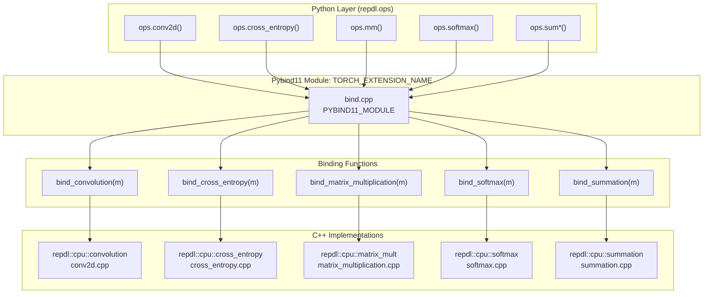
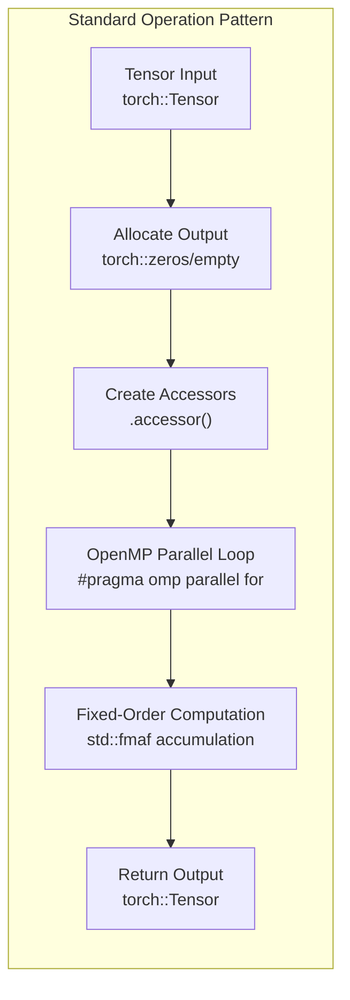
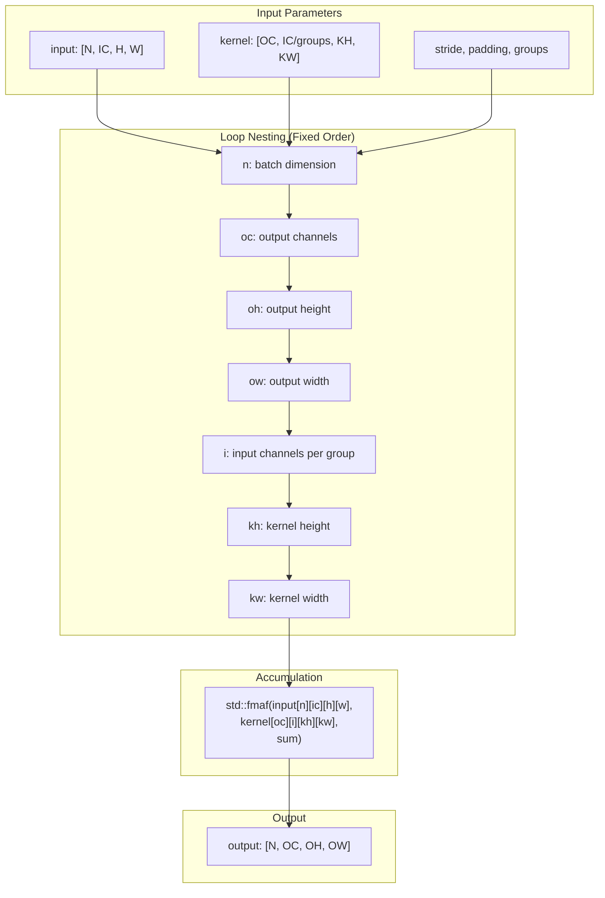
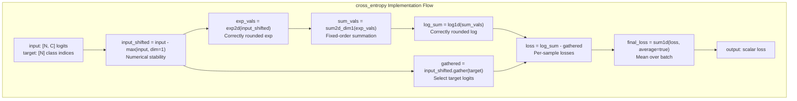
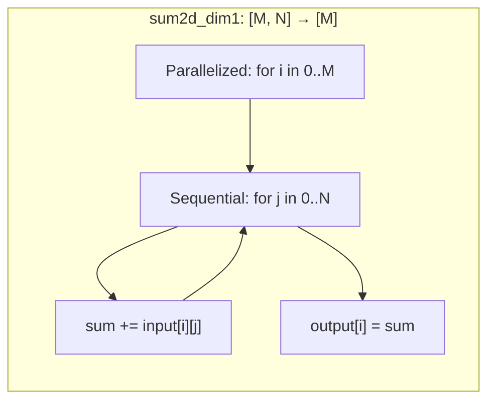

<!-- source: DeepWiki mcp.deepwiki.com · repo microsoft/RepDL · page 5.2 CPU Backend · fetched 2026-10-26 -->

# CPU Backend

<details>
<summary>Relevant source files</summary>

The following files were used as context for generating this wiki page:

- [backend/cpu/bind.cpp](backend/cpu/bind.cpp)
- [backend/cpu/convolution.cpp](backend/cpu/convolution.cpp)
- [backend/cpu/cross_entropy.cpp](backend/cpu/cross_entropy.cpp)
- [backend/cpu/math.cpp](backend/cpu/math.cpp)

</details>


## Purpose and Scope

The CPU backend provides reproducible implementations of deep learning operations in C++ using OpenMP for parallelization. This backend is invoked when tensors reside on the CPU device, as determined by the `repdl.ops` dispatcher (see [Operation Dispatch Mechanism](#3.1)).

The CPU backend ensures bitwise identical results across different CPU architectures by enforcing:
- **Fixed floating-point operation order** to prevent reordering optimizations
- **Correctly rounded math functions** using double-precision intermediates
- **Fused multiply-add operations** (`std::fmaf`) for deterministic accumulation

For CUDA implementations, see [CUDA Backend](#5.3). For the overall backend architecture and pybind11 binding strategy, see [Backend Architecture](#5.1).

**Sources:** [backend/cpu/bind.cpp](), [backend/cpu/convolution.cpp](), [backend/cpu/math.cpp]()

---

## File Organization

The CPU backend is organized into specialized files by operation category:

| File | Purpose | Operations Provided |
|------|---------|---------------------|
| `bind.cpp` | Main pybind11 module registration | Aggregates all binding functions |
| `convolution.cpp` | 2D convolution operations | `conv2d`, `conv2d_grad_input`, `conv2d_grad_kernel` |
| `cross_entropy.cpp` | Cross-entropy loss | `cross_entropy` |
| `matrix_multiplication.cpp` | Matrix operations | `mm` (matrix multiply) |
| `softmax.cpp` | Softmax operations | `softmax`, `softmax_grad` |
| `summation.cpp` | Reduction operations | `sum1d`, `sum2d_dim0`, `sum2d_dim1`, `sum4d_dim023` |
| `math.cpp` | Elementary math functions | `exp2d`, `log1d` (correctly rounded) |
| `math.h` | Math function declarations | Header for internal use |
| `summation.h` | Summation declarations | Header for internal use |

**Sources:** [backend/cpu/bind.cpp:1-19]()

---

## Binding Architecture



**Diagram: Pybind11 Binding Flow from Python to C++**

The binding architecture uses a modular design:

1. **Main Module Registration** ([backend/cpu/bind.cpp:12-19]()): The `PYBIND11_MODULE` macro creates the Python extension module and calls specialized binding functions.

2. **Specialized Binding Functions**: Each category (convolution, cross_entropy, etc.) has its own `bind_*` function that registers operations with the pybind11 module:
   - `bind_convolution(py::module_ &m)` - Registers 3 convolution operations
   - `bind_cross_entropy(py::module_ &m)` - Registers 1 loss operation
   - `bind_matrix_multiplication(py::module_ &m)` - Registers matrix operations
   - `bind_softmax(py::module_ &m)` - Registers softmax operations
   - `bind_summation(py::module_ &m)` - Registers reduction operations

3. **Implementation Namespaces**: C++ implementations are organized under `repdl::cpu::<category>` namespaces to prevent naming collisions.

**Sources:** [backend/cpu/bind.cpp:1-19](), [backend/cpu/convolution.cpp:134-139](), [backend/cpu/cross_entropy.cpp:29-32]()

---

## Operation Implementation Patterns

All CPU backend operations follow consistent patterns for reproducibility and performance:



**Diagram: Common Implementation Pattern for CPU Operations**

### Pattern Components

1. **Tensor Allocation**: Operations use `torch::zeros()` for initialized output or `torch::empty()` when all values will be written.

2. **Accessors**: The `.accessor<float, N>()` method provides efficient, type-safe access to tensor data with dimension checking. Example from [backend/cpu/convolution.cpp:21-23]():
   ```cpp
   auto I = input.accessor<float, 4>();
   auto K = kernel.accessor<float, 4>();
   auto O = output.accessor<float, 4>();
   ```

3. **OpenMP Parallelization**: The `#pragma omp parallel for` directive enables multi-threaded execution. The `collapse(N)` clause parallelizes nested loops.

4. **Fixed-Order Accumulation**: All accumulations use `std::fmaf(a, b, sum)` (fused multiply-add) in a fixed loop order to ensure deterministic results.

**Sources:** [backend/cpu/convolution.cpp:20-51](), [backend/cpu/math.cpp:19-30]()

---

## Convolution Operations

### Forward Convolution

The `conv2d` operation implements 2D convolution with support for stride, padding, and grouped convolutions.



**Diagram: Conv2d Forward Pass Loop Structure**

**Key Implementation Details:**

- **Parallelization** ([backend/cpu/convolution.cpp:24]()): `#pragma omp parallel for collapse(4)` parallelizes the outer 4 loops (N, OC, OH, OW), ensuring each output pixel is computed independently.

- **Grouped Convolution** ([backend/cpu/convolution.cpp:31-34]()): Groups are handled by computing `group = oc / OC_per_group` and restricting input channels to `[group * IC_per_group, (group+1) * IC_per_group)`.

- **Boundary Handling** ([backend/cpu/convolution.cpp:37-44]()): Input coordinates are computed as `h = oh * strideH - paddingH + kh`, and out-of-bounds accesses are skipped with `continue` statements.

- **Accumulation Order** ([backend/cpu/convolution.cpp:30-48]()): The innermost loops iterate over input channels, then kernel height, then kernel width—this fixed order ensures reproducibility.

- **Fused Multiply-Add** ([backend/cpu/convolution.cpp:45]()): `std::fmaf(I[n][ic][h][w], K[oc][i][kh][kw], sum)` performs `sum = (input * kernel) + sum` as a single operation with consistent rounding.

**Sources:** [backend/cpu/convolution.cpp:12-52]()

### Gradient Operations

The convolution gradient operations follow similar patterns but with different loop structures:

| Operation | Output Shape | Parallelized Dimensions | Inner Loop Order |
|-----------|--------------|-------------------------|------------------|
| `conv2d_grad_input` | `[N, IC, H, W]` | N, IC, H, W | OC → KH → KW |
| `conv2d_grad_kernel` | `[OC, IC, KH, KW]` | OC, IC, KH, KW | N → OH → OW |

**Gradient Input** ([backend/cpu/convolution.cpp:54-90]()): Computes `∂L/∂input` by convolving `grad_output` with the transposed kernel. The operation finds which output positions contributed to each input position.

**Gradient Kernel** ([backend/cpu/convolution.cpp:92-128]()): Computes `∂L/∂kernel` by treating each kernel element as a dot product between the input and gradient output at corresponding positions.

**Sources:** [backend/cpu/convolution.cpp:54-128](), [backend/cpu/convolution.cpp:134-139]()

---

## Cross-Entropy Loss

The `cross_entropy` operation implements the combined softmax-log-likelihood loss with numerical stability.



**Diagram: Cross-Entropy Computation Pipeline**

**Implementation Details:**

1. **Numerical Stability** ([backend/cpu/cross_entropy.cpp:17]()): Subtracting the maximum logit prevents overflow in the exponential function while maintaining mathematical equivalence.

2. **Correctly Rounded Exponential** ([backend/cpu/cross_entropy.cpp:18]()): Uses `repdl::cpu::math::exp2d()` which computes `std::exp((double)x)` for each element, ensuring consistent rounding across platforms.

3. **Fixed-Order Summation** ([backend/cpu/cross_entropy.cpp:19]()): `repdl::cpu::summation::sum2d_dim1()` sums along dimension 1 in a fixed order to ensure deterministic results.

4. **Correctly Rounded Logarithm** ([backend/cpu/cross_entropy.cpp:20]()): Uses `repdl::cpu::math::log1d()` which computes `std::log((double)x)` for correct rounding.

5. **Target Gathering** ([backend/cpu/cross_entropy.cpp:21]()): Uses PyTorch's `gather()` operation to select the logit corresponding to each sample's target class.

6. **Averaging** ([backend/cpu/cross_entropy.cpp:22]()): The final summation uses `sum1d(loss, true /*average*)` to compute the mean loss over the batch.

**Sources:** [backend/cpu/cross_entropy.cpp:15-24](), [backend/cpu/math.cpp:14-47]()

---

## Correctly Rounded Math Functions

The CPU backend provides correctly rounded implementations of transcendental functions by using double-precision intermediates.

### Exponential Function

```cpp
// From backend/cpu/math.cpp:14-17
inline float correct_rounded_exp(float x)
{
    return std::exp((double)x);
}
```

**Technique**: Convert single-precision input to double-precision, compute exponential at higher precision, then round back to single-precision. This ensures the result is correctly rounded (nearest representable float) rather than having double-rounding errors.

**Usage**: Applied element-wise in `exp2d()` ([backend/cpu/math.cpp:19-30]()), which is parallelized with OpenMP for 2D tensors.

### Logarithm Function

```cpp
// From backend/cpu/math.cpp:32-35
inline float correct_rounded_log(float x)
{
    return std::log((double)x);
}
```

**Technique**: Same double-precision intermediate approach as exponential, ensuring correctly rounded results.

**Usage**: Applied element-wise in `log1d()` ([backend/cpu/math.cpp:37-47]()), parallelized with OpenMP for 1D tensors.

### Why Correct Rounding Matters

Different implementations of `std::exp()` and `std::log()` may round differently at the single-precision boundary. By explicitly using double-precision intermediates, RepDL ensures:
- **Cross-platform consistency**: Same results on Intel, AMD, ARM processors
- **Library independence**: Results don't depend on math library implementation
- **IEEE-754 compliance**: Guarantees nearest-rounding mode

**Sources:** [backend/cpu/math.cpp:1-50]()

---

## OpenMP Parallelization Strategy

The CPU backend uses OpenMP to parallelize operations across CPU cores while maintaining reproducibility.

### Parallelization Patterns

| Pattern | Directive | Use Case | Example |
|---------|-----------|----------|---------|
| Single loop | `#pragma omp parallel for` | 1D reductions, element-wise ops | `log1d` |
| Collapsed loops | `#pragma omp parallel for collapse(N)` | Multi-dimensional operations | `conv2d` (N=4) |
| Independent outputs | No special clauses needed | Each thread computes distinct outputs | All operations |

### Reproducibility Guarantees

OpenMP parallelization maintains reproducibility because:

1. **Independent Output Elements**: Each output element is computed by a single thread in isolation. For example, in `conv2d`, each thread computes one output pixel `O[n][oc][oh][ow]` without dependencies on other threads.

2. **Fixed Inner Loop Order**: The parallelized outer loops can execute in any order, but the inner accumulation loops maintain a fixed order. Example from [backend/cpu/convolution.cpp:32-48]():
   ```
   Outer (parallel): n, oc, oh, ow
   Inner (sequential): i, kh, kw
   ```

3. **No Race Conditions**: Since output elements are independent and loop variables are thread-private, there are no data races.

4. **Deterministic Accumulation**: Within each thread, accumulation proceeds in fixed loop order using `std::fmaf`, ensuring deterministic floating-point operations.

### Example: Conv2d Parallelization

```
#pragma omp parallel for collapse(4)  // Parallelize N × OC × OH × OW
for (int n = 0; n < N; n++)           // Batch
    for (int oc = 0; oc < OC; oc++)   // Output channels
        for (int oh = 0; oh < OH; oh++)   // Output height
            for (int ow = 0; ow < OW; ow++) // Output width
            {
                float sum = 0;  // Thread-local accumulator
                // Fixed-order inner loops (sequential)
                for (int i = 0; i < IC_per_group; i++)
                    for (int kh = 0; kh < KH; kh++)
                        for (int kw = 0; kw < KW; kw++)
                            sum = std::fmaf(..., sum);
                O[n][oc][oh][ow] = sum;  // Independent write
            }
```

**Key Points**:
- The `collapse(4)` clause creates a single loop space of size `N × OC × OH × OW`
- OpenMP distributes iterations across threads
- Each iteration computes one output pixel independently
- Inner loops execute sequentially within each thread

**Sources:** [backend/cpu/convolution.cpp:24-50](), [backend/cpu/math.cpp:25-28](), [backend/cpu/math.cpp:43-45]()

---

## Summation Operations

The CPU backend provides multiple summation operations for reducing tensors along specific dimensions. These operations are critical for reproducibility since floating-point addition is not associative.

### Available Summation Operations

| Operation | Input Shape | Output Shape | Purpose |
|-----------|-------------|--------------|---------|
| `sum1d` | `[N]` | scalar | Reduce 1D tensor (with optional averaging) |
| `sum2d_dim0` | `[M, N]` | `[N]` | Sum along batch dimension |
| `sum2d_dim1` | `[M, N]` | `[M]` | Sum along feature dimension |
| `sum4d_dim023` | `[N, C, H, W]` | `[C]` | Sum over batch and spatial dimensions |

### Fixed-Order Summation

All summation operations use a **fixed loop order** to ensure deterministic results:



**Diagram: Fixed-Order Summation Pattern**

**Key Principle**: The outer loop (over the output dimension) can be parallelized, but the inner loop (performing the reduction) must execute sequentially to maintain a fixed addition order.

### Usage in Cross-Entropy

The `cross_entropy` operation demonstrates the importance of fixed-order summation ([backend/cpu/cross_entropy.cpp:19-22]()):

1. `sum2d_dim1(exp_vals)`: Sums exponentials across classes for each sample
2. `sum1d(loss, true)`: Averages losses across the batch

Both summations follow fixed orders to ensure reproducible gradient computation.

**Sources:** [backend/cpu/cross_entropy.cpp:15-24](), referenced summation.cpp and summation.h

---

## Reproducibility Techniques Summary

The CPU backend employs several techniques to achieve bitwise identical results:

### 1. Fixed Floating-Point Operation Order

**Principle**: Floating-point addition is not associative: `(a + b) + c ≠ a + (b + c)` in general.

**Implementation**:
- All accumulation loops have fixed iteration order
- No loop reordering optimizations allowed
- OpenMP parallelization only on independent output elements

**Example**: In `conv2d`, the accumulation order is always `IC_per_group → KH → KW` ([backend/cpu/convolution.cpp:32-48]()).

### 2. Fused Multiply-Add (FMA)

**Principle**: `std::fmaf(a, b, c)` computes `a × b + c` with a single rounding operation, more precise than separate multiply and add.

**Implementation**:
- All multiply-accumulate operations use `std::fmaf`
- Consistent use ensures same intermediate values

**Example**: Convolution accumulation ([backend/cpu/convolution.cpp:45]()):
```cpp
sum = std::fmaf(I[n][ic][h][w], K[oc][i][kh][kw], sum);
```

### 3. Correctly Rounded Math Functions

**Principle**: Standard library implementations may vary across platforms, leading to different rounding at the single-precision boundary.

**Implementation**:
- Use double-precision intermediates: `return std::exp((double)x);`
- Forces correct rounding to nearest representable float
- Eliminates platform-specific differences

**Example**: Exponential ([backend/cpu/math.cpp:14-17]()) and logarithm ([backend/cpu/math.cpp:32-35]()).

### 4. Explicit Boundary Handling

**Principle**: Different implementations might handle boundary conditions differently (especially with padding).

**Implementation**:
- Explicit coordinate calculation: `h = oh * strideH - paddingH + kh`
- Explicit bounds checking: `if (h < 0 || h >= H) continue;`
- No implicit padding or boundary assumptions

**Example**: Convolution boundary checks ([backend/cpu/convolution.cpp:37-44]()).

### 5. Avoided Optimizations

The following optimizations are **intentionally avoided** to maintain reproducibility:

- **Loop reordering**: Would change floating-point accumulation order
- **Vectorization**: SIMD instructions may have platform-specific rounding
- **Fast math flags**: Could enable non-IEEE-754-compliant optimizations
- **Parallel reductions**: Would introduce non-deterministic summation order

**Sources:** [backend/cpu/convolution.cpp](), [backend/cpu/math.cpp](), [backend/cpu/cross_entropy.cpp]()

---

## Extending the CPU Backend

To add a new operation to the CPU backend, follow these steps:

1. **Implement the C++ function** in a new or existing `.cpp` file under `backend/cpu/`:
   ```cpp
   namespace repdl::cpu::category {
       torch::Tensor operation_name(const torch::Tensor &input, ...) {
           // Fixed-order implementation with std::fmaf
       }
   }
   ```

2. **Create a binding function** in the same file:
   ```cpp
   void bind_category(py::module_ &m) {
       m.def("operation_name", &repdl::cpu::category::operation_name);
   }
   ```

3. **Declare the binding function** in `bind.cpp`:
   ```cpp
   void bind_category(py::module_ &m);  // Forward declaration
   ```

4. **Register in PYBIND11_MODULE** ([backend/cpu/bind.cpp:12-19]()):
   ```cpp
   PYBIND11_MODULE(TORCH_EXTENSION_NAME, m) {
       // ... existing bindings ...
       bind_category(m);
   }
   ```

5. **Ensure reproducibility**:
   - Use fixed loop orders for accumulation
   - Use `std::fmaf` for multiply-accumulate
   - Use correctly rounded math functions for transcendentals
   - Parallelize only independent outputs with OpenMP

For complete development guidelines, see [Adding Custom Operations](#6.1) and [Reproducibility Principles](#6.4).

**Sources:** [backend/cpu/bind.cpp](), [backend/cpu/convolution.cpp:134-139](), [backend/cpu/cross_entropy.cpp:29-32]()

---

