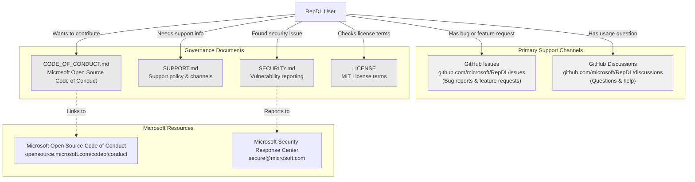
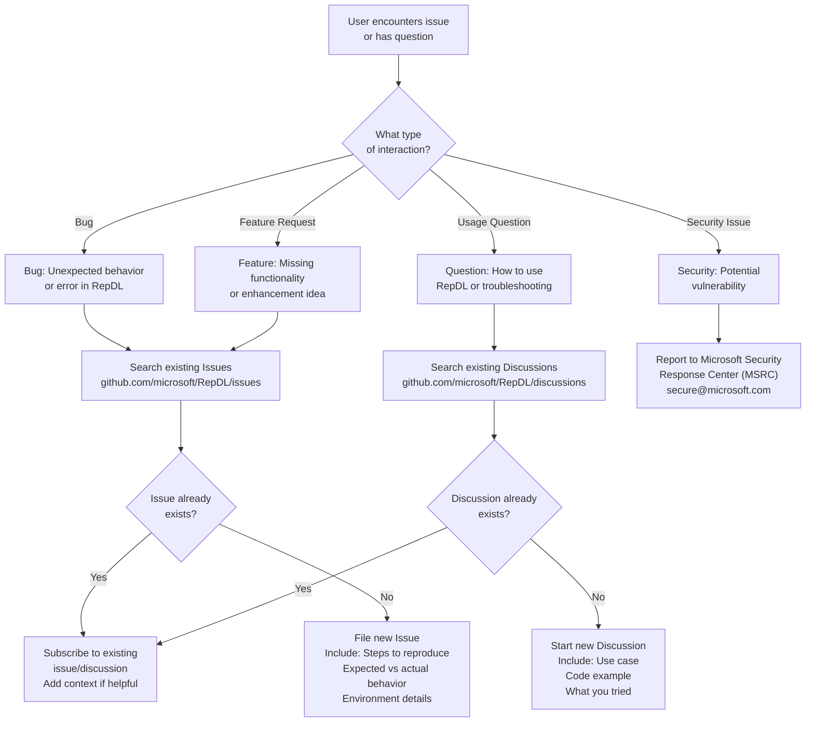
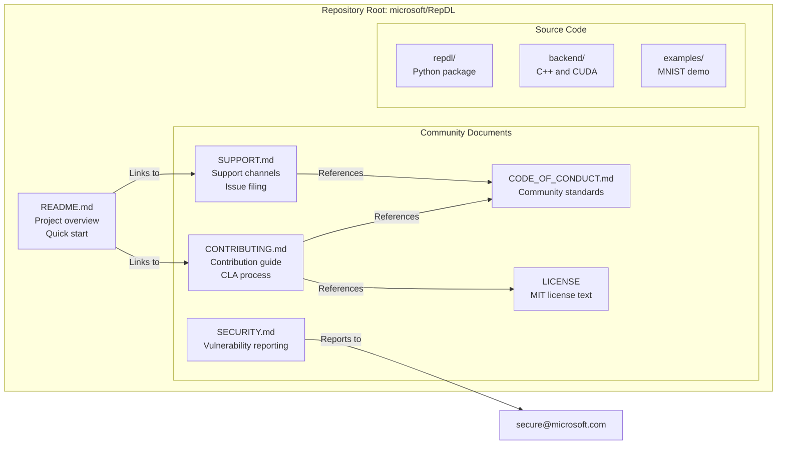
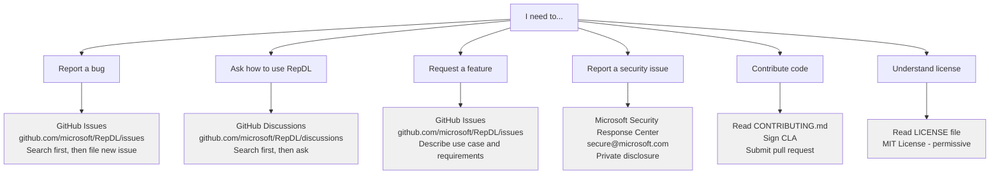

<!-- source: DeepWiki mcp.deepwiki.com · repo microsoft/RepDL · page 7 Community and Support · fetched 2026-10-26 -->

# Community and Support

Relevant source files

The following files were used as context for generating this wiki page:

- [CODE_OF_CONDUCT.md](CODE_OF_CONDUCT.md)
- [SUPPORT.md](SUPPORT.md)

## Purpose and Scope

This section provides information about the RepDL community, support resources, and contribution processes. It covers where to get help when using RepDL, how to report issues, security vulnerability reporting, and the project's governance policies.

For technical guides on extending RepDL with custom operations or layers, see [Development Guide](#6). For API documentation, see [API Reference](#4).

---

## Overview

RepDL is an open-source project hosted on GitHub under the Microsoft organization. Community support is structured around GitHub's collaboration features, with clear channels for different types of interactions. The project follows Microsoft's open-source policies including the Microsoft Open Source Code of Conduct and standard security reporting procedures.

Sources: [SUPPORT.md:1-12](), [CODE_OF_CONDUCT.md:1-10]()

---

## Support Resources Structure

**Support Channel Decision Tree**

The RepDL project uses different channels for different types of interactions:

| User Need | Channel | GitHub Location | Document Reference |
|-----------|---------|-----------------|-------------------|
| Report a bug | GitHub Issues | `github.com/microsoft/RepDL/issues` | [SUPPORT.md:5]() |
| Request a feature | GitHub Issues | `github.com/microsoft/RepDL/issues` | [SUPPORT.md:5]() |
| Ask usage questions | GitHub Discussions | `github.com/microsoft/RepDL/discussions` | [SUPPORT.md:7]() |
| Report security vulnerability | Microsoft Security Response Center | `secure@microsoft.com` | See [Security](#7.3) |
| Understand contribution rules | Code of Conduct | `CODE_OF_CONDUCT.md` | See [Contributing](#7.2) |
| Check license terms | MIT License | `LICENSE` | See [License](#7.4) |

Sources: [SUPPORT.md:1-12]()

---

## Issue and Discussion Workflow

**Key Workflow Principles:**

1. **Search Before Filing**: Users should search existing issues and discussions before creating new ones to avoid duplicates [SUPPORT.md:5]().

2. **Channel Separation**: Bugs and features use GitHub Issues, while questions use GitHub Discussions [SUPPORT.md:5-7]().

3. **Security Exception**: Security vulnerabilities bypass public channels and go directly to Microsoft Security Response Center (see [Security](#7.3)).

Sources: [SUPPORT.md:1-12]()

---

## Microsoft Support Policy

RepDL follows Microsoft's standard support policy for open-source projects:

**Limited Support Scope**: Support for RepDL is limited to the resources listed in [SUPPORT.md:11]():
- GitHub Issues for bugs and feature requests
- GitHub Discussions for usage questions

**No Commercial Support**: RepDL does not include commercial Microsoft support agreements. Users rely on community support and Microsoft's open-source team responses.

**Best Effort Assistance**: The RepDL team and community provide assistance on a best-effort basis without service level agreements (SLAs).

| Support Type | Available? | Channel |
|--------------|-----------|---------|
| Bug fixes | Yes (best effort) | GitHub Issues |
| Feature requests | Yes (review and prioritization) | GitHub Issues |
| Usage questions | Yes (community + maintainers) | GitHub Discussions |
| Commercial SLA | No | N/A |
| Phone support | No | N/A |
| Email support | No | N/A |

Sources: [SUPPORT.md:9-11]()

---

## Code of Conduct

RepDL has adopted the Microsoft Open Source Code of Conduct. All community members are expected to follow these guidelines when interacting in issues, discussions, pull requests, and other community spaces.

**Key Resources:**
- Primary document: [CODE_OF_CONDUCT.md:1-10]()
- Full code: [Microsoft Open Source Code of Conduct](https://opensource.microsoft.com/codeofconduct)
- FAQ: [Microsoft Code of Conduct FAQ](https://opensource.microsoft.com/codeofconduct/faq)
- Contact: `opencode@microsoft.com` for questions or concerns [CODE_OF_CONDUCT.md:9]()

**Core Principles:**
- Be respectful and inclusive
- Assume good intentions
- Focus on constructive collaboration
- Follow community guidelines in all interactions

For detailed contribution guidelines including the Contributor License Agreement (CLA) requirement, see [Contributing](#7.2).

Sources: [CODE_OF_CONDUCT.md:1-10]()

---

## Repository File Organization

**Document Hierarchy:**

1. **Entry Point**: `README.md` provides project overview and links to support resources
2. **Support Layer**: `SUPPORT.md`, `CODE_OF_CONDUCT.md`, `SECURITY.md` define community policies
3. **Legal**: `LICENSE` and CLA requirements in `CONTRIBUTING.md`
4. **Source Code**: Implementation in `repdl/` and `backend/` directories

Sources: [SUPPORT.md:1-12](), [CODE_OF_CONDUCT.md:1-10]()

---

## Related Pages

This section provides an overview of community and support resources. For specific topics:

- **Getting Help**: Detailed guide on filing issues and using discussions → [Getting Help](#7.1)
- **Contributing**: Contribution process, CLA requirements, and PR guidelines → [Contributing](#7.2)
- **Security**: Vulnerability reporting procedures and MSRC contact → [Security](#7.3)
- **License**: MIT license terms and usage permissions → [License](#7.4)

For technical development information:
- **Adding Custom Operations**: Extending RepDL with new operations → [Adding Custom Operations](#6.1)
- **Development Guide**: Complete guide for contributors → [Development Guide](#6)

---

## Quick Reference Card

Sources: [SUPPORT.md:1-12](), [CODE_OF_CONDUCT.md:1-10]()

---

