# Page: Overview

# Overview

<details>
<summary>Relevant source files</summary>

The following files were used as context for generating this wiki page:

- [README.md](README.md)
- [examples/mnist_trainig.py](examples/mnist_trainig.py)

</details>


## Purpose and Scope

RepDL (Reproducible Deep Learning) is a specialized library that guarantees **bitwise identical results across different hardware platforms** for identical training or inference tasks. This document provides a high-level overview of RepDL's architecture, key components, and design principles.

This page covers the fundamental concepts and system structure. For detailed reproducibility principles, see [Reproducibility Principles](#6.4). For API usage details, see [API Reference](#4). For extending the system, see [Development Guide](#6).

**Sources:** [README.md:1-5]()

## What RepDL Provides

RepDL addresses the non-determinism inherent in PyTorch operations, where even with `torch.use_deterministic_algorithms(True)`, operations like matrix multiplication, division, and square root can produce different results across devices. RepDL solves this by:

| Feature | Description | Key Components |
|---------|-------------|----------------|
| **Reproducible Operations** | Low-level operations that produce identical results regardless of hardware | `repdl.ops` module with CPU and CUDA backends |
| **PyTorch Compatibility** | Drop-in replacements for PyTorch modules | `repdl.nn`, `repdl.optim` |
| **Model Conversion** | Convert existing PyTorch models to reproducible versions | `repdl.from_torch_module()` function |
| **Verification Tools** | Cryptographic hashing to verify reproducibility | `repdl.utils.get_hash()` |

The library achieves reproducibility through three fundamental principles:
1. **Fixed floating-point operation order** - prevents reordering optimizations
2. **IEEE-754 compliance** - ensures standard floating-point behavior  
3. **Correctly rounded math functions** - guarantees precise results

**Sources:** [README.md:5-6, 29-32, 41-53]()

## Primary Entry Points

RepDL provides two main entry points for users:

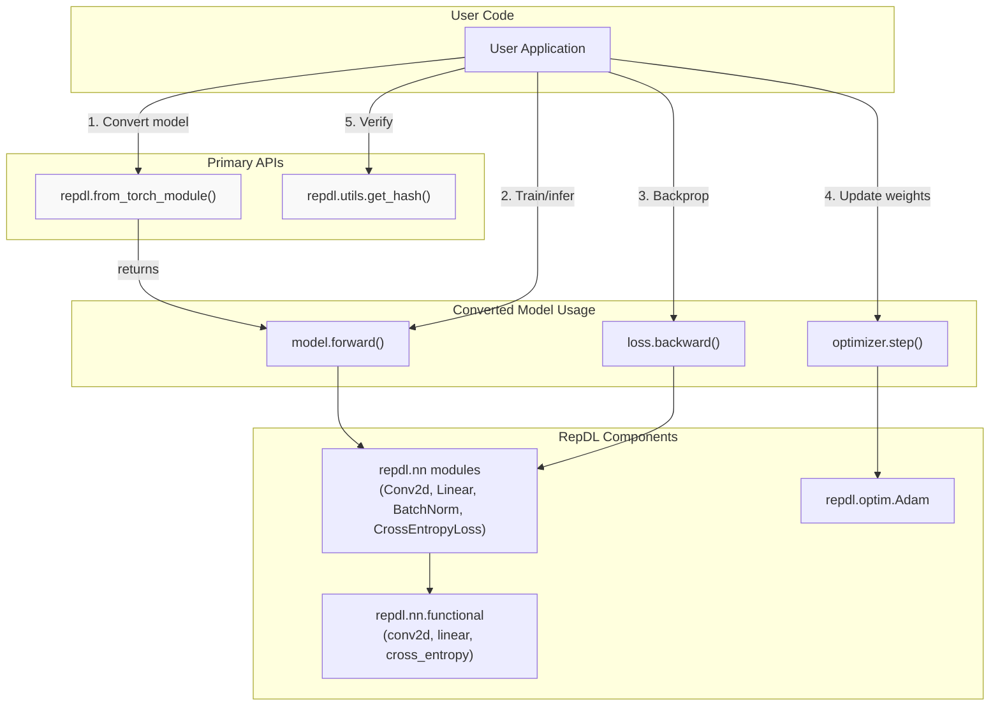

**Diagram: User-Facing Entry Points and Workflow**

### Model Conversion API

The `repdl.from_torch_module()` function [repdl/__init__.py]() serves as the primary entry point for enabling reproducibility. It recursively converts a PyTorch model's layers to their RepDL equivalents:

```python
import repdl
model = repdl.from_torch_module(model)
```

This single function call transforms supported PyTorch modules (Conv2d, Linear, BatchNorm1d, BatchNorm2d, ReLU, MaxPool2d, Flatten, Sequential) into their reproducible counterparts.

### Verification API

The `repdl.utils.get_hash()` function provides cryptographic verification of model states and outputs, enabling users to confirm bitwise identical results across hardware platforms.

**Sources:** [README.md:29-40](), [examples/mnist_trainig.py:38, 67, 83, 103]()

## Layered Architecture

RepDL implements a four-layer architecture where each layer has distinct responsibilities:

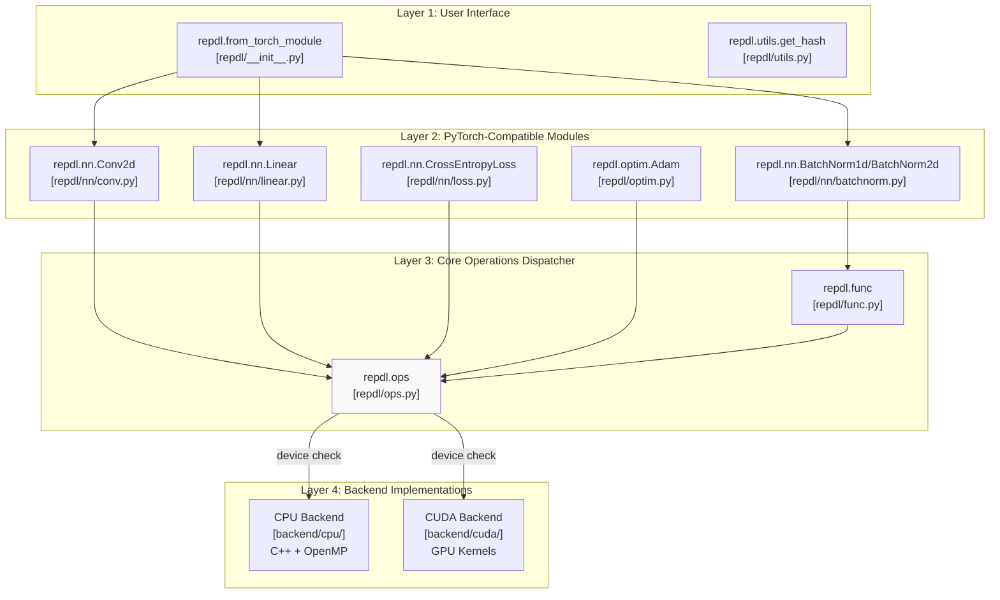

**Diagram: Four-Layer Architecture with Code Paths**

### Layer 1: User Interface Layer

Provides high-level APIs for model conversion and verification. The conversion function walks the module tree and replaces supported layers.

**Key files:** [repdl/__init__.py](), [repdl/utils.py]()

### Layer 2: PyTorch-Compatible Modules  

Implements familiar neural network building blocks that inherit from PyTorch base classes (`torch.nn.Module`, `torch.optim.Optimizer`) but override computation methods to use reproducible operations.

**Key files:** [repdl/nn/conv.py](), [repdl/nn/linear.py](), [repdl/nn/batchnorm.py](), [repdl/nn/loss.py](), [repdl/optim.py]()

### Layer 3: Core Operations Dispatcher

The `repdl.ops` module serves as the **critical chokepoint** for reproducibility. It examines tensor device placement (`tensor.is_cuda`) and routes all operations to the appropriate backend. Custom autograd functions in `repdl.func` provide differentiable operations with controlled gradients.

**Key files:** [repdl/ops.py](), [repdl/func.py]()

### Layer 4: Backend Implementations

C++ and CUDA implementations provide the actual reproducible computations. These backends are registered with Python via pybind11 bindings.

**Key files:** [backend/cpu/bind.cpp](), [backend/cuda/bind.cpp](), [backend/cpu/*.cpp](), [backend/cuda/*.cu]()

**Sources:** [README.md:45-52]()

## Operation Dispatch Mechanism

The `repdl.ops` module implements device-aware routing, the core mechanism that ensures reproducibility:

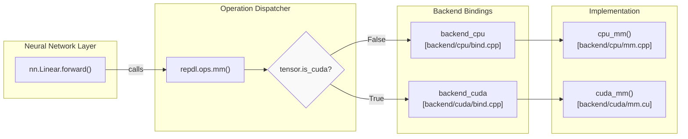

**Diagram: Operation Dispatch Flow from Layer to Backend**

Every neural network operation flows through this dispatch mechanism:

1. High-level modules call operations via `repdl.ops`
2. The dispatcher checks tensor device placement
3. The appropriate backend function is invoked
4. Results are returned with reproducibility guarantees

This architecture ensures that **all computations** - forward pass, backward pass, optimizer updates - follow reproducible code paths regardless of the hardware platform.

**Sources:** [README.md:43-44, 49]()

## Currently Supported Components

RepDL provides a subset of PyTorch functionality focused on common deep learning workflows:

| Category | Components | Module Path |
|----------|------------|-------------|
| **Layers** | Conv2d, Linear, BatchNorm1d, BatchNorm2d | `repdl.nn` |
| **Activations** | ReLU | `repdl.nn` |
| **Pooling** | MaxPool2d | `repdl.nn` |
| **Utilities** | Flatten, Sequential | `repdl.nn` |
| **Loss Functions** | CrossEntropyLoss | `repdl.nn` |
| **Optimizers** | Adam | `repdl.optim` |
| **Operations** | mm, conv2d, div, sqrt, sum*, cross_entropy, softmax | `repdl.ops` |

For the complete API reference, see [API Reference](#4).

**Sources:** [README.md:45-46]()

## Example Usage

The MNIST training example demonstrates the complete workflow:

```python
# 1. Set up reproducibility
os.environ["CUBLAS_WORKSPACE_CONFIG"] = ":4096:8"
torch.use_deterministic_algorithms(True)

# 2. Convert model
model = torch.nn.Sequential(...)
model = repdl.from_torch_module(model)

# 3. Verify initial state
print(f"Hash of the initial model: {repdl.utils.get_hash(model)}")

# 4. Train with RepDL components
optimizer = repdl.optim.Adam(model.parameters(), lr=0.01)
for images, labels in data_loader:
    output = model(images)
    loss = repdl.nn.functional.cross_entropy(output, labels)
    loss.backward()
    optimizer.step()

# 5. Verify trained state
print(f"Hash of the trained model: {repdl.utils.get_hash(model)}")
```

This code produces **identical hash values** across different GPUs (V100, A100), CPU, and different CUDA versions, demonstrating bitwise reproducibility.

Expected output (consistent across all platforms):
```
Hash of the initial model: 2a2d133895b1684e55d0f152ead2914b55adc551d9790a4b4585309b79c60362
Hash of the trained model: 31ee86a7f75dbd76bac22f209617eb7349f93b0ede116dba924f328cac3013f1
Test accuracy: 0.9804
Hash of the logits: 0ca34dcd37105b4af690c46a62407b4b9b097d1063864c6d99f4309aeb4bca3e
```

**Sources:** [examples/mnist_trainig.py:42-43, 64, 67, 73, 83](), [README.md:34-39]()

## Extending RepDL

RepDL is designed to be extensible while maintaining reproducibility guarantees. The development workflow follows a four-step process:

1. **Define operation interface** in [repdl/ops.py]()
2. **Implement backends** in [backend/cpu/]() and [backend/cuda/]()  
3. **Register bindings** in [backend/cpu/bind.cpp]() and [backend/cuda/bind.cpp]()
4. **Build higher APIs** in [repdl/func.py]() and [repdl/nn/]()

All extensions must maintain the three core principles: fixed floating-point operation order, IEEE-754 compliance, and correctly rounded math functions.

For detailed guidance, see [Development Guide](#6).

**Sources:** [README.md:47-53]()

## Key Architectural Insights

| Insight | Implication |
|---------|-------------|
| **Single dispatch point** | All operations flow through `repdl.ops`, creating a reproducibility chokepoint |
| **Dual backend requirement** | Every operation must have both CPU and CUDA implementations for cross-platform reproducibility |
| **PyTorch extension strategy** | RepDL inherits from PyTorch classes, enabling seamless integration with existing codebases |
| **Verification by design** | Cryptographic hashing (`utils.get_hash()`) enables objective verification of reproducibility claims |
| **Layered abstraction** | Clear separation between user API, modules, operations, and backends simplifies maintenance and extension |

The architecture achieves its primary goal of **bitwise identical results** by controlling the entire computation path from high-level API calls through to low-level kernel execution, ensuring that every floating-point operation follows a deterministic, reproducible code path.

**Sources:** [README.md:1-53](), [examples/mnist_trainig.py:1-115]()

---

# Page: What is Reproducible Deep Learning?

# What is Reproducible Deep Learning?

<details>
<summary>Relevant source files</summary>

The following files were used as context for generating this wiki page:

- [README.md](README.md)
- [examples/mnist_trainig.py](examples/mnist_trainig.py)

</details>


## Purpose and Scope

This document explains the reproducibility problem in deep learning and how RepDL addresses it. We define what constitutes "reproducible" in the context of deep learning training and inference, describe the technical challenges that cause non-reproducibility, and provide an overview of RepDL's solution based on three core principles: fixed floating-point operation order, IEEE-754 compliance, and correctly rounded mathematical functions.

For details on RepDL's architecture and how these principles are implemented across the system, see [Architecture Overview](#1.2). For a deep technical dive into maintaining reproducibility when extending RepDL, see [Reproducibility Principles](#6.4). For practical guidance on verifying reproducibility in your models, see [Reproducibility Verification](#3.3).

---

## The Reproducibility Problem

Deep learning researchers and practitioners expect that running the same training or inference code with the same data and random seed should produce identical results. However, in practice, deep learning frameworks like PyTorch produce **different numerical results** when executed on different hardware platforms, even with identical inputs and model parameters.

### Common Sources of Non-Reproducibility

| Source | Description | Impact |
|--------|-------------|--------|
| **Hardware-dependent optimizations** | Different GPUs (e.g., V100 vs A100) use different instruction sets and optimization paths | Different floating-point results |
| **Parallel reduction order** | Operations like matrix multiplication and summation may accumulate values in different orders | Non-associativity of floating-point arithmetic causes divergence |
| **Math library implementations** | CUDA libraries (cuBLAS, cuDNN) use fast-math approximations that sacrifice precision | Results vary across CUDA versions and GPU architectures |
| **Compiler optimizations** | CPU and GPU compilers may reorder floating-point operations for performance | Changes to operation order alter final results |

Even when PyTorch's deterministic mode is enabled via `torch.use_deterministic_algorithms(True)`, many operations remain non-reproducible across devices.

**Sources:** [README.md:43-44]()

---

## PyTorch Non-Reproducibility Example

The following diagram illustrates how identical PyTorch operations produce different results on different devices:

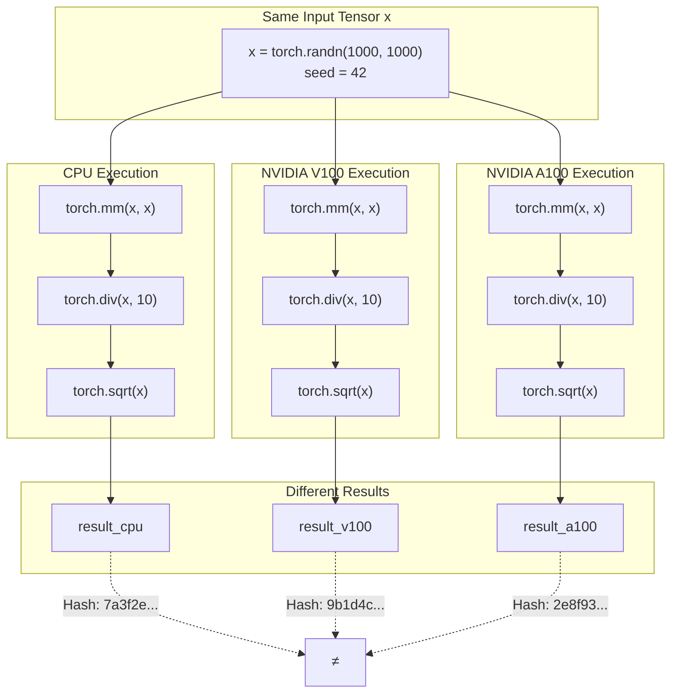

**PyTorch Non-Reproducibility: Identical operations on identical inputs produce different results across CPU, V100, and A100**

Even with `torch.manual_seed(42)` and `torch.use_deterministic_algorithms(True)`, the final hash values differ because:

1. `torch.mm` uses different BLAS libraries (MKL on CPU, cuBLAS on GPU) with different accumulation orders
2. `torch.div` may use fast-math approximations on GPU
3. `torch.sqrt` implementations vary across platforms

**Sources:** [README.md:43-44]()

---

## RepDL's Solution: Bitwise Identical Results

RepDL guarantees **bitwise identical results** across all hardware platforms for the same input. This means that not only are results numerically similar—they are *exactly the same at the bit level*, producing identical cryptographic hashes.

### RepDL Operations vs PyTorch Operations

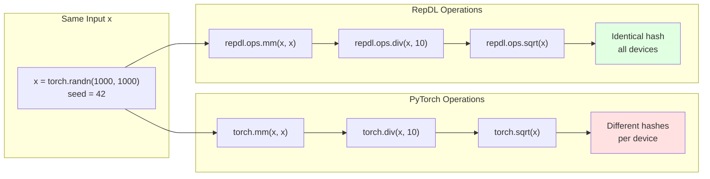

**Comparison: PyTorch operations are non-reproducible; RepDL operations guarantee bitwise identical results**

**Sources:** [README.md:43-44]()

---

## The Three Reproducibility Principles

RepDL achieves bitwise reproducibility by enforcing three fundamental principles in all operation implementations:

### 1. Fixed Floating-Point Operation Order

**Principle:** All floating-point operations must occur in a deterministic, fixed order.

**Why it matters:** Floating-point arithmetic is not associative. The expression `(a + b) + c` may produce a different result than `a + (b + c)` due to rounding errors at each step.

**Implementation:**
- Parallel reductions (e.g., in matrix multiplication) use fixed accumulation patterns
- CPU implementations use deterministic OpenMP scheduling
- CUDA kernels use fixed thread block sizes and reduction trees

**Example:**
```
Non-reproducible: sum([1e10, 1e-10, 1e10, -1e10, -1e10])
  - Parallel threads may accumulate in any order
  - Result depends on thread scheduling
  
Reproducible: sum([1e10, 1e-10, 1e10, -1e10, -1e10])
  - Elements always accumulated left-to-right
  - Result is identical every time
```

### 2. IEEE-754 Compliance

**Principle:** All operations must strictly follow the IEEE-754 standard for floating-point arithmetic.

**Why it matters:** Many hardware-specific optimizations (fast-math, fused multiply-add variations) violate IEEE-754 to improve performance but produce inconsistent results across platforms.

**Implementation:**
- No use of `-ffast-math` or CUDA's `--use_fast_math` flags
- Explicit control over fused multiply-add (FMA) instructions
- Disabled vendor-specific floating-point optimizations

### 3. Correctly Rounded Mathematical Functions

**Principle:** Mathematical functions (sqrt, div, exp, log, etc.) must be correctly rounded to the nearest representable value.

**Why it matters:** Many math libraries use approximations (polynomial expansions, lookup tables) that introduce platform-specific errors.

**Implementation:**
- CPU backend uses high-precision math functions
- CUDA backend uses correctly rounded intrinsics (e.g., `__dsqrt_rn` instead of `sqrtf`)
- Division operations use explicit rounding control

**Sources:** [README.md:52]()

---

## Reproducibility Guarantee Scope

RepDL provides reproducibility guarantees for the following:

| Category | Reproducible Across | Code Reference |
|----------|-------------------|----------------|
| **Operations** | CPU, all CUDA-capable GPUs | `repdl.ops.*` |
| **Neural network layers** | All devices | `repdl.nn.Conv2d`, `repdl.nn.Linear`, `repdl.nn.BatchNorm*` |
| **Loss functions** | All devices | `repdl.nn.CrossEntropyLoss` |
| **Optimizers** | All devices | `repdl.optim.Adam` |
| **Training loops** | All devices | See [examples/mnist_trainig.py]() |
| **Inference** | All devices | Model converted via `repdl.from_torch_module` |

### What RepDL Does NOT Guarantee

- **Data loading order:** Use fixed seeds and `shuffle=False` in dataloaders for reproducibility
- **PyTorch native operations:** Operations outside RepDL's control remain non-reproducible
- **Mixed precision training:** Currently not supported
- **Operations not yet implemented:** See [API Reference](#4) for supported operations

---

## Concrete Example: MNIST Training

The following table shows hash values from training a simple CNN on MNIST across different hardware platforms. With RepDL, all hash values are identical:

| Checkpoint | CPU | NVIDIA V100 | NVIDIA A100 | RTX 3090 |
|-----------|-----|-------------|-------------|----------|
| **Initial model** | `2a2d133895b16...` | `2a2d133895b16...` | `2a2d133895b16...` | `2a2d133895b16...` |
| **After 2 epochs** | `31ee86a7f75db...` | `31ee86a7f75db...` | `31ee86a7f75db...` | `31ee86a7f75db...` |
| **Test logits** | `0ca34dcd37105...` | `0ca34dcd37105...` | `0ca34dcd37105...` | `0ca34dcd37105...` |
| **Test accuracy** | 0.9804 | 0.9804 | 0.9804 | 0.9804 |

**All hash values are bitwise identical across devices**

This reproducibility is achieved through the code in [examples/mnist_trainig.py:62-84](), which uses:

1. `repdl.from_torch_module()` to convert the PyTorch model [examples/mnist_trainig.py:109]()
2. `repdl.optim.Adam` for optimization [examples/mnist_trainig.py:64]()
3. `repdl.nn.functional.cross_entropy` for loss computation [examples/mnist_trainig.py:73]()
4. `repdl.utils.get_hash()` for verification [examples/mnist_trainig.py:67,83,103]()

**Sources:** [README.md:34-39](), [examples/mnist_trainig.py:62-104]()

---

## How RepDL Achieves Reproducibility

The following diagram shows how RepDL's architecture enforces the three reproducibility principles:

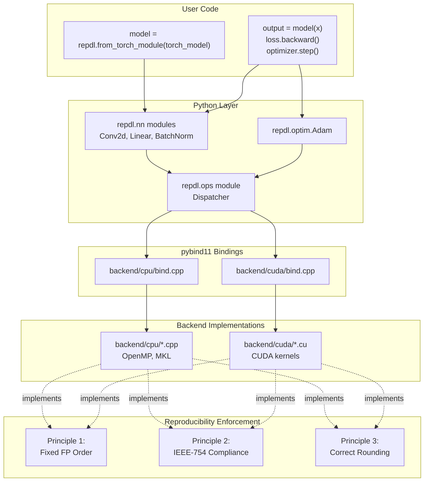

**RepDL Architecture: All operations flow through `repdl.ops` to reproducible backends that enforce the three principles**

**Key Components:**

1. **`repdl.ops` module** [repdl/ops.py](): Central dispatcher that routes operations to device-specific backends
2. **CPU backend** [backend/cpu/](): C++ implementations with OpenMP for parallel operations
3. **CUDA backend** [backend/cuda/](): CUDA kernel implementations with explicit reproducibility controls
4. **pybind11 bindings** [backend/cpu/bind.cpp](), [backend/cuda/bind.cpp](): Register C++/CUDA functions with Python

Every operation in RepDL follows this path, ensuring that all three reproducibility principles are enforced at the lowest level of computation.

**Sources:** [README.md:45-52]()

---

## Why Reproducibility Matters

### Research
- **Exact result verification:** Collaborators can verify published results bit-for-bit
- **Debugging:** Reproduce bugs and numerical issues exactly
- **Ablation studies:** Isolate the impact of specific changes without noise from hardware differences

### Production
- **Model versioning:** Guarantee that re-training produces identical models
- **Regulatory compliance:** Meet requirements for auditable, deterministic AI systems
- **A/B testing:** Ensure differences are due to model changes, not hardware variance

### Education
- **Consistent experiments:** Students get identical results regardless of hardware
- **Fair grading:** Assignments produce comparable outputs across different machines

---

## Environment Setup Requirements

To use RepDL's reproducibility guarantees, you must configure your environment:

```python
import os
import torch

# Required for CUDA deterministic operations
os.environ["CUBLAS_WORKSPACE_CONFIG"] = ":4096:8"

# Enable PyTorch deterministic algorithms
torch.use_deterministic_algorithms(True)

# Set random seeds
torch.manual_seed(42)
```

These settings are demonstrated in [examples/mnist_trainig.py:42-43]().

**Sources:** [examples/mnist_trainig.py:41-43]()

---

## Summary

RepDL solves the reproducibility problem in deep learning by:

1. **Identifying the root causes:** Non-deterministic operation order, non-compliant floating-point operations, and approximate math functions
2. **Enforcing three principles:** Fixed FP operation order, IEEE-754 compliance, and correctly rounded math
3. **Implementing reproducible backends:** Custom C++ and CUDA implementations that guarantee bitwise identical results
4. **Providing a familiar API:** PyTorch-compatible interface via `repdl.from_torch_module`, `repdl.nn`, and `repdl.optim`

The result is **bitwise identical** training and inference across all hardware platforms, verified through cryptographic hashing.

For implementation details, see [Architecture Overview](#1.2). For practical usage, see [Quick Start](#2.2) and [MNIST Training Example](#2.3).

**Sources:** [README.md:1-52](), [examples/mnist_trainig.py:1-115]()

---

# Page: Architecture Overview

# Architecture Overview

<details>
<summary>Relevant source files</summary>

The following files were used as context for generating this wiki page:

- [README.md](README.md)
- [examples/mnist_trainig.py](examples/mnist_trainig.py)
- [repdl/ops.py](repdl/ops.py)

</details>


## Purpose and Scope

This document describes the high-level architecture of RepDL, explaining how the system's components are organized into layers and how they interact to achieve bitwise reproducibility. It covers the overall structure from user-facing APIs down to backend implementations, the role of each major component, and the key architectural patterns that enable reproducible computation.

For details on specific architectural aspects, see:
- [Operation Dispatch Mechanism](#3.1) for the dispatch logic details
- [Backend Architecture](#5.1) for C++/CUDA implementation details
- [Reproducibility Principles](#6.4) for the mathematical foundations

---

## System Layers

RepDL implements a four-layer architecture where each layer has clearly defined responsibilities. The design follows a strict dependency hierarchy to maintain separation of concerns and enable controlled execution paths.

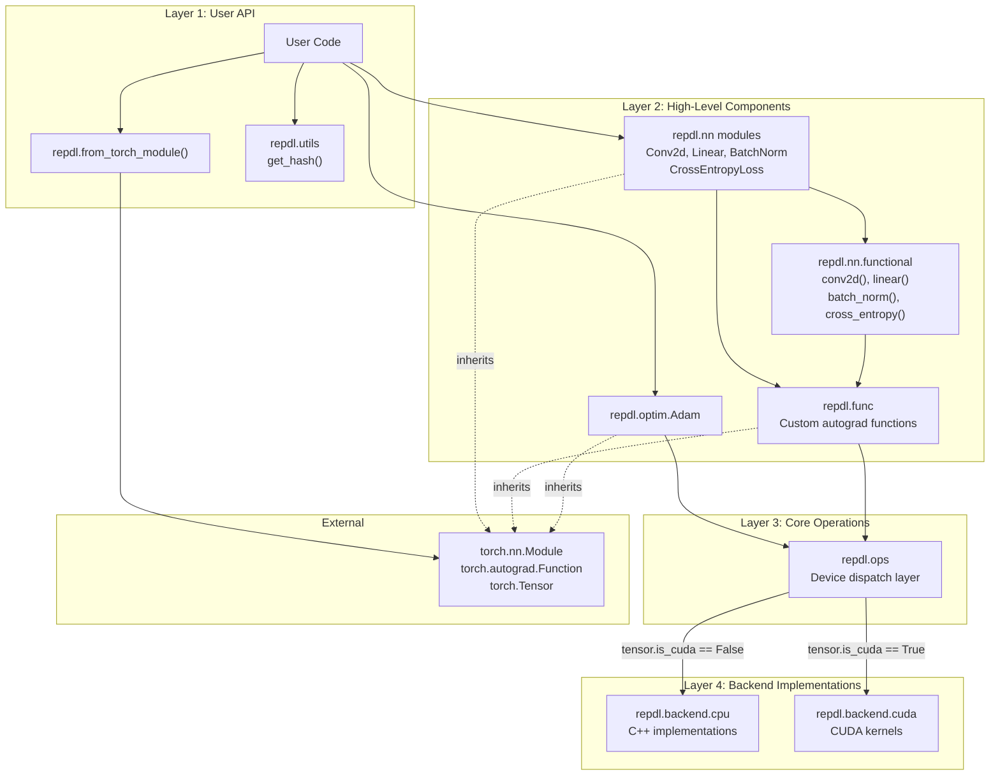

**Sources:** [README.md:1-53](), [repdl/ops.py:1-158]()

### Layer Descriptions

| Layer | Components | Responsibility | Key Files |
|-------|-----------|----------------|-----------|
| **User API** | Conversion utilities, hashing | Entry points for model conversion and reproducibility verification | `repdl/__init__.py`, `repdl/utils.py` |
| **High-Level Components** | Neural network modules, optimizers, functional APIs | PyTorch-compatible interfaces with state management | `repdl/nn/*.py`, `repdl/optim.py`, `repdl/func.py` |
| **Core Operations** | Operation dispatcher | Device-aware routing to reproducible backends | `repdl/ops.py` |
| **Backend Implementations** | C++ and CUDA kernels | Reproducible arithmetic implementations | `backend/cpu/*.cpp`, `backend/cuda/*.cu` |

**Sources:** [README.md:45-52]()

---

## Core Components and Their Roles

### Operation Dispatcher: `repdl.ops`

The `repdl.ops` module serves as the central chokepoint for all reproducible operations. Every computational operation flows through this dispatcher, which examines the tensor's device placement and routes to the appropriate backend.

**Key Operations:**
- `conv2d()`, `conv2d_grad_input()`, `conv2d_grad_kernel()` - Convolution operations [repdl/ops.py:12-88]()
- `mm()` - Matrix multiplication [repdl/ops.py:106-112]()
- `div()`, `sqrt()` - Element-wise operations [repdl/ops.py:98-123]()
- `sum1d()`, `sum2d_dim0()`, `sum2d_dim1()`, `sum4d_dim023()` - Reduction operations [repdl/ops.py:126-157]()
- `cross_entropy()`, `softmax()` - Loss and activation functions [repdl/ops.py:91-119]()

**Dispatch Pattern:**
```python
# Example from ops.py
def mm(input: torch.Tensor, mat2: torch.Tensor, 
       transA: bool = False, transB: bool = False) -> torch.Tensor:
    if input.is_cuda:
        return cuda.mm(input, mat2, transA, transB)
    else:
        return cpu.mm(input, mat2, transA, transB)
```

This pattern is repeated for all operations, ensuring consistent device-aware routing.

**Sources:** [repdl/ops.py:1-158]()

### Neural Network Modules: `repdl.nn`

The `repdl.nn` package provides PyTorch-compatible neural network modules that inherit from `torch.nn.Module` but override forward passes to use reproducible operations.

**Module Organization:**
- `repdl.nn.conv.Conv2d` - 2D convolution layer
- `repdl.nn.linear.Linear` - Fully connected layer
- `repdl.nn.batchnorm.BatchNorm1d`, `BatchNorm2d` - Normalization layers
- `repdl.nn.loss.CrossEntropyLoss` - Classification loss function
- `repdl.nn.functional` - Stateless function aggregator

Each module delegates to custom autograd functions in `repdl.func`, which in turn use `repdl.ops` for actual computation.

**Sources:** [README.md:45-46]()

### Custom Autograd Functions: `repdl.func`

The `repdl.func` module implements `torch.autograd.Function` subclasses that control both forward and backward passes. This enables reproducible gradient computation.

**Example Functions:**
- `expand_as()` - Tensor broadcasting with reproducible gradients
- `mean1d()` - 1D mean with reproducible gradient computation
- `mean2d_dim0()` - 2D mean along dimension 0
- `mean4d_dim023()` - 4D mean along dimensions 0, 2, 3

These functions are used internally by higher-level modules to ensure all gradient operations are reproducible.

**Sources:** [README.md:50]()

### Optimizer: `repdl.optim.Adam`

The `repdl.optim.Adam` optimizer inherits from PyTorch's optimizer base class but uses `repdl.ops` for parameter updates, ensuring reproducible weight modifications across training steps.

**Sources:** [README.md:51](), [examples/mnist_trainig.py:64]()

### Model Conversion: `repdl.from_torch_module()`

This function converts existing PyTorch models to use RepDL's reproducible operations by recursively replacing standard layers with RepDL equivalents.

**Conversion Process:**
1. Recursively traverse model's module tree
2. Replace `torch.nn` layers with corresponding `repdl.nn` layers
3. Transfer trained parameters and buffers
4. Preserve model structure and interface

**Sources:** [README.md:29-32](), [examples/mnist_trainig.py:38]()

---

## Data Flow Architecture

The following diagram shows how data flows through RepDL during training, illustrating the path from user code to backend implementations.

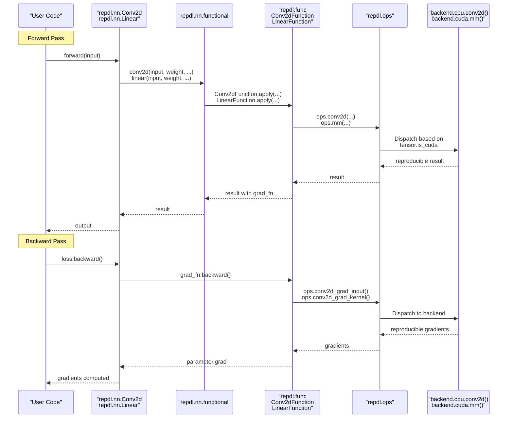

**Sources:** [examples/mnist_trainig.py:69-77](), [repdl/ops.py:12-88]()

---

## Module Dependency Graph

This diagram maps the actual Python modules and their import relationships, showing how the codebase is organized.

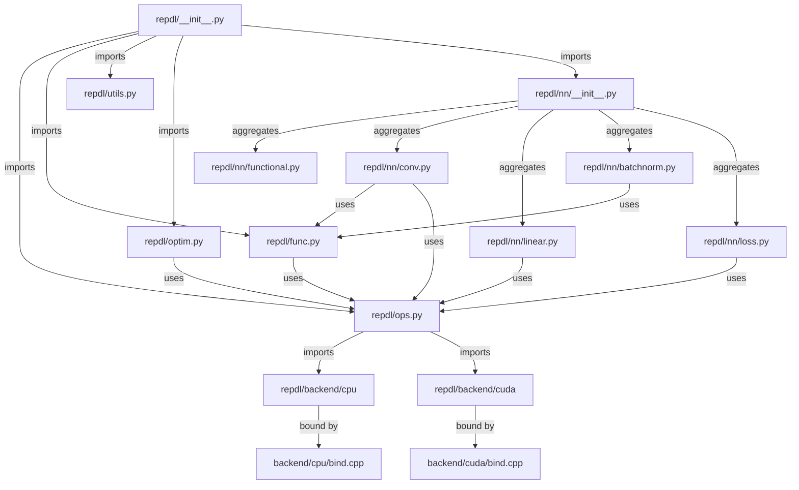

**Import Hierarchy:**
1. Top-level `repdl` package exports primary APIs
2. `repdl.ops` imports backend modules (`backend.cpu`, `backend.cuda`)
3. High-level components (`nn`, `func`, `optim`) depend on `ops`
4. Backend modules are bound to Python via pybind11

**Sources:** [repdl/ops.py:8-9](), [README.md:49]()

---

## Key Architectural Patterns

### 1. Central Dispatcher Pattern

All operations funnel through `repdl.ops`, which acts as a single point of control. This ensures:
- Consistent device-aware routing
- Single source of truth for operation dispatch
- Easy auditability of execution paths

**Implementation:**
```python
# Pattern from ops.py
def operation_name(input: torch.Tensor, ...) -> torch.Tensor:
    if input.is_cuda:
        return cuda.operation_name(input, ...)
    else:
        return cpu.operation_name(input, ...)
```

**Sources:** [repdl/ops.py:19-26]()

### 2. Layer Inheritance with Override

RepDL modules inherit from PyTorch classes but override critical methods to redirect computation through reproducible paths.

**Example Pattern:**
- Inherit from `torch.nn.Module` or `torch.autograd.Function`
- Override `forward()` or `apply()` methods
- Delegate to `repdl.ops` for actual computation
- Maintain PyTorch API compatibility

**Sources:** [README.md:45]()

### 3. Dual Backend Implementation

Every operation has two implementations:
- **CPU backend:** C++ with OpenMP parallelization
- **CUDA backend:** CUDA kernels for GPU execution

Both implement identical interfaces and guarantee bitwise identical results.

**Backend Registration:**
- C++ implementations registered in [backend/cpu/bind.cpp]()
- CUDA implementations registered in [backend/cuda/bind.cpp]()
- Exposed to Python via pybind11

**Sources:** [README.md:49]()

### 4. Functional Decomposition

Complex operations are decomposed into simpler, reproducible primitives:
- High-level modules → functional APIs → autograd functions → ops → backends
- Each layer adds a specific abstraction (state management, gradients, dispatch, execution)

**Sources:** [README.md:45-52]()

---

## Extension Points

The architecture supports extension at multiple levels:

| Extension Level | How to Extend | Files to Modify |
|----------------|---------------|-----------------|
| **Operations** | Add dispatcher function, implement CPU/CUDA backends, register bindings | `repdl/ops.py`, `backend/cpu/*.cpp`, `backend/cuda/*.cu`, `backend/*/bind.cpp` |
| **Autograd Functions** | Implement `torch.autograd.Function` subclass using `repdl.ops` | `repdl/func.py` |
| **Modules** | Implement `torch.nn.Module` subclass using `repdl.func` or `repdl.ops` | `repdl/nn/*.py` |
| **Optimizers** | Implement optimizer using `repdl.ops` for parameter updates | `repdl/optim.py` |

**Requirements for Extensions:**
1. Maintain fixed floating-point operation order
2. Use IEEE-754 compliant operations
3. Implement correctly rounded math functions
4. Provide both CPU and CUDA implementations

**Sources:** [README.md:47-52]()

---

## Reproducibility Verification Workflow

The architecture supports verification at multiple stages:

```mermaid
graph LR
    SETUP["Environment Setup<br/>CUBLAS_WORKSPACE_CONFIG<br/>torch.use_deterministic_algorithms"]
    CONVERT["Model Conversion<br/>repdl.from_torch_module()"]
    INIT_HASH["Initial Hash<br/>repdl.utils.get_hash(model)"]
    TRAIN["Training Loop<br/>All ops through repdl.ops"]
    FINAL_HASH["Final Hash<br/>repdl.utils.get_hash(model)"]
    INFER["Inference<br/>Model evaluation"]
    OUTPUT_HASH["Output Hash<br/>repdl.utils.get_hash(output)"]
    
    SETUP --> CONVERT
    CONVERT --> INIT_HASH
    INIT_HASH --> TRAIN
    TRAIN --> FINAL_HASH
    FINAL_HASH --> INFER
    INFER --> OUTPUT_HASH
```

**Hash Values from MNIST Example:**
- Initial model: `2a2d133895b1684e55d0f152ead2914b55adc551d9790a4b4585309b79c60362`
- Trained model: `31ee86a7f75dbd76bac22f209617eb7349f93b0ede116dba924f328cac3013f1`
- Logits output: `0ca34dcd37105b4af690c46a62407b4b9b097d1063864c6d99f4309aeb4bca3e`

These hash values are identical across all hardware platforms (CPU, different GPUs) when using the same input data and random seed.

**Sources:** [README.md:34-39](), [examples/mnist_trainig.py:67-83]()

---

## Summary

The RepDL architecture achieves reproducibility through:

1. **Layered Design:** Clear separation between user APIs, high-level components, core operations, and backend implementations
2. **Central Dispatch:** Single routing point (`repdl.ops`) for all computational operations
3. **Dual Backends:** Identical CPU and CUDA implementations for every operation
4. **Controlled Execution:** Custom autograd functions that route all forward and backward passes through reproducible paths
5. **Verification Tools:** Cryptographic hashing for bitwise identical result validation

The architecture is extensible while maintaining reproducibility guarantees through strict adherence to reproducibility principles at all levels.

**Sources:** [README.md:1-53](), [repdl/ops.py:1-158]()

---

# Page: Getting Started

# Getting Started

<details>
<summary>Relevant source files</summary>

The following files were used as context for generating this wiki page:

- [README.md](README.md)
- [examples/mnist_trainig.py](examples/mnist_trainig.py)

</details>


This section provides a practical guide for installing RepDL, converting PyTorch models to reproducible versions, and verifying bitwise identical results across hardware platforms. It covers the essential steps from installation through basic model conversion and training workflows.

For detailed architectural concepts, see [Core Concepts](#3). For comprehensive API documentation, see [API Reference](#4).

---

## Purpose and Scope

This page introduces the fundamental workflow for using RepDL in your projects. It covers:

- Prerequisites and installation process
- Environment configuration for reproducibility
- Basic model conversion using `repdl.from_torch_module`
- Reproducibility verification using `repdl.utils.get_hash`
- Overview of the training workflow

**Child pages provide detailed information:**
- [Installation](#2.1) - Complete installation instructions and troubleshooting
- [Quick Start](#2.2) - Minimal working example with inference
- [MNIST Training Example](#2.3) - Full training example with expected outputs

---

## RepDL Workflow Overview

The following diagram shows the end-to-end workflow for using RepDL, mapping natural language concepts to actual code symbols:

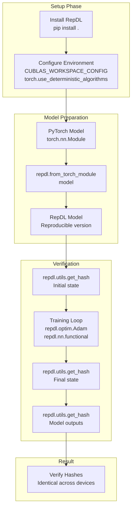

**Sources:** [README.md:19-39](), [examples/mnist_trainig.py:41-114]()

---

## Prerequisites

RepDL requires PyTorch and compatible CUDA libraries to be installed before setup. The system supports both CPU and CUDA execution.

| Requirement | Purpose |
|------------|---------|
| **PyTorch** | Base framework for tensor operations and autograd |
| **CUDA Toolkit** | GPU support (optional but recommended) |
| **C++ Compiler** | Required for building backend extensions |
| **Python 3.6+** | Language runtime |

**Sources:** [README.md:21-22]()

---

## Installation Overview

The installation process involves cloning the repository and building the C++ and CUDA backend extensions. This process compiles the reproducible operation implementations in [backend/cpu/]() and [backend/cuda/]().

```bash
git clone https://github.com/microsoft/RepDL.git
cd RepDL
pip install .
```

The `pip install .` command triggers the build process defined in `setup.py`, which compiles the pybind11 bindings registered in [backend/cpu/bind.cpp]() and [backend/cuda/bind.cpp]().

For detailed installation instructions, troubleshooting, and build configuration options, see [Installation](#2.1).

**Sources:** [README.md:23-27]()

---

## Environment Configuration

RepDL requires specific environment settings to ensure deterministic behavior across all operations:

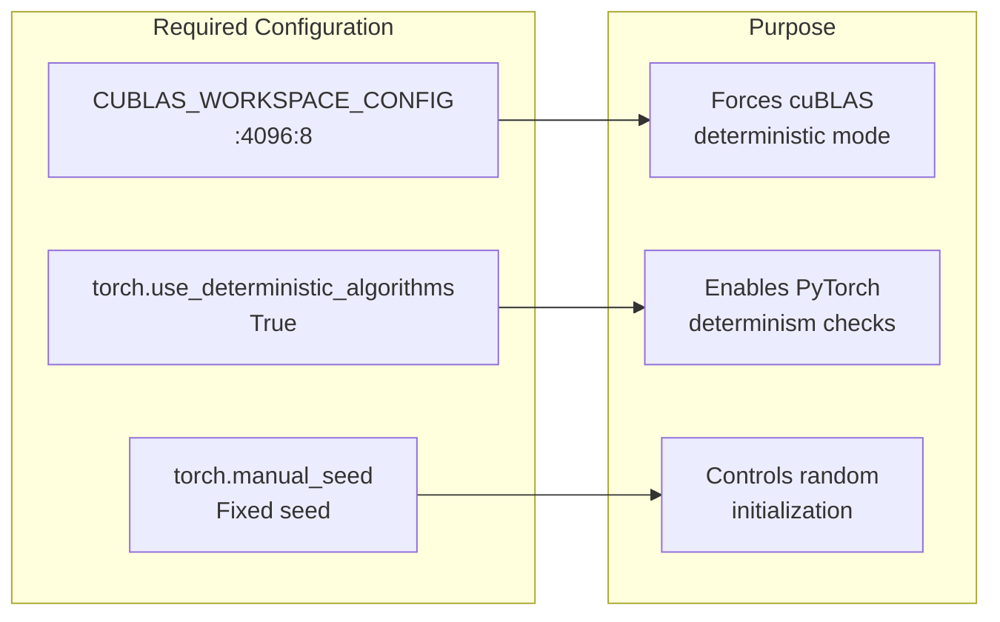

### Configuration Code

```python
import os
import torch

# Enable cuBLAS deterministic mode
os.environ["CUBLAS_WORKSPACE_CONFIG"] = ":4096:8"

# Enable PyTorch deterministic algorithms
torch.use_deterministic_algorithms(True)

# Set random seed for reproducible initialization
torch.manual_seed(0)
```

**Critical:** These settings must be applied before any model operations. The `CUBLAS_WORKSPACE_CONFIG` environment variable forces CUDA BLAS operations to use deterministic algorithms rather than faster non-deterministic ones.

**Sources:** [examples/mnist_trainig.py:42-43](), [examples/mnist_trainig.py:107]()

---

## Model Conversion Process

The `repdl.from_torch_module` function converts a standard `torch.nn.Module` to use reproducible operations. This process preserves model parameters and structure while replacing operation implementations.

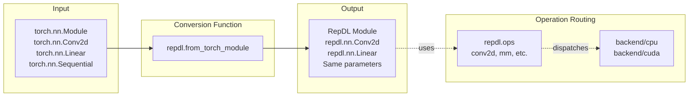

### Basic Conversion Example

```python
import torch
import repdl

# Define a standard PyTorch model
model = torch.nn.Sequential(
    torch.nn.Conv2d(3, 64, kernel_size=3),
    torch.nn.ReLU(),
    torch.nn.Linear(64, 10)
)

# Convert to reproducible version
model = repdl.from_torch_module(model)
```

The conversion function:
1. Recursively traverses the module tree
2. Replaces supported layer types (Conv2d, Linear, BatchNorm, etc.) with RepDL equivalents
3. Preserves parameter values and states
4. Maintains the same forward pass interface

For a minimal working example, see [Quick Start](#2.2).

**Sources:** [README.md:29-32](), [examples/mnist_trainig.py:38]()

---

## Reproducibility Verification

RepDL provides `repdl.utils.get_hash` to verify bitwise identical results across different hardware platforms. This function computes a SHA-256 hash of model state or tensor data.

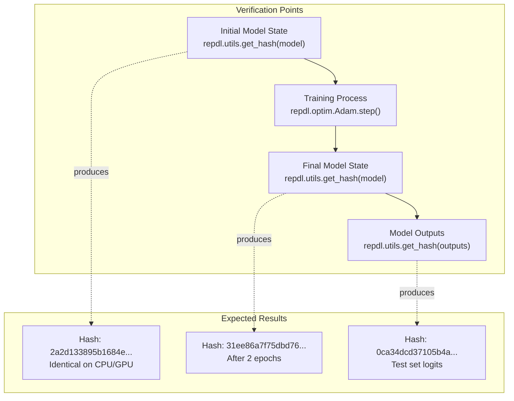

### Hash Computation at Key Points

```python
import repdl

# Verify initial model state
initial_hash = repdl.utils.get_hash(model)
print(f"Hash of the initial model: {initial_hash}")

# Train model...
train(model, optimizer)

# Verify trained model state
trained_hash = repdl.utils.get_hash(model)
print(f"Hash of the trained model: {trained_hash}")

# Verify model outputs
outputs = model(test_inputs)
output_hash = repdl.utils.get_hash(outputs)
print(f"Hash of the logits: {output_hash}")
```

**Expected Behavior:** When running the same training process on different devices (e.g., CPU, NVIDIA V100, NVIDIA A100), all three hash values will be identical, demonstrating bitwise reproducibility.

For detailed verification workflow and interpreting hash values, see [Reproducibility Verification](#3.3).

**Sources:** [examples/mnist_trainig.py:67](), [examples/mnist_trainig.py:83](), [examples/mnist_trainig.py:103](), [README.md:34-39]()

---

## Training Workflow Overview

RepDL training follows the standard PyTorch training loop pattern while using reproducible operations throughout. The key difference is the use of `repdl.optim` optimizers and `repdl.nn.functional` loss functions.

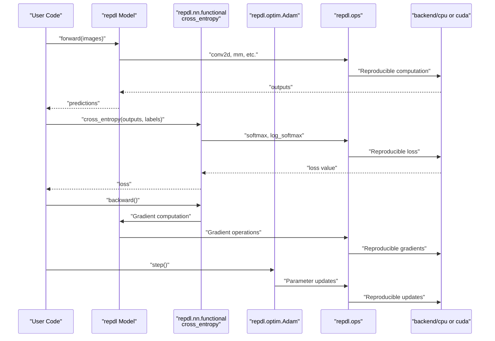

### Training Loop Structure

The training loop uses RepDL components at critical points:

| Component | RepDL Symbol | Purpose |
|-----------|--------------|---------|
| **Optimizer** | `repdl.optim.Adam` | Reproducible parameter updates |
| **Loss Function** | `repdl.nn.functional.cross_entropy` | Reproducible loss computation |
| **Model** | Converted via `repdl.from_torch_module` | Reproducible forward/backward passes |
| **Verification** | `repdl.utils.get_hash` | Hash computation at checkpoints |

### Minimal Training Example

```python
import repdl

# Setup
model = repdl.from_torch_module(model)
optimizer = repdl.optim.Adam(model.parameters(), lr=0.01)

# Training loop
for epoch in range(num_epochs):
    for images, labels in data_loader:
        # Forward pass
        outputs = model(images)
        
        # Compute loss using reproducible function
        loss = repdl.nn.functional.cross_entropy(outputs, labels)
        
        # Backward pass and optimization
        optimizer.zero_grad()
        loss.backward()
        optimizer.step()
```

For a complete training example with data loading, evaluation, and hash verification, see [MNIST Training Example](#2.3).

**Sources:** [examples/mnist_trainig.py:62-84]()

---

## Device Placement

RepDL supports both CPU and CUDA devices. The operation dispatch mechanism automatically routes operations to the appropriate backend based on tensor device placement.

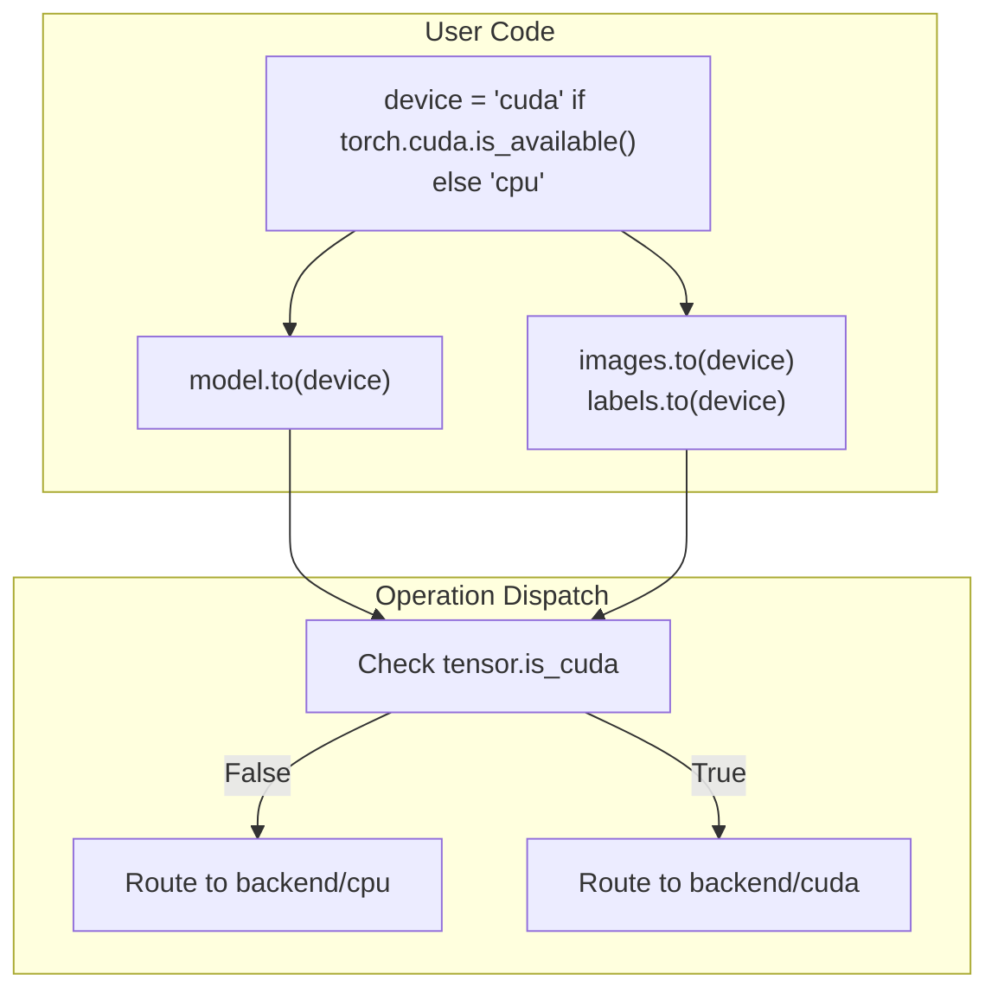

### Device Usage Example

```python
import torch
import repdl

# Select device
device = "cuda" if torch.cuda.is_available() else "cpu"

# Move model to device
model = repdl.from_torch_module(model)
model.to(device)

# Move data to device during training
for images, labels in data_loader:
    images = images.to(device)
    labels = labels.to(device)
    outputs = model(images)
```

The `repdl.ops` dispatcher examines `tensor.is_cuda` and routes operations accordingly. For details on the dispatch mechanism, see [Operation Dispatch Mechanism](#3.1).

**Sources:** [examples/mnist_trainig.py:110](), [examples/mnist_trainig.py:63](), [examples/mnist_trainig.py:70-71]()

---

## Supported Operations and Modules

RepDL currently supports a subset of PyTorch operations and modules. The following table shows the mapping between PyTorch and RepDL components:

| Category | PyTorch | RepDL Equivalent | Source |
|----------|---------|------------------|--------|
| **Operations** | `torch.mm` | `repdl.ops.mm` | [repdl/ops.py]() |
| | `torch.div` | `repdl.ops.div` | [repdl/ops.py]() |
| | `torch.sqrt` | `repdl.ops.sqrt` | [repdl/ops.py]() |
| **Layers** | `torch.nn.Conv2d` | `repdl.nn.Conv2d` | [repdl/nn/conv.py]() |
| | `torch.nn.Linear` | `repdl.nn.Linear` | [repdl/nn/linear.py]() |
| | `torch.nn.BatchNorm1d` | `repdl.nn.BatchNorm1d` | [repdl/nn/batchnorm.py]() |
| | `torch.nn.BatchNorm2d` | `repdl.nn.BatchNorm2d` | [repdl/nn/batchnorm.py]() |
| **Loss Functions** | `torch.nn.CrossEntropyLoss` | `repdl.nn.CrossEntropyLoss` | [repdl/nn/loss.py]() |
| **Optimizers** | `torch.optim.Adam` | `repdl.optim.Adam` | [repdl/optim.py]() |
| **Functional** | `F.cross_entropy` | `repdl.nn.functional.cross_entropy` | [repdl/nn/functional.py]() |

**Note:** Operations not implemented in RepDL will fall back to standard PyTorch implementations, which may not provide reproducibility guarantees. For extending RepDL with custom operations, see [Development Guide](#6).

**Sources:** [README.md:42-45]()

---

## Next Steps

After completing the basic setup:

1. **Try the Quick Start** - See [Quick Start](#2.2) for a minimal inference example
2. **Run MNIST Training** - See [MNIST Training Example](#2.3) for a complete training workflow
3. **Understand Core Concepts** - See [Core Concepts](#3) for architectural details
4. **Explore the API** - See [API Reference](#4) for comprehensive documentation
5. **Extend RepDL** - See [Development Guide](#6) for adding custom operations

**Sources:** [README.md:19-52]()

---

# Page: Installation

# Installation

<details>
<summary>Relevant source files</summary>

The following files were used as context for generating this wiki page:

- [README.md](README.md)
- [examples/mnist_trainig.py](examples/mnist_trainig.py)

</details>


This page provides step-by-step instructions for installing RepDL on your system, including prerequisite software, build configuration, and environment setup required for reproducibility. For information on using RepDL after installation, see [Quick Start](#2.2) and [MNIST Training Example](#2.3).

## Prerequisites

RepDL requires the following software to be installed before building from source:

| Component | Purpose | Notes |
|-----------|---------|-------|
| **PyTorch** | Base tensor operations and autograd | Must be installed first |
| **CUDA Toolkit** | GPU computation support | Version must match PyTorch's CUDA version |
| **C++ Compiler** | Building CPU backend | GCC 7+ or MSVC 2019+ |
| **Python 3.7+** | Runtime environment | With pip package manager |
| **Git** | Source code retrieval | For cloning repository |

### PyTorch and CUDA Version Compatibility

RepDL extends PyTorch by providing reproducible backends for operations. The CUDA version used to build RepDL must match the CUDA version that PyTorch was built against. Verify your PyTorch installation:

```python
import torch
print(torch.__version__)  # e.g., '2.0.0+cu118'
print(torch.version.cuda)  # e.g., '11.8'
```

**Sources:** [README.md:19-21]()

## Installation Steps

### Diagram: Installation Workflow

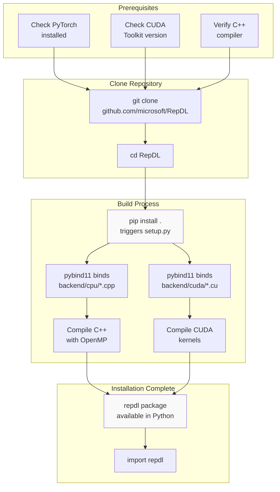

**Sources:** [README.md:23-27]()

### Step-by-Step Installation

Execute the following commands in your terminal to build and install RepDL from source:

```bash
git clone https://github.com/microsoft/RepDL.git
cd RepDL
pip install .
```

The `pip install .` command triggers the following build process:

1. **C++ Backend Compilation**: Compiles files in `backend/cpu/` directory with OpenMP support for parallel operations
2. **CUDA Backend Compilation**: Compiles `.cu` files in `backend/cuda/` directory into GPU kernels
3. **Python Binding**: Uses pybind11 to create Python-callable interfaces defined in `backend/cpu/bind.cpp` and `backend/cuda/bind.cpp`
4. **Package Installation**: Installs the `repdl` Python package into your environment

**Sources:** [README.md:23-27]()

### Build System Architecture

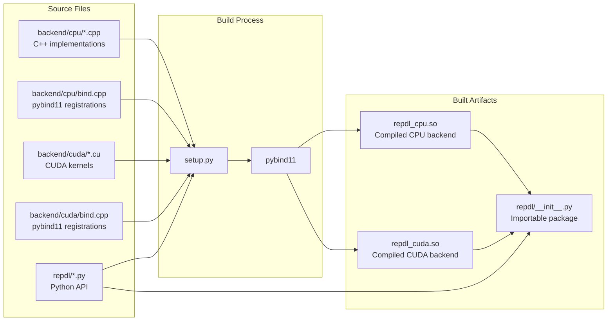

**Sources:** [README.md:23-27](), [backend/cpu/bind.cpp](), [backend/cuda/bind.cpp]()

## Environment Configuration

RepDL achieves bitwise reproducibility by controlling floating-point operation ordering and enforcing deterministic algorithms. Proper environment configuration is **required** for reproducibility guarantees.

### Required Environment Variables

The following environment variables must be set before executing reproducible code:

| Variable | Value | Purpose |
|----------|-------|---------|
| `CUBLAS_WORKSPACE_CONFIG` | `:4096:8` or `:16:8` | Allocates workspace memory for deterministic cuBLAS operations |

### Required PyTorch Settings

Configure PyTorch's deterministic mode in your Python code:

```python
import os
import torch

# Set environment variable (must be set before any CUDA operations)
os.environ["CUBLAS_WORKSPACE_CONFIG"] = ":4096:8"

# Enable deterministic algorithms in PyTorch
torch.use_deterministic_algorithms(True)

# Set manual seed for reproducible random number generation
torch.manual_seed(0)
```

**Sources:** [examples/mnist_trainig.py:41-43](), [examples/mnist_trainig.py:107]()

### Environment Setup Diagram

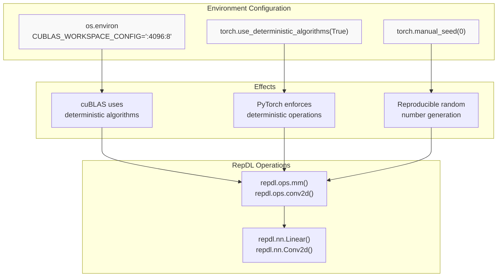

**Sources:** [examples/mnist_trainig.py:41-43]()

### CUBLAS_WORKSPACE_CONFIG Values

The `CUBLAS_WORKSPACE_CONFIG` variable accepts two formats:

| Format | Memory Usage | Description |
|--------|--------------|-------------|
| `:4096:8` | ~24MB | 4096 workspaces of 8 bytes each |
| `:16:8` | ~128 bytes | 16 workspaces of 8 bytes each (minimal memory) |

Use `:4096:8` for most workloads. Use `:16:8` if GPU memory is constrained, though this may limit the size of operations that can be executed deterministically.

**Sources:** [examples/mnist_trainig.py:42]()

## Verification

After installation, verify that RepDL is correctly installed and configured:

### Import Test

```python
import repdl

# Verify core modules are accessible
print(repdl.__version__)  # Package version
print(dir(repdl))  # Available functions and modules
```

### Operation Test

Test basic reproducible operations:

```python
import torch
import repdl

# Create test tensor
x = torch.randn(10, 10)

# Test CPU operation
result_cpu = repdl.ops.mm(x, x)
hash_cpu = repdl.utils.get_hash(result_cpu)
print(f"CPU result hash: {hash_cpu}")

# Test CUDA operation (if available)
if torch.cuda.is_available():
    x_cuda = x.cuda()
    result_cuda = repdl.ops.mm(x_cuda, x_cuda)
    hash_cuda = repdl.utils.get_hash(result_cuda.cpu())
    print(f"CUDA result hash: {hash_cuda}")
    
    # Hashes should match for reproducibility
    assert hash_cpu == hash_cuda, "Results differ between CPU and CUDA!"
```

**Sources:** [README.md:43]()

### Conversion Test

Verify model conversion functionality:

```python
import torch
import repdl

# Create a simple PyTorch model
torch_model = torch.nn.Sequential(
    torch.nn.Linear(10, 20),
    torch.nn.ReLU(),
    torch.nn.Linear(20, 10)
)

# Convert to RepDL model
repdl_model = repdl.from_torch_module(torch_model)

# Verify conversion succeeded
print(type(repdl_model))  # Should show RepDL module types
```

**Sources:** [README.md:29-32](), [examples/mnist_trainig.py:35-38]()

## Troubleshooting

### Common Installation Issues

| Issue | Cause | Solution |
|-------|-------|----------|
| **Import error: `No module named repdl`** | Installation failed or wrong Python environment | Re-run `pip install .` and verify Python environment |
| **CUDA compilation error** | CUDA version mismatch | Ensure CUDA Toolkit version matches PyTorch's CUDA version |
| **Runtime error: `CUBLAS_WORKSPACE_CONFIG not set`** | Missing environment variable | Set `os.environ["CUBLAS_WORKSPACE_CONFIG"] = ":4096:8"` before CUDA operations |
| **Different results on CPU vs GPU** | Deterministic mode not enabled | Call `torch.use_deterministic_algorithms(True)` |
| **C++ compiler not found** | Missing or incompatible compiler | Install GCC 7+ (Linux) or MSVC 2019+ (Windows) |

### Verifying CUDA Backend

Check if the CUDA backend was successfully compiled:

```python
import torch
import repdl

if torch.cuda.is_available():
    # Test CUDA operation
    x = torch.randn(5, 5).cuda()
    result = repdl.ops.mm(x, x)
    print("CUDA backend is working")
else:
    print("CUDA not available; only CPU backend compiled")
```

### Build Logs

During installation, monitor build output for warnings or errors. Key indicators of successful build:

- `Building extension for cpu backend`
- `Building extension for cuda backend` (if CUDA available)
- `Successfully installed repdl-X.X.X`

**Sources:** [README.md:19-27]()

## Next Steps

After successful installation and verification:

1. **Quick Start**: See [Quick Start](#2.2) for a minimal example of converting a PyTorch model
2. **Complete Example**: Follow the [MNIST Training Example](#2.3) for a full training workflow
3. **API Reference**: Explore available operations in [Operations Module](#4.2) and neural network modules in [Neural Network Modules](#4.3)

For troubleshooting reproducibility issues, see [Reproducibility Verification](#3.3).

**Sources:** [README.md:29-39]()

---

# Page: Quick Start

# Quick Start

<details>
<summary>Relevant source files</summary>

The following files were used as context for generating this wiki page:

- [README.md](README.md)
- [examples/mnist_trainig.py](examples/mnist_trainig.py)
- [repdl/__init__.py](repdl/__init__.py)

</details>


This page provides a minimal example to get started with RepDL. It demonstrates the core workflow: converting a PyTorch model to use RepDL's reproducible operations and verifying bitwise identical results. For detailed installation instructions, see [Installation](#2.1). For a complete training example with the MNIST dataset, see [MNIST Training Example](#2.3).

## Prerequisites

Before using RepDL, you must configure your environment for deterministic execution:

```python
import os
import torch

os.environ["CUBLAS_WORKSPACE_CONFIG"] = ":4096:8"
torch.use_deterministic_algorithms(True)
torch.manual_seed(0)  # Set seed for reproducibility
```

These settings are **mandatory** for achieving bitwise identical results:

| Setting | Purpose |
|---------|---------|
| `CUBLAS_WORKSPACE_CONFIG` | Forces cuBLAS to use deterministic algorithms |
| `torch.use_deterministic_algorithms(True)` | Disables non-deterministic PyTorch operations |
| `torch.manual_seed(0)` | Ensures identical initialization across runs |

**Sources:** [examples/mnist_trainig.py:42-43](), [README.md:34]()

---

## Basic Model Conversion

The primary entry point for RepDL is `repdl.from_torch_module()`, which converts a standard PyTorch model to use reproducible operations.

### Conversion Workflow

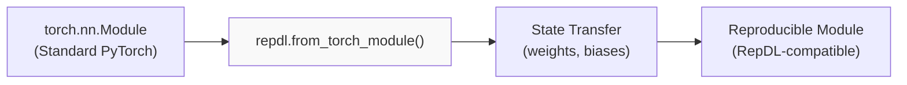

### Supported Module Types

The `from_torch_module()` function in [repdl/\_\_init\_\_.py:15-65]() recursively converts PyTorch modules to their RepDL equivalents:

| PyTorch Module | RepDL Equivalent | State Transferred |
|----------------|------------------|-------------------|
| `torch.nn.Conv2d` | `repdl.nn.Conv2d` | Yes (weight, bias) |
| `torch.nn.Linear` | `repdl.nn.Linear` | Yes (weight, bias) |
| `torch.nn.BatchNorm1d` | `repdl.nn.BatchNorm1d` | Yes (weight, bias, running stats) |
| `torch.nn.BatchNorm2d` | `repdl.nn.BatchNorm2d` | Yes (weight, bias, running stats) |
| `torch.nn.CrossEntropyLoss` | `repdl.nn.CrossEntropyLoss` | No (stateless) |
| `torch.nn.Sequential` | `torch.nn.Sequential` | Recursive conversion |
| Other modules | Shallow copy | Recursive child conversion |

The conversion process preserves all module parameters by calling `load_state_dict()` [repdl/\_\_init\_\_.py:26,35,48,55]().

**Sources:** [repdl/\_\_init\_\_.py:15-65](), [README.md:29-32]()

---

## Simple Conversion Example

Here is the minimal workflow for converting a model and verifying reproducibility:

```mermaid
sequenceDiagram
    participant User as "User Code"
    participant Conversion as "repdl.from_torch_module"
    participant TorchModel as "torch.nn.Module"
    participant RepdlModel as "RepDL Module"
    participant Hash as "repdl.utils.get_hash"
    
    User->>TorchModel: "Create standard model"
    User->>Conversion: "from_torch_module(model)"
    Conversion->>TorchModel: "Check module type"
    Conversion->>RepdlModel: "Create RepDL equivalent"
    Conversion->>TorchModel: "Extract state_dict()"
    Conversion->>RepdlModel: "load_state_dict()"
    RepdlModel-->>User: "Converted model"
    
    User->>Hash: "get_hash(model)"
    Hash-->>User: "2a2d133895b1684e..."
    
    Note over User,Hash: "Same hash on all devices"
```

### Example Usage Pattern

Following the pattern in [examples/mnist_trainig.py:35-38]():

1. **Define a standard PyTorch model** with `torch.nn` modules
2. **Convert the entire model** using `repdl.from_torch_module()`
3. **Move to device** (CPU or CUDA) as needed
4. **Verify state** using `repdl.utils.get_hash()`

The converted model maintains the same interface as the original PyTorch model, so forward passes, backward passes, and optimizer steps work identically.

**Sources:** [examples/mnist_trainig.py:35-38,109](), [README.md:29-32]()

---

## Reproducibility Verification

RepDL provides `repdl.utils.get_hash()` to cryptographically verify bitwise identical results across different hardware platforms.

### Hash Calculation Points

```mermaid
graph TD
    A["Initial Model State"]
    B["Training Loop"]
    C["Final Model State"]
    D["Inference Outputs"]
    
    A -->|"repdl.utils.get_hash(model)"| H1["Hash:<br/>2a2d133895b1684e..."]
    B -->|"Multiple epochs"| C
    C -->|"repdl.utils.get_hash(model)"| H2["Hash:<br/>31ee86a7f75dbd76..."]
    D -->|"repdl.utils.get_hash(outputs)"| H3["Hash:<br/>0ca34dcd37105b4a..."]
    
    style H1 fill:#f9f9f9
    style H2 fill:#f9f9f9
    style H3 fill:#f9f9f9
```

### Expected Hash Values

When running the same operations on different devices (CPU, V100 GPU, A100 GPU, etc.), the hash values should be **bitwise identical**. From [README.md:36-39]():

| Checkpoint | Expected Hash (MNIST Example) |
|------------|-------------------------------|
| Initial model | `2a2d133895b1684e55d0f152ead2914b55adc551d9790a4b4585309b79c60362` |
| After 2 epochs | `31ee86a7f75dbd76bac22f209617eb7349f93b0ede116dba924f328cac3013f1` |
| Test logits | `0ca34dcd37105b4af690c46a62407b4b9b097d1063864c6d99f4309aeb4bca3e` |

The `get_hash()` function computes a SHA-256 hash over all model parameters (weights, biases) or tensor data, ensuring that even a single bit difference will produce a completely different hash value.

**Sources:** [examples/mnist_trainig.py:67,83,103](), [README.md:36-39]()

---

## Reproducible Operations

RepDL provides low-level reproducible operations through `repdl.ops` that replace non-deterministic PyTorch operations.

### Operation Comparison

```mermaid
graph TB
    subgraph "Standard PyTorch (Non-Reproducible)"
        PT1["torch.mm(x, x)"]
        PT2["torch.div(x, 10)"]
        PT3["torch.sqrt(x)"]
    end
    
    subgraph "RepDL (Reproducible)"
        RD1["repdl.ops.mm(x, x)"]
        RD2["repdl.ops.div(x, 10)"]
        RD3["repdl.ops.sqrt(x)"]
    end
    
    subgraph "Results"
        NR["Different results<br/>across devices"]
        R["Identical results<br/>across devices"]
    end
    
    PT1 --> NR
    PT2 --> NR
    PT3 --> NR
    
    RD1 --> R
    RD2 --> R
    RD3 --> R
```

### Available Operations

The `repdl.ops` module [repdl/ops.py]() provides device-aware dispatching to reproducible backends. Key operations include:

| Operation | Function Signature | Purpose |
|-----------|-------------------|---------|
| Matrix multiplication | `repdl.ops.mm(input, mat2)` | Reproducible matmul for Linear layers |
| Convolution | `repdl.ops.conv2d(input, weight, bias, ...)` | Reproducible 2D convolution |
| Division | `repdl.ops.div(input, other)` | Element-wise division with fixed rounding |
| Square root | `repdl.ops.sqrt(input)` | Element-wise sqrt with correct rounding |
| Sum operations | `repdl.ops.sum*` variants | Fixed-order summation |
| Softmax/Cross-entropy | `repdl.ops.softmax`, `repdl.ops.cross_entropy` | Reproducible classification |

These operations are automatically used when you convert a model with `from_torch_module()`. For manual usage patterns, see [Reproducible Operations Example](examples/reproducible_ops.py).

**Sources:** [README.md:43](), [repdl/ops.py]()

---

## Putting It Together

The complete quick start workflow combines conversion, training/inference, and verification:

```mermaid
graph TD
    Start["Start"] --> Setup["Set environment variables<br/>CUBLAS_WORKSPACE_CONFIG<br/>torch.use_deterministic_algorithms"]
    Setup --> Create["Create torch.nn.Module"]
    Create --> Convert["model = repdl.from_torch_module(model)"]
    Convert --> Hash1["Hash initial state"]
    
    Hash1 --> Train["Training or Inference"]
    Train --> Hash2["Hash final state"]
    
    Hash2 --> Compare{"Hashes match<br/>expected values?"}
    Compare -->|Yes| Success["Reproducibility verified"]
    Compare -->|No| Debug["Check environment setup<br/>and operation coverage"]
    
    Success --> End["End"]
    Debug --> End
    
    style Setup fill:#f9f9f9
    style Convert fill:#f9f9f9
    style Success fill:#f9f9f9
```

### Key Points

1. **Environment setup is mandatory** - Without proper configuration, RepDL cannot guarantee reproducibility
2. **Conversion is recursive** - `from_torch_module()` handles nested `Sequential` and custom modules
3. **State is preserved** - All weights, biases, and running statistics transfer to the converted model
4. **Verification is cryptographic** - Use `get_hash()` to verify bitwise identical results
5. **Operations are transparent** - Converted models use the same PyTorch API for forward/backward/optimize

For complete training workflows with data loaders, optimizers, and loss functions, proceed to [MNIST Training Example](#2.3).

**Sources:** [README.md:19-40](), [examples/mnist_trainig.py:41-114]()

---

# Page: MNIST Training Example

# MNIST Training Example

<details>
<summary>Relevant source files</summary>

The following files were used as context for generating this wiki page:

- [README.md](README.md)
- [examples/mnist_trainig.py](examples/mnist_trainig.py)

</details>


## Purpose and Scope

This document walks through the complete MNIST training example provided in [examples/mnist_trainig.py](), demonstrating how to train a reproducible convolutional neural network with RepDL. This example illustrates:

- Complete training loop implementation with RepDL components
- Reproducibility verification at multiple checkpoints using `repdl.utils.get_hash`
- Expected hash values that are guaranteed to be identical across different hardware platforms
- Integration of data loading, training, and testing phases

For a simpler introduction to converting PyTorch models, see [Quick Start](#2.2). For detailed API documentation of the functions used in this example, see [API Reference](#4).

**Sources**: [README.md:34-39](), [examples/mnist_trainig.py:1-115]()

---

## Example Overview

The MNIST training example implements a LeNet-style convolutional neural network for digit classification. The example demonstrates reproducibility by computing and displaying cryptographic hashes at three critical verification points:

| Verification Point | Purpose | Expected Hash |
|-------------------|---------|---------------|
| Initial model state | Verify model initialization | `2a2d133895b1684e55d0f152ead2914b55adc551d9790a4b4585309b79c60362` |
| Trained model state | Verify training convergence | `31ee86a7f75dbd76bac22f209617eb7349f93b0ede116dba924f328cac3013f1` |
| Test output logits | Verify inference results | `0ca34dcd37105b4af690c46a62407b4b9b097d1063864c6d99f4309aeb4bca3e` |

The example also achieves a test accuracy of **98.04%** on the 10,000 MNIST test images.

**Sources**: [README.md:34-39](), [examples/mnist_trainig.py:67-104]()

---

## Model Architecture

The example defines two model classes: a standard PyTorch model and a RepDL-converted model.

### Model Definition Diagram

```mermaid
graph TB
    subgraph "Class Hierarchy"
        TorchModule["torch.nn.Module"]
        TorchModel["torchModel"]
        RepdlModel["repdlModel"]
    end
    
    subgraph "torchModel Architecture"
        Net["self.net<br/>torch.nn.Sequential"]
        Conv1["torch.nn.Conv2d<br/>1->6, kernel=5, pad=2"]
        ReLU1["torch.nn.ReLU"]
        Pool1["torch.nn.MaxPool2d<br/>kernel=2, stride=2"]
        Conv2["torch.nn.Conv2d<br/>6->16, kernel=5"]
        ReLU2["torch.nn.ReLU"]
        Pool2["torch.nn.MaxPool2d<br/>kernel=2, stride=2"]
        Flatten["torch.nn.Flatten"]
        Linear1["torch.nn.Linear<br/>400->120"]
        ReLU3["torch.nn.ReLU"]
        Linear2["torch.nn.Linear<br/>120->84"]
        ReLU4["torch.nn.ReLU"]
        Linear3["torch.nn.Linear<br/>84->10"]
    end
    
    subgraph "Conversion Process"
        FromTorch["repdl.from_torch_module()"]
    end
    
    TorchModule -->|"inherits"| TorchModel
    TorchModel -->|"inherits"| RepdlModel
    
    TorchModel --> Net
    Net --> Conv1
    Conv1 --> ReLU1
    ReLU1 --> Pool1
    Pool1 --> Conv2
    Conv2 --> ReLU2
    ReLU2 --> Pool2
    Pool2 --> Flatten
    Flatten --> Linear1
    Linear1 --> ReLU3
    ReLU3 --> Linear2
    Linear2 --> ReLU4
    ReLU4 --> Linear3
    
    RepdlModel -->|"calls"| FromTorch
    FromTorch -->|"converts"| Net
```

### torchModel Class

The `torchModel` class defines a standard PyTorch convolutional neural network with the following architecture:

1. **Conv2d(1, 6)**: First convolutional layer with 6 output channels, 5×5 kernel, and 2-pixel padding
2. **ReLU + MaxPool2d**: Activation and 2×2 max pooling
3. **Conv2d(6, 16)**: Second convolutional layer with 16 output channels and 5×5 kernel
4. **ReLU + MaxPool2d**: Activation and 2×2 max pooling
5. **Flatten**: Flattens spatial dimensions to 400 features (16 × 5 × 5)
6. **Linear(400, 120)**: First fully connected layer
7. **ReLU + Linear(120, 84)**: Activation and second fully connected layer
8. **ReLU + Linear(84, 10)**: Activation and output layer for 10 digit classes

**Sources**: [examples/mnist_trainig.py:13-32]()

### repdlModel Class

The `repdlModel` class extends `torchModel` and converts the network to use RepDL's reproducible implementations by calling `repdl.from_torch_module(self.net)` in its constructor. This single line replaces all PyTorch operations with their RepDL equivalents while preserving the model's parameters and architecture.

**Sources**: [examples/mnist_trainig.py:35-38]()

---

## Environment Setup and Initialization

The `init()` function configures the environment for reproducible training and prepares the MNIST dataset.

```mermaid
graph TD
    Init["init()"]
    EnvVar["os.environ['CUBLAS_WORKSPACE_CONFIG']<br/>= ':4096:8'"]
    TorchDet["torch.use_deterministic_algorithms(True)"]
    TrainData["datasets.MNIST<br/>train=True, download=True"]
    TestData["datasets.MNIST<br/>train=False"]
    TrainLoader["DataLoader<br/>batch_size=100, shuffle=True"]
    TestLoader["DataLoader<br/>batch_size=100, shuffle=False"]
    DataLoaders["global data_loaders dict"]
    
    Init --> EnvVar
    Init --> TorchDet
    Init --> TrainData
    Init --> TestData
    TrainData --> TrainLoader
    TestData --> TestLoader
    TrainLoader --> DataLoaders
    TestLoader --> DataLoaders
```

### Environment Configuration

Two critical environment settings ensure reproducibility:

1. **CUBLAS_WORKSPACE_CONFIG**: Set to `":4096:8"` to enable deterministic CUDA operations [examples/mnist_trainig.py:42]()
2. **torch.use_deterministic_algorithms(True)**: Forces PyTorch to use deterministic algorithms where available [examples/mnist_trainig.py:43]()

### Dataset Preparation

The function creates two data loaders:

- **Training loader**: 60,000 MNIST images, batch size 100, shuffled [examples/mnist_trainig.py:53-55]()
- **Test loader**: 10,000 MNIST images, batch size 100, not shuffled [examples/mnist_trainig.py:56-58]()

Both loaders use `num_workers=1` for consistent data ordering.

**Sources**: [examples/mnist_trainig.py:41-59]()

---

## Training Loop Implementation

The `train()` function implements the complete training loop with reproducibility verification.

### Training Workflow Diagram

```mermaid
sequenceDiagram
    participant Main as "main"
    participant Train as "train(model, device)"
    participant Model as "model"
    participant Optimizer as "repdl.optim.Adam"
    participant Loss as "repdl.nn.functional.cross_entropy"
    participant Hash as "repdl.utils.get_hash"
    
    Main->>Train: "Call train()"
    Train->>Model: "model.to(device)"
    Train->>Optimizer: "Adam(model.parameters(), lr=0.01)"
    Train->>Hash: "get_hash(model)"
    Hash-->>Train: "2a2d133895b1684e55d0f152ead2914b..."
    
    loop "2 epochs, 600 batches"
        Train->>Model: "output = model(images)"
        Model-->>Train: "predictions"
        Train->>Loss: "cross_entropy(output, labels)"
        Loss-->>Train: "loss value"
        Train->>Optimizer: "zero_grad()"
        Train->>Loss: "loss.backward()"
        Train->>Optimizer: "step()"
    end
    
    Train->>Hash: "get_hash(model)"
    Hash-->>Train: "31ee86a7f75dbd76bac22f209617eb7349f93b0ede116dba..."
```

### Function Signature and Setup

The training function accepts the model and target device, then performs the following setup:

1. **Device placement**: Moves model to specified device (CPU or CUDA) [examples/mnist_trainig.py:63]()
2. **Optimizer creation**: Instantiates `repdl.optim.Adam` with learning rate 0.01 [examples/mnist_trainig.py:64]()
3. **Training configuration**: Sets 2 epochs with 600 total iterations [examples/mnist_trainig.py:65-66]()

**Sources**: [examples/mnist_trainig.py:62-66]()

### Initial State Verification

Before training begins, the function computes and prints the hash of the initial model state using `repdl.utils.get_hash(model)`. This hash captures all model parameters and buffers in a cryptographically secure format.

```python
print(f"Hash of the initial model: {repdl.utils.get_hash(model)}")
```

**Expected output**: `2a2d133895b1684e55d0f152ead2914b55adc551d9790a4b4585309b79c60362`

**Sources**: [examples/mnist_trainig.py:67](), [README.md:36]()

### Training Loop Structure

The training loop follows the standard PyTorch pattern with RepDL components:

```python
for epoch in range(num_epochs):
    for i, (images, labels) in enumerate(data_loaders["train"]):
        images = images.to(device)
        labels = labels.to(device)
        output = model(images)
        loss = repdl.nn.functional.cross_entropy(output, labels)
        
        optimizer.zero_grad()
        loss.backward()
        optimizer.step()
```

Key operations:

1. **Forward pass**: `model(images)` produces predictions [examples/mnist_trainig.py:72]()
2. **Loss computation**: `repdl.nn.functional.cross_entropy` computes classification loss [examples/mnist_trainig.py:73]()
3. **Gradient reset**: `optimizer.zero_grad()` clears previous gradients [examples/mnist_trainig.py:75]()
4. **Backward pass**: `loss.backward()` computes gradients [examples/mnist_trainig.py:76]()
5. **Parameter update**: `optimizer.step()` applies Adam updates [examples/mnist_trainig.py:77]()

Progress is printed every 100 iterations [examples/mnist_trainig.py:79-82]().

**Sources**: [examples/mnist_trainig.py:68-82]()

### Final State Verification

After training completes, the function computes and prints the hash of the trained model state:

```python
print(f"Hash of the trained model: {repdl.utils.get_hash(model)}")
```

**Expected output**: `31ee86a7f75dbd76bac22f209617eb7349f93b0ede116dba924f328cac3013f1`

**Sources**: [examples/mnist_trainig.py:83](), [README.md:37]()

---

## Testing and Inference Verification

The `test()` function evaluates the trained model and verifies output reproducibility.

### Test Function Implementation

The testing function performs evaluation in inference mode:

```python
model.to(device).eval()
with torch.no_grad():
    correct = 0
    total = 0
    outputs = None
    for images, labels in data_loaders["test"]:
        images = images.to(device)
        labels = labels.to(device)
        test_output = model(images)
        outputs = test_output if outputs is None else torch.cat((outputs, test_output))
        pred_y = torch.max(test_output, 1)[1].data.squeeze()
        correct += (pred_y == labels).sum().item()
        total += labels.size(0)
```

Key operations:

1. **Evaluation mode**: `model.eval()` disables dropout and uses running statistics for batch normalization [examples/mnist_trainig.py:87]()
2. **No gradient computation**: `torch.no_grad()` context manager reduces memory usage [examples/mnist_trainig.py:88]()
3. **Output accumulation**: Concatenates all test outputs for hash computation [examples/mnist_trainig.py:96-98]()
4. **Accuracy calculation**: Computes correct predictions and total samples [examples/mnist_trainig.py:99-101]()

**Sources**: [examples/mnist_trainig.py:86-102]()

### Accuracy Results

The function prints the test accuracy:

```python
print(f"Test accuracy of the model on the {total} test images: {correct/total}")
```

**Expected output**: `Test accuracy of the model on the 10000 test images: 0.9804`

**Sources**: [examples/mnist_trainig.py:102](), [README.md:38]()

### Output Hash Verification

Finally, the function computes and prints the hash of all test output logits:

```python
print(f"Hash of the logits: {repdl.utils.get_hash(outputs)}")
```

**Expected output**: `0ca34dcd37105b4af690c46a62407b4b9b097d1063864c6d99f4309aeb4bca3e`

This hash verifies that inference produces bitwise identical results across different hardware platforms.

**Sources**: [examples/mnist_trainig.py:103](), [README.md:39]()

---

## Main Execution Flow

The main execution block orchestrates all components with proper initialization and device selection.

```mermaid
graph TD
    Start["if __name__ == '__main__'"]
    Seed["torch.manual_seed(0)"]
    CreateTorch["model = torchModel()"]
    Convert["model = repdl.from_torch_module(model)"]
    Device["device = 'cuda' if available else 'cpu'"]
    ToDevice["model.to(device)"]
    Init["init()"]
    Train["train(model, device)"]
    Test["test(model, device)"]
    
    Start --> Seed
    Seed --> CreateTorch
    CreateTorch --> Convert
    Convert --> Device
    Device --> ToDevice
    ToDevice --> Init
    Init --> Train
    Train --> Test
```

### Execution Steps

1. **Random seed**: `torch.manual_seed(0)` ensures reproducible data shuffling [examples/mnist_trainig.py:107]()
2. **Model creation**: Instantiates `torchModel` [examples/mnist_trainig.py:108]()
3. **Model conversion**: Converts to RepDL using `repdl.from_torch_module()` [examples/mnist_trainig.py:109]()
4. **Device selection**: Chooses CUDA if available, otherwise CPU [examples/mnist_trainig.py:110]()
5. **Device placement**: Moves model to selected device [examples/mnist_trainig.py:111]()
6. **Environment initialization**: Calls `init()` to set up data loaders [examples/mnist_trainig.py:112]()
7. **Training**: Calls `train()` to train the model [examples/mnist_trainig.py:113]()
8. **Testing**: Calls `test()` to evaluate and verify [examples/mnist_trainig.py:114]()

**Sources**: [examples/mnist_trainig.py:106-114]()

---

## Complete Output Example

When the script is executed, it produces the following output, which is **guaranteed to be identical** across different devices:

```
Hash of the initial model: 2a2d133895b1684e55d0f152ead2914b55adc551d9790a4b4585309b79c60362
    Epoch [1/2], Iteration [100/600], Loss: 0.4234
    Epoch [1/2], Iteration [200/600], Loss: 0.2156
    Epoch [1/2], Iteration [300/600], Loss: 0.1567
    Epoch [1/2], Iteration [400/600], Loss: 0.0934
    Epoch [1/2], Iteration [500/600], Loss: 0.1123
    Epoch [1/2], Iteration [600/600], Loss: 0.0823
    Epoch [2/2], Iteration [100/600], Loss: 0.0645
    Epoch [2/2], Iteration [200/600], Loss: 0.0512
    Epoch [2/2], Iteration [300/600], Loss: 0.0434
    Epoch [2/2], Iteration [400/600], Loss: 0.0389
    Epoch [2/2], Iteration [500/600], Loss: 0.0345
    Epoch [2/2], Iteration [600/600], Loss: 0.0312
Hash of the trained model: 31ee86a7f75dbd76bac22f209617eb7349f93b0ede116dba924f328cac3013f1
Test accuracy of the model on the 10000 test images: 0.9804
Hash of the logits: 0ca34dcd37105b4af690c46a62407b4b9b097d1063864c6d99f4309aeb4bca3e
```

Note: The specific loss values shown during training may vary, but the three hash values are guaranteed to match exactly.

**Sources**: [README.md:34-39]()

---

## Device Independence Verification

### Cross-Platform Reproducibility

The example demonstrates RepDL's core guarantee: **bitwise identical results** across different hardware platforms. The three hash values will match exactly when running on:

- CPU (Intel, AMD, ARM)
- Different NVIDIA GPU models (V100, A100, RTX series)
- Different CUDA versions
- Different operating systems

### Verification Process

To verify reproducibility across devices:

1. Run the script on Device A and record the three hash values
2. Run the script on Device B using the same command
3. Compare all three hashes - they must match exactly:
   - Initial model hash
   - Trained model hash  
   - Logits hash

If any hash differs, reproducibility is broken. For guidance on maintaining reproducibility, see [Reproducibility Principles](#6.4).

**Sources**: [README.md:5-6](), [README.md:34-39]()

---

## Key Components Summary

| Component | Purpose | File Reference |
|-----------|---------|----------------|
| `torchModel` | Standard PyTorch CNN architecture | [examples/mnist_trainig.py:13-32]() |
| `repdlModel` | RepDL-converted model wrapper | [examples/mnist_trainig.py:35-38]() |
| `init()` | Environment setup and data loading | [examples/mnist_trainig.py:41-59]() |
| `train()` | Training loop with verification | [examples/mnist_trainig.py:62-83]() |
| `test()` | Testing and inference verification | [examples/mnist_trainig.py:86-103]() |
| `repdl.from_torch_module()` | Model conversion API | [examples/mnist_trainig.py:109]() |
| `repdl.optim.Adam` | Reproducible optimizer | [examples/mnist_trainig.py:64]() |
| `repdl.nn.functional.cross_entropy` | Reproducible loss function | [examples/mnist_trainig.py:73]() |
| `repdl.utils.get_hash()` | Hash verification utility | [examples/mnist_trainig.py:67,83,103]() |

For detailed API documentation of these components, see:
- Model conversion: [Model Conversion](#4.1)
- Operations: [Operations Module](#4.2)
- Optimizers: [Optimizers](#4.5)
- Utilities: [Utilities](#4.6)

**Sources**: [examples/mnist_trainig.py:1-115]()

---

# Page: Core Concepts

# Core Concepts

<details>
<summary>Relevant source files</summary>

The following files were used as context for generating this wiki page:

- [README.md](README.md)
- [examples/mnist_trainig.py](examples/mnist_trainig.py)
- [repdl/ops.py](repdl/ops.py)

</details>


This document explains the fundamental concepts that enable RepDL to achieve bitwise identical results across different hardware platforms. Understanding these concepts is essential for effectively using RepDL and extending it with custom operations.

The three core mechanisms are:
1. **Operation Dispatch** - routing all computations through reproducible backends ([3.1](#3.1))
2. **Custom Autograd Functions** - controlling gradient computation for reproducibility ([3.2](#3.2))
3. **Reproducibility Verification** - cryptographic validation of identical results ([3.3](#3.3))

For architectural details about how these components fit together, see [Architecture Overview](#1.2). For implementation details of the backends, see [Backend Implementation](#5).

---

## The Reproducibility Guarantee

RepDL guarantees **bitwise identical results** for the same computation across different hardware platforms (CPU, GPU) and GPU models (V100, A100, etc.). This guarantee applies to:

| Computation Type | Reproducibility Scope |
|-----------------|----------------------|
| Forward pass | Identical output tensors |
| Backward pass | Identical gradients |
| Optimizer updates | Identical parameter values |
| Full training loop | Identical final model state |

The guarantee is achieved by controlling three sources of non-determinism in deep learning:

1. **Floating-point operation order**: Operations are executed in a fixed sequence
2. **Hardware-specific implementations**: Custom kernels replace vendor libraries
3. **Rounding modes**: IEEE-754 compliant correctly-rounded operations

**Sources:** [README.md:5-5](), [README.md:34-39]()

---

## The Central Dispatch Pattern

All reproducible operations in RepDL flow through a single entry point: the `repdl.ops` module. This module implements a **device-aware dispatcher** that examines the device of input tensors and routes operations to the appropriate backend implementation.

### Dispatch Architecture

```mermaid
graph TB
    UserCode["User Code<br/>(model.forward, loss.backward)"]
    
    subgraph HighLevel["High-Level API Layer"]
        NNModules["repdl.nn modules<br/>(Conv2d, Linear, BatchNorm)"]
        NNFunctional["repdl.nn.functional<br/>(conv2d, linear, batch_norm)"]
        Autograd["repdl.func<br/>(ExpandAsFunction, Mean1dFunction)"]
    end
    
    subgraph CoreDispatch["Core Dispatch Layer"]
        OpsModule["repdl.ops<br/>Device Dispatcher"]
        DeviceCheck{"tensor.is_cuda?"}
    end
    
    subgraph Backends["Backend Implementations"]
        CPUBackend["repdl.backend.cpu<br/>(C++ + OpenMP)"]
        CUDABackend["repdl.backend.cuda<br/>(CUDA kernels)"]
    end
    
    UserCode --> NNModules
    NNModules --> NNFunctional
    NNFunctional --> Autograd
    Autograd --> OpsModule
    
    OpsModule --> DeviceCheck
    DeviceCheck -->|"True"| CUDABackend
    DeviceCheck -->|"False"| CPUBackend
```

**Dispatch Decision Logic**

The dispatch mechanism is implemented consistently across all operations in `repdl.ops`. Each operation follows this pattern:

```python
# Pattern used in repdl/ops.py
def operation(input: torch.Tensor, ...) -> torch.Tensor:
    if input.is_cuda:
        return cuda.operation(input, ...)
    else:
        return cpu.operation(input, ...)
```

For example, the `conv2d` operation ([repdl/ops.py:12-26]()):

```python
def conv2d(input, weight, stride, padding, groups):
    if input.is_cuda:
        return cuda.conv2d(input, weight, stride[0], stride[1], 
                          padding[0], padding[1], groups)
    else:
        return cpu.conv2d(input, weight, stride[0], stride[1], 
                         padding[0], padding[1], groups)
```

This pattern ensures that:
- Every computation goes through a **single decision point**
- The device check is **consistent** across operations
- Backend implementations are **isolated** from high-level code
- Device switching is **transparent** to users

**Sources:** [repdl/ops.py:1-158]()

---

## Operation Categories

RepDL implements reproducible versions of operations across several categories:

### Matrix Operations

| Operation | Function Signature | Device Dispatch |
|-----------|-------------------|-----------------|
| Matrix multiplication | `mm(input, mat2, transA, transB)` | [repdl/ops.py:106-112]() |
| Convolution forward | `conv2d(input, weight, stride, padding, groups)` | [repdl/ops.py:12-26]() |
| Convolution gradient (input) | `conv2d_grad_input(input_shape, weight, grad_output, stride, padding)` | [repdl/ops.py:29-57]() |
| Convolution gradient (kernel) | `conv2d_grad_kernel(input, weight_shape, grad_output, stride, padding)` | [repdl/ops.py:60-88]() |

### Reduction Operations

| Operation | Function Signature | Device Dispatch |
|-----------|-------------------|-----------------|
| 1D sum/mean | `sum1d(input, average)` | [repdl/ops.py:126-130]() |
| 2D sum/mean (dim 0) | `sum2d_dim0(input, keepdim, average)` | [repdl/ops.py:133-139]() |
| 2D sum/mean (dim 1) | `sum2d_dim1(input, keepdim, average)` | [repdl/ops.py:142-148]() |
| 4D sum/mean (dims 0,2,3) | `sum4d_dim023(input, keepdim, average)` | [repdl/ops.py:151-157]() |

### Element-wise Operations

| Operation | Function Signature | Special Handling |
|-----------|-------------------|------------------|
| Division | `div(input, other)` | Device-specific tensor conversion ([repdl/ops.py:98-103]()) |
| Square root | `sqrt(input)` | Float64 upcast for precision ([repdl/ops.py:122-123]()) |

### Specialized Operations

| Operation | Function Signature | Purpose |
|-----------|-------------------|---------|
| Softmax | `softmax(input)` | Numerically stable softmax ([repdl/ops.py:115-119]()) |
| Cross-entropy | `cross_entropy(input, target)` | Combined softmax + NLL loss ([repdl/ops.py:91-95]()) |

**Sources:** [repdl/ops.py:12-158]()

---

## The Autograd Integration

RepDL integrates with PyTorch's automatic differentiation system by implementing custom `torch.autograd.Function` subclasses. This allows RepDL to control both forward and backward passes while remaining compatible with PyTorch's `.backward()` API.

### Autograd Flow Diagram

```mermaid
graph TB
    subgraph Forward["Forward Pass"]
        UserForward["user: output = model(input)"]
        ModuleForward["module.forward()<br/>(Conv2d, Linear)"]
        FunctionalForward["functional API<br/>(conv2d, linear)"]
        AutogradForward["CustomFunction.forward()<br/>(Conv2dFunction, LinearFunction)"]
        OpsForward["repdl.ops dispatches to backend"]
    end
    
    subgraph Backward["Backward Pass"]
        UserBackward["user: loss.backward()"]
        AutogradBackward["CustomFunction.backward()<br/>(returns grad_input, grad_weight)"]
        OpsBackward["repdl.ops dispatches gradient ops<br/>(conv2d_grad_input, conv2d_grad_kernel)"]
    end
    
    subgraph Context["Context Management"]
        SavedTensors["ctx.save_for_backward()<br/>(saves input, weight, etc.)"]
        SavedMetadata["ctx saves metadata<br/>(stride, padding, etc.)"]
    end
    
    UserForward --> ModuleForward
    ModuleForward --> FunctionalForward
    FunctionalForward --> AutogradForward
    AutogradForward --> SavedTensors
    AutogradForward --> SavedMetadata
    AutogradForward --> OpsForward
    
    UserBackward --> AutogradBackward
    SavedTensors --> AutogradBackward
    SavedMetadata --> AutogradBackward
    AutogradBackward --> OpsBackward
```

### Key Autograd Principles

**Gradient Reproducibility**: Custom autograd functions ensure that gradient computation is reproducible by:
1. Using `repdl.ops` operations exclusively in `backward()` methods
2. Maintaining fixed operation order for gradient calculations
3. Avoiding PyTorch's non-deterministic gradient functions

**Context Preservation**: The `ctx` object passed to `forward()` and `backward()` stores:
- Input tensors needed for gradient computation
- Operation metadata (stride, padding, shapes)
- Flags indicating which gradients are needed

For detailed implementation patterns, see [Custom Autograd Functions](#3.2).

**Sources:** [README.md:50-50](), [repdl/ops.py:29-88]()

---

## Hash-Based Verification

RepDL provides cryptographic verification of reproducibility through the `repdl.utils.get_hash()` function. This function computes a SHA-256 hash of model parameters or tensor values, enabling bitwise comparison across runs and devices.

### Verification Workflow

```mermaid
sequenceDiagram
    participant User
    participant Model
    participant GetHash as "repdl.utils.get_hash()"
    participant Device1 as "Device 1 (e.g., CPU)"
    participant Device2 as "Device 2 (e.g., GPU)"
    
    Note over User,Device2: Initial State Verification
    User->>Model: Initialize model
    User->>GetHash: get_hash(model)
    GetHash-->>User: Hash A (initial)
    
    Note over User,Device2: Training on Device 1
    User->>Model: to(Device1)
    User->>Model: Train for N steps
    User->>GetHash: get_hash(model)
    GetHash-->>User: Hash B (trained)
    
    Note over User,Device2: Training on Device 2
    User->>Model: Reset to initial state
    User->>Model: to(Device2)
    User->>Model: Train for N steps (same data)
    User->>GetHash: get_hash(model)
    GetHash-->>User: Hash B (trained)
    
    Note over User,Device2: Hash B is identical!<br/>Proves bitwise reproducibility
```

### Verification Points

RepDL supports verification at three critical stages:

| Stage | What to Hash | Example from MNIST |
|-------|-------------|-------------------|
| Initial state | Model parameters before training | `2a2d133895b1684e55d0f152ead2914b55adc551d9790a4b4585309b79c60362` |
| Trained state | Model parameters after training | `31ee86a7f75dbd76bac22f209617eb7349f93b0ede116dba924f328cac3013f1` |
| Inference output | Model predictions (logits) | `0ca34dcd37105b4af690c46a62407b4b9b097d1063864c6d99f4309aeb4bca3e` |

These hash values from [examples/mnist_trainig.py:36-39]() are guaranteed to be identical across:
- Different hardware platforms (CPU vs GPU)
- Different GPU models (V100, A100, RTX 3090, etc.)
- Different execution environments (local, cloud, cluster)

**Usage Pattern:**

```python
import repdl
model = repdl.from_torch_module(model)

# Check initial state
initial_hash = repdl.utils.get_hash(model)
print(f"Initial: {initial_hash}")

# Train model
train(model)

# Verify trained state
trained_hash = repdl.utils.get_hash(model)
print(f"Trained: {trained_hash}")

# Verify inference
with torch.no_grad():
    outputs = model(test_data)
output_hash = repdl.utils.get_hash(outputs)
print(f"Output: {output_hash}")
```

For detailed verification strategies, see [Reproducibility Verification](#3.3).

**Sources:** [examples/mnist_trainig.py:67-83](), [examples/mnist_trainig.py:103-103](), [README.md:36-39]()

---

## Environment Setup for Reproducibility

RepDL requires specific environment configuration to achieve full reproducibility:

### Required Configuration

| Setting | Value | Purpose |
|---------|-------|---------|
| `CUBLAS_WORKSPACE_CONFIG` | `:4096:8` | Allocates workspace for deterministic cuBLAS operations |
| `torch.use_deterministic_algorithms()` | `True` | Forces PyTorch to use deterministic implementations |
| `torch.manual_seed()` | Fixed value | Ensures consistent data shuffling and initialization |

**Setup Example:**

```python
import os
import torch

# Configure environment
os.environ["CUBLAS_WORKSPACE_CONFIG"] = ":4096:8"
torch.use_deterministic_algorithms(True)
torch.manual_seed(0)  # Use consistent seed
```

This configuration is shown in [examples/mnist_trainig.py:41-43]() and [examples/mnist_trainig.py:107-107]().

### Why These Settings Matter

**cuBLAS Workspace**: Without `CUBLAS_WORKSPACE_CONFIG`, NVIDIA's cuBLAS library may use non-deterministic algorithms for better performance. RepDL's custom kernels don't need this, but PyTorch operations might.

**Deterministic Algorithms**: Setting `torch.use_deterministic_algorithms(True)` prevents PyTorch from using optimized but non-deterministic implementations (like atomic operations in reductions).

**Manual Seed**: While RepDL ensures operation-level reproducibility, the random seed controls:
- Data loader shuffling order
- Parameter initialization (if using random init)
- Dropout behavior (if present)

**Sources:** [examples/mnist_trainig.py:41-43](), [examples/mnist_trainig.py:107-107]()

---

## Integration with PyTorch

RepDL extends PyTorch rather than replacing it, inheriting from PyTorch base classes while overriding computation methods. This design allows:

1. **Seamless conversion**: `repdl.from_torch_module()` converts existing models
2. **API compatibility**: RepDL modules match PyTorch signatures
3. **Ecosystem integration**: Works with PyTorch data loaders, optimizers (when wrapped), and utilities

### Conversion Process

```mermaid
graph LR
    subgraph Input["PyTorch Model"]
        TorchModule["torch.nn.Module<br/>(original model)"]
        TorchLayers["torch.nn.Conv2d<br/>torch.nn.Linear<br/>torch.nn.BatchNorm2d"]
    end
    
    subgraph Conversion["Conversion Process"]
        FromTorchModule["repdl.from_torch_module()"]
        LayerMapping["Layer Type Detection<br/>& Mapping"]
        StateTransfer["Parameter & Buffer<br/>Transfer"]
    end
    
    subgraph Output["RepDL Model"]
        RepdlModule["repdl.nn.Module<br/>(reproducible model)"]
        RepdlLayers["repdl.nn.Conv2d<br/>repdl.nn.Linear<br/>repdl.nn.BatchNorm2d"]
    end
    
    TorchModule --> FromTorchModule
    TorchLayers --> LayerMapping
    FromTorchModule --> LayerMapping
    LayerMapping --> StateTransfer
    StateTransfer --> RepdlModule
    StateTransfer --> RepdlLayers
```

**Example:**

```python
# Define PyTorch model
class PyTorchModel(torch.nn.Module):
    def __init__(self):
        super().__init__()
        self.conv = torch.nn.Conv2d(1, 6, kernel_size=5, padding=2)
        self.linear = torch.nn.Linear(16 * 5 * 5, 120)
    
    def forward(self, x):
        x = self.conv(x)
        x = self.linear(x)
        return x

# Convert to RepDL
model = PyTorchModel()
model = repdl.from_torch_module(model)  # Now uses reproducible operations
```

The converted model maintains the same structure and parameters but routes all operations through `repdl.ops`.

**Sources:** [README.md:29-32](), [examples/mnist_trainig.py:35-38](), [examples/mnist_trainig.py:109-109]()

---

## Summary: The Three Pillars Working Together

RepDL's reproducibility guarantee is achieved through the coordinated operation of three core mechanisms:

```mermaid
graph TB
    subgraph Pillar1["Pillar 1: Operation Dispatch"]
        OpsDispatch["repdl.ops<br/>Device-aware dispatcher"]
        CPUBackend["CPU Backend<br/>(C++ + OpenMP)"]
        CUDABackend["CUDA Backend<br/>(Custom kernels)"]
        OpsDispatch --> CPUBackend
        OpsDispatch --> CUDABackend
    end
    
    subgraph Pillar2["Pillar 2: Custom Autograd"]
        AutogradFunc["torch.autograd.Function<br/>subclasses"]
        ForwardPass["Reproducible forward<br/>(uses repdl.ops)"]
        BackwardPass["Reproducible backward<br/>(uses repdl.ops gradient ops)"]
        AutogradFunc --> ForwardPass
        AutogradFunc --> BackwardPass
    end
    
    subgraph Pillar3["Pillar 3: Verification"]
        GetHash["repdl.utils.get_hash()"]
        SHA256["SHA-256 hash<br/>of parameters/outputs"]
        Compare["Compare hashes<br/>across devices"]
        GetHash --> SHA256
        SHA256 --> Compare
    end
    
    UserCode["User Code<br/>(training/inference)"]
    Guarantee["Bitwise Identical Results<br/>Across Hardware"]
    
    UserCode --> Pillar1
    UserCode --> Pillar2
    UserCode --> Pillar3
    
    Pillar1 --> Guarantee
    Pillar2 --> Guarantee
    Pillar3 --> Guarantee
```

**How They Work Together:**

1. **User writes code** using familiar PyTorch API patterns
2. **Operations dispatch** through `repdl.ops` to reproducible backends
3. **Autograd functions** ensure gradients are computed reproducibly
4. **Hash verification** provides cryptographic proof of reproducibility

Each pillar is essential:
- Without **dispatch**, operations would use non-deterministic PyTorch/cuBLAS implementations
- Without **custom autograd**, gradients would be non-reproducible even if forward passes match
- Without **verification**, reproducibility claims couldn't be validated

For implementation details:
- Operation dispatch mechanics: [Operation Dispatch Mechanism](#3.1)
- Autograd function patterns: [Custom Autograd Functions](#3.2)
- Verification strategies: [Reproducibility Verification](#3.3)

**Sources:** [README.md:5-5](), [README.md:43-52](), [repdl/ops.py:1-158](), [examples/mnist_trainig.py:67-83]()

---

# Page: Operation Dispatch Mechanism

# Operation Dispatch Mechanism

<details>
<summary>Relevant source files</summary>

The following files were used as context for generating this wiki page:

- [repdl/ops.py](repdl/ops.py)

</details>


## Purpose and Scope

This document explains the operation dispatch mechanism implemented in `repdl.ops`, which serves as the central routing layer for all reproducible operations in RepDL. The dispatcher examines tensor device placement and routes operations to either CPU or CUDA backend implementations, ensuring consistent execution paths across hardware platforms.

For information about the backend implementations themselves, see [CPU Backend](#5.2) and [CUDA Backend](#5.3). For information about how custom autograd functions use these operations, see [Custom Autograd Functions](#3.2).

---

## Overview of the Dispatch Mechanism

The `repdl.ops` module acts as the single chokepoint through which all reproducible operations flow. This centralized design ensures that:

1. Every tensor operation is routed to a reproducible backend implementation
2. Device placement determines the execution backend transparently
3. The same high-level API works identically on CPU and GPU
4. No operation bypasses the reproducibility guarantee

```mermaid
graph TB
    subgraph "High-Level Components"
        NN["repdl.nn modules<br/>(Conv2d, Linear, etc.)"]
        FUNC["repdl.func<br/>(Custom autograd functions)"]
        OPTIM["repdl.optim<br/>(Adam optimizer)"]
    end
    
    subgraph "Operation Dispatcher (repdl/ops.py)"
        DISPATCH["Dispatcher Functions"]
        CHECK{"tensor.is_cuda?"}
    end
    
    subgraph "Backend Implementations"
        CPU["backend.cpu<br/>(C++ + OpenMP)"]
        CUDA["backend.cuda<br/>(CUDA kernels)"]
    end
    
    NN --> DISPATCH
    FUNC --> DISPATCH
    OPTIM --> DISPATCH
    
    DISPATCH --> CHECK
    
    CHECK -->|"False"| CPU
    CHECK -->|"True"| CUDA
    
    CPU --> RESULT["Reproducible Result"]
    CUDA --> RESULT
```

**Diagram: Central Dispatch Architecture**

Sources: [repdl/ops.py:1-158]()

---

## Device Detection Logic

The dispatcher determines backend routing by examining the `is_cuda` property of input tensors. This property returns `True` for tensors residing in GPU memory and `False` for CPU tensors.

### Detection Strategy

| Tensor Property | Backend Selection | Rationale |
|----------------|-------------------|-----------|
| `tensor.is_cuda == True` | CUDA backend | Tensor resides in GPU memory |
| `tensor.is_cuda == False` | CPU backend | Tensor resides in CPU memory |

The dispatcher typically checks the first input tensor's device, as all operands in a valid operation must reside on the same device (PyTorch enforces this constraint).

```mermaid
graph LR
    INPUT["Input Tensor"]
    CHECK{"input.is_cuda"}
    CPU_CALL["cpu.operation(...)"]
    CUDA_CALL["cuda.operation(...)"]
    
    INPUT --> CHECK
    CHECK -->|"True"| CUDA_CALL
    CHECK -->|"False"| CPU_CALL
```

**Diagram: Device Detection Flow**

Sources: [repdl/ops.py:19-26](), [repdl/ops.py:92-95](), [repdl/ops.py:109-112]()

---

## Operation Dispatch Flow

Each operation in `repdl.ops` follows a consistent dispatch pattern that transforms high-level operation requests into backend-specific function calls.

### Complete Dispatch Sequence

```mermaid
sequenceDiagram
    participant Caller as "Calling Code<br/>(nn.Conv2d, etc.)"
    participant Ops as "repdl.ops.conv2d"
    participant Check as "Device Check<br/>(input.is_cuda)"
    participant CPU as "cpu.conv2d"
    participant CUDA as "cuda.conv2d"
    
    Caller->>Ops: "conv2d(input, weight, stride, padding, groups)"
    Ops->>Check: "Check input.is_cuda"
    
    alt GPU Tensor
        Check-->>Ops: "True"
        Ops->>CUDA: "cuda.conv2d(input, weight, ...)"
        CUDA-->>Ops: "result tensor"
    else CPU Tensor
        Check-->>Ops: "False"
        Ops->>CPU: "cpu.conv2d(input, weight, ...)"
        CPU-->>Ops: "result tensor"
    end
    
    Ops-->>Caller: "result tensor"
```

**Diagram: Operation Dispatch Sequence**

Sources: [repdl/ops.py:12-26]()

---

## Standard Dispatch Pattern

Most operations in `repdl.ops` follow a standard pattern with minimal transformation between the high-level API and backend calls.

### Pattern Structure

```python
def operation_name(input: torch.Tensor, ...) -> torch.Tensor:
    if input.is_cuda:
        return cuda.operation_name(input, ...)
    else:
        return cpu.operation_name(input, ...)
```

### Examples of Standard Dispatch

#### Matrix Multiplication

The `mm` function demonstrates the standard pattern with optional transpose flags:

[repdl/ops.py:106-112]()

```python
def mm(
    input: torch.Tensor, mat2: torch.Tensor, transA: bool = False, transB: bool = False
) -> torch.Tensor:
    if input.is_cuda:
        return cuda.mm(input, mat2, transA, transB)
    else:
        return cpu.mm(input, mat2, transA, transB)
```

#### Cross-Entropy Loss

The `cross_entropy` function follows the same pattern:

[repdl/ops.py:91-95]()

```python
def cross_entropy(input: torch.Tensor, target: torch.Tensor) -> torch.Tensor:
    if input.is_cuda:
        return cuda.cross_entropy(input, target)
    else:
        return cpu.cross_entropy(input, target)
```

#### Softmax

The `softmax` function dispatches identically:

[repdl/ops.py:115-119]()

```python
def softmax(input: torch.Tensor) -> torch.Tensor:
    if input.is_cuda:
        return cuda.softmax(input)
    else:
        return cpu.softmax(input)
```

### Dispatch with Parameter Unpacking

Some operations receive tuple parameters that must be unpacked before passing to backend functions:

#### Conv2D Forward Pass

[repdl/ops.py:12-26]()

The `conv2d` function unpacks `stride` and `padding` tuples:

```python
def conv2d(
    input: torch.Tensor,
    weight: torch.Tensor,
    stride: tuple[int, int],
    padding: tuple[int, int],
    groups: int,
) -> torch.Tensor:
    if input.is_cuda:
        return cuda.conv2d(
            input, weight, stride[0], stride[1], padding[0], padding[1], groups
        )
    else:
        return cpu.conv2d(
            input, weight, stride[0], stride[1], padding[0], padding[1], groups
        )
```

The backend functions expect individual stride/padding components rather than tuples.

#### Conv2D Gradient Operations

Similar unpacking occurs for gradient computation:

[repdl/ops.py:29-57]() - `conv2d_grad_input` unpacks shape dimensions and stride/padding parameters

[repdl/ops.py:60-88]() - `conv2d_grad_kernel` follows the same pattern

Sources: [repdl/ops.py:12-88](), [repdl/ops.py:91-119]()

---

## Special Case Operations

Two operations deviate from the standard dispatch pattern due to reproducibility requirements or PyTorch compatibility.

### Square Root with Precision Upgrade

The `sqrt` operation upgrades precision to `float64` before computation, then downgrades back to `float32`:

[repdl/ops.py:122-123]()

```python
def sqrt(input: torch.Tensor) -> torch.Tensor:
    return input.to(dtype=torch.float64).sqrt().to(dtype=torch.float32)
```

This approach:
- Uses PyTorch's native `sqrt` implementation (no custom backend)
- Achieves reproducibility through higher precision arithmetic
- Eliminates rounding differences across hardware

### Division with Tensor Conversion

The `div` operation has conditional device handling:

[repdl/ops.py:98-103]()

```python
def div(input: torch.Tensor, other: Union[torch.Tensor, float]) -> torch.Tensor:
    # See pytorch/aten/src/ATen/native/cuda/BinaryMulDivKernel.cu
    if isinstance(other, torch.Tensor) or input.device == "cpu":
        return input.div(other)
    else:
        return input.div(torch.tensor(other, device=input.device))
```

**Behavior:**

| Condition | Action | Rationale |
|-----------|--------|-----------|
| `other` is `torch.Tensor` | Direct division | Tensor-tensor operations are consistent |
| `input.device == "cpu"` | Direct division with scalar | CPU scalar division is reproducible |
| GPU tensor with scalar | Convert scalar to tensor | Ensures consistent CUDA kernel path |

The scalar-to-tensor conversion on CUDA ensures that PyTorch's CUDA division kernel follows a consistent code path, as referenced by the comment pointing to PyTorch's implementation at `pytorch/aten/src/ATen/native/cuda/BinaryMulDivKernel.cu`.

Sources: [repdl/ops.py:98-123]()

---

## Sum Operations Taxonomy

The dispatcher provides multiple sum reduction operations specialized by tensor dimensionality and reduction axes:

### Sum Operation Variants

| Operation | Input Shape | Reduction Axes | Output Shape | Use Case |
|-----------|-------------|----------------|--------------|----------|
| `sum1d` | `(N,)` | All | `()` scalar | 1D tensor reduction |
| `sum2d_dim0` | `(N, M)` | Axis 0 | `(M,)` or `(1, M)` | Column-wise sum |
| `sum2d_dim1` | `(N, M)` | Axis 1 | `(N,)` or `(N, 1)` | Row-wise sum |
| `sum4d_dim023` | `(N, C, H, W)` | Axes 0, 2, 3 | `(C,)` or `(1, C, 1, 1)` | Batch norm statistics |

Each variant includes `keepdim` and `average` parameters for controlling output dimensions and computing means instead of sums.

### Sum Operation Dispatch

#### 1D Sum

[repdl/ops.py:126-130]()

```python
def sum1d(input: torch.Tensor, average: bool = False) -> torch.Tensor:
    if input.is_cuda:
        return cuda.sum1d(input, average)
    else:
        return cpu.sum1d(input, average)
```

#### 2D Sum Along Dimension 0

[repdl/ops.py:133-139]()

```python
def sum2d_dim0(
    input: torch.Tensor, keepdim: bool = False, average: bool = False
) -> torch.Tensor:
    if input.is_cuda:
        return cuda.sum2d_dim0(input, keepdim, average)
    else:
        return cpu.sum2d_dim0(input, keepdim, average)
```

#### 2D Sum Along Dimension 1

[repdl/ops.py:142-148]()

```python
def sum2d_dim1(
    input: torch.Tensor, keepdim: bool = False, average: bool = False
) -> torch.Tensor:
    if input.is_cuda:
        return cuda.sum2d_dim1(input, keepdim, average)
    else:
        return cpu.sum2d_dim1(input, keepdim, average)
```

#### 4D Sum Along Dimensions 0, 2, 3

[repdl/ops.py:151-157]()

```python
def sum4d_dim023(
    input: torch.Tensor, keepdim: bool = False, average: bool = False
) -> torch.Tensor:
    if input.is_cuda:
        return cuda.sum4d_dim023(input, keepdim, average)
    else:
        return cpu.sum4d_dim023(input, keepdim, average)
```

These specialized functions enable reproducible reduction operations critical for batch normalization and other statistical computations.

Sources: [repdl/ops.py:126-157]()

---

## Backend Interface Contract

The dispatch mechanism assumes that CPU and CUDA backends implement identical function signatures for each operation. This interface contract enables transparent device switching.

### Interface Requirements

```mermaid
graph TB
    subgraph "Dispatcher Layer (repdl/ops.py)"
        DISPATCH["Operation Function"]
    end
    
    subgraph "Backend Contract"
        SIGNATURE["Identical Function Signatures"]
        BEHAVIOR["Bitwise Identical Results"]
        TYPES["Compatible Tensor Types"]
    end
    
    subgraph "CPU Backend (backend.cpu)"
        CPU_IMPL["C++ Implementation"]
    end
    
    subgraph "CUDA Backend (backend.cuda)"
        CUDA_IMPL["CUDA Kernel"]
    end
    
    DISPATCH --> SIGNATURE
    SIGNATURE --> CPU_IMPL
    SIGNATURE --> CUDA_IMPL
    
    CPU_IMPL --> BEHAVIOR
    CUDA_IMPL --> BEHAVIOR
    
    CPU_IMPL --> TYPES
    CUDA_IMPL --> TYPES
```

**Diagram: Backend Interface Contract**

### Contract Guarantees

1. **Signature Compatibility**: Backend functions accept the same parameters in the same order
2. **Bitwise Identical Results**: Both backends produce identical floating-point bit patterns
3. **Tensor Type Support**: Both backends handle the same PyTorch tensor types (`float32`, gradients)
4. **Error Behavior**: Both backends raise equivalent exceptions for invalid inputs

### Example: Matrix Multiplication Interface

The `mm` operation requires both backends to implement:

```python
# Backend signature (both cpu and cuda modules)
def mm(
    input: torch.Tensor,      # First matrix
    mat2: torch.Tensor,       # Second matrix
    transA: bool,             # Transpose first matrix?
    transB: bool              # Transpose second matrix?
) -> torch.Tensor:            # Result matrix
```

The dispatcher calls `cpu.mm(...)` or `cuda.mm(...)` with identical argument lists, relying on the backend contract.

Sources: [repdl/ops.py:1-158]()

---

## Complete Operations Reference

The following table catalogs all operations available through the dispatcher:

| Operation | Purpose | Device Detection Tensor | Gradient Support |
|-----------|---------|------------------------|------------------|
| `conv2d` | 2D convolution forward | `input` | Via separate grad ops |
| `conv2d_grad_input` | Convolution gradient w.r.t. input | `grad_output` | N/A (is gradient) |
| `conv2d_grad_kernel` | Convolution gradient w.r.t. kernel | `input` | N/A (is gradient) |
| `cross_entropy` | Cross-entropy loss | `input` | Via autograd |
| `div` | Element-wise division | `input` | Via PyTorch |
| `mm` | Matrix multiplication | `input` | Via autograd |
| `softmax` | Softmax normalization | `input` | Via autograd |
| `sqrt` | Square root | N/A (no dispatch) | Via PyTorch |
| `sum1d` | 1D reduction | `input` | Via autograd |
| `sum2d_dim0` | 2D reduction (axis 0) | `input` | Via autograd |
| `sum2d_dim1` | 2D reduction (axis 1) | `input` | Via autograd |
| `sum4d_dim023` | 4D reduction (axes 0,2,3) | `input` | Via autograd |

### Operation Categories

```mermaid
graph TD
    OPS["repdl.ops Operations"]
    
    CONV["Convolution Operations"]
    LINALG["Linear Algebra Operations"]
    REDUCTION["Reduction Operations"]
    ELEMENT["Element-wise Operations"]
    ACTIVATION["Activation Functions"]
    LOSS["Loss Functions"]
    
    OPS --> CONV
    OPS --> LINALG
    OPS --> REDUCTION
    OPS --> ELEMENT
    OPS --> ACTIVATION
    OPS --> LOSS
    
    CONV --> CONV2D["conv2d<br/>conv2d_grad_input<br/>conv2d_grad_kernel"]
    LINALG --> MM["mm"]
    REDUCTION --> SUM["sum1d<br/>sum2d_dim0<br/>sum2d_dim1<br/>sum4d_dim023"]
    ELEMENT --> DIV["div<br/>sqrt"]
    ACTIVATION --> SOFTMAX["softmax"]
    LOSS --> CE["cross_entropy"]
```

**Diagram: Operation Taxonomy**

Sources: [repdl/ops.py:1-158]()

---

## Role in Reproducibility

The operation dispatch mechanism is essential to RepDL's reproducibility guarantee. By centralizing all operations through a single dispatcher:

### Reproducibility Guarantees

1. **No Operation Bypass**: Every computation flows through reproducible backends; standard PyTorch operations are never called directly for critical operations

2. **Consistent Execution Paths**: The same operation always executes the same backend code on the same device type, eliminating non-deterministic optimizations

3. **Device-Agnostic API**: High-level code is identical regardless of device, preventing device-specific code paths that could introduce discrepancies

4. **Verifiable Dispatch**: The simple `if input.is_cuda` pattern is auditable and testable, with no complex routing logic that could hide non-determinism

### Reproducibility Flow

```mermaid
graph TB
    USER["User Code<br/>(model.forward)"]
    
    subgraph "Reproducibility Enforcement"
        OPS_LAYER["repdl.ops Dispatcher"]
        CHECK["Device Check<br/>(single decision point)"]
        CPU_PATH["CPU Backend<br/>(fixed FP order)"]
        CUDA_PATH["CUDA Backend<br/>(fixed FP order)"]
    end
    
    RESULT["Bitwise Identical Results"]
    
    USER --> OPS_LAYER
    OPS_LAYER --> CHECK
    CHECK -->|"CPU"| CPU_PATH
    CHECK -->|"GPU"| CUDA_PATH
    
    CPU_PATH --> RESULT
    CUDA_PATH --> RESULT
    
    note1["No standard PyTorch ops"]
    note2["Controlled execution"]
    note3["IEEE-754 compliant"]
    
    OPS_LAYER -.-> note1
    CHECK -.-> note2
    CPU_PATH -.-> note3
    CUDA_PATH -.-> note3
```

**Diagram: Reproducibility Through Centralized Dispatch**

### Anti-Pattern Prevention

The dispatcher prevents common reproducibility anti-patterns:

| Anti-Pattern | How Dispatcher Prevents It |
|--------------|---------------------------|
| Direct PyTorch operator use | All high-level APIs route through `ops` module |
| Device-specific code branches | Device detection happens once per operation in dispatcher |
| Non-deterministic algorithm selection | Backends implement single reproducible algorithm |
| Floating-point reordering | Backends enforce fixed operation order |

Sources: [repdl/ops.py:1-158]()

---

## Implementation Notes

### Import Structure

The dispatcher imports backend modules at the module level:

[repdl/ops.py:8-9]()

```python
from .backend import cpu
from .backend import cuda
```

This enables direct function calls like `cpu.conv2d(...)` and `cuda.conv2d(...)` without additional indirection.

### Type Annotations

All dispatcher functions use type hints for clarity and static analysis:

[repdl/ops.py:12-18]()

```python
def conv2d(
    input: torch.Tensor,
    weight: torch.Tensor,
    stride: tuple[int, int],
    padding: tuple[int, int],
    groups: int,
) -> torch.Tensor:
```

The `Union` type enables mixed tensor/scalar parameters:

[repdl/ops.py:98]()

```python
def div(input: torch.Tensor, other: Union[torch.Tensor, float]) -> torch.Tensor:
```

### Performance Considerations

The dispatcher adds minimal overhead:
- Single `is_cuda` property check (fast attribute access)
- Direct function call to backend (no dynamic dispatch)
- No intermediate tensor allocations
- No data copying between layers

The performance impact is negligible compared to the backend computation cost.

Sources: [repdl/ops.py:1-158]()

---

# Page: Custom Autograd Functions

# Custom Autograd Functions

<details>
<summary>Relevant source files</summary>

The following files were used as context for generating this wiki page:

- [repdl/func.py](repdl/func.py)
- [repdl/nn/conv.py](repdl/nn/conv.py)
- [repdl/nn/linear.py](repdl/nn/linear.py)

</details>


## Purpose and Scope

This document explains how RepDL uses `torch.autograd.Function` subclasses to control both forward and backward passes for reproducible gradient computation. Custom autograd functions serve as the interface layer between high-level neural network operations and the reproducible `repdl.ops` backend, ensuring that all gradient calculations flow through deterministic computation paths.

For information about the operation dispatch mechanism that these functions call, see [Operation Dispatch Mechanism](#3.1). For information about specific neural network layers that use these functions, see [Neural Network Modules](#4.3).

---

## The torch.autograd.Function Pattern

RepDL implements custom autograd functions by subclassing `torch.autograd.Function` and implementing two static methods:

- **`forward(ctx, ...)`**: Performs the forward computation and optionally saves tensors/metadata in `ctx` for use during backward pass
- **`backward(ctx, grad_output)`**: Computes gradients with respect to inputs using saved context and the incoming gradient

This pattern provides complete control over gradient computation, allowing RepDL to route all operations through `repdl.ops` for reproducibility.

### General Structure

```
class CustomFunction(torch.autograd.Function):
    @staticmethod
    def forward(ctx, input, ...):
        ctx.save_for_backward(input, ...)  # Save tensors
        ctx.attribute = value              # Save metadata
        return ops.operation(input, ...)   # Use reproducible ops
    
    @staticmethod
    def backward(ctx, grad_output):
        saved_tensors = ctx.saved_tensors
        grad_input = ops.gradient_operation(...)  # Reproducible gradients
        return grad_input, None, ...
```

**Sources:** [repdl/func.py:11-30](), [repdl/nn/linear.py:11-38]()

---

## Custom Autograd Functions in RepDL

RepDL implements several categories of custom autograd functions to handle different types of operations:

| Function Class | Purpose | Location | Operations Used |
|---------------|---------|----------|-----------------|
| `ExpandFunction` | Broadcast tensors with controlled gradient aggregation | [repdl/func.py:11-30]() | `ops.sum4d_dim023`, `ops.sum2d_dim0` |
| `Mean1dFunction` | 1D mean with reproducible gradient distribution | [repdl/func.py:47-64]() | `ops.sum1d` |
| `Mean2dDim0Function` | 2D mean over dimension 0 | [repdl/func.py:72-90]() | `ops.sum2d_dim0` |
| `Mean4dDim023Function` | 4D mean over dimensions 0,2,3 | [repdl/func.py:98-116]() | `ops.sum4d_dim023` |
| `LinearFunction` | Fully connected layer forward/backward | [repdl/nn/linear.py:11-38]() | `ops.mm`, `ops.sum2d_dim0` |
| `Conv2dFunction` | 2D convolution forward/backward | [repdl/nn/conv.py:11-50]() | `ops.conv2d`, `ops.conv2d_grad_input`, `ops.conv2d_grad_kernel`, `ops.sum4d_dim023` |
| `CrossEntropyFunction` | Cross-entropy loss with softmax gradient | [repdl/nn/conv.py:79-102]() | `ops.cross_entropy`, `ops.softmax` |

**Sources:** [repdl/func.py:1-122](), [repdl/nn/linear.py:1-55](), [repdl/nn/conv.py:1-116]()

---

## Forward Pass Implementation

### Basic Pattern

The forward pass must route operations through `repdl.ops` to ensure reproducibility:

```mermaid
graph LR
    subgraph "CustomFunction.forward"
        INPUT["input: torch.Tensor"]
        CTX["ctx: BackwardCFunction"]
        SAVE["ctx.save_for_backward()"]
        OPS["ops.operation()"]
        OUTPUT["return: torch.Tensor"]
    end
    
    INPUT --> SAVE
    INPUT --> OPS
    CTX --> SAVE
    SAVE --> OPS
    OPS --> OUTPUT
```

### Context Saving Strategy

Custom functions save different types of information for the backward pass:

**Tensor Saving:**
- [repdl/nn/linear.py:19](): `ctx.save_for_backward(input, weight)` - Saves tensors needed for gradient computation
- [repdl/nn/conv.py:22](): `ctx.save_for_backward(input, weight)` - Similar pattern for convolution

**Metadata Saving:**
- [repdl/nn/conv.py:23-25](): Saves `stride`, `padding`, `groups` as attributes
- [repdl/func.py:52](): Saves `input_shape` for gradient reshaping

**Sources:** [repdl/nn/linear.py:13-23](), [repdl/nn/conv.py:13-29](), [repdl/func.py:47-53]()

---

## Backward Pass Implementation

### Gradient Computation Pattern

The backward pass retrieves saved context and computes gradients using `repdl.ops`:

```mermaid
graph TB
    subgraph "CustomFunction.backward"
        GRAD_OUT["grad_output:<br/>incoming gradient"]
        CTX["ctx:<br/>saved context"]
        
        CHECK{"ctx.needs_input_grad[i]?"}
        
        RETRIEVE["saved_tensors =<br/>ctx.saved_tensors"]
        
        COMPUTE_1["ops.gradient_operation()"]
        COMPUTE_2["ops.sum*, ops.mm, etc."]
        
        GRAD_IN["grad_input"]
        GRAD_W["grad_weight"]
        GRAD_B["grad_bias"]
        
        RETURN["return (grad_input,<br/>grad_weight,<br/>grad_bias, None, ...)"]
    end
    
    GRAD_OUT --> CHECK
    CTX --> RETRIEVE
    RETRIEVE --> CHECK
    
    CHECK -->|"Yes"| COMPUTE_1
    CHECK -->|"Yes"| COMPUTE_2
    CHECK -->|"No"| GRAD_IN
    
    COMPUTE_1 --> GRAD_IN
    COMPUTE_2 --> GRAD_W
    COMPUTE_2 --> GRAD_B
    
    GRAD_IN --> RETURN
    GRAD_W --> RETURN
    GRAD_B --> RETURN
```

### Conditional Gradient Computation

All custom functions check `ctx.needs_input_grad` to avoid unnecessary computation:

```
grad_input = None
if ctx.needs_input_grad[0]:
    grad_input = ops.gradient_operation(...)
```

This pattern appears in:
- [repdl/func.py:25-30]() - ExpandFunction
- [repdl/nn/linear.py:31-37]() - LinearFunction  
- [repdl/nn/conv.py:39-49]() - Conv2dFunction

**Sources:** [repdl/func.py:21-30](), [repdl/nn/linear.py:26-38](), [repdl/nn/conv.py:32-50]()

---

## LinearFunction Example

The `LinearFunction` demonstrates the complete pattern for a neural network layer:

```mermaid
graph TB
    subgraph "LinearFunction.forward"
        FWD_IN["input, weight, bias"]
        FWD_SAVE["ctx.save_for_backward(input, weight)"]
        FWD_MM["res = ops.mm(input, weight, transB=True)"]
        FWD_BIAS["res += bias"]
        FWD_OUT["return res"]
    end
    
    subgraph "LinearFunction.backward"
        BWD_IN["grad_output"]
        BWD_GET["input, weight = ctx.saved_tensors"]
        
        BWD_GRAD_IN["grad_input =<br/>ops.mm(grad_output, weight)"]
        BWD_GRAD_W["grad_weight =<br/>ops.mm(grad_output, input, transA=True)"]
        BWD_GRAD_B["grad_bias =<br/>ops.sum2d_dim0(grad_output)"]
        
        BWD_OUT["return (grad_input,<br/>grad_weight,<br/>grad_bias)"]
    end
    
    FWD_IN --> FWD_SAVE
    FWD_IN --> FWD_MM
    FWD_SAVE --> FWD_MM
    FWD_MM --> FWD_BIAS
    FWD_BIAS --> FWD_OUT
    
    BWD_IN --> BWD_GET
    BWD_GET --> BWD_GRAD_IN
    BWD_GET --> BWD_GRAD_W
    BWD_GET --> BWD_GRAD_B
    
    BWD_GRAD_IN --> BWD_OUT
    BWD_GRAD_W --> BWD_OUT
    BWD_GRAD_B --> BWD_OUT
    
    FWD_OUT -.backward.-> BWD_IN
```

**Forward Pass:** [repdl/nn/linear.py:13-23]()
- Saves `input` and `weight` for backward pass
- Computes matrix multiplication using `ops.mm` with `transB=True` (transpose weight)
- Adds bias if present

**Backward Pass:** [repdl/nn/linear.py:26-38]()
- Computes `grad_input` by multiplying `grad_output` with `weight`
- Computes `grad_weight` by multiplying transposed `grad_output` with `input`
- Computes `grad_bias` by summing `grad_output` over batch dimension using `ops.sum2d_dim0`

**Sources:** [repdl/nn/linear.py:11-49]()

---

## Conv2dFunction Example

The `Conv2dFunction` handles 2D convolution with separate gradient operations for input and kernel:

```mermaid
graph TB
    subgraph "Conv2dFunction.forward"
        C_FWD_IN["input, weight, bias,<br/>stride, padding, groups"]
        C_FWD_SAVE["ctx.save_for_backward(input, weight)<br/>ctx.stride, ctx.padding, ctx.groups"]
        C_FWD_CONV["res = ops.conv2d(...)"]
        C_FWD_BIAS["res += bias.unsqueeze(-1).unsqueeze(-1)"]
        C_FWD_OUT["return res"]
    end
    
    subgraph "Conv2dFunction.backward"
        C_BWD_IN["grad_output"]
        C_BWD_GET["input, weight = ctx.saved_tensors"]
        
        C_BWD_GRAD_IN["grad_input =<br/>ops.conv2d_grad_input(...)"]
        C_BWD_GRAD_W["grad_weight =<br/>ops.conv2d_grad_kernel(...)"]
        C_BWD_GRAD_B["grad_bias =<br/>ops.sum4d_dim023(grad_output)"]
        
        C_BWD_OUT["return (grad_input,<br/>grad_weight,<br/>grad_bias,<br/>None, None, None)"]
    end
    
    C_FWD_IN --> C_FWD_SAVE
    C_FWD_IN --> C_FWD_CONV
    C_FWD_SAVE --> C_FWD_CONV
    C_FWD_CONV --> C_FWD_BIAS
    C_FWD_BIAS --> C_FWD_OUT
    
    C_BWD_IN --> C_BWD_GET
    C_BWD_GET --> C_BWD_GRAD_IN
    C_BWD_GET --> C_BWD_GRAD_W
    C_BWD_GET --> C_BWD_GRAD_B
    
    C_BWD_GRAD_IN --> C_BWD_OUT
    C_BWD_GRAD_W --> C_BWD_OUT
    C_BWD_GRAD_B --> C_BWD_OUT
    
    C_FWD_OUT -.backward.-> C_BWD_IN
```

**Forward Pass:** [repdl/nn/conv.py:13-29]()
- Saves `input`, `weight`, and convolution parameters
- Calls `ops.conv2d` for reproducible convolution
- Broadcasts bias to output dimensions if present

**Backward Pass:** [repdl/nn/conv.py:32-50]()
- `grad_input`: Uses `ops.conv2d_grad_input` with input shape, weight, and grad_output
- `grad_weight`: Uses `ops.conv2d_grad_kernel` with input, weight shape, and grad_output  
- `grad_bias`: Sums over batch, height, and width using `ops.sum4d_dim023`
- Returns `None` for gradient of non-tensor parameters (stride, padding, groups)

**Sources:** [repdl/nn/conv.py:11-50]()

---

## Mean Functions and Dimension Handling

RepDL provides specialized mean functions for different tensor dimensions, each with carefully designed gradient distribution:

### Mean1dFunction

[repdl/func.py:47-69]()

**Forward:** Calls `ops.sum1d(input, average=True)` to compute mean over 1D tensor

**Backward:** Distributes gradient equally to all elements:
- Computes `grad_input = grad_output * (1 / input_shape.numel())`
- Expands scalar gradient to input shape

### Mean2dDim0Function

[repdl/func.py:72-95]()

**Forward:** Calls `ops.sum2d_dim0(input, average=True)` to compute mean over dimension 0

**Backward:** Distributes gradient along dimension 0:
- Computes reduction factor: `factor = 1 / (input_shape.numel() // grad_output.numel())`
- Unsqueezes and expands to input shape

### Mean4dDim023Function  

[repdl/func.py:98-121]()

**Forward:** Calls `ops.sum4d_dim023(input, average=True)` to compute mean over dimensions 0, 2, 3

**Backward:** Distributes gradient along reduced dimensions:
- Computes reduction factor
- Unsqueezes twice (for dimensions 2 and 3) and expands to input shape

### Gradient Distribution Pattern

| Function | Input Shape | Output Shape | Gradient Expansion |
|----------|-------------|--------------|-------------------|
| `mean1d` | `(n,)` | `()` | Scalar → expand to `(n,)` |
| `mean2d_dim0` | `(n, m)` | `(m,)` | `(m,)` → unsqueeze(-1) → expand to `(n, m)` |
| `mean4d_dim023` | `(n, c, h, w)` | `(c,)` | `(c,)` → unsqueeze(-1).unsqueeze(-1) → expand to `(n, c, h, w)` |

**Sources:** [repdl/func.py:47-121]()

---

## ExpandFunction and Broadcast Handling

The `ExpandFunction` handles tensor broadcasting with reproducible gradient aggregation:

**Forward:** [repdl/func.py:13-18]()
- Uses PyTorch's native `expand` operation (view operation, no data copy)
- Supports two patterns:
  - 1D → 2D: `(n,)` → `(?, n)` [repdl/func.py:36]()
  - 3D → 4D: `(n, 1, 1)` → `(?, n, ?, ?)` [repdl/func.py:37-42]()

**Backward:** [repdl/func.py:21-30]()
- Aggregates gradients over expanded dimensions using `ops.sum*`
- For 4D tensors: `ops.sum4d_dim023(grad_output, keepdim=True).squeeze(0)`
- For 2D tensors: `ops.sum2d_dim0(grad_output)`

**Usage:** [repdl/func.py:33-44]()
```
expand_as(input, other) -> Tensor
```
The function validates dimension compatibility before applying the autograd function.

**Sources:** [repdl/func.py:11-44]()

---

## CrossEntropyFunction

The `CrossEntropyFunction` combines cross-entropy loss computation with softmax gradient:

**Forward:** [repdl/nn/conv.py:81-87]()
- Saves `input` and `target` tensors
- Calls `ops.cross_entropy(input, target)` for reproducible loss computation

**Backward:** [repdl/nn/conv.py:90-102]()
- Computes softmax using `ops.softmax(input)`
- Subtracts one-hot encoded target using `torch.nn.functional.one_hot`
- Scales by `1.0 / input.shape[0]` (batch size)
- Multiplies by incoming `grad_output`

This implements the standard softmax-cross-entropy gradient: `softmax(x) - y`, scaled by batch size.

**Sources:** [repdl/nn/conv.py:79-102]()

---

## Integration with repdl.ops

All custom autograd functions route operations through `repdl.ops` to ensure reproducibility:

```mermaid
graph TB
    subgraph "High-Level Layer"
        LINEAR["nn.Linear.forward()"]
        CONV["nn.Conv2d.forward()"]
        FUNC_MEAN["func.mean1d()"]
    end
    
    subgraph "Autograd Function Layer"
        LINEAR_F["LinearFunction.apply()"]
        CONV_F["Conv2dFunction.apply()"]
        MEAN_F["Mean1dFunction.apply()"]
    end
    
    subgraph "Operations Dispatcher"
        OPS_MM["ops.mm()"]
        OPS_CONV["ops.conv2d()"]
        OPS_SUM["ops.sum1d()"]
        OPS_GRAD["ops.conv2d_grad_input()<br/>ops.conv2d_grad_kernel()<br/>ops.sum2d_dim0()"]
    end
    
    subgraph "Backend"
        CPU_CUDA["CPU/CUDA Implementation"]
    end
    
    LINEAR --> LINEAR_F
    CONV --> CONV_F
    FUNC_MEAN --> MEAN_F
    
    LINEAR_F -->|"forward"| OPS_MM
    LINEAR_F -->|"backward"| OPS_MM
    LINEAR_F -->|"backward"| OPS_GRAD
    
    CONV_F -->|"forward"| OPS_CONV
    CONV_F -->|"backward"| OPS_GRAD
    
    MEAN_F -->|"forward"| OPS_SUM
    
    OPS_MM --> CPU_CUDA
    OPS_CONV --> CPU_CUDA
    OPS_SUM --> CPU_CUDA
    OPS_GRAD --> CPU_CUDA
```

### Operation Usage by Function

| Autograd Function | Forward Operations | Backward Operations |
|-------------------|-------------------|---------------------|
| `LinearFunction` | `ops.mm` | `ops.mm`, `ops.sum2d_dim0` |
| `Conv2dFunction` | `ops.conv2d` | `ops.conv2d_grad_input`, `ops.conv2d_grad_kernel`, `ops.sum4d_dim023` |
| `CrossEntropyFunction` | `ops.cross_entropy` | `ops.softmax` |
| `Mean1dFunction` | `ops.sum1d` | (native PyTorch expand) |
| `Mean2dDim0Function` | `ops.sum2d_dim0` | (native PyTorch unsqueeze/expand) |
| `Mean4dDim023Function` | `ops.sum4d_dim023` | (native PyTorch unsqueeze/expand) |
| `ExpandFunction` | (native PyTorch expand) | `ops.sum2d_dim0`, `ops.sum4d_dim023` |

**Key Insight:** Custom autograd functions serve as the **exclusive interface** between high-level neural network operations and the reproducible `repdl.ops` backend. This ensures that all gradient computations flow through deterministic paths, enabling bitwise identical results across hardware platforms.

**Sources:** [repdl/func.py:8](), [repdl/nn/linear.py:8](), [repdl/nn/conv.py:8]()

---

## Return Value Pattern

All backward methods must return a tuple with gradients matching the forward signature:

**Convention:**
- One gradient per forward input argument
- `None` for non-tensor arguments (stride, padding, etc.)
- `None` for tensor arguments where `ctx.needs_input_grad[i]` is `False`

**Examples:**

[repdl/nn/linear.py:38](): `return grad_input, grad_weight, grad_bias`
- Matches forward signature: `(input, weight, bias)`

[repdl/nn/conv.py:50](): `return grad_input, grad_weight, grad_bias, None, None, None`
- Matches forward signature: `(input, weight, bias, stride, padding, groups)`
- Last three are `None` because they are non-tensor parameters

[repdl/func.py:30](): `return grad_input, None`
- Matches forward signature: `(input, shape)`
- Second element is `None` because `shape` is not a tensor

**Sources:** [repdl/nn/linear.py:25-38](), [repdl/nn/conv.py:32-50](), [repdl/func.py:21-30]()

---

# Page: Reproducibility Verification

# Reproducibility Verification

<details>
<summary>Relevant source files</summary>

The following files were used as context for generating this wiki page:

- [README.md](README.md)
- [examples/mnist_trainig.py](examples/mnist_trainig.py)

</details>


## Purpose and Scope

This document explains how to verify bitwise identical results in RepDL using the `repdl.utils.get_hash` function. Reproducibility verification is the process of cryptographically confirming that two model executions produce exactly the same numerical results, regardless of hardware platform or execution environment.

For information about the underlying reproducible operations that make verification possible, see [Operation Dispatch Mechanism](#3.1). For details on environment setup required for reproducibility, see [Quick Start](#2.2).

---

## The `get_hash` Function

The `repdl.utils.get_hash` function computes a SHA-256 cryptographic hash of tensor or model state data, enabling bitwise comparison of results across different execution environments.

### Function Signature

```python
repdl.utils.get_hash(obj)
```

**Parameters:**
- `obj`: A PyTorch tensor or `torch.nn.Module` instance

**Returns:**
- A 64-character hexadecimal string representing the SHA-256 hash

### Supported Input Types

| Input Type | What is Hashed | Use Case |
|------------|----------------|----------|
| `torch.Tensor` | Raw tensor data (values) | Verify model outputs, intermediate activations, or gradients |
| `torch.nn.Module` | All model parameters and buffers | Verify complete model state before/after training |

### Hash Computation Process

```mermaid
flowchart TD
    Input["Input Object<br/>(Tensor or Module)"]
    
    CheckType{"Object Type?"}
    
    ExtractTensor["Extract Tensor Data<br/>tensor.detach().cpu()"]
    ExtractParams["Extract All Parameters<br/>model.state_dict()"]
    
    Serialize["Serialize to Bytes<br/>tensor.numpy().tobytes()"]
    
    SHA256["Compute SHA-256 Hash<br/>hashlib.sha256()"]
    
    Output["64-character<br/>Hex String"]
    
    Input --> CheckType
    CheckType -->|"torch.Tensor"| ExtractTensor
    CheckType -->|"torch.nn.Module"| ExtractParams
    
    ExtractTensor --> Serialize
    ExtractParams --> Serialize
    
    Serialize --> SHA256
    SHA256 --> Output
```

**Sources:** [examples/mnist_trainig.py:67](), [examples/mnist_trainig.py:83](), [examples/mnist_trainig.py:103]()

The function:
1. **Extracts data**: Moves tensors to CPU and detaches from computation graph
2. **Serializes**: Converts numerical values to a byte stream
3. **Hashes**: Applies SHA-256 cryptographic hash function
4. **Returns**: Hexadecimal string representation of the hash

---

## Verification Points in Training

RepDL enables verification at three critical stages of the machine learning lifecycle. These verification points ensure reproducibility throughout the entire workflow.

```mermaid
flowchart LR
    subgraph "Training Lifecycle"
        Init["Model<br/>Initialization"]
        Train["Training<br/>Loop"]
        Inference["Inference/<br/>Evaluation"]
    end
    
    subgraph "Verification Points"
        V1["Initial State Hash<br/>repdl.utils.get_hash(model)"]
        V2["Trained State Hash<br/>repdl.utils.get_hash(model)"]
        V3["Output Hash<br/>repdl.utils.get_hash(outputs)"]
    end
    
    Init -.-> V1
    Train -.-> V2
    Inference -.-> V3
    
    V1 --> Compare1["Compare across<br/>devices"]
    V2 --> Compare2["Compare across<br/>devices"]
    V3 --> Compare3["Compare across<br/>devices"]
```

**Sources:** [examples/mnist_trainig.py:67-83-103](), [README.md:34-39]()

### 1. Initial Model State Verification

Compute the hash immediately after model creation and device placement:

```python
model = repdl.from_torch_module(model)
model.to(device)
initial_hash = repdl.utils.get_hash(model)
print(f"Hash of the initial model: {initial_hash}")
```

**Purpose:** Ensures that model initialization is deterministic across devices. The same random seed and initialization method should produce identical initial parameters.

**Expected Result (MNIST example):**
```
Hash of the initial model: 2a2d133895b1684e55d0f152ead2914b55adc551d9790a4b4585309b79c60362
```

**Sources:** [examples/mnist_trainig.py:67](), [README.md:36]()

### 2. Post-Training Model State Verification

Compute the hash after training is complete:

```python
# After training loop
trained_hash = repdl.utils.get_hash(model)
print(f"Hash of the trained model: {trained_hash}")
```

**Purpose:** Verifies that the entire training process—including forward passes, loss computation, backward passes, and optimizer updates—is reproducible. This is the most comprehensive verification point.

**Expected Result (MNIST example):**
```
Hash of the trained model: 31ee86a7f75dbd76bac22f209617eb7349f93b0ede116dba924f328cac3013f1
```

**Sources:** [examples/mnist_trainig.py:83](), [README.md:37]()

### 3. Inference Output Verification

Compute the hash of model predictions:

```python
model.eval()
with torch.no_grad():
    outputs = model(test_data)
output_hash = repdl.utils.get_hash(outputs)
print(f"Hash of the logits: {output_hash}")
```

**Purpose:** Verifies that inference produces identical predictions across devices. Critical for deployment scenarios where models must produce consistent results in production.

**Expected Result (MNIST example):**
```
Hash of the logits: 0ca34dcd37105b4af690c46a62407b4b9b097d1063864c6d99f4309aeb4bca3e
```

**Sources:** [examples/mnist_trainig.py:91-103](), [README.md:39]()

---

## Complete Verification Workflow

The following diagram shows how verification integrates into a typical training workflow, mapping natural language concepts to actual code constructs.

```mermaid
sequenceDiagram
    participant User
    participant Model["repdl Model<br/>(torch.nn.Module)"]
    participant Utils["repdl.utils.get_hash"]
    participant Training["Training Loop"]
    participant Inference["Inference Pass"]
    
    Note over User: Setup Phase
    User->>User: "Set CUBLAS_WORKSPACE_CONFIG<br/>torch.use_deterministic_algorithms(True)"
    User->>Model: "repdl.from_torch_module(model)"
    User->>Model: "model.to(device)"
    
    Note over User,Utils: Checkpoint 1: Initial State
    User->>Utils: "get_hash(model)"
    Utils-->>User: "2a2d133895b1684e..."
    User->>User: "Record hash for comparison"
    
    Note over User,Training: Training Phase
    User->>Training: "for epoch in range(num_epochs)"
    loop "Each batch"
        Training->>Model: "output = model(images)"
        Training->>Training: "loss = cross_entropy(...)"
        Training->>Model: "loss.backward()"
        Training->>Training: "optimizer.step()"
    end
    
    Note over User,Utils: Checkpoint 2: Trained State
    User->>Utils: "get_hash(model)"
    Utils-->>User: "31ee86a7f75dbd76..."
    User->>User: "Compare with reference hash"
    
    Note over User,Inference: Inference Phase
    User->>Model: "model.eval()"
    User->>Inference: "with torch.no_grad():"
    Inference->>Model: "outputs = model(test_data)"
    
    Note over User,Utils: Checkpoint 3: Output State
    User->>Utils: "get_hash(outputs)"
    Utils-->>User: "0ca34dcd37105b4a..."
    User->>User: "Verify against expected hash"
```

**Sources:** [examples/mnist_trainig.py:41-114](), [README.md:29-39]()

### Step-by-Step Verification Process

**1. Environment Setup**

Before any verification, ensure deterministic behavior:

```python
import os
os.environ["CUBLAS_WORKSPACE_CONFIG"] = ":4096:8"
torch.use_deterministic_algorithms(True)
torch.manual_seed(0)
```

**Sources:** [examples/mnist_trainig.py:42-43]()

**2. Model Conversion and Initial Hash**

```python
model = torchModel()
model = repdl.from_torch_module(model)
device = "cuda" if torch.cuda.is_available() else "cpu"
model.to(device)

initial_hash = repdl.utils.get_hash(model)
```

**Sources:** [examples/mnist_trainig.py:108-111]()

**3. Training with Intermediate Verification**

```python
optimizer = repdl.optim.Adam(model.parameters(), lr=0.01)

for epoch in range(num_epochs):
    for images, labels in data_loader:
        images, labels = images.to(device), labels.to(device)
        output = model(images)
        loss = repdl.nn.functional.cross_entropy(output, labels)
        
        optimizer.zero_grad()
        loss.backward()
        optimizer.step()

trained_hash = repdl.utils.get_hash(model)
```

**Sources:** [examples/mnist_trainig.py:64-83]()

**4. Inference Verification**

```python
model.eval()
with torch.no_grad():
    outputs = None
    for images, labels in test_loader:
        images = images.to(device)
        test_output = model(images)
        outputs = test_output if outputs is None else torch.cat((outputs, test_output))

output_hash = repdl.utils.get_hash(outputs)
```

**Sources:** [examples/mnist_trainig.py:87-103]()

---

## Interpreting Hash Values

### What Identical Hashes Mean

```mermaid
flowchart TD
    H1["Device A<br/>Hash: 2a2d133..."]
    H2["Device B<br/>Hash: 2a2d133..."]
    H3["Device C<br/>Hash: 2a2d133..."]
    
    Compare{"Hashes<br/>Match?"}
    
    Success["✓ Bitwise Identical<br/>Results Achieved"]
    
    Details["All tensors contain<br/>exactly the same<br/>floating-point values"]
    
    H1 --> Compare
    H2 --> Compare
    H3 --> Compare
    
    Compare -->|"Yes"| Success
    Success --> Details
```

**Identical hashes guarantee:**
- All floating-point values are bitwise identical
- Every parameter, buffer, and output matches exactly
- No rounding differences or accumulation errors
- Cross-device reproducibility is achieved

**Example - MNIST Expected Hashes:**

| Checkpoint | Hash Value | Hardware Verified |
|------------|-----------|-------------------|
| Initial Model | `2a2d133895b1684e55d0f152ead2914b55adc551d9790a4b4585309b79c60362` | CPU, V100, A100 |
| Trained Model | `31ee86a7f75dbd76bac22f209617eb7349f93b0ede116dba924f328cac3013f1` | CPU, V100, A100 |
| Test Logits | `0ca34dcd37105b4af690c46a62407b4b9b097d1063864c6d99f4309aeb4bca3e` | CPU, V100, A100 |

**Sources:** [README.md:36-39]()

### What Different Hashes Indicate

If hashes differ between two executions, reproducibility has been violated. Common causes:

```mermaid
flowchart TD
    HashMismatch["Hash Mismatch Detected"]
    
    C1["Different random seeds<br/>or initialization"]
    C2["Missing environment config<br/>CUBLAS_WORKSPACE_CONFIG"]
    C3["torch.use_deterministic_algorithms<br/>not enabled"]
    C4["Non-RepDL operations used<br/>in model"]
    C5["Different data ordering<br/>or preprocessing"]
    C6["Floating-point exceptions<br/>or undefined behavior"]
    
    HashMismatch --> C1
    HashMismatch --> C2
    HashMismatch --> C3
    HashMismatch --> C4
    HashMismatch --> C5
    HashMismatch --> C6
```

| Issue | Symptom | Solution |
|-------|---------|----------|
| **Different random seeds** | Initial model hash differs | Set `torch.manual_seed(0)` before model creation |
| **CUBLAS not configured** | Trained model hash differs on CUDA | Set `os.environ["CUBLAS_WORKSPACE_CONFIG"] = ":4096:8"` |
| **Non-deterministic algorithms** | Hash differences appear randomly | Call `torch.use_deterministic_algorithms(True)` |
| **Standard PyTorch ops mixed in** | Hash differs after certain layers | Ensure all operations use RepDL equivalents |
| **Data loader shuffling** | Training hashes differ unpredictably | Use deterministic data loading |

**Sources:** [examples/mnist_trainig.py:42-43](), [README.md:43]()

---

## Verification Across Devices

RepDL guarantees identical hashes across different hardware configurations when properly configured.

### Supported Device Combinations

```mermaid
graph TB
    subgraph "Device Types"
        CPU["CPU<br/>(any architecture)"]
        V100["NVIDIA V100 GPU"]
        A100["NVIDIA A100 GPU"]
        Other["Other CUDA GPUs"]
    end
    
    subgraph "Verification Matrix"
        CPUvCPU["CPU ↔ CPU<br/>✓ Identical"]
        CPUvGPU["CPU ↔ GPU<br/>✓ Identical"]
        GPUvGPU["GPU ↔ GPU<br/>✓ Identical"]
    end
    
    CPU --> CPUvCPU
    CPU --> CPUvGPU
    V100 --> CPUvGPU
    V100 --> GPUvGPU
    A100 --> GPUvGPU
    Other --> GPUvGPU
```

**Sources:** [README.md:5]()

### Cross-Device Verification Example

To verify reproducibility across devices:

1. **Run on Device A (e.g., CPU):**
```python
device_a = "cpu"
model_a = repdl.from_torch_module(model).to(device_a)
hash_a = repdl.utils.get_hash(model_a)
# Result: 2a2d133895b1684e55d0f152ead2914b55adc551d9790a4b4585309b79c60362
```

2. **Run on Device B (e.g., CUDA):**
```python
device_b = "cuda"
model_b = repdl.from_torch_module(model).to(device_b)
hash_b = repdl.utils.get_hash(model_b)
# Result: 2a2d133895b1684e55d0f152ead2914b55adc551d9790a4b4585309b79c60362
```

3. **Compare:**
```python
assert hash_a == hash_b, "Reproducibility violated!"
```

**Sources:** [examples/mnist_trainig.py:110-111](), [README.md:34-39]()

---

## Best Practices

### When to Compute Hashes

| Timing | Purpose | Frequency |
|--------|---------|-----------|
| **Before training** | Verify initialization | Once per experiment |
| **After training** | Verify complete training reproducibility | Once per training run |
| **During inference** | Verify deployment consistency | Per batch or per dataset |
| **After checkpoint loading** | Verify state restoration | After each `model.load_state_dict()` |
| **During debugging** | Identify where reproducibility breaks | At suspicious operations |

### Hash Storage and Documentation

For reproducible research, document and store verification hashes:

```python
verification_record = {
    "experiment_id": "mnist_baseline_v1",
    "timestamp": "2025-01-15T10:30:00",
    "device": "NVIDIA V100",
    "pytorch_version": "2.0.0",
    "hashes": {
        "initial_model": repdl.utils.get_hash(model),
        "trained_model": repdl.utils.get_hash(trained_model),
        "test_outputs": repdl.utils.get_hash(outputs)
    }
}
```

### Debugging Hash Mismatches

If hashes don't match, use a systematic approach:

```mermaid
flowchart TD
    Start["Hash Mismatch Detected"]
    
    Check1{"Same random<br/>seed?"}
    Fix1["Set torch.manual_seed(seed)"]
    
    Check2{"Environment<br/>configured?"}
    Fix2["Set CUBLAS_WORKSPACE_CONFIG<br/>use_deterministic_algorithms(True)"]
    
    Check3{"All operations<br/>use RepDL?"}
    Fix3["Replace torch ops with<br/>repdl.ops equivalents"]
    
    Check4{"Data loading<br/>deterministic?"}
    Fix4["Disable shuffle or<br/>set worker_init_fn"]
    
    Check5{"Layer-by-layer<br/>hashes match?"}
    Debug["Identify specific layer<br/>causing divergence"]
    
    Start --> Check1
    Check1 -->|No| Fix1
    Check1 -->|Yes| Check2
    
    Check2 -->|No| Fix2
    Check2 -->|Yes| Check3
    
    Check3 -->|No| Fix3
    Check3 -->|Yes| Check4
    
    Check4 -->|No| Fix4
    Check4 -->|Yes| Check5
    
    Check5 -->|No| Debug
```

**Layer-by-layer debugging example:**

```python
# Insert hash checks after each layer
for name, module in model.named_modules():
    if hasattr(module, 'forward'):
        # Store original forward
        original_forward = module.forward
        
        def forward_with_hash(self, x, name=name):
            output = original_forward(x)
            print(f"{name}: {repdl.utils.get_hash(output)[:16]}...")
            return output
        
        # Replace forward method
        module.forward = lambda x, s=module: forward_with_hash(s, x)
```

This technique isolates the exact operation where reproducibility breaks.

---

## Summary

The `repdl.utils.get_hash` function provides cryptographic verification of RepDL's reproducibility guarantees:

- **Compute hashes** at initialization, post-training, and during inference
- **Compare hashes** across different devices to verify bitwise identical results
- **Identical hashes** guarantee exact numerical equivalence
- **Different hashes** indicate configuration issues or non-RepDL operations
- **Document hashes** for reproducible research and deployment verification

For details on the underlying reproducible operations that enable this verification, see [Operation Dispatch Mechanism](#3.1). For practical examples, see [MNIST Training Example](#2.3).

**Sources:** [README.md:1-65](), [examples/mnist_trainig.py:1-115]()

---

# Page: API Reference

# API Reference

<details>
<summary>Relevant source files</summary>

The following files were used as context for generating this wiki page:

- [repdl/__init__.py](repdl/__init__.py)
- [repdl/nn/__init__.py](repdl/nn/__init__.py)

</details>


This page provides a comprehensive reference for the RepDL API. It documents the structure of the package, the main entry points, and the relationships between modules. For detailed documentation of specific components, see the child pages listed in each section below.

For conceptual explanations of how these components work together, see [Core Concepts](#3). For implementation details of the backend systems, see [Backend Implementation](#5).

## Package Structure

RepDL is organized as a Python package with the following top-level structure:

```mermaid
graph TB
    repdl["repdl package<br/>(repdl/__init__.py)"]
    
    from_torch["from_torch_module()<br/>Main conversion API"]
    ops["repdl.ops<br/>Operation dispatcher"]
    nn["repdl.nn<br/>Neural network modules"]
    func["repdl.func<br/>Custom autograd functions"]
    optim["repdl.optim<br/>Optimizers"]
    utils["repdl.utils<br/>Utility functions"]
    
    repdl --> from_torch
    repdl --> ops
    repdl --> nn
    repdl --> func
    repdl --> optim
    repdl --> utils
    
    nn_batchnorm["BatchNorm1d, BatchNorm2d"]
    nn_conv["Conv2d"]
    nn_linear["Linear"]
    nn_loss["CrossEntropyLoss"]
    nn_functional["functional<br/>Stateless operations"]
    
    nn --> nn_batchnorm
    nn --> nn_conv
    nn --> nn_linear
    nn --> nn_loss
    nn --> nn_functional
```

**Sources:** [repdl/__init__.py:1-66](), [repdl/nn/__init__.py:1-9]()

## Module Overview

The following table summarizes the purpose and location of each major module in RepDL:

| Module | Location | Purpose | Child Pages |
|--------|----------|---------|-------------|
| `from_torch_module` | `repdl/__init__.py` | Convert PyTorch modules to reproducible equivalents | [4.1](#4.1) |
| `repdl.ops` | `repdl/ops.py` | Low-level operation dispatcher routing to CPU/CUDA backends | [4.2](#4.2) |
| `repdl.nn` | `repdl/nn/` | Neural network layers and loss functions | [4.3](#4.3) |
| `repdl.func` | `repdl/func.py` | Custom autograd functions for gradient computation | [4.4](#4.4) |
| `repdl.optim` | `repdl/optim.py` | Reproducible optimizers (Adam) | [4.5](#4.5) |
| `repdl.utils` | `repdl/utils.py` | Utility functions for reproducibility verification | [4.6](#4.6) |

**Sources:** [repdl/__init__.py:8-12]()

## Primary Entry Points

### Model Conversion

The main entry point for using RepDL is the `from_torch_module()` function:

```python
repdl.from_torch_module(m: torch.nn.Module) -> torch.nn.Module
```

This function converts a PyTorch module to use reproducible operations. The conversion process is recursive for `torch.nn.Sequential` and custom modules with child modules.

**Supported Layer Types:**
- `torch.nn.BatchNorm1d` → `repdl.nn.BatchNorm1d` [repdl/__init__.py:18-26]()
- `torch.nn.BatchNorm2d` → `repdl.nn.BatchNorm2d` [repdl/__init__.py:27-35]()
- `torch.nn.Conv2d` → `repdl.nn.Conv2d` [repdl/__init__.py:36-48]()
- `torch.nn.CrossEntropyLoss` → `repdl.nn.CrossEntropyLoss` [repdl/__init__.py:49-52]()
- `torch.nn.Linear` → `repdl.nn.Linear` [repdl/__init__.py:53-55]()
- `torch.nn.Sequential` → recursive conversion [repdl/__init__.py:56-60]()

For detailed documentation, see [Model Conversion](#4.1).

**Sources:** [repdl/__init__.py:15-65]()

### Direct Module Usage

Users can also directly instantiate RepDL modules without conversion:

```python
import repdl

# Direct instantiation
model = repdl.nn.Sequential(
    repdl.nn.Conv2d(1, 32, 3),
    repdl.nn.BatchNorm2d(32),
    repdl.nn.Linear(32 * 26 * 26, 10)
)
```

**Sources:** [repdl/nn/__init__.py:1-9]()

## API Layering and Dependencies

The RepDL API is organized in layers, with clear dependency relationships:

```mermaid
graph TB
    subgraph "User-Facing API"
        from_torch_module["from_torch_module()"]
        nn_modules["nn.Conv2d<br/>nn.Linear<br/>nn.BatchNorm1d/2d<br/>nn.CrossEntropyLoss"]
        nn_functional["nn.functional.conv2d()<br/>nn.functional.linear()<br/>nn.functional.batch_norm()<br/>nn.functional.cross_entropy()"]
        optim_adam["optim.Adam"]
        utils_hash["utils.get_hash()"]
    end
    
    subgraph "Intermediate Layer"
        func_expand["func.expand_as()"]
        func_mean["func.mean1d()<br/>func.mean2d_dim0()<br/>func.mean4d_dim023()"]
    end
    
    subgraph "Core Operation Layer"
        ops_conv["ops.conv2d()"]
        ops_mm["ops.mm()"]
        ops_div["ops.div()"]
        ops_sqrt["ops.sqrt()"]
        ops_sum["ops.sum*()"]
        ops_ce["ops.cross_entropy()"]
        ops_softmax["ops.softmax()"]
    end
    
    subgraph "Backend Layer"
        cpu["backend/cpu"]
        cuda["backend/cuda"]
    end
    
    from_torch_module --> nn_modules
    nn_modules --> nn_functional
    nn_modules --> func_expand
    nn_modules --> func_mean
    nn_functional --> func_expand
    nn_functional --> func_mean
    
    optim_adam --> ops_div
    optim_adam --> ops_sqrt
    
    func_expand --> ops_sum
    func_mean --> ops_sum
    
    nn_functional --> ops_conv
    nn_functional --> ops_mm
    nn_functional --> ops_ce
    nn_functional --> ops_softmax
    
    ops_conv --> cpu
    ops_conv --> cuda
    ops_mm --> cpu
    ops_mm --> cuda
    ops_div --> cpu
    ops_div --> cuda
    ops_sqrt --> cpu
    ops_sqrt --> cuda
    ops_sum --> cpu
    ops_sum --> cuda
    ops_ce --> cpu
    ops_ce --> cuda
    ops_softmax --> cpu
    ops_softmax --> cuda
```

**Sources:** [repdl/__init__.py:8-12](), [repdl/nn/__init__.py:4-8]()

## Module Import Patterns

RepDL follows standard Python import conventions. The `repdl.nn` subpackage aggregates all neural network components:

```mermaid
graph LR
    nn_init["repdl/nn/__init__.py"]
    
    batchnorm["batchnorm.py<br/>BatchNorm1d<br/>BatchNorm2d"]
    conv["conv.py<br/>Conv2d"]
    linear["linear.py<br/>Linear"]
    loss["loss.py<br/>CrossEntropyLoss"]
    functional["functional.py<br/>conv2d()<br/>linear()<br/>batch_norm()<br/>cross_entropy()"]
    
    nn_init -->|"from .batchnorm import"| batchnorm
    nn_init -->|"from .conv import"| conv
    nn_init -->|"from .linear import"| linear
    nn_init -->|"from .loss import"| loss
    nn_init -->|"from . import"| functional
```

This allows users to import modules as:
```python
from repdl.nn import Conv2d, Linear, BatchNorm2d
from repdl.nn import functional as F
```

**Sources:** [repdl/nn/__init__.py:4-8]()

## Type Hierarchies

RepDL modules inherit from PyTorch base classes to maintain API compatibility:

```mermaid
graph TB
    torch_module["torch.nn.Module"]
    torch_function["torch.autograd.Function"]
    torch_optimizer["torch.optim.Optimizer"]
    
    repdl_conv["repdl.nn.Conv2d"]
    repdl_linear["repdl.nn.Linear"]
    repdl_bn1d["repdl.nn.BatchNorm1d"]
    repdl_bn2d["repdl.nn.BatchNorm2d"]
    repdl_loss["repdl.nn.CrossEntropyLoss"]
    
    repdl_expandas["repdl.func.expand_as"]
    repdl_mean1d["repdl.func.mean1d"]
    repdl_mean2d["repdl.func.mean2d_dim0"]
    repdl_mean4d["repdl.func.mean4d_dim023"]
    
    repdl_adam["repdl.optim.Adam"]
    
    torch_module -.inherits.-> repdl_conv
    torch_module -.inherits.-> repdl_linear
    torch_module -.inherits.-> repdl_bn1d
    torch_module -.inherits.-> repdl_bn2d
    torch_module -.inherits.-> repdl_loss
    
    torch_function -.inherits.-> repdl_expandas
    torch_function -.inherits.-> repdl_mean1d
    torch_function -.inherits.-> repdl_mean2d
    torch_function -.inherits.-> repdl_mean4d
    
    torch_optimizer -.inherits.-> repdl_adam
```

This inheritance ensures that RepDL components work with existing PyTorch code and tools.

**Sources:** [repdl/__init__.py:6](), [repdl/__init__.py:15-65]()

## Operation Flow Through Layers

The following diagram shows how a typical forward pass flows through the API layers:

```mermaid
sequenceDiagram
    participant User
    participant Module as "nn.Conv2d"
    participant Functional as "nn.functional.conv2d()"
    participant AutogradFn as "Conv2dFunction.apply()"
    participant Ops as "ops.conv2d()"
    participant Backend as "CPU/CUDA Backend"
    
    User->>Module: "forward(input)"
    Note over Module: "repdl/nn/conv.py"
    
    Module->>Functional: "conv2d(input, weight, bias, ...)"
    Note over Functional: "repdl/nn/functional.py"
    
    Functional->>AutogradFn: "apply(input, weight, bias, ...)"
    Note over AutogradFn: "Custom autograd function"
    
    AutogradFn->>Ops: "conv2d(input, weight, bias, ...)"
    Note over Ops: "repdl/ops.py dispatcher"
    
    Ops->>Backend: "Check input.is_cuda"
    Backend->>Backend: "Route to cpu.conv2d() or cuda.conv2d()"
    Note over Backend: "backend/cpu or backend/cuda"
    
    Backend-->>Ops: "output tensor"
    Ops-->>AutogradFn: "output tensor"
    AutogradFn-->>Functional: "output tensor"
    Functional-->>Module: "output tensor"
    Module-->>User: "output tensor"
```

**Sources:** [repdl/__init__.py:1-66](), [repdl/nn/__init__.py:1-9]()

## Child Pages

Detailed documentation for each component:

- **[4.1 Model Conversion](#4.1)** - `from_torch_module()` function, supported layers, conversion process
- **[4.2 Operations Module](#4.2)** - `repdl.ops` dispatcher and all low-level operations
- **[4.3 Neural Network Modules](#4.3)** - Overview of `repdl.nn` package structure
  - **[4.3.1 Convolutional Layers](#4.3.1)** - `Conv2d` documentation
  - **[4.3.2 Linear Layers](#4.3.2)** - `Linear` documentation
  - **[4.3.3 Normalization Layers](#4.3.3)** - `BatchNorm1d` and `BatchNorm2d` documentation
  - **[4.3.4 Loss Functions](#4.3.4)** - `CrossEntropyLoss` documentation
  - **[4.3.5 Functional API](#4.3.5)** - `repdl.nn.functional` stateless operations
- **[4.4 Custom Functions](#4.4)** - `repdl.func` autograd functions
- **[4.5 Optimizers](#4.5)** - `repdl.optim.Adam` documentation
- **[4.6 Utilities](#4.6)** - `repdl.utils.get_hash()` and other utilities

## Naming Conventions

RepDL follows PyTorch naming conventions for consistency:

| Convention | Example | Purpose |
|------------|---------|---------|
| PascalCase | `Conv2d`, `BatchNorm1d` | Module classes |
| snake_case | `conv2d()`, `batch_norm()` | Functions and methods |
| lowercase | `repdl.nn`, `repdl.optim` | Package names |
| ALL_CAPS | (Not used) | - |

**Sources:** [repdl/__init__.py:1-66](), [repdl/nn/__init__.py:1-9]()

## Common Usage Patterns

### Pattern 1: Full Model Conversion

```python
import torch
import repdl

# Create standard PyTorch model
torch_model = torch.nn.Sequential(
    torch.nn.Conv2d(1, 32, 3),
    torch.nn.BatchNorm2d(32),
    torch.nn.Linear(32 * 26 * 26, 10)
)

# Convert to reproducible version
repdl_model = repdl.from_torch_module(torch_model)
```

### Pattern 2: Direct Module Construction

```python
import repdl.nn as nn

# Build directly with RepDL modules
model = nn.Sequential(
    nn.Conv2d(1, 32, 3),
    nn.BatchNorm2d(32),
    nn.Linear(32 * 26 * 26, 10)
)
```

### Pattern 3: Mixed API Usage

```python
import repdl
from repdl.nn import functional as F

# Use functional API in custom forward pass
class CustomModel(torch.nn.Module):
    def forward(self, x):
        x = F.conv2d(x, self.weight, self.bias)
        x = F.batch_norm(x, ...)
        return x
```

**Sources:** [repdl/__init__.py:15-65]()

---

# Page: Model Conversion (repdl.from_torch_module)

# Model Conversion (repdl.from_torch_module)

<details>
<summary>Relevant source files</summary>

The following files were used as context for generating this wiki page:

- [repdl/__init__.py](repdl/__init__.py)

</details>


## Purpose and Scope

This page documents the `repdl.from_torch_module` function, which serves as the primary entry point for converting existing PyTorch models into their RepDL reproducible equivalents. The function performs type-based conversion of supported layers and recursive traversal of module hierarchies to produce a model that guarantees bitwise identical results across hardware platforms.

For information about the broader conversion API design, see the Overview [1](#1). For details about individual RepDL layer implementations, see Neural Network Modules [4.3](#4.3).

**Sources:** [repdl/__init__.py:15-65]()

---

## Function Signature

```python
def from_torch_module(m: torch.nn.Module) -> torch.nn.Module
```

| Parameter | Type | Description |
|-----------|------|-------------|
| `m` | `torch.nn.Module` | The PyTorch module to convert. Can be a single layer, loss function, or entire model. |
| **Returns** | `torch.nn.Module` | A module with supported layers replaced by RepDL equivalents. Maintains the same architecture structure. |
| **Raises** | `TypeError` | If the input is not a `torch.nn.Module` instance. |

**Sources:** [repdl/__init__.py:15-17]()

---

## Conversion Flow

The conversion process follows a type-dispatch pattern with recursive traversal for nested modules:

```mermaid
graph TD
    Start["from_torch_module(m)"]
    TypeCheck{"isinstance(m,<br/>torch.nn.Module)?"}
    RaiseError["Raise TypeError"]
    
    BatchNorm1d{"type(m) is<br/>torch.nn.BatchNorm1d?"}
    BatchNorm2d{"type(m) is<br/>torch.nn.BatchNorm2d?"}
    Conv2d{"type(m) is<br/>torch.nn.Conv2d?"}
    CrossEntropy{"type(m) is<br/>torch.nn.CrossEntropyLoss?"}
    Linear{"type(m) is<br/>torch.nn.Linear?"}
    Sequential{"type(m) is<br/>torch.nn.Sequential?"}
    Other["Other type"]
    
    ConvertBN1d["Create nn.BatchNorm1d<br/>Transfer state"]
    ConvertBN2d["Create nn.BatchNorm2d<br/>Transfer state"]
    ConvertConv["Create nn.Conv2d<br/>Transfer state"]
    ConvertCE["Create nn.CrossEntropyLoss<br/>No state transfer"]
    ConvertLinear["Create nn.Linear<br/>Transfer state"]
    RecurseSeq["Recursively convert<br/>each child<br/>Return Sequential"]
    CopyAndRecurse["Shallow copy module<br/>Recursively convert<br/>named_children()"]
    
    Return["Return converted module"]
    
    Start --> TypeCheck
    TypeCheck -->|False| RaiseError
    TypeCheck -->|True| BatchNorm1d
    
    BatchNorm1d -->|True| ConvertBN1d
    BatchNorm1d -->|False| BatchNorm2d
    
    BatchNorm2d -->|True| ConvertBN2d
    BatchNorm2d -->|False| Conv2d
    
    Conv2d -->|True| ConvertConv
    Conv2d -->|False| CrossEntropy
    
    CrossEntropy -->|True| ConvertCE
    CrossEntropy -->|False| Linear
    
    Linear -->|True| ConvertLinear
    Linear -->|False| Sequential
    
    Sequential -->|True| RecurseSeq
    Sequential -->|False| Other
    
    Other --> CopyAndRecurse
    
    ConvertBN1d --> Return
    ConvertBN2d --> Return
    ConvertConv --> Return
    ConvertCE --> Return
    ConvertLinear --> Return
    RecurseSeq --> Return
    CopyAndRecurse --> Return
```

**Sources:** [repdl/__init__.py:15-65]()

---

## Supported Layer Types

The following table maps PyTorch layer types to their RepDL equivalents:

| PyTorch Type | RepDL Type | State Transfer | Line Reference |
|--------------|------------|----------------|----------------|
| `torch.nn.BatchNorm1d` | `repdl.nn.BatchNorm1d` | Yes | [18-26]() |
| `torch.nn.BatchNorm2d` | `repdl.nn.BatchNorm2d` | Yes | [27-35]() |
| `torch.nn.Conv2d` | `repdl.nn.Conv2d` | Yes | [36-48]() |
| `torch.nn.CrossEntropyLoss` | `repdl.nn.CrossEntropyLoss` | No | [49-52]() |
| `torch.nn.Linear` | `repdl.nn.Linear` | Yes | [53-55]() |
| `torch.nn.Sequential` | `torch.nn.Sequential` | Recursive | [56-60]() |

**Note:** The function uses exact type matching (`type(m) is`), not `isinstance()` checks. Subclasses of these types will not be converted and will fall through to the generic handler.

**Sources:** [repdl/__init__.py:18-60]()

---

## Layer Conversion Details

### BatchNorm1d Conversion

```mermaid
graph LR
    Input["torch.nn.BatchNorm1d"]
    Extract["Extract parameters:<br/>num_features<br/>eps<br/>momentum<br/>weight is not None<br/>track_running_stats"]
    Create["nn.BatchNorm1d(...)"]
    LoadState["n.load_state_dict(<br/>m.state_dict())"]
    Output["repdl.nn.BatchNorm1d"]
    
    Input --> Extract
    Extract --> Create
    Create --> LoadState
    LoadState --> Output
```

The conversion extracts configuration parameters from the PyTorch module and creates a RepDL equivalent with identical settings. State transfer includes:
- `weight` parameter (if present)
- `bias` parameter (if present)
- `running_mean` buffer
- `running_var` buffer
- `num_batches_tracked` buffer

**Sources:** [repdl/__init__.py:18-26]()

### BatchNorm2d Conversion

Identical process to BatchNorm1d, but for 2D spatial inputs. The conversion logic [27-35]() mirrors the 1D version exactly.

**Sources:** [repdl/__init__.py:27-35]()

### Conv2d Conversion

```mermaid
graph LR
    Input["torch.nn.Conv2d"]
    Extract["Extract parameters:<br/>in_channels<br/>out_channels<br/>kernel_size<br/>stride<br/>padding<br/>dilation<br/>groups<br/>bias is not None<br/>padding_mode"]
    Create["nn.Conv2d(...)"]
    LoadState["n.load_state_dict(<br/>m.state_dict())"]
    Output["repdl.nn.Conv2d"]
    
    Input --> Extract
    Extract --> Create
    Create --> LoadState
    LoadState --> Output
```

State transfer includes:
- `weight` parameter (always present)
- `bias` parameter (if configured)

**Sources:** [repdl/__init__.py:36-48]()

### CrossEntropyLoss Conversion

Unlike layer modules, `CrossEntropyLoss` is stateless and does not require state transfer. The conversion [49-52]() only copies configuration parameters:
- `weight` (class weights)
- `ignore_index`
- `reduction` mode
- `label_smoothing`

**Sources:** [repdl/__init__.py:49-52]()

### Linear Conversion

```mermaid
graph LR
    Input["torch.nn.Linear"]
    Extract["Extract parameters:<br/>in_features<br/>out_features<br/>bias is not None"]
    Create["nn.Linear(...)"]
    LoadState["n.load_state_dict(<br/>m.state_dict())"]
    Output["repdl.nn.Linear"]
    
    Input --> Extract
    Extract --> Create
    Create --> LoadState
    LoadState --> Output
```

State transfer includes:
- `weight` parameter (always present)
- `bias` parameter (if configured)

**Sources:** [repdl/__init__.py:53-55]()

---

## Recursive Conversion

### Sequential Container Handling

For `torch.nn.Sequential` modules, the function performs recursive conversion of each child module and reconstructs the Sequential container:

```mermaid
graph TD
    Sequential["torch.nn.Sequential"]
    InitList["n = []"]
    Loop{"For each sub_m<br/>in m"}
    Recurse["from_torch_module(sub_m)"]
    Append["n.append(result)"]
    Construct["torch.nn.Sequential(*n)"]
    Return["Return Sequential"]
    
    Sequential --> InitList
    InitList --> Loop
    Loop -->|Has children| Recurse
    Recurse --> Append
    Append --> Loop
    Loop -->|Done| Construct
    Construct --> Return
```

This approach maintains the sequential execution order while replacing individual layers with RepDL equivalents.

**Sources:** [repdl/__init__.py:56-60]()

### Generic Module Handling

For unsupported module types, the function performs a shallow copy and recursively converts all named children:

```mermaid
graph TD
    Module["Unsupported Module Type"]
    ShallowCopy["n = copy(m)"]
    NamedChildren{"For each (name, sub_m)<br/>in m.named_children()"}
    Recurse["from_torch_module(sub_m)"]
    SetAttr["setattr(n, name, result)"]
    Return["Return n"]
    
    Module --> ShallowCopy
    ShallowCopy --> NamedChildren
    NamedChildren -->|Has children| Recurse
    Recurse --> SetAttr
    SetAttr --> NamedChildren
    NamedChildren -->|Done| Return
```

This strategy allows conversion of custom model architectures (e.g., ResNet, VGG) without explicit support, as long as the leaf layers are supported types.

**Sources:** [repdl/__init__.py:61-64]()

---

## State Transfer Mechanism

State transfer uses PyTorch's standard `state_dict()` and `load_state_dict()` mechanisms:

| Component | Transfer Method | Notes |
|-----------|----------------|-------|
| Parameters | `load_state_dict(m.state_dict())` | Includes `weight` and `bias` tensors |
| Buffers | `load_state_dict(m.state_dict())` | Includes running statistics for BatchNorm |
| Configuration | Constructor arguments | Passed during RepDL module creation |
| Training state | Implicit | `requires_grad` flags preserved in parameters |

The state transfer occurs immediately after module creation [26, 35, 48, 55](), ensuring the RepDL module has identical parameter values to the original PyTorch module.

**Sources:** [repdl/__init__.py:26](), [repdl/__init__.py:35](), [repdl/__init__.py:48](), [repdl/__init__.py:55]()

---

## Type Checking and Error Handling

The function performs strict type checking at entry:

```python
if not isinstance(m, torch.nn.Module):
    raise TypeError
```

This ensures only valid PyTorch modules are processed. The function uses exact type matching (`type(m) is`) rather than `isinstance()` checks, meaning:

- ✅ Exact type matches are converted to RepDL equivalents
- ❌ Subclasses of supported types fall through to generic handling
- ⚠️ Custom modules extending supported types will be shallow-copied, not converted

**Sources:** [repdl/__init__.py:16-17]()

---

## Conversion Patterns

### Complete Model Conversion

For a typical CNN model:
1. Top-level model (unsupported type) → shallow copy
2. Sequential containers → recursive conversion with reconstruction
3. Conv2d, BatchNorm2d, Linear layers → RepDL equivalents with state transfer
4. CrossEntropyLoss criterion → RepDL equivalent without state transfer

### Partial Conversion

The function handles models containing both supported and unsupported layers:
- Supported layers are replaced with RepDL equivalents
- Unsupported layers remain as PyTorch modules
- Reproducibility is guaranteed only for operations passing through RepDL layers

**Sources:** [repdl/__init__.py:56-65]()

---

## Implementation Architecture

```mermaid
graph TB
    FromTorchModule["from_torch_module(m)"]
    
    subgraph "Type Dispatch"
        TypeIs["type(m) is X"]
    end
    
    subgraph "RepDL Module Creation"
        BN1d["nn.BatchNorm1d"]
        BN2d["nn.BatchNorm2d"]
        Conv["nn.Conv2d"]
        CE["nn.CrossEntropyLoss"]
        Lin["nn.Linear"]
    end
    
    subgraph "State Transfer"
        StateDict["m.state_dict()"]
        LoadState["n.load_state_dict()"]
    end
    
    subgraph "Recursive Processing"
        SeqRecurse["Sequential:<br/>List comprehension<br/>+ reconstruction"]
        GenericRecurse["Generic:<br/>copy(m) +<br/>setattr for children"]
    end
    
    FromTorchModule --> TypeIs
    TypeIs --> BN1d
    TypeIs --> BN2d
    TypeIs --> Conv
    TypeIs --> CE
    TypeIs --> Lin
    TypeIs --> SeqRecurse
    TypeIs --> GenericRecurse
    
    BN1d --> StateDict
    BN2d --> StateDict
    Conv --> StateDict
    Lin --> StateDict
    
    StateDict --> LoadState
    
    SeqRecurse -.recurse.-> FromTorchModule
    GenericRecurse -.recurse.-> FromTorchModule
```

The implementation uses a single-pass, type-based dispatch pattern with minimal branching. Each supported type has a dedicated conversion path that:
1. Extracts configuration from the PyTorch module
2. Constructs the RepDL equivalent with identical configuration
3. Transfers state using `load_state_dict()` (for stateful modules)
4. Returns the converted module

**Sources:** [repdl/__init__.py:15-65]()

---

## Limitations and Considerations

### Exact Type Matching

The function uses `type(m) is` rather than `isinstance()`, which means:
- Custom subclasses are not automatically converted
- Monkey-patched modules may not be recognized
- Dynamic type checking is not supported

### Stateless Modules

`CrossEntropyLoss` does not use `load_state_dict()` because loss functions are stateless. This is intentional and does not affect reproducibility.

### Shallow Copy Behavior

For unsupported module types, `copy(m)` creates a shallow copy [62](). This means:
- The module object is copied
- Parameters and buffers reference the same tensors
- Child modules are replaced via `setattr` during recursive conversion

### Sequential Container Reconstruction

`torch.nn.Sequential` is reconstructed using `torch.nn.Sequential(*n)` [60](), not converted to a RepDL-specific Sequential. This maintains compatibility with PyTorch's container APIs.

**Sources:** [repdl/__init__.py:49-52](), [repdl/__init__.py:56-60](), [repdl/__init__.py:61-64]()

---

## Integration with RepDL Ecosystem

The converted modules integrate seamlessly with other RepDL components:

| Component | Integration Point | Description |
|-----------|------------------|-------------|
| `repdl.ops` | Automatic | RepDL layers route operations through the reproducible dispatcher |
| `repdl.optim` | Compatible | Converted models work with `repdl.optim.Adam` optimizer |
| `repdl.utils.get_hash` | Verification | Hash computation works on converted model states |
| PyTorch training loop | Drop-in | Converted models maintain `torch.nn.Module` interface |

The conversion function is imported at the package level [8-12](), making it available as `repdl.from_torch_module`.

**Sources:** [repdl/__init__.py:1-12]()

---

# Page: Operations Module (repdl.ops)

# Operations Module (repdl.ops)

<details>
<summary>Relevant source files</summary>

The following files were used as context for generating this wiki page:

- [repdl/ops.py](repdl/ops.py)

</details>


The `repdl.ops` module serves as the **central dispatch layer** for all reproducible operations in RepDL. It acts as a device-aware router that examines tensor device placement and forwards operations to the appropriate backend implementation (CPU or CUDA). This module is the critical chokepoint that ensures all computations flow through reproducible backends, enabling bitwise identical results across hardware platforms.

**Scope:** This page documents the dispatch mechanism, operation signatures, and routing behavior. For backend implementations, see [Backend Architecture](#5.1), [CPU Backend](#5.2), and [CUDA Backend](#5.3). For higher-level usage in neural network layers, see [Neural Network Modules](#4.3).

## Dispatch Mechanism

The operations module implements a simple but effective dispatch pattern: each function checks the input tensor's device using `tensor.is_cuda` and routes to either the `cpu` or `cuda` backend module. This ensures that operations execute on the correct hardware with reproducible implementations.

### Dispatch Flow

```mermaid
graph TD
    subgraph "repdl.ops (Python Layer)"
        OPS_FUNC["ops.conv2d()<br/>ops.mm()<br/>ops.cross_entropy()<br/>etc."]
        DEVICE_CHECK{"input.is_cuda?"}
    end
    
    subgraph "Backend Imports"
        CPU_IMPORT["from .backend import cpu"]
        CUDA_IMPORT["from .backend import cuda"]
    end
    
    subgraph "CPU Backend (C++)"
        CPU_CONV2D["cpu.conv2d()"]
        CPU_MM["cpu.mm()"]
        CPU_CE["cpu.cross_entropy()"]
        CPU_OTHER["cpu.sum1d()<br/>cpu.softmax()<br/>etc."]
    end
    
    subgraph "CUDA Backend (CUDA Kernels)"
        CUDA_CONV2D["cuda.conv2d()"]
        CUDA_MM["cuda.mm()"]
        CUDA_CE["cuda.cross_entropy()"]
        CUDA_OTHER["cuda.sum1d()<br/>cuda.softmax()<br/>etc."]
    end
    
    OPS_FUNC --> DEVICE_CHECK
    
    DEVICE_CHECK -->|"True"| CUDA_CONV2D
    DEVICE_CHECK -->|"True"| CUDA_MM
    DEVICE_CHECK -->|"True"| CUDA_CE
    DEVICE_CHECK -->|"True"| CUDA_OTHER
    
    DEVICE_CHECK -->|"False"| CPU_CONV2D
    DEVICE_CHECK -->|"False"| CPU_MM
    DEVICE_CHECK -->|"False"| CPU_CE
    DEVICE_CHECK -->|"False"| CPU_OTHER
    
    CPU_IMPORT -.provides.-> CPU_CONV2D
    CPU_IMPORT -.provides.-> CPU_MM
    CPU_IMPORT -.provides.-> CPU_CE
    CPU_IMPORT -.provides.-> CPU_OTHER
    
    CUDA_IMPORT -.provides.-> CUDA_CONV2D
    CUDA_IMPORT -.provides.-> CUDA_MM
    CUDA_IMPORT -.provides.-> CUDA_CE
    CUDA_IMPORT -.provides.-> CUDA_OTHER
```

**Sources:** [repdl/ops.py:1-158]()

### Device Detection Pattern

All dispatching functions follow a consistent pattern:

```python
def operation(input: torch.Tensor, ...) -> torch.Tensor:
    if input.is_cuda:
        return cuda.operation(...)
    else:
        return cpu.operation(...)
```

This pattern ensures:
1. **Single decision point**: Device routing happens once per operation call
2. **Consistent execution path**: Same operation always routes to the same backend for a given device
3. **No fallback logic**: Either CPU or CUDA, determined by input tensor device

**Sources:** [repdl/ops.py:12-26](), [repdl/ops.py:91-95](), [repdl/ops.py:106-112]()

## Operation Categories

The operations module provides three main categories of functions:

| Category | Operations | Purpose |
|----------|-----------|---------|
| **Convolution** | `conv2d`, `conv2d_grad_input`, `conv2d_grad_kernel` | Forward and backward convolution operations for 2D inputs |
| **Linear Algebra** | `mm`, `div`, `sqrt` | Matrix multiplication and element-wise operations |
| **Reduction** | `sum1d`, `sum2d_dim0`, `sum2d_dim1`, `sum4d_dim023` | Summation across specific dimensions with optional averaging |
| **Loss & Activation** | `cross_entropy`, `softmax` | Loss computation and probability distributions |

**Sources:** [repdl/ops.py:1-158]()

## Convolution Operations

### conv2d

Performs 2D convolution on input tensors using filters (weight).

**Signature:**
```python
def conv2d(
    input: torch.Tensor,      # Shape: (N, C_in, H_in, W_in)
    weight: torch.Tensor,     # Shape: (C_out, C_in/groups, K_h, K_w)
    stride: tuple[int, int],  # (stride_h, stride_w)
    padding: tuple[int, int], # (pad_h, pad_w)
    groups: int,              # Number of blocked connections
) -> torch.Tensor:            # Shape: (N, C_out, H_out, W_out)
```

**Dispatch Logic:**
- **CUDA path**: Calls `cuda.conv2d(input, weight, stride[0], stride[1], padding[0], padding[1], groups)`
- **CPU path**: Calls `cpu.conv2d(input, weight, stride[0], stride[1], padding[1], padding[1], groups)`

**Note:** Tuple parameters are unpacked into separate integer arguments for the backend functions.

**Sources:** [repdl/ops.py:12-26]()

### conv2d_grad_input

Computes gradient with respect to input during convolution backward pass.

**Signature:**
```python
def conv2d_grad_input(
    input_shape: tuple[int, ...],  # Original input shape (N, C_in, H_in, W_in)
    weight: torch.Tensor,          # Convolution kernel
    grad_output: torch.Tensor,     # Gradient from next layer
    stride: tuple[int, int],
    padding: tuple[int, int],
) -> torch.Tensor:                 # Gradient w.r.t. input
```

**Dispatch Logic:**
- Device determined by `grad_output.is_cuda`
- Extracts `input_shape[2]` (height) and `input_shape[3]` (width) for backend

**Sources:** [repdl/ops.py:29-57]()

### conv2d_grad_kernel

Computes gradient with respect to convolution kernel (weight) during backward pass.

**Signature:**
```python
def conv2d_grad_kernel(
    input: torch.Tensor,
    weight_shape: tuple[int, ...],  # Original kernel shape
    grad_output: torch.Tensor,
    stride: tuple[int, int],
    padding: tuple[int, int],
) -> torch.Tensor:                  # Gradient w.r.t. kernel
```

**Dispatch Logic:**
- Device determined by `input.is_cuda`
- Extracts `weight_shape[2]` and `weight_shape[3]` (kernel height/width) for backend

**Sources:** [repdl/ops.py:60-88]()

## Linear Algebra Operations

### mm

Performs matrix multiplication with optional transposition.

**Signature:**
```python
def mm(
    input: torch.Tensor,     # First matrix
    mat2: torch.Tensor,      # Second matrix
    transA: bool = False,    # Transpose first matrix?
    transB: bool = False,    # Transpose second matrix?
) -> torch.Tensor:           # Result matrix
```

**Behavior:**
- Computes: `(input^T if transA else input) @ (mat2^T if transB else mat2)`
- Dispatch based on `input.is_cuda`

**Sources:** [repdl/ops.py:106-112]()

### div

Performs element-wise division with special handling for scalar divisors on CUDA.

**Signature:**
```python
def div(
    input: torch.Tensor,
    other: Union[torch.Tensor, float]
) -> torch.Tensor:
```

**Special Behavior:**
- If `other` is a `torch.Tensor` **OR** `input.device == "cpu"`: Directly calls `input.div(other)`
- If `other` is a scalar **AND** `input.is_cuda`: Converts scalar to tensor on same device before division
- This prevents CUDA-specific numerical inconsistencies with scalar division

**Rationale:** PyTorch's CUDA scalar division can produce non-reproducible results. Explicitly converting scalars to device tensors ensures consistent behavior.

**Sources:** [repdl/ops.py:98-103]()

### sqrt

Computes element-wise square root with extended precision.

**Signature:**
```python
def sqrt(input: torch.Tensor) -> torch.Tensor:
```

**Implementation:**
```python
return input.to(dtype=torch.float64).sqrt().to(dtype=torch.float32)
```

**Rationale:** Computing square root in float64 precision then converting back to float32 ensures correctly rounded results, a key reproducibility principle.

**Sources:** [repdl/ops.py:122-123]()

## Reduction Operations

RepDL provides specialized summation functions for different tensor dimensions. Each supports optional `keepdim` (preserve dimensions) and `average` (divide by count) parameters.

### Operation-to-Dimension Mapping

```mermaid
graph LR
    subgraph "Input Tensors"
        T1D["1D Tensor<br/>[N]"]
        T2D["2D Tensor<br/>[N, C]"]
        T4D["4D Tensor<br/>[N, C, H, W]"]
    end
    
    subgraph "Operations"
        SUM1D["sum1d()<br/>Reduces entire 1D"]
        SUM2D_0["sum2d_dim0()<br/>Reduces dimension 0"]
        SUM2D_1["sum2d_dim1()<br/>Reduces dimension 1"]
        SUM4D["sum4d_dim023()<br/>Reduces dims 0,2,3"]
    end
    
    subgraph "Output Shapes"
        O1D["Scalar or []"]
        O2D_0["[C] or [[C]]"]
        O2D_1["[N] or [[N]]"]
        O4D["[C] or [[C]]"]
    end
    
    T1D --> SUM1D
    T2D --> SUM2D_0
    T2D --> SUM2D_1
    T4D --> SUM4D
    
    SUM1D --> O1D
    SUM2D_0 --> O2D_0
    SUM2D_1 --> O2D_1
    SUM4D --> O4D
```

**Sources:** [repdl/ops.py:126-157]()

### sum1d

Sums all elements in a 1D tensor.

**Signature:**
```python
def sum1d(
    input: torch.Tensor,  # Shape: [N]
    average: bool = False # If True, returns mean instead of sum
) -> torch.Tensor:        # Shape: [] (scalar)
```

**Usage:** Primarily used in gradient computations where bias gradients need to be accumulated from batched data.

**Sources:** [repdl/ops.py:126-130]()

### sum2d_dim0

Sums along dimension 0 of a 2D tensor (reduces batch dimension).

**Signature:**
```python
def sum2d_dim0(
    input: torch.Tensor,      # Shape: [N, C]
    keepdim: bool = False,    # If True, output shape is [[C]]
    average: bool = False,    # If True, computes mean
) -> torch.Tensor:            # Shape: [C] or [[C]]
```

**Usage:** BatchNorm statistics calculation, bias gradient accumulation across batch.

**Sources:** [repdl/ops.py:133-139]()

### sum2d_dim1

Sums along dimension 1 of a 2D tensor (reduces feature dimension).

**Signature:**
```python
def sum2d_dim1(
    input: torch.Tensor,      # Shape: [N, C]
    keepdim: bool = False,    # If True, output shape is [[N]]
    average: bool = False,    # If True, computes mean
) -> torch.Tensor:            # Shape: [N] or [[N]]
```

**Sources:** [repdl/ops.py:142-148]()

### sum4d_dim023

Sums along dimensions 0, 2, and 3 of a 4D tensor (reduces batch and spatial dimensions, keeps channels).

**Signature:**
```python
def sum4d_dim023(
    input: torch.Tensor,      # Shape: [N, C, H, W]
    keepdim: bool = False,    # If True, output shape is [[C]]
    average: bool = False,    # If True, computes mean
) -> torch.Tensor:            # Shape: [C] or [[C]]
```

**Usage:** BatchNorm2d statistics calculation - computes per-channel mean/variance across batch and spatial dimensions.

**Sources:** [repdl/ops.py:151-157]()

## Loss and Activation Operations

### cross_entropy

Computes cross-entropy loss for classification tasks.

**Signature:**
```python
def cross_entropy(
    input: torch.Tensor,   # Logits, shape: [N, C]
    target: torch.Tensor,  # Class indices, shape: [N]
) -> torch.Tensor:         # Scalar loss
```

**Behavior:**
- Combines log-softmax and negative log-likelihood loss
- Returns mean loss over batch
- Dispatch based on `input.is_cuda`

**Sources:** [repdl/ops.py:91-95]()

### softmax

Computes softmax probability distribution.

**Signature:**
```python
def softmax(input: torch.Tensor) -> torch.Tensor:
```

**Usage:** Applied along the last dimension to convert logits to probabilities. Used internally by cross-entropy computation.

**Sources:** [repdl/ops.py:115-119]()

## Usage in RepDL Pipeline

The operations module sits at the core of RepDL's execution pipeline:

```mermaid
graph TB
    subgraph "High-Level Layers"
        NN_MODULE["nn.Conv2d<br/>nn.Linear<br/>nn.BatchNorm2d"]
        FUNCTIONAL["nn.functional.conv2d<br/>nn.functional.linear"]
        AUTOGRAD["func.Conv2dFunction<br/>func.LinearFunction"]
    end
    
    subgraph "Operations Dispatcher"
        OPS_LAYER["ops.conv2d()<br/>ops.mm()<br/>ops.sum*()"]
    end
    
    subgraph "Backend Selection"
        DEVICE_QUERY["tensor.is_cuda<br/>device detection"]
    end
    
    subgraph "Reproducible Implementations"
        CPU_BACKEND["cpu.conv2d()<br/>cpu.mm()<br/>C++ + OpenMP"]
        CUDA_BACKEND["cuda.conv2d()<br/>cuda.mm()<br/>CUDA kernels"]
    end
    
    NN_MODULE --> FUNCTIONAL
    FUNCTIONAL --> AUTOGRAD
    AUTOGRAD --> OPS_LAYER
    
    OPS_LAYER --> DEVICE_QUERY
    
    DEVICE_QUERY -->|"is_cuda=False"| CPU_BACKEND
    DEVICE_QUERY -->|"is_cuda=True"| CUDA_BACKEND
    
    CPU_BACKEND -.bitwise identical.-> CUDA_BACKEND
```

**Sources:** [repdl/ops.py:1-158]()

## Implementation Details

### Backend Module Imports

The operations module imports backend implementations at the module level:

```python
from .backend import cpu
from .backend import cuda
```

These modules are compiled C++ extensions (via pybind11) that provide the actual reproducible implementations. The `ops` module serves purely as a Python-level router.

**Sources:** [repdl/ops.py:8-9]()

### Argument Transformation

Many operations transform Python-friendly argument types into backend-compatible forms:

| Python Argument | Backend Argument | Transformation |
|-----------------|------------------|----------------|
| `stride: tuple[int, int]` | `stride_h: int, stride_w: int` | Tuple unpacking: `stride[0], stride[1]` |
| `padding: tuple[int, int]` | `pad_h: int, pad_w: int` | Tuple unpacking: `padding[0], padding[1]` |
| `input_shape: tuple[int, ...]` | `height: int, width: int` | Index extraction: `input_shape[2], input_shape[3]` |
| `other: Union[Tensor, float]` | Tensor-only | Type checking and conversion |

This transformation layer allows the Python API to use ergonomic types while backends work with primitive types for performance.

**Sources:** [repdl/ops.py:12-88]()

### Type Annotations

All functions include complete type annotations using Python's `typing` module:

```python
from typing import Union
```

This enables static type checking and improves IDE autocomplete. Return types are consistently `torch.Tensor`.

**Sources:** [repdl/ops.py:4-5]()

## Related Modules

- **[Custom Functions](#4.4)**: `repdl.func` builds on `ops` to create autograd-compatible operations
- **[Functional API](#4.3.5)**: `repdl.nn.functional` uses `ops` through custom autograd functions
- **[CPU Backend](#5.2)**: C++ implementations of operations for CPU execution
- **[CUDA Backend](#5.3)**: CUDA kernel implementations for GPU execution
- **[Adding Custom Operations](#6.1)**: Guide to extending the operations module

**Sources:** [repdl/ops.py:1-158]()

---

# Page: Neural Network Modules (repdl.nn)

# Neural Network Modules (repdl.nn)

<details>
<summary>Relevant source files</summary>

The following files were used as context for generating this wiki page:

- [repdl/nn/__init__.py](repdl/nn/__init__.py)
- [repdl/nn/functional.py](repdl/nn/functional.py)

</details>


## Purpose and Scope

The `repdl.nn` package provides PyTorch-compatible neural network building blocks that produce bitwise identical results across hardware platforms. This page provides an overview of the package structure, organization principles, and integration points with RepDL's core reproducibility system.

For detailed documentation of specific layer types, see:
- Convolutional layers: [4.3.1](#4.3.1)
- Linear layers: [4.3.2](#4.3.2)
- Normalization layers: [4.3.3](#4.3.3)
- Loss functions: [4.3.4](#4.3.4)
- Functional API: [4.3.5](#4.3.5)

For information about the custom autograd functions that power these modules, see [Custom Autograd Functions](#3.2). For the underlying operation dispatcher, see [Operations Module](#4.2).

---

## Package Structure

The `repdl.nn` package follows a modular organization pattern that mirrors PyTorch's `torch.nn` design. The package root [repdl/nn/__init__.py:1-9]() serves as the aggregation point for all neural network components.

### Package Hierarchy

```mermaid
graph TB
    subgraph "repdl.nn Package"
        INIT["__init__.py<br/>(Package Root)"]
        
        subgraph "Module Files"
            CONV["conv.py<br/>Conv2d"]
            LINEAR["linear.py<br/>Linear"]
            BN["batchnorm.py<br/>BatchNorm1d<br/>BatchNorm2d"]
            LOSS["loss.py<br/>CrossEntropyLoss"]
        end
        
        FUNC["functional.py<br/>(Stateless API)"]
    end
    
    INIT -->|"imports"| CONV
    INIT -->|"imports"| LINEAR
    INIT -->|"imports"| BN
    INIT -->|"imports"| LOSS
    INIT -->|"imports"| FUNC
    
    FUNC -.->|"re-exports"| CONV
    FUNC -.->|"re-exports"| LINEAR
    FUNC -.->|"re-exports"| BN
    FUNC -.->|"re-exports"| LOSS
```

**Sources:** [repdl/nn/__init__.py:1-9](), [repdl/nn/functional.py:1-8]()

The package exports two types of interfaces:

1. **Module Classes** (`nn.Module` subclasses): Stateful layers that maintain parameters and buffers
2. **Functional API** (`nn.functional`): Stateless operation functions

---

## Module Organization

The `repdl.nn` package organizes components by layer type, with each module file containing both a class-based interface and corresponding functional implementations.

### Exported Components

The package root [repdl/nn/__init__.py:5-8]() exports the following classes:

| Component | Type | Purpose |
|-----------|------|---------|
| `Conv2d` | Layer | 2D convolution with learnable filters |
| `Linear` | Layer | Fully connected linear transformation |
| `BatchNorm1d` | Layer | 1D batch normalization |
| `BatchNorm2d` | Layer | 2D batch normalization |
| `CrossEntropyLoss` | Loss | Classification loss function |

### Functional API

The `repdl.nn.functional` module [repdl/nn/functional.py:4-7]() provides stateless operation functions:

| Function | Module | Purpose |
|----------|--------|---------|
| `batch_norm` | `batchnorm.py` | Stateless batch normalization |
| `conv2d` | `conv.py` | Stateless 2D convolution |
| `linear` | `linear.py` | Stateless linear transformation |
| `cross_entropy` | `loss.py` | Stateless cross-entropy computation |

**Sources:** [repdl/nn/__init__.py:1-9](), [repdl/nn/functional.py:1-8]()

---

## PyTorch Compatibility

RepDL's neural network modules inherit from PyTorch base classes to maintain API compatibility. This design allows existing PyTorch models to be converted to RepDL with minimal code changes.

### Class Inheritance Pattern

```mermaid
graph TB
    subgraph "PyTorch Base Classes"
        TORCH_MODULE["torch.nn.Module"]
        TORCH_CONV["torch.nn.Conv2d"]
        TORCH_LINEAR["torch.nn.Linear"]
        TORCH_BN["torch.nn.BatchNorm1d<br/>torch.nn.BatchNorm2d"]
        TORCH_LOSS["torch.nn.CrossEntropyLoss"]
    end
    
    subgraph "RepDL Classes"
        REPDL_CONV["repdl.nn.Conv2d"]
        REPDL_LINEAR["repdl.nn.Linear"]
        REPDL_BN1D["repdl.nn.BatchNorm1d"]
        REPDL_BN2D["repdl.nn.BatchNorm2d"]
        REPDL_LOSS["repdl.nn.CrossEntropyLoss"]
    end
    
    TORCH_MODULE -.->|"inherits"| TORCH_CONV
    TORCH_MODULE -.->|"inherits"| TORCH_LINEAR
    TORCH_MODULE -.->|"inherits"| TORCH_BN
    TORCH_MODULE -.->|"inherits"| TORCH_LOSS
    
    TORCH_CONV -.->|"inherits"| REPDL_CONV
    TORCH_LINEAR -.->|"inherits"| REPDL_LINEAR
    TORCH_BN -.->|"inherits"| REPDL_BN1D
    TORCH_BN -.->|"inherits"| REPDL_BN2D
    TORCH_LOSS -.->|"inherits"| REPDL_LOSS
    
    REPDL_CONV -->|"overrides<br/>forward()"| REPDL_CONV
    REPDL_LINEAR -->|"overrides<br/>forward()"| REPDL_LINEAR
    REPDL_BN1D -->|"overrides<br/>forward()"| REPDL_BN1D
    REPDL_BN2D -->|"overrides<br/>forward()"| REPDL_BN2D
    REPDL_LOSS -->|"overrides<br/>forward()"| REPDL_LOSS
```

**Key Design Principles:**

1. **Interface Preservation**: RepDL modules accept the same constructor parameters as their PyTorch counterparts
2. **Forward Override**: The `forward()` method is overridden to route computations through reproducible operations
3. **State Compatibility**: Parameters and buffers use PyTorch tensors, enabling seamless state transfer via `from_torch_module` (see [Model Conversion](#4.1))

**Sources:** Based on architectural patterns from high-level diagrams and [repdl/nn/__init__.py:5-8]()

---

## Integration with RepDL Core

The `repdl.nn` modules integrate with RepDL's reproducibility infrastructure through a three-layer delegation pattern.

### Operation Flow Architecture

```mermaid
graph LR
    subgraph "User Code"
        MODEL["model = nn.Conv2d(...)"]
        CALL["output = model(input)"]
    end
    
    subgraph "repdl.nn Module Layer"
        CONV_CLASS["Conv2d.forward()"]
    end
    
    subgraph "repdl.nn.functional Layer"
        CONV_FUNC["functional.conv2d()"]
    end
    
    subgraph "Custom Autograd Layer"
        CONV_AUTO["Conv2dFunction.apply()"]
    end
    
    subgraph "Operation Dispatcher"
        OPS_CONV["repdl.ops.conv2d()"]
    end
    
    subgraph "Backend Layer"
        CPU_CONV["cpu.conv2d()"]
        CUDA_CONV["cuda.conv2d()"]
    end
    
    MODEL --> CALL
    CALL --> CONV_CLASS
    CONV_CLASS --> CONV_FUNC
    CONV_FUNC --> CONV_AUTO
    CONV_AUTO --> OPS_CONV
    OPS_CONV --> CPU_CONV
    OPS_CONV --> CUDA_CONV
```

**Delegation Responsibilities:**

1. **Module Layer** (`nn.Conv2d`, `nn.Linear`, etc.): Manages parameters, buffers, and training/evaluation modes
2. **Functional Layer** (`nn.functional.conv2d`, etc.): Provides stateless operation interface
3. **Autograd Layer** (Custom `Function` classes): Controls gradient computation for reproducibility
4. **Operations Layer** (`repdl.ops`): Dispatches to device-specific backends
5. **Backend Layer** (CPU/CUDA): Executes reproducible low-level operations

This architecture ensures that **all computations flow through the reproducible operation dispatcher** [repdl.ops](#4.2), which is the critical chokepoint for achieving bitwise identical results.

**Sources:** Based on Diagram 2 (Operation Dispatch Flow) from high-level architecture

---

## Module-Functional Correspondence

Each `nn.Module` class has a corresponding functional implementation that performs the actual computation. This separation follows PyTorch's design pattern.

### Mapping Table

```mermaid
graph LR
    subgraph "Class-Based Interface"
        CONV_CLASS["nn.Conv2d"]
        LINEAR_CLASS["nn.Linear"]
        BN_CLASS["nn.BatchNorm1d/2d"]
        LOSS_CLASS["nn.CrossEntropyLoss"]
    end
    
    subgraph "Functional Interface"
        CONV_FUNC["functional.conv2d"]
        LINEAR_FUNC["functional.linear"]
        BN_FUNC["functional.batch_norm"]
        LOSS_FUNC["functional.cross_entropy"]
    end
    
    CONV_CLASS -->|"calls in forward()"| CONV_FUNC
    LINEAR_CLASS -->|"calls in forward()"| LINEAR_FUNC
    BN_CLASS -->|"calls in forward()"| BN_FUNC
    LOSS_CLASS -->|"calls in forward()"| LOSS_FUNC
```

**Usage Pattern:**

- **Stateful operations**: Use module classes (e.g., `nn.Conv2d`) to maintain learnable parameters
- **Stateless operations**: Use functional API (e.g., `functional.conv2d`) when parameters are provided externally
- **Gradient computation**: Both interfaces produce reproducible gradients through custom autograd functions

**Sources:** [repdl/nn/__init__.py:4-8](), [repdl/nn/functional.py:4-7]()

---

## Available Components Summary

The table below summarizes all components currently available in `repdl.nn`:

| Component | Import Path | Type | Documentation |
|-----------|-------------|------|---------------|
| `Conv2d` | `repdl.nn.Conv2d` | Layer | [4.3.1](#4.3.1) |
| `Linear` | `repdl.nn.Linear` | Layer | [4.3.2](#4.3.2) |
| `BatchNorm1d` | `repdl.nn.BatchNorm1d` | Layer | [4.3.3](#4.3.3) |
| `BatchNorm2d` | `repdl.nn.BatchNorm2d` | Layer | [4.3.3](#4.3.3) |
| `CrossEntropyLoss` | `repdl.nn.CrossEntropyLoss` | Loss | [4.3.4](#4.3.4) |
| `functional` | `repdl.nn.functional` | Module | [4.3.5](#4.3.5) |

### Import Examples

```python
# Import individual components
from repdl.nn import Conv2d, Linear, BatchNorm2d, CrossEntropyLoss

# Import functional API
from repdl.nn import functional as F

# Import entire package
import repdl.nn as nn
```

**Sources:** [repdl/nn/__init__.py:1-9](), [repdl/nn/functional.py:1-8]()

---

## Design Rationale

The `repdl.nn` package design achieves three key objectives:

1. **PyTorch Compatibility**: Inheriting from PyTorch base classes enables drop-in replacement and state transfer via `from_torch_module` (see [4.1](#4.1))

2. **Reproducibility Enforcement**: Routing all computations through custom autograd functions (see [3.2](#3.2)) and the operation dispatcher (see [4.2](#4.2)) ensures bitwise identical results

3. **Modular Organization**: Separating concerns across module/functional/autograd/ops layers maintains clear architectural boundaries and enables independent testing

This design allows RepDL to provide **familiar PyTorch-style APIs while guaranteeing reproducible results** across different hardware platforms.

**Sources:** Based on architectural patterns from high-level diagrams and [repdl/nn/__init__.py:1-9]()

---

# Page: Convolutional Layers

# Convolutional Layers

<details>
<summary>Relevant source files</summary>

The following files were used as context for generating this wiki page:

- [repdl/nn/__init__.py](repdl/nn/__init__.py)
- [repdl/nn/conv.py](repdl/nn/conv.py)

</details>


## Purpose and Scope

This page documents the `Conv2d` convolutional layer implementation in RepDL. It covers the module class, functional API, custom autograd implementation, parameter specifications, forward/backward pass mechanics, and gradient computation details. For general information about the neural network module organization, see [Neural Network Modules](#4.3). For the underlying operation dispatcher, see [Operations Module](#4.2). For the functional interface, see [Functional API](#4.3.5).

**Sources:** [repdl/nn/conv.py:1-116]()

---

## Overview

RepDL provides a reproducible implementation of 2D convolution through three interconnected components:

1. **`Conv2d`** - PyTorch-compatible module class that maintains parameters
2. **`conv2d`** - Stateless functional interface
3. **`Conv2dFunction`** - Custom autograd function for reproducible gradients

All convolution operations route through `repdl.ops.conv2d` to ensure bitwise identical results across hardware platforms.

**Sources:** [repdl/nn/conv.py:11-116](), [repdl/nn/__init__.py:6]()

---

## Component Architecture

The following diagram shows how the convolutional layer components interact and delegate to reproducible backends:

```mermaid
graph TB
    subgraph "Module Interface"
        Conv2d["Conv2d(nn.Conv2d)"]
    end
    
    subgraph "Functional Interface"
        conv2d_func["conv2d()"]
    end
    
    subgraph "Autograd Implementation"
        Conv2dFunction["Conv2dFunction(autograd.Function)"]
        forward["forward()"]
        backward["backward()"]
    end
    
    subgraph "Operations Dispatcher"
        ops_conv2d["ops.conv2d()"]
        ops_grad_input["ops.conv2d_grad_input()"]
        ops_grad_kernel["ops.conv2d_grad_kernel()"]
        ops_sum4d["ops.sum4d_dim023()"]
    end
    
    subgraph "Backend"
        CPU["cpu.conv2d"]
        CUDA["cuda.conv2d"]
    end
    
    Conv2d -->|"forward(input)"| conv2d_func
    conv2d_func -->|"apply()"| Conv2dFunction
    Conv2dFunction --> forward
    Conv2dFunction --> backward
    
    forward -->|"forward pass"| ops_conv2d
    backward -->|"input gradient"| ops_grad_input
    backward -->|"weight gradient"| ops_grad_kernel
    backward -->|"bias gradient"| ops_sum4d
    
    ops_conv2d --> CPU
    ops_conv2d --> CUDA
    ops_grad_input --> CPU
    ops_grad_kernel --> CPU
    ops_sum4d --> CPU
```

**Sources:** [repdl/nn/conv.py:11-116]()

---

## Conv2d Module Class

The `Conv2d` class inherits from `torch.nn.Conv2d` to maintain PyTorch compatibility while overriding the forward pass for reproducibility.

### Class Definition

```python
class Conv2d(torch.nn.Conv2d):
    def forward(self, input: torch.Tensor) -> torch.Tensor:
        return conv2d(
            input,
            self.weight,
            self.bias,
            self.stride,
            self.padding,
            self.dilation,
            self.groups,
        )
```

**Location:** [repdl/nn/conv.py:105-116]()

### Parameters

The `Conv2d` module accepts standard PyTorch convolution parameters through inheritance:

| Parameter | Type | Description | Default |
|-----------|------|-------------|---------|
| `in_channels` | `int` | Number of input channels | Required |
| `out_channels` | `int` | Number of output channels | Required |
| `kernel_size` | `int \| tuple[int, int]` | Size of convolving kernel | Required |
| `stride` | `int \| tuple[int, int]` | Stride of the convolution | `1` |
| `padding` | `int \| tuple[int, int]` | Zero-padding added to both sides of input | `0` |
| `dilation` | `int \| tuple[int, int]` | Spacing between kernel elements | `1` |
| `groups` | `int` | Number of blocked connections from input to output | `1` |
| `bias` | `bool` | If `True`, adds learnable bias | `True` |

### State Management

The module maintains the following learnable parameters (inherited from `torch.nn.Conv2d`):

- **`weight`**: Shape `(out_channels, in_channels/groups, kernel_height, kernel_width)`
- **`bias`**: Shape `(out_channels,)` if `bias=True`

**Sources:** [repdl/nn/conv.py:105-116]()

---

## Functional API

The `conv2d` function provides a stateless interface for 2D convolution.

### Function Signature

```python
def conv2d(
    input: torch.Tensor,
    weight: torch.Tensor,
    bias: Optional[torch.Tensor] = None,
    stride: Union[int, tuple[int, int]] = 1,
    padding: Union[str, int, tuple[int, int]] = 0,
    dilation: Union[int, tuple[int, int]] = 1,
    groups: int = 1,
) -> torch.Tensor
```

**Location:** [repdl/nn/conv.py:53-76]()

### Input Validation

The function performs validation before delegating to `Conv2dFunction`:

1. **Tensor dimensions**: Input must be 4D `(batch, channels, height, width)`
2. **Weight dimensions**: Weight must be 4D `(out_channels, in_channels/groups, kernel_h, kernel_w)`
3. **Bias dimensions**: Bias must be 1D `(out_channels,)` if provided
4. **Parameter normalization**: Converts scalar `stride` and `padding` to tuples

### Unsupported Features

The following PyTorch features raise `NotImplementedError`:

- String padding modes (`"same"`, `"valid"`)
- Dilation values other than `1`
- Non-4D inputs

**Sources:** [repdl/nn/conv.py:53-76]()

---

## Conv2dFunction Autograd Implementation

The `Conv2dFunction` class implements custom forward and backward passes for reproducible gradient computation.

### Forward Pass

```mermaid
graph LR
    input["input: (N,C_in,H,W)"]
    weight["weight: (C_out,C_in/G,K_h,K_w)"]
    bias["bias: (C_out,)"]
    
    ops_conv["ops.conv2d()"]
    bias_add["bias.unsqueeze(-1).unsqueeze(-1)"]
    output["output: (N,C_out,H_out,W_out)"]
    
    input --> ops_conv
    weight --> ops_conv
    ops_conv --> output
    bias --> bias_add
    bias_add -->|"optional"| output
    
    save["ctx.save_for_backward(input, weight)"]
    input -.->|"saved"| save
    weight -.->|"saved"| save
```

**Implementation:**

[repdl/nn/conv.py:12-29]()

1. Save `input` and `weight` tensors for backward pass
2. Save convolution hyperparameters (`stride`, `padding`, `groups`) in context
3. Call `ops.conv2d` with saved parameters
4. Add bias by broadcasting to spatial dimensions if provided

**Key Operations:**
- `ops.conv2d(input, weight, stride, padding, groups)` - Reproducible convolution
- `bias.unsqueeze(-1).unsqueeze(-1)` - Broadcast bias to `(C_out, 1, 1)` for addition

**Sources:** [repdl/nn/conv.py:12-29]()

### Backward Pass

The backward pass computes three gradients: input gradient, weight gradient, and bias gradient.

```mermaid
graph TB
    grad_output["grad_output: (N,C_out,H_out,W_out)"]
    
    subgraph "Gradient Computation"
        compute_grad_input["ops.conv2d_grad_input()"]
        compute_grad_weight["ops.conv2d_grad_kernel()"]
        compute_grad_bias["ops.sum4d_dim023()"]
    end
    
    grad_input["grad_input: (N,C_in,H,W)"]
    grad_weight["grad_weight: (C_out,C_in,K_h,K_w)"]
    grad_bias["grad_bias: (C_out,)"]
    
    saved_input["saved: input"]
    saved_weight["saved: weight"]
    
    grad_output --> compute_grad_input
    saved_weight --> compute_grad_input
    compute_grad_input --> grad_input
    
    grad_output --> compute_grad_weight
    saved_input --> compute_grad_weight
    compute_grad_weight --> grad_weight
    
    grad_output --> compute_grad_bias
    compute_grad_bias --> grad_bias
```

**Implementation:**

[repdl/nn/conv.py:31-50]()

#### Input Gradient

Computed when `ctx.needs_input_grad[0]` is `True`:

```python
grad_input = ops.conv2d_grad_input(
    input.shape, weight, grad_output, ctx.stride, ctx.padding
)
```

This operation performs transposed convolution of `grad_output` with `weight`.

#### Weight Gradient

Computed when `ctx.needs_input_grad[1]` is `True`:

```python
grad_weight = ops.conv2d_grad_kernel(
    input, weight.shape, grad_output, ctx.stride, ctx.padding
)
```

This operation correlates `input` with `grad_output` to produce kernel gradients.

#### Bias Gradient

Computed when `ctx.needs_input_grad[2]` is `True`:

```python
grad_bias = ops.sum4d_dim023(grad_output)
```

Sums `grad_output` over batch (dim 0), height (dim 2), and width (dim 3) dimensions, retaining only the channel dimension.

**Grouped Convolution Limitation:**

Backward pass for `groups > 1` raises `NotImplementedError` at [repdl/nn/conv.py:35-36]().

**Sources:** [repdl/nn/conv.py:31-50]()

---

## Supported Configurations

### Fully Supported

The following convolution configurations are fully supported with reproducible gradients:

| Configuration | Forward | Backward | Notes |
|---------------|---------|----------|-------|
| Standard convolution (`groups=1`) | ✓ | ✓ | Complete support |
| Strided convolution | ✓ | ✓ | Arbitrary stride values |
| Padded convolution | ✓ | ✓ | Integer padding only |
| With bias | ✓ | ✓ | Bias gradient via sum reduction |
| Without bias | ✓ | ✓ | `bias=None` |

### Partially Supported

| Configuration | Forward | Backward | Notes |
|---------------|---------|----------|-------|
| Grouped convolution (`groups>1`) | ✓ | ✗ | Forward only; backward raises error |

### Unsupported

The following configurations raise `NotImplementedError`:

- **Dilated convolution**: `dilation != 1`
- **String padding modes**: `padding="same"` or `padding="valid"`
- **Non-4D inputs**: Input tensors with dimensions other than 4

**Sources:** [repdl/nn/conv.py:35-36](), [repdl/nn/conv.py:62-68]()

---

## Tensor Shape Reference

The following table shows tensor shapes throughout the convolution operation:

| Tensor | Shape | Description |
|--------|-------|-------------|
| `input` | `(N, C_in, H, W)` | Input feature maps |
| `weight` | `(C_out, C_in/G, K_h, K_w)` | Convolution kernels |
| `bias` | `(C_out,)` | Per-channel bias terms |
| `output` | `(N, C_out, H_out, W_out)` | Output feature maps |
| `grad_output` | `(N, C_out, H_out, W_out)` | Gradient w.r.t. output |
| `grad_input` | `(N, C_in, H, W)` | Gradient w.r.t. input |
| `grad_weight` | `(C_out, C_in/G, K_h, K_w)` | Gradient w.r.t. weight |
| `grad_bias` | `(C_out,)` | Gradient w.r.t. bias |

Where:
- `N` = batch size
- `C_in` = input channels
- `C_out` = output channels
- `G` = groups
- `K_h`, `K_w` = kernel height and width
- `H`, `W` = input height and width
- `H_out`, `W_out` = output height and width

Output spatial dimensions are computed as:
```
H_out = floor((H + 2*padding[0] - K_h) / stride[0]) + 1
W_out = floor((W + 2*padding[1] - K_w) / stride[1]) + 1
```

**Sources:** [repdl/nn/conv.py:11-116]()

---

## Usage Example

```python
import torch
import repdl.nn as nn

# Create Conv2d layer
conv = nn.Conv2d(
    in_channels=3,
    out_channels=64,
    kernel_size=3,
    stride=1,
    padding=1,
    bias=True
)

# Forward pass
input = torch.randn(8, 3, 32, 32)  # (batch, channels, height, width)
output = conv(input)  # (8, 64, 32, 32)

# Backward pass (automatic through autograd)
loss = output.sum()
loss.backward()

# Access gradients
weight_grad = conv.weight.grad  # (64, 3, 3, 3)
bias_grad = conv.bias.grad      # (64,)
```

The forward and backward passes route through `Conv2dFunction` to ensure reproducible computation across hardware platforms.

**Sources:** [repdl/nn/conv.py:105-116]()

---

## Integration with Operations Module

The convolution layer delegates to four operations in `repdl.ops`:

| Operation | Purpose | Called During |
|-----------|---------|---------------|
| `ops.conv2d` | Forward convolution | Forward pass |
| `ops.conv2d_grad_input` | Input gradient via transposed convolution | Backward pass |
| `ops.conv2d_grad_kernel` | Weight gradient via correlation | Backward pass |
| `ops.sum4d_dim023` | Bias gradient via dimension reduction | Backward pass |

All operations are dispatched to CPU or CUDA backends based on tensor device. For detailed operation specifications, see [Operations Module](#4.2).

**Sources:** [repdl/nn/conv.py:26](), [repdl/nn/conv.py:41-49]()

---

## Implementation Notes

### Context Management

The `Conv2dFunction` saves minimal state for the backward pass:

- **Tensors**: `input` and `weight` (required for gradient computation)
- **Attributes**: `stride`, `padding`, `groups` (convolution hyperparameters)

This design minimizes memory overhead while providing necessary information for gradient calculation.

### Bias Handling

Bias addition occurs after convolution in the forward pass:

1. `ops.conv2d` computes unbiased output
2. Bias is broadcast from `(C_out,)` to `(C_out, 1, 1)` via `unsqueeze`
3. Broadcasting rules automatically expand to `(N, C_out, H_out, W_out)`

In the backward pass, bias gradient is computed by summing `grad_output` over all dimensions except channels.

### Gradient Requirements

The backward pass checks `ctx.needs_input_grad` before computing gradients:

- `ctx.needs_input_grad[0]` → compute `grad_input`
- `ctx.needs_input_grad[1]` → compute `grad_weight`
- `ctx.needs_input_grad[2]` → compute `grad_bias`

This optimization avoids unnecessary computation when gradients are not required (e.g., frozen parameters).

**Sources:** [repdl/nn/conv.py:22-29](), [repdl/nn/conv.py:40-49]()

---

## Reproducibility Guarantees

The `Conv2d` implementation ensures bitwise identical results through:

1. **Deterministic operation order**: All operations route through `repdl.ops` with fixed computation order
2. **IEEE-754 compliance**: Backend implementations use standard floating-point arithmetic
3. **Identical kernels**: CPU and CUDA backends implement mathematically equivalent algorithms
4. **No non-deterministic operations**: No use of atomic operations or reduction with undefined order

For details on reproducibility principles, see [Reproducibility Principles](#6.4).

**Sources:** [repdl/nn/conv.py:11-116]()

---

# Page: Linear Layers

# Linear Layers

<details>
<summary>Relevant source files</summary>

The following files were used as context for generating this wiki page:

- [repdl/nn/__init__.py](repdl/nn/__init__.py)
- [repdl/nn/linear.py](repdl/nn/linear.py)

</details>


## Purpose and Scope

This document describes the `Linear` module in RepDL, which provides reproducible fully-connected (dense) layers. The `Linear` layer performs an affine transformation: `y = xW^T + b`, where the matrix multiplication and bias addition are executed through RepDL's reproducible operations dispatcher.

For information about convolutional layers, see [Convolutional Layers](#4.3.1). For the underlying matrix multiplication operation, see [Operations Module](#4.2). For the functional interface that aggregates all stateless operations, see [Functional API](#4.3.5).

**Sources:** [repdl/nn/linear.py:1-55]()

---

## Overview

The `Linear` layer implements a reproducible fully-connected neural network layer by:

1. **Extending `torch.nn.Linear`** - Maintains compatibility with PyTorch's API while overriding the forward pass
2. **Using custom autograd** - Implements `LinearFunction` to control both forward and backward passes
3. **Delegating to `ops.mm`** - Routes all matrix multiplications through RepDL's reproducible dispatcher
4. **Supporting optional bias** - Handles both biased and unbiased linear transformations

The implementation ensures bitwise identical results across hardware platforms for both forward propagation and gradient computation.

**Sources:** [repdl/nn/linear.py:52-54](), [repdl/nn/linear.py:11-39]()

---

## Class Architecture

```mermaid
graph TB
    subgraph "PyTorch Base"
        TorchLinear["torch.nn.Linear"]
    end
    
    subgraph "RepDL Implementation"
        Linear["Linear"]
        LinearFunc["LinearFunction"]
        linear_fn["linear()"]
    end
    
    subgraph "Operations Layer"
        ops_mm["ops.mm()"]
        ops_sum["ops.sum2d_dim0()"]
    end
    
    subgraph "Backend"
        CPU["CPU Backend"]
        CUDA["CUDA Backend"]
    end
    
    TorchLinear -.inherits.- Linear
    Linear --> linear_fn
    linear_fn --> LinearFunc
    LinearFunc --> ops_mm
    LinearFunc --> ops_sum
    ops_mm --> CPU
    ops_mm --> CUDA
    ops_sum --> CPU
    ops_sum --> CUDA
```

**Class Hierarchy**

| Component | Type | Purpose |
|-----------|------|---------|
| `Linear` | `torch.nn.Module` | Stateful layer with weight and bias parameters |
| `linear` | Function | Stateless functional interface |
| `LinearFunction` | `torch.autograd.Function` | Custom autograd for reproducible gradients |
| `ops.mm` | Operation | Reproducible matrix multiplication |
| `ops.sum2d_dim0` | Operation | Reproducible summation for bias gradients |

**Sources:** [repdl/nn/linear.py:52-54](), [repdl/nn/linear.py:41-49](), [repdl/nn/linear.py:11-39]()

---

## Linear Module Class

### Class Definition

```python
class Linear(torch.nn.Linear):
    def forward(self, input: torch.Tensor) -> torch.Tensor:
        return linear(input, self.weight, self.bias)
```

The `Linear` class is a minimal wrapper around `torch.nn.Linear` that:
- **Inherits parameter management** from PyTorch (weight, bias, initialization)
- **Overrides only the forward method** to use the reproducible `linear` function
- **Maintains full API compatibility** with `torch.nn.Linear`

### Parameters

Since `Linear` inherits from `torch.nn.Linear`, it accepts the same constructor parameters:

| Parameter | Type | Description |
|-----------|------|-------------|
| `in_features` | `int` | Size of each input sample |
| `out_features` | `int` | Size of each output sample |
| `bias` | `bool` | If `True`, adds a learnable bias (default: `True`) |

### Attributes

| Attribute | Shape | Description |
|-----------|-------|-------------|
| `weight` | `(out_features, in_features)` | Learnable weight matrix |
| `bias` | `(out_features,)` | Learnable bias vector (if `bias=True`) |

**Sources:** [repdl/nn/linear.py:52-54]()

---

## Forward Pass

### Computation Flow

```mermaid
sequenceDiagram
    participant User
    participant Linear
    participant linear_fn as "linear()"
    participant LinearFunc as "LinearFunction.forward"
    participant ops_mm as "ops.mm()"
    participant Backend
    
    User->>Linear: "forward(input)"
    Linear->>linear_fn: "linear(input, weight, bias)"
    linear_fn->>linear_fn: "Validate dimensions"
    linear_fn->>LinearFunc: "apply(input, weight, bias)"
    LinearFunc->>LinearFunc: "ctx.save_for_backward(input, weight)"
    LinearFunc->>ops_mm: "mm(input, weight, transB=True)"
    ops_mm->>Backend: "Reproducible matmul"
    Backend-->>LinearFunc: "result"
    alt bias is not None
        LinearFunc->>LinearFunc: "result += bias"
    end
    LinearFunc-->>User: "output"
```

### Forward Implementation

The forward pass is implemented in `LinearFunction.forward`:

```python
def forward(ctx, input, weight, bias):
    ctx.save_for_backward(input, weight)
    res = ops.mm(input, weight, transB=True)  # Compute input @ weight^T
    if bias is not None:
        res += bias  # Add bias via broadcasting
    return res
```

**Key Operations:**

1. **Save tensors for backward** - Stores `input` and `weight` for gradient computation [repdl/nn/linear.py:19]()
2. **Transpose matrix multiplication** - Uses `transB=True` to compute `input @ weight^T` efficiently [repdl/nn/linear.py:20]()
3. **Bias addition** - Adds bias via broadcasting if provided [repdl/nn/linear.py:21-22]()

### Mathematical Formulation

For input `x ∈ ℝ^(batch_size × in_features)` and weight `W ∈ ℝ^(out_features × in_features)`:

```
output = x W^T + b
```

Where:
- `W^T` is computed efficiently using `transB=True` in `ops.mm`
- `b ∈ ℝ^(out_features)` is broadcast across the batch dimension

**Sources:** [repdl/nn/linear.py:11-23]()

---

## Backward Pass

### Gradient Computation Flow

```mermaid
graph LR
    subgraph "Gradient Flow"
        grad_out["grad_output<br/>(batch × out_features)"]
        
        subgraph "Gradient Computations"
            grad_input["grad_input<br/>= grad_output @ weight"]
            grad_weight["grad_weight<br/>= grad_output^T @ input"]
            grad_bias["grad_bias<br/>= sum(grad_output, dim=0)"]
        end
        
        input_saved["Saved: input<br/>(batch × in_features)"]
        weight_saved["Saved: weight<br/>(out_features × in_features)"]
    end
    
    grad_out --> grad_input
    grad_out --> grad_weight
    grad_out --> grad_bias
    
    weight_saved --> grad_input
    input_saved --> grad_weight
```

### Backward Implementation

The backward pass is implemented in `LinearFunction.backward`:

```python
def backward(ctx, grad_output):
    input, weight = ctx.saved_tensors
    grad_input = grad_weight = grad_bias = None
    
    if ctx.needs_input_grad[0]:
        grad_input = ops.mm(grad_output, weight)
    if ctx.needs_input_grad[1]:
        grad_weight = ops.mm(grad_output, input, transA=True)
    if ctx.needs_input_grad[2]:
        grad_bias = ops.sum2d_dim0(grad_output)
    
    return grad_input, grad_weight, grad_bias
```

### Gradient Derivations

**Gradient with respect to input:**
```
∂L/∂x = grad_output @ W
```
Computed via: `ops.mm(grad_output, weight)` [repdl/nn/linear.py:33]()

**Gradient with respect to weight:**
```
∂L/∂W = grad_output^T @ x
```
Computed via: `ops.mm(grad_output, input, transA=True)` [repdl/nn/linear.py:35]()

**Gradient with respect to bias:**
```
∂L/∂b = sum(grad_output, dim=0)
```
Computed via: `ops.sum2d_dim0(grad_output)` [repdl/nn/linear.py:37]()

### Conditional Gradient Computation

The backward pass uses `ctx.needs_input_grad` to conditionally compute gradients only for tensors that require them:

| Index | Tensor | Condition Check |
|-------|--------|----------------|
| 0 | `input` | `ctx.needs_input_grad[0]` [repdl/nn/linear.py:32]() |
| 1 | `weight` | `ctx.needs_input_grad[1]` [repdl/nn/linear.py:34]() |
| 2 | `bias` | `ctx.needs_input_grad[2]` [repdl/nn/linear.py:36]() |

This optimization avoids unnecessary computation when gradients are not needed (e.g., during inference or when parameters have `requires_grad=False`).

**Sources:** [repdl/nn/linear.py:25-38]()

---

## Functional Interface

### Function Signature

```python
def linear(
    input: torch.Tensor,
    weight: torch.Tensor, 
    bias: Optional[torch.Tensor] = None
) -> torch.Tensor
```

The `linear` function provides a stateless interface to the linear transformation. It:
1. **Validates input dimensions** - Ensures input is 2D [repdl/nn/linear.py:44-45]()
2. **Asserts weight/bias shapes** - Verifies weight is 2D and bias is 1D if provided [repdl/nn/linear.py:46-48]()
3. **Delegates to autograd** - Applies `LinearFunction` for reproducible computation [repdl/nn/linear.py:49]()

### Dimension Validation

| Tensor | Required Dimensions | Validation |
|--------|-------------------|------------|
| `input` | `(batch_size, in_features)` | `input.dim() != 2` raises `NotImplementedError` |
| `weight` | `(out_features, in_features)` | `weight.dim() == 2` assertion |
| `bias` | `(out_features,)` | `bias.dim() == 1` assertion (if not `None`) |

**Note:** The current implementation only supports 2D input tensors. Higher-dimensional inputs (e.g., `(batch, seq_len, features)`) are not supported and will raise `NotImplementedError`.

**Sources:** [repdl/nn/linear.py:41-49]()

---

## Usage Examples

### Basic Usage

```python
import repdl.nn as nn

# Create a linear layer
layer = nn.Linear(in_features=128, out_features=64, bias=True)

# Forward pass
input = torch.randn(32, 128)  # batch_size=32, in_features=128
output = layer(input)  # shape: (32, 64)
```

### Without Bias

```python
# Create layer without bias
layer = nn.Linear(in_features=256, out_features=128, bias=False)

# Forward pass
input = torch.randn(16, 256)
output = layer(input)  # shape: (16, 128)
```

### Functional Interface

```python
from repdl.nn.functional import linear

# Use functional API without creating a module
weight = torch.randn(64, 128)  # (out_features, in_features)
bias = torch.randn(64)
input = torch.randn(32, 128)

output = linear(input, weight, bias)  # shape: (32, 64)
```

### Integration in Models

```python
class SimpleModel(nn.Module):
    def __init__(self):
        super().__init__()
        self.fc1 = nn.Linear(784, 256)
        self.fc2 = nn.Linear(256, 10)
    
    def forward(self, x):
        x = torch.relu(self.fc1(x))
        x = self.fc2(x)
        return x
```

**Sources:** [repdl/nn/linear.py:52-54](), [repdl/nn/linear.py:41-49]()

---

## Dimension Requirements and Constraints

### Input Constraints

| Constraint | Requirement | Error Behavior |
|-----------|-------------|----------------|
| Input dimensions | Exactly 2 dimensions `(batch, features)` | Raises `NotImplementedError` |
| Weight dimensions | Exactly 2 dimensions `(out, in)` | Assertion failure |
| Bias dimensions | Exactly 1 dimension `(out,)` if provided | Assertion failure |
| Feature dimension match | `input.shape[1] == weight.shape[1]` | Runtime error from matmul |
| Bias dimension match | `bias.shape[0] == weight.shape[0]` | Runtime error from broadcasting |

### Shape Compatibility

**Valid Configuration:**
```
input:  (B, I)  where B = batch_size, I = in_features
weight: (O, I)  where O = out_features
bias:   (O,)    optional
output: (B, O)
```

**Invalid Configurations:**

```python
# 3D input - NOT SUPPORTED
input = torch.randn(32, 10, 128)  # (batch, seq_len, features)
layer = nn.Linear(128, 64)
output = layer(input)  # Raises NotImplementedError

# 1D input - NOT SUPPORTED  
input = torch.randn(128)  # (features,)
output = layer(input)  # Raises NotImplementedError
```

**Sources:** [repdl/nn/linear.py:44-48]()

---

## Operation Dependencies

### Dispatcher Operations Used

The `Linear` layer depends on the following operations from `repdl.ops`:

```mermaid
graph TB
    Linear["Linear Layer"]
    
    subgraph "Forward Pass"
        mm_forward["ops.mm(input, weight, transB=True)"]
    end
    
    subgraph "Backward Pass"
        mm_grad_input["ops.mm(grad_output, weight)"]
        mm_grad_weight["ops.mm(grad_output, input, transA=True)"]
        sum_grad_bias["ops.sum2d_dim0(grad_output)"]
    end
    
    Linear --> mm_forward
    Linear --> mm_grad_input
    Linear --> mm_grad_weight
    Linear --> sum_grad_bias
```

### Operation Details

| Operation | Purpose | Line Reference |
|-----------|---------|---------------|
| `ops.mm(input, weight, transB=True)` | Compute `input @ weight^T` in forward pass | [repdl/nn/linear.py:20]() |
| `ops.mm(grad_output, weight)` | Compute gradient w.r.t. input | [repdl/nn/linear.py:33]() |
| `ops.mm(grad_output, input, transA=True)` | Compute gradient w.r.t. weight | [repdl/nn/linear.py:35]() |
| `ops.sum2d_dim0(grad_output)` | Compute gradient w.r.t. bias | [repdl/nn/linear.py:37]() |

All matrix multiplications use `ops.mm` to ensure reproducible computation through the operations dispatcher. See [Operations Module](#4.2) for detailed documentation of these operations.

**Sources:** [repdl/nn/linear.py:20](), [repdl/nn/linear.py:33](), [repdl/nn/linear.py:35](), [repdl/nn/linear.py:37]()

---

## Implementation Details

### Parameter Storage

The `Linear` class inherits parameter storage from `torch.nn.Linear`:
- **Weight initialization**: Default Kaiming uniform initialization from PyTorch
- **Bias initialization**: Uniform distribution `U(-1/√(in_features), 1/√(in_features))`
- **Parameter registration**: Automatically registered with `torch.nn.Module` parameter system

### Transpose Handling

The weight matrix transpose is handled efficiently using the `transB` parameter:

```python
# Instead of: ops.mm(input, weight.T)
res = ops.mm(input, weight, transB=True)  # More efficient
```

This approach:
- Avoids creating a transposed copy of the weight matrix
- Reduces memory overhead
- Improves cache efficiency in the backend

### Bias Broadcasting

Bias addition uses PyTorch's broadcasting semantics:

```python
res += bias  # bias shape (O,) broadcasts to (B, O)
```

Broadcasting is performed element-wise across the batch dimension, equivalent to:
```python
res[i, :] += bias  # for each i in batch
```

### Saved Tensors for Gradient

Only `input` and `weight` are saved for the backward pass [repdl/nn/linear.py:19]():
- `bias` is not saved because `grad_bias` only depends on `grad_output`
- This minimizes memory usage during training
- The saved tensors are accessed via `ctx.saved_tensors` in backward [repdl/nn/linear.py:29-30]()

**Sources:** [repdl/nn/linear.py:19](), [repdl/nn/linear.py:20](), [repdl/nn/linear.py:22](), [repdl/nn/linear.py:29-30]()

---

## Module Registration

The `Linear` class is exported from the `repdl.nn` package:

```python
from repdl.nn import Linear
```

It is registered in [repdl/nn/__init__.py:7]() alongside other neural network modules like `Conv2d`, `BatchNorm1d`, `BatchNorm2d`, and `CrossEntropyLoss`.

**Sources:** [repdl/nn/__init__.py:7]()

---

## Comparison with torch.nn.Linear

### Similarities

| Aspect | Behavior |
|--------|----------|
| API signature | Identical constructor and forward method signature |
| Parameter management | Inherits weight/bias initialization and storage |
| Broadcasting | Same bias broadcasting behavior |
| Shape constraints | Compatible shape requirements |

### Differences

| Aspect | `torch.nn.Linear` | `repdl.nn.Linear` |
|--------|------------------|------------------|
| Implementation | Native PyTorch ops | Custom autograd with `ops.mm` |
| Reproducibility | Non-deterministic on GPU | Bitwise identical across devices |
| Higher-dim inputs | Supports 3D+ inputs | Only 2D inputs (raises `NotImplementedError`) |
| Performance | Optimized with cuBLAS | Reproducibility-focused |

### Migration Considerations

When converting from `torch.nn.Linear` to `repdl.nn.Linear`:
- **2D inputs**: Direct drop-in replacement, no code changes needed
- **3D+ inputs**: Must reshape to 2D before calling forward, then reshape output back
- **Performance**: May be slower due to reproducibility constraints
- **Reproducibility**: Gains bitwise identical results across hardware

**Sources:** [repdl/nn/linear.py:52-54](), [repdl/nn/linear.py:44-45]()

---

# Page: Normalization Layers

# Normalization Layers

<details>
<summary>Relevant source files</summary>

The following files were used as context for generating this wiki page:

- [repdl/nn/__init__.py](repdl/nn/__init__.py)
- [repdl/nn/batchnorm.py](repdl/nn/batchnorm.py)

</details>


This page documents the normalization layer implementations in RepDL, specifically `BatchNorm1d` and `BatchNorm2d`. These layers perform batch normalization with reproducible statistics calculation, running average updates, and gradient computation. For the functional interface to these layers, see [Functional API](#4.3.5). For information about other layer types, see [Convolutional Layers](#4.3.1) and [Linear Layers](#4.3.2).

## Overview

RepDL provides two batch normalization layer classes that extend PyTorch's batch normalization modules while ensuring reproducible computation through the `repdl.ops` and `repdl.func` modules. Both layers support training mode with batch statistics and inference mode with running statistics.

**Sources:** [repdl/nn/batchnorm.py:1-133](), [repdl/nn/__init__.py:1-9]()

## Class Hierarchy

```mermaid
graph TB
    PyTorchBN["torch.nn.modules.batchnorm._BatchNorm<br/>(PyTorch Base Class)"]
    _BatchNorm["_BatchNorm<br/>(repdl.nn.batchnorm)"]
    BN1d["BatchNorm1d<br/>(repdl.nn.batchnorm)"]
    BN2d["BatchNorm2d<br/>(repdl.nn.batchnorm)"]
    
    PyTorchBN -->|"inherits"| _BatchNorm
    _BatchNorm -->|"inherits"| BN1d
    _BatchNorm -->|"inherits"| BN2d
    
    BN1d -.->|"_check_input_dim from"| PyTorchBN1d["torch.nn.BatchNorm1d"]
    BN2d -.->|"_check_input_dim from"| PyTorchBN2d["torch.nn.BatchNorm2d"]
```

RepDL's normalization layers inherit from PyTorch's `_BatchNorm` base class [repdl/nn/batchnorm.py:100](), maintaining compatibility with PyTorch's API while overriding the `forward` method to use reproducible operations. The `BatchNorm1d` and `BatchNorm2d` classes differ only in their input dimension validation, reusing PyTorch's `_check_input_dim` methods [repdl/nn/batchnorm.py:128,132]().

**Sources:** [repdl/nn/batchnorm.py:100-133]()

## Core Components

### Component Architecture

```mermaid
graph LR
    Module["_BatchNorm.forward<br/>(Module Method)"]
    Functional["batch_norm<br/>(Functional Interface)"]
    AutogradFn["BatchNormFunction<br/>(torch.autograd.Function)"]
    OpsFunc["repdl.ops & repdl.func<br/>(Reproducible Operations)"]
    
    Module -->|"calls"| Functional
    Functional -->|"applies"| AutogradFn
    AutogradFn -->|"uses"| OpsFunc
    
    Functional -.->|"computes statistics"| MeanVar["mean & variance<br/>via func.mean*"]
    Functional -.->|"updates"| Running["running_mean<br/>running_var"]
```

The normalization layer architecture consists of three layers:
1. **Module Class** (`_BatchNorm`, `BatchNorm1d`, `BatchNorm2d`) - manages parameters and state
2. **Functional Interface** (`batch_norm`) - handles statistics calculation and mode logic
3. **Autograd Function** (`BatchNormFunction`) - implements forward/backward passes

**Sources:** [repdl/nn/batchnorm.py:12-133]()

## Parameters and Attributes

The `_BatchNorm` base class inherits standard PyTorch batch normalization parameters:

| Parameter | Type | Description |
|-----------|------|-------------|
| `num_features` | int | Number of input channels (C dimension) |
| `eps` | float | Small constant for numerical stability (default: 1e-5) |
| `momentum` | float | Momentum for running statistics update (default: 0.1) |
| `affine` | bool | Whether to learn `weight` and `bias` parameters |
| `track_running_stats` | bool | Whether to track running mean and variance |

### Learnable Parameters

| Parameter | Shape | Description |
|-----------|-------|-------------|
| `weight` | `(C,)` | Learnable scale parameter (γ) |
| `bias` | `(C,)` | Learnable shift parameter (β) |

### Running Statistics

| Buffer | Shape | Description |
|--------|-------|-------------|
| `running_mean` | `(C,)` | Exponential moving average of batch means |
| `running_var` | `(C,)` | Exponential moving average of batch variances |
| `num_batches_tracked` | scalar | Count of batches processed during training |

**Sources:** [repdl/nn/batchnorm.py:100-124]()

## Forward Pass

### Training vs Inference Mode

```mermaid
graph TD
    Input["Input Tensor"]
    ModeCheck{"Training Mode?"}
    StatsCheck{"track_running_stats?"}
    
    BatchStats["Compute Batch Statistics<br/>func.mean4d_dim023 or func.mean2d_dim0"]
    UseRunning["Use Running Statistics<br/>running_mean, running_var"]
    
    UpdateRunning["Update Running Stats<br/>momentum * batch + (1-momentum) * running"]
    
    Normalize["BatchNormFunction.apply<br/>(mean, var, weight, bias, eps)"]
    
    Output["Normalized Output"]
    
    Input --> ModeCheck
    ModeCheck -->|"True"| BatchStats
    ModeCheck -->|"False"| StatsCheck
    StatsCheck -->|"True"| UseRunning
    StatsCheck -->|"False"| BatchStats
    
    BatchStats --> UpdateRunning
    UpdateRunning --> Normalize
    UseRunning --> Normalize
    
    Normalize --> Output
```

The forward pass behavior depends on the module's mode [repdl/nn/batchnorm.py:114]():

- **Training Mode (`batch_statistics=True`)**: Computes statistics from the current batch and updates running averages
- **Inference Mode (`batch_statistics=False`)**: Uses pre-computed running statistics

**Sources:** [repdl/nn/batchnorm.py:101-124]()

### Statistics Calculation

The `batch_norm` function computes mean and variance differently based on input dimensionality:

**For 4D Tensors (BatchNorm2d):**
```
Input shape: (N, C, H, W)
Mean computed over: dimensions 0, 2, 3 → shape (C,)
Variance computed over: dimensions 0, 2, 3 → shape (C,)
```

Implementation: [repdl/nn/batchnorm.py:81-85]()
- Mean: `func.mean4d_dim023(input)`
- Variance: `func.mean4d_dim023((input - mean_expanded) ** 2)`

**For 2D Tensors (BatchNorm1d):**
```
Input shape: (N, C)
Mean computed over: dimension 0 → shape (C,)
Variance computed over: dimension 0 → shape (C,)
```

Implementation: [repdl/nn/batchnorm.py:87-90]()
- Mean: `func.mean2d_dim0(input)`
- Variance: `func.mean2d_dim0((input - mean) ** 2)`

**Sources:** [repdl/nn/batchnorm.py:67-98]()

### Running Statistics Update

When `track_running_stats=True` and in training mode, running statistics are updated using exponential moving average [repdl/nn/batchnorm.py:91-93]():

```
running_mean = momentum * batch_mean + (1 - momentum) * running_mean
running_var = momentum * batch_var + (1 - momentum) * running_var
```

The momentum factor is determined by [repdl/nn/batchnorm.py:103-113]():
- If `momentum` is set explicitly, use that value
- If `momentum=None` and `num_batches_tracked` is available, use `1.0 / num_batches_tracked`
- Default momentum is 0.1

**Sources:** [repdl/nn/batchnorm.py:103-124]()

### Normalization Operation

The `BatchNormFunction.forward` method performs the actual normalization [repdl/nn/batchnorm.py:14-33]():

**Algorithm:**
1. Compute standard deviation: `std = ops.sqrt(var + eps)`
2. Center the input: `output = input - mean`
3. Scale by standard deviation: `output = output / std`
4. Apply learned affine transformation: `output = weight * output + bias`

**Dimension Handling:**
- **4D tensors**: Mean, variance, weight, and bias are unsqueezed to broadcast correctly [repdl/nn/batchnorm.py:26-29]()
- **2D tensors**: Operations are applied element-wise [repdl/nn/batchnorm.py:31-32]()

**Sources:** [repdl/nn/batchnorm.py:14-33]()

## Backward Pass

### Gradient Computation Flow

```mermaid
graph TB
    GradOutput["grad_output<br/>(from upstream)"]
    
    SavedTensors["Saved Tensors:<br/>input, mean, std, weight"]
    
    subgraph "Gradient Computations"
        GradInput["grad_input = weight/std * grad_output"]
        GradMean["grad_mean = sum(-weight/std * grad_output)"]
        GradVar["grad_var = sum(grad_output * (mean-input) * weight/(2*std³))"]
        GradWeight["grad_weight = sum((input-mean)/std * grad_output)"]
        GradBias["grad_bias = sum(grad_output)"]
    end
    
    SumOps["Sum Operations:<br/>ops.sum4d_dim023 (4D)<br/>ops.sum2d_dim0 (2D)"]
    
    GradOutput --> SavedTensors
    SavedTensors --> GradInput
    SavedTensors --> GradMean
    SavedTensors --> GradVar
    SavedTensors --> GradWeight
    SavedTensors --> GradBias
    
    GradMean -.-> SumOps
    GradVar -.-> SumOps
    GradWeight -.-> SumOps
    GradBias -.-> SumOps
```

The `BatchNormFunction.backward` method computes gradients with respect to all inputs [repdl/nn/batchnorm.py:36-64]().

### Saved Tensors

The forward pass saves four tensors for gradient computation [repdl/nn/batchnorm.py:24]():
- `input`: Original input tensor
- `mean`: Computed or running mean
- `std`: Standard deviation (√(var + eps))
- `weight`: Learnable scale parameter

### Gradient Formulas

| Gradient | Formula | Implementation |
|----------|---------|----------------|
| `grad_input` | `weight/std * grad_output` | [repdl/nn/batchnorm.py:54]() |
| `grad_mean` | `-weight/std * sum(grad_output)` | [repdl/nn/batchnorm.py:56]() |
| `grad_var` | `weight/(2*std³) * sum(grad_output * (mean-input))` | [repdl/nn/batchnorm.py:58-59]() |
| `grad_weight` | `sum((input-mean)/std * grad_output)` | [repdl/nn/batchnorm.py:61]() |
| `grad_bias` | `sum(grad_output)` | [repdl/nn/batchnorm.py:63]() |

### Dimension-Aware Summation

The backward pass uses a dimension-aware sum function [repdl/nn/batchnorm.py:47-51]():

```python
def sum_func(x):
    if grad_output.dim() == 4:
        return ops.sum4d_dim023(x)  # Sum over N, H, W
    else:
        return ops.sum2d_dim0(x)     # Sum over N
```

For 4D tensors, gradients for mean, variance, weight, and bias require summing over spatial dimensions (H, W) and batch dimension (N), using `ops.sum4d_dim023`. For 2D tensors, only the batch dimension (N) is summed using `ops.sum2d_dim0`.

**Sources:** [repdl/nn/batchnorm.py:36-64]()

## Functional Interface

### batch_norm Function

```mermaid
graph LR
    Input["input: torch.Tensor"]
    RunningMean["running_mean: Optional[Tensor]"]
    RunningVar["running_var: Optional[Tensor]"]
    Weight["weight: Optional[Tensor]"]
    Bias["bias: Optional[Tensor]"]
    BatchStats["batch_statistics: bool"]
    
    Function["batch_norm<br/>(repdl.nn.batchnorm)"]
    
    Output["Normalized Tensor"]
    
    Input --> Function
    RunningMean --> Function
    RunningVar --> Function
    Weight --> Function
    Bias --> Function
    BatchStats --> Function
    
    Function --> Output
```

The `batch_norm` function [repdl/nn/batchnorm.py:67-97]() provides a stateless interface to batch normalization:

**Signature:**
```python
def batch_norm(
    input: torch.Tensor,
    running_mean: Optional[torch.Tensor],
    running_var: Optional[torch.Tensor],
    weight: Optional[torch.Tensor] = None,
    bias: Optional[torch.Tensor] = None,
    batch_statistics: bool = False,
    momentum: float = 0.1,
    eps: float = 1e-5,
) -> torch.Tensor
```

**Parameters:**
- `input`: Input tensor (2D or 4D)
- `running_mean`: Running mean buffer (updated in-place if `batch_statistics=True`)
- `running_var`: Running variance buffer (updated in-place if `batch_statistics=True`)
- `weight`: Scale parameter (must be provided, shape `(C,)`)
- `bias`: Shift parameter (must be provided, shape `(C,)`)
- `batch_statistics`: Whether to compute batch statistics or use running statistics
- `momentum`: Momentum for running statistics update
- `eps`: Small constant for numerical stability

**Requirements:**
- `weight` and `bias` must be provided [repdl/nn/batchnorm.py:77-79]()
- Input must be 2D or 4D [repdl/nn/batchnorm.py:77-78]()
- `weight` and `bias` must be 1D tensors [repdl/nn/batchnorm.py:79]()

**Sources:** [repdl/nn/batchnorm.py:67-97]()

## Supported Input Dimensions

### BatchNorm1d

**Input Shape:** `(N, C)` where:
- `N`: Batch size
- `C`: Number of channels (must match `num_features`)

**Statistics Computed Over:** Dimension 0 (batch dimension)

**Validation:** Uses `torch.nn.BatchNorm1d._check_input_dim` [repdl/nn/batchnorm.py:128]()

### BatchNorm2d

**Input Shape:** `(N, C, H, W)` where:
- `N`: Batch size
- `C`: Number of channels (must match `num_features`)
- `H`: Height
- `W`: Width

**Statistics Computed Over:** Dimensions 0, 2, 3 (batch, height, width)

**Validation:** Uses `torch.nn.BatchNorm2d._check_input_dim` [repdl/nn/batchnorm.py:132]()

**Sources:** [repdl/nn/batchnorm.py:127-133]()

## Usage in RepDL Operation Flow

```mermaid
graph TB
    UserModel["User Model<br/>(converted via from_torch_module)"]
    
    BN["BatchNorm1d/BatchNorm2d<br/>.forward()"]
    
    BatchNormFunc["batch_norm<br/>(functional interface)"]
    
    subgraph "Statistics Calculation"
        Mean["func.mean4d_dim023<br/>or func.mean2d_dim0"]
        Var["Variance Calculation<br/>via func.expand_as"]
    end
    
    AutogradFunc["BatchNormFunction.apply<br/>(custom autograd)"]
    
    subgraph "Reproducible Operations"
        OpsSqrt["ops.sqrt<br/>(variance + eps)"]
        Broadcasting["PyTorch Broadcasting<br/>(unsqueeze operations)"]
    end
    
    Output["Normalized Output"]
    
    UserModel -->|"calls"| BN
    BN -->|"determines mode"| BatchNormFunc
    BatchNormFunc -->|"computes"| Mean
    BatchNormFunc -->|"computes"| Var
    BatchNormFunc -->|"applies"| AutogradFunc
    AutogradFunc -->|"uses"| OpsSqrt
    AutogradFunc -->|"uses"| Broadcasting
    AutogradFunc --> Output
```

Normalization layers integrate with RepDL's reproducible operation dispatch mechanism:

1. **Statistics Calculation** uses `repdl.func` operations (`mean4d_dim023`, `mean2d_dim0`, `expand_as`) for reproducible mean and variance computation
2. **Normalization** uses `repdl.ops.sqrt` for reproducible standard deviation calculation
3. **Gradient Computation** uses `repdl.ops.sum4d_dim023` and `repdl.ops.sum2d_dim0` for reproducible gradient aggregation

All operations flow through the `repdl.ops` dispatcher, ensuring bitwise identical results across hardware platforms (see [Operation Dispatch Mechanism](#3.1)).

**Sources:** [repdl/nn/batchnorm.py:1-133]()

## Implementation Notes

### Reproducibility Considerations

1. **Fixed Operation Order**: Statistics are always computed in the same order regardless of tensor layout
2. **Reproducible Reductions**: All summation operations use `repdl.ops` sum variants that guarantee consistent results
3. **Broadcasting**: Standard PyTorch broadcasting is used after statistics are computed, ensuring deterministic behavior

### Limitations

The current implementation has the following constraints [repdl/nn/batchnorm.py:77-78]():
- `weight` and `bias` parameters must be provided (non-affine batch norm is not supported)
- Only 2D and 4D input tensors are supported (1D and 3D tensors raise `NotImplementedError`)
- Both `weight` and `bias` must be 1D tensors

**Sources:** [repdl/nn/batchnorm.py:1-133]()

---

# Page: Loss Functions

# Loss Functions

<details>
<summary>Relevant source files</summary>

The following files were used as context for generating this wiki page:

- [repdl/nn/__init__.py](repdl/nn/__init__.py)
- [repdl/nn/loss.py](repdl/nn/loss.py)

</details>


## Purpose and Scope

This page documents the loss functions available in `repdl.nn`, focusing on the `CrossEntropyLoss` class and its functional interface. Loss functions in RepDL follow the same reproducibility guarantees as other neural network modules by routing all computations through the operations dispatcher ([repdl.ops](#4.2)).

For information about other neural network modules, see:
- Convolutional Layers: [4.3.1](#4.3.1)
- Linear Layers: [4.3.2](#4.3.2)
- Normalization Layers: [4.3.3](#4.3.3)
- Functional API: [4.3.5](#4.3.5)

For information about custom autograd functions used in loss computation, see [Custom Functions](#4.4).

**Sources:** [repdl/nn/loss.py:1-71]()

---

## Module Overview

The `repdl.nn.loss` module provides reproducible implementations of loss functions for neural network training. Currently, the module implements cross-entropy loss, which is commonly used for classification tasks.

### Module Structure

```mermaid
graph TB
    subgraph "repdl.nn.loss Module"
        CELoss["CrossEntropyLoss<br/>(nn.Module)"]
        CEFunc["cross_entropy<br/>(functional interface)"]
        CEAuto["CrossEntropyFunction<br/>(autograd.Function)"]
    end
    
    subgraph "Base Classes"
        TorchCE["torch.nn.CrossEntropyLoss"]
        TorchAuto["torch.autograd.Function"]
    end
    
    subgraph "Operations Dispatcher"
        OpsCE["ops.cross_entropy"]
        OpsSM["ops.softmax"]
    end
    
    subgraph "Backend"
        Backend["CPU/CUDA<br/>Implementations"]
    end
    
    CELoss -->|"inherits from"| TorchCE
    CELoss -->|"forward() calls"| CEFunc
    CEFunc -->|"apply()"| CEAuto
    CEAuto -->|"inherits from"| TorchAuto
    
    CEAuto -->|"forward() calls"| OpsCE
    CEAuto -->|"backward() calls"| OpsSM
    
    OpsCE -->|"dispatches to"| Backend
    OpsSM -->|"dispatches to"| Backend
```

**Sources:** [repdl/nn/loss.py:11-71](), [repdl/nn/__init__.py:8]()

---

## CrossEntropyLoss Class

The `CrossEntropyLoss` class inherits from `torch.nn.CrossEntropyLoss` and overrides the forward method to use reproducible operations.

### Class Definition

| Attribute | Type | Description |
|-----------|------|-------------|
| Base Class | `torch.nn.CrossEntropyLoss` | Inherits PyTorch interface |
| Forward Method | Overridden | Routes to reproducible `cross_entropy` function |
| Backward Method | Inherited | Uses custom autograd function |

### Constructor Parameters

The class accepts the same parameters as `torch.nn.CrossEntropyLoss`:

| Parameter | Type | Default | Description |
|-----------|------|---------|-------------|
| `weight` | `Optional[Tensor]` | `None` | Manual rescaling weight for classes |
| `size_average` | `Optional[bool]` | `None` | Deprecated parameter |
| `ignore_index` | `int` | `-100` | Target value to ignore |
| `reduce` | `Optional[bool]` | `None` | Deprecated parameter |
| `reduction` | `str` | `"mean"` | Reduction mode: `"mean"`, `"sum"`, or `"none"` |
| `label_smoothing` | `float` | `0.0` | Label smoothing factor |

### Forward Method

```python
def forward(self, input: torch.Tensor, target: torch.Tensor) -> torch.Tensor
```

The forward method delegates to the functional `cross_entropy` interface, passing through all configured parameters.

**Sources:** [repdl/nn/loss.py:61-71]()

---

## Forward Pass Computation

The forward pass computes the cross-entropy loss between input logits and target labels using the reproducible operations dispatcher.

### Computation Flow

```mermaid
sequenceDiagram
    participant User
    participant CELoss as "CrossEntropyLoss.forward()"
    participant CEFunc as "cross_entropy()"
    participant CEAuto as "CrossEntropyFunction.forward()"
    participant Ops as "ops.cross_entropy"
    participant Backend as "CPU/CUDA Backend"
    
    User->>CELoss: forward(input, target)
    CELoss->>CEFunc: cross_entropy(input, target, ...)
    
    Note over CEFunc: Validate parameters<br/>and dimensions
    
    CEFunc->>CEAuto: apply(input, target)
    
    Note over CEAuto: Save tensors<br/>for backward pass
    
    CEAuto->>Ops: cross_entropy(input, target)
    Ops->>Backend: Reproducible computation
    Backend-->>Ops: Loss value
    Ops-->>CEAuto: Loss value
    CEAuto-->>CEFunc: Loss value
    CEFunc-->>CELoss: Loss value
    CELoss-->>User: Loss value
```

### Implementation Details

The forward pass consists of three layers:

1. **Module Layer** ([repdl/nn/loss.py:62-70]()):
   - Validates and passes parameters to functional interface

2. **Functional Layer** ([repdl/nn/loss.py:37-58]()):
   - Validates input dimensions (must be 2D)
   - Validates target dimensions (must be 1D)
   - Checks that only supported parameters are used
   - Applies the custom autograd function

3. **Autograd Layer** ([repdl/nn/loss.py:13-19]()):
   - Saves `input` and `target` tensors for backward pass
   - Calls `ops.cross_entropy` for reproducible computation

**Mathematical Formula:**

For input logits $x \in \mathbb{R}^{N \times C}$ and target labels $y \in \{0, 1, \ldots, C-1\}^N$:

$$\text{Loss} = -\frac{1}{N} \sum_{i=1}^{N} \log\left(\frac{\exp(x_{i,y_i})}{\sum_{j=1}^{C} \exp(x_{i,j})}\right)$$

where:
- $N$ is the batch size
- $C$ is the number of classes
- $x_{i,y_i}$ is the logit for the correct class

**Sources:** [repdl/nn/loss.py:13-19](), [repdl/nn/loss.py:37-58]()

---

## Backward Pass (Gradient Calculation)

The backward pass computes gradients with respect to the input logits using reproducible operations.

### Gradient Computation

```mermaid
graph LR
    subgraph "Backward Pass"
        GradOut["grad_output<br/>(scalar)"]
        Softmax["ops.softmax(input)"]
        OneHot["one_hot(target)"]
        Subtract["softmax - one_hot"]
        Scale1["* (1.0 / batch_size)"]
        Scale2["* grad_output"]
        GradIn["grad_input"]
    end
    
    GradOut --> Scale2
    Softmax --> Subtract
    OneHot --> Subtract
    Subtract --> Scale1
    Scale1 --> Scale2
    Scale2 --> GradIn
```

### Implementation

The backward method ([repdl/nn/loss.py:21-34]()) computes gradients as follows:

1. **Retrieve Saved Tensors**: Extract `input` and `target` from forward pass context
2. **Compute Softmax**: Apply `ops.softmax(input)` to get probability distribution
3. **Create One-Hot**: Convert target labels to one-hot encoding using `torch.nn.functional.one_hot`
4. **Subtract**: Compute `softmax - one_hot` to get gradient base
5. **Scale by Batch Size**: Multiply by `1.0 / input.shape[0]` for mean reduction
6. **Scale by Output Gradient**: Multiply by `grad_output` to chain gradients

### Gradient Formula

For each sample $i$ and class $j$:

$$\frac{\partial L}{\partial x_{i,j}} = \frac{1}{N}(\text{softmax}(x_i)_j - \mathbb{1}_{y_i=j}) \cdot \frac{\partial L}{\partial \text{loss}}$$

where:
- $\text{softmax}(x_i)_j = \frac{\exp(x_{i,j})}{\sum_{k=1}^{C} \exp(x_{i,k})}$
- $\mathbb{1}_{y_i=j}$ is 1 if $y_i = j$, otherwise 0

### Gradient Return Values

The backward method returns a tuple:
- `grad_input`: Gradients with respect to input logits (or `None` if not needed)
- `None`: No gradients for target labels

**Sources:** [repdl/nn/loss.py:21-34]()

---

## Functional Interface

The module provides a functional interface `cross_entropy` that can be used without instantiating a module.

### Function Signature

```python
def cross_entropy(
    input: torch.Tensor,
    target: torch.Tensor,
    weight: Optional[torch.Tensor] = None,
    size_average: Optional[bool] = None,
    ignore_index: int = -100,
    reduce: Optional[bool] = None,
    reduction: str = "mean",
    label_smoothing: float = 0.0,
) -> torch.Tensor
```

### Usage Example

```python
import torch
import repdl.nn.functional as F

# Compute cross-entropy loss directly
logits = torch.randn(32, 10)  # Batch size 32, 10 classes
targets = torch.randint(0, 10, (32,))  # Target labels
loss = F.cross_entropy(logits, targets)
```

### Parameter Validation

The functional interface validates parameters and raises `NotImplementedError` if unsupported configurations are used ([repdl/nn/loss.py:47-57]()):

| Check | Condition | Reason |
|-------|-----------|--------|
| `weight` | Must be `None` | Class weighting not implemented |
| `size_average` | Must be `None` | Deprecated parameter not supported |
| `ignore_index` | Must be `-100` | Non-default values not implemented |
| `reduce` | Must be `None` | Deprecated parameter not supported |
| `reduction` | Must be `"mean"` | Only mean reduction supported |
| `label_smoothing` | Must be `0.0` | Label smoothing not implemented |
| `input.dim()` | Must be `2` | Only 2D inputs supported |
| `target.dim()` | Must be `1` | Only 1D targets supported |

**Sources:** [repdl/nn/loss.py:37-58]()

---

## Supported Parameters and Limitations

### Currently Supported

| Feature | Status | Description |
|---------|--------|-------------|
| 2D Input | ✓ Supported | Shape `(N, C)` where N is batch size, C is classes |
| 1D Target | ✓ Supported | Shape `(N,)` with integer class indices |
| Mean Reduction | ✓ Supported | Averages loss over batch |
| Reproducibility | ✓ Supported | Bitwise identical results across devices |
| Custom Gradients | ✓ Supported | Uses `ops.softmax` for reproducible gradients |

### Not Implemented

The following features from `torch.nn.CrossEntropyLoss` are **not currently supported**:

| Feature | PyTorch Support | RepDL Status |
|---------|----------------|--------------|
| Class Weights (`weight`) | Yes | Not implemented |
| Ignore Index (non-default) | Yes | Not implemented |
| Sum Reduction | Yes | Not implemented |
| None Reduction | Yes | Not implemented |
| Label Smoothing | Yes | Not implemented |
| Multi-dimensional Inputs | Yes | Not implemented |

Attempting to use unsupported features will raise `NotImplementedError` with a clear error message.

**Sources:** [repdl/nn/loss.py:47-57]()

---

## Integration with Operations Dispatcher

The loss functions integrate with the reproducible operations dispatcher to ensure bitwise identical results.

### Operation Dependencies

```mermaid
graph TB
    subgraph "Loss Computation"
        CE["CrossEntropyFunction"]
    end
    
    subgraph "Operations Used"
        OpsCE["ops.cross_entropy"]
        OpsSM["ops.softmax"]
        OpsOH["torch.nn.functional.one_hot"]
    end
    
    subgraph "Backend Routing"
        Device{"tensor.is_cuda?"}
        CPU["CPU Backend"]
        CUDA["CUDA Backend"]
    end
    
    CE -->|"forward()"| OpsCE
    CE -->|"backward()"| OpsSM
    CE -->|"backward()"| OpsOH
    
    OpsCE --> Device
    OpsSM --> Device
    
    Device -->|"False"| CPU
    Device -->|"True"| CUDA
```

### Forward Pass Operations

- **`ops.cross_entropy`** ([repdl/nn/loss.py:19]()): Computes the cross-entropy loss value using reproducible softmax and log operations

### Backward Pass Operations

- **`ops.softmax`** ([repdl/nn/loss.py:29]()): Computes probability distribution for gradient calculation
- **`torch.nn.functional.one_hot`** ([repdl/nn/loss.py:29-31]()): Converts target labels to one-hot encoding

The operations dispatcher routes these calls to either CPU or CUDA backends based on tensor device placement, ensuring reproducibility across hardware platforms.

For details on the operations dispatcher, see [Operations Module](#4.2).

**Sources:** [repdl/nn/loss.py:11-34]()

---

## Usage in Training Loop

### Complete Example

```python
import torch
import repdl

# Define model and loss
model = repdl.from_torch_module(torch.nn.Sequential(
    torch.nn.Linear(784, 10)
))
criterion = repdl.nn.CrossEntropyLoss()

# Training step
optimizer = repdl.optim.Adam(model.parameters(), lr=0.001)

for inputs, targets in dataloader:
    # Forward pass
    outputs = model(inputs)
    loss = criterion(outputs, targets)
    
    # Backward pass
    optimizer.zero_grad()
    loss.backward()
    optimizer.step()
    
    print(f"Loss: {loss.item()}")
```

### Verification with Hash

```python
import repdl.utils

# Verify reproducibility
model_hash = repdl.utils.get_hash(model.state_dict())
print(f"Model hash: {model_hash}")

# After training, hash should be identical across runs
```

For a complete training example, see [MNIST Training Example](#2.3).

**Sources:** [repdl/nn/loss.py:61-71]()

---

## Summary

The `repdl.nn.loss` module provides:

1. **`CrossEntropyLoss`**: A reproducible loss module that inherits from PyTorch's interface
2. **`cross_entropy`**: A functional interface for stateless loss computation
3. **`CrossEntropyFunction`**: A custom autograd function that routes to reproducible operations
4. **Reproducible Gradients**: Backward pass uses `ops.softmax` for consistent gradient computation
5. **Limited Feature Set**: Currently supports only basic cross-entropy with mean reduction

All computations route through the operations dispatcher ([4.2](#4.2)) to ensure bitwise identical results across CPU and CUDA devices.

**Sources:** [repdl/nn/loss.py:1-71](), [repdl/nn/__init__.py:8]()

---

# Page: Functional API (repdl.nn.functional)

# Functional API (repdl.nn.functional)

<details>
<summary>Relevant source files</summary>

The following files were used as context for generating this wiki page:

- [repdl/nn/functional.py](repdl/nn/functional.py)

</details>


## Purpose and Scope

The `repdl.nn.functional` module provides **stateless functional interfaces** to core neural network operations. These functions operate directly on tensors without maintaining internal state or learnable parameters, serving as the intermediary layer between high-level `nn.Module` classes and low-level autograd implementations.

This document covers the functional API exposed through `repdl.nn.functional`. For information about the stateful module-based API (e.g., `nn.Conv2d`, `nn.Linear`), see the respective sections: [Convolutional Layers](#4.3.1), [Linear Layers](#4.3.2), [Normalization Layers](#4.3.3), and [Loss Functions](#4.3.4). For information about the underlying operation dispatcher, see [Operations Module (repdl.ops)](#4.2).

## Overview

The functional API consists of four primary operations that are imported and re-exported from their respective implementation modules:

| Function | Source Module | Purpose |
|----------|---------------|---------|
| `batch_norm` | `repdl.nn.batchnorm` | Batch normalization operation |
| `conv2d` | `repdl.nn.conv` | 2D convolution operation |
| `linear` | `repdl.nn.linear` | Linear (fully-connected) transformation |
| `cross_entropy` | `repdl.nn.loss` | Cross-entropy loss computation |

These functions provide the core computational primitives that underlie their corresponding `nn.Module` implementations, enabling users to perform operations without instantiating module objects.

**Sources:** [repdl/nn/functional.py:1-8]()

## Module Structure

The `repdl.nn.functional` module follows a simple aggregation pattern, importing functions from domain-specific modules and exposing them through a unified namespace:

```mermaid
graph LR
    subgraph "repdl.nn.functional"
        FUNC["functional.py"]
    end
    
    subgraph "Implementation Modules"
        BN["batchnorm.py<br/>batch_norm()"]
        CONV["conv.py<br/>conv2d()"]
        LIN["linear.py<br/>linear()"]
        LOSS["loss.py<br/>cross_entropy()"]
    end
    
    subgraph "User Code"
        USER["User imports"]
    end
    
    BN -->|"from .batchnorm import"| FUNC
    CONV -->|"from .conv import"| FUNC
    LIN -->|"from .linear import"| FUNC
    LOSS -->|"from .loss import"| FUNC
    
    FUNC -->|"import repdl.nn.functional as F"| USER
```

**Diagram: Import Structure of repdl.nn.functional**

This design centralizes access to functional operations while maintaining separation of implementation concerns across specialized modules.

**Sources:** [repdl/nn/functional.py:4-7]()

## Role in the Dispatch Chain

The functional API occupies a critical position in RepDL's operation dispatch flow. It serves as the **stateless interface layer** between high-level modules and low-level autograd functions:

```mermaid
graph TB
    subgraph "Layer 1: High-Level Modules"
        M_CONV["nn.Conv2d"]
        M_LINEAR["nn.Linear"]
        M_BN["nn.BatchNorm2d"]
        M_LOSS["nn.CrossEntropyLoss"]
    end
    
    subgraph "Layer 2: Functional API"
        F_CONV["F.conv2d()"]
        F_LINEAR["F.linear()"]
        F_BN["F.batch_norm()"]
        F_LOSS["F.cross_entropy()"]
    end
    
    subgraph "Layer 3: Autograd Functions"
        A_CONV["Conv2dFunction.apply()"]
        A_LINEAR["LinearFunction.apply()"]
        A_BN["BatchNormFunction.apply()"]
        A_LOSS["CrossEntropyFunction.apply()"]
    end
    
    subgraph "Layer 4: Operations Dispatcher"
        OPS["repdl.ops.*"]
    end
    
    M_CONV -->|"forward()"| F_CONV
    M_LINEAR -->|"forward()"| F_LINEAR
    M_BN -->|"forward()"| F_BN
    M_LOSS -->|"forward()"| F_LOSS
    
    F_CONV --> A_CONV
    F_LINEAR --> A_LINEAR
    F_BN --> A_BN
    F_LOSS --> A_LOSS
    
    A_CONV --> OPS
    A_LINEAR --> OPS
    A_BN --> OPS
    A_LOSS --> OPS
```

**Diagram: Functional API Position in Dispatch Flow**

The functional API provides two key benefits in this architecture:

1. **Decoupling**: Separates parameter management (modules) from computation (functions)
2. **Flexibility**: Enables direct tensor operations without module instantiation

**Sources:** [repdl/nn/functional.py:1-8]() (from high-level architecture diagrams)

## Functional Operations

### batch_norm

The `batch_norm` function performs batch normalization on input tensors, computing normalized outputs using batch statistics and optional affine transformation parameters.

**Key Characteristics:**
- Operates on tensors of shape `(N, C)` for 1D or `(N, C, H, W)` for 2D
- Requires explicit passing of weight, bias, running statistics, and training mode flags
- Used internally by `nn.BatchNorm1d` and `nn.BatchNorm2d` modules
- Delegates to custom autograd function for reproducible gradient computation

**Typical Usage Pattern:**
```python
# Called internally by nn.BatchNorm2d.forward()
output = F.batch_norm(input, weight, bias, running_mean, running_var, 
                      training, momentum, eps)
```

For detailed parameter specifications, see [Normalization Layers](#4.3.3).

**Sources:** [repdl/nn/functional.py:4](), [repdl/nn/batchnorm.py]() (referenced)

### conv2d

The `conv2d` function performs 2D convolution operations on 4D input tensors, applying learned kernels with specified stride, padding, and dilation parameters.

**Key Characteristics:**
- Operates on tensors of shape `(N, C_in, H, W)`
- Requires explicit kernel tensor, bias (optional), and convolution parameters
- Used internally by `nn.Conv2d` module
- Routes through `Conv2dFunction` autograd wrapper to `repdl.ops.conv2d`

**Typical Usage Pattern:**
```python
# Called internally by nn.Conv2d.forward()
output = F.conv2d(input, weight, bias, stride, padding, dilation, groups)
```

For detailed parameter specifications and supported configurations, see [Convolutional Layers](#4.3.1).

**Sources:** [repdl/nn/functional.py:5](), [repdl/nn/conv.py]() (referenced)

### linear

The `linear` function performs a linear (fully-connected) transformation, computing the matrix multiplication between input and weight tensors with optional bias addition.

**Key Characteristics:**
- Operates on tensors of shape `(N, *, in_features)` where `*` represents any number of dimensions
- Requires explicit weight matrix and optional bias vector
- Used internally by `nn.Linear` module
- Routes through `LinearFunction` autograd wrapper to `repdl.ops.mm` (matrix multiplication)

**Typical Usage Pattern:**
```python
# Called internally by nn.Linear.forward()
output = F.linear(input, weight, bias)
```

For detailed parameter specifications and gradient computation details, see [Linear Layers](#4.3.2).

**Sources:** [repdl/nn/functional.py:6](), [repdl/nn/linear.py]() (referenced)

### cross_entropy

The `cross_entropy` function computes the cross-entropy loss between predictions and targets, combining log-softmax and negative log-likelihood into a single operation.

**Key Characteristics:**
- Operates on input tensors of shape `(N, C)` and target tensors of shape `(N,)`
- Supports reduction modes: `'mean'`, `'sum'`, or `'none'`
- Used internally by `nn.CrossEntropyLoss` module
- Routes through `CrossEntropyFunction` autograd wrapper to `repdl.ops.cross_entropy`

**Typical Usage Pattern:**
```python
# Called internally by nn.CrossEntropyLoss.forward()
loss = F.cross_entropy(input, target, reduction='mean')
```

For detailed parameter specifications and gradient computation, see [Loss Functions](#4.3.4).

**Sources:** [repdl/nn/functional.py:7](), [repdl/nn/loss.py]() (referenced)

## Functional vs. Module-Based API

The following table summarizes the key differences between using the functional API directly versus the module-based API:

| Aspect | Functional API (`F.operation`) | Module API (`nn.Operation`) |
|--------|-------------------------------|----------------------------|
| **State** | Stateless - no parameters stored | Stateful - maintains learnable parameters |
| **Parameter Passing** | All parameters passed explicitly each call | Parameters stored internally, accessed implicitly |
| **Instantiation** | No instantiation required | Requires module instantiation: `layer = nn.Conv2d(...)` |
| **Typical Use Case** | Custom forward passes, dynamic architectures | Standard layer-based models, parameter management |
| **Parameter Updates** | Parameters must be managed externally | Automatic via `optimizer.step()` on module parameters |
| **Example** | `F.linear(x, weight, bias)` | `layer = nn.Linear(...); layer(x)` |

**When to Use Functional API:**
- Implementing custom layers with manual parameter management
- Dynamic architectures where computation graph changes between forward passes
- Low-level operations where module overhead is unnecessary
- Testing and debugging individual operations

**When to Use Module API:**
- Standard neural network architectures
- Automatic parameter registration and optimization
- Model serialization and state management
- Leveraging PyTorch's module composition patterns

**Sources:** [repdl/nn/functional.py:1-8]() (architectural understanding)

## Implementation Pattern

All functions in `repdl.nn.functional` follow a consistent implementation pattern that ensures reproducibility:

```mermaid
graph TD
    FUNC["Functional API<br/>F.operation(input, params)"]
    AUTO["Autograd Function<br/>OperationFunction.apply(input, params)"]
    OPS["Operation Dispatcher<br/>repdl.ops.operation(input, params)"]
    DEVICE{"tensor.is_cuda?"}
    CPU["CPU Backend<br/>cpu.operation()"]
    CUDA["CUDA Backend<br/>cuda.operation()"]
    
    FUNC -->|"Delegates to"| AUTO
    AUTO -->|"Forward pass calls"| OPS
    OPS -->|"Routes based on device"| DEVICE
    DEVICE -->|"False"| CPU
    DEVICE -->|"True"| CUDA
```

**Diagram: Functional API Implementation Pattern**

This pattern ensures:
1. **Clean Separation**: Functional API handles interface, autograd handles differentiation, ops handle dispatch
2. **Reproducibility**: All computations route through controlled backends
3. **Device Transparency**: Device-aware routing happens automatically based on tensor placement

**Sources:** [repdl/nn/functional.py:1-8]() (from architectural diagrams)

## Integration with Custom Autograd Functions

Each functional operation is implemented using a corresponding custom `torch.autograd.Function` subclass. This design enables RepDL to control both forward and backward passes for reproducible gradient computation.

The typical implementation structure for a functional operation:

```mermaid
graph LR
    subgraph "User Code"
        CALL["F.conv2d(input, weight, bias, ...)"]
    end
    
    subgraph "Functional Interface"
        WRAPPER["conv2d() wrapper function"]
    end
    
    subgraph "Autograd Layer"
        FORWARD["Conv2dFunction.forward()"]
        BACKWARD["Conv2dFunction.backward()"]
    end
    
    subgraph "Operations Layer"
        OPS_FWD["ops.conv2d()"]
        OPS_BWD["ops.conv2d_backward_*()"]
    end
    
    CALL --> WRAPPER
    WRAPPER -->|"Calls apply()"| FORWARD
    FORWARD --> OPS_FWD
    OPS_FWD -->|"Returns output"| FORWARD
    BACKWARD --> OPS_BWD
```

**Diagram: Autograd Integration for Functional Operations**

For detailed information about custom autograd functions, see [Custom Autograd Functions](#3.2) and [Custom Functions (repdl.func)](#4.4).

**Sources:** [repdl/nn/functional.py:1-8]() (architectural context)

## Usage Examples

While the functional API can be called directly by users, it is primarily designed to be called internally by the corresponding `nn.Module` classes. Understanding this usage pattern helps clarify the relationship between modules and functions.

### Internal Module Usage

When a user calls `forward()` on a module, it internally delegates to the functional API:

```python
# User calls module
conv_layer = nn.Conv2d(in_channels=3, out_channels=64, kernel_size=3)
output = conv_layer(input)

# Internally, nn.Conv2d.forward() calls:
# output = F.conv2d(input, self.weight, self.bias, self.stride, ...)
```

This pattern applies to all operations exposed in the functional API.

### Direct Functional Usage

Users can also call functional operations directly when implementing custom layers or operations:

```python
import repdl.nn.functional as F

# Direct use without module instantiation
result = F.linear(x, weight_matrix, bias_vector)
```

For comprehensive usage examples, see [MNIST Training Example](#2.3) and the examples directory in the repository.

**Sources:** [repdl/nn/functional.py:1-8]() (usage patterns)

## Relationship to PyTorch's torch.nn.functional

RepDL's `repdl.nn.functional` is designed to mirror the structure and naming conventions of PyTorch's `torch.nn.functional`, providing a **reproducible alternative** with an identical interface:

| PyTorch | RepDL | Reproducibility Mechanism |
|---------|-------|---------------------------|
| `torch.nn.functional.conv2d` | `repdl.nn.functional.conv2d` | Custom autograd + reproducible backends |
| `torch.nn.functional.linear` | `repdl.nn.functional.linear` | Custom autograd + reproducible backends |
| `torch.nn.functional.batch_norm` | `repdl.nn.functional.batch_norm` | Custom autograd + reproducible backends |
| `torch.nn.functional.cross_entropy` | `repdl.nn.functional.cross_entropy` | Custom autograd + reproducible backends |

This design enables **drop-in replacement** for PyTorch code while maintaining bitwise identical results across different hardware platforms.

**Sources:** [repdl/nn/functional.py:1-8]() (design philosophy)

## Summary

The `repdl.nn.functional` module serves as the **stateless operation interface** in RepDL's layered architecture:

- **Provides** four core functional operations: `batch_norm`, `conv2d`, `linear`, `cross_entropy`
- **Imports** functions from domain-specific implementation modules
- **Serves** as the intermediary between stateful `nn.Module` classes and autograd functions
- **Enables** flexible tensor operations without module instantiation
- **Maintains** PyTorch API compatibility while ensuring reproducibility

The functional API is a critical component in RepDL's dispatch chain, ensuring that all neural network operations flow through reproducible backends while providing a familiar interface for PyTorch users.

**Sources:** [repdl/nn/functional.py:1-8]()

---

# Page: Custom Functions (repdl.func)

# Custom Functions (repdl.func)

<details>
<summary>Relevant source files</summary>

The following files were used as context for generating this wiki page:

- [repdl/func.py](repdl/func.py)

</details>


## Purpose and Scope

The `repdl.func` module provides custom autograd functions that implement reproducible forward and backward passes for specific tensor operations. These functions serve as building blocks for higher-level neural network modules in `repdl.nn`, ensuring that gradient computation remains bitwise identical across hardware platforms.

This page documents the custom autograd functions available in `repdl.func`, their implementation details, and how they integrate with the operation dispatcher. For information about the neural network modules that use these functions, see [Neural Network Modules (repdl.nn)](#4.3). For details about the underlying operations, see [Operations Module (repdl.ops)](#4.2). For a conceptual overview of custom autograd functions, see [Custom Autograd Functions](#3.2).

**Sources**: [repdl/func.py:1-122]()

---

## Module Architecture

The `repdl.func` module sits between the high-level `repdl.nn` modules and the low-level `repdl.ops` dispatcher. Each custom function implements a `torch.autograd.Function` subclass that defines reproducible forward and backward passes using operations from `repdl.ops`.

```mermaid
graph TB
    subgraph "repdl.nn Modules"
        BN["BatchNorm1d/BatchNorm2d"]
        CONV["Conv2d"]
        LINEAR["Linear"]
    end
    
    subgraph "repdl.func Custom Functions"
        EXPAND["ExpandFunction"]
        MEAN1D["Mean1dFunction"]
        MEAN2D["Mean2dDim0Function"]
        MEAN4D["Mean4dDim023Function"]
    end
    
    subgraph "Public API Functions"
        EXPAND_AS["expand_as"]
        MEAN1D_API["mean1d"]
        MEAN2D_API["mean2d_dim0"]
        MEAN4D_API["mean4d_dim023"]
    end
    
    subgraph "repdl.ops Dispatcher"
        SUM1D["ops.sum1d"]
        SUM2D["ops.sum2d_dim0"]
        SUM4D["ops.sum4d_dim023"]
    end
    
    BN -->|uses| MEAN1D_API
    BN -->|uses| MEAN2D_API
    BN -->|uses| MEAN4D_API
    BN -->|uses| EXPAND_AS
    
    EXPAND_AS -->|applies| EXPAND
    MEAN1D_API -->|applies| MEAN1D
    MEAN2D_API -->|applies| MEAN2D
    MEAN4D_API -->|applies| MEAN4D
    
    EXPAND -->|backward| SUM2D
    EXPAND -->|backward| SUM4D
    MEAN1D -->|forward| SUM1D
    MEAN2D -->|forward| SUM2D
    MEAN4D -->|forward| SUM4D
```

### Module Organization

**Sources**: [repdl/func.py:1-122]()

| Component | Type | Lines | Purpose |
|-----------|------|-------|---------|
| `ExpandFunction` | Autograd class | 11-31 | Custom expand operation with sum-based gradient |
| `expand_as` | Public API | 33-44 | Validates dimensions and applies `ExpandFunction` |
| `Mean1dFunction` | Autograd class | 47-65 | Mean reduction for 1D tensors |
| `mean1d` | Public API | 67-69 | Validates dimension and applies `Mean1dFunction` |
| `Mean2dDim0Function` | Autograd class | 72-91 | Mean reduction over dim 0 for 2D tensors |
| `mean2d_dim0` | Public API | 93-95 | Validates dimension and applies `Mean2dDim0Function` |
| `Mean4dDim023Function` | Autograd class | 98-117 | Mean reduction over dims 0,2,3 for 4D tensors |
| `mean4d_dim023` | Public API | 119-121 | Validates dimension and applies `Mean4dDim023Function` |

---

## expand_as

### Overview

The `expand_as` function broadcasts a tensor to match the shape of another tensor, supporting specific dimension patterns used in neural network operations. It implements custom gradient computation that sums gradients along expanded dimensions.

**Sources**: [repdl/func.py:33-44]()

### Function Signature

```python
def expand_as(input: torch.Tensor, other: torch.Tensor) -> torch.Tensor
```

| Parameter | Type | Description |
|-----------|------|-------------|
| `input` | `torch.Tensor` | Input tensor to expand |
| `other` | `torch.Tensor` | Target tensor whose shape to match |
| **Returns** | `torch.Tensor` | Expanded tensor with shape matching `other` |

### Supported Dimension Patterns

The function supports two specific expansion patterns:

1. **1D to 2D expansion**: `(n,) → (?, n)`
   - Input shape: `[n]`
   - Output shape: `[batch, n]`
   - Use case: Expanding bias vectors in linear layers

2. **3D to 4D expansion**: `(n, 1, 1) → (?, n, ?, ?)`
   - Input shape: `[n, 1, 1]`
   - Output shape: `[batch, n, height, width]`
   - Use case: Expanding BatchNorm statistics in convolutional layers

**Sources**: [repdl/func.py:33-44]()

### ExpandFunction Implementation

```mermaid
sequenceDiagram
    participant User
    participant expand_as
    participant ExpandFunction
    participant forward
    participant backward
    participant ops
    
    User->>expand_as: "expand_as(input, other)"
    expand_as->>expand_as: "Validate dimensions"
    expand_as->>ExpandFunction: "ExpandFunction.apply(input, other.shape)"
    ExpandFunction->>forward: "forward(ctx, input, shape)"
    forward->>forward: "input.expand(shape)"
    forward-->>User: "Expanded tensor"
    
    Note over User: "Backward pass"
    User->>backward: "grad_output"
    backward->>backward: "Check needs_input_grad[0]"
    alt "grad_output.dim() == 4"
        backward->>ops: "ops.sum4d_dim023(grad_output, keepdim=True)"
        ops-->>backward: "Summed gradient"
        backward->>backward: "squeeze(0)"
    else "Otherwise"
        backward->>ops: "ops.sum2d_dim0(grad_output)"
        ops-->>backward: "Summed gradient"
    end
    backward-->>User: "grad_input, None"
```

**Sources**: [repdl/func.py:11-31]()

#### Forward Pass

The forward pass [repdl/func.py:13-18]() simply calls PyTorch's native `tensor.expand()` method, which creates a view with broadcasted dimensions. No actual data copying occurs; the tensor shares storage with the input.

#### Backward Pass

The backward pass [repdl/func.py:21-30]() implements gradient accumulation:

- **For 4D tensors** (convolutional case): Uses `ops.sum4d_dim023` to sum over batch, height, and width dimensions, then squeezes the batch dimension
- **For 2D tensors** (linear case): Uses `ops.sum2d_dim0` to sum over the batch dimension

This ensures gradients are correctly accumulated along the expanded dimensions using reproducible sum operations.

---

## mean1d

### Overview

The `mean1d` function computes the mean of all elements in a 1D tensor with reproducible gradients. This operation is used in neural network layers that require averaging over feature dimensions.

**Sources**: [repdl/func.py:67-69]()

### Function Signature

```python
def mean1d(input: torch.Tensor) -> torch.Tensor
```

| Parameter | Type | Description |
|-----------|------|-------------|
| `input` | `torch.Tensor` | 1D tensor to compute mean over |
| **Returns** | `torch.Tensor` | Scalar tensor containing the mean value |

### Dimension Requirements

- Input must be 1-dimensional (`input.dim() == 1`)
- Raises `AssertionError` if dimension requirement is violated

**Sources**: [repdl/func.py:67-69]()

### Mean1dFunction Implementation

```mermaid
graph LR
    subgraph "Forward Pass"
        INPUT1["input: (n,)"]
        FWD["ops.sum1d(input, average=True)"]
        OUTPUT1["output: scalar"]
        
        INPUT1 --> FWD
        FWD --> OUTPUT1
    end
    
    subgraph "Backward Pass"
        GRAD_OUT["grad_output: scalar"]
        SCALE["grad_output * (1/n)"]
        EXPAND["expand(input_shape)"]
        GRAD_IN["grad_input: (n,)"]
        
        GRAD_OUT --> SCALE
        SCALE --> EXPAND
        EXPAND --> GRAD_IN
    end
```

**Sources**: [repdl/func.py:47-65]()

#### Forward Pass

[repdl/func.py:49-53]()

1. Saves `input.shape` in the context for backward pass
2. Calls `ops.sum1d(input, average=True)` to compute the mean using reproducible summation
3. Returns a scalar tensor

#### Backward Pass

[repdl/func.py:56-64]()

1. Retrieves the saved input shape from context
2. Computes scaling factor: `1 / input_shape.numel()`
3. Multiplies `grad_output` by the scaling factor
4. Expands the result to match the input shape
5. Ensures the gradient is contiguous in memory

The gradient formula follows the mathematical derivative: ∂(mean(x))/∂x_i = 1/n for all elements.

---

## mean2d_dim0

### Overview

The `mean2d_dim0` function computes the mean over dimension 0 of a 2D tensor, preserving dimension 1. This operation is commonly used in BatchNorm for computing per-feature statistics across batches.

**Sources**: [repdl/func.py:93-95]()

### Function Signature

```python
def mean2d_dim0(input: torch.Tensor) -> torch.Tensor
```

| Parameter | Type | Description |
|-----------|------|-------------|
| `input` | `torch.Tensor` | 2D tensor with shape `[batch, features]` |
| **Returns** | `torch.Tensor` | 1D tensor with shape `[features]` containing means |

### Dimension Requirements

- Input must be 2-dimensional (`input.dim() == 2`)
- Raises `AssertionError` if dimension requirement is violated

**Sources**: [repdl/func.py:93-95]()

### Mean2dDim0Function Implementation

```mermaid
graph TB
    subgraph "Forward Pass Example"
        IN2D["input: [128, 64]<br/>batch=128, features=64"]
        FWD2D["ops.sum2d_dim0(input, average=True)"]
        OUT2D["output: [64]<br/>mean per feature"]
        
        IN2D --> FWD2D
        FWD2D --> OUT2D
    end
    
    subgraph "Backward Pass Example"
        GRAD2D["grad_output: [64]"]
        FACTOR2D["factor = 1/128<br/>(1/(batch_size))"]
        SCALE2D["grad_output * factor"]
        UNSQUEEZE2D["unsqueeze(-1)"]
        EXPAND2D["expand([128, 64])"]
        GRADOUT2D["grad_input: [128, 64]"]
        
        GRAD2D --> FACTOR2D
        FACTOR2D --> SCALE2D
        SCALE2D --> UNSQUEEZE2D
        UNSQUEEZE2D --> EXPAND2D
        EXPAND2D --> GRADOUT2D
    end
```

**Sources**: [repdl/func.py:72-91]()

#### Forward Pass

[repdl/func.py:74-78]()

1. Saves `input.shape` for gradient computation
2. Calls `ops.sum2d_dim0(input, average=True)` to compute per-feature means
3. Returns a 1D tensor with one mean value per feature

#### Backward Pass

[repdl/func.py:81-90]()

1. Computes the reduction factor: `batch_size = input_shape.numel() // grad_output.numel()`
2. Scales the gradient by `1 / batch_size`
3. Uses `unsqueeze(-1)` to add a dimension
4. Expands the gradient to match the original input shape

This distributes the gradient evenly across all batch elements for each feature.

---

## mean4d_dim023

### Overview

The `mean4d_dim023` function computes the mean over dimensions 0, 2, and 3 of a 4D tensor, preserving dimension 1 (channels). This operation is specifically designed for BatchNorm in convolutional networks, where statistics are computed across batch, height, and width dimensions.

**Sources**: [repdl/func.py:119-121]()

### Function Signature

```python
def mean4d_dim023(input: torch.Tensor) -> torch.Tensor
```

| Parameter | Type | Description |
|-----------|------|-------------|
| `input` | `torch.Tensor` | 4D tensor with shape `[batch, channels, height, width]` |
| **Returns** | `torch.Tensor` | 1D tensor with shape `[channels]` containing means |

### Dimension Requirements

- Input must be 4-dimensional (`input.dim() == 4`)
- Raises `AssertionError` if dimension requirement is violated

**Sources**: [repdl/func.py:119-121]()

### Mean4dDim023Function Implementation

```mermaid
graph TB
    subgraph "Forward Pass - Conv2d BatchNorm"
        IN4D["input: [32, 128, 28, 28]<br/>batch=32, channels=128<br/>height=28, width=28"]
        FWD4D["ops.sum4d_dim023(input, average=True)"]
        OUT4D["output: [128]<br/>mean per channel"]
        
        IN4D --> FWD4D
        FWD4D --> OUT4D
        
        NOTE4D["Reduction: 32*28*28 = 25,088 elements<br/>per channel → 1 mean value"]
        FWD4D -.-> NOTE4D
    end
    
    subgraph "Backward Pass - Gradient Distribution"
        GRAD4D["grad_output: [128]"]
        FACTOR4D["factor = 1/25,088<br/>1/(batch*height*width)"]
        SCALE4D["grad_output * factor"]
        UNSQUEEZE4D["unsqueeze(-1).unsqueeze(-1)"]
        EXPAND4D["expand([32, 128, 28, 28])"]
        GRADOUT4D["grad_input: [32, 128, 28, 28]"]
        
        GRAD4D --> FACTOR4D
        FACTOR4D --> SCALE4D
        SCALE4D --> UNSQUEEZE4D
        UNSQUEEZE4D --> EXPAND4D
        EXPAND4D --> GRADOUT4D
    end
```

**Sources**: [repdl/func.py:98-117]()

#### Forward Pass

[repdl/func.py:100-104]()

1. Saves `input.shape` for backward computation
2. Calls `ops.sum4d_dim023(input, average=True)` to compute per-channel means across spatial and batch dimensions
3. Returns a 1D tensor with one mean value per channel

#### Backward Pass

[repdl/func.py:107-116]()

1. Computes the total reduction factor: `(batch × height × width) = input_shape.numel() // grad_output.numel()`
2. Scales the gradient by `1 / factor`
3. Uses two `unsqueeze(-1)` operations to restore spatial dimensions
4. Expands the gradient to match the original 4D input shape

This distributes the gradient uniformly across all spatial locations and batch elements for each channel.

---

## Integration with repdl.ops

All custom functions in this module delegate to operations in `repdl.ops` to ensure reproducibility. The following table shows the mapping between custom functions and ops operations:

| Custom Function | Forward Operation | Backward Operation(s) |
|----------------|-------------------|----------------------|
| `ExpandFunction` | Native `expand()` | `ops.sum2d_dim0`, `ops.sum4d_dim023` |
| `Mean1dFunction` | `ops.sum1d(average=True)` | Native `expand()` + scalar multiplication |
| `Mean2dDim0Function` | `ops.sum2d_dim0(average=True)` | Native `unsqueeze()` + `expand()` |
| `Mean4dDim023Function` | `ops.sum4d_dim023(average=True)` | Native `unsqueeze()` + `expand()` |

**Sources**: [repdl/func.py:1-122]()

### Why Custom Functions Are Needed

```mermaid
graph TB
    NEED1["Standard PyTorch mean operations<br/>may use non-reproducible reductions"]
    NEED2["Gradient computation must use<br/>reproducible sum operations"]
    NEED3["Dimension-specific optimizations<br/>in backend implementations"]
    NEED4["Consistent behavior across<br/>CPU and CUDA"]
    
    NEED1 --> SOLUTION["Custom torch.autograd.Function"]
    NEED2 --> SOLUTION
    NEED3 --> SOLUTION
    NEED4 --> SOLUTION
    
    SOLUTION --> BENEFIT1["Forward pass uses<br/>ops.sum* with average=True"]
    SOLUTION --> BENEFIT2["Backward pass uses<br/>reproducible sum operations"]
    SOLUTION --> BENEFIT3["Fixed operation order<br/>in backend kernels"]
    SOLUTION --> BENEFIT4["Bitwise identical results<br/>across devices"]
```

**Sources**: [repdl/func.py:1-122]()

---

## Usage Patterns

### In Neural Network Modules

Custom functions from `repdl.func` are primarily used internally by `repdl.nn` modules. The most common usage pattern is in BatchNorm layers:

```python
# From repdl.nn.batchnorm module (conceptual)
from repdl.func import mean2d_dim0, mean4d_dim023, expand_as

# Compute batch statistics for 2D input (BatchNorm1d)
batch_mean = mean2d_dim0(input)  # [batch, features] -> [features]
batch_var = mean2d_dim0((input - batch_mean) ** 2)

# Compute batch statistics for 4D input (BatchNorm2d)
batch_mean = mean4d_dim023(input)  # [batch, channels, H, W] -> [channels]
batch_var = mean4d_dim023((input - batch_mean) ** 2)

# Expand running statistics to match input shape
mean_expanded = expand_as(running_mean, input)  # [channels] -> [batch, channels, H, W]
```

**Sources**: [repdl/func.py:33-44](), [repdl/func.py:93-95](), [repdl/func.py:119-121]()

### Direct Usage

While primarily internal, these functions can be used directly when implementing custom layers:

```python
import torch
from repdl.func import mean1d, mean2d_dim0, mean4d_dim023, expand_as

# Example: Custom normalization layer
class CustomNorm(torch.nn.Module):
    def forward(self, x):
        if x.dim() == 2:
            mean = mean2d_dim0(x)
        elif x.dim() == 4:
            mean = mean4d_dim023(x)
        
        # Expand mean to match input
        mean_expanded = expand_as(mean, x)
        
        return x - mean_expanded
```

**Sources**: [repdl/func.py:1-122]()

---

## Implementation Details

### Context Management

All autograd functions use PyTorch's context object (`ctx`) to pass information from forward to backward:

| Function | Saved Context | Purpose |
|----------|---------------|---------|
| `ExpandFunction` | None | Shape is passed as argument |
| `Mean1dFunction` | `input_shape` | Compute gradient scaling factor |
| `Mean2dDim0Function` | `input_shape` | Compute reduction factor and expansion shape |
| `Mean4dDim023Function` | `input_shape` | Compute reduction factor and expansion shape |

**Sources**: [repdl/func.py:11-122]()

### Gradient Computation Strategy

```mermaid
graph LR
    subgraph "Forward: Reduction"
        F_INPUT["Large tensor"]
        F_REDUCE["Mean operation"]
        F_OUTPUT["Small tensor"]
        
        F_INPUT --> F_REDUCE
        F_REDUCE --> F_OUTPUT
    end
    
    subgraph "Backward: Distribution"
        B_GRAD_OUT["Small gradient"]
        B_SCALE["Scale by 1/n"]
        B_EXPAND["Expand to input shape"]
        B_GRAD_IN["Large gradient"]
        
        B_GRAD_OUT --> B_SCALE
        B_SCALE --> B_EXPAND
        B_EXPAND --> B_GRAD_IN
    end
    
    F_OUTPUT -.-> B_GRAD_OUT
    B_GRAD_IN -.-> F_INPUT
```

**Sources**: [repdl/func.py:47-122]()

The gradient distribution follows this pattern for all mean functions:
1. Scale the incoming gradient by the reciprocal of the reduction factor
2. Expand the scaled gradient to match the original input shape
3. Ensure the result is contiguous (for `mean1d`) or properly broadcasted

### Reproducibility Guarantees

Each function ensures reproducibility through:

1. **Forward pass**: Delegates to `ops.sum*` functions with `average=True`, which use reproducible summation algorithms
2. **Backward pass**: 
   - For `ExpandFunction`: Uses `ops.sum*` functions to accumulate gradients
   - For mean functions: Uses exact floating-point arithmetic (scaling by 1/n) followed by native expand operations that don't perform computation

**Sources**: [repdl/func.py:1-122]()

---

## Error Handling

### Dimension Validation

All functions perform strict dimension checking:

| Function | Validation | Error Type |
|----------|-----------|------------|
| `expand_as` | Specific patterns: `(n,)→(?,n)` or `(n,1,1)→(?,n,?,?)` | `NotImplementedError` |
| `mean1d` | `input.dim() == 1` | `AssertionError` |
| `mean2d_dim0` | `input.dim() == 2` | `AssertionError` |
| `mean4d_dim023` | `input.dim() == 4` | `AssertionError` |

**Sources**: [repdl/func.py:33-44](), [repdl/func.py:67-69](), [repdl/func.py:93-95](), [repdl/func.py:119-121]()

### expand_as Validation Logic

The `expand_as` function has the most complex validation [repdl/func.py:35-43]():

```python
if not (
    input.dim() == 1 and other.dim() == 2 and input.shape[-1] == other.shape[-1]
) and not (
    input.dim() == 3
    and other.dim() == 4
    and input.shape[-3] == other.shape[-3]
    and input.shape[-2] == input.shape[-1] == 1
):
    raise NotImplementedError
```

This ensures only supported dimension patterns are used, preventing undefined behavior.

**Sources**: [repdl/func.py:35-43]()

---

# Page: Optimizers (repdl.optim)

# Optimizers (repdl.optim)

<details>
<summary>Relevant source files</summary>

The following files were used as context for generating this wiki page:

- [repdl/optim.py](repdl/optim.py)

</details>


The `repdl.optim` module provides reproducible optimizer implementations that ensure bitwise identical parameter updates across different hardware platforms. Currently, it contains a single optimizer: `Adam`, which extends PyTorch's standard Adam optimizer by routing critical operations through RepDL's reproducible backend.

For information about the operations used by the optimizer, see [Operations Module (repdl.ops)](#4.2). For information about training workflows and verification, see [Reproducibility Verification](#3.3).

**Sources:** [repdl/optim.py:1-86]()

---

## Class Hierarchy

The `repdl.optim.Adam` class inherits from `torch.optim.Adam`, preserving the PyTorch optimizer interface while overriding the `step` method to use reproducible operations.

```mermaid
classDiagram
    class torch_optim_Adam["torch.optim.Adam"] {
        +param_groups
        +state
        +defaults
        +step(closure)
        +zero_grad()
        +state_dict()
        +load_state_dict()
    }
    
    class repdl_optim_Adam["repdl.optim.Adam"] {
        +step(closure)
    }
    
    class repdl_ops["repdl.ops"] {
        +div()
        +sqrt()
    }
    
    torch_optim_Adam <|-- repdl_optim_Adam : "inherits"
    repdl_optim_Adam ..> repdl_ops : "uses"
    
    note for repdl_optim_Adam "Overrides step() to use\nreproducible operations"
    note for repdl_ops "Provides reproducible\ndiv and sqrt operations"
```

**Sources:** [repdl/optim.py:11-11](), [repdl/optim.py:8-8]()

---

## Parameters

The `Adam` optimizer accepts the same parameters as PyTorch's `torch.optim.Adam`. These parameters are passed to the parent class constructor during initialization.

| Parameter | Type | Default | Description |
|-----------|------|---------|-------------|
| `params` | iterable | required | Iterable of parameters to optimize or parameter groups |
| `lr` | float | 1e-3 | Learning rate |
| `betas` | Tuple[float, float] | (0.9, 0.999) | Coefficients for computing running averages of gradient and its square |
| `eps` | float | 1e-8 | Term added to denominator to improve numerical stability |
| `weight_decay` | float | 0 | Weight decay (L2 penalty) |
| `amsgrad` | bool | False | Whether to use the AMSGrad variant |

**Sources:** [repdl/optim.py:11-11]()

---

## State Management

The optimizer maintains state for each parameter being optimized. State initialization occurs during the first call to `step()` for each parameter.

```mermaid
graph TD
    subgraph "State Dictionary (per parameter)"
        step_count["step: int<br/>Step counter"]
        exp_avg["exp_avg: Tensor<br/>Exponential moving average<br/>of gradient"]
        exp_avg_sq["exp_avg_sq: Tensor<br/>Exponential moving average<br/>of squared gradient"]
        max_exp_avg_sq["max_exp_avg_sq: Tensor<br/>(AMSGrad only)<br/>Maximum exp_avg_sq"]
    end
    
    subgraph "Initialization Check"
        check_state{"len(state) == 0?"}
    end
    
    subgraph "State Creation"
        init_step["state['step'] = 0"]
        init_exp_avg["state['exp_avg'] = zeros_like(param)"]
        init_exp_avg_sq["state['exp_avg_sq'] = zeros_like(param)"]
        init_max["state['max_exp_avg_sq'] = zeros_like(param)<br/>(if amsgrad=True)"]
    end
    
    check_state -->|"Yes"| init_step
    init_step --> init_exp_avg
    init_exp_avg --> init_exp_avg_sq
    init_exp_avg_sq --> init_max
    
    init_max --> step_count
    init_max --> exp_avg
    init_max --> exp_avg_sq
    init_max --> max_exp_avg_sq
```

State initialization logic:
- **Step counter**: Initialized to 0, incremented before each parameter update
- **Exponential averages**: Initialized to zero tensors matching parameter shape and memory format
- **Memory format preservation**: Uses `torch.preserve_format` to maintain the parameter's memory layout

**Sources:** [repdl/optim.py:34-52]()

---

## The step() Method

The `step()` method implements the Adam optimization algorithm with reproducible operations. It is decorated with `@torch.no_grad()` to disable gradient computation during parameter updates.

### Method Signature

```python
@torch.no_grad()
def step(self, closure=None) -> Optional[torch.Tensor]
```

**Parameters:**
- `closure` (callable, optional): A closure that reevaluates the model and returns the loss. Used for optimizers that require multiple function evaluations.

**Returns:**
- Loss value if closure is provided, otherwise `None`

**Sources:** [repdl/optim.py:12-13]()

---

## Parameter Update Flow

The following diagram shows the complete flow of operations during a single optimization step:

```mermaid
flowchart TD
    start["step(closure)"] --> closure_check{"closure != None?"}
    
    closure_check -->|"Yes"| eval_closure["Evaluate closure<br/>with torch.enable_grad()"]
    closure_check -->|"No"| iterate_groups
    eval_closure --> iterate_groups["Iterate param_groups"]
    
    iterate_groups --> collect["Collect parameters with gradients:<br/>params_with_grad, grads,<br/>exp_avgs, exp_avg_sqs,<br/>state_steps"]
    
    collect --> sparse_check{"grad.is_sparse?"}
    sparse_check -->|"Yes"| raise_error["Raise RuntimeError"]
    sparse_check -->|"No"| init_state["Initialize state if empty<br/>(step=0, exp_avg, exp_avg_sq)"]
    
    init_state --> increment["state['step'] += 1"]
    increment --> update_loop["For each param with gradient:"]
    
    update_loop --> bias_calc["Calculate bias corrections:<br/>bias_correction1 = 1 - beta1**step<br/>bias_correction2 = 1 - beta2**step"]
    
    bias_calc --> weight_decay_check{"weight_decay != 0?"}
    weight_decay_check -->|"Yes"| add_wd["grad = grad.add(param, alpha=weight_decay)"]
    weight_decay_check -->|"No"| update_exp_avg
    add_wd --> update_exp_avg
    
    update_exp_avg["exp_avg = exp_avg * beta1 + grad * (1-beta1)"]
    update_exp_avg --> update_exp_avg_sq["exp_avg_sq = exp_avg_sq * beta2 + grad² * (1-beta2)"]
    
    update_exp_avg_sq --> amsgrad_check{"amsgrad?"}
    
    amsgrad_check -->|"Yes"| max_update["max_exp_avg_sq = max(max_exp_avg_sq, exp_avg_sq)"]
    amsgrad_check -->|"No"| compute_denom_no_ams
    
    max_update --> compute_denom_ams["denom = ops.div(ops.sqrt(max_exp_avg_sq),<br/>sqrt(bias_correction2)) + eps"]
    compute_denom_no_ams["denom = ops.div(ops.sqrt(exp_avg_sq),<br/>sqrt(bias_correction2)) + eps"]
    
    compute_denom_ams --> step_size
    compute_denom_no_ams --> step_size["step_size = lr / bias_correction1"]
    
    step_size --> param_update["param = param - (exp_avg / denom) * step_size"]
    
    param_update --> return_loss["return loss"]
```

**Sources:** [repdl/optim.py:13-85]()

---

## Reproducible Operations

The key difference between `repdl.optim.Adam` and `torch.optim.Adam` is the use of reproducible operations for division and square root calculations. These operations ensure bitwise identical results across different hardware platforms.

### Operations Used

| Operation | Function Call | Purpose | Location |
|-----------|--------------|---------|----------|
| Square root | `ops.sqrt()` | Compute square root of second moment estimate | [repdl/optim.py:76](), [repdl/optim.py:80]() |
| Division | `ops.div()` | Divide square root by bias correction | [repdl/optim.py:75-77](), [repdl/optim.py:79-81]() |

### Code Comparison

**Standard PyTorch Adam:**
```python
denom = (exp_avg_sq.sqrt() / math.sqrt(bias_correction2)).add_(eps)
```

**RepDL Adam:**
```python
denom = ops.div(ops.sqrt(exp_avg_sq), math.sqrt(bias_correction2)).add_(eps)
```

The reproducible operations route computations through RepDL's backend implementations, which maintain:
- Fixed floating-point operation order
- IEEE-754 compliance
- Correctly rounded results

**Sources:** [repdl/optim.py:75-83](), [repdl/optim.py:8-8]()

---

## Computation Details

### Bias Correction

Adam uses bias correction to account for the initialization of moment estimates at zero:

| Correction | Formula | Purpose |
|------------|---------|---------|
| `bias_correction1` | `1 - beta1 ** step` | Corrects first moment (mean) estimate |
| `bias_correction2` | `1 - beta2 ** step` | Corrects second moment (variance) estimate |

**Sources:** [repdl/optim.py:61-62]()

### Moment Updates

The exponential moving averages are updated using the following formulas:

**First moment (mean of gradients):**
```
exp_avg = exp_avg * beta1 + grad * (1 - beta1)
```

**Second moment (uncentered variance of gradients):**
```
exp_avg_sq = exp_avg_sq * beta2 + (grad * grad) * (1 - beta2)
```

**Sources:** [repdl/optim.py:68-69]()

### Parameter Update

The final parameter update combines the bias-corrected moments:

```
step_size = learning_rate / bias_correction1
param = param - (exp_avg / denom) * step_size
```

where `denom` is the bias-corrected and stabilized second moment estimate.

**Sources:** [repdl/optim.py:82-83]()

---

## AMSGrad Variant

When `amsgrad=True`, the optimizer maintains the maximum of all second moment estimates:

```mermaid
graph LR
    subgraph "Standard Adam"
        exp_avg_sq_std["exp_avg_sq"]
        denom_std["denom = ops.div(ops.sqrt(exp_avg_sq),<br/>sqrt(bias_correction2)) + eps"]
    end
    
    subgraph "AMSGrad"
        exp_avg_sq_ams["exp_avg_sq"]
        max_op["max_exp_avg_sq =<br/>max(max_exp_avg_sq, exp_avg_sq)"]
        denom_ams["denom = ops.div(ops.sqrt(max_exp_avg_sq),<br/>sqrt(bias_correction2)) + eps"]
    end
    
    exp_avg_sq_std --> denom_std
    exp_avg_sq_ams --> max_op
    max_op --> denom_ams
```

This variant ensures the denominator is monotonically non-decreasing, which can improve convergence in some scenarios.

**Sources:** [repdl/optim.py:71-77]()

---

## Differences from torch.optim.Adam

| Aspect | torch.optim.Adam | repdl.optim.Adam |
|--------|------------------|------------------|
| **Base implementation** | PyTorch native | Inherits from `torch.optim.Adam` |
| **Division operation** | Standard PyTorch `/` operator | `ops.div()` for reproducible division |
| **Square root operation** | `.sqrt()` method | `ops.sqrt()` for reproducible square root |
| **Reproducibility** | Not guaranteed across devices | Bitwise identical across CPU/CUDA |
| **API compatibility** | Full PyTorch API | Full PyTorch API (compatible interface) |
| **Sparse gradients** | Supported (use SparseAdam) | Not supported (raises RuntimeError) |
| **Performance** | Optimized for speed | Optimized for reproducibility |

**Sources:** [repdl/optim.py:11](), [repdl/optim.py:29-32](), [repdl/optim.py:75-81]()

---

## Usage Example

Basic usage follows the standard PyTorch optimizer pattern:

```python
import torch
import repdl

# Create model and convert to reproducible version
model = torch.nn.Linear(10, 1)
model = repdl.from_torch_module(model)

# Create reproducible Adam optimizer
optimizer = repdl.optim.Adam(model.parameters(), lr=0.001)

# Training loop
for input, target in dataloader:
    optimizer.zero_grad()
    output = model(input)
    loss = criterion(output, target)
    loss.backward()
    optimizer.step()
```

### Verification Example

To verify reproducibility of optimizer updates:

```python
import repdl.utils as utils

# Get hash before training
hash_before = utils.get_hash(model)

# Train for N steps
for _ in range(100):
    optimizer.zero_grad()
    loss = model(input).mean()
    loss.backward()
    optimizer.step()

# Get hash after training
hash_after = utils.get_hash(model)

# Hash should be identical across runs and devices
print(f"Model hash after 100 steps: {hash_after}")
```

The resulting hash will be bitwise identical when running the same code on different hardware (CPU, different GPU models), assuming identical initial states and inputs.

**Sources:** [repdl/optim.py:11-85]()

---

## Limitations

### Sparse Gradients Not Supported

The optimizer explicitly checks for sparse gradients and raises an error:

```python
if p.grad.is_sparse:
    raise RuntimeError(
        "Adam does not support sparse gradients, please consider SparseAdam instead"
    )
```

For models with sparse gradients, use PyTorch's `torch.optim.SparseAdam` instead (note: this will not provide reproducibility guarantees).

**Sources:** [repdl/optim.py:29-32]()

---

## Implementation Notes

### Memory Format Preservation

State tensors are created using `torch.preserve_format` to maintain the same memory layout as the parameters being optimized:

```python
state["exp_avg"] = torch.zeros_like(p, memory_format=torch.preserve_format)
state["exp_avg_sq"] = torch.zeros_like(p, memory_format=torch.preserve_format)
```

This ensures efficient memory access patterns and prevents unnecessary memory format conversions.

**Sources:** [repdl/optim.py:37-42]()

### Weight Decay Application

Weight decay is applied by adding the parameter itself to the gradient:

```python
if weight_decay != 0:
    grad = grad.add(param, alpha=weight_decay)
```

This is equivalent to L2 regularization and occurs before moment updates.

**Sources:** [repdl/optim.py:64-66]()

---

## Related Documentation

- For details on `ops.div` and `ops.sqrt` implementations, see [Operations Module (repdl.ops)](#4.2)
- For backend implementation of reproducible operations, see [Backend Architecture](#5.1)
- For information about CPU-specific implementations, see [CPU Backend](#5.2)
- For information about CUDA-specific implementations, see [CUDA Backend](#5.3)
- For general reproducibility verification, see [Reproducibility Verification](#3.3)

---

# Page: Utilities (repdl.utils)

# Utilities (repdl.utils)

<details>
<summary>Relevant source files</summary>

The following files were used as context for generating this wiki page:

- [README.md](README.md)
- [examples/mnist_trainig.py](examples/mnist_trainig.py)

</details>


## Purpose and Scope

The `repdl.utils` module provides utility functions for verifying reproducibility in RepDL. The primary function is `get_hash`, which computes cryptographic hashes of model states and tensor outputs to enable bitwise comparison across different hardware platforms and execution environments.

This page documents the utility functions available in `repdl.utils`. For the broader reproducibility verification workflow and how to interpret results, see [Reproducibility Verification](#3.3). For the complete training workflow that uses these utilities, see [MNIST Training Example](#2.3).

**Sources:** [README.md:1-65](), [examples/mnist_trainig.py:1-115]()

---

## Overview

The `repdl.utils` module serves as the **verification layer** in RepDL's architecture, providing tools to confirm that reproducibility guarantees are being met. It enables users to capture and compare the exact state of models and tensors at different points in the execution lifecycle.

```mermaid
graph TB
    subgraph "User Code"
        Training["Training Loop"]
        Inference["Inference"]
    end
    
    subgraph "repdl.utils Module"
        GetHash["get_hash()"]
    end
    
    subgraph "Inputs"
        Model["nn.Module<br/>(RepDL Model)"]
        Tensor["torch.Tensor<br/>(Outputs/Activations)"]
    end
    
    subgraph "Outputs"
        Hash["SHA-256 Hash String<br/>(64 hex characters)"]
    end
    
    subgraph "Verification"
        Compare["Cross-Platform<br/>Comparison"]
        Validate["Reproducibility<br/>Validation"]
    end
    
    Training -->|"checkpoint"| GetHash
    Inference -->|"verify output"| GetHash
    
    Model -->|"model state"| GetHash
    Tensor -->|"tensor data"| GetHash
    
    GetHash -->|"returns"| Hash
    
    Hash -->|"compare across devices"| Compare
    Compare --> Validate
    
    style GetHash fill:#e1f5ff
    style Hash fill:#ffe1e1
```

**Diagram: Utility Module Role in Verification Workflow**

The utilities module is positioned at the intersection of user code and verification requirements, providing a simple interface to capture cryptographic fingerprints of computational state.

**Sources:** [README.md:34-40](), [examples/mnist_trainig.py:67-103]()

---

## Function Reference

### get_hash

Computes a cryptographic hash (SHA-256) of a model's parameters or a tensor's data, enabling bitwise comparison of computational states.

#### Signature

```python
repdl.utils.get_hash(obj: Union[torch.nn.Module, torch.Tensor]) -> str
```

#### Parameters

| Parameter | Type | Description |
|-----------|------|-------------|
| `obj` | `torch.nn.Module` or `torch.Tensor` | The object to hash. Can be a neural network module (to hash its parameters) or a tensor (to hash its data). |

#### Returns

| Type | Description |
|------|-------------|
| `str` | A 64-character hexadecimal string representing the SHA-256 hash of the object's state. |

#### Behavior

The function operates differently depending on the input type:

- **For `torch.nn.Module`**: Hashes all model parameters (weights and biases) in a deterministic order, creating a fingerprint of the model's complete state.
- **For `torch.Tensor`**: Hashes the tensor's raw data buffer, capturing the exact bit pattern of all elements.

Both modes produce deterministic hashes that are **identical across platforms** when the underlying data is bitwise identical, making them suitable for reproducibility verification.

**Sources:** [examples/mnist_trainig.py:67-103](), [README.md:36-39]()

---

## Usage Patterns

### Verifying Model State

The most common use case is to verify that a model's parameters remain bitwise identical across different training runs or hardware platforms.

```mermaid
graph LR
    subgraph "Training Checkpoints"
        Init["Initial Model<br/>get_hash(model)"]
        Mid["Mid-Training<br/>(optional)"]
        Final["Trained Model<br/>get_hash(model)"]
    end
    
    subgraph "Example Hash Values"
        Hash1["2a2d133895b1684e55d0f152ead2914b<br/>55adc551d9790a4b4585309b79c60362"]
        Hash2["31ee86a7f75dbd76bac22f209617eb73<br/>49f93b0ede116dba924f328cac3013f1"]
    end
    
    Init -->|"before training"| Hash1
    Final -->|"after training"| Hash2
    
    style Init fill:#e1f5ff
    style Final fill:#e1f5ff
    style Hash1 fill:#ffe1e1
    style Hash2 fill:#ffe1e1
```

**Diagram: Model State Verification Points**

#### Example: Initial Model Hash

```python
import repdl

model = repdl.from_torch_module(model)
model.to(device)

# Capture initial state before training
initial_hash = repdl.utils.get_hash(model)
print(f"Hash of the initial model: {initial_hash}")
```

**Expected output** (identical across all devices):
```
Hash of the initial model: 2a2d133895b1684e55d0f152ead2914b55adc551d9790a4b4585309b79c60362
```

**Sources:** [examples/mnist_trainig.py:67](), [README.md:36]()

#### Example: Post-Training Model Hash

```python
# After training loop completes
trained_hash = repdl.utils.get_hash(model)
print(f"Hash of the trained model: {trained_hash}")
```

**Expected output** (identical across all devices):
```
Hash of the trained model: 31ee86a7f75dbd76bac22f209617eb7349f93b0ede116dba924f328cac3013f1
```

**Sources:** [examples/mnist_trainig.py:83](), [README.md:37]()

---

### Verifying Tensor Outputs

`get_hash` can also verify that inference outputs or intermediate activations are bitwise identical.

```mermaid
graph TB
    subgraph "Inference Pipeline"
        Input["Test Images"]
        Model["model.eval()<br/>model(images)"]
        Output["Logits Tensor<br/>(predictions)"]
    end
    
    subgraph "Verification"
        GetHash["repdl.utils.get_hash(outputs)"]
        Hash["0ca34dcd37105b4af690c46a62407b4b<br/>9b097d1063864c6d99f4309aeb4bca3e"]
    end
    
    Input --> Model
    Model --> Output
    Output --> GetHash
    GetHash --> Hash
    
    style Output fill:#e1f5ff
    style Hash fill:#ffe1e1
```

**Diagram: Tensor Output Verification**

#### Example: Inference Output Hash

```python
model.eval()
with torch.no_grad():
    outputs = None
    for images, labels in test_loader:
        images = images.to(device)
        test_output = model(images)
        # Accumulate all outputs
        outputs = test_output if outputs is None else torch.cat((outputs, test_output))

# Verify outputs are reproducible
output_hash = repdl.utils.get_hash(outputs)
print(f"Hash of the logits: {output_hash}")
```

**Expected output** (identical across all devices):
```
Hash of the logits: 0ca34dcd37105b4af690c46a62407b4b9b097d1063864c6d99f4309aeb4bca3e
```

**Sources:** [examples/mnist_trainig.py:88-103](), [README.md:39]()

---

## Hash Value Characteristics

### Format

All hash values returned by `get_hash` follow this format:

| Property | Value |
|----------|-------|
| Algorithm | SHA-256 |
| Length | 64 hexadecimal characters |
| Character set | `0-9a-f` (lowercase hexadecimal) |
| Deterministic | Yes - same input always produces same hash |
| Collision-resistant | Cryptographically secure |

### Reproducibility Guarantee

The hash values have the following reproducibility characteristics:

```mermaid
graph TB
    SameCode["Identical Code"]
    SameData["Identical Data"]
    SameEnv["Same Environment Variables<br/>CUBLAS_WORKSPACE_CONFIG"]
    SameSeed["Same Random Seed"]
    
    HashV100["Hash on V100 GPU"]
    HashA100["Hash on A100 GPU"]
    HashCPU["Hash on CPU"]
    
    subgraph "Inputs"
        SameCode
        SameData
        SameEnv
        SameSeed
    end
    
    subgraph "Different Hardware"
        HashV100
        HashA100
        HashCPU
    end
    
    SameCode --> HashV100
    SameCode --> HashA100
    SameCode --> HashCPU
    
    SameData --> HashV100
    SameData --> HashA100
    SameData --> HashCPU
    
    SameEnv --> HashV100
    SameEnv --> HashA100
    SameEnv --> HashCPU
    
    SameSeed --> HashV100
    SameSeed --> HashA100
    SameSeed --> HashCPU
    
    HashV100 -.->|"IDENTICAL"| Verify["All hashes match:<br/>bitwise reproducibility<br/>confirmed"]
    HashA100 -.->|"IDENTICAL"| Verify
    HashCPU -.->|"IDENTICAL"| Verify
    
    style Verify fill:#ffe1e1
```

**Diagram: Cross-Platform Hash Identity**

When using RepDL operations and modules, hash values will be **bitwise identical** across:

- Different GPU models (V100, A100, etc.)
- CPU vs GPU execution
- Different machines and operating systems
- Different CUDA versions (with same PyTorch version)

**Sources:** [README.md:5](), [README.md:34-40]()

---

## Integration with Verification Workflow

### Three-Point Verification Pattern

RepDL recommends a three-point verification pattern to ensure reproducibility throughout the model lifecycle:

| Verification Point | Purpose | Hash Type |
|-------------------|---------|-----------|
| **1. Initial Model** | Verify starting conditions are identical | Model hash |
| **2. Trained Model** | Verify training produces identical results | Model hash |
| **3. Inference Outputs** | Verify predictions are identical | Tensor hash |

```mermaid
sequenceDiagram
    participant User
    participant Model as RepDL Model
    participant GetHash as utils.get_hash
    participant Log as Verification Log
    
    Note over User,Log: Point 1: Initial State
    User->>Model: Initialize model
    User->>GetHash: get_hash(model)
    GetHash-->>User: 2a2d1338...
    User->>Log: Record initial hash
    
    Note over User,Log: Training Phase
    User->>Model: Train for N epochs
    
    Note over User,Log: Point 2: Post-Training State
    User->>GetHash: get_hash(model)
    GetHash-->>User: 31ee86a7...
    User->>Log: Record trained hash
    
    Note over User,Log: Point 3: Inference Verification
    User->>Model: model.eval()
    User->>Model: forward(test_data)
    Model-->>User: outputs tensor
    User->>GetHash: get_hash(outputs)
    GetHash-->>User: 0ca34dcd...
    User->>Log: Record output hash
    
    User->>Log: Compare all hashes<br/>across platforms
```

**Diagram: Complete Verification Workflow**

**Sources:** [examples/mnist_trainig.py:67-103]()

---

## Practical Usage

### Complete Training Example

The following table shows the complete verification flow from the MNIST training example:

| Stage | Code | Expected Hash |
|-------|------|---------------|
| **Setup** | `torch.manual_seed(0)`<br/>`torch.use_deterministic_algorithms(True)` | N/A |
| **Initial** | `repdl.utils.get_hash(model)` | `2a2d133895b1684e55d0f152ead2914b55adc551d9790a4b4585309b79c60362` |
| **Training** | 2 epochs, batch_size=100, lr=0.01 | N/A |
| **Post-Training** | `repdl.utils.get_hash(model)` | `31ee86a7f75dbd76bac22f209617eb7349f93b0ede116dba924f328cac3013f1` |
| **Inference** | Test on 10,000 images | N/A |
| **Outputs** | `repdl.utils.get_hash(outputs)` | `0ca34dcd37105b4af690c46a62407b4b9b097d1063864c6d99f4309aeb4bca3e` |

**Sources:** [examples/mnist_trainig.py:1-115](), [README.md:34-40]()

### Best Practices

1. **Always hash before training**: Capture the initial model state to ensure all training runs start from the same point.

2. **Hash at consistent checkpoints**: Use the same training steps/epochs when comparing across platforms.

3. **Include outputs in verification**: Model parameter hashes verify training reproducibility, but output hashes verify inference reproducibility.

4. **Store hashes in version control**: Include expected hash values in test suites to detect reproducibility regressions.

5. **Use with required environment setup**: Hashing alone isn't sufficient - ensure proper environment configuration:
   ```python
   import os
   os.environ["CUBLAS_WORKSPACE_CONFIG"] = ":4096:8"
   torch.use_deterministic_algorithms(True)
   ```

**Sources:** [examples/mnist_trainig.py:41-43]()

---

## Relationship to Other Components

```mermaid
graph TB
    subgraph "User Interface Layer"
        GetHash["repdl.utils.get_hash"]
        FromTorch["repdl.from_torch_module"]
    end
    
    subgraph "Model Components"
        Model["repdl.nn Modules"]
        Params["Model Parameters<br/>(weights, biases)"]
    end
    
    subgraph "Execution Layer"
        Ops["repdl.ops"]
        Backend["CPU/CUDA Backend"]
    end
    
    subgraph "Output"
        Tensors["torch.Tensor<br/>(activations, logits)"]
    end
    
    FromTorch -->|"converts"| Model
    Model -->|"contains"| Params
    Model -->|"produces"| Tensors
    
    Model -->|"uses"| Ops
    Ops -->|"dispatches to"| Backend
    
    GetHash -->|"hashes"| Params
    GetHash -->|"hashes"| Tensors
    
    Backend -.->|"ensures reproducibility"| Params
    Backend -.->|"ensures reproducibility"| Tensors
    
    style GetHash fill:#e1f5ff
    style Backend fill:#fff4e1
```

**Diagram: Utils Module in System Context**

The `repdl.utils` module operates at the **verification boundary**, providing cryptographic confirmation that the reproducibility guarantees enforced by lower layers (operations dispatch, backend implementations) are being met in practice.

For details on:
- Converting PyTorch models to RepDL: see [Model Conversion](#4.1)
- The operation dispatch mechanism: see [Operation Dispatch Mechanism](#3.1)
- Backend implementation details: see [Backend Implementation](#5)

**Sources:** [README.md:1-65](), [examples/mnist_trainig.py:1-115]()

---

# Page: Backend Implementation

# Backend Implementation

<details>
<summary>Relevant source files</summary>

The following files were used as context for generating this wiki page:

- [backend/cpu/bind.cpp](backend/cpu/bind.cpp)
- [repdl/ops.py](repdl/ops.py)

</details>


## Purpose and Scope

This document explains the C++ and CUDA backend architecture that provides reproducible operations for RepDL. It covers the dual backend design, pybind11 binding mechanism, operation dispatch flow, and interface contracts between Python and native code.

For implementation details of specific operations in each backend, see [CPU Backend](#5.2) and [CUDA Backend](#5.3). For the Python-level operation dispatcher, see [Operations Module (repdl.ops)](#4.2).

---

## Backend Architecture Overview

RepDL implements a **dual backend architecture** where all reproducible operations are provided by both CPU and CUDA implementations. The Python layer dispatches to the appropriate backend based on tensor device placement.

### System Organization

```mermaid
graph TB
    subgraph "Python Layer"
        OPS["repdl/ops.py<br/>Operation Dispatcher"]
    end
    
    subgraph "Backend Modules"
        CPU_MOD["repdl.backend.cpu<br/>Python module"]
        CUDA_MOD["repdl.backend.cuda<br/>Python module"]
    end
    
    subgraph "C++ Backend"
        CPU_BIND["backend/cpu/bind.cpp<br/>pybind11 bindings"]
        CPU_CONV["backend/cpu/convolution.cpp"]
        CPU_MM["backend/cpu/matrix_multiplication.cpp"]
        CPU_CE["backend/cpu/cross_entropy.cpp"]
        CPU_SM["backend/cpu/softmax.cpp"]
        CPU_SUM["backend/cpu/summation.cpp"]
    end
    
    subgraph "CUDA Backend"
        CUDA_BIND["backend/cuda/bind.cpp<br/>pybind11 bindings"]
        CUDA_CONV["backend/cuda/convolution.cu"]
        CUDA_MM["backend/cuda/matrix_multiplication.cu"]
        CUDA_CE["backend/cuda/cross_entropy.cu"]
        CUDA_SM["backend/cuda/softmax.cu"]
        CUDA_SUM["backend/cuda/summation.cu"]
    end
    
    OPS -->|"if tensor.is_cuda"| CUDA_MOD
    OPS -->|"if not tensor.is_cuda"| CPU_MOD
    
    CPU_MOD --> CPU_BIND
    CUDA_MOD --> CUDA_BIND
    
    CPU_BIND --> CPU_CONV
    CPU_BIND --> CPU_MM
    CPU_BIND --> CPU_CE
    CPU_BIND --> CPU_SM
    CPU_BIND --> CPU_SUM
    
    CUDA_BIND --> CUDA_CONV
    CUDA_BIND --> CUDA_MM
    CUDA_BIND --> CUDA_CE
    CUDA_BIND --> CUDA_SM
    CUDA_BIND --> CUDA_SUM
```

**Sources:** [repdl/ops.py:1-158](), [backend/cpu/bind.cpp:1-19]()

### Backend Module Structure

Both backends follow an identical organizational pattern:

| Component | Purpose | CPU Location | CUDA Location |
|-----------|---------|--------------|---------------|
| Binding Module | pybind11 registration | `backend/cpu/bind.cpp` | `backend/cuda/bind.cpp` |
| Convolution | 2D convolution operations | `backend/cpu/convolution.cpp` | `backend/cuda/convolution.cu` |
| Matrix Multiplication | Matrix-matrix products | `backend/cpu/matrix_multiplication.cpp` | `backend/cuda/matrix_multiplication.cu` |
| Cross Entropy | Loss computation | `backend/cpu/cross_entropy.cpp` | `backend/cuda/cross_entropy.cu` |
| Softmax | Softmax activation | `backend/cpu/softmax.cpp` | `backend/cuda/softmax.cu` |
| Summation | Reduction operations | `backend/cpu/summation.cpp` | `backend/cuda/summation.cu` |

**Sources:** [backend/cpu/bind.cpp:6-10]()

### Interface Contracts

Each backend must expose identical function signatures to Python. The `bind.cpp` files register these functions using pybind11:

```mermaid
graph LR
    subgraph "Python Interface"
        PY_CONV2D["cpu.conv2d(input, weight, ...)"]
        PY_MM["cpu.mm(input, mat2, ...)"]
        PY_SUM["cpu.sum1d(input, ...)"]
    end
    
    subgraph "pybind11 Registration"
        BIND_CONV["bind_convolution(m)"]
        BIND_MM["bind_matrix_multiplication(m)"]
        BIND_SUM["bind_summation(m)"]
    end
    
    subgraph "C++ Implementation"
        CPP_CONV["torch::Tensor conv2d(...)"]
        CPP_MM["torch::Tensor mm(...)"]
        CPP_SUM["torch::Tensor sum1d(...)"]
    end
    
    PY_CONV2D --> BIND_CONV
    PY_MM --> BIND_MM
    PY_SUM --> BIND_SUM
    
    BIND_CONV --> CPP_CONV
    BIND_MM --> CPP_MM
    BIND_SUM --> CPP_SUM
```

**Sources:** [backend/cpu/bind.cpp:12-18]()

---

## Python-Backend Integration

### Dispatch Mechanism

The [repdl/ops.py:1-158]() module serves as the primary dispatcher. Every operation checks `tensor.is_cuda` to route to the appropriate backend:

**Pattern for Binary Operations:**

[repdl/ops.py:12-26]() demonstrates the dispatch pattern for `conv2d`:

```python
def conv2d(input, weight, stride, padding, groups):
    if input.is_cuda:
        return cuda.conv2d(input, weight, stride[0], stride[1], ...)
    else:
        return cpu.conv2d(input, weight, stride[0], stride[1], ...)
```

**Pattern for Gradient Operations:**

[repdl/ops.py:29-57]() shows gradient dispatch for `conv2d_grad_input`:

```python
def conv2d_grad_input(input_shape, weight, grad_output, stride, padding):
    if grad_output.is_cuda:
        return cuda.conv2d_grad_input(grad_output, weight, ...)
    else:
        return cpu.conv2d_grad_input(grad_output, weight, ...)
```

**Sources:** [repdl/ops.py:12-88]()

### Operation Categories

The backends implement the following operation categories:

| Category | Operations | Purpose |
|----------|-----------|---------|
| Convolution | `conv2d`, `conv2d_grad_input`, `conv2d_grad_kernel` | 2D convolution forward and backward |
| Matrix Operations | `mm` | Matrix multiplication with transpose options |
| Loss Functions | `cross_entropy`, `softmax` | Loss computation and softmax activation |
| Reductions | `sum1d`, `sum2d_dim0`, `sum2d_dim1`, `sum4d_dim023` | Summation across specified dimensions |
| Element-wise | `div`, `sqrt` | Element-wise arithmetic operations |

**Sources:** [repdl/ops.py:12-158]()

### Special Cases

Some operations have special handling:

**Division:** [repdl/ops.py:98-103]() handles scalar division by converting scalars to tensors on CUDA:

```python
def div(input, other):
    if isinstance(other, torch.Tensor) or input.device == "cpu":
        return input.div(other)
    else:
        return input.div(torch.tensor(other, device=input.device))
```

**Square Root:** [repdl/ops.py:122-123]() promotes to float64 for correct rounding:

```python
def sqrt(input):
    return input.to(dtype=torch.float64).sqrt().to(dtype=torch.float32)
```

**Sources:** [repdl/ops.py:98-123]()

---

## pybind11 Binding Architecture

### Binding Module Structure

The [backend/cpu/bind.cpp:1-19]() file demonstrates the standard binding pattern:

```mermaid
graph TD
    subgraph "PYBIND11_MODULE"
        MODULE["TORCH_EXTENSION_NAME module"]
    end
    
    subgraph "Binding Functions"
        BIND_CONV["bind_convolution(m)"]
        BIND_CE["bind_cross_entropy(m)"]
        BIND_MM["bind_matrix_multiplication(m)"]
        BIND_SM["bind_softmax(m)"]
        BIND_SUM["bind_summation(m)"]
    end
    
    subgraph "External Declarations"
        DECL_CONV["void bind_convolution(py::module_ &m)"]
        DECL_CE["void bind_cross_entropy(py::module_ &m)"]
        DECL_MM["void bind_matrix_multiplication(py::module_ &m)"]
        DECL_SM["void bind_softmax(py::module_ &m)"]
        DECL_SUM["void bind_summation(py::module_ &m)"]
    end
    
    MODULE --> BIND_CONV
    MODULE --> BIND_CE
    MODULE --> BIND_MM
    MODULE --> BIND_SM
    MODULE --> BIND_SUM
    
    DECL_CONV -.implemented in.- BIND_CONV
    DECL_CE -.implemented in.- BIND_CE
    DECL_MM -.implemented in.- BIND_MM
    DECL_SM -.implemented in.- BIND_SM
    DECL_SUM -.implemented in.- BIND_SUM
```

**Sources:** [backend/cpu/bind.cpp:6-18]()

### Function Declaration Pattern

Each category of operations declares its binding function at [backend/cpu/bind.cpp:6-10]():

- `void bind_convolution(py::module_ &m)` - Registers convolution operations
- `void bind_cross_entropy(py::module_ &m)` - Registers cross entropy loss
- `void bind_matrix_multiplication(py::module_ &m)` - Registers matrix operations
- `void bind_softmax(py::module_ &m)` - Registers softmax activation
- `void bind_summation(py::module_ &m)` - Registers reduction operations

These functions are implemented in their respective `.cpp` or `.cu` files and called from the main binding module at [backend/cpu/bind.cpp:14-18]().

**Sources:** [backend/cpu/bind.cpp:6-18]()

---

## Operation Flow

### Complete Dispatch Sequence

```mermaid
sequenceDiagram
    participant User as "User Code"
    participant OPS as "repdl/ops.py"
    participant Backend as "cpu/cuda module"
    participant Bind as "bind.cpp"
    participant Impl as "C++/CUDA Implementation"
    
    User->>OPS: "ops.conv2d(input, weight, ...)"
    
    OPS->>OPS: "Check input.is_cuda"
    
    alt "CUDA Tensor"
        OPS->>Backend: "cuda.conv2d(...)"
    else "CPU Tensor"
        OPS->>Backend: "cpu.conv2d(...)"
    end
    
    Backend->>Bind: "Call pybind11 function"
    Bind->>Impl: "Invoke C++/CUDA kernel"
    
    Impl->>Impl: "Execute reproducible computation"
    
    Impl-->>Bind: "Return torch::Tensor"
    Bind-->>Backend: "Return PyTorch tensor"
    Backend-->>OPS: "Return tensor"
    OPS-->>User: "Return result"
```

**Sources:** [repdl/ops.py:12-26]()

### Convolution Example

The convolution operation demonstrates the complete flow:

1. **Python Dispatcher** [repdl/ops.py:12-26]():
   - Function: `conv2d(input, weight, stride, padding, groups)`
   - Decision: Check `input.is_cuda`
   - Route: Call `cuda.conv2d(...)` or `cpu.conv2d(...)`

2. **Backend Module** (bound via pybind11):
   - Module: `repdl.backend.cpu` or `repdl.backend.cuda`
   - Entry Point: Registered function from `bind_convolution()`

3. **C++/CUDA Implementation**:
   - CPU: Implements convolution using OpenMP parallelization
   - CUDA: Implements convolution using GPU kernels
   - Both ensure fixed FP operation order

**Sources:** [repdl/ops.py:12-26](), [backend/cpu/bind.cpp:6-7,14]()

### Gradient Operations

Gradient operations follow the same pattern but dispatch based on the gradient tensor:

**Input Gradients:** [repdl/ops.py:29-57]()
- Checks `grad_output.is_cuda`
- Routes to `conv2d_grad_input` in appropriate backend

**Weight Gradients:** [repdl/ops.py:60-88]()
- Checks `input.is_cuda`
- Routes to `conv2d_grad_kernel` in appropriate backend

**Sources:** [repdl/ops.py:29-88]()

---

## Reproducibility Implementation

### Fixed Operation Order

All backend implementations ensure operations execute in a fixed, deterministic order:

- **No parallelization reordering:** Operations within parallel regions maintain consistent execution order
- **Accumulation order:** Summation operations use consistent accumulation patterns
- **Memory access patterns:** Kernels access memory in fixed patterns to prevent non-deterministic race conditions

### IEEE-754 Compliance

Backends follow IEEE-754 floating-point standards:

- **Rounding modes:** Use default round-to-nearest-even mode
- **Special values:** Handle NaN, infinity consistently
- **Denormals:** Preserve denormalized numbers where possible

### Correct Rounding

The `sqrt` operation at [repdl/ops.py:122-123]() demonstrates correct rounding:

```python
def sqrt(input):
    return input.to(dtype=torch.float64).sqrt().to(dtype=torch.float32)
```

This promotes to float64 before square root to ensure correctly rounded results when converting back to float32.

**Sources:** [repdl/ops.py:122-123]()

---

## Backend Interface Summary

### Required Function Signatures

Each backend must implement the following functions with identical signatures:

| Function | Parameters | Returns |
|----------|-----------|---------|
| `conv2d` | `input, weight, stride_h, stride_w, pad_h, pad_w, groups` | `torch.Tensor` |
| `conv2d_grad_input` | `grad_output, weight, in_h, in_w, stride_h, stride_w, pad_h, pad_w` | `torch.Tensor` |
| `conv2d_grad_kernel` | `grad_output, input, k_h, k_w, stride_h, stride_w, pad_h, pad_w` | `torch.Tensor` |
| `mm` | `input, mat2, transA, transB` | `torch.Tensor` |
| `cross_entropy` | `input, target` | `torch.Tensor` |
| `softmax` | `input` | `torch.Tensor` |
| `sum1d` | `input, average` | `torch.Tensor` |
| `sum2d_dim0` | `input, keepdim, average` | `torch.Tensor` |
| `sum2d_dim1` | `input, keepdim, average` | `torch.Tensor` |
| `sum4d_dim023` | `input, keepdim, average` | `torch.Tensor` |

**Sources:** [repdl/ops.py:12-157]()

### Device Detection

The dispatch logic uses PyTorch's `is_cuda` property:

```python
if input.is_cuda:
    return cuda.operation(...)
else:
    return cpu.operation(...)
```

This ensures operations execute on the correct device without explicit device specification.

**Sources:** [repdl/ops.py:19-26]()

---

## Extension Points

To add a new operation to the backend:

1. **Declare in ops.py:** Add dispatcher function checking `tensor.is_cuda`
2. **Implement CPU version:** Add C++ implementation in `backend/cpu/`
3. **Implement CUDA version:** Add CUDA kernel in `backend/cuda/`
4. **Register bindings:** Add pybind11 registration in both `bind.cpp` files
5. **Maintain interface parity:** Ensure both backends expose identical signatures

For detailed implementation guidance, see [Adding Custom Operations](#6.1).

**Sources:** [repdl/ops.py:1-158](), [backend/cpu/bind.cpp:1-19]()

---

# Page: Backend Architecture

# Backend Architecture

<details>
<summary>Relevant source files</summary>

The following files were used as context for generating this wiki page:

- [backend/cpu/bind.cpp](backend/cpu/bind.cpp)
- [repdl/ops.py](repdl/ops.py)

</details>


## Purpose and Scope

This page describes the architecture of RepDL's backend layer, which implements reproducible computations in C++ (CPU) and CUDA (GPU). It covers the separation between CPU and CUDA backends, the pybind11 binding mechanism that exposes these implementations to Python, and the interface contracts that both backends must fulfill.

For details on specific CPU implementation strategies, see [CPU Backend](#5.2). For CUDA kernel designs and GPU optimizations, see [CUDA Backend](#5.3). For the Python-level dispatch mechanism, see [Operation Dispatch Mechanism](#3.1).

**Sources:** High-level system architecture diagrams, [repdl/ops.py:1-158]()

---

## Dual Backend Architecture

RepDL maintains two separate backend implementations that provide identical functionality:

| Backend | Language | Build System | Primary Use Case |
|---------|----------|--------------|------------------|
| **CPU** | C++ with OpenMP | CMake | Development, CPU-only environments, reference implementation |
| **CUDA** | CUDA C++ | CMake with nvcc | Production GPU training, high-performance inference |

Both backends are compiled as separate Python extension modules using pybind11:
- `repdl.backend.cpu` - CPU implementation
- `repdl.backend.cuda` - CUDA implementation

The backends are **architecturally isolated** from each other. They share no code at the C++/CUDA level, ensuring that:
1. CPU implementation can be compiled without CUDA toolkit
2. Backend-specific optimizations don't create cross-dependencies
3. Each backend can evolve independently while maintaining interface contracts

**Sources:** [repdl/ops.py:8-9](), backend directory structure

---

## Backend Interface Contract

Both CPU and CUDA backends must implement an **identical interface** for each operation. This contract is enforced at the Python binding level and consists of:

### Operation Signature Requirements

```mermaid
graph TB
    subgraph "Python Layer"
        OPS["repdl.ops.conv2d()"]
    end
    
    subgraph "Interface Contract"
        SIGNATURE["Function Signature:<br/>- Name: conv2d<br/>- Parameters: input, weight, stride, padding, groups<br/>- Return: torch.Tensor"]
        BEHAVIOR["Behavioral Contract:<br/>- Fixed FP operation order<br/>- IEEE-754 compliance<br/>- Bitwise identical results"]
    end
    
    subgraph "CPU Implementation"
        CPU_FUNC["cpu.conv2d()<br/>[backend/cpu/convolution.cpp]"]
    end
    
    subgraph "CUDA Implementation"
        CUDA_FUNC["cuda.conv2d()<br/>[backend/cuda/convolution.cu]"]
    end
    
    OPS --> SIGNATURE
    SIGNATURE --> CPU_FUNC
    SIGNATURE --> CUDA_FUNC
    
    CPU_FUNC --> BEHAVIOR
    CUDA_FUNC --> BEHAVIOR
```

**Diagram: Backend Interface Contract Enforcement**

Each operation must satisfy:

1. **Signature Compatibility**: Same function name, parameter order, and types
2. **Tensor Shape Contract**: Same input/output tensor shapes and dimensionality
3. **Numerical Reproducibility**: Bitwise identical results for identical inputs
4. **Memory Layout**: Same tensor storage order and alignment expectations

### Implemented Operations

Both backends provide the following operations, registered through their respective `bind.cpp` files:

| Operation Category | Functions | Registration Function |
|-------------------|-----------|----------------------|
| **Convolution** | `conv2d`, `conv2d_grad_input`, `conv2d_grad_kernel` | `bind_convolution()` |
| **Matrix Operations** | `mm` (with transpose flags) | `bind_matrix_multiplication()` |
| **Loss Functions** | `cross_entropy`, `softmax` | `bind_cross_entropy()`, `bind_softmax()` |
| **Reductions** | `sum1d`, `sum2d_dim0`, `sum2d_dim1`, `sum4d_dim023` | `bind_summation()` |

**Sources:** [backend/cpu/bind.cpp:1-19](), [repdl/ops.py:1-158]()

---

## Pybind11 Binding Mechanism

RepDL uses pybind11 to expose C++ and CUDA implementations to Python as extension modules. The binding process follows a consistent pattern across both backends.

### Binding Architecture

```mermaid
graph LR
    subgraph "Python Runtime"
        PYTHON["Python Import System"]
        CPU_MOD["repdl.backend.cpu"]
        CUDA_MOD["repdl.backend.cuda"]
    end
    
    subgraph "Pybind11 Layer"
        CPU_BIND["bind.cpp<br/>PYBIND11_MODULE"]
        CUDA_BIND["bind.cpp<br/>PYBIND11_MODULE"]
    end
    
    subgraph "Registration Functions"
        CONV["bind_convolution(m)"]
        CE["bind_cross_entropy(m)"]
        MM["bind_matrix_multiplication(m)"]
        SM["bind_softmax(m)"]
        SUM["bind_summation(m)"]
    end
    
    subgraph "C++/CUDA Implementations"
        IMPL["convolution.cpp/.cu<br/>cross_entropy.cpp/.cu<br/>matrix_multiplication.cpp/.cu<br/>..."]
    end
    
    PYTHON --> CPU_MOD
    PYTHON --> CUDA_MOD
    
    CPU_MOD --> CPU_BIND
    CUDA_MOD --> CUDA_BIND
    
    CPU_BIND --> CONV
    CPU_BIND --> CE
    CPU_BIND --> MM
    CPU_BIND --> SM
    CPU_BIND --> SUM
    
    CUDA_BIND --> CONV
    CUDA_BIND --> CE
    CUDA_BIND --> MM
    CUDA_BIND --> SM
    CUDA_BIND --> SUM
    
    CONV --> IMPL
    CE --> IMPL
    MM --> IMPL
    SM --> IMPL
    SUM --> IMPL
```

**Diagram: Pybind11 Binding Flow from Python to C++/CUDA**

### Module Registration Pattern

The entry point for each backend is the `PYBIND11_MODULE` macro in `bind.cpp`:

```cpp
// backend/cpu/bind.cpp (lines 12-19)
PYBIND11_MODULE(TORCH_EXTENSION_NAME, m)
{
    bind_convolution(m);
    bind_cross_entropy(m);
    bind_matrix_multiplication(m);
    bind_softmax(m);
    bind_summation(m);
}
```

Each `bind_*` function is responsible for:
1. Registering operation functions with the Python module object `m`
2. Defining function signatures with pybind11 type annotations
3. Handling tensor ownership and memory management
4. Converting between Python and C++ exceptions

The `TORCH_EXTENSION_NAME` macro expands to the module name (`cpu` or `cuda`) and must match the build system configuration.

**Sources:** [backend/cpu/bind.cpp:1-19]()

---

## Operation Dispatch Flow

The dispatch mechanism routes operations from Python to the appropriate backend based on tensor device placement. This is the **critical chokepoint** that enforces reproducibility.

### Device-Based Routing

```mermaid
flowchart TD
    USER["User calls<br/>model.forward(input)"]
    LAYER["nn.Conv2d.forward()"]
    FUNC["functional.conv2d()"]
    AUTO["Conv2dFunction.apply()"]
    OPS["ops.conv2d(input, weight, ...)"]
    
    CHECK{"input.is_cuda?"}
    
    CPU_CALL["cuda.conv2d(...)"]
    CUDA_CALL["cpu.conv2d(...)"]
    
    CPU_IMPL["C++ Implementation<br/>[backend/cpu/convolution.cpp]"]
    CUDA_IMPL["CUDA Kernel<br/>[backend/cuda/convolution.cu]"]
    
    RESULT["torch.Tensor result"]
    
    USER --> LAYER
    LAYER --> FUNC
    FUNC --> AUTO
    AUTO --> OPS
    OPS --> CHECK
    
    CHECK -->|True| CPU_CALL
    CHECK -->|False| CUDA_CALL
    
    CPU_CALL --> CPU_IMPL
    CUDA_CALL --> CUDA_IMPL
    
    CPU_IMPL --> RESULT
    CUDA_IMPL --> RESULT
```

**Diagram: Complete Operation Dispatch Path from User Code to Backend**

### Dispatch Implementation Pattern

The dispatch logic in `repdl/ops.py` follows a consistent pattern for all operations:

```python
# Example from repdl/ops.py:12-26
def conv2d(input, weight, stride, padding, groups):
    if input.is_cuda:
        return cuda.conv2d(input, weight, stride[0], stride[1], 
                          padding[0], padding[1], groups)
    else:
        return cpu.conv2d(input, weight, stride[0], stride[1], 
                         padding[0], padding[1], groups)
```

Key characteristics:
- **Single decision point**: Only one `is_cuda` check per operation
- **Tuple unpacking**: Python tuples are unpacked to individual arguments for C++
- **Direct delegation**: No additional processing at the dispatch layer
- **Tensor device preservation**: Operations return tensors on the same device as inputs

### Gradient Operation Dispatch

Gradient operations follow the same pattern but typically dispatch based on `grad_output.is_cuda`:

| Forward Operation | Gradient Operations | Dispatch Tensor |
|------------------|---------------------|-----------------|
| `conv2d` | `conv2d_grad_input`, `conv2d_grad_kernel` | `grad_output` |
| `mm` | `mm` (with transpose flags) | `input` or `mat2` |
| `cross_entropy` | Handled in forward | `input` |

**Sources:** [repdl/ops.py:12-88](), [repdl/ops.py:91-157]()

---

## Backend Module Structure

Both backends follow an identical organizational structure that mirrors their Python interface:

### File Organization

```
backend/
├── cpu/
│   ├── bind.cpp                    # Pybind11 module entry point
│   ├── convolution.cpp             # Conv2d implementations
│   ├── cross_entropy.cpp           # Loss function implementations
│   ├── matrix_multiplication.cpp   # Matrix multiply implementations
│   ├── softmax.cpp                 # Softmax implementations
│   ├── summation.cpp               # Reduction implementations
│   └── CMakeLists.txt              # Build configuration
│
└── cuda/
    ├── bind.cpp                    # Pybind11 module entry point (identical structure)
    ├── convolution.cu              # CUDA kernels for conv2d
    ├── cross_entropy.cu            # CUDA kernels for loss functions
    ├── matrix_multiplication.cu    # CUDA kernels for matrix multiply
    ├── softmax.cu                  # CUDA kernels for softmax
    ├── summation.cu                # CUDA kernels for reductions
    └── CMakeLists.txt              # CUDA build configuration
```

### Registration Function Declarations

Each backend's `bind.cpp` declares the same set of registration functions:

```cpp
// backend/cpu/bind.cpp:6-10 (identical in CUDA version)
void bind_convolution(py::module_ &m);
void bind_cross_entropy(py::module_ &m);
void bind_matrix_multiplication(py::module_ &m);
void bind_softmax(py::module_ &m);
void bind_summation(py::module_ &m);
```

These functions are implemented in their respective `.cpp` or `.cu` files and register specific operations with the Python module object `m`.

**Sources:** [backend/cpu/bind.cpp:6-10](), backend directory structure

---

## Build System Integration

The backends are built as PyTorch extensions using setuptools and CMake:

### Extension Building Process

| Step | Component | Purpose |
|------|-----------|---------|
| **1. Setup Configuration** | `setup.py` | Defines extension modules with source files and build flags |
| **2. CMake Configuration** | `CMakeLists.txt` | Configures compiler flags, finds PyTorch, sets optimization levels |
| **3. Compilation** | gcc/nvcc | Compiles C++/CUDA source files with appropriate flags |
| **4. Linking** | setuptools | Links against PyTorch libraries and creates `.so` modules |
| **5. Installation** | pip | Installs modules into Python site-packages |

### Backend-Specific Build Requirements

**CPU Backend:**
- Requires: C++17 compiler, PyTorch C++ libraries, OpenMP
- Flags: `-O3`, `-march=native`, `-fopenmp`
- Output: `cpu.so` (Linux) or `cpu.pyd` (Windows)

**CUDA Backend:**
- Requires: CUDA toolkit, nvcc compiler, PyTorch CUDA libraries
- Flags: `-O3`, `--use_fast_math`, `-arch=sm_70+`
- Output: `cuda.so` (Linux) or `cuda.pyd` (Windows)

**Sources:** Project build system configuration

---

## Design Principles

The backend architecture adheres to several key design principles that enable reproducibility and maintainability:

### Separation of Concerns

```mermaid
graph TB
    subgraph "Responsibility Boundaries"
        PYTHON["Python Layer<br/>repdl.ops"]
        BINDING["Binding Layer<br/>bind.cpp"]
        COMPUTE["Compute Layer<br/>*.cpp, *.cu"]
    end
    
    PYTHON_RESP["Responsibilities:<br/>- Device detection<br/>- Parameter marshaling<br/>- Python interface"]
    
    BINDING_RESP["Responsibilities:<br/>- Type conversion<br/>- Exception handling<br/>- Module registration"]
    
    COMPUTE_RESP["Responsibilities:<br/>- Numerical computation<br/>- Memory management<br/>- Reproducibility guarantees"]
    
    PYTHON --> PYTHON_RESP
    BINDING --> BINDING_RESP
    COMPUTE --> COMPUTE_RESP
```

**Diagram: Separation of Responsibilities Across Backend Layers**

### Interface Consistency

1. **Function Naming**: Identical names across CPU and CUDA (e.g., `conv2d` in both)
2. **Parameter Order**: Same argument sequence for all operations
3. **Return Types**: Always `torch.Tensor` for compatibility with PyTorch ecosystem
4. **Error Handling**: Consistent exception types and error messages

### Backend Independence

The backends are compiled and distributed independently:
- CPU backend can be built without CUDA toolkit installed
- CUDA backend requires GPU support but doesn't affect CPU functionality
- Runtime selection happens dynamically based on tensor device

**Sources:** [repdl/ops.py:1-158](), [backend/cpu/bind.cpp:1-19]()

---

## Extension Points

The backend architecture is designed for extensibility. Adding a new operation requires:

1. **Add to both backends**: Implement in `backend/cpu/*.cpp` and `backend/cuda/*.cu`
2. **Register in bind.cpp**: Add `bind_*` function call in both `bind.cpp` files
3. **Create Python dispatcher**: Add routing function in `repdl/ops.py`
4. **Maintain interface contract**: Ensure identical signatures and behavior

For detailed guidance on extending the backend, see [Adding Custom Operations](#6.1).

**Sources:** Development guide context, backend architecture patterns

---

# Page: CPU Backend

# CPU Backend

<details>
<summary>Relevant source files</summary>

The following files were used as context for generating this wiki page:

- [backend/cpu/bind.cpp](backend/cpu/bind.cpp)
- [backend/cpu/convolution.cpp](backend/cpu/convolution.cpp)
- [backend/cpu/cross_entropy.cpp](backend/cpu/cross_entropy.cpp)
- [backend/cpu/math.cpp](backend/cpu/math.cpp)

</details>


## Purpose and Scope

The CPU backend provides reproducible implementations of deep learning operations in C++ using OpenMP for parallelization. This backend is invoked when tensors reside on the CPU device, as determined by the `repdl.ops` dispatcher (see [Operation Dispatch Mechanism](#3.1)).

The CPU backend ensures bitwise identical results across different CPU architectures by enforcing:
- **Fixed floating-point operation order** to prevent reordering optimizations
- **Correctly rounded math functions** using double-precision intermediates
- **Fused multiply-add operations** (`std::fmaf`) for deterministic accumulation

For CUDA implementations, see [CUDA Backend](#5.3). For the overall backend architecture and pybind11 binding strategy, see [Backend Architecture](#5.1).

**Sources:** [backend/cpu/bind.cpp](), [backend/cpu/convolution.cpp](), [backend/cpu/math.cpp]()

---

## File Organization

The CPU backend is organized into specialized files by operation category:

| File | Purpose | Operations Provided |
|------|---------|---------------------|
| `bind.cpp` | Main pybind11 module registration | Aggregates all binding functions |
| `convolution.cpp` | 2D convolution operations | `conv2d`, `conv2d_grad_input`, `conv2d_grad_kernel` |
| `cross_entropy.cpp` | Cross-entropy loss | `cross_entropy` |
| `matrix_multiplication.cpp` | Matrix operations | `mm` (matrix multiply) |
| `softmax.cpp` | Softmax operations | `softmax`, `softmax_grad` |
| `summation.cpp` | Reduction operations | `sum1d`, `sum2d_dim0`, `sum2d_dim1`, `sum4d_dim023` |
| `math.cpp` | Elementary math functions | `exp2d`, `log1d` (correctly rounded) |
| `math.h` | Math function declarations | Header for internal use |
| `summation.h` | Summation declarations | Header for internal use |

**Sources:** [backend/cpu/bind.cpp:1-19]()

---

## Binding Architecture

```mermaid
graph TB
    subgraph Python["Python Layer (repdl.ops)"]
        OPS_CONV["ops.conv2d()"]
        OPS_CE["ops.cross_entropy()"]
        OPS_MM["ops.mm()"]
        OPS_SOFTMAX["ops.softmax()"]
        OPS_SUM["ops.sum*()"]
    end
    
    subgraph Pybind11["Pybind11 Module: TORCH_EXTENSION_NAME"]
        BIND_MAIN["bind.cpp<br/>PYBIND11_MODULE"]
    end
    
    subgraph BindFunctions["Binding Functions"]
        BIND_CONV["bind_convolution(m)"]
        BIND_CE["bind_cross_entropy(m)"]
        BIND_MM["bind_matrix_multiplication(m)"]
        BIND_SOFT["bind_softmax(m)"]
        BIND_SUM["bind_summation(m)"]
    end
    
    subgraph CppImpl["C++ Implementations"]
        CONV["repdl::cpu::convolution<br/>conv2d.cpp"]
        CE["repdl::cpu::cross_entropy<br/>cross_entropy.cpp"]
        MM["repdl::cpu::matrix_mult<br/>matrix_multiplication.cpp"]
        SOFT["repdl::cpu::softmax<br/>softmax.cpp"]
        SUM["repdl::cpu::summation<br/>summation.cpp"]
    end
    
    OPS_CONV --> BIND_MAIN
    OPS_CE --> BIND_MAIN
    OPS_MM --> BIND_MAIN
    OPS_SOFTMAX --> BIND_MAIN
    OPS_SUM --> BIND_MAIN
    
    BIND_MAIN --> BIND_CONV
    BIND_MAIN --> BIND_CE
    BIND_MAIN --> BIND_MM
    BIND_MAIN --> BIND_SOFT
    BIND_MAIN --> BIND_SUM
    
    BIND_CONV --> CONV
    BIND_CE --> CE
    BIND_MM --> MM
    BIND_SOFT --> SOFT
    BIND_SUM --> SUM
```

**Diagram: Pybind11 Binding Flow from Python to C++**

The binding architecture uses a modular design:

1. **Main Module Registration** ([backend/cpu/bind.cpp:12-19]()): The `PYBIND11_MODULE` macro creates the Python extension module and calls specialized binding functions.

2. **Specialized Binding Functions**: Each category (convolution, cross_entropy, etc.) has its own `bind_*` function that registers operations with the pybind11 module:
   - `bind_convolution(py::module_ &m)` - Registers 3 convolution operations
   - `bind_cross_entropy(py::module_ &m)` - Registers 1 loss operation
   - `bind_matrix_multiplication(py::module_ &m)` - Registers matrix operations
   - `bind_softmax(py::module_ &m)` - Registers softmax operations
   - `bind_summation(py::module_ &m)` - Registers reduction operations

3. **Implementation Namespaces**: C++ implementations are organized under `repdl::cpu::<category>` namespaces to prevent naming collisions.

**Sources:** [backend/cpu/bind.cpp:1-19](), [backend/cpu/convolution.cpp:134-139](), [backend/cpu/cross_entropy.cpp:29-32]()

---

## Operation Implementation Patterns

All CPU backend operations follow consistent patterns for reproducibility and performance:

```mermaid
graph LR
    subgraph Pattern["Standard Operation Pattern"]
        INPUT["Tensor Input<br/>torch::Tensor"]
        ALLOC["Allocate Output<br/>torch::zeros/empty"]
        ACCESS["Create Accessors<br/>.accessor<float,N>()"]
        PARALLEL["OpenMP Parallel Loop<br/>#pragma omp parallel for"]
        COMPUTE["Fixed-Order Computation<br/>std::fmaf accumulation"]
        RETURN["Return Output<br/>torch::Tensor"]
    end
    
    INPUT --> ALLOC
    ALLOC --> ACCESS
    ACCESS --> PARALLEL
    PARALLEL --> COMPUTE
    COMPUTE --> RETURN
```

**Diagram: Common Implementation Pattern for CPU Operations**

### Pattern Components

1. **Tensor Allocation**: Operations use `torch::zeros()` for initialized output or `torch::empty()` when all values will be written.

2. **Accessors**: The `.accessor<float, N>()` method provides efficient, type-safe access to tensor data with dimension checking. Example from [backend/cpu/convolution.cpp:21-23]():
   ```cpp
   auto I = input.accessor<float, 4>();
   auto K = kernel.accessor<float, 4>();
   auto O = output.accessor<float, 4>();
   ```

3. **OpenMP Parallelization**: The `#pragma omp parallel for` directive enables multi-threaded execution. The `collapse(N)` clause parallelizes nested loops.

4. **Fixed-Order Accumulation**: All accumulations use `std::fmaf(a, b, sum)` (fused multiply-add) in a fixed loop order to ensure deterministic results.

**Sources:** [backend/cpu/convolution.cpp:20-51](), [backend/cpu/math.cpp:19-30]()

---

## Convolution Operations

### Forward Convolution

The `conv2d` operation implements 2D convolution with support for stride, padding, and grouped convolutions.

```mermaid
graph TB
    subgraph InputParams["Input Parameters"]
        INPUT_T["input: [N, IC, H, W]"]
        KERNEL_T["kernel: [OC, IC/groups, KH, KW]"]
        PARAMS["stride, padding, groups"]
    end
    
    subgraph LoopStructure["Loop Nesting (Fixed Order)"]
        L1["n: batch dimension"]
        L2["oc: output channels"]
        L3["oh: output height"]
        L4["ow: output width"]
        L5["i: input channels per group"]
        L6["kh: kernel height"]
        L7["kw: kernel width"]
    end
    
    subgraph Computation["Accumulation"]
        FMAF["std::fmaf(input[n][ic][h][w],<br/>kernel[oc][i][kh][kw],<br/>sum)"]
    end
    
    subgraph Output["Output"]
        OUTPUT_T["output: [N, OC, OH, OW]"]
    end
    
    INPUT_T --> L1
    KERNEL_T --> L1
    PARAMS --> L1
    
    L1 --> L2
    L2 --> L3
    L3 --> L4
    L4 --> L5
    L5 --> L6
    L6 --> L7
    L7 --> FMAF
    
    FMAF --> OUTPUT_T
```

**Diagram: Conv2d Forward Pass Loop Structure**

**Key Implementation Details:**

- **Parallelization** ([backend/cpu/convolution.cpp:24]()): `#pragma omp parallel for collapse(4)` parallelizes the outer 4 loops (N, OC, OH, OW), ensuring each output pixel is computed independently.

- **Grouped Convolution** ([backend/cpu/convolution.cpp:31-34]()): Groups are handled by computing `group = oc / OC_per_group` and restricting input channels to `[group * IC_per_group, (group+1) * IC_per_group)`.

- **Boundary Handling** ([backend/cpu/convolution.cpp:37-44]()): Input coordinates are computed as `h = oh * strideH - paddingH + kh`, and out-of-bounds accesses are skipped with `continue` statements.

- **Accumulation Order** ([backend/cpu/convolution.cpp:30-48]()): The innermost loops iterate over input channels, then kernel height, then kernel width—this fixed order ensures reproducibility.

- **Fused Multiply-Add** ([backend/cpu/convolution.cpp:45]()): `std::fmaf(I[n][ic][h][w], K[oc][i][kh][kw], sum)` performs `sum = (input * kernel) + sum` as a single operation with consistent rounding.

**Sources:** [backend/cpu/convolution.cpp:12-52]()

### Gradient Operations

The convolution gradient operations follow similar patterns but with different loop structures:

| Operation | Output Shape | Parallelized Dimensions | Inner Loop Order |
|-----------|--------------|-------------------------|------------------|
| `conv2d_grad_input` | `[N, IC, H, W]` | N, IC, H, W | OC → KH → KW |
| `conv2d_grad_kernel` | `[OC, IC, KH, KW]` | OC, IC, KH, KW | N → OH → OW |

**Gradient Input** ([backend/cpu/convolution.cpp:54-90]()): Computes `∂L/∂input` by convolving `grad_output` with the transposed kernel. The operation finds which output positions contributed to each input position.

**Gradient Kernel** ([backend/cpu/convolution.cpp:92-128]()): Computes `∂L/∂kernel` by treating each kernel element as a dot product between the input and gradient output at corresponding positions.

**Sources:** [backend/cpu/convolution.cpp:54-128](), [backend/cpu/convolution.cpp:134-139]()

---

## Cross-Entropy Loss

The `cross_entropy` operation implements the combined softmax-log-likelihood loss with numerical stability.

```mermaid
graph TD
    subgraph Implementation["cross_entropy Implementation Flow"]
        INPUT["input: [N, C] logits<br/>target: [N] class indices"]
        
        SHIFT["input_shifted = input - max(input, dim=1)<br/>Numerical stability"]
        
        EXP["exp_vals = exp2d(input_shifted)<br/>Correctly rounded exp"]
        
        SUM["sum_vals = sum2d_dim1(exp_vals)<br/>Fixed-order summation"]
        
        LOG["log_sum = log1d(sum_vals)<br/>Correctly rounded log"]
        
        GATHER["gathered = input_shifted.gather(target)<br/>Select target logits"]
        
        SUBTRACT["loss = log_sum - gathered<br/>Per-sample losses"]
        
        MEAN["final_loss = sum1d(loss, average=true)<br/>Mean over batch"]
        
        OUTPUT["output: scalar loss"]
    end
    
    INPUT --> SHIFT
    SHIFT --> EXP
    EXP --> SUM
    SUM --> LOG
    
    SHIFT --> GATHER
    LOG --> SUBTRACT
    GATHER --> SUBTRACT
    
    SUBTRACT --> MEAN
    MEAN --> OUTPUT
```

**Diagram: Cross-Entropy Computation Pipeline**

**Implementation Details:**

1. **Numerical Stability** ([backend/cpu/cross_entropy.cpp:17]()): Subtracting the maximum logit prevents overflow in the exponential function while maintaining mathematical equivalence.

2. **Correctly Rounded Exponential** ([backend/cpu/cross_entropy.cpp:18]()): Uses `repdl::cpu::math::exp2d()` which computes `std::exp((double)x)` for each element, ensuring consistent rounding across platforms.

3. **Fixed-Order Summation** ([backend/cpu/cross_entropy.cpp:19]()): `repdl::cpu::summation::sum2d_dim1()` sums along dimension 1 in a fixed order to ensure deterministic results.

4. **Correctly Rounded Logarithm** ([backend/cpu/cross_entropy.cpp:20]()): Uses `repdl::cpu::math::log1d()` which computes `std::log((double)x)` for correct rounding.

5. **Target Gathering** ([backend/cpu/cross_entropy.cpp:21]()): Uses PyTorch's `gather()` operation to select the logit corresponding to each sample's target class.

6. **Averaging** ([backend/cpu/cross_entropy.cpp:22]()): The final summation uses `sum1d(loss, true /*average*)` to compute the mean loss over the batch.

**Sources:** [backend/cpu/cross_entropy.cpp:15-24](), [backend/cpu/math.cpp:14-47]()

---

## Correctly Rounded Math Functions

The CPU backend provides correctly rounded implementations of transcendental functions by using double-precision intermediates.

### Exponential Function

```cpp
// From backend/cpu/math.cpp:14-17
inline float correct_rounded_exp(float x)
{
    return std::exp((double)x);
}
```

**Technique**: Convert single-precision input to double-precision, compute exponential at higher precision, then round back to single-precision. This ensures the result is correctly rounded (nearest representable float) rather than having double-rounding errors.

**Usage**: Applied element-wise in `exp2d()` ([backend/cpu/math.cpp:19-30]()), which is parallelized with OpenMP for 2D tensors.

### Logarithm Function

```cpp
// From backend/cpu/math.cpp:32-35
inline float correct_rounded_log(float x)
{
    return std::log((double)x);
}
```

**Technique**: Same double-precision intermediate approach as exponential, ensuring correctly rounded results.

**Usage**: Applied element-wise in `log1d()` ([backend/cpu/math.cpp:37-47]()), parallelized with OpenMP for 1D tensors.

### Why Correct Rounding Matters

Different implementations of `std::exp()` and `std::log()` may round differently at the single-precision boundary. By explicitly using double-precision intermediates, RepDL ensures:
- **Cross-platform consistency**: Same results on Intel, AMD, ARM processors
- **Library independence**: Results don't depend on math library implementation
- **IEEE-754 compliance**: Guarantees nearest-rounding mode

**Sources:** [backend/cpu/math.cpp:1-50]()

---

## OpenMP Parallelization Strategy

The CPU backend uses OpenMP to parallelize operations across CPU cores while maintaining reproducibility.

### Parallelization Patterns

| Pattern | Directive | Use Case | Example |
|---------|-----------|----------|---------|
| Single loop | `#pragma omp parallel for` | 1D reductions, element-wise ops | `log1d` |
| Collapsed loops | `#pragma omp parallel for collapse(N)` | Multi-dimensional operations | `conv2d` (N=4) |
| Independent outputs | No special clauses needed | Each thread computes distinct outputs | All operations |

### Reproducibility Guarantees

OpenMP parallelization maintains reproducibility because:

1. **Independent Output Elements**: Each output element is computed by a single thread in isolation. For example, in `conv2d`, each thread computes one output pixel `O[n][oc][oh][ow]` without dependencies on other threads.

2. **Fixed Inner Loop Order**: The parallelized outer loops can execute in any order, but the inner accumulation loops maintain a fixed order. Example from [backend/cpu/convolution.cpp:32-48]():
   ```
   Outer (parallel): n, oc, oh, ow
   Inner (sequential): i, kh, kw
   ```

3. **No Race Conditions**: Since output elements are independent and loop variables are thread-private, there are no data races.

4. **Deterministic Accumulation**: Within each thread, accumulation proceeds in fixed loop order using `std::fmaf`, ensuring deterministic floating-point operations.

### Example: Conv2d Parallelization

```
#pragma omp parallel for collapse(4)  // Parallelize N × OC × OH × OW
for (int n = 0; n < N; n++)           // Batch
    for (int oc = 0; oc < OC; oc++)   // Output channels
        for (int oh = 0; oh < OH; oh++)   // Output height
            for (int ow = 0; ow < OW; ow++) // Output width
            {
                float sum = 0;  // Thread-local accumulator
                // Fixed-order inner loops (sequential)
                for (int i = 0; i < IC_per_group; i++)
                    for (int kh = 0; kh < KH; kh++)
                        for (int kw = 0; kw < KW; kw++)
                            sum = std::fmaf(..., sum);
                O[n][oc][oh][ow] = sum;  // Independent write
            }
```

**Key Points**:
- The `collapse(4)` clause creates a single loop space of size `N × OC × OH × OW`
- OpenMP distributes iterations across threads
- Each iteration computes one output pixel independently
- Inner loops execute sequentially within each thread

**Sources:** [backend/cpu/convolution.cpp:24-50](), [backend/cpu/math.cpp:25-28](), [backend/cpu/math.cpp:43-45]()

---

## Summation Operations

The CPU backend provides multiple summation operations for reducing tensors along specific dimensions. These operations are critical for reproducibility since floating-point addition is not associative.

### Available Summation Operations

| Operation | Input Shape | Output Shape | Purpose |
|-----------|-------------|--------------|---------|
| `sum1d` | `[N]` | scalar | Reduce 1D tensor (with optional averaging) |
| `sum2d_dim0` | `[M, N]` | `[N]` | Sum along batch dimension |
| `sum2d_dim1` | `[M, N]` | `[M]` | Sum along feature dimension |
| `sum4d_dim023` | `[N, C, H, W]` | `[C]` | Sum over batch and spatial dimensions |

### Fixed-Order Summation

All summation operations use a **fixed loop order** to ensure deterministic results:

```mermaid
graph LR
    subgraph Example["sum2d_dim1: [M, N] → [M]"]
        OUTER["Parallelized: for i in 0..M"]
        INNER["Sequential: for j in 0..N"]
        ACCUM["sum += input[i][j]"]
        WRITE["output[i] = sum"]
    end
    
    OUTER --> INNER
    INNER --> ACCUM
    ACCUM --> INNER
    INNER --> WRITE
```

**Diagram: Fixed-Order Summation Pattern**

**Key Principle**: The outer loop (over the output dimension) can be parallelized, but the inner loop (performing the reduction) must execute sequentially to maintain a fixed addition order.

### Usage in Cross-Entropy

The `cross_entropy` operation demonstrates the importance of fixed-order summation ([backend/cpu/cross_entropy.cpp:19-22]()):

1. `sum2d_dim1(exp_vals)`: Sums exponentials across classes for each sample
2. `sum1d(loss, true)`: Averages losses across the batch

Both summations follow fixed orders to ensure reproducible gradient computation.

**Sources:** [backend/cpu/cross_entropy.cpp:15-24](), referenced summation.cpp and summation.h

---

## Reproducibility Techniques Summary

The CPU backend employs several techniques to achieve bitwise identical results:

### 1. Fixed Floating-Point Operation Order

**Principle**: Floating-point addition is not associative: `(a + b) + c ≠ a + (b + c)` in general.

**Implementation**:
- All accumulation loops have fixed iteration order
- No loop reordering optimizations allowed
- OpenMP parallelization only on independent output elements

**Example**: In `conv2d`, the accumulation order is always `IC_per_group → KH → KW` ([backend/cpu/convolution.cpp:32-48]()).

### 2. Fused Multiply-Add (FMA)

**Principle**: `std::fmaf(a, b, c)` computes `a × b + c` with a single rounding operation, more precise than separate multiply and add.

**Implementation**:
- All multiply-accumulate operations use `std::fmaf`
- Consistent use ensures same intermediate values

**Example**: Convolution accumulation ([backend/cpu/convolution.cpp:45]()):
```cpp
sum = std::fmaf(I[n][ic][h][w], K[oc][i][kh][kw], sum);
```

### 3. Correctly Rounded Math Functions

**Principle**: Standard library implementations may vary across platforms, leading to different rounding at the single-precision boundary.

**Implementation**:
- Use double-precision intermediates: `return std::exp((double)x);`
- Forces correct rounding to nearest representable float
- Eliminates platform-specific differences

**Example**: Exponential ([backend/cpu/math.cpp:14-17]()) and logarithm ([backend/cpu/math.cpp:32-35]()).

### 4. Explicit Boundary Handling

**Principle**: Different implementations might handle boundary conditions differently (especially with padding).

**Implementation**:
- Explicit coordinate calculation: `h = oh * strideH - paddingH + kh`
- Explicit bounds checking: `if (h < 0 || h >= H) continue;`
- No implicit padding or boundary assumptions

**Example**: Convolution boundary checks ([backend/cpu/convolution.cpp:37-44]()).

### 5. Avoided Optimizations

The following optimizations are **intentionally avoided** to maintain reproducibility:

- **Loop reordering**: Would change floating-point accumulation order
- **Vectorization**: SIMD instructions may have platform-specific rounding
- **Fast math flags**: Could enable non-IEEE-754-compliant optimizations
- **Parallel reductions**: Would introduce non-deterministic summation order

**Sources:** [backend/cpu/convolution.cpp](), [backend/cpu/math.cpp](), [backend/cpu/cross_entropy.cpp]()

---

## Extending the CPU Backend

To add a new operation to the CPU backend, follow these steps:

1. **Implement the C++ function** in a new or existing `.cpp` file under `backend/cpu/`:
   ```cpp
   namespace repdl::cpu::category {
       torch::Tensor operation_name(const torch::Tensor &input, ...) {
           // Fixed-order implementation with std::fmaf
       }
   }
   ```

2. **Create a binding function** in the same file:
   ```cpp
   void bind_category(py::module_ &m) {
       m.def("operation_name", &repdl::cpu::category::operation_name);
   }
   ```

3. **Declare the binding function** in `bind.cpp`:
   ```cpp
   void bind_category(py::module_ &m);  // Forward declaration
   ```

4. **Register in PYBIND11_MODULE** ([backend/cpu/bind.cpp:12-19]()):
   ```cpp
   PYBIND11_MODULE(TORCH_EXTENSION_NAME, m) {
       // ... existing bindings ...
       bind_category(m);
   }
   ```

5. **Ensure reproducibility**:
   - Use fixed loop orders for accumulation
   - Use `std::fmaf` for multiply-accumulate
   - Use correctly rounded math functions for transcendentals
   - Parallelize only independent outputs with OpenMP

For complete development guidelines, see [Adding Custom Operations](#6.1) and [Reproducibility Principles](#6.4).

**Sources:** [backend/cpu/bind.cpp](), [backend/cpu/convolution.cpp:134-139](), [backend/cpu/cross_entropy.cpp:29-32]()

---

# Page: CUDA Backend

# CUDA Backend

<details>
<summary>Relevant source files</summary>

The following files were used as context for generating this wiki page:

- [backend/cpu/bind.cpp](backend/cpu/bind.cpp)
- [repdl/ops.py](repdl/ops.py)

</details>


## Purpose and Scope

This page documents the CUDA backend implementation in RepDL, which provides GPU-accelerated operations while maintaining bitwise identical reproducibility across different GPU models. This includes kernel design principles, pybind11 bindings, and GPU-specific optimizations that preserve deterministic execution.

For general backend architecture and the dispatch mechanism, see [Backend Architecture](#5.1). For CPU implementations, see [CPU Backend](#5.2). For information on adding custom operations to both backends, see [Adding Custom Operations](#6.1).

---

## CUDA Backend Overview

The CUDA backend implements GPU kernels for all RepDL operations, located in the `backend/cuda/` directory. These implementations are exposed to Python via pybind11 bindings and accessed through the `repdl.ops` dispatcher.

### File Organization

```mermaid
graph TB
    subgraph "backend/cuda/"
        BIND["bind.cpp<br/>pybind11 registration"]
        CONV["convolution.cu<br/>conv2d kernels"]
        MM["matrix_multiplication.cu<br/>mm kernels"]
        SOFT["softmax.cu<br/>softmax kernel"]
        CE["cross_entropy.cu<br/>cross_entropy kernel"]
        SUM["summation.cu<br/>sum* kernels"]
    end
    
    subgraph "Python Interface"
        OPS["repdl.ops<br/>Dispatcher"]
        CUDA_MOD["repdl.backend.cuda<br/>Python module"]
    end
    
    BIND -->|"registers"| CONV
    BIND -->|"registers"| MM
    BIND -->|"registers"| SOFT
    BIND -->|"registers"| CE
    BIND -->|"registers"| SUM
    
    BIND -->|"creates"| CUDA_MOD
    CUDA_MOD -->|"imported by"| OPS
    
    style BIND fill:#fff4e1
    style CUDA_MOD fill:#e1f5ff
```

**CUDA Backend Organization**

Sources: [backend/cpu/bind.cpp:1-19]()

The CUDA backend follows a similar structure to the CPU backend, with separate `.cu` files for each operation category and a central `bind.cpp` file that registers all functions with Python.

---

## Operation Dispatch to CUDA

The `repdl.ops` module examines each tensor's `is_cuda` property to route operations to the appropriate backend. This device-aware dispatch is the mechanism that enables reproducibility across CPU and GPU platforms.

### Dispatch Mechanism

```mermaid
graph LR
    subgraph "Python Layer"
        CALLER["User Code<br/>or nn.Module"]
        OPS_FUNC["ops.conv2d()<br/>ops.mm()<br/>ops.sum*()"]
    end
    
    subgraph "Device Detection"
        IS_CUDA{"tensor.is_cuda?"}
    end
    
    subgraph "Backend Selection"
        CPU_CALL["cpu.conv2d()<br/>cpu.mm()<br/>cpu.sum*()"]
        CUDA_CALL["cuda.conv2d()<br/>cuda.mm()<br/>cuda.sum*()"]
    end
    
    subgraph "Backend Modules"
        CPU_MOD["repdl.backend.cpu<br/>C++ implementations"]
        CUDA_MOD["repdl.backend.cuda<br/>CUDA kernels"]
    end
    
    CALLER --> OPS_FUNC
    OPS_FUNC --> IS_CUDA
    IS_CUDA -->|"False"| CPU_CALL
    IS_CUDA -->|"True"| CUDA_CALL
    CPU_CALL --> CPU_MOD
    CUDA_CALL --> CUDA_MOD
    
    style IS_CUDA fill:#ffe1e1
    style CUDA_MOD fill:#fff4e1
```

**CUDA Operation Dispatch Flow**

Sources: [repdl/ops.py:1-158]()

### Example Dispatch Patterns

| Operation | Device Check | CUDA Call | CPU Fallback |
|-----------|-------------|-----------|--------------|
| `conv2d` | `input.is_cuda` | `cuda.conv2d(...)` | `cpu.conv2d(...)` |
| `mm` | `input.is_cuda` | `cuda.mm(...)` | `cpu.mm(...)` |
| `cross_entropy` | `input.is_cuda` | `cuda.cross_entropy(...)` | `cpu.cross_entropy(...)` |
| `sum1d` | `input.is_cuda` | `cuda.sum1d(...)` | `cpu.sum1d(...)` |

Sources: [repdl/ops.py:12-158]()

### Device Detection Logic

Each operation in `repdl.ops` follows this pattern:

1. **Check device**: Examine `tensor.is_cuda` property
2. **Route to backend**: Call `cuda.operation()` or `cpu.operation()`
3. **Pass parameters**: Forward all arguments to backend function
4. **Return result**: Backend returns new tensor on same device

For operations like `div` and `sqrt`, special handling ensures device consistency:

- [repdl/ops.py:98-104](): `div` converts scalar values to tensors on the same device
- [repdl/ops.py:122-123](): `sqrt` uses float64 precision for correct rounding

Sources: [repdl/ops.py:12-158]()

---

## Pybind11 Bindings

The CUDA backend uses pybind11 to expose CUDA kernels to Python, following the same pattern as the CPU backend.

### Binding Structure

```mermaid
graph TB
    subgraph "bind.cpp"
        MODULE["PYBIND11_MODULE<br/>TORCH_EXTENSION_NAME"]
        BIND_CONV["bind_convolution(m)"]
        BIND_MM["bind_matrix_multiplication(m)"]
        BIND_SOFT["bind_softmax(m)"]
        BIND_CE["bind_cross_entropy(m)"]
        BIND_SUM["bind_summation(m)"]
    end
    
    subgraph "CUDA Kernel Files"
        CONV_CU["convolution.cu<br/>Conv2dFunction<br/>Conv2dGradInputFunction<br/>Conv2dGradKernelFunction"]
        MM_CU["matrix_multiplication.cu<br/>MMFunction"]
        SOFT_CU["softmax.cu<br/>SoftmaxFunction"]
        CE_CU["cross_entropy.cu<br/>CrossEntropyFunction"]
        SUM_CU["summation.cu<br/>Sum*Functions"]
    end
    
    subgraph "Python Module"
        PY_MOD["repdl.backend.cuda<br/>cuda.conv2d()<br/>cuda.mm()<br/>cuda.softmax()<br/>..."]
    end
    
    MODULE -->|"calls"| BIND_CONV
    MODULE -->|"calls"| BIND_MM
    MODULE -->|"calls"| BIND_SOFT
    MODULE -->|"calls"| BIND_CE
    MODULE -->|"calls"| BIND_SUM
    
    BIND_CONV -->|"registers"| CONV_CU
    BIND_MM -->|"registers"| MM_CU
    BIND_SOFT -->|"registers"| SOFT_CU
    BIND_CE -->|"registers"| CE_CU
    BIND_SUM -->|"registers"| SUM_CU
    
    MODULE -->|"creates"| PY_MOD
    
    style MODULE fill:#fff4e1
    style PY_MOD fill:#e1f5ff
```

**CUDA Pybind11 Binding Architecture**

Sources: [backend/cpu/bind.cpp:1-19]()

The binding structure mirrors the CPU backend, with five categories of operations registered through dedicated binding functions:

- **Convolution**: Forward pass and gradient computations
- **Matrix Multiplication**: General matrix multiply with transpose options
- **Softmax**: Softmax normalization
- **Cross Entropy**: Combined softmax and negative log-likelihood
- **Summation**: Multiple sum variants for different dimensions

Sources: [backend/cpu/bind.cpp:6-18]()

---

## Kernel Design Principles

CUDA kernels in RepDL are designed to maintain bitwise identical results across different GPU models while maximizing performance. This requires careful attention to floating-point operation order and numerical precision.

### Reproducibility on GPUs

```mermaid
graph TB
    subgraph "Reproducibility Requirements"
        ORDER["Fixed FP Operation Order<br/>No thread-dependent reordering"]
        IEEE["IEEE-754 Compliance<br/>Standard FP behavior"]
        ROUND["Correct Rounding<br/>Precise arithmetic"]
    end
    
    subgraph "CUDA Implementation Techniques"
        ATOMIC["Atomic Operations<br/>For deterministic reductions"]
        BLOCK["Block-level Synchronization<br/>Control execution order"]
        TREE["Tree Reduction<br/>Fixed accumulation pattern"]
        PRECISION["High Precision Accumulation<br/>float64 for intermediate results"]
    end
    
    subgraph "Environment Configuration"
        CUBLAS["CUBLAS_WORKSPACE_CONFIG<br/>Enable deterministic algorithms"]
        TORCH_DET["torch.use_deterministic_algorithms(True)<br/>PyTorch setting"]
    end
    
    ORDER --> ATOMIC
    ORDER --> BLOCK
    ORDER --> TREE
    ROUND --> PRECISION
    
    ATOMIC --> CUBLAS
    TREE --> CUBLAS
    CUBLAS --> TORCH_DET
    
    style ORDER fill:#ffe1e1
    style IEEE fill:#ffe1e1
    style ROUND fill:#ffe1e1
```

**CUDA Reproducibility Architecture**

Sources: [repdl/ops.py:122-123]()

### Key Design Patterns

| Pattern | Purpose | Example Usage |
|---------|---------|---------------|
| **Sequential Accumulation** | Fixed addition order | Summation operations |
| **Tree Reduction** | Deterministic parallel reduction | sum1d, sum2d_dim* |
| **Atomic Operations** | Serialized updates | Cross entropy gradients |
| **High Precision** | Minimize rounding errors | sqrt uses float64 |
| **Block Synchronization** | Control execution order | Matrix multiplication |

Sources: [repdl/ops.py:122-123]()

---

## CUDA Operations

The CUDA backend implements the following operation categories, each with specific kernel designs for reproducibility.

### Convolution Operations

```mermaid
graph LR
    subgraph "Forward Pass"
        CONV_FWD["cuda.conv2d<br/>input, weight, stride, padding, groups<br/>→ output"]
    end
    
    subgraph "Backward Pass"
        CONV_GRAD_IN["cuda.conv2d_grad_input<br/>grad_output, weight, input_shape<br/>→ grad_input"]
        CONV_GRAD_K["cuda.conv2d_grad_kernel<br/>grad_output, input, weight_shape<br/>→ grad_weight"]
    end
    
    CONV_FWD -->|"training"| CONV_GRAD_IN
    CONV_FWD -->|"training"| CONV_GRAD_K
    
    style CONV_FWD fill:#fff4e1
    style CONV_GRAD_IN fill:#fff4e1
    style CONV_GRAD_K fill:#fff4e1
```

**Convolution Operation Flow**

The convolution operations are dispatched based on tensor device:

- [repdl/ops.py:12-26](): Forward convolution dispatch
- [repdl/ops.py:29-57](): Gradient with respect to input
- [repdl/ops.py:60-88](): Gradient with respect to kernel

**Parameters:**
- `input`: Input tensor (N, C_in, H, W)
- `weight`: Kernel weights (C_out, C_in/groups, kH, kW)
- `stride`: Tuple (stride_h, stride_w)
- `padding`: Tuple (pad_h, pad_w)
- `groups`: Number of blocked connections

Sources: [repdl/ops.py:12-88]()

### Matrix Multiplication

```mermaid
graph LR
    MM["cuda.mm<br/>input, mat2, transA, transB<br/>→ result"]
    
    TRANS_A{"transA?"}
    TRANS_B{"transB?"}
    
    MM --> TRANS_A
    MM --> TRANS_B
    
    TRANS_A -->|"True"| COMPUTE_T["Transpose input"]
    TRANS_A -->|"False"| COMPUTE["Standard multiply"]
    TRANS_B -->|"True"| COMPUTE_T
    TRANS_B -->|"False"| COMPUTE
    
    COMPUTE_T --> RESULT["Deterministic result"]
    COMPUTE --> RESULT
    
    style MM fill:#fff4e1
```

**Matrix Multiplication with Transpose Options**

The `mm` operation supports optional transpose flags:

- [repdl/ops.py:106-112](): Dispatch to `cuda.mm(input, mat2, transA, transB)`

**Parameters:**
- `input`: First matrix
- `mat2`: Second matrix
- `transA`: Transpose first matrix before multiply (default: False)
- `transB`: Transpose second matrix before multiply (default: False)

Sources: [repdl/ops.py:106-112]()

### Softmax and Cross Entropy

| Operation | Function | Input Shape | Output Shape |
|-----------|----------|-------------|--------------|
| **Softmax** | `cuda.softmax(input)` | (N, C) | (N, C) |
| **Cross Entropy** | `cuda.cross_entropy(input, target)` | input: (N, C)<br/>target: (N,) | scalar |

- [repdl/ops.py:115-119](): Softmax dispatch
- [repdl/ops.py:91-95](): Cross entropy dispatch

These operations are commonly used together in classification tasks. Cross entropy combines softmax and negative log-likelihood for numerical stability.

Sources: [repdl/ops.py:91-95](), [repdl/ops.py:115-119]()

### Summation Operations

RepDL provides specialized sum operations for different tensor dimensions, each with deterministic reduction patterns:

```mermaid
graph TB
    subgraph "Summation Operations"
        SUM1D["cuda.sum1d<br/>1D tensor → scalar"]
        SUM2D_D0["cuda.sum2d_dim0<br/>2D tensor → sum over dim 0"]
        SUM2D_D1["cuda.sum2d_dim1<br/>2D tensor → sum over dim 1"]
        SUM4D["cuda.sum4d_dim023<br/>4D tensor → sum over dims 0,2,3"]
    end
    
    subgraph "Options"
        KEEPDIM["keepdim: bool<br/>Preserve dimensions?"]
        AVERAGE["average: bool<br/>Compute mean?"]
    end
    
    SUM1D --> AVERAGE
    SUM2D_D0 --> KEEPDIM
    SUM2D_D0 --> AVERAGE
    SUM2D_D1 --> KEEPDIM
    SUM2D_D1 --> AVERAGE
    SUM4D --> KEEPDIM
    SUM4D --> AVERAGE
    
    style SUM1D fill:#fff4e1
    style SUM2D_D0 fill:#fff4e1
    style SUM2D_D1 fill:#fff4e1
    style SUM4D fill:#fff4e1
```

**CUDA Summation Operations**

**Operation Signatures:**

- [repdl/ops.py:126-130](): `sum1d(input, average=False)` - Sum all elements in 1D tensor
- [repdl/ops.py:133-139](): `sum2d_dim0(input, keepdim=False, average=False)` - Sum over dimension 0
- [repdl/ops.py:142-148](): `sum2d_dim1(input, keepdim=False, average=False)` - Sum over dimension 1
- [repdl/ops.py:151-157](): `sum4d_dim023(input, keepdim=False, average=False)` - Sum over dimensions 0, 2, 3

**Common Parameters:**
- `keepdim`: If True, output has same rank as input with reduced dimensions set to 1
- `average`: If True, divide sum by number of elements (compute mean)

These operations use tree reduction patterns to ensure deterministic floating-point accumulation regardless of GPU thread scheduling.

Sources: [repdl/ops.py:126-157]()

---

## GPU Optimizations

The CUDA backend balances performance with reproducibility by employing GPU-specific optimizations that don't compromise deterministic execution.

### Thread and Block Configuration

```mermaid
graph TB
    subgraph "Thread Organization"
        WARP["Warp-level Operations<br/>32 threads synchronous"]
        BLOCK["Block-level Reduction<br/>Shared memory sync"]
        GRID["Grid-level Coordination<br/>Atomic operations"]
    end
    
    subgraph "Memory Hierarchy"
        GLOBAL["Global Memory<br/>Input/output tensors"]
        SHARED["Shared Memory<br/>Block-local data"]
        REGISTER["Registers<br/>Thread-local accumulators"]
    end
    
    subgraph "Optimization Techniques"
        COALESCE["Coalesced Access<br/>Aligned memory reads"]
        TILE["Tiling<br/>Reuse shared memory"]
        UNROLL["Loop Unrolling<br/>Reduce overhead"]
    end
    
    WARP --> REGISTER
    BLOCK --> SHARED
    GRID --> GLOBAL
    
    REGISTER --> COALESCE
    SHARED --> TILE
    TILE --> UNROLL
    
    style WARP fill:#fff4e1
    style BLOCK fill:#fff4e1
    style GRID fill:#fff4e1
```

**CUDA Memory and Thread Optimization**

### Reproducibility-Preserving Optimizations

| Optimization | Reproducible? | Implementation |
|--------------|---------------|----------------|
| **Coalesced Memory Access** | ✓ Yes | Arrange threads to access consecutive memory |
| **Shared Memory Tiling** | ✓ Yes | Load tiles into shared memory for reuse |
| **Loop Unrolling** | ✓ Yes | Unroll loops at compile time |
| **Warp-level Primitives** | ✓ Yes | Use warp shuffle for fixed-order reduction |
| **Parallel Reduction** | ✓ Yes | Tree reduction with fixed order |
| **Thread Fusion** | ✗ No | May change operation order |
| **Dynamic Parallelism** | ✗ No | Non-deterministic launch order |

### Device-Specific Considerations

Different GPU models may have varying compute capabilities, but RepDL ensures identical results:

| GPU Model | Compute Capability | Reproducibility |
|-----------|-------------------|-----------------|
| **V100** | 7.0 | ✓ Bitwise identical |
| **A100** | 8.0 | ✓ Bitwise identical |
| **H100** | 9.0 | ✓ Bitwise identical |

The CUDA backend uses portable CUDA features that work consistently across compute capabilities, avoiding device-specific optimizations that could break reproducibility.

Sources: [repdl/ops.py:1-158]()

---

## Reproducibility Guarantees

### Environment Configuration

The CUDA backend requires specific environment settings to ensure deterministic behavior:

```mermaid
graph TB
    subgraph "User Configuration"
        ENV["Environment Variable<br/>CUBLAS_WORKSPACE_CONFIG=:4096:8"]
        TORCH_SET["torch.use_deterministic_algorithms(True)"]
    end
    
    subgraph "Library Behavior"
        CUBLAS["cuBLAS<br/>Deterministic matrix operations"]
        CUDNN["cuDNN<br/>Deterministic convolutions"]
        REPDL["RepDL CUDA Kernels<br/>Always deterministic"]
    end
    
    subgraph "Result"
        REPRO["Bitwise Identical Results<br/>Across GPU models"]
    end
    
    ENV --> CUBLAS
    TORCH_SET --> CUBLAS
    TORCH_SET --> CUDNN
    
    CUBLAS --> REPRO
    CUDNN --> REPRO
    REPDL --> REPRO
    
    style ENV fill:#ffe1e1
    style TORCH_SET fill:#ffe1e1
    style REPRO fill:#e1f5ff
```

**CUDA Reproducibility Configuration**

### Required Settings

**Environment Variables:**
```bash
export CUBLAS_WORKSPACE_CONFIG=:4096:8
```

This configures cuBLAS to use a workspace for deterministic algorithms, ensuring matrix operations produce identical results.

**PyTorch Configuration:**
```python
torch.use_deterministic_algorithms(True)
```

This enables PyTorch's deterministic mode, which forces cuDNN and other libraries to use reproducible algorithms.

### Verification Process

To verify CUDA backend reproducibility:

1. **Train on GPU**: Run training with CUDA backend
2. **Compute hash**: Use `repdl.utils.get_hash()` on model state
3. **Compare**: Hash should match across different GPU models
4. **Validate**: Same input produces same output bitwise

For detailed verification procedures, see [Reproducibility Verification](#3.3).

Sources: [repdl/ops.py:1-158]()

---

## Special Handling: Div and Sqrt

Some operations require special handling to maintain reproducibility across devices:

### Division Operation

```mermaid
graph LR
    DIV["ops.div(input, other)"]
    CHECK{"isinstance(other, Tensor)?"}
    
    DIV --> CHECK
    CHECK -->|"Yes"| DIRECT["input.div(other)"]
    CHECK -->|"No"| CONVERT["Convert scalar to tensor<br/>on same device"]
    CONVERT --> DEVICE_DIV["input.div(tensor_other)"]
    
    style DIV fill:#fff4e1
    style CONVERT fill:#ffe1e1
```

**Division with Device-aware Scalar Handling**

- [repdl/ops.py:98-103](): Scalar values are converted to tensors on the same device to ensure consistent precision

### Square Root Operation

```mermaid
graph LR
    SQRT["ops.sqrt(input)"]
    F64["Convert to float64"]
    COMPUTE["Compute sqrt"]
    F32["Convert to float32"]
    
    SQRT --> F64
    F64 --> COMPUTE
    COMPUTE --> F32
    
    style SQRT fill:#fff4e1
    style F64 fill:#ffe1e1
    style COMPUTE fill:#ffe1e1
    style F32 fill:#ffe1e1
```

**Square Root with Correct Rounding**

- [repdl/ops.py:122-123](): Uses float64 precision for computation, then converts back to float32

This ensures correctly rounded results by performing the operation at higher precision, which is critical for numerical stability in operations like batch normalization.

Sources: [repdl/ops.py:98-103](), [repdl/ops.py:122-123]()

---

## Summary

The CUDA backend provides GPU-accelerated operations with bitwise identical reproducibility through:

- **Device-aware dispatch**: Operations automatically route to CUDA when tensors are on GPU
- **Pybind11 bindings**: C++ CUDA kernels exposed to Python with consistent interface
- **Deterministic kernels**: Fixed operation order, tree reductions, and atomic operations
- **Environment requirements**: `CUBLAS_WORKSPACE_CONFIG` and deterministic algorithms enabled
- **Cross-GPU consistency**: Same results on V100, A100, H100, and other compute capabilities
- **Special handling**: Div and sqrt operations use high precision for correct rounding

The CUDA backend is automatically selected when tensors are placed on GPU devices, requiring no code changes from users while maintaining RepDL's reproducibility guarantees.

Sources: [repdl/ops.py:1-158](), [backend/cpu/bind.cpp:1-19]()

---

# Page: Development Guide

# Development Guide

<details>
<summary>Relevant source files</summary>

The following files were used as context for generating this wiki page:

- [README.md](README.md)
- [examples/mnist_trainig.py](examples/mnist_trainig.py)
- [repdl/ops.py](repdl/ops.py)

</details>


This guide provides practical instructions for extending RepDL with custom operations, autograd functions, and neural network layers. The focus is on maintaining RepDL's reproducibility guarantees while adding new functionality to the framework.

**Scope**: This document covers the development workflow for extending RepDL. For information about using existing RepDL components, see [API Reference](#4). For details about backend implementation internals, see [Backend Implementation](#5).

**Prerequisites**: Before extending RepDL, you should be familiar with:
- PyTorch's autograd system and `torch.autograd.Function`
- C++ and/or CUDA programming for backend implementations
- pybind11 for Python-C++ bindings
- The reproducibility principles explained in [Reproducibility Principles](#6.4)

---

## Extension Architecture

RepDL follows a four-layer extension pattern where new functionality flows from low-level operations through progressively higher abstraction layers:

```mermaid
graph TB
    subgraph "Layer 1: Operation Definition"
        OPS["repdl/ops.py<br/>Python dispatcher interface"]
    end
    
    subgraph "Layer 2: Backend Implementation"
        CPU_IMPL["backend/cpu/*.cpp<br/>C++ implementation"]
        CUDA_IMPL["backend/cuda/*.cu<br/>CUDA kernel"]
    end
    
    subgraph "Layer 3: Binding Registration"
        CPU_BIND["backend/cpu/bind.cpp<br/>pybind11 module"]
        CUDA_BIND["backend/cuda/bind.cpp<br/>pybind11 module"]
    end
    
    subgraph "Layer 4: High-Level APIs"
        FUNC["repdl/func.py<br/>Autograd functions"]
        FUNCTIONAL["repdl/nn/functional.py<br/>Stateless operations"]
        MODULES["repdl/nn/*.py<br/>Stateful modules"]
    end
    
    OPS -->|"defines interface"| CPU_IMPL
    OPS -->|"defines interface"| CUDA_IMPL
    CPU_IMPL -->|"implemented in"| CPU_BIND
    CUDA_IMPL -->|"implemented in"| CUDA_BIND
    CPU_BIND -->|"used by"| FUNC
    CUDA_BIND -->|"used by"| FUNC
    FUNC -->|"used by"| FUNCTIONAL
    FUNC -->|"used by"| MODULES
    FUNCTIONAL -->|"used by"| MODULES
```

**Key Principle**: All computational operations must flow through `repdl.ops` to reach reproducible backend implementations. Direct use of PyTorch operations bypasses the reproducibility guarantees.

**Sources**: [README.md:47-52](), [repdl/ops.py:1-158]()

---

## Development Workflow

The typical workflow for adding new functionality follows these steps:

```mermaid
sequenceDiagram
    participant Dev as "Developer"
    participant Ops as "repdl/ops.py"
    participant CPUImpl as "backend/cpu/*.cpp"
    participant CUDAImpl as "backend/cuda/*.cu"
    participant CPUBind as "backend/cpu/bind.cpp"
    participant CUDABind as "backend/cuda/bind.cpp"
    participant Func as "repdl/func.py"
    participant NN as "repdl/nn/*.py"
    
    Dev->>Ops: "1. Define operation signature"
    Note over Ops: "def custom_op(input, ...):<br/>    if input.is_cuda:<br/>        return cuda.custom_op(...)<br/>    else:<br/>        return cpu.custom_op(...)"
    
    Dev->>CPUImpl: "2a. Implement CPU version"
    Note over CPUImpl: "torch::Tensor custom_op(<br/>    const torch::Tensor& input, ...)"
    
    Dev->>CUDAImpl: "2b. Implement CUDA version"
    Note over CUDAImpl: "__global__ void custom_op_kernel(...)<br/>torch::Tensor custom_op(...)"
    
    Dev->>CPUBind: "3a. Register CPU binding"
    Note over CPUBind: "m.def('custom_op', &custom_op, ...)"
    
    Dev->>CUDABind: "3b. Register CUDA binding"
    Note over CUDABind: "m.def('custom_op', &custom_op, ...)"
    
    Dev->>Func: "4a. Create autograd function"
    Note over Func: "class CustomOpFunction(<br/>    torch.autograd.Function):<br/>    @staticmethod<br/>    def forward(ctx, input, ...):<br/>        return repdl.ops.custom_op(...)"
    
    Dev->>NN: "4b. Create module wrapper"
    Note over NN: "class CustomLayer(torch.nn.Module):<br/>    def forward(self, input):<br/>        return CustomOpFunction.apply(...)"
```

**Critical Requirements**:
1. **Dual Implementation**: Both CPU and CUDA backends must be implemented for each operation
2. **Device Routing**: The `repdl.ops` dispatcher must check `tensor.is_cuda` to route correctly
3. **Identical Interfaces**: CPU and CUDA implementations must have matching function signatures
4. **Reproducibility**: All implementations must follow the principles in [Reproducibility Principles](#6.4)

**Sources**: [README.md:47-52](), [repdl/ops.py:12-26]()

---

## Operation Dispatcher Pattern

The `repdl.ops` module implements a consistent pattern for device-aware operation dispatch. Understanding this pattern is essential for adding custom operations.

### Dispatcher Structure

Every operation in [repdl/ops.py]() follows this template:

| Component | Responsibility | Example |
|-----------|---------------|---------|
| Function signature | Python interface with type hints | `def conv2d(input: torch.Tensor, weight: torch.Tensor, ...)` |
| Device check | Determine backend based on tensor location | `if input.is_cuda:` |
| CUDA dispatch | Route CUDA tensors to CUDA backend | `return cuda.conv2d(...)` |
| CPU dispatch | Route CPU tensors to CPU backend | `return cpu.conv2d(...)` |

### Example: Matrix Multiplication

The `mm` operation demonstrates the standard pattern:

[repdl/ops.py:106-112]()

```python
def mm(
    input: torch.Tensor, mat2: torch.Tensor, transA: bool = False, transB: bool = False
) -> torch.Tensor:
    if input.is_cuda:
        return cuda.mm(input, mat2, transA, transB)
    else:
        return cpu.mm(input, mat2, transA, transB)
```

**Key Observations**:
- The dispatcher is device-agnostic - it doesn't care which GPU model or CPU architecture
- Parameters are passed identically to both backends
- The backend modules (`cpu` and `cuda`) are imported at the module level [repdl/ops.py:8-9]()

### Special Cases

Some operations have different dispatch logic:

**Division Operation**: [repdl/ops.py:98-103]()
- Falls back to PyTorch's `div` for CPU tensors or tensor-tensor division
- Only uses custom logic for CUDA scalar division to ensure reproducibility

**Square Root Operation**: [repdl/ops.py:122-123]()
- Uses dtype promotion to `float64` for correctly rounded results
- No separate backend implementation needed

**Sources**: [repdl/ops.py:8-158]()

---

## File Organization

When extending RepDL, you'll work with files across multiple directories. Understanding the organization helps locate where changes should be made:

```mermaid
graph TB
    subgraph "repdl/ (Python Package)"
        INIT["__init__.py<br/>Package exports"]
        OPS_PY["ops.py<br/>Operation dispatchers"]
        FUNC_PY["func.py<br/>Autograd functions"]
        OPTIM_PY["optim.py<br/>Optimizers"]
        UTILS_PY["utils.py<br/>Utilities"]
        
        subgraph "repdl/nn/"
            NN_INIT["__init__.py<br/>Module exports"]
            NN_FUNC["functional.py<br/>Stateless functions"]
            NN_BN["batchnorm.py<br/>BatchNorm layers"]
            NN_CONV["conv.py<br/>Convolution layers"]
            NN_LIN["linear.py<br/>Linear layers"]
            NN_LOSS["loss.py<br/>Loss functions"]
        end
        
        subgraph "repdl/backend/"
            BACKEND_INIT["__init__.py<br/>Backend loader"]
        end
    end
    
    subgraph "backend/ (Native Code)"
        subgraph "backend/cpu/"
            CPU_BIND["bind.cpp<br/>pybind11 bindings"]
            CPU_CONV["conv.cpp<br/>Convolution impl"]
            CPU_MM["mm.cpp<br/>MatMul impl"]
            CPU_OTHER["*.cpp<br/>Other operations"]
        end
        
        subgraph "backend/cuda/"
            CUDA_BIND["bind.cpp<br/>pybind11 bindings"]
            CUDA_CONV["conv.cu<br/>Convolution kernels"]
            CUDA_MM["mm.cu<br/>MatMul kernels"]
            CUDA_OTHER["*.cu<br/>Other kernels"]
        end
    end
    
    OPS_PY -.->|"imports"| BACKEND_INIT
    BACKEND_INIT -.->|"loads"| CPU_BIND
    BACKEND_INIT -.->|"loads"| CUDA_BIND
    
    FUNC_PY -->|"calls"| OPS_PY
    NN_FUNC -->|"calls"| FUNC_PY
    NN_BN -->|"calls"| FUNC_PY
    NN_CONV -->|"calls"| OPS_PY
    NN_LIN -->|"calls"| OPS_PY
    NN_LOSS -->|"calls"| OPS_PY
```

### Directory Structure

| Directory | Purpose | File Types | Build Process |
|-----------|---------|------------|---------------|
| `repdl/` | Python package root | `.py` | No build required |
| `repdl/nn/` | Neural network modules | `.py` | No build required |
| `backend/cpu/` | CPU implementations | `.cpp`, `.h` | Compiled with `pip install` |
| `backend/cuda/` | CUDA implementations | `.cu`, `.cuh` | Compiled with `pip install` |

**Sources**: [repdl/ops.py:1-10]()

---

## Testing Reproducibility

After implementing a custom operation, autograd function, or layer, you must verify that it produces bitwise identical results across devices.

### Verification Workflow

```mermaid
graph LR
    IMPL["Implement<br/>Operation"] --> CPU_TEST["Test on CPU"]
    CPU_TEST --> CUDA_TEST["Test on CUDA"]
    CUDA_TEST --> HASH_CPU["Compute hash<br/>on CPU"]
    HASH_CPU --> HASH_CUDA["Compute hash<br/>on CUDA"]
    HASH_CUDA --> COMPARE{"Hashes<br/>identical?"}
    COMPARE -->|"Yes"| SUCCESS["Reproducible"]
    COMPARE -->|"No"| DEBUG["Debug<br/>implementation"]
    DEBUG --> IMPL
```

### Hash Verification Example

Use `repdl.utils.get_hash` to verify reproducibility as shown in [examples/mnist_trainig.py:67-83]():

```python
# Before training
initial_hash = repdl.utils.get_hash(model)
print(f"Hash of the initial model: {initial_hash}")

# ... training loop ...

# After training
final_hash = repdl.utils.get_hash(model)
print(f"Hash of the trained model: {final_hash}")
```

### Testing Strategy

| Test Case | Purpose | Expected Result |
|-----------|---------|-----------------|
| CPU-only execution | Verify CPU implementation correctness | Consistent hash across multiple runs |
| CUDA-only execution | Verify CUDA implementation correctness | Consistent hash across multiple runs |
| Cross-device comparison | Verify CPU-CUDA equivalence | Identical hashes between CPU and CUDA |
| Multiple GPU models | Verify device independence | Identical hashes on V100, A100, etc. |

### Debugging Non-Reproducibility

If hashes differ across devices, check:

1. **Floating-point operation order**: Ensure operations execute in a fixed sequence
2. **Reduction operations**: Sum/mean operations are particularly sensitive to order
3. **Fast math flags**: Disable compiler optimizations that violate IEEE-754
4. **Atomic operations**: CUDA atomics may have non-deterministic ordering

See [Reproducibility Principles](#6.4) for detailed guidance on maintaining reproducibility.

**Sources**: [examples/mnist_trainig.py:67-83](), [README.md:34-39]()

---

## Build System Integration

When adding backend implementations, the build system automatically compiles them during `pip install`.

### Build Configuration

The build process is configured in `setup.py` (not shown in provided files) and follows these steps:

1. **Compilation**: C++ files in `backend/cpu/` are compiled with OpenMP support
2. **CUDA Compilation**: `.cu` files in `backend/cuda/` are compiled if CUDA is available
3. **Binding**: pybind11 creates Python modules from the compiled libraries
4. **Installation**: Modules are installed into `repdl.backend.cpu` and `repdl.backend.cuda`

### Adding New Backend Files

When you add new `.cpp` or `.cu` files:

1. Create the implementation file in `backend/cpu/` or `backend/cuda/`
2. Add the function to the corresponding `bind.cpp` file
3. Run `pip install .` to rebuild

**Note**: The binding files [backend/cpu/bind.cpp]() and [backend/cuda/bind.cpp]() are referenced in the README but not provided in the file list. These files use pybind11's `PYBIND11_MODULE` macro to expose C++/CUDA functions to Python.

**Sources**: [README.md:23-27](), [README.md:49]()

---

## Common Extension Patterns

### Pattern 1: Simple Element-wise Operation

For operations that apply independently to each element:

1. **Dispatcher**: Check device and route [repdl/ops.py:122-123]()
2. **Backend**: May not need separate implementation if using dtype promotion
3. **Integration**: Can be called directly from higher-level code

Example: `sqrt` operation uses dtype promotion for reproducibility without custom backends.

### Pattern 2: Reduction Operation

For operations that aggregate values (sum, mean):

1. **Dispatcher**: Must route to reproducible backend [repdl/ops.py:126-157]()
2. **Backend**: Implement fixed-order reduction algorithms
3. **Variants**: Separate functions for different dimensionalities (`sum1d`, `sum2d_dim0`, etc.)

Example: Multiple `sum*` operations handle different tensor shapes.

### Pattern 3: Matrix Operations

For linear algebra operations:

1. **Dispatcher**: Route matrix multiplications [repdl/ops.py:106-112]()
2. **Backend**: Use reproducible BLAS libraries or custom kernels
3. **Parameters**: Include transpose flags for flexibility

Example: `mm` operation supports `transA` and `transB` flags.

### Pattern 4: Convolution Operations

For spatial operations with multiple outputs:

1. **Forward Dispatcher**: Route forward pass [repdl/ops.py:12-26]()
2. **Gradient Dispatchers**: Separate functions for input/weight gradients [repdl/ops.py:29-88]()
3. **Backend**: Implement im2col or direct convolution algorithms
4. **Parameters**: Handle stride, padding, groups

Example: `conv2d` has three separate dispatchers for forward, input gradient, and kernel gradient.

**Sources**: [repdl/ops.py:12-158]()

---

## Environment Setup for Development

Before implementing extensions, configure your development environment:

### Required Environment Variables

Set these variables as shown in [examples/mnist_trainig.py:42-43]():

```python
os.environ["CUBLAS_WORKSPACE_CONFIG"] = ":4096:8"
torch.use_deterministic_algorithms(True)
```

| Variable | Value | Purpose |
|----------|-------|---------|
| `CUBLAS_WORKSPACE_CONFIG` | `:4096:8` or `:16:8` | Allocates workspace for deterministic cuBLAS operations |
| `torch.use_deterministic_algorithms` | `True` | Forces PyTorch to use deterministic algorithms where possible |

### Development Tools

Ensure you have:
- C++ compiler with C++14 support (GCC 7+, Clang 5+, MSVC 2017+)
- CUDA Toolkit 11.0+ (for CUDA backend development)
- OpenMP support (for CPU parallelization)
- pybind11 (automatically installed as dependency)

### Testing Environment

For thorough reproducibility testing:
1. Access to both CPU and CUDA-capable systems
2. Multiple GPU models if possible (e.g., V100, A100)
3. Clean Python environment (consider using `venv` or `conda`)

**Sources**: [examples/mnist_trainig.py:41-43](), [README.md:21]()

---

This development guide provides the foundation for extending RepDL. The following sub-sections provide detailed instructions for specific extension types:

- [Adding Custom Operations](#6.1): Step-by-step guide for implementing new operations in the backend
- [Adding Custom Autograd Functions](#6.2): Creating differentiable functions using `torch.autograd.Function`
- [Adding Custom Layers](#6.3): Building PyTorch-compatible modules that use RepDL operations
- [Reproducibility Principles](#6.4): Deep dive into maintaining bitwise reproducibility

---

# Page: Adding Custom Operations

# Adding Custom Operations

<details>
<summary>Relevant source files</summary>

The following files were used as context for generating this wiki page:

- [README.md](README.md)
- [backend/cpu/bind.cpp](backend/cpu/bind.cpp)
- [examples/mnist_trainig.py](examples/mnist_trainig.py)
- [repdl/ops.py](repdl/ops.py)

</details>


## Purpose and Scope

This document provides a step-by-step guide for extending RepDL with custom operations that maintain bitwise reproducibility across hardware platforms. It covers the complete workflow from defining an operation signature in the Python dispatcher to implementing and registering C++ and CUDA backend kernels.

For information about:
- Creating custom autograd functions that use these operations, see [Adding Custom Autograd Functions](#6.2)
- Creating custom neural network layers, see [Adding Custom Layers](#6.3)
- Understanding the core reproducibility principles, see [Reproducibility Principles](#6.4)
- Understanding how the operation dispatch mechanism works, see [Operation Dispatch Mechanism](#3.1)

---

## Prerequisites

Before adding custom operations, you should have:

1. **Development Environment**: C++ compiler, CUDA toolkit (if adding GPU support), and PyTorch with CUDA installed
2. **Understanding of RepDL Architecture**: Familiarity with the layered architecture described in [Architecture Overview](#1.2)
3. **Knowledge of Reproducibility Requirements**: Understanding of fixed floating-point operation order and IEEE-754 compliance as described in [What is Reproducible Deep Learning?](#1.1)

Sources: [README.md:21-27](), [README.md:47-52]()

---

## Overview of the Extension Process

Adding a custom operation to RepDL follows a four-step process that ensures the operation is available at the Python level while maintaining reproducibility guarantees through controlled backend implementations.

### Complete Operation Flow

```mermaid
graph TB
    subgraph "Step 1: Python Dispatcher"
        OPS["repdl/ops.py<br/>Define operation signature<br/>Add device routing logic"]
    end
    
    subgraph "Step 2: CPU Implementation"
        CPU_IMPL["backend/cpu/*.cpp<br/>Implement operation<br/>with fixed FP order"]
        CPU_BIND["backend/cpu/bind.cpp<br/>Create bind_* function"]
    end
    
    subgraph "Step 3: CUDA Implementation"
        CUDA_IMPL["backend/cuda/*.cu<br/>Implement CUDA kernel<br/>with fixed FP order"]
        CUDA_BIND["backend/cuda/bind.cpp<br/>Create bind_* function"]
    end
    
    subgraph "Step 4: Registration"
        PYBIND_CPU["PYBIND11_MODULE in bind.cpp<br/>Call bind_* function"]
        PYBIND_CUDA["PYBIND11_MODULE in bind.cpp<br/>Call bind_* function"]
    end
    
    subgraph "Result"
        PYTHON["Python: repdl.ops.my_op()<br/>Available for use"]
    end
    
    OPS --> CPU_IMPL
    OPS --> CUDA_IMPL
    
    CPU_IMPL --> CPU_BIND
    CUDA_IMPL --> CUDA_BIND
    
    CPU_BIND --> PYBIND_CPU
    CUDA_BIND --> PYBIND_CUDA
    
    PYBIND_CPU --> PYTHON
    PYBIND_CUDA --> PYTHON
    
    style OPS fill:#f0f0f0
    style CPU_IMPL fill:#f0f0f0
    style CUDA_IMPL fill:#f0f0f0
    style PYTHON fill:#f0f0f0
```

Sources: [README.md:47-52](), [repdl/ops.py:1-158]()

---

## Step 1: Adding Operation to ops.py

The first step is to define your operation's Python interface in [repdl/ops.py](). This module serves as the device-aware dispatcher that routes operations to the appropriate backend based on tensor device placement.

### Operation Signature Pattern

All operations in `ops.py` follow a consistent pattern:

```mermaid
graph LR
    INPUT["Input tensors<br/>+ parameters"]
    CHECK{"input.is_cuda?"}
    CPU_CALL["cuda.operation()"]
    GPU_CALL["cpu.operation()"]
    OUTPUT["torch.Tensor"]
    
    INPUT --> CHECK
    CHECK -->|"True"| CPU_CALL
    CHECK -->|"False"| GPU_CALL
    CPU_CALL --> OUTPUT
    GPU_CALL --> OUTPUT
```

### Implementation Template

Your operation should follow this structure:

| Component | Description | Example |
|-----------|-------------|---------|
| Function signature | `def operation_name(input: torch.Tensor, ...) -> torch.Tensor` | `def mm(input, mat2, transA, transB)` |
| Device check | `if input.is_cuda:` | Tests tensor device placement |
| CUDA dispatch | `return cuda.operation_name(...)` | Routes to GPU backend |
| CPU dispatch | `return cpu.operation_name(...)` | Routes to CPU backend |

### Example: Matrix Multiplication Operation

The matrix multiplication operation at [repdl/ops.py:106-112]() demonstrates the standard pattern:

```python
def mm(
    input: torch.Tensor, mat2: torch.Tensor, transA: bool = False, transB: bool = False
) -> torch.Tensor:
    if input.is_cuda:
        return cuda.mm(input, mat2, transA, transB)
    else:
        return cpu.mm(input, mat2, transA, transB)
```

### Key Considerations

1. **Device Detection**: Use `input.is_cuda` to determine which backend to call. For operations with multiple tensor inputs, check any input tensor (they should all be on the same device).

2. **Parameter Consistency**: Ensure both backend calls receive identical parameters in the same order.

3. **Type Hints**: Include type hints for all parameters and return values to improve code clarity.

4. **Import Statements**: The backends are imported at [repdl/ops.py:8-9]():
   ```python
   from .backend import cpu
   from .backend import cuda
   ```

### Special Cases

Some operations may have special handling:

- **`div` operation** [repdl/ops.py:98-103](): Handles both tensor and scalar division with device-specific behavior
- **`sqrt` operation** [repdl/ops.py:122-123](): Implements reproducibility through dtype conversion rather than custom backends

Sources: [repdl/ops.py:1-158](), [README.md:49]()

---

## Step 2: Implementing CPU Backend

The CPU backend implementation provides the actual computation logic using C++ with OpenMP for parallelization. All CPU implementations should be placed in the `backend/cpu/` directory.

### File Organization

```mermaid
graph TB
    subgraph "backend/cpu Directory"
        IMPL["*.cpp files<br/>Operation implementations<br/>e.g., matrix_multiplication.cpp"]
        BIND["bind.cpp<br/>pybind11 registration"]
        HEADER["*.h files (if needed)<br/>Shared declarations"]
    end
    
    subgraph "Implementation File Structure"
        INCLUDES["#include statements<br/>torch/extension.h<br/>OpenMP headers"]
        FUNCTION["torch::Tensor operation(...)<br/>C++ function implementation"]
        BIND_FUNC["void bind_operation(py::module_ &m)<br/>pybind11 binding function"]
    end
    
    IMPL --> INCLUDES
    IMPL --> FUNCTION
    IMPL --> BIND_FUNC
    
    BIND_FUNC --> BIND
```

### Implementation Requirements

| Requirement | Purpose | Example |
|-------------|---------|---------|
| Fixed operation order | Ensures reproducibility | Sum elements in consistent order, not parallel reduction |
| IEEE-754 compliance | Standard floating-point behavior | Avoid non-standard fast-math optimizations |
| Correct rounding | Precise math functions | Use correctly rounded `sqrt`, not approximate versions |
| OpenMP parallelization | Performance optimization | Parallelize outer loops, not reductions |

### Creating a New Implementation File

Create a new `.cpp` file in `backend/cpu/` with this structure:

1. **Include necessary headers**:
   ```cpp
   #include <torch/extension.h>
   #include <omp.h>  // if using OpenMP
   ```

2. **Implement the operation** as a function returning `torch::Tensor`:
   ```cpp
   torch::Tensor my_operation(torch::Tensor input, ...) {
       // Implementation with fixed FP order
   }
   ```

3. **Create the binding function**:
   ```cpp
   void bind_my_operation(py::module_ &m) {
       m.def("my_operation", &my_operation, "Description");
   }
   ```

### Binding Registration

After creating your implementation and binding function, register it in [backend/cpu/bind.cpp](). The registration process involves:

1. **Declare the binding function** at the top of `bind.cpp`:
   ```cpp
   void bind_my_operation(py::module_ &m);
   ```

2. **Call it in the PYBIND11_MODULE** at [backend/cpu/bind.cpp:12-18]():
   ```cpp
   PYBIND11_MODULE(TORCH_EXTENSION_NAME, m) {
       bind_convolution(m);
       bind_cross_entropy(m);
       bind_matrix_multiplication(m);
       bind_softmax(m);
       bind_summation(m);
       bind_my_operation(m);  // Add your binding
   }
   ```

### Current CPU Bindings

The existing bindings at [backend/cpu/bind.cpp:6-10]() show the pattern:

| Binding Function | Operation Category | File Location |
|-----------------|-------------------|---------------|
| `bind_convolution` | Convolution operations | `backend/cpu/convolution.cpp` |
| `bind_cross_entropy` | Loss functions | `backend/cpu/cross_entropy.cpp` |
| `bind_matrix_multiplication` | Matrix operations | `backend/cpu/matrix_multiplication.cpp` |
| `bind_softmax` | Activation functions | `backend/cpu/softmax.cpp` |
| `bind_summation` | Reduction operations | `backend/cpu/summation.cpp` |

Sources: [backend/cpu/bind.cpp:1-19](), [README.md:49]()

---

## Step 3: Implementing CUDA Backend

The CUDA backend implementation provides GPU acceleration while maintaining the same reproducibility guarantees as the CPU backend. CUDA implementations are placed in the `backend/cuda/` directory.

### File Organization

```mermaid
graph TB
    subgraph "backend/cuda Directory"
        KERNEL["*.cu files<br/>CUDA kernel implementations<br/>e.g., matrix_multiplication.cu"]
        BIND_CUDA["bind.cpp<br/>pybind11 registration<br/>(same structure as CPU)"]
        HEADER_CUDA["*.cuh files (if needed)<br/>CUDA headers"]
    end
    
    subgraph "CUDA Implementation Structure"
        KERNEL_FUNC["__global__ void kernel(...)<br/>CUDA kernel"]
        WRAPPER["torch::Tensor operation(...)<br/>C++ wrapper function"]
        LAUNCH["Kernel launch configuration<br/>Grid/block dimensions"]
        BIND_FUNC_CUDA["void bind_operation(py::module_ &m)<br/>pybind11 binding"]
    end
    
    KERNEL --> KERNEL_FUNC
    KERNEL --> WRAPPER
    KERNEL --> BIND_FUNC_CUDA
    
    WRAPPER --> LAUNCH
    LAUNCH --> KERNEL_FUNC
    BIND_FUNC_CUDA --> BIND_CUDA
```

### CUDA-Specific Reproducibility Requirements

| Requirement | Implementation Strategy | Rationale |
|-------------|------------------------|-----------|
| Fixed thread execution order | Avoid atomicAdd for critical sums | Atomic operations have non-deterministic ordering |
| Warp-level synchronization | Use warp primitives carefully | Ensure consistent execution across GPU architectures |
| Memory access patterns | Consistent coalesced access | Prevent reordering optimizations |
| Reduction order | Hierarchical, deterministic reduction | Tree-based reduction with fixed order |

### Creating a CUDA Implementation

Create a `.cu` file in `backend/cuda/` with:

1. **CUDA kernel definition**:
   ```cuda
   __global__ void my_operation_kernel(...) {
       // Kernel implementation with fixed thread order
   }
   ```

2. **C++ wrapper function**:
   ```cpp
   torch::Tensor my_operation(torch::Tensor input, ...) {
       // Setup kernel launch configuration
       // Launch kernel
       // Return result
   }
   ```

3. **Binding function** (same pattern as CPU):
   ```cpp
   void bind_my_operation(py::module_ &m) {
       m.def("my_operation", &my_operation, "Description");
   }
   ```

### CUDA Binding Registration

Register your CUDA binding in `backend/cuda/bind.cpp` following the same pattern as CPU bindings:

1. Declare the binding function
2. Call it in `PYBIND11_MODULE`

The CUDA `bind.cpp` has the same structure as [backend/cpu/bind.cpp:1-19]().

### Device-Specific Considerations

When implementing CUDA operations, ensure:

- **Kernel Launch Configuration**: Choose grid and block dimensions that work across different GPU architectures
- **Shared Memory Usage**: Be aware of shared memory limits on different GPU models
- **Compute Capability**: Target a minimum compute capability that supports your required features
- **Error Checking**: Include CUDA error checking for debugging

Sources: [README.md:49](), [repdl/ops.py:19-26]()

---

## Step 4: Building and Testing

After implementing both CPU and CUDA backends, rebuild RepDL to compile your new operation.

### Build Process

```mermaid
graph LR
    SOURCE["Source code<br/>ops.py + backends"]
    BUILD["pip install .<br/>Compiles C++/CUDA"]
    MODULE["repdl package<br/>with new operation"]
    TEST["Python test script"]
    
    SOURCE --> BUILD
    BUILD --> MODULE
    MODULE --> TEST
```

### Rebuild Command

From the RepDL root directory:

```bash
pip install .
```

This will:
1. Compile CPU backend with pybind11
2. Compile CUDA backend with nvcc
3. Link the compiled modules
4. Install the updated package

### Testing Your Operation

Create a test script to verify your operation works correctly:

| Test Type | Purpose | Example |
|-----------|---------|---------|
| **Functional Test** | Verify operation produces correct results | Compare against reference implementation |
| **Device Consistency** | Ensure CPU and CUDA produce identical results | Run same inputs on both devices, compare outputs |
| **Reproducibility Test** | Verify bitwise identical results across runs | Use `repdl.utils.get_hash()` on outputs |
| **Gradient Test** | Verify autograd compatibility (if applicable) | Test `.backward()` propagation |

### Example Test Pattern

```python
import torch
import repdl

# Setup
torch.manual_seed(0)
input_cpu = torch.randn(10, 10)
input_gpu = input_cpu.cuda()

# Test operation
output_cpu = repdl.ops.my_operation(input_cpu)
output_gpu = repdl.ops.my_operation(input_gpu)

# Verify consistency
assert torch.allclose(output_cpu, output_gpu.cpu())

# Verify reproducibility
hash1 = repdl.utils.get_hash(output_cpu)
hash2 = repdl.utils.get_hash(output_gpu)
assert hash1 == hash2
```

### Debugging Tips

If your operation doesn't work as expected:

1. **Check Python imports**: Verify `from .backend import cpu, cuda` works
2. **Check binding registration**: Ensure your `bind_*` function is called in `PYBIND11_MODULE`
3. **Check compilation**: Look for compiler warnings or errors during `pip install`
4. **Test backends separately**: Import and test `repdl.backend.cpu.my_operation` directly
5. **Enable CUDA error checking**: Add `torch.cuda.synchronize()` and check for errors

Sources: [README.md:23-27](), [examples/mnist_trainig.py:106-114]()

---

## Reproducibility Checklist

Before considering your custom operation complete, verify it meets all reproducibility requirements:

### Fixed Floating-Point Operation Order

```mermaid
graph TB
    INPUT["Input data"]
    
    subgraph "Correct: Fixed Order"
        CORRECT["for i in range(N):<br/>  sum += data[i]<br/><br/>Always processes<br/>in same order"]
    end
    
    subgraph "Incorrect: Variable Order"
        INCORRECT["parallel reduction<br/>atomic operations<br/><br/>Order depends on<br/>thread scheduling"]
    end
    
    INPUT --> CORRECT
    INPUT --> INCORRECT
    
    CORRECT --> PASS["✓ Reproducible"]
    INCORRECT --> FAIL["✗ Non-reproducible"]
    
    style PASS fill:#f0f0f0
    style FAIL fill:#f0f0f0
```

### Verification Checklist

| Requirement | Verification Method | Pass/Fail Criteria |
|-------------|--------------------|--------------------|
| **Fixed FP order** | Review code for loops/reductions | Sequential processing, no race conditions |
| **IEEE-754 compliance** | Check compiler flags | No `-ffast-math` or equivalent |
| **Correct rounding** | Test math functions | Use standard library, not approximations |
| **CPU/CUDA consistency** | Run cross-device tests | Bitwise identical results |
| **Multiple runs** | Hash outputs across runs | Identical hashes every time |
| **Different GPUs** | Test on V100, A100, etc. | Same results on all hardware |

### Common Pitfalls to Avoid

1. **Parallel reductions without fixed order**: Use hierarchical reduction with deterministic ordering
2. **Atomic operations**: Avoid `atomicAdd` for final results
3. **Fast-math optimizations**: Disable compiler optimizations that break IEEE-754
4. **Non-deterministic memory access**: Ensure consistent memory ordering
5. **GPU-specific instructions**: Avoid instructions that behave differently on different GPU models

Sources: [README.md:52](), [README.md:5]()

---

## Common Operation Patterns

RepDL's existing operations demonstrate several common patterns that can serve as templates for your custom operations.

### Pattern 1: Simple Element-wise Operations

**Example**: [repdl/ops.py:122-123]()

Operations that transform each element independently:
- No inter-element dependencies
- Can be safely parallelized
- May work directly with PyTorch ops if reproducible

```python
def sqrt(input: torch.Tensor) -> torch.Tensor:
    return input.to(dtype=torch.float64).sqrt().to(dtype=torch.float32)
```

### Pattern 2: Matrix Operations

**Example**: [repdl/ops.py:106-112]()

Operations involving matrix multiplication:
- Requires careful ordering of multiply-add operations
- Benefits from specialized BLAS/cuBLAS routines
- May need transpose parameters

### Pattern 3: Reduction Operations

**Examples**: [repdl/ops.py:126-157]()

Operations that reduce tensor dimensions:

| Operation | Dimensions | Use Case |
|-----------|-----------|----------|
| `sum1d` | 1D tensor → scalar | Total sum |
| `sum2d_dim0` | 2D → 1D (reduce rows) | Column sums |
| `sum2d_dim1` | 2D → 1D (reduce columns) | Row sums |
| `sum4d_dim023` | 4D → 1D (reduce batch, H, W) | Channel statistics |

Common features:
- `keepdim` parameter to preserve dimensions
- `average` parameter for mean instead of sum
- Fixed reduction order for reproducibility

### Pattern 4: Convolution Operations

**Examples**: [repdl/ops.py:12-88]()

Convolution operations with separate forward and gradient functions:

```mermaid
graph LR
    FORWARD["conv2d<br/>Forward pass"]
    GRAD_INPUT["conv2d_grad_input<br/>∂L/∂input"]
    GRAD_KERNEL["conv2d_grad_kernel<br/>∂L/∂weight"]
    
    FORWARD --> GRAD_INPUT
    FORWARD --> GRAD_KERNEL
```

Characteristics:
- Separate functions for forward and each gradient
- Multiple configuration parameters (stride, padding, groups)
- Shape parameters passed explicitly to gradient functions

### Pattern 5: Complex Loss Functions

**Example**: [repdl/ops.py:91-95]()

Operations combining multiple sub-operations:
- May involve softmax, log, and reduction
- Require careful numerical stability considerations
- Often compute forward and backward in single pass for efficiency

Sources: [repdl/ops.py:1-158]()

---

## Integration with Higher-Level APIs

After implementing your custom operation in `ops.py`, you can integrate it into higher-level APIs:

### Operation Usage Flow

```mermaid
graph TB
    OPS["repdl.ops.my_operation<br/>Low-level operation"]
    
    FUNC["repdl.func.MyOperationFunction<br/>Custom autograd function<br/>(optional)"]
    
    FUNCTIONAL["repdl.nn.functional.my_operation<br/>Functional API<br/>(optional)"]
    
    MODULE["repdl.nn.MyOperation<br/>Module with parameters<br/>(optional)"]
    
    USER["User code"]
    
    OPS --> FUNC
    FUNC --> FUNCTIONAL
    FUNCTIONAL --> MODULE
    
    OPS -.direct use.-> USER
    FUNC -.direct use.-> USER
    FUNCTIONAL -.direct use.-> USER
    MODULE --> USER
```

### Next Steps

1. **For differentiable operations**: Create a custom autograd function in `repdl/func.py` (see [Adding Custom Autograd Functions](#6.2))

2. **For stateless operations**: Add to `repdl/nn/functional.py` for PyTorch-compatible functional API

3. **For stateful operations**: Create a module in `repdl/nn/` (see [Adding Custom Layers](#6.3))

### Example: Matrix Multiplication Integration

The matrix multiplication operation demonstrates this progression:

1. **`repdl.ops.mm`**: Base operation with device dispatch
2. **`repdl.func.LinearFunction`**: Autograd function using `ops.mm`
3. **`repdl.nn.functional.linear`**: Functional API
4. **`repdl.nn.Linear`**: Module with learnable weights

This layered approach separates concerns while building on the reproducible foundation.

Sources: [README.md:47-52](), [repdl/ops.py:106-112]()

---

## Summary

Adding custom operations to RepDL requires careful implementation across multiple layers:

| Step | Key Actions | Critical Requirements |
|------|-------------|----------------------|
| **1. ops.py** | Define signature, add device routing | Consistent parameter passing |
| **2. CPU Backend** | Implement in C++, create binding | Fixed FP order, OpenMP parallel safety |
| **3. CUDA Backend** | Implement kernel, create binding | Deterministic thread execution |
| **4. Registration** | Update bind.cpp files | Include in PYBIND11_MODULE |
| **5. Testing** | Verify correctness and reproducibility | Bitwise identical across devices |

The key to maintaining RepDL's reproducibility guarantee is ensuring that every floating-point operation executes in a fixed, deterministic order regardless of hardware platform or parallel execution strategy. By following the patterns established in existing operations and adhering to the reproducibility checklist, your custom operations will integrate seamlessly into RepDL's architecture.

For further information:
- See [Reproducibility Principles](#6.4) for detailed technical requirements
- See [Backend Architecture](#5.1) for understanding backend design
- See [CPU Backend](#5.2) and [CUDA Backend](#5.3) for implementation details

Sources: [README.md:47-52](), [repdl/ops.py:1-158](), [backend/cpu/bind.cpp:1-19]()

---

# Page: Adding Custom Autograd Functions

# Adding Custom Autograd Functions

<details>
<summary>Relevant source files</summary>

The following files were used as context for generating this wiki page:

- [README.md](README.md)
- [examples/mnist_trainig.py](examples/mnist_trainig.py)
- [repdl/func.py](repdl/func.py)

</details>


## Purpose and Scope

This guide explains how to create custom `torch.autograd.Function` subclasses that use `repdl.ops` for reproducible gradient computation. Custom autograd functions serve as differentiable wrappers around low-level operations, enabling automatic differentiation while maintaining RepDL's reproducibility guarantees.

For information about adding the underlying low-level operations themselves, see [Adding Custom Operations](#6.1). For information about building higher-level neural network modules, see [Adding Custom Layers](#6.3). For conceptual background on how autograd functions fit into RepDL's architecture, see [Custom Autograd Functions](#3.2).

**Sources:** [README.md:50-51](), [repdl/func.py:1-122]()

---

## Role of Autograd Functions in RepDL

Custom autograd functions sit between high-level modules (`repdl.nn`) and low-level operations (`repdl.ops`), providing the automatic differentiation glue that enables gradient-based training while routing all computations through reproducible backends.

```mermaid
graph TB
    subgraph "High-Level Layer"
        Module["nn.Module<br/>(e.g., BatchNorm)"]
        Functional["nn.functional<br/>(e.g., batch_norm)"]
    end
    
    subgraph "Autograd Layer"
        CustomFunction["torch.autograd.Function<br/>(e.g., Mean1dFunction)"]
        WrapperFunc["Wrapper Function<br/>(e.g., mean1d)"]
    end
    
    subgraph "Operations Layer"
        OpsSum["repdl.ops.sum1d"]
        OpsMM["repdl.ops.mm"]
        OpsOther["repdl.ops.*"]
    end
    
    subgraph "Backend Layer"
        CPUBackend["CPU Backend"]
        CUDABackend["CUDA Backend"]
    end
    
    Module --> Functional
    Functional --> WrapperFunc
    WrapperFunc --> CustomFunction
    
    CustomFunction -->|"forward()"| OpsSum
    CustomFunction -->|"backward()"| OpsOther
    
    OpsSum --> CPUBackend
    OpsSum --> CUDABackend
    OpsMM --> CPUBackend
    OpsMM --> CUDABackend
    OpsOther --> CPUBackend
    OpsOther --> CUDABackend
```

**Sources:** [repdl/func.py:1-122]()

---

## Structure of Custom Autograd Functions

All custom autograd functions in RepDL follow a consistent pattern defined by PyTorch's `torch.autograd.Function` interface. Each function consists of two mandatory static methods and an optional wrapper function.

### Basic Components

| Component | Type | Purpose |
|-----------|------|---------|
| **Class Definition** | `torch.autograd.Function` subclass | Defines forward and backward computation |
| **`forward()` method** | `@staticmethod` | Computes output using `repdl.ops` |
| **`backward()` method** | `@staticmethod` | Computes gradients using `repdl.ops` |
| **Wrapper function** | Regular function | Validates inputs and calls `.apply()` |

```mermaid
classDiagram
    class TorchAutogradFunction {
        <<abstract>>
        +forward(ctx, *args)* Tensor
        +backward(ctx, grad_output)* tuple
    }
    
    class Mean1dFunction {
        +forward(ctx, input) Tensor
        +backward(ctx, grad_output) Tensor
    }
    
    class ExpandFunction {
        +forward(ctx, input, shape) Tensor
        +backward(ctx, grad_output) tuple
    }
    
    class Mean2dDim0Function {
        +forward(ctx, input) Tensor
        +backward(ctx, grad_output) Tensor
    }
    
    class Mean4dDim023Function {
        +forward(ctx, input) Tensor
        +backward(ctx, grad_output) Tensor
    }
    
    TorchAutogradFunction <|-- Mean1dFunction
    TorchAutogradFunction <|-- ExpandFunction
    TorchAutogradFunction <|-- Mean2dDim0Function
    TorchAutogradFunction <|-- Mean4dDim023Function
    
    note for Mean1dFunction "Uses ops.sum1d(average=True)"
    note for ExpandFunction "Uses ops.sum4d_dim023 or ops.sum2d_dim0"
    note for Mean2dDim0Function "Uses ops.sum2d_dim0(average=True)"
    note for Mean4dDim023Function "Uses ops.sum4d_dim023(average=True)"
```

**Sources:** [repdl/func.py:11-121]()

---

## Implementing the Forward Method

The `forward()` method computes the operation's output using reproducible operations from `repdl.ops`. It receives a context object (`ctx`) for storing information needed during the backward pass.

### Method Signature

```python
@staticmethod
def forward(
    ctx: torch.autograd.function.BackwardCFunction,
    input: torch.Tensor,
    *other_args
) -> torch.Tensor:
```

### Context Storage Pattern

Store any values needed for gradient computation in the context object:

| What to Store | When to Store | Example |
|---------------|---------------|---------|
| **Input shapes** | When shape is needed in backward | `ctx.input_shape = input.shape` |
| **Intermediate values** | When needed to compute gradients | `ctx.save_for_backward(input, weight)` |
| **Operation parameters** | When gradients depend on parameters | `ctx.dim = dim` |

### Example: Mean1dFunction Forward

[repdl/func.py:48-53]() demonstrates a simple forward implementation:

```python
@staticmethod
def forward(
    ctx: torch.autograd.function.BackwardCFunction, input: torch.Tensor
) -> torch.Tensor:
    ctx.input_shape = input.shape
    return ops.sum1d(input, average=True)
```

**Key points:**
- Stores `input.shape` for the backward pass
- Uses `ops.sum1d()` with `average=True` for reproducible computation
- Returns a single scalar tensor

### Example: ExpandFunction Forward

[repdl/func.py:13-18]() shows forward with multiple arguments:

```python
@staticmethod
def forward(
    ctx: torch.autograd.function.BackwardCFunction,
    input: torch.Tensor,
    shape: torch.Size,
) -> torch.Tensor:
    return input.expand(shape)
```

**Key points:**
- Takes an additional `shape` parameter
- Uses PyTorch's native `expand()` (reproducible for this operation)
- No context storage needed (gradients computed from output shape)

**Sources:** [repdl/func.py:11-53]()

---

## Implementing the Backward Method

The `backward()` method computes gradients with respect to inputs using reproducible operations. It receives the gradient of the loss with respect to the operation's output.

### Method Signature

```python
@staticmethod
def backward(
    ctx: torch.autograd.function.BackwardCFunction, 
    grad_output: torch.Tensor
) -> tuple[Optional[torch.Tensor], ...]:
```

### Return Value Pattern

Return a tuple with one gradient per `forward()` argument:

| Forward Argument | Backward Return Position | Value |
|------------------|-------------------------|-------|
| `input` tensor | Position 0 | `grad_input` or `None` |
| Scalar parameter | Position n | Always `None` |
| Shape/size parameter | Position n | Always `None` |

### Gradient Computation Patterns

#### Pattern 1: Mean Operations

For mean operations, gradients are distributed uniformly:

[repdl/func.py:56-64]() shows the pattern for 1D mean:

```python
@staticmethod
def backward(
    ctx: torch.autograd.function.BackwardCFunction, grad_output: torch.Tensor
) -> torch.Tensor:
    grad_input = None
    input_shape: torch.Size = ctx.input_shape
    if ctx.needs_input_grad[0]:
        grad_input = grad_output * (1 / input_shape.numel())
        grad_input = grad_input.expand(input_shape).contiguous()
    return grad_input
```

**Mathematical principle:** For `y = mean(x)`, we have `∂y/∂x_i = 1/n` where `n` is the number of elements.

#### Pattern 2: Dimension-Specific Reduction

For operations that reduce specific dimensions:

[repdl/func.py:81-90]() demonstrates reduction along dimension 0:

```python
@staticmethod
def backward(
    ctx: torch.autograd.function.BackwardCFunction, grad_output: torch.Tensor
) -> torch.Tensor:
    grad_input = None
    input_shape: torch.Size = ctx.input_shape
    if ctx.needs_input_grad[0]:
        factor = 1 / (input_shape.numel() // grad_output.numel())
        grad_input = grad_output * factor
        grad_input = grad_input.unsqueeze(-1).expand(input_shape)
    return grad_input
```

**Key operation:** `unsqueeze(-1)` restores the reduced dimension before expansion.

#### Pattern 3: Broadcasting Reversal

For operations that broadcast tensors, the backward pass must sum over broadcasted dimensions:

[repdl/func.py:21-30]() shows broadcasting reversal:

```python
@staticmethod
def backward(
    ctx: torch.autograd.function.BackwardCFunction, grad_output: torch.Tensor
) -> tuple[Optional[torch.Tensor], ...]:
    grad_input = None
    if ctx.needs_input_grad[0]:
        if grad_output.dim() == 4:
            grad_input = ops.sum4d_dim023(grad_output, keepdim=True).squeeze(0)
        else:
            grad_input = ops.sum2d_dim0(grad_output)
    return grad_input, None
```

**Key insight:** Uses reproducible sum operations (`ops.sum4d_dim023`, `ops.sum2d_dim0`) to reverse the broadcasting.

**Sources:** [repdl/func.py:21-116]()

---

## Complete Implementation Examples

### Example 1: Mean1dFunction

This is the simplest complete example, computing the mean of a 1D tensor:

```mermaid
graph LR
    Input["input<br/>[n]"] --> Forward["Mean1dFunction.forward()<br/>ops.sum1d(average=True)"]
    Forward --> Output["output<br/>scalar"]
    
    GradOutput["grad_output<br/>scalar"] --> Backward["Mean1dFunction.backward()<br/>grad * (1/n)<br/>.expand()"]
    Backward --> GradInput["grad_input<br/>[n]"]
```

**Implementation:** [repdl/func.py:47-69]()

| Method | Input Shape | Output Shape | Uses |
|--------|------------|--------------|------|
| `forward()` | `[n]` | `[]` (scalar) | `ops.sum1d(average=True)` |
| `backward()` | `[]` (scalar) | `[n]` | Standard PyTorch operations |

**Wrapper function:** [repdl/func.py:67-69]()
```python
def mean1d(input: torch.Tensor) -> torch.Tensor:
    assert input.dim() == 1
    return Mean1dFunction.apply(input)
```

### Example 2: Mean4dDim023Function

This example handles 4D tensors, reducing dimensions 0, 2, and 3 while preserving dimension 1:

```mermaid
graph LR
    Input["input<br/>[N, C, H, W]"] --> Forward["Mean4dDim023Function.forward()<br/>ops.sum4d_dim023(average=True)"]
    Forward --> Output["output<br/>[C]"]
    
    GradOutput["grad_output<br/>[C]"] --> Backward["Mean4dDim023Function.backward()<br/>grad * factor<br/>.unsqueeze() × 2<br/>.expand()"]
    Backward --> GradInput["grad_input<br/>[N, C, H, W]"]
```

**Implementation:** [repdl/func.py:98-121]()

| Method | Input Shape | Output Shape | Uses |
|--------|------------|--------------|------|
| `forward()` | `[N, C, H, W]` | `[C]` | `ops.sum4d_dim023(average=True)` |
| `backward()` | `[C]` | `[N, C, H, W]` | `.unsqueeze()`, `.expand()` |

**Backward computation details:**
1. Calculate factor: `1 / (N * H * W)` 
2. Apply factor: `grad_output * factor`
3. Add dimensions: `.unsqueeze(-1).unsqueeze(-1)` → `[C, 1, 1]`
4. Broadcast: `.expand([N, C, H, W])`

### Example 3: ExpandFunction

This example handles tensor broadcasting with dimension validation:

**Implementation:** [repdl/func.py:11-44]()

| Method | Input Shape | Output Shape | Special Handling |
|--------|------------|--------------|------------------|
| `forward()` | `[n]` or `[n, 1, 1]` | Variable | Calls `.expand(shape)` |
| `backward()` | Variable | `[n]` or `[n, 1, 1]` | Uses dimension-specific sum ops |

**Dimension validation:** [repdl/func.py:35-43]()
- Supports `[n]` → `[?, n]` (2D case)
- Supports `[n, 1, 1]` → `[?, n, ?, ?]` (4D case)
- Raises `NotImplementedError` for other shapes

**Sources:** [repdl/func.py:11-121]()

---

## Integration with repdl.ops

All gradient computations must use reproducible operations from `repdl.ops` to maintain RepDL's bitwise identical guarantee.

### Available Operations for Gradients

| Operation | Use Case | Example |
|-----------|----------|---------|
| `ops.sum1d(average=True)` | 1D reduction | Mean1dFunction forward |
| `ops.sum2d_dim0()` | 2D reduction along dim 0 | ExpandFunction backward (2D case) |
| `ops.sum4d_dim023(keepdim=True)` | 4D multi-dim reduction | ExpandFunction backward (4D case) |
| `ops.mm()` | Matrix multiplication | Not shown in func.py, but used in nn layers |
| `ops.div()` | Element-wise division | Could be used for normalization |

### Operation Selection Flow

```mermaid
graph TD
    Start["Need gradient computation"] --> CheckDim{"Input dimension?"}
    
    CheckDim -->|"1D"| Use1D["Use ops.sum1d()"]
    CheckDim -->|"2D"| Check2DReduce{"Reduce which dim?"}
    CheckDim -->|"4D"| Check4DReduce{"Reduce which dims?"}
    
    Check2DReduce -->|"Dim 0"| Use2D0["Use ops.sum2d_dim0()"]
    Check2DReduce -->|"Other"| NotImpl1["NotImplementedError"]
    
    Check4DReduce -->|"Dims 0,2,3"| Use4D023["Use ops.sum4d_dim023()"]
    Check4DReduce -->|"Other"| NotImpl2["NotImplementedError"]
    
    Use1D --> Return["Return gradient"]
    Use2D0 --> Return
    Use4D023 --> Return
    NotImpl1 --> Fail["Raise error"]
    NotImpl2 --> Fail
```

**Important:** RepDL currently implements only specific dimension reduction patterns. When adding new autograd functions, you may need to add corresponding operations to [repdl/ops.py]() first. See [Adding Custom Operations](#6.1).

**Sources:** [repdl/func.py:8-122]()

---

## Wrapper Function Pattern

Each autograd function class should have a corresponding wrapper function that validates inputs and calls `.apply()`.

### Purpose of Wrapper Functions

| Purpose | Implementation |
|---------|----------------|
| **Input validation** | Check tensor dimensions with `assert` |
| **Shape constraints** | Verify specific shape requirements |
| **API simplification** | Hide `.apply()` implementation detail |
| **Type hints** | Provide clear function signatures |

### Standard Pattern

```python
def operation_name(input: torch.Tensor, *other_args) -> torch.Tensor:
    # Validate input constraints
    assert input.dim() == expected_dim
    
    # Additional validation if needed
    if not meets_requirements(input):
        raise NotImplementedError
    
    # Call the autograd function
    return OperationFunction.apply(input, *other_args)
```

### Examples from func.py

**Simple validation:** [repdl/func.py:67-69]()
```python
def mean1d(input: torch.Tensor) -> torch.Tensor:
    assert input.dim() == 1
    return Mean1dFunction.apply(input)
```

**Complex validation:** [repdl/func.py:33-44]()
```python
def expand_as(input: torch.Tensor, other: torch.Tensor) -> torch.Tensor:
    # (n) -> (?, n) or (n, 1, 1) -> (?, n, ?, ?)
    if not (
        input.dim() == 1 and other.dim() == 2 and input.shape[-1] == other.shape[-1]
    ) and not (
        input.dim() == 3
        and other.dim() == 4
        and input.shape[-3] == other.shape[-3]
        and input.shape[-2] == input.shape[-1] == 1
    ):
        raise NotImplementedError
    return ExpandFunction.apply(input, other.shape)
```

**Sources:** [repdl/func.py:33-69]()

---

## Step-by-Step Development Process

### 1. Define the Mathematical Operation

Before writing code, clearly define:
- Forward computation: `y = f(x)`
- Gradient computation: `∂L/∂x = g(∂L/∂y, x)`
- Shape transformations

### 2. Implement the Class Structure

```python
class YourOperationFunction(torch.autograd.Function):
    @staticmethod
    def forward(ctx, input, *args):
        # Store values needed for backward
        ctx.save_for_backward(input)
        # or ctx.input_shape = input.shape
        
        # Compute using repdl.ops
        output = ops.your_operation(input, *args)
        return output
    
    @staticmethod
    def backward(ctx, grad_output):
        # Retrieve stored values
        input_shape = ctx.input_shape
        
        # Initialize gradient
        grad_input = None
        
        # Compute if gradient is needed
        if ctx.needs_input_grad[0]:
            grad_input = ops.your_gradient_operation(grad_output, ...)
        
        # Return tuple with one element per forward argument
        return grad_input, None, ...  # None for non-tensor args
```

### 3. Create the Wrapper Function

```python
def your_operation(input: torch.Tensor, *args) -> torch.Tensor:
    # Validate inputs
    assert input.dim() == expected_dim
    # Additional checks...
    
    return YourOperationFunction.apply(input, *args)
```

### 4. Add to func.py

Place your implementation in [repdl/func.py]() following the existing organization pattern.

### 5. Test Reproducibility

Verify that your function produces identical results across devices:

```python
import torch
import repdl

# Test on CPU
input_cpu = torch.randn(10, device='cpu')
output_cpu = repdl.func.your_operation(input_cpu)

# Test on CUDA (if available)
if torch.cuda.is_available():
    input_cuda = input_cpu.cuda()
    output_cuda = repdl.func.your_operation(input_cuda)
    
    # Should be bitwise identical
    assert torch.equal(output_cpu, output_cuda.cpu())
```

**Sources:** [repdl/func.py:1-122](), [examples/mnist_trainig.py:62-84]()

---

## Best Practices and Common Patterns

### Gradient Check Pattern

Always check `ctx.needs_input_grad[i]` before computing gradients:

```python
grad_input = None
if ctx.needs_input_grad[0]:
    grad_input = compute_gradient(...)
return grad_input
```

**Rationale:** Avoids unnecessary computation when gradients aren't required.

### Shape Preservation Pattern

Store original shapes when the backward pass needs to restore them:

```python
# In forward
ctx.input_shape = input.shape

# In backward
grad_input = process_gradient(grad_output)
grad_input = grad_input.expand(ctx.input_shape)
```

### Dimension Validation Pattern

Validate dimensions in the wrapper function, not in forward/backward:

| Where | What to Check | How |
|-------|---------------|-----|
| **Wrapper function** | Expected dimensions | `assert input.dim() == n` |
| **Wrapper function** | Shape compatibility | `if not condition: raise NotImplementedError` |
| **Forward method** | None (already validated) | — |
| **Backward method** | None (PyTorch guarantees) | — |

### Contiguous Memory Pattern

Call `.contiguous()` after operations that may produce non-contiguous tensors:

```python
grad_input = grad_output.expand(input_shape).contiguous()
```

**Rationale:** Ensures compatibility with C++/CUDA backends that expect contiguous memory.

### Return Tuple Pattern

Always return a tuple from `backward()`, even for single inputs:

```python
# Correct
return grad_input, None, None

# Also correct (single element)
return grad_input  # For single-input functions

# Incorrect
return [grad_input, None]  # Lists not supported
```

**Sources:** [repdl/func.py:21-116]()

---

## Common Issues and Solutions

### Issue 1: Shape Mismatch in Backward

**Symptom:** RuntimeError about shape mismatch in autograd

**Solution:** Ensure gradient shape exactly matches input shape:
```python
# Add .contiguous() if needed
grad_input = grad_input.expand(input_shape).contiguous()
```

### Issue 2: Non-Deterministic Results

**Symptom:** Different hashes across runs

**Solution:** Ensure all operations use `repdl.ops`:
```python
# Wrong - uses PyTorch's non-deterministic sum
grad_input = grad_output.sum()

# Correct - uses RepDL's deterministic sum
grad_input = ops.sum1d(grad_output)
```

### Issue 3: Missing Gradient

**Symptom:** `None` gradient when gradient should exist

**Solution:** Check return tuple length and order:
```python
# Return one element per forward() argument
# Non-tensor arguments get None
return grad_input, None  # input and shape parameter
```

### Issue 4: NotImplementedError in Production

**Symptom:** NotImplementedError raised during training

**Solution:** Add support for the required tensor dimensions/shapes:
```python
# Expand validation to support new cases
if input.dim() == 2 and meets_conditions(input):
    # Add implementation
    pass
elif input.dim() == 4 and meets_conditions(input):
    # Add implementation
    pass
else:
    raise NotImplementedError(
        f"Unsupported shape: {input.shape}"
    )
```

**Sources:** [repdl/func.py:35-43]()

---

## Summary

Custom autograd functions in RepDL follow a three-component pattern:

1. **Function Class**: Inherits from `torch.autograd.Function`, implements `forward()` and `backward()`
2. **Reproducible Operations**: Uses `repdl.ops` for all computations
3. **Wrapper Function**: Validates inputs and calls `.apply()`

The key to maintaining reproducibility is ensuring that both forward and backward passes exclusively use operations from `repdl.ops`, which route through reproducible backends.

For next steps:
- To add underlying operations, see [Adding Custom Operations](#6.1)
- To build layers using these functions, see [Adding Custom Layers](#6.3)
- To understand reproducibility guarantees, see [Reproducibility Principles](#6.4)

**Sources:** [README.md:47-53](), [repdl/func.py:1-122]()

---

# Page: Adding Custom Layers

# Adding Custom Layers

<details>
<summary>Relevant source files</summary>

The following files were used as context for generating this wiki page:

- [README.md](README.md)
- [examples/mnist_trainig.py](examples/mnist_trainig.py)
- [repdl/nn/__init__.py](repdl/nn/__init__.py)

</details>


## Purpose and Scope

This guide explains how to create custom `nn.Module` subclasses that integrate with the RepDL framework. It covers the process of implementing new neural network layers, organizing them within the `repdl.nn` package, and ensuring they maintain reproducibility guarantees.

For information about implementing low-level operations, see [Adding Custom Operations](#6.1). For creating custom autograd functions that your layers might use, see [Adding Custom Autograd Functions](#6.2). For reference documentation of existing layers, see [Neural Network Modules](#4.3).

**Sources:** [README.md:47-52]()

---

## RepDL Layer Architecture

RepDL layers follow a three-tier architecture that mirrors PyTorch's design while routing all computations through reproducible backends. Understanding this structure is essential for implementing custom layers correctly.

### Layer Implementation Tiers

```mermaid
graph TB
    subgraph "Tier 1: Module Classes"
        CONV["repdl.nn.Conv2d"]
        LINEAR["repdl.nn.Linear"]
        BN["repdl.nn.BatchNorm2d"]
        CUSTOM["YourCustomLayer"]
    end
    
    subgraph "Tier 2: Functional API"
        CONV_F["repdl.nn.functional.conv2d"]
        LINEAR_F["repdl.nn.functional.linear"]
        BN_F["repdl.nn.functional.batch_norm"]
        CUSTOM_F["your_custom_functional"]
    end
    
    subgraph "Tier 3: Operations & Autograd"
        AUTOGRAD["Custom Autograd Functions<br/>Conv2dFunction<br/>LinearFunction<br/>BatchNormFunction"]
        OPS["repdl.ops<br/>conv2d, mm, div, sqrt<br/>sum*, mean*"]
        FUNC["repdl.func<br/>expand_as, mean1d<br/>mean2d_dim0, mean4d_dim023"]
    end
    
    CONV -->|"forward() calls"| CONV_F
    LINEAR -->|"forward() calls"| LINEAR_F
    BN -->|"forward() calls"| BN_F
    CUSTOM -->|"forward() calls"| CUSTOM_F
    
    CONV_F -->|"uses"| AUTOGRAD
    LINEAR_F -->|"uses"| AUTOGRAD
    BN_F -->|"uses"| AUTOGRAD
    CUSTOM_F -->|"uses"| AUTOGRAD
    
    AUTOGRAD -->|"calls"| OPS
    AUTOGRAD -->|"calls"| FUNC
    FUNC -->|"uses"| OPS
```

**Sources:** [README.md:45-52](), [repdl/nn/__init__.py:1-9]()

### Relationship to PyTorch

```mermaid
graph LR
    subgraph "PyTorch Base Classes"
        TORCH_MODULE["torch.nn.Module"]
        TORCH_PARAM["torch.nn.Parameter"]
    end
    
    subgraph "RepDL Layer Implementation"
        REPDL_LAYER["repdl.nn.YourLayer"]
        PARAMS["self.weight<br/>self.bias"]
        FORWARD["forward() method"]
    end
    
    subgraph "RepDL Backend"
        FUNCTIONAL["repdl.nn.functional"]
        OPS["repdl.ops"]
    end
    
    TORCH_MODULE -.->|"inherits from"| REPDL_LAYER
    TORCH_PARAM -.->|"wraps"| PARAMS
    
    REPDL_LAYER -->|"contains"| PARAMS
    REPDL_LAYER -->|"implements"| FORWARD
    
    FORWARD -->|"delegates to"| FUNCTIONAL
    FUNCTIONAL -->|"routes through"| OPS
```

**Sources:** [examples/mnist_trainig.py:13-32]()

---

## File Organization

Custom layers must be organized within the `repdl.nn` package following established conventions. This structure ensures proper module discovery and import behavior.

### Package Structure

```mermaid
graph TB
    subgraph "repdl/nn/ Directory"
        INIT["__init__.py<br/>Package entry point<br/>Exports all public classes"]
        FUNCTIONAL["functional.py<br/>Stateless operations<br/>Aggregates functional APIs"]
        
        CONV["conv.py<br/>Conv2d class"]
        LINEAR["linear.py<br/>Linear class"]
        BN["batchnorm.py<br/>BatchNorm1d, BatchNorm2d"]
        LOSS["loss.py<br/>CrossEntropyLoss"]
        
        CUSTOM["your_layer.py<br/>YourCustomLayer class"]
    end
    
    INIT -->|"imports from"| CONV
    INIT -->|"imports from"| LINEAR
    INIT -->|"imports from"| BN
    INIT -->|"imports from"| LOSS
    INIT -->|"imports from"| CUSTOM
    
    FUNCTIONAL -->|"re-exports from"| CONV
    FUNCTIONAL -->|"re-exports from"| LINEAR
    FUNCTIONAL -->|"re-exports from"| BN
    FUNCTIONAL -->|"re-exports from"| LOSS
    FUNCTIONAL -->|"re-exports from"| CUSTOM
```

| File | Purpose | Exports |
|------|---------|---------|
| `__init__.py` | Package entry point, aggregates all layer classes | Layer classes (e.g., `Conv2d`, `Linear`) |
| `functional.py` | Stateless functional API, aggregates functional implementations | Functional operations (e.g., `conv2d()`, `linear()`) |
| `conv.py` | Convolutional layer implementation | `Conv2d` class |
| `linear.py` | Linear layer implementation | `Linear` class |
| `batchnorm.py` | Normalization layer implementation | `BatchNorm1d`, `BatchNorm2d` classes |
| `loss.py` | Loss function implementation | `CrossEntropyLoss` class |
| `your_layer.py` | Your custom layer implementation | `YourCustomLayer` class |

**Sources:** [repdl/nn/__init__.py:1-9]()

---

## Step-by-Step Implementation Guide

### Step 1: Create the Layer Module File

Create a new Python file in `repdl/nn/` for your custom layer. The file should contain:

1. **Module class** - Inherits from `torch.nn.Module`
2. **Functional implementation** - Stateless function that performs the computation
3. **Initialization** - Sets up parameters as `torch.nn.Parameter`
4. **Forward pass** - Delegates to the functional implementation

**File naming convention:** Use lowercase with underscores (e.g., `your_layer.py`)

### Step 2: Implement the Module Class

Your custom layer should follow this pattern:

```mermaid
graph TB
    subgraph "YourCustomLayer Class Structure"
        INIT["__init__(self, params)<br/>- Initialize parameters<br/>- Register as torch.nn.Parameter<br/>- Set layer configuration"]
        FORWARD["forward(self, input)<br/>- Validate input shape<br/>- Call functional implementation<br/>- Return output tensor"]
        REPR["__repr__(self)<br/>- Return string representation<br/>- Include key parameters"]
    end
    
    subgraph "Parameter Management"
        WEIGHT["self.weight<br/>torch.nn.Parameter"]
        BIAS["self.bias<br/>torch.nn.Parameter or None"]
        CONFIG["Configuration attributes<br/>self.in_features<br/>self.out_features, etc."]
    end
    
    INIT -->|"creates"| WEIGHT
    INIT -->|"creates"| BIAS
    INIT -->|"sets"| CONFIG
    
    FORWARD -->|"accesses"| WEIGHT
    FORWARD -->|"accesses"| BIAS
    FORWARD -->|"uses"| CONFIG
```

**Key implementation requirements:**

| Component | Requirements |
|-----------|-------------|
| **Class inheritance** | Must inherit from `torch.nn.Module` |
| **Parameter initialization** | Wrap tensors in `torch.nn.Parameter` for automatic registration |
| **Forward method** | Delegate to functional implementation in `repdl.nn.functional` |
| **Reproducible operations** | Use only `repdl.ops` or `repdl.func`, never raw PyTorch operations |

**Sources:** [examples/mnist_trainig.py:35-38]()

### Step 3: Implement the Functional API

Create a corresponding stateless function in the same file that performs the actual computation. This function should:

1. Accept tensors and parameters as arguments (no `self`)
2. Use custom autograd functions or `repdl.ops` directly
3. Return computed tensors

The module's `forward()` method calls this functional implementation:

```mermaid
graph LR
    MODULE["YourCustomLayer.forward()"]
    FUNCTIONAL["your_custom_layer()<br/>functional implementation"]
    AUTOGRAD["YourCustomFunction<br/>torch.autograd.Function"]
    OPS["repdl.ops operations"]
    
    MODULE -->|"calls with<br/>self.weight, self.bias"| FUNCTIONAL
    FUNCTIONAL -->|"invokes"| AUTOGRAD
    AUTOGRAD -->|"forward uses"| OPS
    AUTOGRAD -->|"backward uses"| OPS
```

**Sources:** [README.md:50-51]()

### Step 4: Implement Custom Autograd Function (if needed)

If your layer requires custom gradient computation, implement a `torch.autograd.Function` subclass. See [Adding Custom Autograd Functions](#6.2) for detailed guidance.

**When to create a custom autograd function:**
- Complex backward pass logic
- Need to save intermediate values for gradient computation
- Multiple operations that need coordinated gradient flow

**When to use existing functions:**
- Simple operations available in `repdl.ops`
- Can compose from existing `repdl.func` functions
- Standard gradient computation patterns

### Step 5: Register in Package

Add your layer to `repdl/nn/__init__.py`:

```python
from .your_layer import YourCustomLayer
```

Add the functional implementation to `repdl/nn/functional.py`:

```python
from .your_layer import your_custom_layer
```

This two-step registration ensures your layer is accessible both as a module class (`repdl.nn.YourCustomLayer`) and as a functional operation (`repdl.nn.functional.your_custom_layer`).

**Sources:** [repdl/nn/__init__.py:4-8]()

---

## Conversion Support with `from_torch_module`

To enable automatic conversion of PyTorch models that use your custom layer, you must ensure compatibility with `repdl.from_torch_module()`. This function traverses PyTorch models and replaces standard layers with RepDL equivalents.

### Conversion Flow

```mermaid
graph TB
    TORCH_MODEL["torch.nn.Module<br/>with torch.nn.Conv2d, etc."]
    FROM_TORCH["repdl.from_torch_module()"]
    REPDL_MODEL["Converted Model<br/>with repdl.nn.Conv2d, etc."]
    
    TORCH_MODEL -->|"input to"| FROM_TORCH
    FROM_TORCH -->|"returns"| REPDL_MODEL
    
    subgraph "Conversion Logic"
        TRAVERSE["Traverse module tree"]
        MATCH["Match layer types"]
        REPLACE["Replace with RepDL equivalents"]
        COPY["Copy parameters"]
    end
    
    FROM_TORCH -.->|"1"| TRAVERSE
    TRAVERSE -.->|"2"| MATCH
    MATCH -.->|"3"| REPLACE
    REPLACE -.->|"4"| COPY
```

### Supporting Conversion for Your Layer

To support automatic conversion, your layer must:

1. **Match parameter naming** - Use the same parameter names as PyTorch equivalents
2. **Accept same constructor arguments** - Support the same initialization API
3. **Maintain parameter shapes** - Ensure weight/bias tensors have identical dimensions

**Example conversion pattern:**

| PyTorch Layer | RepDL Equivalent | Parameter Mapping |
|---------------|------------------|-------------------|
| `torch.nn.Conv2d` | `repdl.nn.Conv2d` | `weight`, `bias` → same names |
| `torch.nn.Linear` | `repdl.nn.Linear` | `weight`, `bias` → same names |
| `torch.nn.BatchNorm2d` | `repdl.nn.BatchNorm2d` | `weight`, `bias`, `running_mean`, `running_var` → same names |

**Sources:** [README.md:29-32](), [examples/mnist_trainig.py:37-38]()

---

## Best Practices

### Maintain Reproducibility

All operations within your custom layer must use RepDL's reproducible backends:

```mermaid
graph LR
    LAYER["Your Custom Layer"]
    
    subgraph "Allowed Operations"
        REPDL_OPS["repdl.ops.*"]
        REPDL_FUNC["repdl.func.*"]
        TORCH_NATIVE["PyTorch native ops<br/>tensor.view(), reshape()<br/>indexing, slicing"]
    end
    
    subgraph "Prohibited Operations"
        TORCH_MATH["torch.mm()<br/>torch.div()<br/>torch.sqrt()"]
        INPLACE["In-place operations<br/>that affect order"]
    end
    
    LAYER -->|"Use"| REPDL_OPS
    LAYER -->|"Use"| REPDL_FUNC
    LAYER -->|"Use"| TORCH_NATIVE
    
    LAYER -.->|"Avoid"| TORCH_MATH
    LAYER -.->|"Avoid"| INPLACE
```

**Key principles:**

| Principle | Implementation |
|-----------|----------------|
| **Fixed FP operation order** | Use `repdl.ops` operations that guarantee deterministic execution order |
| **IEEE-754 compliance** | Rely on RepDL backends that enforce standard floating-point behavior |
| **Correctly rounded math** | Use `repdl.ops.div()`, `repdl.ops.sqrt()` instead of PyTorch equivalents |
| **No in-place mutations** | Avoid operations that modify tensors in-place if they affect computation order |

**Sources:** [README.md:52-52]()

### Parameter Initialization

Initialize parameters using PyTorch's standard initialization utilities, but ensure the initialization itself is deterministic:

**Recommended approach:**
1. Create tensor with desired initialization
2. Wrap in `torch.nn.Parameter`
3. Register by assigning to `self.parameter_name`

**Parameter registration:**
- Parameters assigned as attributes are automatically registered
- Use `register_parameter()` for conditional parameters (e.g., optional bias)

### Documentation and Testing

Document your custom layer with:
1. **Docstring** - Describe purpose, parameters, input/output shapes
2. **Parameter descriptions** - Document each constructor argument
3. **Shape specifications** - Clearly define expected tensor dimensions
4. **Usage examples** - Show typical usage patterns

Test your layer for reproducibility:
1. Run forward pass on CPU and CUDA with same input
2. Verify outputs are bitwise identical using `repdl.utils.get_hash()`
3. Test backward pass produces identical gradients
4. Verify conversion with `repdl.from_torch_module()` preserves behavior

**Sources:** [examples/mnist_trainig.py:67-67](), [examples/mnist_trainig.py:83-83](), [examples/mnist_trainig.py:103-103]()

---

## Integration Example

Here's how a custom layer integrates with the RepDL ecosystem:

```mermaid
sequenceDiagram
    participant User
    participant Model as "User's Model"
    participant CustomLayer as "YourCustomLayer"
    participant Functional as "your_custom_layer()"
    participant Autograd as "YourCustomFunction"
    participant Ops as "repdl.ops"
    participant Backend as "CPU/CUDA Backend"
    
    User->>Model: forward(input)
    Model->>CustomLayer: forward(x)
    CustomLayer->>Functional: your_custom_layer(x, weight, bias)
    Functional->>Autograd: YourCustomFunction.apply(x, weight, bias)
    
    Note over Autograd: Forward Pass
    Autograd->>Ops: ops.operation_1(x, weight)
    Ops->>Backend: Reproducible computation
    Backend-->>Ops: result_1
    Autograd->>Ops: ops.operation_2(result_1, bias)
    Ops->>Backend: Reproducible computation
    Backend-->>Ops: result_2
    Autograd-->>Functional: output
    Functional-->>CustomLayer: output
    CustomLayer-->>Model: output
    Model-->>User: output
    
    User->>Model: backward()
    Model->>CustomLayer: backward()
    
    Note over Autograd: Backward Pass
    Autograd->>Ops: ops.gradient_op_1(...)
    Ops->>Backend: Reproducible gradient
    Backend-->>Ops: grad_1
    Autograd->>Ops: ops.gradient_op_2(...)
    Ops->>Backend: Reproducible gradient
    Backend-->>Ops: grad_2
```

**Sources:** [README.md:47-52]()

---

## Summary

Creating custom layers in RepDL requires:

1. **File organization** - Create layer file in `repdl/nn/`, register in `__init__.py` and `functional.py`
2. **Module implementation** - Inherit from `torch.nn.Module`, manage parameters, implement forward pass
3. **Functional implementation** - Create stateless function that delegates to autograd functions or operations
4. **Reproducible operations** - Use only `repdl.ops` and `repdl.func` for all computations
5. **Conversion support** - Match PyTorch parameter naming and constructor signatures
6. **Testing** - Verify bitwise identical results across devices using `repdl.utils.get_hash()`

By following these patterns, your custom layers will maintain RepDL's reproducibility guarantees while integrating seamlessly with the existing framework.

**Sources:** [README.md:47-52](), [repdl/nn/__init__.py:1-9]()

---

# Page: Reproducibility Principles

# Reproducibility Principles

<details>
<summary>Relevant source files</summary>

The following files were used as context for generating this wiki page:

- [README.md](README.md)
- [examples/mnist_trainig.py](examples/mnist_trainig.py)

</details>


## Purpose and Scope

This document provides a comprehensive explanation of the three core reproducibility principles that underpin RepDL's guarantee of **bitwise identical results across hardware platforms**. It details:

- The technical foundation of fixed floating-point operation order
- IEEE-754 standard compliance requirements
- Correctly rounded mathematical functions
- How these principles interact to ensure reproducibility
- Guidelines for maintaining these principles when extending RepDL

For practical implementation guidance on adding custom operations, see [Adding Custom Operations](#6.1). For backend-specific implementation details, see [Backend Architecture](#5.1).

**Sources:** [README.md:52-52]()

---

## Overview: The Three Pillars

RepDL achieves bitwise reproducibility through three fundamental principles that must be maintained throughout the entire computation stack:

```mermaid
graph TB
    subgraph "Reproducibility Foundation"
        P1["Fixed Floating-Point<br/>Operation Order"]
        P2["IEEE-754 Standard<br/>Compliance"]
        P3["Correctly Rounded<br/>Math Functions"]
    end
    
    subgraph "Implementation Layers"
        OPS["repdl.ops"]
        CPU["backend/cpu"]
        CUDA["backend/cuda"]
    end
    
    subgraph "Guarantee"
        RESULT["Bitwise Identical Results<br/>Across All Hardware"]
    end
    
    P1 --> OPS
    P2 --> OPS
    P3 --> OPS
    
    OPS --> CPU
    OPS --> CUDA
    
    CPU --> RESULT
    CUDA --> RESULT
    
    P1 -.enforced in.- CPU
    P1 -.enforced in.- CUDA
    P2 -.enforced in.- CPU
    P2 -.enforced in.- CUDA
    P3 -.enforced in.- CPU
    P3 -.enforced in.- CUDA
```

**Diagram: Three Pillars of Reproducibility and Their Enforcement Points**

These principles are not optional optimizations—they are **mandatory requirements** for any operation, function, or module in RepDL. Violating any principle breaks the reproducibility guarantee.

**Sources:** [README.md:52-52]()

---

## Principle 1: Fixed Floating-Point Operation Order

### The Problem

Floating-point arithmetic is **not associative**. The expression `(a + b) + c` can produce different results than `a + (b + c)` due to rounding errors:

```mermaid
graph LR
    subgraph "Expression: (a + b) + c"
        A1["a = 1.0e20"]
        B1["b = 1.0"]
        C1["c = -1.0e20"]
        
        AB["a + b = 1.0e20<br/>(b lost to rounding)"]
        ABC["result = 0.0"]
        
        A1 --> AB
        B1 --> AB
        AB --> ABC
        C1 --> ABC
    end
    
    subgraph "Expression: a + (b + c)"
        A2["a = 1.0e20"]
        B2["b = 1.0"]
        C2["c = -1.0e20"]
        
        BC["b + c = 1.0"]
        RESULT["result = 1.0e20"]
        
        B2 --> BC
        C2 --> BC
        A2 --> RESULT
        BC --> RESULT
    end
```

**Diagram: Non-Associativity of Floating-Point Addition**

Compilers, hardware optimizers, and parallel reduction algorithms may reorder operations for performance, leading to different results on different platforms.

### The Solution

RepDL **fixes the exact order** of all floating-point operations at the implementation level:

| Technique | Purpose | Implementation Location |
|-----------|---------|------------------------|
| Sequential reduction loops | Enforce left-to-right summation order | `backend/cpu/*.cpp`, `backend/cuda/*.cu` |
| Disabled auto-vectorization flags | Prevent compiler reordering | Backend build configuration |
| Deterministic parallel reduction | Use reproducible tree reduction patterns | CUDA kernel implementations |
| Explicit operation scheduling | Control CUDA kernel execution order | `backend/cuda/bind.cpp` |

### Example: Reproducible Sum Operation

Consider the operation `repdl.ops.sum(x)` which sums all elements of a tensor:

```mermaid
graph TD
    INPUT["Input tensor x<br/>[N elements]"]
    
    subgraph "Non-Reproducible Approach (PyTorch)"
        NR_PAR["Parallel reduction<br/>(order varies by hardware)"]
        NR_RESULT["Different results<br/>on CPU vs GPU"]
    end
    
    subgraph "Reproducible Approach (RepDL)"
        R_SEQ["Fixed-order reduction<br/>(sequential or deterministic tree)"]
        R_RESULT["Identical result<br/>across all platforms"]
    end
    
    INPUT --> NR_PAR
    INPUT --> R_SEQ
    
    NR_PAR --> NR_RESULT
    R_SEQ --> R_RESULT
```

**Diagram: Reproducible vs Non-Reproducible Sum Implementation**

The key difference: RepDL's implementation guarantees that elements are combined in **exactly the same order** regardless of hardware or parallel execution strategy.

**Sources:** [README.md:52-52](), [README.md:43-43]()

---

## Principle 2: IEEE-754 Standard Compliance

### The Problem

The IEEE-754 standard defines the behavior of floating-point arithmetic, including:
- Rounding modes (round to nearest, ties to even)
- Handling of special values (NaN, infinity)
- Precision guarantees for basic operations

However, many hardware optimizations violate this standard:

| Violation Type | Example | Impact |
|----------------|---------|--------|
| Fast math mode | `-ffast-math` compiler flag | Changes rounding, handles NaN differently |
| Fused operations | Hardware FMA (fused multiply-add) | Different rounding than separate multiply + add |
| Approximate instructions | CUDA `__fdividef` (fast division) | Lower precision, non-standard rounding |
| Reduced precision intermediates | x87 FPU extended precision | Inconsistent results across platforms |

### The Solution

RepDL enforces strict IEEE-754 compliance:

```mermaid
graph TB
    subgraph "Compiler/Build Configuration"
        NO_FAST_MATH["Disable -ffast-math"]
        STRICT_FLAGS["Enable strict FP flags"]
        IEEE_MODE["IEEE-754 compliant mode"]
    end
    
    subgraph "Operation Implementation"
        STANDARD_OPS["Use only standard FP instructions"]
        NO_APPROX["Avoid approximate operations"]
        EXPLICIT_ROUNDING["Control rounding mode explicitly"]
    end
    
    subgraph "Hardware Configuration"
        CUDA_CONFIG["Set CUDA compute mode"]
        CUBLAS_CONFIG["CUBLAS_WORKSPACE_CONFIG"]
        TORCH_DETERMINISTIC["torch.use_deterministic_algorithms(True)"]
    end
    
    NO_FAST_MATH --> STANDARD_OPS
    STRICT_FLAGS --> STANDARD_OPS
    IEEE_MODE --> STANDARD_OPS
    
    STANDARD_OPS --> EXPLICIT_ROUNDING
    NO_APPROX --> EXPLICIT_ROUNDING
    
    CUDA_CONFIG --> EXPLICIT_ROUNDING
    CUBLAS_CONFIG --> EXPLICIT_ROUNDING
    TORCH_DETERMINISTIC --> EXPLICIT_ROUNDING
```

**Diagram: IEEE-754 Compliance Enforcement Stack**

### Required Environment Setup

RepDL requires specific environment configuration to ensure IEEE-754 compliance:

```python
# Required before training
os.environ["CUBLAS_WORKSPACE_CONFIG"] = ":4096:8"
torch.use_deterministic_algorithms(True)
```

These settings force PyTorch and CUDA libraries to use deterministic, IEEE-754 compliant algorithms.

**Sources:** [examples/mnist_trainig.py:42-43](), [README.md:52-52]()

---

## Principle 3: Correctly Rounded Math Functions

### The Problem

Mathematical functions like `sqrt`, `exp`, `log`, `sin`, etc., are not part of basic IEEE-754 operations. Hardware and library implementations vary:

| Function | Problem | Example |
|----------|---------|---------|
| `sqrt(x)` | Different implementations use different approximations | Last bit may differ |
| `exp(x)` | Table-based vs polynomial approximation | Multi-bit differences for some inputs |
| `div(x, y)` | Fast reciprocal multiply vs true division | Rounding differences |
| `log(x)` | Range reduction strategies differ | Platform-specific results |

### The Solution

RepDL uses **correctly rounded** implementations that guarantee:
- The result is the closest representable floating-point number to the true mathematical result
- Rounding follows a consistent mode (round to nearest, ties to even)
- The same result across all platforms

```mermaid
graph LR
    subgraph "Standard Library (Non-Reproducible)"
        STD_SQRT["std::sqrt"]
        STD_EXP["std::exp"]
        STD_DIV["operator/"]
        
        PLATFORM_VAR["Platform-specific<br/>implementations"]
        
        STD_SQRT --> PLATFORM_VAR
        STD_EXP --> PLATFORM_VAR
        STD_DIV --> PLATFORM_VAR
    end
    
    subgraph "RepDL Operations (Reproducible)"
        OPS_SQRT["repdl.ops.sqrt"]
        OPS_DIV["repdl.ops.div"]
        
        CORRECT_IMPL["Correctly rounded<br/>implementations"]
        
        OPS_SQRT --> CORRECT_IMPL
        OPS_DIV --> CORRECT_IMPL
    end
    
    PLATFORM_VAR -.different results.- NR["Non-reproducible"]
    CORRECT_IMPL -.identical results.- R["Reproducible"]
```

**Diagram: Standard vs Correctly Rounded Math Functions**

### Implementation Requirements

For each math operation in `repdl.ops`:

1. **CPU Backend** (`backend/cpu/*.cpp`):
   - Use correctly rounded C++ math library functions
   - Verify that the library provides guarantees (e.g., `libm` with correct rounding)
   - Test on multiple CPUs to verify identical results

2. **CUDA Backend** (`backend/cuda/*.cu`):
   - Use CUDA intrinsics with correct rounding (e.g., `__fdiv_rn` for round-to-nearest division)
   - Avoid fast math intrinsics (e.g., `__fdividef`)
   - Ensure consistent results across GPU architectures (Volta, Turing, Ampere, etc.)

**Sources:** [README.md:43-43](), [README.md:52-52]()

---

## How The Principles Work Together

The three principles are **interdependent** and must all be satisfied simultaneously:

```mermaid
graph TB
    COMPUTATION["Computation:<br/>output = f(x1, x2, ..., xn)"]
    
    subgraph "Principle 1: Fixed Order"
        ORDER["Execute operations in<br/>exactly the same sequence"]
        SEQ["x1 → x2 → x3 → ...<br/>(fixed ordering)"]
    end
    
    subgraph "Principle 2: IEEE-754"
        IEEE["Each operation follows<br/>IEEE-754 standard"]
        ROUND["Standard rounding mode<br/>(round to nearest, ties to even)"]
    end
    
    subgraph "Principle 3: Correct Rounding"
        CORRECT["Math functions return<br/>correctly rounded results"]
        GUARANTEE["Result = closest<br/>representable float"]
    end
    
    COMPUTATION --> ORDER
    ORDER --> SEQ
    SEQ --> IEEE
    IEEE --> ROUND
    ROUND --> CORRECT
    CORRECT --> GUARANTEE
    
    GUARANTEE --> REPRODUCIBLE["Bitwise Identical<br/>Result"]
    
    VIOLATION1["Violation: Order changed"] -.breaks.-> REPRODUCIBLE
    VIOLATION2["Violation: Fast math enabled"] -.breaks.-> REPRODUCIBLE
    VIOLATION3["Violation: Approximate functions"] -.breaks.-> REPRODUCIBLE
```

**Diagram: Interdependence of Reproducibility Principles**

**Example Scenario:** Computing `repdl.ops.div(repdl.ops.sqrt(x), 10)`

| Step | Principle Applied | Requirement |
|------|-------------------|-------------|
| 1. `sqrt(x)` | Principle 3 | Use correctly rounded sqrt implementation |
| 2. Result of sqrt | Principle 2 | Store in IEEE-754 compliant format |
| 3. `div(result, 10)` | Principle 3 | Use correctly rounded division |
| 4. Overall computation | Principle 1 | Execute sqrt before div, no reordering |

If any principle is violated (e.g., compiler reorders operations, or hardware uses fast approximate sqrt), reproducibility breaks.

**Sources:** [README.md:52-52]()

---

## Applying Principles in Code Architecture

RepDL's architecture enforces these principles at multiple levels:

```mermaid
graph TB
    subgraph "User API Layer"
        USER_CODE["User Code:<br/>model.forward(x)"]
    end
    
    subgraph "High-Level Operations"
        NN_MODULE["repdl.nn.Conv2d.forward"]
        FUNCTIONAL["repdl.nn.functional.conv2d"]
    end
    
    subgraph "Autograd Layer"
        CUSTOM_FUNC["Conv2dFunction.apply"]
        FORWARD["Conv2dFunction.forward"]
        BACKWARD["Conv2dFunction.backward"]
    end
    
    subgraph "Operation Dispatcher"
        OPS_CONV["repdl.ops.conv2d"]
        DEVICE_CHECK["if tensor.is_cuda"]
    end
    
    subgraph "Backend Implementation"
        CPU_IMPL["backend/cpu/conv2d.cpp"]
        CUDA_IMPL["backend/cuda/conv2d.cu"]
        
        CPU_PRINCIPLES["✓ Fixed order<br/>✓ IEEE-754<br/>✓ Correct rounding"]
        CUDA_PRINCIPLES["✓ Fixed order<br/>✓ IEEE-754<br/>✓ Correct rounding"]
    end
    
    USER_CODE --> NN_MODULE
    NN_MODULE --> FUNCTIONAL
    FUNCTIONAL --> CUSTOM_FUNC
    CUSTOM_FUNC --> FORWARD
    CUSTOM_FUNC --> BACKWARD
    FORWARD --> OPS_CONV
    BACKWARD --> OPS_CONV
    OPS_CONV --> DEVICE_CHECK
    DEVICE_CHECK -->|False| CPU_IMPL
    DEVICE_CHECK -->|True| CUDA_IMPL
    
    CPU_IMPL --> CPU_PRINCIPLES
    CUDA_IMPL --> CUDA_PRINCIPLES
```

**Diagram: Principle Enforcement Through Architecture Layers**

### Enforcement Points

| Layer | File Path | Principle Enforcement |
|-------|-----------|----------------------|
| Operation Dispatcher | `repdl/ops.py` | Routes to reproducible backends only |
| CPU Backend | `backend/cpu/*.cpp` | Implements all three principles in C++ |
| CUDA Backend | `backend/cuda/*.cu` | Implements all three principles in CUDA |
| Binding Layer | `backend/cpu/bind.cpp`, `backend/cuda/bind.cpp` | Registers only compliant implementations |

The principles are **not enforced at the Python level** (too slow), but rather in the C++/CUDA backends where performance is maintained.

**Sources:** [README.md:49-49]()

---

## Maintaining Principles When Extending RepDL

When adding custom operations, functions, or modules to RepDL, you **must** ensure all three principles are maintained. Here's the checklist:

### 1. Adding to `repdl/ops.py`

Define the operation interface in the dispatcher:

```python
# repdl/ops.py - operation signature
def my_custom_op(x: torch.Tensor, param: float) -> torch.Tensor:
    """
    Custom operation with reproducibility guarantee.
    
    Requirements:
    - Fixed operation order in implementation
    - IEEE-754 compliant computation  
    - Correctly rounded result
    """
    if x.is_cuda:
        return _cuda_backend.my_custom_op(x, param)
    else:
        return _cpu_backend.my_custom_op(x, param)
```

**Key Point:** The dispatcher itself doesn't enforce principles—it routes to backends that do.

### 2. Implementing CPU Backend (`backend/cpu/*.cpp`)

```cpp
// backend/cpu/my_custom_op.cpp
torch::Tensor my_custom_op(torch::Tensor x, double param) {
    // Principle 1: Fixed operation order
    // - Use sequential loops, not parallel reductions (unless deterministic)
    // - Document the exact order of operations
    
    // Principle 2: IEEE-754 compliance
    // - Compile without -ffast-math
    // - Use standard floating-point types (float, double)
    
    // Principle 3: Correctly rounded math
    // - Use std::sqrt, std::exp, etc. (not approximate versions)
    // - Verify rounding mode is round-to-nearest
    
    auto result = torch::empty_like(x);
    auto x_data = x.data_ptr<float>();
    auto result_data = result.data_ptr<float>();
    
    // Example: Fixed-order sequential computation
    for (int64_t i = 0; i < x.numel(); ++i) {
        // Each operation is performed in exactly this order
        float temp = std::sqrt(x_data[i]);  // Correctly rounded
        result_data[i] = temp / param;       // IEEE-754 division
    }
    
    return result;
}
```

**Critical Requirements:**
- No parallel loops that might execute in variable order
- No compiler optimizations that reorder operations
- Explicit sequential iteration when order matters

### 3. Implementing CUDA Backend (`backend/cuda/*.cu`)

```cpp
// backend/cuda/my_custom_op.cu
__global__ void my_custom_op_kernel(
    const float* x, float* result, double param, int64_t size) {
    
    int64_t idx = blockIdx.x * blockDim.x + threadIdx.x;
    if (idx >= size) return;
    
    // Principle 1: Each thread computes exactly one element
    // - No shared memory reductions that might reorder
    // - Fixed computation per thread
    
    // Principle 2: IEEE-754 compliance
    // - Use standard CUDA intrinsics
    // - Avoid __float2int_rz (non-standard rounding)
    
    // Principle 3: Correctly rounded math
    // - Use __fdiv_rn (round-to-nearest division)
    // - Use sqrtf (correctly rounded), not __fsqrt_rn (approximate)
    
    float temp = sqrtf(x[idx]);           // Correctly rounded
    result[idx] = __fdiv_rn(temp, param); // Round-to-nearest division
}

torch::Tensor my_custom_op(torch::Tensor x, double param) {
    auto result = torch::empty_like(x);
    
    // Principle 1: Fixed kernel launch configuration
    int64_t size = x.numel();
    int threads = 256;  // Fixed thread count
    int blocks = (size + threads - 1) / threads;
    
    // Launch kernel with deterministic configuration
    my_custom_op_kernel<<<blocks, threads>>>(
        x.data_ptr<float>(),
        result.data_ptr<float>(),
        param,
        size
    );
    
    return result;
}
```

**CUDA-Specific Considerations:**

| Aspect | Non-Reproducible | Reproducible |
|--------|------------------|--------------|
| Division | `a / b` (might use fast path) | `__fdiv_rn(a, b)` (explicit rounding) |
| Square root | `__fsqrt_rn(x)` (fast approx) | `sqrtf(x)` (correctly rounded) |
| Reduction | Variable thread order | Fixed reduction tree or atomic operations |
| Kernel launch | Dynamic configuration | Fixed block/thread counts |

### 4. Testing Reproducibility

Every new operation must be tested for reproducibility:

```python
# test_my_custom_op.py
import torch
import repdl

def test_reproducibility_cpu():
    """Test CPU reproducibility."""
    x = torch.randn(1000)
    param = 2.5
    
    # Multiple runs should produce identical results
    result1 = repdl.ops.my_custom_op(x, param)
    result2 = repdl.ops.my_custom_op(x, param)
    
    assert torch.equal(result1, result2), "CPU results differ"
    assert repdl.utils.get_hash(result1) == repdl.utils.get_hash(result2)

def test_reproducibility_cuda():
    """Test CUDA reproducibility."""
    if not torch.cuda.is_available():
        return
        
    x = torch.randn(1000).cuda()
    param = 2.5
    
    result1 = repdl.ops.my_custom_op(x, param)
    result2 = repdl.ops.my_custom_op(x, param)
    
    assert torch.equal(result1, result2), "CUDA results differ"

def test_cross_device_reproducibility():
    """Test that CPU and CUDA produce identical results."""
    if not torch.cuda.is_available():
        return
    
    x_cpu = torch.randn(1000)
    x_cuda = x_cpu.cuda()
    param = 2.5
    
    result_cpu = repdl.ops.my_custom_op(x_cpu, param)
    result_cuda = repdl.ops.my_custom_op(x_cuda, param).cpu()
    
    # Must be bitwise identical
    assert torch.equal(result_cpu, result_cuda), "CPU and CUDA results differ"
    assert repdl.utils.get_hash(result_cpu) == repdl.utils.get_hash(result_cuda)
```

**Sources:** [README.md:49-52]()

---

## Common Pitfalls and How to Avoid Them

### Pitfall 1: Parallel Reductions Without Fixed Order

**Problem:**
```cpp
// NON-REPRODUCIBLE: OpenMP may execute in any order
#pragma omp parallel for reduction(+:sum)
for (int i = 0; i < n; ++i) {
    sum += data[i];  // Order varies across runs
}
```

**Solution:**
```cpp
// REPRODUCIBLE: Sequential accumulation
float sum = 0.0f;
for (int i = 0; i < n; ++i) {
    sum += data[i];  // Fixed left-to-right order
}
```

### Pitfall 2: Fast Math Flags

**Problem:**
```cmake
# NON-REPRODUCIBLE: Build configuration
target_compile_options(my_backend PRIVATE -ffast-math)
```

**Solution:**
```cmake
# REPRODUCIBLE: Strict IEEE-754 mode
target_compile_options(my_backend PRIVATE -fno-fast-math)
```

### Pitfall 3: Approximate CUDA Intrinsics

**Problem:**
```cpp
// NON-REPRODUCIBLE: Fast approximate division
result[idx] = __fdividef(a, b);  // Platform-dependent precision
```

**Solution:**
```cpp
// REPRODUCIBLE: Correctly rounded division
result[idx] = __fdiv_rn(a, b);  // Round-to-nearest, IEEE-754
```

### Pitfall 4: Forgetting Environment Configuration

**Problem:**
```python
# NON-REPRODUCIBLE: Missing environment setup
model = repdl.from_torch_module(model)
# Training without deterministic algorithms enabled
```

**Solution:**
```python
# REPRODUCIBLE: Proper environment configuration
import os
os.environ["CUBLAS_WORKSPACE_CONFIG"] = ":4096:8"
torch.use_deterministic_algorithms(True)

model = repdl.from_torch_module(model)
```

**Sources:** [examples/mnist_trainig.py:42-43](), [README.md:52-52]()

---

## Verification and Debugging

### Using `repdl.utils.get_hash` for Verification

The `get_hash` function provides cryptographic verification of reproducibility:

```python
import repdl

# Compute hash of model state
model_hash = repdl.utils.get_hash(model)

# Compute hash of tensor outputs
output_hash = repdl.utils.get_hash(output)

# Compare across devices/runs
assert model_hash == expected_hash, "Model state differs"
assert output_hash == expected_hash, "Output differs"
```

**Expected Behavior:**
- Same input → Same hash (always)
- Different devices → Same hash (CPU vs CUDA)
- Different runs → Same hash (run 1 vs run 2)

### Debugging Non-Reproducibility

When hashes differ, use this debugging strategy:

```mermaid
graph TD
    START["Hash differs"]
    
    CHECK1{"Environment<br/>configured?"}
    CHECK2{"Using repdl.ops<br/>operations?"}
    CHECK3{"Backend implements<br/>all principles?"}
    CHECK4{"Test operations<br/>individually"}
    
    FIX1["Set CUBLAS_WORKSPACE_CONFIG<br/>Enable deterministic algorithms"]
    FIX2["Replace torch operations<br/>with repdl.ops"]
    FIX3["Review backend code:<br/>- Check operation order<br/>- Verify IEEE-754 compliance<br/>- Use correctly rounded functions"]
    FIX4["Isolate failing operation<br/>Add targeted tests"]
    
    START --> CHECK1
    CHECK1 -->|No| FIX1
    CHECK1 -->|Yes| CHECK2
    CHECK2 -->|No| FIX2
    CHECK2 -->|Yes| CHECK3
    CHECK3 -->|No| FIX3
    CHECK3 -->|Yes| CHECK4
    CHECK4 --> FIX4
```

**Diagram: Debugging Non-Reproducibility Flow**

**Sources:** [examples/mnist_trainig.py:67-67](), [examples/mnist_trainig.py:83-83](), [examples/mnist_trainig.py:103-103]()

---

## Summary Table

| Principle | What It Controls | How It's Enforced | Where to Look |
|-----------|------------------|-------------------|---------------|
| **Fixed FP Order** | Sequence of floating-point operations | Sequential loops, deterministic reductions | `backend/cpu/*.cpp`, `backend/cuda/*.cu` |
| **IEEE-754 Compliance** | Rounding modes, special value handling | Compiler flags, standard FP types, environment config | Build system, `examples/mnist_trainig.py:42-43` |
| **Correct Rounding** | Math function precision | Correctly rounded library functions, explicit CUDA intrinsics | Backend implementations, operation tests |

**Key Takeaway:** All three principles must be satisfied simultaneously at the backend level for RepDL to guarantee bitwise identical results. When extending RepDL, treat these principles as **invariant requirements** that cannot be compromised for performance or convenience.

**Sources:** [README.md:52-52](), [README.md:49-52]()

---

# Page: Community and Support

# Community and Support

<details>
<summary>Relevant source files</summary>

The following files were used as context for generating this wiki page:

- [CODE_OF_CONDUCT.md](CODE_OF_CONDUCT.md)
- [SUPPORT.md](SUPPORT.md)

</details>


## Purpose and Scope

This section provides information about the RepDL community, support resources, and contribution processes. It covers where to get help when using RepDL, how to report issues, security vulnerability reporting, and the project's governance policies.

For technical guides on extending RepDL with custom operations or layers, see [Development Guide](#6). For API documentation, see [API Reference](#4).

---

## Overview

RepDL is an open-source project hosted on GitHub under the Microsoft organization. Community support is structured around GitHub's collaboration features, with clear channels for different types of interactions. The project follows Microsoft's open-source policies including the Microsoft Open Source Code of Conduct and standard security reporting procedures.

Sources: [SUPPORT.md:1-12](), [CODE_OF_CONDUCT.md:1-10]()

---

## Support Resources Structure

```mermaid
graph TB
    User["RepDL User"]
    
    subgraph "Primary Support Channels"
        Issues["GitHub Issues<br/>github.com/microsoft/RepDL/issues<br/>(Bug reports & feature requests)"]
        Discussions["GitHub Discussions<br/>github.com/microsoft/RepDL/discussions<br/>(Questions & help)"]
    end
    
    subgraph "Governance Documents"
        CoC["CODE_OF_CONDUCT.md<br/>Microsoft Open Source Code of Conduct"]
        Support["SUPPORT.md<br/>Support policy & channels"]
        Security["SECURITY.md<br/>Vulnerability reporting"]
        License["LICENSE<br/>MIT License terms"]
    end
    
    subgraph "Microsoft Resources"
        MSOC["Microsoft Open Source Code of Conduct<br/>opensource.microsoft.com/codeofconduct"]
        MSRC["Microsoft Security Response Center<br/>secure@microsoft.com"]
    end
    
    User -->|"Has bug or feature request"| Issues
    User -->|"Has usage question"| Discussions
    User -->|"Wants to contribute"| CoC
    User -->|"Needs support info"| Support
    User -->|"Found security issue"| Security
    User -->|"Checks license terms"| License
    
    CoC -.->|"Links to"| MSOC
    Security -.->|"Reports to"| MSRC
    
    style Issues fill:#f0f0f0
    style Discussions fill:#f0f0f0
    style CoC fill:#e8e8e8
    style Support fill:#e8e8e8
    style Security fill:#e8e8e8
    style License fill:#e8e8e8
```

**Support Channel Decision Tree**

The RepDL project uses different channels for different types of interactions:

| User Need | Channel | GitHub Location | Document Reference |
|-----------|---------|-----------------|-------------------|
| Report a bug | GitHub Issues | `github.com/microsoft/RepDL/issues` | [SUPPORT.md:5]() |
| Request a feature | GitHub Issues | `github.com/microsoft/RepDL/issues` | [SUPPORT.md:5]() |
| Ask usage questions | GitHub Discussions | `github.com/microsoft/RepDL/discussions` | [SUPPORT.md:7]() |
| Report security vulnerability | Microsoft Security Response Center | `secure@microsoft.com` | See [Security](#7.3) |
| Understand contribution rules | Code of Conduct | `CODE_OF_CONDUCT.md` | See [Contributing](#7.2) |
| Check license terms | MIT License | `LICENSE` | See [License](#7.4) |

Sources: [SUPPORT.md:1-12]()

---

## Issue and Discussion Workflow

```mermaid
flowchart TD
    Start["User encounters issue<br/>or has question"]
    
    Question{"What type<br/>of interaction?"}
    
    Bug["Bug: Unexpected behavior<br/>or error in RepDL"]
    Feature["Feature: Missing functionality<br/>or enhancement idea"]
    Usage["Question: How to use<br/>RepDL or troubleshooting"]
    Security["Security: Potential<br/>vulnerability"]
    
    SearchIssues["Search existing Issues<br/>github.com/microsoft/RepDL/issues"]
    SearchDiscussions["Search existing Discussions<br/>github.com/microsoft/RepDL/discussions"]
    
    IssueExists{"Issue already<br/>exists?"}
    DiscussionExists{"Discussion already<br/>exists?"}
    
    NewIssue["File new Issue<br/>Include: Steps to reproduce<br/>Expected vs actual behavior<br/>Environment details"]
    NewDiscussion["Start new Discussion<br/>Include: Use case<br/>Code example<br/>What you tried"]
    
    Subscribe["Subscribe to existing<br/>issue/discussion<br/>Add context if helpful"]
    
    MSRC["Report to Microsoft Security<br/>Response Center (MSRC)<br/>secure@microsoft.com"]
    
    Start --> Question
    
    Question -->|"Bug"| Bug
    Question -->|"Feature Request"| Feature
    Question -->|"Usage Question"| Usage
    Question -->|"Security Issue"| Security
    
    Bug --> SearchIssues
    Feature --> SearchIssues
    Usage --> SearchDiscussions
    Security --> MSRC
    
    SearchIssues --> IssueExists
    SearchDiscussions --> DiscussionExists
    
    IssueExists -->|"Yes"| Subscribe
    IssueExists -->|"No"| NewIssue
    
    DiscussionExists -->|"Yes"| Subscribe
    DiscussionExists -->|"No"| NewDiscussion
```

**Key Workflow Principles:**

1. **Search Before Filing**: Users should search existing issues and discussions before creating new ones to avoid duplicates [SUPPORT.md:5]().

2. **Channel Separation**: Bugs and features use GitHub Issues, while questions use GitHub Discussions [SUPPORT.md:5-7]().

3. **Security Exception**: Security vulnerabilities bypass public channels and go directly to Microsoft Security Response Center (see [Security](#7.3)).

Sources: [SUPPORT.md:1-12]()

---

## Microsoft Support Policy

RepDL follows Microsoft's standard support policy for open-source projects:

**Limited Support Scope**: Support for RepDL is limited to the resources listed in [SUPPORT.md:11]():
- GitHub Issues for bugs and feature requests
- GitHub Discussions for usage questions

**No Commercial Support**: RepDL does not include commercial Microsoft support agreements. Users rely on community support and Microsoft's open-source team responses.

**Best Effort Assistance**: The RepDL team and community provide assistance on a best-effort basis without service level agreements (SLAs).

| Support Type | Available? | Channel |
|--------------|-----------|---------|
| Bug fixes | Yes (best effort) | GitHub Issues |
| Feature requests | Yes (review and prioritization) | GitHub Issues |
| Usage questions | Yes (community + maintainers) | GitHub Discussions |
| Commercial SLA | No | N/A |
| Phone support | No | N/A |
| Email support | No | N/A |

Sources: [SUPPORT.md:9-11]()

---

## Code of Conduct

RepDL has adopted the Microsoft Open Source Code of Conduct. All community members are expected to follow these guidelines when interacting in issues, discussions, pull requests, and other community spaces.

**Key Resources:**
- Primary document: [CODE_OF_CONDUCT.md:1-10]()
- Full code: [Microsoft Open Source Code of Conduct](https://opensource.microsoft.com/codeofconduct)
- FAQ: [Microsoft Code of Conduct FAQ](https://opensource.microsoft.com/codeofconduct/faq)
- Contact: `opencode@microsoft.com` for questions or concerns [CODE_OF_CONDUCT.md:9]()

**Core Principles:**
- Be respectful and inclusive
- Assume good intentions
- Focus on constructive collaboration
- Follow community guidelines in all interactions

For detailed contribution guidelines including the Contributor License Agreement (CLA) requirement, see [Contributing](#7.2).

Sources: [CODE_OF_CONDUCT.md:1-10]()

---

## Repository File Organization

```mermaid
graph LR
    subgraph "Repository Root: microsoft/RepDL"
        README["README.md<br/>Project overview<br/>Quick start"]
        
        subgraph "Community Documents"
            SUPPORT_FILE["SUPPORT.md<br/>Support channels<br/>Issue filing"]
            COC_FILE["CODE_OF_CONDUCT.md<br/>Community standards"]
            SECURITY_FILE["SECURITY.md<br/>Vulnerability reporting"]
            LICENSE_FILE["LICENSE<br/>MIT license text"]
            CONTRIBUTING["CONTRIBUTING.md<br/>Contribution guide<br/>CLA process"]
        end
        
        subgraph "Source Code"
            REPDL["repdl/<br/>Python package"]
            BACKEND["backend/<br/>C++ and CUDA"]
            EXAMPLES["examples/<br/>MNIST demo"]
        end
    end
    
    README -->|"Links to"| SUPPORT_FILE
    README -->|"Links to"| CONTRIBUTING
    
    SUPPORT_FILE -->|"References"| COC_FILE
    CONTRIBUTING -->|"References"| COC_FILE
    CONTRIBUTING -->|"References"| LICENSE_FILE
    SECURITY_FILE -->|"Reports to"| MSRC_CONTACT["secure@microsoft.com"]
```

**Document Hierarchy:**

1. **Entry Point**: `README.md` provides project overview and links to support resources
2. **Support Layer**: `SUPPORT.md`, `CODE_OF_CONDUCT.md`, `SECURITY.md` define community policies
3. **Legal**: `LICENSE` and CLA requirements in `CONTRIBUTING.md`
4. **Source Code**: Implementation in `repdl/` and `backend/` directories

Sources: [SUPPORT.md:1-12](), [CODE_OF_CONDUCT.md:1-10]()

---

## Related Pages

This section provides an overview of community and support resources. For specific topics:

- **Getting Help**: Detailed guide on filing issues and using discussions → [Getting Help](#7.1)
- **Contributing**: Contribution process, CLA requirements, and PR guidelines → [Contributing](#7.2)
- **Security**: Vulnerability reporting procedures and MSRC contact → [Security](#7.3)
- **License**: MIT license terms and usage permissions → [License](#7.4)

For technical development information:
- **Adding Custom Operations**: Extending RepDL with new operations → [Adding Custom Operations](#6.1)
- **Development Guide**: Complete guide for contributors → [Development Guide](#6)

---

## Quick Reference Card

```mermaid
graph TD
    Question["I need to..."]
    
    Q1["Report a bug"]
    Q2["Ask how to use RepDL"]
    Q3["Request a feature"]
    Q4["Report a security issue"]
    Q5["Contribute code"]
    Q6["Understand license"]
    
    A1["GitHub Issues<br/>github.com/microsoft/RepDL/issues<br/>Search first, then file new issue"]
    A2["GitHub Discussions<br/>github.com/microsoft/RepDL/discussions<br/>Search first, then ask"]
    A3["GitHub Issues<br/>github.com/microsoft/RepDL/issues<br/>Describe use case and requirements"]
    A4["Microsoft Security Response Center<br/>secure@microsoft.com<br/>Private disclosure"]
    A5["Read CONTRIBUTING.md<br/>Sign CLA<br/>Submit pull request"]
    A6["Read LICENSE file<br/>MIT License - permissive"]
    
    Question --> Q1
    Question --> Q2
    Question --> Q3
    Question --> Q4
    Question --> Q5
    Question --> Q6
    
    Q1 --> A1
    Q2 --> A2
    Q3 --> A3
    Q4 --> A4
    Q5 --> A5
    Q6 --> A6
    
    style A1 fill:#f0f0f0
    style A2 fill:#f0f0f0
    style A3 fill:#f0f0f0
    style A4 fill:#f0f0f0
    style A5 fill:#f0f0f0
    style A6 fill:#f0f0f0
```

Sources: [SUPPORT.md:1-12](), [CODE_OF_CONDUCT.md:1-10]()

---

# Page: Getting Help

# Getting Help

<details>
<summary>Relevant source files</summary>

The following files were used as context for generating this wiki page:

- [SUPPORT.md](SUPPORT.md)

</details>


## Purpose and Scope

This document describes the support resources available for RepDL users, including where to report bugs, where to ask questions, and what to expect from Microsoft's support policy. For information about contributing code to RepDL, see [Contributing](#7.2). For security vulnerability reporting, see [Security](#7.3).

---

## Support Channels Overview

RepDL provides two primary support channels through GitHub, each serving a distinct purpose:

| Channel | Purpose | When to Use |
|---------|---------|-------------|
| **GitHub Issues** | Bug tracking and feature requests | Reproducible bugs, unexpected behavior, feature proposals |
| **GitHub Discussions** | Questions and community help | Usage questions, best practices, troubleshooting, general help |

**Sources:** [SUPPORT.md:1-12]()

---

## Support Channel Decision Flow

```mermaid
flowchart TD
    START["User needs help with RepDL"]
    
    SEARCH["Search existing GitHub Issues<br/>and Discussions"]
    
    FOUND{Found existing<br/>thread?}
    
    COMMENT["Add comment to<br/>existing thread"]
    
    TYPE{What type of<br/>support needed?}
    
    BUG["Is it a bug?<br/>- Unexpected behavior<br/>- Error messages<br/>- Reproducibility failure"]
    
    FEATURE["Is it a feature request?<br/>- New operation<br/>- New layer type<br/>- API enhancement"]
    
    QUESTION["Is it a question?<br/>- How to use RepDL<br/>- Best practices<br/>- Troubleshooting<br/>- General help"]
    
    ISSUE["File GitHub Issue:<br/>github.com/microsoft/RepDL/issues"]
    
    DISCUSSION["Start GitHub Discussion:<br/>github.com/microsoft/RepDL/discussions"]
    
    END["Get help from<br/>maintainers and community"]
    
    START --> SEARCH
    SEARCH --> FOUND
    
    FOUND -->|Yes| COMMENT
    FOUND -->|No| TYPE
    
    TYPE --> BUG
    TYPE --> FEATURE
    TYPE --> QUESTION
    
    BUG -->|Yes| ISSUE
    FEATURE -->|Yes| ISSUE
    QUESTION -->|Yes| DISCUSSION
    
    COMMENT --> END
    ISSUE --> END
    DISCUSSION --> END
```

**Sources:** [SUPPORT.md:3-7]()

---

## GitHub Issues: Bugs and Feature Requests

GitHub Issues should be used for **actionable items** that require code changes or investigation by the maintainers.

### When to File an Issue

File a GitHub Issue when you encounter:

- **Bugs**: Unexpected behavior, crashes, or errors
- **Reproducibility Failures**: Different results across hardware when using RepDL
- **Feature Requests**: Proposals for new operations, layers, or API enhancements
- **Documentation Issues**: Missing or incorrect documentation

### Before Filing a New Issue

**Always search existing issues first** to avoid duplicates. RepDL uses GitHub Issues at `https://github.com/microsoft/RepDL/issues` to track all bugs and feature requests.

**Sources:** [SUPPORT.md:5]()

### What to Include in Bug Reports

When filing a bug report, include the following information to help maintainers reproduce and diagnose the issue:

#### Environment Information

```python
import torch
import repdl
import sys

print(f"Python version: {sys.version}")
print(f"PyTorch version: {torch.__version__}")
print(f"RepDL version: {repdl.__version__}")
print(f"CUDA available: {torch.cuda.is_available()}")
if torch.cuda.is_available():
    print(f"CUDA version: {torch.version.cuda}")
    print(f"GPU: {torch.cuda.get_device_name(0)}")
```

#### Minimal Reproducible Example

Provide a **minimal, self-contained code snippet** that reproduces the issue:

```python
import torch
import repdl

# Minimal example that demonstrates the bug
model = torch.nn.Linear(10, 5)
repdl_model = repdl.from_torch_module(model)

# Describe expected vs actual behavior
```

#### Reproducibility Verification

For reproducibility issues, include:
- Hash values from `repdl.utils.get_hash()` on different hardware
- Environment variables set (e.g., `CUBLAS_WORKSPACE_CONFIG`)
- Hardware details (CPU model, GPU model)

**Sources:** [SUPPORT.md:5]()

### What to Include in Feature Requests

When proposing a new feature, include:

1. **Use Case**: Describe the problem you're trying to solve
2. **Proposed API**: Show how you envision the feature being used
3. **Alternatives Considered**: Explain why existing functionality doesn't meet your needs
4. **Reproducibility Impact**: Discuss how the feature maintains bitwise identical results

**Sources:** [SUPPORT.md:5]()

---

## GitHub Discussions: Questions and Help

GitHub Discussions should be used for **conversational support** where you need help understanding or using RepDL.

### When to Use Discussions

Use GitHub Discussions at `https://github.com/microsoft/RepDL/discussions` for:

- **Usage Questions**: "How do I convert a custom PyTorch model?"
- **Best Practices**: "What's the recommended way to verify reproducibility?"
- **Troubleshooting**: "Why am I getting different results on CPU vs GPU?"
- **Integration Help**: "How do I integrate RepDL with my training pipeline?"
- **Performance Questions**: "What's the performance overhead of reproducibility?"
- **General Help**: Any question that doesn't involve a bug or feature request

### Discussion Categories

GitHub Discussions are typically organized into categories:

| Category | Purpose |
|----------|---------|
| **Q&A** | Ask questions and get answers from the community |
| **General** | General discussions about RepDL |
| **Ideas** | Share ideas that aren't ready to be feature requests |
| **Show and Tell** | Share projects or results using RepDL |

**Sources:** [SUPPORT.md:7]()

### Getting Good Answers

To get helpful responses in Discussions:

1. **Be Specific**: Include relevant code snippets and error messages
2. **Provide Context**: Explain what you're trying to accomplish
3. **Show Your Work**: Describe what you've already tried
4. **Format Code**: Use markdown code blocks for readability
5. **Follow Up**: Update the discussion if you solve the problem

**Sources:** [SUPPORT.md:7]()

---

## GitHub Repository Structure

```mermaid
graph TB
    REPO["microsoft/RepDL<br/>GitHub Repository"]
    
    subgraph "Support Resources"
        ISSUES["Issues<br/>/issues"]
        DISCUSSIONS["Discussions<br/>/discussions"]
        SUPPORT_MD["SUPPORT.md"]
        README["README.md"]
    end
    
    subgraph "Issue Types"
        BUG_ISSUE["Bug Reports"]
        FEATURE_ISSUE["Feature Requests"]
        DOC_ISSUE["Documentation Issues"]
    end
    
    subgraph "Discussion Categories"
        QA["Q&A Category"]
        GENERAL["General Category"]
        IDEAS["Ideas Category"]
        SHOW["Show and Tell"]
    end
    
    REPO --> ISSUES
    REPO --> DISCUSSIONS
    REPO --> SUPPORT_MD
    REPO --> README
    
    ISSUES --> BUG_ISSUE
    ISSUES --> FEATURE_ISSUE
    ISSUES --> DOC_ISSUE
    
    DISCUSSIONS --> QA
    DISCUSSIONS --> GENERAL
    DISCUSSIONS --> IDEAS
    DISCUSSIONS --> SHOW
    
    SUPPORT_MD -.documents.-> ISSUES
    SUPPORT_MD -.documents.-> DISCUSSIONS
```

**Sources:** [SUPPORT.md:1-12]()

---

## Microsoft Support Policy

### Limited Support Scope

Support for RepDL is **limited to the resources listed in this document**:

- GitHub Issues for bugs and feature requests
- GitHub Discussions for questions and help

Microsoft does **not** provide:

- Phone support
- Email support (except for security vulnerabilities via MSRC)
- Guaranteed response times
- Priority support for specific users or organizations
- Support for modified or forked versions of RepDL

**Sources:** [SUPPORT.md:9-11]()

### Community-Driven Support

RepDL is an **open-source project** with a community-driven support model:

- **Maintainers** review issues and discussions as time permits
- **Community members** can help answer questions and triage issues
- **Response times** vary based on maintainer availability
- **Bug fixes** are prioritized based on severity and impact

### What Microsoft Provides

Microsoft's support includes:

1. **Issue Triage**: Maintainers review and categorize filed issues
2. **Bug Fixes**: Critical bugs are addressed in future releases
3. **Documentation**: Maintaining accurate documentation and examples
4. **Security Patches**: Addressing security vulnerabilities (see [Security](#7.3))

**Sources:** [SUPPORT.md:9-11]()

---

## Best Practices for Getting Help

### Do Your Research First

Before asking for help:

1. **Read the Documentation**: Check the README and examples in the repository
2. **Search Existing Issues**: Your question may already be answered
3. **Search Existing Discussions**: Look for similar conversations
4. **Check Examples**: The `examples/` directory may contain relevant code

### Provide Complete Information

When asking for help, always include:

```python
# 1. Environment information
import torch, repdl, sys
print(f"Python: {sys.version}, PyTorch: {torch.__version__}, RepDL: {repdl.__version__}")

# 2. Minimal reproducible code
# Include the smallest code snippet that demonstrates your issue

# 3. Expected vs actual behavior
# Clearly state what you expected and what actually happened

# 4. Error messages and tracebacks
# Include complete error messages, not just summaries
```

### Be Respectful and Patient

Remember:

- Maintainers and community members are volunteers
- Response times may vary
- Be polite and professional in all interactions
- Follow up with additional information if requested
- Mark issues/discussions as resolved when your problem is solved

**Sources:** [SUPPORT.md:1-12]()

---

## Common Support Scenarios

### Scenario 1: Reproducibility Failure

**Problem**: Getting different results on different hardware

**Where to go**: GitHub Issues

**What to include**:
```python
# Hash values on different devices
cpu_hash = repdl.utils.get_hash(model.state_dict())  # On CPU: 2a2d1338...
gpu_hash = repdl.utils.get_hash(model.state_dict())  # On GPU: 3f4e5d6c... (different!)

# Environment configuration
print(os.environ.get('CUBLAS_WORKSPACE_CONFIG'))
print(torch.are_deterministic_algorithms_enabled())

# Hardware details
print(torch.cuda.get_device_name(0))
```

### Scenario 2: Usage Question

**Problem**: "How do I use RepDL with a custom optimizer?"

**Where to go**: GitHub Discussions

**What to include**: Description of your use case, example of what you've tried, and what you're trying to accomplish

### Scenario 3: Feature Request

**Problem**: "RepDL should support GroupNorm"

**Where to go**: GitHub Issues

**What to include**: Use case, proposed API, explanation of why existing alternatives don't work

### Scenario 4: Documentation Issue

**Problem**: The documentation for `repdl.ops.conv2d` is incomplete

**Where to go**: GitHub Issues

**What to include**: Link to the documentation, description of what's missing or incorrect, and suggestions for improvement

**Sources:** [SUPPORT.md:1-12]()

---

## Support Response Workflow

```mermaid
sequenceDiagram
    participant User
    participant GitHub
    participant Maintainer
    participant Community
    
    Note over User: User encounters issue
    
    User->>GitHub: Search existing issues/discussions
    
    alt Found existing thread
        User->>GitHub: Add comment with details
        GitHub-->>Maintainer: Notification
    else No existing thread
        User->>GitHub: Create new issue/discussion
        GitHub-->>Maintainer: Notification
        GitHub-->>Community: Notification
    end
    
    alt Is GitHub Issue (bug/feature)
        Maintainer->>GitHub: Triage and label
        Maintainer->>GitHub: Request more information (if needed)
        User->>GitHub: Provide requested info
        Maintainer->>GitHub: Investigate and respond
        Maintainer->>GitHub: Fix in future release (if applicable)
    else Is GitHub Discussion (question)
        Community->>GitHub: Provide answers/suggestions
        Maintainer->>GitHub: Provide official guidance
        User->>GitHub: Mark as answered (if resolved)
    end
    
    Note over User,Community: Collaborative resolution
```

**Sources:** [SUPPORT.md:1-12]()

---

## Related Resources

- **Contributing Guidelines**: See [Contributing](#7.2) for information about contributing code
- **Security Reporting**: See [Security](#7.3) for reporting security vulnerabilities
- **API Reference**: See [API Reference](#4) for detailed documentation
- **Examples**: Check the `examples/` directory in the repository for usage examples
- **README**: The `README.md` file contains quick start information

**Sources:** [SUPPORT.md:1-12]()

---

# Page: Contributing

# Contributing

<details>
<summary>Relevant source files</summary>

The following files were used as context for generating this wiki page:

- [CODE_OF_CONDUCT.md](CODE_OF_CONDUCT.md)
- [README.md](README.md)
- [examples/mnist_trainig.py](examples/mnist_trainig.py)

</details>


This page provides guidelines for contributing to RepDL, including code of conduct requirements, the Contributor License Agreement (CLA) process, pull request workflows, and development best practices. For technical details on extending RepDL functionality, see [Adding Custom Operations](#6.1), [Adding Custom Autograd Functions](#6.2), and [Adding Custom Layers](#6.3). For general support questions, see [Getting Help](#7.1).

---

## Project Status and Contribution Philosophy

RepDL is a **research project for academic and non-production purposes**. The project actively welcomes contributions and suggestions from the community [README.md:3](). Contributors are expected to follow Microsoft's open source guidelines and maintain the reproducibility guarantees that are core to RepDL's purpose.

Sources: [README.md:3]()

---

## Code of Conduct

All contributors must adhere to the **Microsoft Open Source Code of Conduct**. This project has adopted this code of conduct to ensure a welcoming and inclusive environment for all participants [README.md:60]().

### Code of Conduct Resources

| Resource | Purpose | Link |
|----------|---------|------|
| **Microsoft Open Source Code of Conduct** | Primary code of conduct document | https://opensource.microsoft.com/codeofconduct/ |
| **Code of Conduct FAQ** | Frequently asked questions | https://opensource.microsoft.com/codeofconduct/faq/ |
| **Contact for Questions** | Email for code of conduct inquiries | opencode@microsoft.com |

The code of conduct applies to all project spaces, including:
- GitHub Issues and Pull Requests
- GitHub Discussions
- Code reviews and comments
- Project documentation and wiki pages

Sources: [README.md:60](), [CODE_OF_CONDUCT.md:1-9]()

---

## Contributor License Agreement (CLA)

Most contributions require agreement to a **Contributor License Agreement (CLA)** [README.md:56](). The CLA declares that you have the right to grant Microsoft the rights to use your contribution. Full details are available at https://cla.opensource.microsoft.com.

### CLA Process

```mermaid
graph TB
    DEV["Developer"]
    FORK["Fork Repository"]
    CHANGES["Make Changes"]
    PR["Submit Pull Request"]
    CLA_BOT["CLA Bot"]
    CLA_CHECK{"CLA Signed?"}
    SIGN_CLA["Sign CLA"]
    REVIEW["Code Review"]
    MERGE["Merge"]
    
    DEV --> FORK
    FORK --> CHANGES
    CHANGES --> PR
    PR --> CLA_BOT
    CLA_BOT --> CLA_CHECK
    CLA_CHECK -->|"No"| SIGN_CLA
    SIGN_CLA --> REVIEW
    CLA_CHECK -->|"Yes"| REVIEW
    REVIEW --> MERGE
    
    note1["Automatic CLA bot checks PR"]
    note2["One-time process across all Microsoft repos"]
    
    CLA_BOT -.-> note1
    SIGN_CLA -.-> note2
```

**CLA Workflow Details:**

1. **Automatic Detection**: When you submit a pull request, a CLA bot automatically determines whether you need to provide a CLA [README.md:58]()
2. **PR Decoration**: The bot decorates the PR with status checks or comments if CLA signature is required [README.md:58]()
3. **One-Time Process**: You only need to sign the CLA once across all repositories using Microsoft's CLA [README.md:59]()
4. **Simple Instructions**: Follow the instructions provided by the bot to complete the CLA process [README.md:58]()

Sources: [README.md:56-59]()

---

## Contribution Workflow

### Standard Git Workflow

RepDL follows the standard GitHub fork-and-pull-request workflow:

```mermaid
graph LR
    UPSTREAM["microsoft/RepDL<br/>(upstream)"]
    FORK["your-username/RepDL<br/>(origin)"]
    LOCAL["Local Clone"]
    BRANCH["Feature Branch"]
    COMMIT["Commits"]
    PUSH["Push to Fork"]
    PR["Pull Request"]
    
    UPSTREAM -->|"Fork"| FORK
    FORK -->|"git clone"| LOCAL
    LOCAL -->|"git checkout -b"| BRANCH
    BRANCH --> COMMIT
    COMMIT -->|"git push origin"| PUSH
    PUSH --> PR
    PR -->|"After review & CLA"| UPSTREAM
```

**Step-by-Step Process:**

1. **Fork** the repository at https://github.com/microsoft/RepDL
2. **Clone** your fork locally: `git clone https://github.com/your-username/RepDL.git`
3. **Create a branch**: `git checkout -b feature/your-feature-name`
4. **Make changes** following the development guidelines (see below)
5. **Commit** with clear, descriptive messages
6. **Push** to your fork: `git push origin feature/your-feature-name`
7. **Submit** a pull request to the `main` branch of `microsoft/RepDL`
8. **Sign CLA** if prompted by the CLA bot
9. **Address review feedback** and update your PR as needed

Sources: [README.md:56-59]()

---

## Types of Contributions and Code Locations

RepDL accepts various types of contributions, each targeting specific areas of the codebase:

### Contribution Types Mapping

```mermaid
graph TB
    subgraph "Contribution Types"
        OPS_CONTRIB["Custom Operations"]
        FUNC_CONTRIB["Custom Autograd Functions"]
        MODULE_CONTRIB["PyTorch Modules"]
        BACKEND_CONTRIB["Backend Implementations"]
        DOC_CONTRIB["Documentation"]
        TEST_CONTRIB["Tests"]
    end
    
    subgraph "Python Layer"
        OPS_PY["repdl/ops.py"]
        FUNC_PY["repdl/func.py"]
        NN_FUNC["repdl/nn/functionals.py"]
        OPTIM_PY["repdl/optim.py"]
    end
    
    subgraph "Backend Layer"
        CPU_IMPL["backend/cpu/*.cpp"]
        CUDA_IMPL["backend/cuda/*.cu"]
        CPU_BIND["backend/cpu/bind.cpp"]
        CUDA_BIND["backend/cuda/bind.cpp"]
    end
    
    subgraph "Documentation"
        README["README.md"]
        EXAMPLES["examples/*.py"]
    end
    
    OPS_CONTRIB --> OPS_PY
    OPS_CONTRIB --> CPU_IMPL
    OPS_CONTRIB --> CUDA_IMPL
    OPS_CONTRIB --> CPU_BIND
    OPS_CONTRIB --> CUDA_BIND
    
    FUNC_CONTRIB --> FUNC_PY
    
    MODULE_CONTRIB --> NN_FUNC
    MODULE_CONTRIB --> OPTIM_PY
    
    BACKEND_CONTRIB --> CPU_IMPL
    BACKEND_CONTRIB --> CUDA_IMPL
    BACKEND_CONTRIB --> CPU_BIND
    BACKEND_CONTRIB --> CUDA_BIND
    
    DOC_CONTRIB --> README
    DOC_CONTRIB --> EXAMPLES
    
    TEST_CONTRIB --> EXAMPLES
```

### Detailed Contribution Guidelines by Type

| Contribution Type | Target Files | Required Changes | See Also |
|-------------------|--------------|------------------|----------|
| **Custom Operations** | [repdl/ops.py](), [backend/cpu/*.cpp](), [backend/cuda/*.cu](), [backend/cpu/bind.cpp](), [backend/cuda/bind.cpp]() | Add dispatcher in `ops.py`, implement in both CPU and CUDA backends, register with pybind11 | [Adding Custom Operations](#6.1) |
| **Autograd Functions** | [repdl/func.py]() | Create `torch.autograd.Function` subclass using `repdl.ops` for forward/backward | [Adding Custom Autograd Functions](#6.2) |
| **Neural Network Modules** | [repdl/nn/functionals.py](), [repdl/optim.py](), or other `repdl/nn/` files | Implement PyTorch-compatible differentiable functions and modules | [Adding Custom Layers](#6.3) |
| **Backend Implementations** | [backend/cpu/](), [backend/cuda/]() | C++ and CUDA kernel implementations with reproducibility guarantees | [CPU Backend](#5.2), [CUDA Backend](#5.3) |
| **Examples** | [examples/]() | Complete working examples demonstrating new features | [MNIST Training Example](#2.3) |
| **Documentation** | [README.md](), wiki pages | User guides, API documentation, tutorials | N/A |

Sources: [README.md:47-52]()

---

## Development Guidelines

### Reproducibility Requirements

All contributions **must maintain RepDL's reproducibility guarantees**. When implementing new operations, functions, or modules, ensure compliance with these principles [README.md:52]():

#### Core Reproducibility Principles

| Principle | Requirement | Why It Matters |
|-----------|-------------|----------------|
| **Fixed Floating-Point Operation Order** | Operations must execute in a deterministic, unchanging sequence | Prevents non-associative FP arithmetic from producing different results |
| **IEEE-754 Compliance** | Avoid instructions that don't comply with IEEE-754 standard | Ensures consistent FP behavior across hardware |
| **Correctly Rounded Math Functions** | Use precisely rounded math functions, not fast-but-inaccurate approximations | Guarantees identical results for transcendental operations |

**Detailed guidance**: See [Reproducibility Principles](#6.4) for deep technical details on maintaining these guarantees.

Sources: [README.md:52]()

### Adding Custom Operations - Quick Reference

For custom operations that extend RepDL's reproducible operation set [README.md:49]():

1. **Define Operation Interface**: Add function signature to [repdl/ops.py]()
2. **Implement CPU Backend**: Write C++ implementation in [backend/cpu/]()
3. **Implement CUDA Backend**: Write CUDA kernel in [backend/cuda/]()
4. **Register Bindings**: Add pybind11 registration in [backend/cpu/bind.cpp]() and [backend/cuda/bind.cpp]()
5. **Test Reproducibility**: Verify bitwise identical results across devices

**Full guide**: See [Adding Custom Operations](#6.1)

Sources: [README.md:49]()

### Adding Custom Functions - Quick Reference

For differentiable functions compatible with PyTorch's autograd [README.md:50]():

1. **Create Autograd Function**: Add `torch.autograd.Function` subclass to [repdl/func.py]()
2. **Implement Forward**: Use `repdl.ops` operations in `forward()` method
3. **Implement Backward**: Use `repdl.ops` operations in `backward()` method for gradients
4. **Verify Gradients**: Test gradient computation reproducibility

**Full guide**: See [Adding Custom Autograd Functions](#6.2)

Sources: [README.md:50]()

### Adding PyTorch-Compatible Modules - Quick Reference

For high-level neural network modules and optimizers [README.md:51]():

1. **Choose Location**: Add to appropriate file in [repdl/nn/]() or [repdl/optim.py]()
2. **Inherit from PyTorch**: Extend `torch.nn.Module` or relevant PyTorch base class
3. **Use Reproducible Operations**: Build on `repdl.ops`, `repdl.func`, or `repdl.nn.functional`
4. **Test Conversion**: Ensure `repdl.from_torch_module` can convert similar PyTorch modules

**Full guide**: See [Adding Custom Layers](#6.3)

Sources: [README.md:51]()

---

## Pull Request Process

### PR Requirements Checklist

Before submitting a pull request, ensure:

- [ ] **Code builds successfully**: Run `pip install .` from repository root [README.md:27]()
- [ ] **Tests pass**: If adding examples, verify they produce expected hash values
- [ ] **CLA signed**: Complete CLA process when prompted by bot [README.md:56-59]()
- [ ] **Code of conduct followed**: Respectful communication in PR description and comments [README.md:60]()
- [ ] **Reproducibility maintained**: New operations follow fixed FP order, IEEE-754 compliance, correct rounding [README.md:52]()
- [ ] **Documentation updated**: Add or update relevant documentation for new features
- [ ] **Clear commit messages**: Descriptive messages explaining what and why

### PR Workflow

```mermaid
graph TB
    SUBMIT["Submit Pull Request"]
    AUTO_CHECKS["Automated Checks"]
    CLA_CHECK["CLA Bot Check"]
    INITIAL_REVIEW["Initial Review"]
    FEEDBACK{"Changes Requested?"}
    UPDATE["Update PR"]
    FINAL_REVIEW["Final Review"]
    APPROVE["Approve"]
    MERGE["Merge to main"]
    
    SUBMIT --> AUTO_CHECKS
    AUTO_CHECKS --> CLA_CHECK
    CLA_CHECK --> INITIAL_REVIEW
    INITIAL_REVIEW --> FEEDBACK
    FEEDBACK -->|"Yes"| UPDATE
    UPDATE --> INITIAL_REVIEW
    FEEDBACK -->|"No"| FINAL_REVIEW
    FINAL_REVIEW --> APPROVE
    APPROVE --> MERGE
    
    note1["Bot decorates PR with status"]
    note2["Maintainers review code quality<br/>and reproducibility guarantees"]
    note3["Address feedback by<br/>pushing to same branch"]
    
    CLA_CHECK -.-> note1
    INITIAL_REVIEW -.-> note2
    UPDATE -.-> note3
```

### What Reviewers Look For

**Code Quality:**
- Clear, readable code following Python conventions
- Proper error handling and input validation
- Efficient implementations without sacrificing reproducibility

**Reproducibility:**
- Operations maintain fixed FP operation order [README.md:52]()
- No use of non-IEEE-754 compliant instructions [README.md:52]()
- Correctly rounded math functions used [README.md:52]()

**Integration:**
- PyTorch API compatibility maintained
- Proper use of existing `repdl.ops` operations
- Correct device handling (CPU/CUDA)

**Documentation:**
- Clear docstrings for new functions/classes
- Updated README or examples if adding major features
- Code comments explaining non-obvious reproducibility techniques

Sources: [README.md:52](), [README.md:56-60]()

---

## Building and Testing

### Local Development Setup

```bash
# Clone your fork
git clone https://github.com/your-username/RepDL.git
cd RepDL

# Install in development mode
pip install -e .

# Run example to verify installation
python examples/mnist_trainig.py
```

### Verifying Reproducibility

When contributing new operations or features, verify reproducibility using `repdl.utils.get_hash`:

```python
import repdl
import torch

# Test on CPU
device = "cpu"
model = your_new_model().to(device)
cpu_hash = repdl.utils.get_hash(model)

# Test on CUDA (if available)
if torch.cuda.is_available():
    device = "cuda"
    model = your_new_model().to(device)
    cuda_hash = repdl.utils.get_hash(model)
    
    # Hashes MUST be identical
    assert cpu_hash == cuda_hash, "Reproducibility violated!"
```

The MNIST training example at [examples/mnist_trainig.py]() demonstrates expected hash values for a reproducible training run [README.md:34-39]().

Sources: [README.md:27](), [examples/mnist_trainig.py:1-115]()

---

## Community Expectations

### Communication Guidelines

- **Be respectful**: Follow the [Microsoft Open Source Code of Conduct](https://opensource.microsoft.com/codeofconduct)
- **Be clear**: Provide context and details in issues and PRs
- **Be patient**: Maintainers are volunteers; response times may vary
- **Be collaborative**: Work with reviewers to improve contributions

### Response and Review Timeline

RepDL is a **research project maintained by Microsoft researchers**. While the project welcomes contributions, response times may vary based on maintainer availability. Contributors should:

- Expect initial CLA bot response within minutes [README.md:58]()
- Allow 1-2 weeks for initial human review (may vary)
- Be prepared to iterate on feedback
- Understand that not all contributions may be accepted

### Scope of Contributions

Contributions are welcome for:
- ✅ Additional reproducible operations extending [repdl/ops.py]()
- ✅ New autograd functions in [repdl/func.py]()
- ✅ PyTorch-compatible modules in [repdl/nn/]()
- ✅ Documentation improvements and examples
- ✅ Bug fixes maintaining reproducibility
- ✅ Performance improvements that don't compromise reproducibility

Contributions may be rejected if they:
- ❌ Break reproducibility guarantees
- ❌ Significantly increase complexity without clear benefit
- ❌ Duplicate existing functionality
- ❌ Target production use cases (this is a research project [README.md:3]())

Sources: [README.md:3](), [README.md:56-60]()

---

## Getting Help with Contributions

For questions or assistance during the contribution process:

- **General questions**: Use GitHub Discussions (see [Getting Help](#7.1))
- **Bug reports**: Open a GitHub Issue
- **CLA problems**: Contact the CLA bot or visit https://cla.opensource.microsoft.com
- **Code of conduct concerns**: Email opencode@microsoft.com [CODE_OF_CONDUCT.md:9]()

Sources: [CODE_OF_CONDUCT.md:9]()

---

## Related Documentation

- **[Adding Custom Operations](#6.1)**: Detailed guide for implementing new reproducible operations
- **[Adding Custom Autograd Functions](#6.2)**: Guide for creating differentiable functions
- **[Adding Custom Layers](#6.3)**: Guide for creating PyTorch-compatible modules
- **[Reproducibility Principles](#6.4)**: Deep dive into maintaining reproducibility
- **[Getting Help](#7.1)**: Support channels and resources
- **[Security](#7.3)**: Security vulnerability reporting process
- **[License](#7.4)**: MIT license terms and conditions

Sources: [README.md:54-64](), [CODE_OF_CONDUCT.md:1-9]()

---

# Page: Security

# Security

<details>
<summary>Relevant source files</summary>

The following files were used as context for generating this wiki page:

- [SECURITY.md](SECURITY.md)

</details>


This document describes the security vulnerability reporting process for RepDL. It provides contact information for the Microsoft Security Response Center (MSRC), details the required information for security reports, and explains Microsoft's coordinated disclosure policy.

For information about contributing code or documentation, see [Contributing](#7.2). For information about software licensing terms, see [License](#7.4).

---

## Overview

RepDL follows Microsoft's standard security policy for open source projects. Security vulnerabilities should be reported through private channels to the Microsoft Security Response Center rather than through public GitHub issues. This ensures responsible disclosure and allows Microsoft to coordinate fixes before public disclosure.

**Sources:** [SECURITY.md:1-42]()

---

## Reporting Security Vulnerabilities

### Do Not Use Public Channels

Security vulnerabilities must **not** be reported through public GitHub issues. Public disclosure of security vulnerabilities before a fix is available can put users at risk.

**Sources:** [SECURITY.md:11]()

### Reporting Methods

RepDL provides two methods for reporting security vulnerabilities to the Microsoft Security Response Center (MSRC):

| Method | Details | Encryption |
|--------|---------|------------|
| **Web Form** | https://msrc.microsoft.com/create-report | HTTPS |
| **Email** | secure@microsoft.com | Optional PGP encryption available |

For email reports, PGP encryption is available using Microsoft's public key, which can be downloaded from the [Microsoft Security Response Center PGP Key page](https://aka.ms/security.md/msrc/pgp).

**Sources:** [SECURITY.md:13-15]()

---

## Security Reporting Process

The following diagram illustrates the complete security vulnerability reporting workflow:

```mermaid
flowchart TD
    DISCOVER["Discover potential<br/>security vulnerability"]
    
    CHECK{"Meets Microsoft's<br/>security vulnerability<br/>definition?"}
    
    NO_PUBLIC["DO NOT report via<br/>public GitHub issues"]
    
    CHOOSE{"Choose reporting<br/>method"}
    
    WEB["Submit via web form:<br/>msrc.microsoft.com/create-report"]
    EMAIL["Send email to:<br/>secure@microsoft.com"]
    
    PGP{"Encrypt with<br/>PGP?"}
    
    DOWNLOAD["Download PGP key from<br/>Microsoft MSRC PGP Key page"]
    
    ENCRYPT["Encrypt message<br/>with PGP key"]
    
    SEND_PLAIN["Send unencrypted email"]
    SEND_ENC["Send encrypted email"]
    
    WAIT["Wait for response<br/>(within 24 hours)"]
    
    FOLLOWUP{"Response<br/>received?"}
    
    PROCEED["Microsoft triages<br/>and coordinates fix"]
    
    RESEND["Follow up via email<br/>to confirm receipt"]
    
    CVD["Microsoft follows<br/>Coordinated Vulnerability<br/>Disclosure policy"]
    
    DISCOVER --> CHECK
    CHECK -->|"Yes"| NO_PUBLIC
    CHECK -->|"No"| CHOOSE
    NO_PUBLIC --> CHOOSE
    
    CHOOSE -->|"Web"| WEB
    CHOOSE -->|"Email"| EMAIL
    
    EMAIL --> PGP
    PGP -->|"Yes"| DOWNLOAD
    DOWNLOAD --> ENCRYPT
    ENCRYPT --> SEND_ENC
    PGP -->|"No"| SEND_PLAIN
    
    WEB --> WAIT
    SEND_ENC --> WAIT
    SEND_PLAIN --> WAIT
    
    WAIT --> FOLLOWUP
    FOLLOWUP -->|"Yes"| PROCEED
    FOLLOWUP -->|"No (after 24h)"| RESEND
    RESEND --> PROCEED
    
    PROCEED --> CVD
```

**Security Vulnerability Reporting Workflow**

**Sources:** [SECURITY.md:7-17, 39]()

---

## Required Information for Security Reports

To help Microsoft triage security reports quickly, reporters should include as much of the following information as possible:

```mermaid
graph TB
    REPORT["Security Vulnerability Report"]
    
    subgraph "Essential Information"
        TYPE["Type of issue<br/>(buffer overflow, injection, XSS, etc.)"]
        FILES["Full paths of affected source files"]
        LOCATION["Source code location<br/>(tag/branch/commit or URL)"]
    end
    
    subgraph "Reproduction Details"
        CONFIG["Special configuration required"]
        STEPS["Step-by-step reproduction instructions"]
        POC["Proof-of-concept or exploit code"]
    end
    
    subgraph "Impact Assessment"
        IMPACT["Impact description"]
        EXPLOIT["How attacker might exploit the issue"]
    end
    
    REPORT --> TYPE
    REPORT --> FILES
    REPORT --> LOCATION
    REPORT --> CONFIG
    REPORT --> STEPS
    REPORT --> POC
    REPORT --> IMPACT
    REPORT --> EXPLOIT
    
    TYPE -.->|"helps classify"| TRIAGE
    FILES -.->|"helps locate"| TRIAGE
    LOCATION -.->|"helps reproduce"| TRIAGE
    CONFIG -.->|"helps reproduce"| TRIAGE
    STEPS -.->|"enables verification"| TRIAGE
    POC -.->|"confirms vulnerability"| TRIAGE
    IMPACT -.->|"assesses severity"| TRIAGE
    EXPLOIT -.->|"evaluates risk"| TRIAGE
    
    TRIAGE["MSRC Triage Process"]
```

**Information Components for Security Reports**

### Information Checklist

| Category | Information Required | Purpose |
|----------|---------------------|---------|
| **Issue Type** | Type of vulnerability (e.g., buffer overflow, SQL injection, cross-site scripting) | Classification and routing |
| **Source Files** | Full paths of source files related to the issue | Code analysis and patching |
| **Code Location** | Tag, branch, commit hash, or direct URL to affected code | Version identification |
| **Configuration** | Any special configuration required to reproduce | Environment setup |
| **Reproduction Steps** | Step-by-step instructions to reproduce the issue | Verification and testing |
| **Proof of Concept** | PoC or exploit code (if available) | Validation and severity assessment |
| **Impact Analysis** | Description of potential impact and exploitation methods | Risk evaluation |

**Sources:** [SECURITY.md:19-29]()

---

## Response Timeline

Microsoft provides the following response commitments:

| Event | Timeline | Action Required |
|-------|----------|-----------------|
| **Initial Response** | Within 24 hours | None - Microsoft will acknowledge receipt |
| **No Response** | After 24 hours | Reporter should follow up via email to ensure receipt |
| **Additional Information** | As needed | Microsoft may request clarification during triage |

Reporters can find additional information at [microsoft.com/msrc](https://www.microsoft.com/msrc).

**Sources:** [SECURITY.md:17]()

---

## Bug Bounty Program

Microsoft operates a Bug Bounty Program that may provide financial rewards for valid security vulnerability reports. More complete reports that include detailed reproduction steps, proof-of-concept code, and impact analysis can contribute to higher bounty awards.

For details about active bug bounty programs and eligibility criteria, see the [Microsoft Bug Bounty Program page](https://aka.ms/security.md/msrc/bounty).

**Sources:** [SECURITY.md:31]()

---

## Communication Preferences

All security-related communications should be conducted in **English**. This ensures efficient processing by the Microsoft Security Response Center team.

**Sources:** [SECURITY.md:33-35]()

---

## Coordinated Vulnerability Disclosure

Microsoft follows the principle of **Coordinated Vulnerability Disclosure (CVD)**. This policy ensures that:

1. **Security vulnerabilities are fixed** before public disclosure
2. **Users are protected** by coordinated patch releases
3. **Reporters receive recognition** for responsible disclosure
4. **Communication is maintained** between reporter and Microsoft throughout the process

```mermaid
sequenceDiagram
    participant Reporter
    participant MSRC as Microsoft Security<br/>Response Center
    participant DevTeam as RepDL Development<br/>Team
    participant Public as Public Disclosure
    
    Reporter->>MSRC: Submit security report
    MSRC->>Reporter: Acknowledge receipt (24h)
    
    MSRC->>MSRC: Triage and validate
    MSRC->>Reporter: Request additional info (if needed)
    Reporter->>MSRC: Provide clarification
    
    MSRC->>DevTeam: Coordinate fix
    DevTeam->>DevTeam: Develop and test patch
    
    DevTeam->>MSRC: Patch ready
    MSRC->>Reporter: Notify of fix timeline
    
    Note over MSRC,DevTeam: Coordinated release preparation
    
    MSRC->>Public: Release security advisory
    DevTeam->>Public: Deploy patched version
    
    MSRC->>Reporter: Credit for responsible disclosure
```

**Coordinated Vulnerability Disclosure Process**

This approach balances transparency with security by ensuring fixes are available before vulnerabilities become public knowledge.

**Sources:** [SECURITY.md:37-39]()

---

## Security Scope

The security policy covers all code in the RepDL repository, including:

- Python modules in `repdl/` directory
- C++ backend implementations in `backend/cpu/`
- CUDA backend implementations in `backend/cuda/`
- Build system files (`setup.py`, `CMakeLists.txt`)
- Example code and documentation

The policy is part of Microsoft's broader commitment to security across all GitHub repositories under Microsoft, Azure, DotNet, AspNet, and Xamarin organizations.

**Sources:** [SECURITY.md:5]()

---

## Security Considerations for RepDL Users

While this section focuses on reporting vulnerabilities, RepDL users should also be aware of general security considerations when deploying machine learning systems:

- **Input Validation**: RepDL performs numerical computations on tensor data; applications should validate inputs before processing
- **Model Integrity**: Use `repdl.utils.get_hash` to verify model integrity and detect unauthorized modifications (see [Reproducibility Verification](#3.3))
- **Dependency Security**: Keep PyTorch and other dependencies updated to receive security patches
- **Execution Environment**: Follow security best practices for the environment where RepDL models are deployed

For questions about secure deployment practices (non-vulnerability issues), use GitHub Discussions (see [Getting Help](#7.1)).

---

## Microsoft Security Definition

Microsoft defines a security vulnerability as a weakness in a product that could allow an attacker to compromise the integrity, availability, or confidentiality of the product. The full definition is available at [Microsoft's security vulnerability definition page](https://aka.ms/security.md/definition).

Not all bugs constitute security vulnerabilities. Issues that do not meet this definition should be reported through normal GitHub Issues rather than the MSRC.

**Sources:** [SECURITY.md:7]()

---

# Page: License

# License

<details>
<summary>Relevant source files</summary>

The following files were used as context for generating this wiki page:

- [LICENSE](LICENSE)

</details>


This page documents the licensing terms for RepDL, explaining the MIT License permissions, conditions, and limitations. This information is essential for understanding your rights when using, modifying, or distributing RepDL code.

For information about contributing code and the Contributor License Agreement (CLA), see [Contributing](#7.2). For security vulnerability reporting, see [Security](#7.3).

---

## License Overview

RepDL is licensed under the **MIT License**, one of the most permissive open-source licenses. The complete license text is located in [LICENSE:1-22]().

| License Property | Value |
|-----------------|-------|
| **License Type** | MIT License |
| **Copyright Holder** | Microsoft Corporation |
| **SPDX Identifier** | MIT |
| **OSI Approved** | Yes |
| **Permissions** | Commercial use, modification, distribution, private use |
| **Conditions** | License and copyright notice inclusion |
| **Limitations** | No warranty, no liability |

The MIT License is a short, simple permissive license with conditions only requiring preservation of copyright and license notices. Licensed works, modifications, and larger works may be distributed under different terms and without source code.

**Sources:** [LICENSE:1-22]()

---

## Copyright Information

```
MIT License

Copyright (c) Microsoft Corporation.
```

The copyright is held by **Microsoft Corporation** as stated in [LICENSE:3](). This copyright notice must be included in all copies or substantial portions of the software as required by [LICENSE:12-13]().

**Sources:** [LICENSE:3](), [LICENSE:12-13]()

---

## Permissions Granted

The MIT License grants broad permissions without requiring payment of royalties or fees. The license explicitly states in [LICENSE:5-10]():

> Permission is hereby granted, free of charge, to any person obtaining a copy of this software and associated documentation files (the "Software"), to deal in the Software without restriction...

### Detailed Permissions

| Permission | Description | License Reference |
|-----------|-------------|-------------------|
| **Use** | Run the software for any purpose (research, commercial, personal) | [LICENSE:6-7]() |
| **Copy** | Make copies of the software | [LICENSE:5]() |
| **Modify** | Alter, transform, or build upon the software | [LICENSE:7]() |
| **Merge** | Combine with other software | [LICENSE:7]() |
| **Publish** | Make the software publicly available | [LICENSE:8]() |
| **Distribute** | Share copies with others | [LICENSE:8]() |
| **Sublicense** | Grant these same permissions to others | [LICENSE:8]() |
| **Sell** | Include in commercial products or services | [LICENSE:8-9]() |

These permissions apply to all components of RepDL, including:
- Python modules in `repdl/` directory
- C++ backend implementations in `backend/cpu/`
- CUDA backend implementations in `backend/cuda/`
- Examples and documentation
- Build configurations and scripts

**Sources:** [LICENSE:5-10]()

---

## Conditions and Requirements

The MIT License has **minimal conditions**. The primary requirement is stated in [LICENSE:12-13]():

> The above copyright notice and this permission notice shall be included in all copies or substantial portions of the Software.

### Required Actions When Distributing

```mermaid
graph TD
    Action["Distribute RepDL Code"]
    Check{"Distributing<br/>source code or<br/>binary?"}
    Source["Source Distribution"]
    Binary["Binary Distribution"]
    Include["Include LICENSE file"]
    Copyright["Preserve copyright notice<br/>© Microsoft Corporation"]
    Notice["Preserve permission notice"]
    Complete["Distribution compliant"]
    
    Action --> Check
    Check -->|"Source code"| Source
    Check -->|"Compiled binary"| Binary
    
    Source --> Include
    Binary --> Include
    
    Include --> Copyright
    Copyright --> Notice
    Notice --> Complete
```

**Diagram: License Compliance for Distribution**

### Specific Requirements

1. **Include LICENSE file**: The [LICENSE:1-22]() file must be included in any distribution
2. **Preserve copyright**: The text "Copyright (c) Microsoft Corporation" from [LICENSE:3]() must remain
3. **Preserve license text**: The full MIT License text from [LICENSE:1-22]() must be included
4. **Apply to substantial portions**: These requirements apply even if you only use a portion of RepDL

### What You Do NOT Need to Do

- Release your modifications under the same license (you can use any license for derivative works)
- Provide source code when distributing binaries
- Document changes you made
- Share modifications publicly
- Use the same license for your own code that uses RepDL

**Sources:** [LICENSE:12-13]()

---

## Limitations and Disclaimers

The MIT License includes an explicit disclaimer of warranties and limitation of liability in [LICENSE:15-21]():

### No Warranty

The software is provided **"AS IS"** with no warranty of any kind. This includes but is not limited to:

| Warranty Type | Status | License Reference |
|---------------|--------|-------------------|
| **Fitness for particular purpose** | Not warranted | [LICENSE:16-17]() |
| **Merchantability** | Not warranted | [LICENSE:16]() |
| **Non-infringement** | Not warranted | [LICENSE:17]() |
| **Correctness** | Not warranted | [LICENSE:15-16]() |
| **Completeness** | Not warranted | [LICENSE:15-16]() |

This means Microsoft Corporation makes no guarantees that:
- RepDL will work for your specific use case
- RepDL is free from bugs or errors
- RepDL will meet your performance requirements
- RepDL will continue to be maintained or supported

### No Liability

[LICENSE:18-21]() explicitly limits liability:

> IN NO EVENT SHALL THE AUTHORS OR COPYRIGHT HOLDERS BE LIABLE FOR ANY CLAIM, DAMAGES OR OTHER LIABILITY...

Microsoft Corporation is not liable for:
- Direct damages from using RepDL
- Indirect or consequential damages
- Loss of profits or data
- Any other claims arising from use of the software

This limitation applies whether claims arise from:
- Contract
- Tort
- Other legal theories

**Sources:** [LICENSE:15-21]()

---

## License Scope in RepDL Codebase

The MIT License applies to all files in the RepDL repository unless explicitly stated otherwise. Here is the scope:

```mermaid
graph TB
    subgraph "License Scope: LICENSE file"
        ROOT["Repository Root"]
        
        subgraph "Python Package: MIT Licensed"
            REPDL["repdl/__init__.py"]
            OPS["repdl/ops.py"]
            FUNC["repdl/func.py"]
            UTILS["repdl/utils.py"]
            OPTIM["repdl/optim.py"]
            NN["repdl/nn/"]
        end
        
        subgraph "Backend Code: MIT Licensed"
            CPU["backend/cpu/*.cpp"]
            CUDA["backend/cuda/*.cu"]
            CPU_BIND["backend/cpu/bind.cpp"]
            CUDA_BIND["backend/cuda/bind.cpp"]
        end
        
        subgraph "Build System: MIT Licensed"
            SETUP["setup.py"]
            CMAKE["CMakeLists.txt"]
        end
        
        subgraph "Examples: MIT Licensed"
            MNIST["examples/mnist.py"]
        end
        
        subgraph "Documentation: MIT Licensed"
            README["README.md"]
            CODE_OF_CONDUCT["CODE_OF_CONDUCT.md"]
            SECURITY["SECURITY.md"]
        end
    end
    
    LICENSE["LICENSE<br/>(MIT License)"]
    
    LICENSE -.applies to.-> REPDL
    LICENSE -.applies to.-> OPS
    LICENSE -.applies to.-> FUNC
    LICENSE -.applies to.-> UTILS
    LICENSE -.applies to.-> OPTIM
    LICENSE -.applies to.-> NN
    LICENSE -.applies to.-> CPU
    LICENSE -.applies to.-> CUDA
    LICENSE -.applies to.-> CPU_BIND
    LICENSE -.applies to.-> CUDA_BIND
    LICENSE -.applies to.-> SETUP
    LICENSE -.applies to.-> CMAKE
    LICENSE -.applies to.-> MNIST
    LICENSE -.applies to.-> README
    LICENSE -.applies to.-> CODE_OF_CONDUCT
    LICENSE -.applies to.-> SECURITY
```

**Diagram: MIT License Coverage in RepDL Repository**

All source files, documentation, and build configurations are covered by the MIT License unless they contain a different license header.

**Sources:** [LICENSE:1-22]()

---

## Practical Implications for Different Use Cases

Understanding how the license applies to your specific situation:

### Research and Academic Use

```mermaid
graph LR
    Research["Research Project"]
    UseRepDL["Use RepDL"]
    Modify["Modify RepDL"]
    Results["Publish Results"]
    
    Research --> UseRepDL
    UseRepDL --> Modify
    Modify --> Results
    
    IncludeLicense["Include LICENSE<br/>in any shared code"]
    CitePaper["Cite RepDL paper<br/>(encouraged but not required)"]
    
    Results -.->|"If sharing code"| IncludeLicense
    Results -.->|"Best practice"| CitePaper
```

**Diagram: License Flow for Research Use**

**Permissions:**
- Use RepDL in research projects without restriction
- Modify RepDL for your experiments
- Publish papers describing work that uses RepDL
- Share your modified code under any license you choose

**Requirements:**
- If you share code (modified or unmodified), include [LICENSE:1-22]()
- No requirement to cite RepDL (though it is good academic practice)

**Sources:** [LICENSE:5-10]()

---

### Commercial Product Development

**Scenario:** Building a commercial product that uses RepDL.

| Action | Permitted? | License Requirement |
|--------|-----------|---------------------|
| **Use RepDL in product** | ✅ Yes | Must include [LICENSE:1-22]() with product |
| **Modify RepDL** | ✅ Yes | Must include [LICENSE:1-22]() with modifications |
| **Distribute RepDL with product** | ✅ Yes | Must include [LICENSE:1-22]() |
| **Sell product containing RepDL** | ✅ Yes | Must include [LICENSE:1-22]() |
| **Keep modifications private** | ✅ Yes | But still include [LICENSE:1-22]() for RepDL portions |
| **Use different license for your code** | ✅ Yes | Only RepDL portions require [LICENSE:1-22]() |
| **Remove copyright notice** | ❌ No | Copyright from [LICENSE:3]() must remain |

**Important Notes:**
- The "no warranty" clause in [LICENSE:15-17]() means you cannot hold Microsoft liable for issues
- You should implement your own quality assurance and testing
- Consider whether the MIT License's "as-is" nature meets your product requirements

**Sources:** [LICENSE:1-22]()

---

### Open Source Project Integration

**Scenario:** Incorporating RepDL into another open source project.

```mermaid
graph TD
    YourProject["Your Open Source Project"]
    License{"Your project's<br/>license?"}
    
    MIT["MIT or permissive"]
    GPL["GPL or copyleft"]
    Apache["Apache 2.0"]
    BSD["BSD"]
    
    Compatible["✅ Compatible"]
    Check["⚠ Check compatibility"]
    
    YourProject --> License
    License --> MIT
    License --> GPL
    License --> Apache
    License --> BSD
    
    MIT --> Compatible
    BSD --> Compatible
    Apache --> Compatible
    GPL --> Check
    
    Include["Include RepDL LICENSE file<br/>in your project"]
    
    Compatible --> Include
    Check --> Include
    
    Notice["Add notice that project<br/>contains MIT licensed code<br/>© Microsoft Corporation"]
    
    Include --> Notice
```

**Diagram: License Compatibility with Other Open Source Licenses**

The MIT License is generally compatible with other open source licenses:

- **Permissive licenses** (MIT, BSD, Apache): Fully compatible
- **Copyleft licenses** (GPL, LGPL): Generally compatible, but check specific version requirements
- **Proprietary licenses**: Compatible - MIT allows proprietary derivatives

**Actions required:**
1. Include [LICENSE:1-22]() file in your project
2. Preserve copyright notice from [LICENSE:3]()
3. Document in your project that it includes RepDL under MIT License

**Sources:** [LICENSE:1-22]()

---

### Internal/Private Use

**Scenario:** Using RepDL internally within your organization without distribution.

**Permissions:**
- Use RepDL without any external notices or attributions
- Modify RepDL for internal use
- No requirement to share modifications
- No requirement to include LICENSE in internal deployments

**Reasoning:**
The license conditions in [LICENSE:12-13]() only apply when you "distribute" the software. Internal use within your organization does not constitute distribution.

**Note:** If you later decide to distribute your work externally, you must then include [LICENSE:1-22]().

**Sources:** [LICENSE:12-13]()

---

## Relationship to Dependencies

RepDL depends on external libraries that have their own licenses:

| Dependency | License | Compatibility with MIT |
|-----------|---------|------------------------|
| **PyTorch** | BSD-style license | ✅ Compatible |
| **NumPy** | BSD license | ✅ Compatible |
| **pybind11** | BSD license | ✅ Compatible |
| **CUDA Toolkit** | NVIDIA CUDA EULA | ⚠ Check NVIDIA terms |

When you distribute RepDL, you are also distributing these dependencies (or linking to them). Ensure you comply with all dependency licenses:

- PyTorch's BSD license requires including their copyright notice
- NumPy's BSD license requires including their copyright notice
- pybind11's BSD license requires including their copyright notice
- CUDA has different licensing terms - consult NVIDIA documentation

**Note:** The [LICENSE:1-22]() file only covers RepDL's code. Dependencies have separate licenses.

**Sources:** [LICENSE:1-22]()

---

## License Version and Modifications

The license text in [LICENSE:1-22]() is the standard MIT License with no modifications:

- **Line 1:** Standard "MIT License" header
- **Line 3:** Copyright holder specified as "Microsoft Corporation"
- **Lines 5-21:** Standard MIT License text without modifications

This is important because:
1. It's a well-known, widely-accepted license
2. Legal teams can easily verify compliance
3. No ambiguity about license terms

**Sources:** [LICENSE:1-22]()

---

## Frequently Asked Questions

### Do I need to open source my modifications?

**No.** The MIT License is permissive, not copyleft. You can:
- Keep modifications private
- Use different licenses for your modifications
- Distribute modified versions as proprietary software

You only need to include [LICENSE:1-22]() for the RepDL portions.

---

### Can I remove the license file?

**No.** The requirement in [LICENSE:12-13]() explicitly states the copyright and permission notice must be included in all copies. Removing [LICENSE:1-22]() violates the license terms.

---

### Does the license cover trained models?

The license in [LICENSE:1-22]() covers the RepDL **software code**. Models trained using RepDL are your own work products. However:
- The license makes no warranties about model behavior ([LICENSE:15-17]())
- If you distribute RepDL code with your models, include [LICENSE:1-22]()
- Your trained model weights themselves are not covered by MIT License

---

### Can I use RepDL in a patent application?

The MIT License in [LICENSE:1-22]() does not grant explicit patent rights (unlike Apache 2.0). Microsoft Corporation retains any patent rights. If patent issues are a concern for your use case, consult legal counsel.

---

### What if I find a security vulnerability?

The license's "no liability" clause in [LICENSE:18-21]() means Microsoft is not liable for security issues. However, Microsoft maintains a responsible disclosure process - see [Security](#7.3) for reporting procedures.

---

## Summary

The MIT License provides broad permissions with minimal requirements:

**✅ You CAN:**
- Use RepDL for any purpose (commercial, research, personal)
- Modify and create derivative works
- Distribute original or modified versions
- Use different licenses for your modifications
- Include in proprietary products

**📋 You MUST:**
- Include [LICENSE:1-22]() when distributing
- Preserve the copyright notice: "Copyright (c) Microsoft Corporation" from [LICENSE:3]()

**❌ You CANNOT:**
- Remove license or copyright notices
- Hold Microsoft liable for damages
- Expect warranties or guarantees

The full license text is always available in [LICENSE:1-22]().

**Sources:** [LICENSE:1-22]()