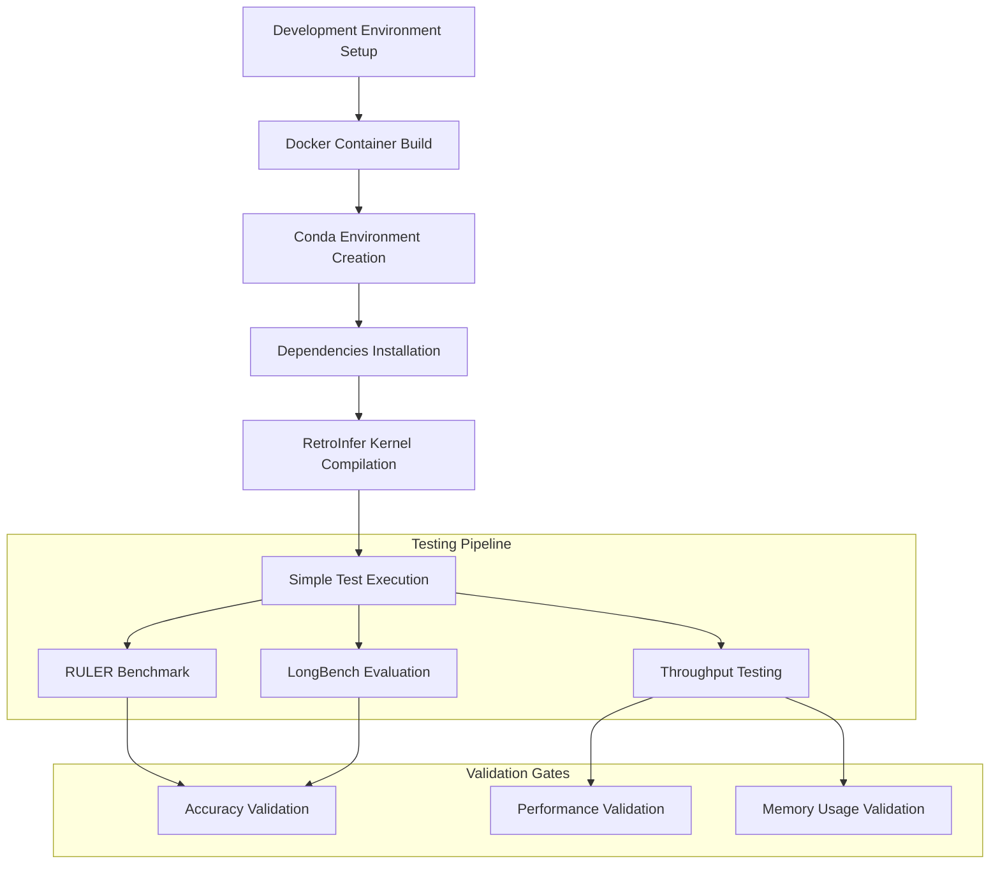
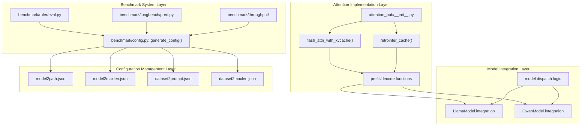
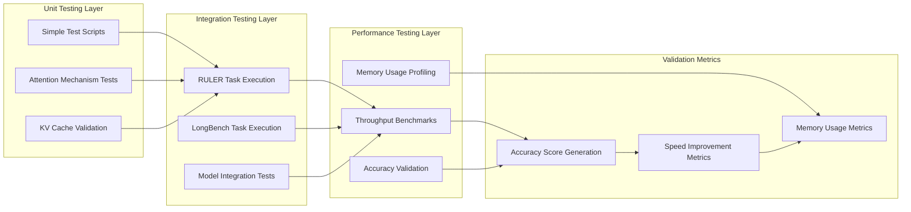

<!-- source: DeepWiki mcp.deepwiki.com · repo microsoft/RetrievalAttention · page 6 Development and Contributing · fetched 2026-10-26 -->

# Development and Contributing

Relevant source files

The following files were used as context for generating this wiki page:

- [CODE_OF_CONDUCT.md](CODE_OF_CONDUCT.md)
- [SUPPORT.md](SUPPORT.md)

This document provides guidance for developers who want to contribute to the RetroInfer project. It covers the development workflow, project structure, testing procedures, and contribution guidelines. 

For information about getting help and reporting issues, see [Getting Support](#6.1). For security-related concerns, see [Security](#6.2). For community guidelines and behavioral expectations, see [Code of Conduct](#6.3).

## Development Workflow

The RetroInfer project follows a structured development workflow that integrates testing, benchmarking, and deployment considerations. The development process centers around the core attention mechanisms and their integration with various model architectures.

### Development Environment Pipeline

**Sources:** README.md, development environment setup procedures

### Key Development Components

The development workflow involves several critical components that contributors should understand:

| Component | Location | Purpose |
|-----------|----------|---------|
| Attention Hub | `attention_hub/` | Core attention mechanism implementations |
| Wave Index | RetroInfer kernels | Attention-aware vector indexing |
| Wave Buffer | RetroInfer kernels | GPU-CPU coordination and overlap |
| Benchmarking | `benchmark/` | Performance evaluation and validation |
| Configuration | `benchmark/config.py` | System configuration management |

## Project Structure for Contributors

Understanding the codebase structure is essential for effective contribution. The project is organized around core attention mechanisms, benchmarking systems, and configuration management.

### Core Code Entity Architecture

**Sources:** attention_hub structure, benchmark/config.py, benchmark/ruler/eval.py, benchmark/longbench/pred.py

### Critical Code Paths for Contributors

Contributors should focus on these key areas when making modifications:

1. **Attention Mechanisms**: The `attention_hub/` directory contains the core attention implementations that interface with `flash_attn_with_kvcache()` and `retroinfer_cache()` functions.

2. **Benchmarking Scripts**: The `benchmark/` directory structure includes evaluation scripts that call specific functions like `generate_config()` in [benchmark/config.py]().

3. **Model Configuration**: JSON configuration files managed through [benchmark/config.py]() that define model paths, maximum lengths, and dataset prompts.

4. **Evaluation Pipelines**: Scripts in [benchmark/ruler/eval.py]() and [benchmark/longbench/pred.py]() that orchestrate the testing process.

## Testing and Validation Process

The RetroInfer project employs a comprehensive testing strategy that validates both correctness and performance across multiple dimensions.

### Testing Pipeline Architecture

**Sources:** README.md testing procedures, benchmark/ruler/eval.py, benchmark/longbench/pred.py

### Test Execution Framework

The testing process follows a structured approach:

1. **Simple Testing**: Execute basic functionality tests with 4 batch size and 120K tokens to verify core operations.

2. **RULER Benchmark**: Run synthetic task evaluation using [benchmark/ruler/eval.py]() with tasks defined in `constants.py`.

3. **LongBench Evaluation**: Execute real-world task evaluation through [benchmark/longbench/pred.py]() and [benchmark/longbench/eval.py]().

4. **Throughput Testing**: Measure performance improvements using multi-GPU configurations and NUMA-aware settings.

### Validation Criteria

Contributors should ensure their changes meet these validation criteria:

| Metric | Baseline | Target | Test Command |
|--------|----------|---------|-------------|
| Accuracy | Flash Attention baseline | ≥99% of baseline | RULER + LongBench evaluation |
| Throughput | Flash Attention baseline | 4.5x-10.5x improvement | Throughput benchmarks |
| Memory Usage | Variable by model | GPU ~25GB, CPU ~67GB | Memory profiling |

## Contributing Guidelines

### Code Contribution Process

1. **Fork and Branch**: Create a feature branch from the main repository
2. **Development**: Implement changes following the existing code patterns
3. **Testing**: Run the full test suite including RULER and LongBench evaluations
4. **Documentation**: Update relevant documentation and code comments
5. **Pull Request**: Submit PR with detailed description of changes

### Code Quality Standards

- Follow existing code organization patterns in `attention_hub/` and `benchmark/`
- Maintain compatibility with existing configuration files in [benchmark/config.py]()
- Ensure all attention mechanism changes preserve the interface contracts
- Include appropriate error handling and logging

### Documentation Requirements

- Update README.md for significant feature additions
- Maintain inline code documentation for complex attention mechanisms
- Update configuration documentation for new model or dataset support
- Provide examples for new benchmarking capabilities

**Sources:** [SUPPORT.md:1-14](), [CODE_OF_CONDUCT.md:1-10]()

## Support and Community

The RetroInfer project provides multiple channels for developer support and community engagement.

### Issue Tracking and Support

The project uses GitHub Issues for bug tracking and feature requests. Before filing new issues, contributors should search existing issues to avoid duplicates as outlined in [SUPPORT.md:5-7](). For help with using the project, refer to the main documentation in README.md.

### Community Guidelines

This project follows the [Microsoft Open Source Code of Conduct](https://opensource.microsoft.com/codeofconduct) as specified in [CODE_OF_CONDUCT.md:3](). Contributors should familiarize themselves with these guidelines and direct questions to [opencode@microsoft.com](mailto:opencode@microsoft.com) as needed.

### Development Support Resources

- **Documentation**: Primary reference in README.md for setup and usage
- **Issue Tracking**: GitHub Issues for bugs and feature requests  
- **Code of Conduct**: Microsoft Open Source Code of Conduct for community guidelines
- **Security**: Dedicated security policy for vulnerability reporting

**Sources:** [SUPPORT.md:1-14](), [CODE_OF_CONDUCT.md:1-10]()

---

