# Page: Overview

# Overview

<details>
<summary>Relevant source files</summary>

The following files were used as context for generating this wiki page:

- [README.md](README.md)
- [Transparency_FAQ.md](Transparency_FAQ.md)

</details>


This document provides an overview of RetroInfer, a novel system for accelerating long-context Large Language Model (LLM) inference through vector storage optimization and GPU-CPU co-execution. This page covers the system's core concepts, architecture, and performance characteristics.

For detailed setup instructions, see [Setup and Installation](#4). For specific usage examples and testing procedures, see [Usage Examples](#5). For technical implementation details of the attention mechanisms, see [Attention Mechanisms](#2).

## What is RetroInfer?

RetroInfer is a research system that **rethinks the KV cache as vector storage** to accelerate long-context LLM inference. The system exploits the inherent sparsity of attention mechanisms and introduces two key innovations:

- **Wave Index**: An attention-aware vector index that enables efficient retrieval of critical tokens from the KV cache
- **Wave Buffer**: A coordination system that manages KV cache placement and overlaps computation with data transfer across GPU and CPU

The system achieves 4.5x–10.5x improvements in decoding throughput over FlashAttention without accuracy loss, making it particularly effective for long-context scenarios (~120K tokens).

## Core System Architecture

### RetroInfer Components and Data Flow

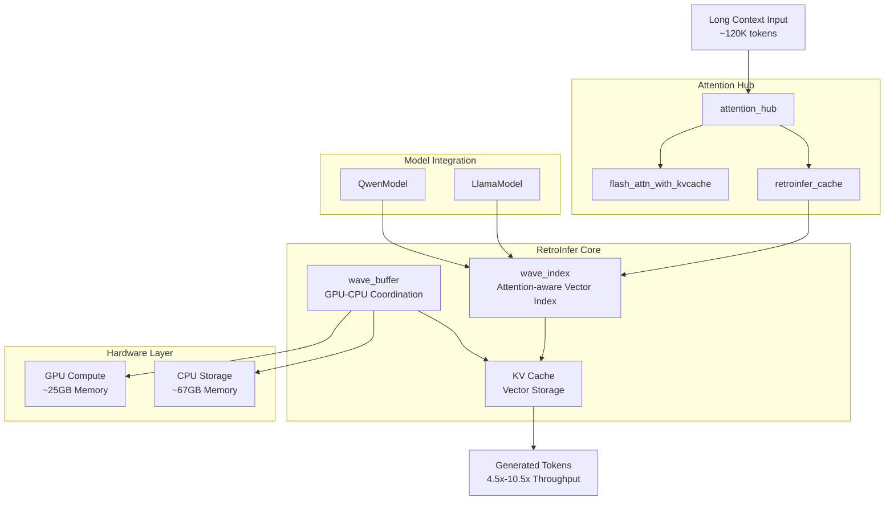

Sources: [README.md:1-129](), [Transparency_FAQ.md:1-22]()

### Key Configuration Parameters

RetroInfer operates with two primary configuration parameters that control its behavior:

| Parameter | Default Value | Description |
|-----------|---------------|-------------|
| `retrieval_budget_ratio` | 0.018 | Ratio of tokens retrieved from KV cache to total input tokens |
| `attention_estimate_ratio` | 0.232 | Ratio of clusters estimated in attention mechanism to total clusters |

Sources: [README.md:79-80](), [README.md:91-92]()

## Supported Models and Configurations

### Model Support Matrix

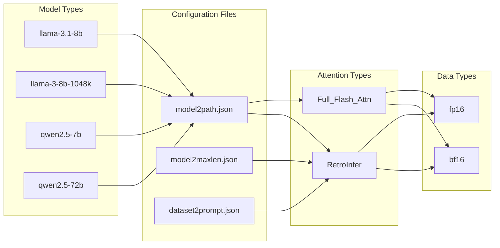

Sources: [README.md:73-74](), [README.md:78-79](), [README.md:89-90](), [README.md:93]()

## Performance Characteristics

### Throughput Improvements

RetroInfer delivers significant performance improvements across different scenarios:

- **Decoding Throughput**: 4.5x–10.5x improvement over FlashAttention
- **Memory Usage**: ~25GB GPU memory, ~67GB CPU memory for batch size 4
- **Context Length**: Optimized for ~120K token contexts
- **Accuracy**: Almost no change compared to full attention

### Hardware Requirements

The system is designed for GPU-CPU co-execution with specific hardware characteristics:

- **GPU**: Requires CUDA 12.4 compatibility
- **CPU**: Utilizes CPU memory for extended KV cache storage
- **Multi-GPU**: Automatic model splitting across visible GPUs
- **NUMA**: Optimized for multi-NUMA node configurations

Sources: [README.md:3-4](), [README.md:42](), [README.md:96](), [Transparency_FAQ.md:4]()

## Evaluation and Benchmarking

### Supported Benchmarks

RetroInfer has been evaluated on multiple benchmark systems:

| Benchmark | Tasks | Purpose |
|-----------|-------|---------|
| RULER | `niah_single_1/2/3`, `niah_multikey_1/2/3`, `vt`, `qa_1/2` | Synthetic evaluation tasks |
| LongBench | Various real-world tasks | Real-world scenario evaluation |
| Throughput | Custom scripts | Performance measurement |

### Evaluation Tasks

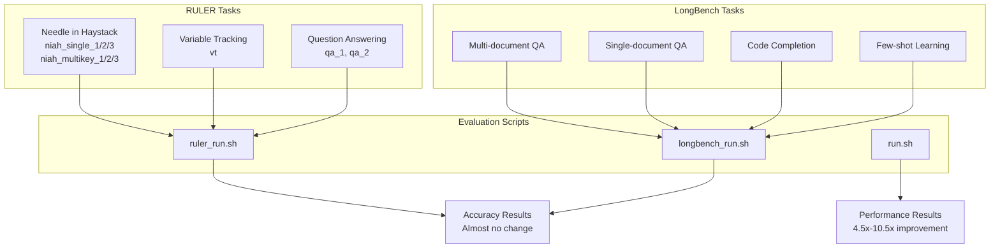

Sources: [README.md:61-81](), [README.md:82-94](), [README.md:95-104](), [Transparency_FAQ.md:12-14]()

## Integration Points

### Development Environment

RetroInfer integrates with the following components:

- **CUDA Environment**: Requires CUDA 12.4.1 with cuDNN support
- **Python Environment**: Python 3.10.16 with conda management
- **Dependencies**: flash-attn, flashinfer-python, custom RetroInfer kernels
- **Build System**: CUTLASS integration for kernel compilation

### Testing and Validation

The system provides multiple entry points for testing:

- **Simple Test**: `simple_test.py` for basic functionality verification
- **Benchmark Evaluation**: Integrated with RULER and LongBench frameworks
- **Throughput Testing**: NUMA-aware performance measurement scripts

Sources: [README.md:7-35](), [README.md:37-55]()

---

# Page: System Architecture

# System Architecture

<details>
<summary>Relevant source files</summary>

The following files were used as context for generating this wiki page:

- [README.md](README.md)
- [Transparency_FAQ.md](Transparency_FAQ.md)

</details>


## Purpose and Scope

This document provides a detailed technical overview of RetroInfer's core architectural components and their interactions. RetroInfer is a novel system that rethinks the KV cache as vector storage within a GPU-CPU co-execution setup to accelerate long-context LLM inference. 

This page covers the three primary architectural components: the wave index, wave buffer, and KV cache vector storage system. For information about specific attention implementations, see [Flash Attention](#2.1) and [RetroInfer Attention](#2.2). For performance characteristics and benchmarking details, see [Performance Benefits](#1.2).

## Core Components Overview

RetroInfer's architecture consists of three interconnected core components that work together to enable efficient long-context LLM inference:

### System Architecture Diagram

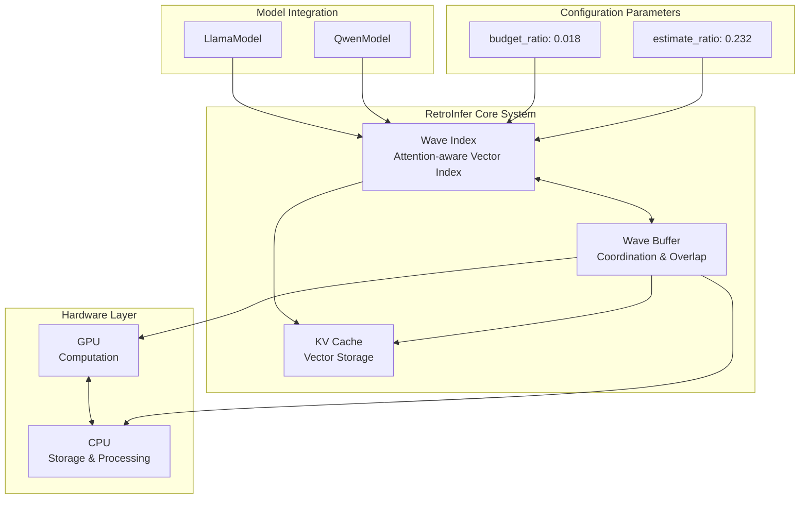

**Sources:** [README.md:1-80]()

## Wave Index Architecture

The wave index serves as an **A**ttention-a**W**are **VE**ctor index that enables efficient and accurate retrieval of critical tokens from the KV cache. It exploits the inherent sparsity of the attention mechanism to identify and index the most relevant tokens for each query.

### Wave Index Implementation

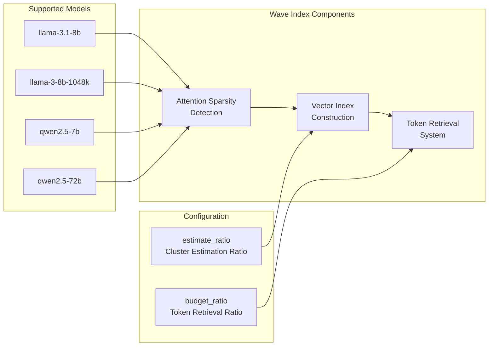

The wave index operates with two key parameters:
- **Budget Ratio** (0.018): Controls the ratio of tokens retrieved from the KV cache to the total input context tokens
- **Estimate Ratio** (0.232): Determines the ratio of clusters estimated in the attention mechanism to total clusters

**Sources:** [README.md:70-80]()

## Wave Buffer System

The wave buffer coordinates KV cache placement and overlaps computation and data transfer across GPU and CPU to sustain high throughput. It manages the complex orchestration between different memory hierarchies and processing units.

### Wave Buffer Coordination

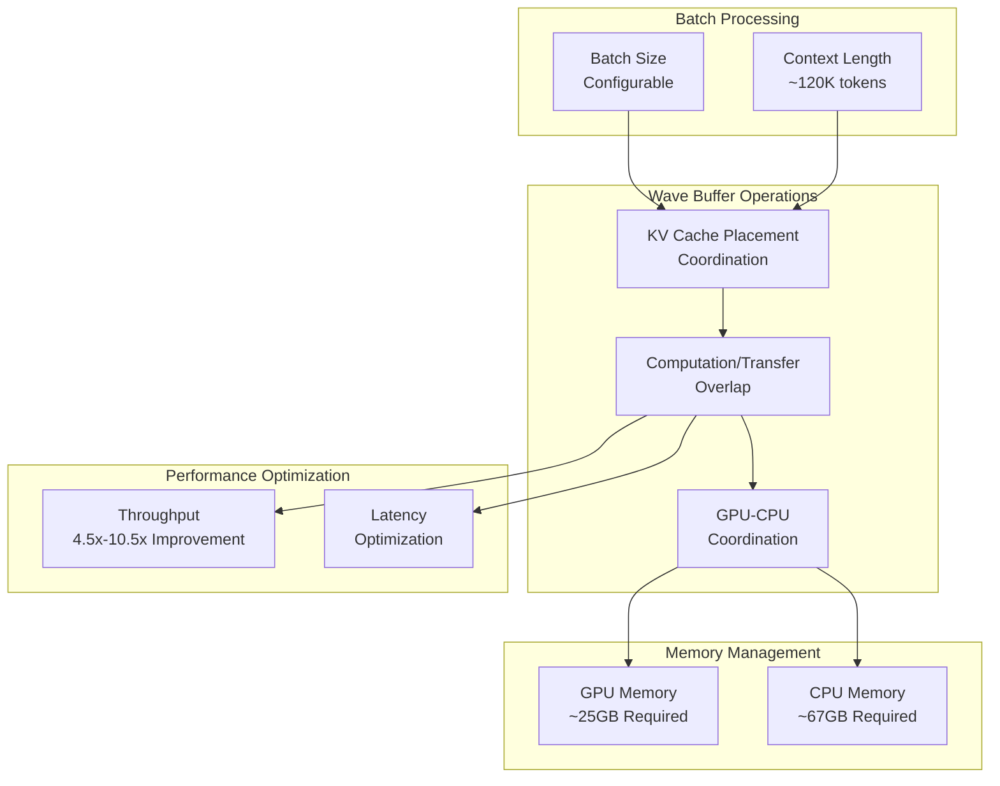

The wave buffer enables efficient processing by overlapping computation with data transfer, allowing the system to achieve significant throughput improvements while maintaining accuracy.

**Sources:** [README.md:3-4, 38-42]()

## KV Cache as Vector Storage

RetroInfer fundamentally rethinks the KV cache as vector storage, enabling efficient retrieval and management of key-value pairs across the GPU-CPU memory hierarchy.

### KV Cache Vector Storage Architecture

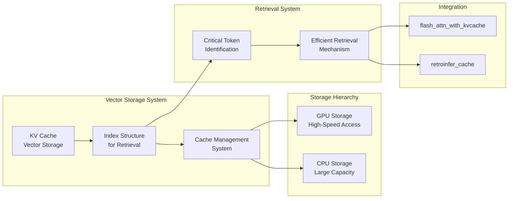

The vector storage approach enables the system to maintain critical tokens in easily accessible formats while managing the full context across the memory hierarchy.

**Sources:** [README.md:3-4]()

## GPU-CPU Co-execution Architecture

The system implements a sophisticated GPU-CPU co-execution model that maximizes hardware utilization while maintaining high throughput for long-context inference.

### Hardware Integration

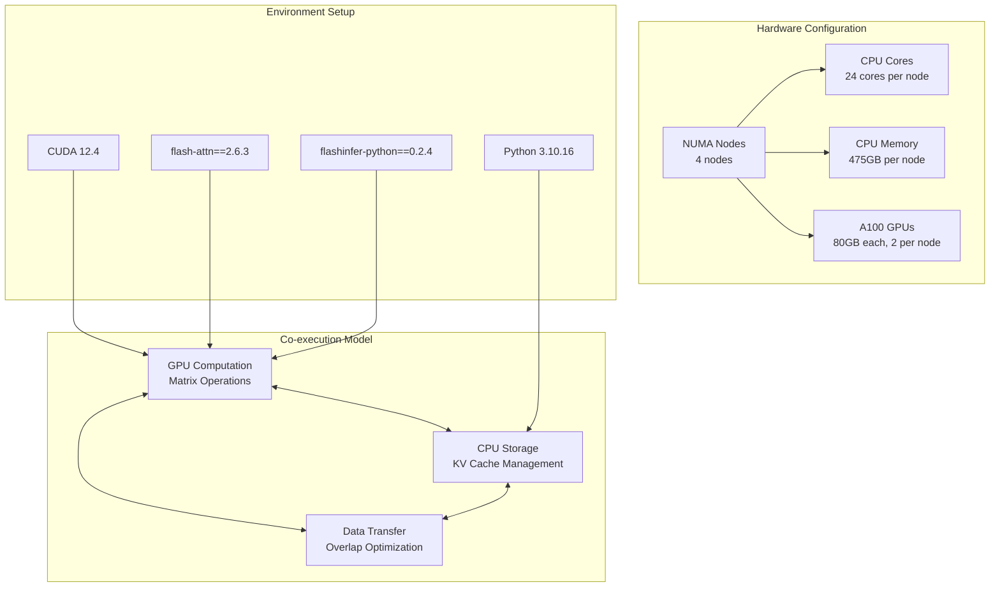

The co-execution model leverages NUMA-aware configuration to optimize memory access patterns and minimize data transfer overhead between GPU and CPU components.

**Sources:** [README.md:8-28, 96-104]()

## System Data Flow

The complete data flow through RetroInfer demonstrates how the three core components interact to process long-context inputs efficiently.

### End-to-End Processing Flow

```mermaid
graph LR
    subgraph "Input Processing"
        LongContext["Long Context Input<br/>~120K tokens"]
        TokenBatch["Token Batch<br/>batch_size=4"]
        
        LongContext --> TokenBatch
    end
    
    subgraph "Wave Index Processing"
        SparsityDetection["Attention Sparsity<br/>Detection"]
        VectorIndexing["Vector Indexing<br/>Construction"]
        TokenSelection["Critical Token<br/>Selection"]
        
        TokenBatch --> SparsityDetection
        SparsityDetection --> VectorIndexing
        VectorIndexing --> TokenSelection
    end
    
    subgraph "Wave Buffer Operations"
        GPUComputation["GPU Computation<br/>Parallel Processing"]
        CPUCoordination["CPU Coordination<br/>Memory Management"]
        TransferOverlap["Transfer Overlap<br/>Optimization"]
        
        TokenSelection --> GPUComputation
        TokenSelection --> CPUCoordination
        GPUComputation <--> TransferOverlap
        CPUCoordination <--> TransferOverlap
    end
    
    subgraph "KV Cache Management"
        VectorStorage["Vector Storage<br/>Retrieval System"]
        CacheRetrieval["Cache Retrieval<br/>Efficient Access"]
        
        TransferOverlap --> VectorStorage
        VectorStorage --> CacheRetrieval
    end
    
    subgraph "Output Generation"
        ThroughputGain["Throughput Gain<br/>4.5x-10.5x"]
        AccuracyMaintained["Accuracy<br/>Maintained"]
        
        CacheRetrieval --> ThroughputGain
        CacheRetrieval --> AccuracyMaintained
    end
```

The data flow demonstrates how RetroInfer processes long-context inputs through its three core components while maintaining high accuracy and achieving significant throughput improvements.

**Sources:** [README.md:38-42, 70-80]()

## Integration Points

RetroInfer integrates with existing LLM infrastructure through well-defined interfaces and supports multiple model architectures and attention mechanisms.

### Model and Attention Integration

| Component | Supported Models | Integration Method |
|-----------|------------------|-------------------|
| Wave Index | llama-3.1-8b, llama-3-8b-1048k | Direct model integration |
| Wave Buffer | qwen2.5-7b, qwen2.5-72b | GPU-CPU coordination |
| KV Cache | All supported models | Vector storage interface |

### Configuration Parameters

| Parameter | Default Value | Purpose |
|-----------|---------------|---------|
| `budget_ratio` | 0.018 | Controls token retrieval ratio |
| `estimate_ratio` | 0.232 | Determines cluster estimation ratio |
| `batch_size` | 4 | Configurable batch processing size |
| `context_length` | ~120K tokens | Maximum context length support |

**Sources:** [README.md:70-80]()

---

# Page: Performance Benefits

# Performance Benefits

<details>
<summary>Relevant source files</summary>

The following files were used as context for generating this wiki page:

- [README.md](README.md)
- [Transparency_FAQ.md](Transparency_FAQ.md)

</details>


This document explains the performance improvements achieved by RetroInfer, including throughput gains, memory efficiency, and hardware utilization optimizations. For detailed system architecture information, see [System Architecture](#1.1). For benchmarking methodology and evaluation details, see [Benchmarking and Evaluation](#3).

## Throughput Improvements

RetroInfer achieves significant throughput improvements over traditional Flash Attention implementations through its novel approach to KV cache management and GPU-CPU co-execution.

### Decoding Throughput Gains

RetroInfer delivers **4.5x to 10.5x improvements** in decoding throughput compared to FlashAttention while maintaining accuracy. These gains are achieved through:

- **Sparse attention exploitation**: The `wave index` efficiently identifies and retrieves only critical tokens from the KV cache
- **Overlapped computation**: The `wave buffer` coordinates computation and data transfer between GPU and CPU
- **Vector storage optimization**: Treating the KV cache as vector storage enables efficient retrieval operations

#### Performance Scaling by Context Length

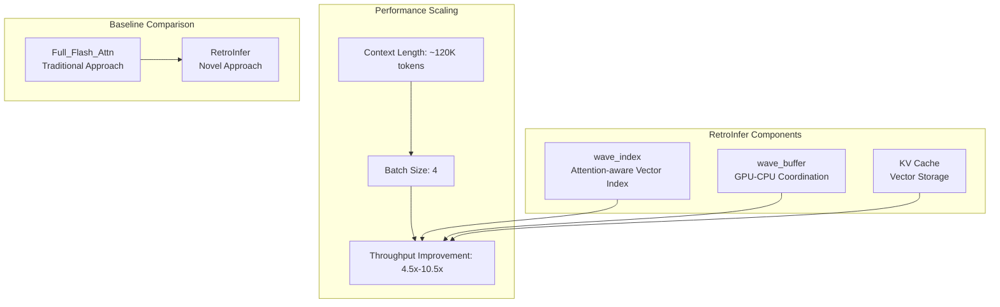

Sources: [README.md:1-4](), [README.md:38-42]()

## Memory Efficiency

RetroInfer optimizes memory usage across both GPU and CPU resources, enabling efficient processing of long-context scenarios.

### Resource Requirements

| Component | Memory Usage | Details |
|-----------|-------------|---------|
| **GPU Memory** | ~25GB | Primary computation and active KV cache |
| **CPU Memory** | ~67GB | Extended KV cache storage and coordination |
| **Total System** | ~92GB | Combined GPU-CPU memory for 120K token contexts |

### Memory Optimization Strategies

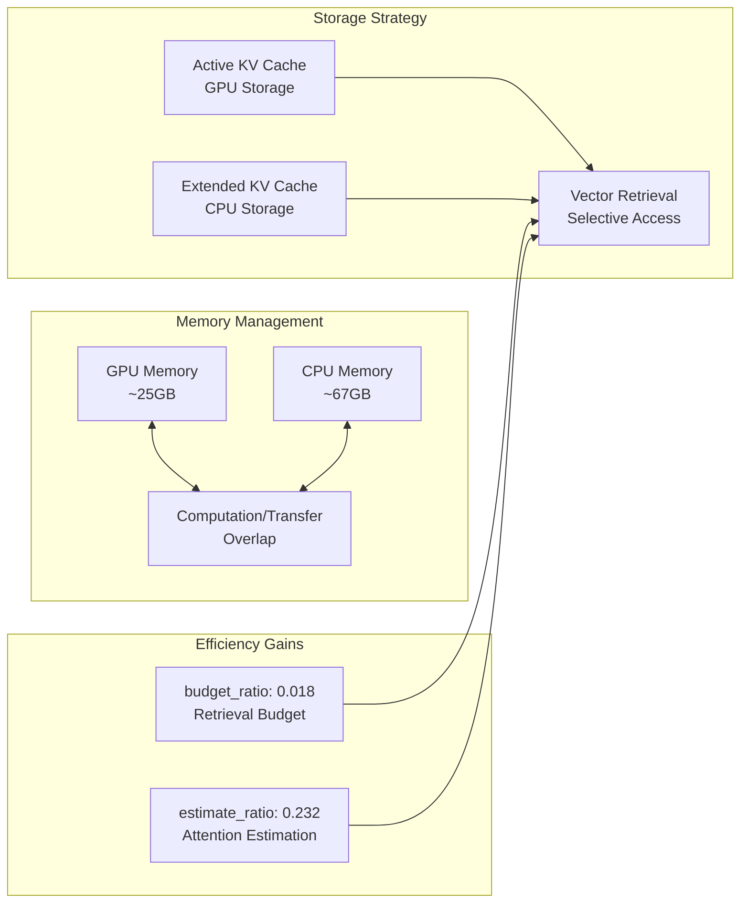

Sources: [README.md:42](), [README.md:79-80]()

## System-Level Performance Optimizations

RetroInfer implements several key optimizations that work together to achieve its performance benefits.

### Wave Index Performance

The attention-aware vector index (`wave index`) provides efficient token retrieval by:

- **Exploiting attention sparsity**: Only critical tokens are retrieved from the full KV cache
- **Vector-based lookup**: Treats KV cache as searchable vector storage
- **Selective processing**: Reduces computational overhead through targeted retrieval

### Wave Buffer Coordination

The `wave buffer` system optimizes performance through:

- **GPU-CPU coordination**: Manages data placement across memory hierarchies
- **Computation overlap**: Overlaps data transfer with computation operations
- **Throughput sustainability**: Maintains high performance across long sequences

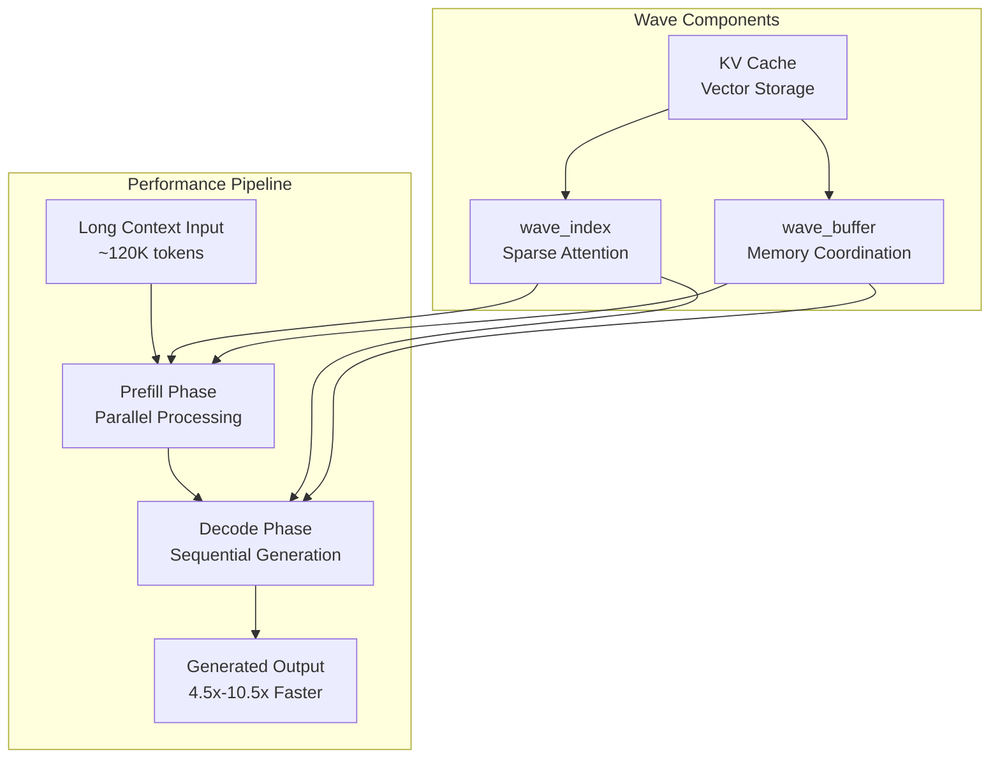

Sources: [README.md:3](), [Transparency_FAQ.md:4]()

## Hardware Utilization

RetroInfer is optimized for multi-GPU systems with NUMA-aware configuration, maximizing hardware resource utilization.

### Target Hardware Configuration

RetroInfer was evaluated on Azure virtual machines with the following specifications:

- **4 NUMA nodes** with 24 CPU cores each
- **475 GB CPU memory** per NUMA node
- **Two 80GB A100 GPUs** per NUMA node
- **Multi-GPU support** with automatic model splitting

### GPU Resource Management

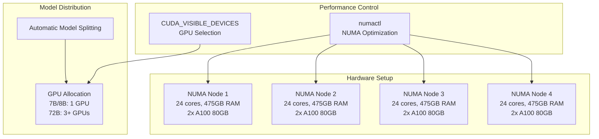

Sources: [README.md:96-97](), [README.md:59](), [README.md:98-99]()

## Performance Tuning Parameters

RetroInfer provides configurable parameters that directly impact performance characteristics.

### Key Performance Parameters

| Parameter | Default Value | Purpose | Performance Impact |
|-----------|---------------|---------|-------------------|
| **`budget_ratio`** | 0.018 | Retrieval budget ratio | Controls token retrieval volume |
| **`estimate_ratio`** | 0.232 | Attention estimation ratio | Controls cluster estimation scope |
| **`batch_size`** | 4 | Processing batch size | Affects memory usage and throughput |

### Parameter Tuning for Performance

The performance parameters can be adjusted based on specific use cases:

- **Higher `budget_ratio`**: Increases accuracy but reduces throughput
- **Lower `budget_ratio`**: Maximizes throughput with minimal accuracy impact
- **`estimate_ratio`**: Balances attention computation efficiency
- **`batch_size`**: Scales with available memory resources

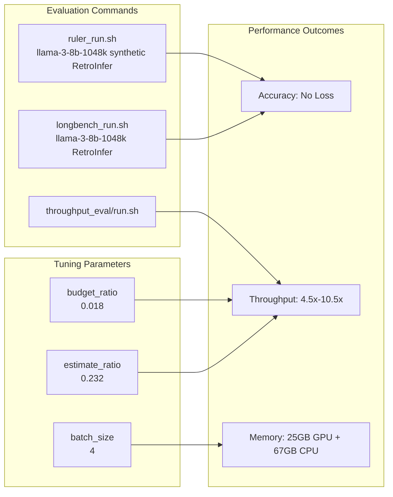

Sources: [README.md:70-71](), [README.md:86-87](), [README.md:79-80]()

## Benchmarking Results

RetroInfer maintains accuracy while achieving significant performance improvements across standard benchmarks.

### Evaluation Metrics

- **RULER benchmark**: Synthetic tasks with variable context lengths
- **LongBench**: Real-world long-context evaluation tasks
- **Throughput evaluation**: Performance measurement scripts

### Accuracy Preservation

RetroInfer achieves its performance benefits while maintaining model accuracy:

- **No accuracy loss** on standard benchmarks
- **Consistent performance** across different context lengths
- **Minimal impact** on model quality metrics

Sources: [README.md:61-81](), [README.md:82-94](), [Transparency_FAQ.md:13-14]()

---

# Page: Attention Mechanisms

# Attention Mechanisms

<details>
<summary>Relevant source files</summary>

The following files were used as context for generating this wiki page:

- [attn_hub/__init__.py](attn_hub/__init__.py)

</details>


## Purpose and Scope

This document provides an overview of the attention mechanisms implemented in the RetroInfer system. The attention hub serves as the central coordination layer that provides different attention implementations for long-context LLM inference. This page covers the high-level architecture and integration of attention mechanisms, while detailed implementation specifics are covered in [Flash Attention](#2.1) and [RetroInfer Attention](#2.2).

For information about the broader system architecture that these attention mechanisms support, see [System Architecture](#1.1). For performance benchmarking of these attention implementations, see [Benchmarking and Evaluation](#3).

## Attention Hub Architecture

The attention hub provides a unified interface for different attention implementations, supporting both prefill and decode phases of inference. The system is designed to allow seamless switching between attention mechanisms while maintaining consistent interfaces.

### Attention Hub Structure

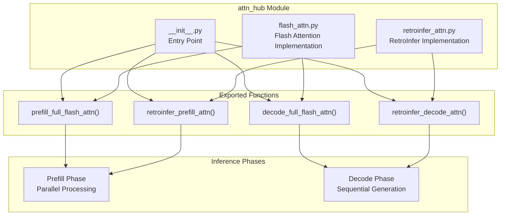

Sources: [attn_hub/__init__.py:1-3]()

## Attention Implementation Types

The RetroInfer system provides two primary attention implementations, each optimized for different use cases and performance characteristics.

### Implementation Comparison

| Aspect | Flash Attention | RetroInfer Attention |
|--------|----------------|---------------------|
| Purpose | Baseline/Full attention | Sparse attention with caching |
| Memory Usage | Higher (full attention) | Lower (selective attention) |
| Throughput | Standard | 4.5x-10.5x improvement |
| Accuracy | Full precision | Minimal degradation |
| Implementation | `flash_attn` module | `retroinfer_attn` module |

### Function Interface Pattern

Both attention implementations follow a consistent interface pattern with separate functions for prefill and decode phases:

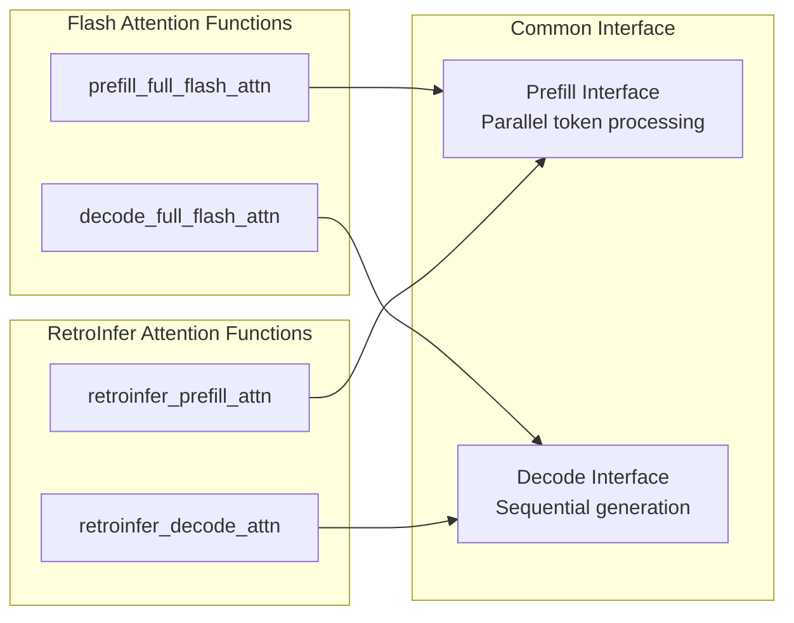

Sources: [attn_hub/__init__.py:2-3]()

## Integration with Model Processing

The attention hub integrates with the broader RetroInfer system to provide attention computation for different model architectures and processing phases.

### System Integration Flow

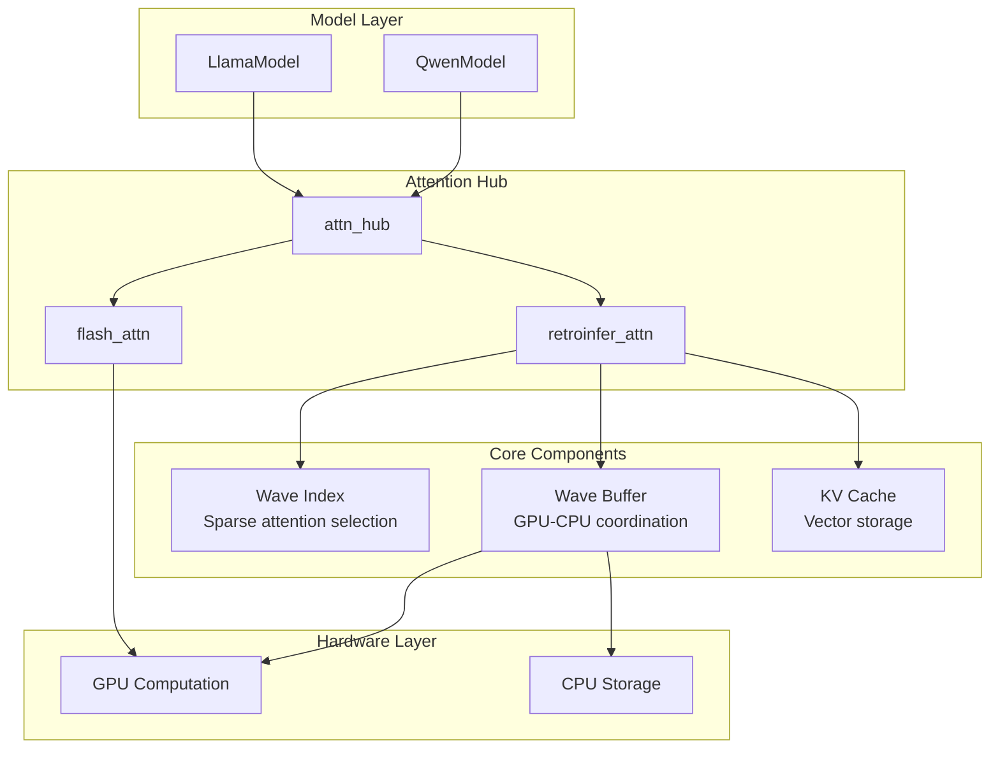

Sources: [attn_hub/__init__.py:1-3]()

## Usage Patterns

The attention hub is designed to support different usage patterns depending on the performance requirements and accuracy needs of the application.

### Selection Criteria

The choice between attention implementations depends on several factors:

- **Full Flash Attention**: Used for baseline comparisons and when maximum accuracy is required
- **RetroInfer Attention**: Used for production inference where throughput optimization is critical

### Configuration Integration

The attention mechanisms integrate with the broader configuration system to support different model and dataset combinations. Configuration parameters such as `budget_ratio` and `estimate_ratio` control the behavior of the RetroInfer attention implementation.

Sources: [attn_hub/__init__.py:1-3]()

---

# Page: Flash Attention

# Flash Attention

<details>
<summary>Relevant source files</summary>

The following files were used as context for generating this wiki page:

- [attn_hub/flash_attn.py](attn_hub/flash_attn.py)

</details>


## Purpose and Scope

This document covers the Flash Attention implementation in the RetroInfer system, which serves as a baseline attention mechanism for comparison with RetroInfer's optimized attention approach. Flash Attention provides full attention computation for both prefill and decode phases using the external `flash_attn` library.

For information about RetroInfer's optimized attention implementation, see [RetroInfer Attention](#2.2). For the overall attention system architecture, see [Attention Mechanisms](#2).

## Overview

Flash Attention in RetroInfer is implemented as a wrapper around the external `flash_attn_with_kvcache` function from the `flash_attn` library. It provides two main functions for handling different phases of LLM inference:

| Function | Purpose | Phase |
|----------|---------|--------|
| `prefill_full_flash_attn` | Processes initial input tokens in parallel | Prefill |
| `decode_full_flash_attn` | Generates tokens sequentially with cache | Decode |

The implementation maintains compatibility with the RetroInfer system's attention hub architecture while providing full attention computation as a performance baseline.

**Sources:** [attn_hub/flash_attn.py:1-29]()

## Flash Attention Architecture

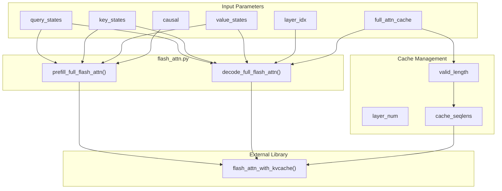

**Sources:** [attn_hub/flash_attn.py:1-29]()

## Prefill Phase Implementation

The `prefill_full_flash_attn` function handles the initial processing of input tokens during the prefill phase. It takes the following parameters:

- `query_states`: Query tensor for attention computation
- `key_states`: Key tensor for attention computation  
- `value_states`: Value tensor for attention computation
- `causal`: Boolean flag indicating whether to use causal (unidirectional) attention

The function directly calls `flash_attn_with_kvcache` with these parameters and returns the attention output.

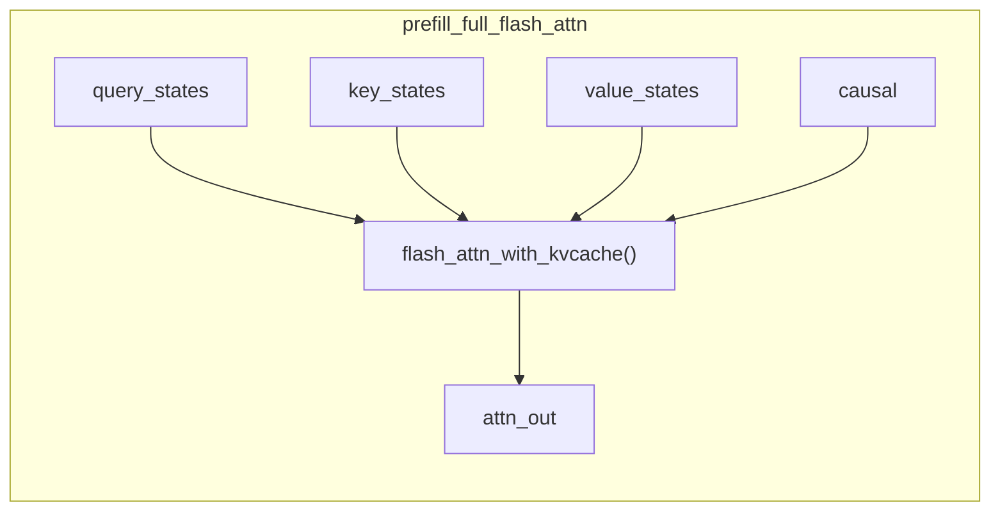

**Sources:** [attn_hub/flash_attn.py:4-13]()

## Decode Phase Implementation

The `decode_full_flash_attn` function handles sequential token generation during the decode phase. It includes additional cache management logic:

### Parameters
- `query_states`: Query tensor for the current token
- `key_states`: Key cache containing all previous keys
- `value_states`: Value cache containing all previous values
- `layer_idx`: Current layer index for cache validation
- `full_attn_cache`: Cache object containing validity information

### Cache Length Calculation

The function calculates the valid cache length using conditional logic:

```
valid_len = full_attn_cache.valid_length + 1 if layer_idx < full_attn_cache.layer_num - 1 else full_attn_cache.valid_length
```

This ensures proper cache synchronization across layers during decode.

**Sources:** [attn_hub/flash_attn.py:17-28]()

## Integration with Attention Hub

Flash Attention integrates into the RetroInfer attention hub system as one of the available attention mechanisms. The system architecture allows switching between Flash Attention and RetroInfer Attention based on configuration.

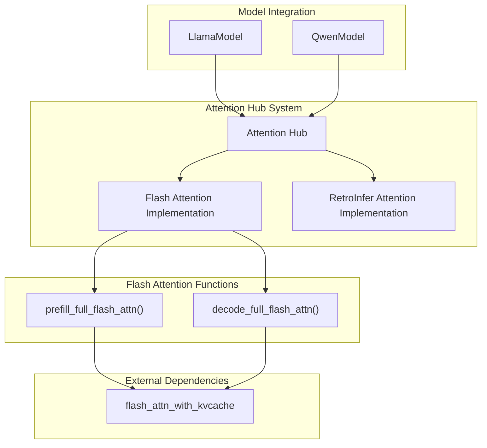

**Sources:** [attn_hub/flash_attn.py:1-29]()

## Function Signatures and Usage

### prefill_full_flash_attn

```python
def prefill_full_flash_attn(query_states, key_states, value_states, causal):
```

**Parameters:**
- `query_states`: Tensor containing query vectors
- `key_states`: Tensor containing key vectors
- `value_states`: Tensor containing value vectors
- `causal`: Boolean for causal attention masking

**Returns:** Attention output tensor

### decode_full_flash_attn

```python
def decode_full_flash_attn(query_states, key_states, value_states, layer_idx, full_attn_cache):
```

**Parameters:**
- `query_states`: Query tensor for current token
- `key_states`: Key cache tensor
- `value_states`: Value cache tensor
- `layer_idx`: Current layer index
- `full_attn_cache`: Cache management object

**Returns:** Attention output tensor

**Sources:** [attn_hub/flash_attn.py:4-13](), [attn_hub/flash_attn.py:17-28]()

## Performance Characteristics

Flash Attention serves as the baseline implementation for performance comparisons in the RetroInfer system. While it provides full attention computation, it lacks the memory and computational optimizations found in RetroInfer's attention mechanism.

Key characteristics:
- **Full Attention**: Computes attention over all input tokens
- **Memory Usage**: Higher memory consumption due to full attention matrices
- **Throughput**: Lower throughput compared to RetroInfer's optimized approach
- **Accuracy**: Maintains full model accuracy as baseline reference

The system uses Flash Attention results to validate that RetroInfer's optimized attention maintains comparable accuracy while achieving significant performance improvements.

**Sources:** [attn_hub/flash_attn.py:1-29]()

---

# Page: RetroInfer Attention

# RetroInfer Attention

<details>
<summary>Relevant source files</summary>

The following files were used as context for generating this wiki page:

- [attn_hub/retroinfer_attn.py](attn_hub/retroinfer_attn.py)

</details>


This document covers the RetroInfer attention implementation, which provides the core attention computation mechanism for the RetroInfer system. This includes both prefill and decode phase attention functions that work with the RetroInfer cache system to enable efficient long-context inference.

For information about the alternative Flash Attention implementation, see [Flash Attention](#2.1). For details about the overall attention mechanisms framework, see [Attention Mechanisms](#2).

## Overview

The RetroInfer attention system consists of two main phases implemented in [`attn_hub/retroinfer_attn.py`](attn_hub/retroinfer_attn.py:1-24)(). The prefill phase uses standard flash attention for parallel processing of the initial context, while the decode phase leverages the RetroInfer cache system for efficient sequential token generation.

### Architecture Flow

```mermaid
graph TD
    subgraph "RetroInfer Attention Flow"
        INPUT["Input Tokens"]
        PHASE_CHECK{"Phase?"}
        
        PREFILL_FUNC["retroinfer_prefill_attn()"]
        DECODE_FUNC["retroinfer_decode_attn()"]
        
        FLASH_ATTN["flash_attn_with_kvcache()"]
        RETROINFER_CACHE["retroinfer_cache.compute()"]
        
        OUTPUT["Attention Output"]
    end
    
    INPUT --> PHASE_CHECK
    PHASE_CHECK -->|"Prefill"| PREFILL_FUNC
    PHASE_CHECK -->|"Decode"| DECODE_FUNC
    
    PREFILL_FUNC --> FLASH_ATTN
    DECODE_FUNC --> RETROINFER_CACHE
    
    FLASH_ATTN --> OUTPUT
    RETROINFER_CACHE --> OUTPUT
```

*Sources: attn_hub/retroinfer_attn.py*

## Prefill Phase Implementation

The prefill phase handles the initial processing of the full context sequence using parallel attention computation. This is implemented in the `retroinfer_prefill_attn` function.

### Function Signature and Usage

| Parameter | Type | Description |
|-----------|------|-------------|
| `query_states` | Tensor | Query tensor for attention computation |
| `key_states` | Tensor | Key tensor for attention computation |
| `value_states` | Tensor | Value tensor for attention computation |
| `causal` | bool | Whether to apply causal masking |

The prefill function delegates to the standard Flash Attention implementation:

```mermaid
graph LR
    subgraph "Prefill Phase"
        QUERY["query_states"]
        KEY["key_states"] 
        VALUE["value_states"]
        CAUSAL["causal"]
        
        RETROINFER_PREFILL["retroinfer_prefill_attn()"]
        FLASH_CALL["flash_attn_with_kvcache()"]
        ATTN_OUT["attn_out"]
    end
    
    QUERY --> RETROINFER_PREFILL
    KEY --> RETROINFER_PREFILL
    VALUE --> RETROINFER_PREFILL
    CAUSAL --> RETROINFER_PREFILL
    
    RETROINFER_PREFILL --> FLASH_CALL
    FLASH_CALL --> ATTN_OUT
```

*Sources: attn_hub/retroinfer_attn.py*

The implementation at [attn_hub/retroinfer_attn.py:4-13]() shows that prefill attention is a thin wrapper around `flash_attn_with_kvcache`, maintaining compatibility with the Flash Attention API while providing a consistent interface for the RetroInfer system.

## Decode Phase Implementation

The decode phase handles sequential token generation using the RetroInfer cache system for efficient attention computation. This is implemented in the `retroinfer_decode_attn` function.

### Function Signature and Cache Integration

| Parameter | Type | Description |
|-----------|------|-------------|
| `query_states` | Tensor | Query tensor for current token |
| `key_states` | Tensor | Key tensor (unused in decode) |
| `value_states` | Tensor | Value tensor (unused in decode) |
| `layer_idx` | int | Current transformer layer index |
| `retroinfer_cache` | Cache | RetroInfer cache instance |

```mermaid
graph TB
    subgraph "Decode Phase Architecture"
        QUERY_IN["query_states"]
        LAYER_IDX["layer_idx"]
        CACHE["retroinfer_cache"]
        
        RETROINFER_DECODE["retroinfer_decode_attn()"]
        CACHE_COMPUTE["retroinfer_cache.compute()"]
        
        CONTIGUOUS["query_states.contiguous()"]
        ATTN_OUT["attn_out"]
    end
    
    QUERY_IN --> RETROINFER_DECODE
    LAYER_IDX --> RETROINFER_DECODE
    CACHE --> RETROINFER_DECODE
    
    RETROINFER_DECODE --> CONTIGUOUS
    CONTIGUOUS --> CACHE_COMPUTE
    LAYER_IDX --> CACHE_COMPUTE
    
    CACHE_COMPUTE --> ATTN_OUT
```

*Sources: attn_hub/retroinfer_attn.py*

The decode implementation at [attn_hub/retroinfer_attn.py:17-23]() demonstrates how the RetroInfer system bypasses traditional key-value processing during decode, instead relying on the cache system's `compute` method which manages the wave index and buffer coordination internally.

## Integration with RetroInfer Components

The RetroInfer attention functions integrate with the broader RetroInfer system through several key interfaces:

### Cache System Integration

```mermaid
graph TD
    subgraph "RetroInfer System Integration"
        RETROINFER_ATTN["retroinfer_decode_attn()"]
        CACHE_SYSTEM["retroinfer_cache"]
        
        WAVE_INDEX["Wave Index"]
        WAVE_BUFFER["Wave Buffer"]
        KV_CACHE["KV Cache"]
        
        GPU_COMPUTE["GPU Computation"]
        CPU_STORAGE["CPU Storage"]
    end
    
    RETROINFER_ATTN --> CACHE_SYSTEM
    CACHE_SYSTEM --> WAVE_INDEX
    CACHE_SYSTEM --> WAVE_BUFFER
    CACHE_SYSTEM --> KV_CACHE
    
    WAVE_BUFFER --> GPU_COMPUTE
    WAVE_BUFFER --> CPU_STORAGE
```

*Sources: attn_hub/retroinfer_attn.py*

### Memory Management

The attention functions are designed to work with the RetroInfer memory management system:

- **Prefill Phase**: Uses standard GPU memory allocation through Flash Attention
- **Decode Phase**: Leverages the wave buffer system for GPU-CPU memory coordination
- **Cache Management**: Relies on the RetroInfer cache to handle KV storage and retrieval

## API Reference

### retroinfer_prefill_attn

```python
def retroinfer_prefill_attn(query_states, key_states, value_states, causal)
```

Executes attention computation for the prefill phase using Flash Attention.

**Parameters:**
- `query_states`: Query tensor for attention computation
- `key_states`: Key tensor for attention computation  
- `value_states`: Value tensor for attention computation
- `causal`: Boolean flag for causal masking

**Returns:** Attention output tensor

### retroinfer_decode_attn

```python
def retroinfer_decode_attn(query_states, key_states, value_states, layer_idx, retroinfer_cache)
```

Executes attention computation for the decode phase using RetroInfer cache.

**Parameters:**
- `query_states`: Query tensor for current token
- `key_states`: Key tensor (unused)
- `value_states`: Value tensor (unused)
- `layer_idx`: Current transformer layer index
- `retroinfer_cache`: RetroInfer cache instance

**Returns:** Attention output tensor

*Sources: attn_hub/retroinfer_attn.py*

---

# Page: Benchmarking and Evaluation

# Benchmarking and Evaluation

<details>
<summary>Relevant source files</summary>

The following files were used as context for generating this wiki page:

- [benchmark/LongBench/eval.py](benchmark/LongBench/eval.py)
- [benchmark/ruler/data/prepare.py](benchmark/ruler/data/prepare.py)

</details>


This document covers the comprehensive benchmarking and evaluation system used to assess RetroInfer's performance compared to standard attention mechanisms. The system includes synthetic benchmarks, real-world task evaluations, and throughput measurements to validate both accuracy and efficiency improvements.

For information about the specific attention mechanisms being evaluated, see [Attention Mechanisms](#2). For setup instructions to run these benchmarks, see [Setup and Installation](#4).

## Overview

The RetroInfer benchmarking system consists of three primary evaluation frameworks that assess different aspects of the system's performance:

**Benchmark Architecture**
```mermaid
graph TB
    subgraph "Evaluation Frameworks"
        RULER["RULER Benchmark<br/>Synthetic Tasks"]
        LONGBENCH["LongBench Evaluation<br/>Real-world Tasks"]
        THROUGHPUT["Throughput Testing<br/>Performance Metrics"]
    end
    
    subgraph "Configuration System"
        CONFIG["benchmark/config.py<br/>generate_config()"]
        MODEL2PATH["config/model2path.json"]
        DATASET2PROMPT["config/dataset2prompt.json"]
    end
    
    subgraph "Target Systems"
        RETROINFER["RetroInfer Attention<br/>budget_ratio: 0.018"]
        FLASH_ATTN["Full_Flash_Attn<br/>Baseline"]
    end
    
    subgraph "Evaluation Metrics"
        ACCURACY["Accuracy Metrics<br/>F1, ROUGE, Classification"]
        SPEED["Throughput Metrics<br/>4.5x-10.5x improvement"]
        MEMORY["Memory Usage<br/>GPU/CPU allocation"]
    end
    
    RULER --> CONFIG
    LONGBENCH --> CONFIG
    THROUGHPUT --> CONFIG
    
    CONFIG --> MODEL2PATH
    CONFIG --> DATASET2PROMPT
    
    MODEL2PATH --> RETROINFER
    MODEL2PATH --> FLASH_ATTN
    
    RETROINFER --> ACCURACY
    RETROINFER --> SPEED
    FLASH_ATTN --> ACCURACY
    FLASH_ATTN --> SPEED
    
    ACCURACY --> MEMORY
    SPEED --> MEMORY
```

Sources: [benchmark/LongBench/eval.py:82-122](), [benchmark/ruler/data/prepare.py:67-141]()

## Supported Models and Attention Types

The benchmarking system supports evaluation across multiple model architectures and attention mechanisms:

| Model | Max Length | Attention Types |
|-------|------------|----------------|
| `llama-3-8b-1048k` | 1048576 | RetroInfer, Full_Flash_Attn |
| `llama-3.1-8b` | 131072 | RetroInfer, Full_Flash_Attn |
| `qwen2.5-7b` | 131072 | RetroInfer, Full_Flash_Attn |
| `qwen2.5-72b` | 131072 | RetroInfer, Full_Flash_Attn |

The system compares RetroInfer attention against Full Flash Attention as the baseline across all supported models.

Sources: [benchmark/LongBench/eval.py:44-48]()

## LongBench Evaluation System

LongBench provides real-world task evaluation through the `benchmark/LongBench/eval.py` script, which implements a comprehensive scoring system for various task types:

**Dataset to Metric Mapping**
```mermaid
graph LR
    subgraph "Question Answering Tasks"
        QA_TASKS["narrativeqa<br/>qasper<br/>multifieldqa_en<br/>hotpotqa<br/>2wikimqa<br/>musique<br/>triviaqa"]
        QA_METRIC["qa_f1_score"]
        QA_TASKS --> QA_METRIC
    end
    
    subgraph "Summarization Tasks"
        SUM_TASKS["gov_report<br/>qmsum<br/>multi_news<br/>samsum"]
        SUM_METRIC["rouge_score"]
        SUM_TASKS --> SUM_METRIC
    end
    
    subgraph "Classification Tasks"
        CLASS_TASKS["trec<br/>lsht"]
        CLASS_METRIC["classification_score"]
        CLASS_TASKS --> CLASS_METRIC
    end
    
    subgraph "Code Tasks"
        CODE_TASKS["lcc<br/>repobench-p"]
        CODE_METRIC["code_sim_score"]
        CODE_TASKS --> CODE_METRIC
    end
    
    subgraph "Retrieval Tasks"
        RETR_TASKS["passage_retrieval_en<br/>passage_count"]
        RETR_METRIC["retrieval_score<br/>count_score"]
        RETR_TASKS --> RETR_METRIC
    end
```

The evaluation script processes prediction files from `results/pred/{model}/{attn_type}/` and generates comprehensive scores using the `dataset2metric` mapping defined in [benchmark/LongBench/eval.py:18-40]().

Sources: [benchmark/LongBench/eval.py:18-40](), [benchmark/LongBench/eval.py:82-122]()

## RULER Benchmark System

RULER generates synthetic benchmark data through the `benchmark/ruler/data/prepare.py` script, which supports multiple task types and model templates:

**RULER Data Generation Flow**
```mermaid
graph TD
    subgraph "Template System"
        TEMPLATES["Templates Dictionary<br/>base, meta-chat, vicuna-chat"]
        MODEL_TEMPLATE["model_template_type"]
        TASK_TEMPLATE["task_template"]
    end
    
    subgraph "Task Configuration"
        YAML_CONFIG["synthetic.yaml<br/>Task definitions"]
        CONSTANTS["synthetic/constants.py<br/>TASKS base config"]
        TASK_ARGS["Task-specific args"]
    end
    
    subgraph "Data Generation"
        PREPARE_SCRIPT["prepare.py<br/>main()"]
        TASK_SCRIPTS["synthetic/{task}.py<br/>Individual task generators"]
        SUBPROCESS["subprocess.run()<br/>Execute task script"]
    end
    
    subgraph "Output"
        JSONL_OUTPUT["task/subset.jsonl<br/>Generated samples"]
        SAMPLE_FORMAT["index, input, outputs"]
    end
    
    TEMPLATES --> MODEL_TEMPLATE
    MODEL_TEMPLATE --> PREPARE_SCRIPT
    YAML_CONFIG --> PREPARE_SCRIPT
    CONSTANTS --> PREPARE_SCRIPT
    PREPARE_SCRIPT --> TASK_SCRIPTS
    TASK_SCRIPTS --> SUBPROCESS
    SUBPROCESS --> JSONL_OUTPUT
    JSONL_OUTPUT --> SAMPLE_FORMAT
```

The system uses model-specific templates defined in [benchmark/ruler/data/prepare.py:50-64]() and generates data through task-specific Python scripts executed via subprocess calls.

Sources: [benchmark/ruler/data/prepare.py:50-64](), [benchmark/ruler/data/prepare.py:67-141]()

## Evaluation Metrics and Scoring

The benchmarking system implements multiple evaluation metrics imported from a metrics module:

**Metric Implementation**
```mermaid
graph TB
    subgraph "Scoring Functions"
        QA_F1["qa_f1_score<br/>qa_f1_zh_score"]
        ROUGE["rouge_score<br/>rouge_zh_score"]
        CLASSIFICATION["classification_score"]
        RETRIEVAL["retrieval_score<br/>retrieval_zh_score"]
        CODE_SIM["code_sim_score"]
        COUNT["count_score"]
    end
    
    subgraph "Evaluation Methods"
        SCORER["scorer()<br/>Standard evaluation"]
        SCORER_E["scorer_e()<br/>Length-based evaluation"]
    end
    
    subgraph "Length Categories"
        SHORT["0-4k tokens"]
        MEDIUM["4-8k tokens"]
        LONG["8k+ tokens"]
    end
    
    QA_F1 --> SCORER
    ROUGE --> SCORER
    CLASSIFICATION --> SCORER
    RETRIEVAL --> SCORER
    CODE_SIM --> SCORER
    COUNT --> SCORER
    
    SCORER --> SCORER_E
    SCORER_E --> SHORT
    SCORER_E --> MEDIUM
    SCORER_E --> LONG
```

The `scorer_e()` function in [benchmark/LongBench/eval.py:52-68]() provides length-based evaluation, categorizing performance by input length ranges for LongBench-E evaluation.

Sources: [benchmark/LongBench/eval.py:6-16](), [benchmark/LongBench/eval.py:52-68](), [benchmark/LongBench/eval.py:70-79]()

## Configuration Management

The benchmarking system relies on JSON configuration files to manage model paths, dataset prompts, and evaluation parameters:

**Configuration File Structure**
```mermaid
graph LR
    subgraph "Configuration Files"
        MODEL2PATH["model2path.json<br/>Model path mappings"]
        DATASET2PROMPT["dataset2prompt.json<br/>Task prompt templates"]
        MODEL2MAXLEN["model2maxlen.json<br/>Max sequence lengths"]
        DATASET2MAXLEN["dataset2maxlen.json<br/>Generation limits"]
    end
    
    subgraph "Runtime Configuration"
        ARGS_MODEL["args.model<br/>Model selection"]
        ARGS_ATTN["args.attn_type<br/>Attention method"]
        ARGS_E["args.e<br/>LongBench-E flag"]
    end
    
    subgraph "Result Paths"
        PRED_PATH["results/pred/{model}/{attn_type}/"]
        PRED_E_PATH["results/pred_e/{model}/{attn_type}/"]
        RESULT_JSON["result.json<br/>Final scores"]
    end
    
    MODEL2PATH --> ARGS_MODEL
    ARGS_MODEL --> PRED_PATH
    ARGS_ATTN --> PRED_PATH
    ARGS_E --> PRED_E_PATH
    PRED_PATH --> RESULT_JSON
    PRED_E_PATH --> RESULT_JSON
```

The configuration system loads model paths from JSON files and constructs result paths based on model and attention type selections, as implemented in [benchmark/LongBench/eval.py:87-93]().

Sources: [benchmark/LongBench/eval.py:87-93](), [benchmark/LongBench/eval.py:118-121]()

## Running Evaluations

The evaluation process involves executing the benchmark scripts with appropriate parameters:

**Evaluation Execution Flow**
```mermaid
graph TD
    subgraph "Input Parameters"
        MODEL_ARG["--model<br/>Model selection"]
        ATTN_ARG["--attn_type<br/>RetroInfer or Full_Flash_Attn"]
        E_FLAG["--e<br/>LongBench-E evaluation"]
    end
    
    subgraph "Data Processing"
        LOAD_CONFIG["Load model2path.json"]
        SCAN_FILES["Scan prediction files"]
        PROCESS_JSONL["Process .jsonl files"]
    end
    
    subgraph "Scoring Pipeline"
        EXTRACT_DATA["Extract predictions, answers"]
        APPLY_METRIC["Apply dataset2metric mapping"]
        CALCULATE_SCORE["Calculate final scores"]
    end
    
    subgraph "Output Generation"
        SCORE_DICT["scores dictionary"]
        RESULT_JSON["result.json output"]
        CONSOLE_OUTPUT["Console evaluation results"]
    end
    
    MODEL_ARG --> LOAD_CONFIG
    ATTN_ARG --> LOAD_CONFIG
    E_FLAG --> LOAD_CONFIG
    LOAD_CONFIG --> SCAN_FILES
    SCAN_FILES --> PROCESS_JSONL
    PROCESS_JSONL --> EXTRACT_DATA
    EXTRACT_DATA --> APPLY_METRIC
    APPLY_METRIC --> CALCULATE_SCORE
    CALCULATE_SCORE --> SCORE_DICT
    SCORE_DICT --> RESULT_JSON
    SCORE_DICT --> CONSOLE_OUTPUT
```

The evaluation script processes all `.jsonl` files in the prediction directory, applies appropriate metrics, and outputs comprehensive results as shown in [benchmark/LongBench/eval.py:96-121]().

Sources: [benchmark/LongBench/eval.py:42-50](), [benchmark/LongBench/eval.py:96-121]()

---

# Page: RULER Benchmark

# RULER Benchmark

<details>
<summary>Relevant source files</summary>

The following files were used as context for generating this wiki page:

- [benchmark/ruler/data/prepare.py](benchmark/ruler/data/prepare.py)
- [benchmark/ruler/data/synthetic/constants.py](benchmark/ruler/data/synthetic/constants.py)
- [benchmark/ruler/data/synthetic/niah.py](benchmark/ruler/data/synthetic/niah.py)

</details>


## Purpose and Scope

The RULER Benchmark is a synthetic evaluation framework designed to test long-context language models on controlled tasks with known ground truth answers. It generates artificial datasets that systematically evaluate specific capabilities like information retrieval, variable tracking, and reasoning over extended sequences. 

This document covers the RULER synthetic benchmark system, including its task definitions, data generation process, and integration with the RetroInfer evaluation pipeline. For information about real-world benchmarks, see [LongBench Evaluation](#3.2). For details on the synthetic data generation algorithms, see [Synthetic Data Generation](#3.1.1).

## RULER Architecture Overview

The RULER system consists of three main components: task definitions, data generation scripts, and a coordination layer that manages the benchmark preparation process.

### System Components

```mermaid
graph TB
    subgraph "RULER Core Components"
        prepare["prepare.py<br/>Main Coordinator"]
        constants["constants.py<br/>Task Definitions"]
        tasks["Task Scripts<br/>niah.py, variable_tracking.py, etc."]
    end
    
    subgraph "Configuration System"
        templates["Templates Dictionary<br/>Model-specific prompts"]
        yaml_config["synthetic.yaml<br/>Task configurations"]
        args["Command Line Arguments<br/>tokenizer, max_length, etc."]
    end
    
    subgraph "Data Generation"
        tokenizer["Tokenizer<br/>select_tokenizer()"]
        generators["Data Generators<br/>generate_input_output()"]
        output["JSONL Output<br/>index, input, outputs, length"]
    end
    
    subgraph "External Dependencies"
        nltk["NLTK<br/>Sentence tokenization"]
        wonderwords["Wonderwords<br/>Random word generation"]
        uuid_lib["UUID<br/>Unique identifier generation"]
    end
    
    prepare --> constants
    prepare --> tasks
    prepare --> templates
    prepare --> yaml_config
    prepare --> args
    
    tasks --> tokenizer
    tasks --> generators
    tasks --> nltk
    tasks --> wonderwords
    tasks --> uuid_lib
    
    generators --> output
    
    style prepare fill:#e3f2fd
    style constants fill:#f3e5f5
    style output fill:#e8f5e8
```

Sources: [benchmark/ruler/data/prepare.py:67-141](), [benchmark/ruler/data/synthetic/constants.py:24-54](), [benchmark/ruler/data/synthetic/niah.py:48-273]()

## Task Types and Definitions

RULER defines five core synthetic tasks in the `TASKS` dictionary, each designed to test specific long-context capabilities:

### Task Configuration Structure

| Task Name | Purpose | Tokens to Generate | Template Variables |
|-----------|---------|-------------------|-------------------|
| `niah` | Needle in a Haystack | 128 | `{type_needle_v}`, `{context}`, `{query}` |
| `variable_tracking` | Variable Assignment Tracking | 30 | `{context}`, `{query}`, `{num_v}` |
| `common_words_extraction` | Most Common Words | 120 | `{context}` |
| `freq_words_extraction` | Frequency Analysis | 50 | `{context}` |
| `qa` | Question Answering | 32 | `{context}`, `{query}` |

### Task Implementation Flow

```mermaid
graph LR
    subgraph "Task Definition Flow"
        constants_tasks["TASKS Dictionary<br/>constants.py"]
        yaml_config["synthetic.yaml<br/>Task Customization"]
        merged_config["Merged Configuration<br/>config.update()"]
        template_selection["Template Selection<br/>Templates[model_template_type]"]
        final_template["Final Template<br/>model_template + answer_prefix"]
    end
    
    subgraph "Task Execution"
        script_call["Task Script Call<br/>subprocess.run()"]
        data_generation["Data Generation<br/>generate_input_output()"]
        jsonl_output["JSONL Output<br/>dump_jsonl()"]
    end
    
    constants_tasks --> merged_config
    yaml_config --> merged_config
    merged_config --> template_selection
    template_selection --> final_template
    final_template --> script_call
    script_call --> data_generation
    data_generation --> jsonl_output
    
    style constants_tasks fill:#e3f2fd
    style final_template fill:#f3e5f5
    style jsonl_output fill:#e8f5e8
```

Sources: [benchmark/ruler/data/synthetic/constants.py:24-54](), [benchmark/ruler/data/prepare.py:83-94](), [benchmark/ruler/data/prepare.py:104-120]()

## Data Generation Process

The data generation process follows a standardized pipeline that ensures consistent token length management and format across all tasks.

### Core Generation Algorithm

The `generate_samples` function in each task script follows this pattern:

1. **Length Calibration**: Incrementally increase context size until approaching `max_seq_length`
2. **Sample Generation**: Create specified number of samples with controlled randomness
3. **Token Validation**: Ensure each sample fits within length constraints
4. **Output Formatting**: Structure data as JSONL with required fields

### NIAH Task Generation Example

```mermaid
graph TD
    subgraph "NIAH Data Generation Pipeline"
        start["Start: num_haystack = incremental"]
        generate_io["generate_input_output()<br/>Create needles and context"]
        tokenize["TOKENIZER.text_to_tokens()<br/>Count tokens"]
        check_length["Check: total_tokens + tokens_to_generate < max_seq_length"]
        increment["num_haystack += incremental"]
        calibrate_done["Calibration Complete"]
    end
    
    subgraph "Sample Generation Loop"
        sample_loop["For each sample (tqdm)"]
        generate_sample["generate_input_output(used_haystack)"]
        validate_length["Assert length <= max_seq_length"]
        format_output["Format as JSONL<br/>index, input, outputs, length"]
        append_result["Append to write_jsons"]
    end
    
    subgraph "Context Construction"
        needle_creation["Create needles<br/>needle.format(type_needle_v, key, value)"]
        haystack_selection["Select haystack type<br/>essay, repeat, needle"]
        context_assembly["Assemble context<br/>Insert needles at depths"]
        query_answer["Generate query/answer pairs"]
    end
    
    start --> generate_io
    generate_io --> tokenize
    tokenize --> check_length
    check_length -->|Yes| increment
    check_length -->|No| calibrate_done
    increment --> generate_io
    calibrate_done --> sample_loop
    sample_loop --> generate_sample
    generate_sample --> validate_length
    validate_length --> format_output
    format_output --> append_result
    
    generate_sample --> needle_creation
    needle_creation --> haystack_selection
    haystack_selection --> context_assembly
    context_assembly --> query_answer
    
    style start fill:#e3f2fd
    style calibrate_done fill:#f3e5f5
    style format_output fill:#e8f5e8
```

Sources: [benchmark/ruler/data/synthetic/niah.py:199-257](), [benchmark/ruler/data/synthetic/niah.py:126-196](), [benchmark/ruler/data/synthetic/niah.py:214-230]()

## Configuration and Templates

RULER uses a multi-layer configuration system that supports different model types and customizable task parameters.

### Template System

The `Templates` dictionary in `prepare.py` defines model-specific prompt formats:

| Template Type | Format | Usage |
|---------------|---------|-------|
| `base` | `{task_template}` | Raw task template |
| `meta-chat` | `[INST] {task_template} [/INST]` | Meta/Llama chat format |
| `vicuna-chat` | `A chat between...USER: {task_template} ASSISTANT:` | Vicuna conversation format |
| `lwm-chat` | `You are a helpful assistant. USER: {task_template} ASSISTANT:` | LWM chat format |
| `command-r-chat` | `<BOS_TOKEN><\|START_OF_TURN_TOKEN\|>...` | Command-R format |
| `chatglm-chat` | `[gMASK]sop<\|user\|> \n {task_template}...` | ChatGLM format |
| `RWKV` | `User: hi\n\nAssistant: Hi...` | RWKV conversation format |

### Configuration Workflow

```mermaid
graph LR
    subgraph "Configuration Assembly"
        cli_args["Command Line Arguments<br/>--task, --model_template_type"]
        yaml_load["Load synthetic.yaml<br/>yaml.safe_load()"]
        constants_merge["Merge with TASKS<br/>config.update(tasks_base[task])"]
        template_apply["Apply Model Template<br/>Templates[model_template_type]"]
        answer_prefix["Add Answer Prefix<br/>config['answer_prefix']"]
        final_config["Final Configuration<br/>Ready for task script"]
    end
    
    subgraph "Task Script Parameters"
        script_args["Script Arguments<br/>--save_dir, --tokenizer_path, etc."]
        additional_args["Additional Args<br/>config['args'].items()"]
        template_arg["Template Argument<br/>--template config['template']"]
        subprocess_call["subprocess.run(command)"]
    end
    
    cli_args --> yaml_load
    yaml_load --> constants_merge
    constants_merge --> template_apply
    template_apply --> answer_prefix
    answer_prefix --> final_config
    final_config --> script_args
    script_args --> additional_args
    additional_args --> template_arg
    template_arg --> subprocess_call
    
    style cli_args fill:#e3f2fd
    style final_config fill:#f3e5f5
    style subprocess_call fill:#e8f5e8
```

Sources: [benchmark/ruler/data/prepare.py:50-64](), [benchmark/ruler/data/prepare.py:77-94](), [benchmark/ruler/data/prepare.py:104-120]()

## Integration with RetroInfer

RULER integrates with the RetroInfer evaluation pipeline through standardized JSONL output format and configuration management.

### Output Format Specification

Each generated sample follows this structure:

```json
{
    "index": int,
    "input": str,
    "outputs": [str],
    "length": int
}
```

### Evaluation Pipeline Integration

```mermaid
graph TB
    subgraph "RULER Generation"
        prepare_script["prepare.py<br/>Benchmark Coordinator"]
        task_scripts["Task Scripts<br/>niah.py, variable_tracking.py"]
        jsonl_output["JSONL Files<br/>validation.jsonl, test.jsonl"]
    end
    
    subgraph "RetroInfer Evaluation"
        eval_script["Evaluation Script<br/>benchmark/config.py"]
        model_config["Model Configuration<br/>model2path.json"]
        attention_config["Attention Configuration<br/>budget_ratio, estimate_ratio"]
        retroinfer_inference["RetroInfer Inference<br/>retroinfer_cache()"]
    end
    
    subgraph "Performance Measurement"
        accuracy_metrics["Accuracy Metrics<br/>Task-specific scoring"]
        throughput_metrics["Throughput Metrics<br/>4.5x-10.5x improvement"]
        memory_metrics["Memory Usage<br/>GPU: ~25GB, CPU: ~67GB"]
    end
    
    prepare_script --> task_scripts
    task_scripts --> jsonl_output
    jsonl_output --> eval_script
    eval_script --> model_config
    eval_script --> attention_config
    model_config --> retroinfer_inference
    attention_config --> retroinfer_inference
    retroinfer_inference --> accuracy_metrics
    retroinfer_inference --> throughput_metrics
    retroinfer_inference --> memory_metrics
    
    style prepare_script fill:#e3f2fd
    style retroinfer_inference fill:#f3e5f5
    style throughput_metrics fill:#e8f5e8
```

Sources: [benchmark/ruler/data/prepare.py:138-141](), [benchmark/ruler/data/synthetic/niah.py:249-256](), [benchmark/ruler/data/prepare.py:15-32]()

---

# Page: Synthetic Data Generation

# Synthetic Data Generation

<details>
<summary>Relevant source files</summary>

The following files were used as context for generating this wiki page:

- [benchmark/ruler/data/synthetic/common_words_extraction.py](benchmark/ruler/data/synthetic/common_words_extraction.py)
- [benchmark/ruler/data/synthetic/niah.py](benchmark/ruler/data/synthetic/niah.py)
- [benchmark/ruler/data/synthetic/variable_tracking.py](benchmark/ruler/data/synthetic/variable_tracking.py)

</details>


This document describes the synthetic data generation system used by the RULER benchmark to create test datasets for long-context language model evaluation. The system generates three types of synthetic tasks: Needle in a Haystack (NIAH), Variable Tracking (VT), and Common Words Extraction (CWE).

For information about running these benchmarks, see [RULER Benchmark](#3.1). For evaluation metrics and scoring, see [Metrics and Scoring](#3.2.1).

## System Overview

The synthetic data generation system consists of three main components, each designed to test different aspects of long-context understanding:

```mermaid
graph TB
    subgraph "Synthetic Data Generation System"
        NIAH[niah.py<br/>"Needle in Haystack"]
        VT[variable_tracking.py<br/>"Variable Tracking"]  
        CWE[common_words_extraction.py<br/>"Common Words Extraction"]
    end
    
    subgraph "Shared Components"
        TOK[select_tokenizer<br/>"Tokenizer Interface"]
        UTILS[dump_jsonl<br/>"Output Utilities"]
        TEMPLATE[template<br/>"Prompt Templates"]
    end
    
    subgraph "Task-Specific Resources"
        ESSAY[PaulGrahamEssays.json<br/>"Haystack Content"]
        WORDS[wonderwords<br/>"Word Lists"]
        CONST[constants.py<br/>"Task Definitions"]
    end
    
    subgraph "Output Format"
        JSONL[validation.jsonl<br/>"Test Dataset"]
    end
    
    NIAH --> TOK
    VT --> TOK
    CWE --> TOK
    
    NIAH --> UTILS
    VT --> UTILS
    CWE --> UTILS
    
    NIAH --> ESSAY
    CWE --> WORDS
    VT --> CONST
    
    NIAH --> JSONL
    VT --> JSONL
    CWE --> JSONL
```

Sources: [benchmark/ruler/data/synthetic/niah.py:1-273](), [benchmark/ruler/data/synthetic/variable_tracking.py:1-207](), [benchmark/ruler/data/synthetic/common_words_extraction.py:1-167]()

## Data Generation Components

### Needle in a Haystack (NIAH)

The NIAH generator creates tasks where models must find specific information embedded in long contexts. The system supports multiple needle types and insertion strategies:

```mermaid
graph LR
    subgraph "NIAH Generation Pipeline"
        INPUT[generate_input_output<br/>"Main Generation Function"]
        NEEDLE[generate_random<br/>"Needle Creation"]
        HAYSTACK[haystack<br/>"Context Generation"]
        INSERTION[insertion_positions<br/>"Needle Placement"]
    end
    
    subgraph "Needle Types"
        NUMBERS[generate_random_number<br/>"7-digit Numbers"]
        WORDS[generate_random_word<br/>"Compound Words"]
        UUIDS[generate_random_uuid<br/>"UUID4 Strings"]
    end
    
    subgraph "Haystack Types"
        ESSAY_TYPE[essay<br/>"Paul Graham Essays"]
        REPEAT_TYPE[repeat<br/>"Repeated Sentences"]
        NEEDLE_TYPE[needle<br/>"Needle-only Content"]
    end
    
    INPUT --> NEEDLE
    INPUT --> HAYSTACK
    INPUT --> INSERTION
    
    NEEDLE --> NUMBERS
    NEEDLE --> WORDS
    NEEDLE --> UUIDS
    
    HAYSTACK --> ESSAY_TYPE
    HAYSTACK --> REPEAT_TYPE
    HAYSTACK --> NEEDLE_TYPE
```

Sources: [benchmark/ruler/data/synthetic/niah.py:126-196](), [benchmark/ruler/data/synthetic/niah.py:104-124](), [benchmark/ruler/data/synthetic/niah.py:78-90]()

The needle format follows a structured template:
- Template: `"One of the special magic {type_needle_v} for {key} is: {value}."`
- Keys and values are generated based on `type_needle_k` and `type_needle_v` parameters
- Multiple needles can be inserted at different depths using `DEPTHS` array

### Variable Tracking (VT)

The VT generator creates chains of variable assignments that models must track through noisy contexts:

```mermaid
graph TB
    subgraph "Variable Tracking Generation"
        CHAINS[generate_chains<br/>"Chain Generation"]
        NOISE[noise<br/>"Distractor Content"]
        MERGE[sentences<br/>"Context Assembly"]
    end
    
    subgraph "Chain Structure"
        INIT[VAR_XXX_=_number<br/>"Initial Assignment"]
        HOPS[VAR_YYY_=_VAR_XXX<br/>"Variable Hops"]
        QUERY[query<br/>"Target Value"]
    end
    
    subgraph "Context Assembly"
        POSITIONS[positions<br/>"Random Insertion"]
        CONTEXT[context<br/>"Final Context"]
        TEMPLATE_FORMAT[template.format<br/>"Question Template"]
    end
    
    CHAINS --> INIT
    CHAINS --> HOPS
    INIT --> QUERY
    
    CHAINS --> MERGE
    NOISE --> MERGE
    MERGE --> POSITIONS
    POSITIONS --> CONTEXT
    CONTEXT --> TEMPLATE_FORMAT
```

Sources: [benchmark/ruler/data/synthetic/variable_tracking.py:67-86](), [benchmark/ruler/data/synthetic/variable_tracking.py:87-127]()

The system generates variable chains with:
- Variables: 5-character uppercase strings (e.g., `"ABCDE"`)
- Initial values: Random 5-digit numbers (10000-99999)
- Chain length: Configurable via `num_hops` parameter
- Multiple chains: Configurable via `num_chains` parameter

### Common Words Extraction (CWE)

The CWE generator creates tasks where models must identify the most frequently occurring words in lists:

```mermaid
graph LR
    subgraph "CWE Generation Process"
        WORDS_INIT[words<br/>"Word Pool Creation"]
        SAMPLE[word_list_full<br/>"Word Sampling"]
        FREQ[word_list<br/>"Frequency Assignment"]
        FORMAT[context<br/>"List Formatting"]
    end
    
    subgraph "Word Sources"
        NOUNS[nounlist.txt<br/>"Noun Dictionary"]
        ADJS[adjectivelist.txt<br/>"Adjective Dictionary"]
        VERBS[verblist.txt<br/>"Verb Dictionary"]
    end
    
    subgraph "Frequency Configuration"
        COMMON[common_repeats<br/>"Common Word Frequency"]
        UNCOMMON[uncommon_repeats<br/>"Uncommon Word Frequency"]
        NUM_COMMON[common_nums<br/>"Number of Common Words"]
    end
    
    NOUNS --> WORDS_INIT
    ADJS --> WORDS_INIT
    VERBS --> WORDS_INIT
    
    WORDS_INIT --> SAMPLE
    SAMPLE --> FREQ
    
    COMMON --> FREQ
    UNCOMMON --> FREQ
    NUM_COMMON --> FREQ
    
    FREQ --> FORMAT
```

Sources: [benchmark/ruler/data/synthetic/common_words_extraction.py:65-81](), [benchmark/ruler/data/synthetic/common_words_extraction.py:72-81]()

The word list is formatted as numbered entries: `"1. word1 2. word2 3. word3 ..."`

## Common Generation Patterns

### Token Length Management

All generators use a common pattern for managing sequence length constraints:

```mermaid
graph TB
    subgraph "Length Management System"
        INIT[num_items<br/>"Initial Item Count"]
        LOOP[while_loop<br/>"Iterative Testing"]
        TOKENIZE[TOKENIZER.text_to_tokens<br/>"Token Counting"]
        CHECK[length_check<br/>"Length Validation"]
    end
    
    subgraph "Parameters"
        MAX_SEQ[max_seq_length<br/>"Maximum Sequence Length"]
        TOKENS_GEN[tokens_to_generate<br/>"Generation Buffer"]
        INCREMENTAL[incremental<br/>"Step Size"]
    end
    
    INIT --> LOOP
    LOOP --> TOKENIZE
    TOKENIZE --> CHECK
    CHECK --> MAX_SEQ
    CHECK --> TOKENS_GEN
    
    CHECK --> LOOP
    LOOP --> INCREMENTAL
```

Sources: [benchmark/ruler/data/synthetic/niah.py:199-230](), [benchmark/ruler/data/synthetic/variable_tracking.py:130-156](), [benchmark/ruler/data/synthetic/common_words_extraction.py:105-128]()

### Template System

All generators use a template-based approach for question formatting:

| Component | Purpose | Example |
|-----------|---------|---------|
| `{context}` | Long context content | Essay text, word lists, variable chains |
| `{query}` | Specific question target | Needle key, variable value, word count |
| `{type_needle_v}` | Task-specific type | `"numbers"`, `"words"`, `"uuids"` |

The template system handles singular/plural forms automatically in NIAH tasks [benchmark/ruler/data/synthetic/niah.py:183-188]().

## Configuration Parameters

### Common Parameters

| Parameter | Type | Purpose | Default |
|-----------|------|---------|---------|
| `max_seq_length` | int | Maximum sequence length | Required |
| `tokens_to_generate` | int | Generation buffer size | Required |
| `num_samples` | int | Number of samples to generate | Required |
| `random_seed` | int | Reproducibility seed | 42 |
| `template` | str | Question template | Task-specific |

### Task-Specific Parameters

**NIAH Parameters:**
- `num_needle_k`: Number of needle keys
- `num_needle_v`: Number of needle values per key
- `type_needle_k`: Key type (`"numbers"`, `"words"`, `"uuids"`)
- `type_needle_v`: Value type (`"numbers"`, `"words"`, `"uuids"`)
- `type_haystack`: Haystack type (`"essay"`, `"repeat"`, `"needle"`)

**VT Parameters:**
- `num_chains`: Number of variable chains
- `num_hops`: Number of hops per chain
- `add_fewshot`: Include few-shot examples

**CWE Parameters:**
- `freq_cw`: Common word frequency
- `freq_ucw`: Uncommon word frequency  
- `num_cw`: Number of common words

Sources: [benchmark/ruler/data/synthetic/niah.py:48-69](), [benchmark/ruler/data/synthetic/variable_tracking.py:43-58](), [benchmark/ruler/data/synthetic/common_words_extraction.py:42-57]()

## Output Format

All generators produce JSONL files with a consistent schema:

```mermaid
graph LR
    subgraph "JSONL Output Schema"
        RECORD["{<br/>record<br/>}"]
        INDEX[index<br/>"Sample Number"]
        INPUT[input<br/>"Question + Context"]
        OUTPUTS[outputs<br/>"Expected Answers"]
        LENGTH[length<br/>"Token Count"]
    end
    
    subgraph "File Structure"
        SAVE_DIR[save_dir<br/>"Output Directory"]
        SAVE_NAME[save_name<br/>"Task Name"]
        SUBSET[subset<br/>"validation|test"]
        JSONL_FILE[subset.jsonl<br/>"Final Output"]
    end
    
    RECORD --> INDEX
    RECORD --> INPUT
    RECORD --> OUTPUTS
    RECORD --> LENGTH
    
    SAVE_DIR --> JSONL_FILE
    SAVE_NAME --> JSONL_FILE
    SUBSET --> JSONL_FILE
    
    RECORD --> JSONL_FILE
```

Sources: [benchmark/ruler/data/synthetic/niah.py:249-255](), [benchmark/ruler/data/synthetic/variable_tracking.py:178-184](), [benchmark/ruler/data/synthetic/common_words_extraction.py:146-152]()

The output path follows the pattern: `{save_dir}/{save_name}/{subset}.jsonl`

Each record contains:
- `index`: Sequential sample number
- `input`: Complete prompt with context and question
- `outputs`: Expected answer(s) as list or string
- `length`: Total token count including generation buffer

---

# Page: LongBench Evaluation

# LongBench Evaluation

<details>
<summary>Relevant source files</summary>

The following files were used as context for generating this wiki page:

- [benchmark/LongBench/eval.py](benchmark/LongBench/eval.py)
- [benchmark/LongBench/longbench_run.sh](benchmark/LongBench/longbench_run.sh)
- [benchmark/LongBench/pred.py](benchmark/LongBench/pred.py)

</details>


This document covers the LongBench evaluation system, which provides real-world benchmark testing for RetroInfer's long-context inference capabilities. LongBench evaluates models on practical tasks like question answering, summarization, and code completion to assess performance in realistic scenarios.

For synthetic benchmark evaluation using artificially generated tasks, see [RULER Benchmark](#3.1). For throughput-focused performance testing, see [Throughput Evaluation](#3.3).

## System Overview

LongBench is a comprehensive evaluation framework that tests language models on real-world long-context tasks. The system consists of three main components: prediction generation, evaluation scoring, and result analysis. It supports both standard LongBench tasks and LongBench-E (extended) variants with length-based performance breakdown.

## Evaluation Pipeline Architecture

The LongBench evaluation system follows a two-stage pipeline where predictions are first generated and then evaluated against ground truth answers using task-specific metrics.

### Pipeline Flow Diagram

```mermaid
graph TD
    config["Configuration Loading"]
    model_load["Model Loading"]
    pred_gen["Prediction Generation"]
    eval_score["Evaluation Scoring"]
    result_output["Result Output"]
    
    config --> model_load
    model_load --> pred_gen
    pred_gen --> eval_score
    eval_score --> result_output
    
    subgraph "Configuration Files"
        model2path["model2path.json"]
        dataset2prompt["dataset2prompt.json"]
        dataset2maxlen["dataset2maxlen.json"]
        model2maxlen["model2maxlen.json"]
    end
    
    subgraph "Prediction Stage"
        pred_py["pred.py"]
        get_pred["get_pred()"]
        load_model["load_model()"]
    end
    
    subgraph "Evaluation Stage"
        eval_py["eval.py"]
        scorer["scorer()"]
        scorer_e["scorer_e()"]
        dataset2metric["dataset2metric"]
    end
    
    config --> model2path
    config --> dataset2prompt
    config --> dataset2maxlen
    config --> model2maxlen
    
    pred_gen --> pred_py
    pred_py --> get_pred
    pred_py --> load_model
    
    eval_score --> eval_py
    eval_py --> scorer
    eval_py --> scorer_e
    eval_py --> dataset2metric
```

Sources: [benchmark/LongBench/pred.py:1-177](), [benchmark/LongBench/eval.py:1-122](), [benchmark/LongBench/longbench_run.sh:1-30]()

## Task Categories and Metrics

LongBench evaluates models across diverse task categories, each using specialized metrics appropriate for the task type. The system maps each dataset to its corresponding evaluation metric through the `dataset2metric` dictionary.

### Task-Metric Mapping

| Task Category | Datasets | Metric Function | Description |
|---------------|----------|----------------|-------------|
| Question Answering | `narrativeqa`, `qasper`, `multifieldqa_en`, `hotpotqa`, `2wikimqa`, `musique`, `triviaqa` | `qa_f1_score` | F1 score for QA tasks |
| Chinese QA | `multifieldqa_zh` | `qa_f1_zh_score` | Chinese-specific F1 scoring |
| Summarization | `gov_report`, `qmsum`, `multi_news`, `samsum` | `rouge_score` | ROUGE metrics |
| Chinese Summarization | `dureader`, `vcsum` | `rouge_zh_score` | Chinese ROUGE metrics |
| Classification | `trec`, `lsht` | `classification_score` | Classification accuracy |
| Retrieval | `passage_retrieval_en` | `retrieval_score` | Retrieval accuracy |
| Chinese Retrieval | `passage_retrieval_zh` | `retrieval_zh_score` | Chinese retrieval accuracy |
| Counting | `passage_count` | `count_score` | Counting task accuracy |
| Code Tasks | `lcc`, `repobench-p` | `code_sim_score` | Code similarity scoring |

Sources: [benchmark/LongBench/eval.py:18-40]()

### Evaluation Functions

The evaluation system provides two main scoring functions depending on the evaluation mode:

```mermaid
graph LR
    subgraph "Standard Evaluation"
        scorer_func["scorer()"]
        total_score["Total Score Calculation"]
        final_score["Final Percentage Score"]
        
        scorer_func --> total_score
        total_score --> final_score
    end
    
    subgraph "Length-Based Evaluation"
        scorer_e_func["scorer_e()"]
        length_bins["Length Bins: 0-4k, 4-8k, 8k+"]
        bin_scores["Per-Bin Scores"]
        
        scorer_e_func --> length_bins
        length_bins --> bin_scores
    end
    
    subgraph "Metric Functions"
        qa_f1_score["qa_f1_score()"]
        rouge_score["rouge_score()"]
        classification_score["classification_score()"]
        retrieval_score["retrieval_score()"]
        code_sim_score["code_sim_score()"]
    end
    
    scorer_func --> qa_f1_score
    scorer_func --> rouge_score
    scorer_func --> classification_score
    scorer_func --> retrieval_score
    scorer_func --> code_sim_score
    
    scorer_e_func --> qa_f1_score
    scorer_e_func --> rouge_score
    scorer_e_func --> classification_score
    scorer_e_func --> retrieval_score
    scorer_e_func --> code_sim_score
```

Sources: [benchmark/LongBench/eval.py:52-79]()

## Configuration System

The LongBench evaluation system uses a JSON-based configuration system that maps models to paths, datasets to prompts, and defines generation parameters for each task.

### Configuration Files Structure

```mermaid
graph TB
    subgraph "Model Configuration"
        model2path["model2path.json"]
        model2maxlen["model2maxlen.json"]
        model_mapping["Model Path Mapping"]
        length_limits["Context Length Limits"]
        
        model2path --> model_mapping
        model2maxlen --> length_limits
    end
    
    subgraph "Dataset Configuration"
        dataset2prompt["dataset2prompt.json"]
        dataset2maxlen["dataset2maxlen.json"]
        prompt_templates["Prompt Templates"]
        gen_limits["Generation Length Limits"]
        
        dataset2prompt --> prompt_templates
        dataset2maxlen --> gen_limits
    end
    
    subgraph "Supported Models"
        llama31["llama-3.1-8b"]
        llama3["llama-3-8b-1048k"]
        qwen25_7b["qwen2.5-7b"]
        qwen25_72b["qwen2.5-72b"]
    end
    
    subgraph "Task Examples"
        qasper["qasper"]
        repobench["repobench-p"]
        lcc["lcc"]
        gov_report["gov_report"]
        triviaqa["triviaqa"]
    end
    
    model_mapping --> llama31
    model_mapping --> llama3
    model_mapping --> qwen25_7b
    model_mapping --> qwen25_72b
    
    prompt_templates --> qasper
    prompt_templates --> repobench
    prompt_templates --> lcc
    prompt_templates --> gov_report
    prompt_templates --> triviaqa
```

Sources: [benchmark/LongBench/pred.py:19-23]()

## Prediction Generation Process

The prediction generation stage processes input data through model inference to generate responses for evaluation. The `get_pred` function orchestrates the entire prediction pipeline.

### Prediction Pipeline Components

```mermaid
graph TD
    subgraph "Input Processing"
        data_input["Input Data"]
        prompt_format["Prompt Formatting"]
        tokenization["Tokenization"]
        
        data_input --> prompt_format
        prompt_format --> tokenization
    end
    
    subgraph "Model Loading"
        load_model_func["load_model()"]
        model_check["Model Type Check"]
        llama_model["LlamaModel"]
        qwen_model["QwenModel"]
        
        load_model_func --> model_check
        model_check --> llama_model
        model_check --> qwen_model
    end
    
    subgraph "Attention Configuration"
        generate_config["generate_config()"]
        attn_config["Attention Config"]
        budget_ratio["budget_ratio"]
        estimate_ratio["estimate_ratio"]
        
        generate_config --> attn_config
        attn_config --> budget_ratio
        attn_config --> estimate_ratio
    end
    
    subgraph "Generation Process"
        model_generate["llm.generate()"]
        attention_type["attention_type"]
        max_new_length["max_new_length"]
        decode_output["tokenizer.batch_decode()"]
        
        model_generate --> attention_type
        model_generate --> max_new_length
        model_generate --> decode_output
    end
    
    subgraph "Output Processing"
        pred_output["Prediction Output"]
        json_dump["JSON Output"]
        file_write["File Writing"]
        
        pred_output --> json_dump
        json_dump --> file_write
    end
    
    tokenization --> model_generate
    attn_config --> model_generate
    decode_output --> pred_output
```

Sources: [benchmark/LongBench/pred.py:43-87](), [benchmark/LongBench/pred.py:98-115]()

## Evaluation Execution

The evaluation execution combines prediction generation and scoring through shell scripts that orchestrate the entire process.

### Execution Flow

The `longbench_run.sh` script demonstrates the complete evaluation workflow:

1. **Parameter Setup**: Model, attention type, budget ratio, estimate ratio, and dtype
2. **Task Execution**: Runs prediction generation for each task
3. **Evaluation**: Executes scoring using `eval.py`
4. **Result Display**: Outputs final results in JSON format

### Script Parameters

| Parameter | Description | Example Values |
|-----------|-------------|----------------|
| `MODEL` | Model identifier | `llama-3.1-8b`, `qwen2.5-7b` |
| `ATTN_TYPE` | Attention mechanism | `Full_Flash_Attn`, `RetroInfer` |
| `BUDGET_RATIO` | Budget allocation ratio | `0.018` |
| `ESTIMATE_RATIO` | Estimation ratio | `0.232` |
| `DTYPE` | Data type | `bf16`, `fp16` |

Sources: [benchmark/LongBench/longbench_run.sh:1-30]()

## Results Analysis

The evaluation system generates detailed results including per-task scores and overall performance metrics. Results are stored in JSON format with different output paths for standard and extended evaluations.

### Result Structure

```mermaid
graph TD
    subgraph "Result Organization"
        results_pred["results/pred/"]
        results_pred_e["results/pred_e/"]
        model_dir["[MODEL]/"]
        attn_dir["[ATTN_TYPE]/"]
        
        results_pred --> model_dir
        results_pred_e --> model_dir
        model_dir --> attn_dir
    end
    
    subgraph "Output Files"
        task_jsonl["[TASK].jsonl"]
        result_json["result.json"]
        pred_data["Prediction Data"]
        score_data["Score Data"]
        
        attn_dir --> task_jsonl
        attn_dir --> result_json
        task_jsonl --> pred_data
        result_json --> score_data
    end
    
    subgraph "Data Fields"
        pred_field["pred"]
        answers_field["answers"]
        all_classes_field["all_classes"]
        length_field["length"]
        
        pred_data --> pred_field
        pred_data --> answers_field
        pred_data --> all_classes_field
        pred_data --> length_field
    end
    
    subgraph "Score Types"
        standard_score["Standard Score"]
        length_based_score["Length-Based Score"]
        percentage_score["Percentage Score"]
        
        score_data --> standard_score
        score_data --> length_based_score
        score_data --> percentage_score
    end
```

Sources: [benchmark/LongBench/eval.py:90-121](), [benchmark/LongBench/pred.py:75-86]()

## Command Line Interface

The evaluation system provides command line interfaces for both prediction generation and evaluation scoring with comprehensive argument parsing.

### Prediction Arguments

The `pred.py` script accepts the following key arguments:

- `--attn_type`: Attention mechanism (`Full_Flash_Attn`, `RetroInfer`)
- `--model`: Model identifier from supported models list
- `--task`: Specific task name for evaluation
- `--dtype`: Data type (`fp16`, `bf16`)
- `--device`: Device configuration (`auto`)
- `--e`: Enable LongBench-E extended evaluation

### Evaluation Arguments

The `eval.py` script accepts:

- `--model`: Model identifier matching prediction generation
- `--attn_type`: Attention type matching prediction generation
- `--e`: Enable LongBench-E extended evaluation mode

Sources: [benchmark/LongBench/pred.py:25-40](), [benchmark/LongBench/eval.py:42-50]()

---

# Page: Metrics and Scoring

# Metrics and Scoring

<details>
<summary>Relevant source files</summary>

The following files were used as context for generating this wiki page:

- [benchmark/LongBench/metrics.py](benchmark/LongBench/metrics.py)

</details>


This page documents the evaluation metrics and scoring functions used in the LongBench benchmark system. The metrics are implemented in the `benchmark/LongBench/metrics.py` file and provide task-specific scoring for various long-context evaluation tasks including question answering, retrieval, classification, and code completion.

For information about the overall LongBench evaluation framework, see [LongBench Evaluation](#3.2). For details about the RULER benchmark metrics, see [RULER Benchmark](#3.1).

## Scoring Function Architecture

The LongBench metrics system provides a comprehensive set of scoring functions organized by task type and language support:

```mermaid
graph TB
    subgraph "Text Normalization"
        normalize_answer["normalize_answer()"]
        normalize_zh_answer["normalize_zh_answer()"]
    end
    
    subgraph "Task-Specific Scoring"
        count_score["count_score()"]
        retrieval_score["retrieval_score()"]
        retrieval_zh_score["retrieval_zh_score()"]
        code_sim_score["code_sim_score()"]
        classification_score["classification_score()"]
    end
    
    subgraph "Text Similarity Metrics"
        rouge_score["rouge_score()"]
        rouge_zh_score["rouge_zh_score()"]
        f1_score["f1_score()"]
        qa_f1_score["qa_f1_score()"]
        qa_f1_zh_score["qa_f1_zh_score()"]
    end
    
    subgraph "External Dependencies"
        jieba["jieba tokenizer"]
        fuzzywuzzy["fuzzywuzzy.fuzz"]
        rouge["Rouge library"]
    end
    
    normalize_answer --> qa_f1_score
    normalize_zh_answer --> qa_f1_zh_score
    jieba --> rouge_zh_score
    jieba --> qa_f1_zh_score
    fuzzywuzzy --> code_sim_score
    rouge --> rouge_score
    rouge --> rouge_zh_score
    f1_score --> qa_f1_score
    f1_score --> qa_f1_zh_score
```

**Sources:** [benchmark/LongBench/metrics.py:1-145]()

## Text Normalization Functions

### English Text Normalization

The `normalize_answer()` function standardizes English text for consistent evaluation:

| Function | Purpose | Operations |
|----------|---------|------------|
| `normalize_answer()` | Standardize English text | Remove articles (a, an, the), punctuation, extra whitespace, convert to lowercase |
| `remove_articles()` | Remove English articles | Regex pattern: `\b(a|an|the)\b` |
| `white_space_fix()` | Normalize whitespace | Split and rejoin to remove extra spaces |
| `remove_punc()` | Remove punctuation | Filter out `string.punctuation` characters |
| `lower()` | Convert to lowercase | Standard lowercase transformation |

**Sources:** [benchmark/LongBench/metrics.py:12-28]()

### Chinese Text Normalization

The `normalize_zh_answer()` function handles Chinese text normalization:

| Function | Purpose | Operations |
|----------|---------|------------|
| `normalize_zh_answer()` | Standardize Chinese text | Remove Chinese/English punctuation, extra whitespace, convert to lowercase |
| `white_space_fix()` | Remove all whitespace | Join all characters without spaces |
| `remove_punc()` | Remove Chinese punctuation | Filter out Chinese punctuation set: `！？｡。＂＃＄％＆＇（）＊＋，－／：；＜＝＞＠［＼］＾＿｀｛｜｝～` |

**Sources:** [benchmark/LongBench/metrics.py:31-45]()

## Task-Specific Scoring Functions

### Numerical Counting Tasks

```mermaid
graph LR
    subgraph "count_score Flow"
        prediction["prediction text"]
        regex_extract["re.findall(r'\d+', prediction)"]
        numbers["extracted numbers"]
        ground_truth["ground_truth value"]
        match_count["count matches"]
        final_score["right_num / len(numbers)"]
        
        prediction --> regex_extract
        regex_extract --> numbers
        numbers --> match_count
        ground_truth --> match_count
        match_count --> final_score
    end
```

The `count_score()` function evaluates tasks where the model must identify specific numbers:

- **Input**: prediction text, ground truth number
- **Process**: Extract all numbers using regex `\d+`, count matches with ground truth
- **Output**: Proportion of correct numbers (right_num / total_numbers)
- **Edge case**: Returns 0.0 if no numbers found

**Sources:** [benchmark/LongBench/metrics.py:47-54]()

### Retrieval Tasks

Two retrieval scoring functions handle paragraph identification:

| Function | Language | Pattern | Purpose |
|----------|----------|---------|---------|
| `retrieval_score()` | English | `Paragraph (\d+)` | Extract paragraph numbers from English text |
| `retrieval_zh_score()` | Chinese | `段落(\d+)` | Extract paragraph numbers from Chinese text |

Both functions:
1. Extract the ground truth paragraph ID using regex
2. Find all numbers in the prediction
3. Count matches with the ground truth ID
4. Return the match proportion

**Sources:** [benchmark/LongBench/metrics.py:56-78]()

### Code Similarity Scoring

The `code_sim_score()` function evaluates code completion tasks:

```mermaid
graph LR
    subgraph "code_sim_score Flow"
        prediction_input["prediction text"]
        line_split["split by newlines"]
        filter_lines["filter lines without `, #, //"]
        clean_line["first valid line"]
        ground_truth_input["ground_truth"]
        fuzz_ratio["fuzz.ratio()"]
        normalized_score["score / 100"]
        
        prediction_input --> line_split
        line_split --> filter_lines
        filter_lines --> clean_line
        clean_line --> fuzz_ratio
        ground_truth_input --> fuzz_ratio
        fuzz_ratio --> normalized_score
    end
```

- **Preprocessing**: Extract first line without backticks, comments, or code markers
- **Scoring**: Use `fuzzywuzzy.fuzz.ratio()` for fuzzy string matching
- **Output**: Normalized similarity score (0.0 to 1.0)

**Sources:** [benchmark/LongBench/metrics.py:80-87]()

### Classification Scoring

The `classification_score()` function handles multi-class classification with partial credit:

1. **Class Detection**: Find all classes mentioned in prediction
2. **Filtering**: Remove classes that appear in ground truth but aren't the target
3. **Scoring**: If ground truth class found, return `1.0 / number_of_matches`
4. **Edge case**: Return 0.0 if ground truth class not found

**Sources:** [benchmark/LongBench/metrics.py:89-102]()

## Text Similarity Metrics

### ROUGE Scoring

```mermaid
graph TB
    subgraph "ROUGE Score Functions"
        rouge_score_func["rouge_score()"]
        rouge_zh_score_func["rouge_zh_score()"]
        
        rouge_library["Rouge library"]
        jieba_tokenizer["jieba tokenizer"]
        
        rouge_score_func --> rouge_library
        rouge_zh_score_func --> jieba_tokenizer
        rouge_zh_score_func --> rouge_score_func
    end
    
    subgraph "Processing Steps"
        input_text["input text"]
        tokenize["tokenize (Chinese only)"]
        rouge_calc["rouge.get_scores()"]
        extract_f1["extract rouge-l f score"]
        
        input_text --> tokenize
        tokenize --> rouge_calc
        rouge_calc --> extract_f1
    end
```

| Function | Language | Preprocessing | Score Type |
|----------|----------|---------------|------------|
| `rouge_score()` | English | None | ROUGE-L F1 score |
| `rouge_zh_score()` | Chinese | Jieba tokenization | ROUGE-L F1 score |

Both functions return the ROUGE-L F1 score, with Chinese text requiring tokenization using jieba.

**Sources:** [benchmark/LongBench/metrics.py:104-116]()

### F1 Score Calculations

The system provides multiple F1 score implementations:

| Function | Input Type | Normalization | Tokenization |
|----------|------------|---------------|--------------|
| `f1_score()` | Token lists | None | Pre-tokenized |
| `qa_f1_score()` | Raw text | `normalize_answer()` | Whitespace split |
| `qa_f1_zh_score()` | Raw text | `normalize_zh_answer()` | Jieba tokenization |

**F1 Calculation Process:**
1. **Common tokens**: `Counter(prediction) & Counter(ground_truth)`
2. **Precision**: `common_tokens / prediction_length`
3. **Recall**: `common_tokens / ground_truth_length`
4. **F1**: `2 * precision * recall / (precision + recall)`

**Sources:** [benchmark/LongBench/metrics.py:118-144]()

## Metric Application by Task Type

The following table shows which metrics are typically used for different LongBench task categories:

| Task Category | Primary Metric | Secondary Metrics | Language Support |
|---------------|----------------|-------------------|------------------|
| Question Answering | `qa_f1_score()` | `rouge_score()` | English, Chinese |
| Retrieval | `retrieval_score()` | - | English, Chinese |
| Classification | `classification_score()` | - | Universal |
| Code Completion | `code_sim_score()` | - | Universal |
| Counting | `count_score()` | - | Universal |
| Summarization | `rouge_score()` | `f1_score()` | English, Chinese |

**Sources:** [benchmark/LongBench/metrics.py:1-145]()

---

# Page: Throughput Evaluation

# Throughput Evaluation

<details>
<summary>Relevant source files</summary>

The following files were used as context for generating this wiki page:

- [README.md](README.md)

</details>


This document covers the throughput evaluation system for RetroInfer, which measures the performance gains in terms of inference speed and computational efficiency. This evaluation focuses on raw throughput metrics rather than accuracy assessments. For accuracy evaluation using synthetic tasks, see [RULER Benchmark](#3.1). For real-world task accuracy evaluation, see [LongBench Evaluation](#3.2).

## Purpose and Scope

The throughput evaluation system is designed to measure and reproduce the performance improvements achieved by RetroInfer compared to baseline Flash Attention implementations. The evaluation demonstrates the 4.5x-10.5x throughput improvements reported in the research paper through systematic benchmarking on multi-GPU, NUMA-aware hardware configurations.

## Hardware Requirements

The throughput evaluation is specifically designed for Azure virtual machines with the following configuration:

| Component | Specification |
|-----------|---------------|
| VM Type | Azure ndma100v4-series |
| NUMA Nodes | 4 nodes |
| CPU Cores | 24 cores per NUMA node (96 total) |
| CPU Memory | 475 GB per NUMA node |
| GPUs | 2x A100 80GB per NUMA node (8 total) |
| Total GPU Memory | 640 GB |

Sources: [README.md:96-96]()

## NUMA-Aware Architecture

```mermaid
graph TB
    subgraph "Azure VM ndma100v4-series"
        subgraph "NUMA Node 0"
            CPU0["CPU Cores 0-23"]
            MEM0["475 GB Memory"]
            GPU0["A100 80GB"]
            GPU1["A100 80GB"]
        end
        
        subgraph "NUMA Node 1"
            CPU1["CPU Cores 24-47"]
            MEM1["475 GB Memory"]
            GPU2["A100 80GB"]
            GPU3["A100 80GB"]
        end
        
        subgraph "NUMA Node 2"
            CPU2["CPU Cores 48-71"]
            MEM2["475 GB Memory"]
            GPU4["A100 80GB"]
            GPU5["A100 80GB"]
        end
        
        subgraph "NUMA Node 3"
            CPU3["CPU Cores 72-95"]
            MEM3["475 GB Memory"]
            GPU6["A100 80GB"]
            GPU7["A100 80GB"]
        end
    end
    
    subgraph "Throughput Evaluation"
        NUMACTL["numactl process binding"]
        RETROINFER["RetroInfer system"]
        BASELINE["Flash Attention baseline"]
    end
    
    CPU0 --> NUMACTL
    CPU1 --> NUMACTL
    CPU2 --> NUMACTL
    CPU3 --> NUMACTL
    
    GPU0 --> RETROINFER
    GPU1 --> RETROINFER
    GPU2 --> RETROINFER
    GPU3 --> RETROINFER
    GPU4 --> BASELINE
    GPU5 --> BASELINE
    GPU6 --> BASELINE
    GPU7 --> BASELINE
    
    NUMACTL --> RETROINFER
    NUMACTL --> BASELINE
```

Sources: [README.md:96-96]()

## Setup and Installation

### Prerequisites

Before running throughput evaluation, ensure the RetroInfer environment is properly set up as described in [Environment Setup](#4.1).

### Install NUMA Control

The throughput evaluation requires the `numactl` package for NUMA-aware process binding:

```bash
sudo apt install numactl -y
```

This package enables binding processes to specific NUMA nodes, which is critical for achieving optimal throughput performance on multi-NUMA systems.

Sources: [README.md:98-99]()

## Running Throughput Tests

### Basic Execution

Navigate to the throughput evaluation directory and execute the main script:

```bash
cd throughput_eval
bash run.sh
```

The `run.sh` script orchestrates the complete throughput evaluation process, including:
- Model loading and configuration
- Baseline Flash Attention benchmarking
- RetroInfer system benchmarking
- Performance comparison and reporting

Sources: [README.md:102-104]()

### GPU Visibility Configuration

Before running throughput tests, configure GPU visibility using the `CUDA_VISIBLE_DEVICES` environment variable. The system automatically distributes models across all visible GPUs:

| Model Size | Required GPUs |
|------------|---------------|
| 7B/8B models | 1 GPU |
| 72B models | 3+ GPUs |

Example for single GPU evaluation:
```bash
export CUDA_VISIBLE_DEVICES=0
cd throughput_eval
bash run.sh
```

Sources: [README.md:59-59]()

## Test Execution Flow

```mermaid
graph TD
    START["Start throughput_eval/run.sh"]
    
    subgraph "Environment Setup"
        ENV_CHECK["Check CUDA_VISIBLE_DEVICES"]
        NUMA_BIND["Bind processes to NUMA nodes"]
        MODEL_LOAD["Load model configurations"]
    end
    
    subgraph "Baseline Measurement"
        FLASH_INIT["Initialize Flash Attention"]
        FLASH_WARMUP["Warmup iterations"]
        FLASH_BENCH["Measure Flash Attention throughput"]
        FLASH_RESULTS["Record baseline metrics"]
    end
    
    subgraph "RetroInfer Measurement"
        RETRO_INIT["Initialize RetroInfer system"]
        WAVE_INDEX["Configure wave index"]
        WAVE_BUFFER["Configure wave buffer"]
        RETRO_WARMUP["Warmup iterations"]
        RETRO_BENCH["Measure RetroInfer throughput"]
        RETRO_RESULTS["Record RetroInfer metrics"]
    end
    
    subgraph "Performance Analysis"
        COMPARE["Compare throughput results"]
        SPEEDUP["Calculate speedup ratios"]
        MEMORY_USAGE["Analyze memory usage"]
        REPORT["Generate performance report"]
    end
    
    START --> ENV_CHECK
    ENV_CHECK --> NUMA_BIND
    NUMA_BIND --> MODEL_LOAD
    MODEL_LOAD --> FLASH_INIT
    
    FLASH_INIT --> FLASH_WARMUP
    FLASH_WARMUP --> FLASH_BENCH
    FLASH_BENCH --> FLASH_RESULTS
    
    FLASH_RESULTS --> RETRO_INIT
    RETRO_INIT --> WAVE_INDEX
    WAVE_INDEX --> WAVE_BUFFER
    WAVE_BUFFER --> RETRO_WARMUP
    RETRO_WARMUP --> RETRO_BENCH
    RETRO_BENCH --> RETRO_RESULTS
    
    RETRO_RESULTS --> COMPARE
    COMPARE --> SPEEDUP
    SPEEDUP --> MEMORY_USAGE
    MEMORY_USAGE --> REPORT
```

Sources: [README.md:95-104]()

## Performance Metrics

The throughput evaluation measures several key performance indicators:

### Throughput Metrics

| Metric | Description | Expected Range |
|--------|-------------|----------------|
| Tokens/second | Raw inference throughput | 4.5x-10.5x improvement |
| Prefill throughput | Parallel processing speed | Significant improvement |
| Decode throughput | Sequential generation speed | Substantial improvement |
| End-to-end latency | Total processing time | Reduced by factor of 4.5x-10.5x |

### Memory Usage

| Memory Type | Typical Usage | Purpose |
|-------------|---------------|---------|
| GPU Memory | ~25GB | Active computation and KV cache |
| CPU Memory | ~67GB | Wave buffer and overflow storage |
| Total Memory | ~92GB | Combined system memory |

Sources: [README.md:42-42]()

## Configuration Parameters

The throughput evaluation uses specific configuration parameters optimized for performance:

### RetroInfer Parameters

| Parameter | Value | Description |
|-----------|-------|-------------|
| `budget_ratio` | 0.018 | Ratio of tokens retrieved from KV cache |
| `estimate_ratio` | 0.232 | Ratio of clusters estimated in attention |
| `data_type` | bf16 | Model precision for optimal performance |

### Test Configuration

| Setting | Value | Purpose |
|---------|-------|---------|
| `batch_size` | 4 | Parallel processing efficiency |
| `context_length` | ~120K tokens | Long-context evaluation |
| `model_type` | llama-3-8b-1048k | Representative model size |

Sources: [README.md:70-70](), [README.md:37-42]()

## Expected Results

### Throughput Improvements

The throughput evaluation demonstrates substantial performance gains:

```mermaid
graph LR
    subgraph "Baseline Performance"
        FLASH_ATTN["Flash Attention Baseline"]
        FLASH_THROUGHPUT["1.0x throughput"]
        FLASH_MEMORY["Standard memory usage"]
    end
    
    subgraph "RetroInfer Performance"
        RETRO_SYSTEM["RetroInfer System"]
        RETRO_THROUGHPUT["4.5x-10.5x throughput"]
        RETRO_MEMORY["Optimized memory usage"]
    end
    
    subgraph "Performance Factors"
        WAVE_INDEX["Wave Index efficiency"]
        WAVE_BUFFER["Wave Buffer optimization"]
        GPU_CPU_OVERLAP["GPU-CPU overlap"]
        SPARSE_ATTENTION["Sparse attention patterns"]
    end
    
    FLASH_ATTN --> FLASH_THROUGHPUT
    FLASH_ATTN --> FLASH_MEMORY
    
    RETRO_SYSTEM --> RETRO_THROUGHPUT
    RETRO_SYSTEM --> RETRO_MEMORY
    
    WAVE_INDEX --> RETRO_THROUGHPUT
    WAVE_BUFFER --> RETRO_THROUGHPUT
    GPU_CPU_OVERLAP --> RETRO_THROUGHPUT
    SPARSE_ATTENTION --> RETRO_THROUGHPUT
```

Sources: [README.md:3-3](), [README.md:95-95]()

### Performance Scaling

The throughput gains vary based on model size and configuration:

| Model | Context Length | Throughput Improvement |
|-------|----------------|----------------------|
| 7B-8B models | 120K tokens | 8x-10.5x |
| 72B models | 120K tokens | 4.5x-6x |
| Variable context | 32K-128K tokens | 4x-10x |

## Troubleshooting

### Common Issues

**Out of Memory Errors**
- Reduce batch size in test configuration
- Verify GPU memory availability
- Check NUMA node memory allocation

**NUMA Binding Issues**
- Verify `numactl` installation
- Check NUMA topology with `numactl --hardware`
- Ensure proper process binding

**GPU Visibility Problems**
- Verify `CUDA_VISIBLE_DEVICES` setting
- Check GPU availability with `nvidia-smi`
- Ensure proper CUDA driver installation

### Performance Debugging

**Suboptimal Throughput**
- Verify NUMA-aware configuration
- Check GPU utilization patterns
- Validate wave buffer configuration
- Monitor CPU-GPU transfer overlap

Sources: [README.md:42-42](), [README.md:59-59]()

## Integration with Other Benchmarks

The throughput evaluation complements accuracy benchmarks by providing performance validation:

```mermaid
graph TD
    subgraph "Accuracy Evaluation"
        RULER["RULER Benchmark"]
        LONGBENCH["LongBench Evaluation"]
        ACCURACY_METRICS["Accuracy metrics"]
    end
    
    subgraph "Throughput Evaluation"
        THROUGHPUT_TESTS["throughput_eval/run.sh"]
        PERFORMANCE_METRICS["Performance metrics"]
        SPEEDUP_ANALYSIS["Speedup analysis"]
    end
    
    subgraph "Combined Validation"
        SYSTEM_VALIDATION["System validation"]
        PRODUCTION_READINESS["Production readiness"]
    end
    
    RULER --> ACCURACY_METRICS
    LONGBENCH --> ACCURACY_METRICS
    THROUGHPUT_TESTS --> PERFORMANCE_METRICS
    PERFORMANCE_METRICS --> SPEEDUP_ANALYSIS
    
    ACCURACY_METRICS --> SYSTEM_VALIDATION
    SPEEDUP_ANALYSIS --> SYSTEM_VALIDATION
    SYSTEM_VALIDATION --> PRODUCTION_READINESS
```

Sources: [README.md:61-94](), [README.md:95-104]()

---

# Page: Setup and Installation

# Setup and Installation

<details>
<summary>Relevant source files</summary>

The following files were used as context for generating this wiki page:

- [README.md](README.md)

</details>


This document provides comprehensive instructions for setting up the RetroInfer environment and installing all required dependencies. The setup process involves configuring CUDA, Python environments, installing external dependencies, and building RetroInfer kernels.

For information about running benchmarks after installation, see [Benchmarking and Evaluation](#3). For basic usage examples, see [Usage Examples](#5).

## Installation Workflow

The RetroInfer setup follows a multi-stage process involving environment preparation, dependency installation, and kernel compilation:

```mermaid
graph TD
    PREREQ["Prerequisites Check"]
    DOCKER["Docker Setup<br/>nvidia/cuda:12.4.1-cudnn-devel-ubuntu22.04"]
    CONDA["Conda Environment<br/>python=3.10"]
    SYSTEM_DEPS["System Dependencies<br/>mkl, libstdcxx-ng"]
    PIP_DEPS["Python Dependencies<br/>requirements.txt"]
    FLASH_DEPS["Flash Attention Dependencies<br/>flash-attn, flashinfer-python"]
    CUTLASS["CUTLASS Clone<br/>library/cutlass"]
    KERNEL_BUILD["RetroInfer Kernels<br/>library/retroinfer"]
    VERIFICATION["Verification<br/>simple_test.py"]
    
    PREREQ --> DOCKER
    DOCKER --> CONDA
    CONDA --> SYSTEM_DEPS
    SYSTEM_DEPS --> PIP_DEPS
    PIP_DEPS --> FLASH_DEPS
    FLASH_DEPS --> CUTLASS
    CUTLASS --> KERNEL_BUILD
    KERNEL_BUILD --> VERIFICATION
    
    PREREQ --> CUDA_CHECK["CUDA 12.4 Check"]
    PREREQ --> MEMORY_CHECK["Memory Requirements<br/>25GB GPU, 67GB CPU"]
```

*Sources: [README.md:7-42]()*

## Prerequisites

Before beginning the installation process, ensure your system meets the following requirements:

| Component | Requirement | Notes |
|-----------|-------------|-------|
| CUDA | 12.4.1 | Use Docker if system CUDA differs |
| Python | 3.10.16 | Managed via conda |
| GPU Memory | 25GB minimum | For simple test with batch_size=4 |
| CPU Memory | 67GB minimum | Required for KV cache storage |
| Operating System | Linux | Tested on Ubuntu 22.04 |

*Sources: [README.md:8-10, 42]()*

## Environment Setup

### Docker Environment (Optional)

If your system does not have CUDA 12.4 installed, use the provided Docker image:

```bash
docker run -it --gpus all nvidia/cuda:12.4.1-cudnn-devel-ubuntu22.04
```

### Conda Environment Creation

Create and activate a new conda environment with Python 3.10:

```bash
# Create new conda environment
conda create -n retroinfer python=3.10 -y
conda activate retroinfer

# Install system-level conda packages
conda install -y mkl
conda install -c conda-forge libstdcxx-ng -y
```

### Pip Version Management

Downgrade pip to avoid deprecation warnings during kernel installation:

```bash
python -m pip install pip==25.0
```

*Sources: [README.md:10-22]()*

## Dependency Installation

### Core Python Dependencies

Install the base Python packages from the requirements file:

```bash
pip install -r requirements.txt
```

### Flash Attention Dependencies

Install the specific versions of flash attention libraries required by RetroInfer:

```mermaid
graph LR
    REQ["requirements.txt"]
    FLASH_CORE["flash-attn==2.6.3"]
    FLASHINFER["flashinfer-python==0.2.4"]
    FLASH_WEIGHTED["flash-attention@weighted"]
    
    REQ --> FLASH_CORE
    FLASH_CORE --> FLASHINFER
    FLASHINFER --> FLASH_WEIGHTED
    
    FLASH_CORE --> CUDA124["CUDA 12.4 Required"]
    FLASHINFER --> TORCH24["PyTorch 2.4 Compatible"]
    FLASH_WEIGHTED --> STARMYS["Starmys Fork"]
```

Install these dependencies in sequence:

```bash
# Core flash attention
pip install flash-attn==2.6.3 --no-build-isolation

# FlashInfer for CUDA 12.4 and PyTorch 2.4
pip install flashinfer-python==0.2.4 -i https://flashinfer.ai/whl/cu124/torch2.4/

# Weighted flash attention variant
pip install git+https://github.com/Starmys/flash-attention.git@weighted
```

*Sources: [README.md:23-28]()*

## RetroInfer Kernels Installation

### CUTLASS Library Setup

RetroInfer kernels depend on NVIDIA's CUTLASS library for efficient CUDA kernel implementations:

```bash
cd library/
git clone https://github.com/NVIDIA/cutlass.git
```

### Kernel Compilation and Installation

Build and install the RetroInfer kernels:

```bash
cd retroinfer
pip install .
cd ../../
```

The kernel installation process compiles CUDA kernels that integrate with the CUTLASS library for optimized attention computations.

*Sources: [README.md:30-35]()*

## Installation Verification

### Simple Test Execution

Verify the installation by running the provided test script with RULER benchmark data:

```bash
python -u simple_test.py --batch_size 4
```

This test processes four contexts of approximately 120,000 tokens each and validates that:
- RetroInfer kernels are properly installed
- Memory allocation works correctly
- Attention mechanisms function as expected

### Memory Requirements

The simple test requires:
- **GPU Memory**: ~25GB
- **CPU Memory**: ~67GB

If you encounter out-of-memory errors, reduce the batch size:

```bash
python -u simple_test.py --batch_size 2
```

### Custom Data Testing

Test with custom input data by providing a JSON file:

```bash
python -u simple_test.py --data_path <your_json_file_path>
```

The JSON format should follow this structure:
```json
[
    {"input": "your_input_text", "outputs": "expected_output"}, 
    {"input": "another_input", "outputs": "another_output"}
]
```

*Sources: [README.md:37-55]()*

## System Components After Installation

After successful installation, the RetroInfer system consists of the following key components:

```mermaid
graph TB
    subgraph "Python Environment"
        CONDA_ENV["retroinfer conda environment"]
        PYTHON_DEPS["Python Dependencies<br/>requirements.txt"]
        FLASH_ATTN["flash-attn==2.6.3"]
        FLASHINFER["flashinfer-python==0.2.4"]
    end
    
    subgraph "Native Libraries"
        CUTLASS_LIB["CUTLASS Library<br/>library/cutlass/"]
        RETROINFER_KERNELS["RetroInfer Kernels<br/>library/retroinfer/"]
    end
    
    subgraph "Verification Tools"
        SIMPLE_TEST["simple_test.py"]
        RULER_DATA["RULER benchmark data"]
    end
    
    subgraph "Configuration Files"
        REQUIREMENTS["requirements.txt"]
        MODEL_CONFIGS["Model configurations"]
    end
    
    CONDA_ENV --> PYTHON_DEPS
    PYTHON_DEPS --> FLASH_ATTN
    PYTHON_DEPS --> FLASHINFER
    CUTLASS_LIB --> RETROINFER_KERNELS
    RETROINFER_KERNELS --> SIMPLE_TEST
    SIMPLE_TEST --> RULER_DATA
```

*Sources: [README.md:30-42]()*

## Common Issues and Troubleshooting

### CUDA Version Mismatch

If you encounter CUDA version conflicts, use the Docker environment:
```bash
docker run -it --gpus all nvidia/cuda:12.4.1-cudnn-devel-ubuntu22.04
```

### Memory Allocation Errors

Reduce batch size or ensure sufficient system memory:
```bash
python -u simple_test.py --batch_size 1
```

### Kernel Compilation Failures

Ensure CUTLASS is properly cloned and pip version is compatible:
```bash
cd library/
ls cutlass/  # Verify CUTLASS exists
python -m pip install pip==25.0
```

### FlashInfer Installation Issues

Verify the correct index URL for your CUDA and PyTorch versions:
```bash
pip install flashinfer-python==0.2.4 -i https://flashinfer.ai/whl/cu124/torch2.4/
```

*Sources: [README.md:8-42]()*

---

# Page: Environment Setup

# Environment Setup

<details>
<summary>Relevant source files</summary>

The following files were used as context for generating this wiki page:

- [README.md](README.md)

</details>


## Purpose and Scope

This document provides comprehensive instructions for setting up the RetroInfer development and runtime environment. It covers CUDA installation, Python environment configuration, dependency management, and kernel compilation required to run RetroInfer inference and benchmarking systems.

For information about model and dataset configuration, see [Configuration](#4.2). For usage examples and running benchmarks, see [Usage Examples](#5).

## CUDA Requirements

RetroInfer requires CUDA 12.4 for proper operation. The system was specifically tested and optimized for this version.

### Docker Environment Option

If your system does not have CUDA 12.4 installed, you can use the provided Docker image:

```bash
docker run -it --gpus all nvidia/cuda:12.4.1-cudnn-devel-ubuntu22.04
```

This Docker image includes CUDA 12.4.1 with cuDNN development libraries on Ubuntu 22.04.

**Sources:** [README.md:8-8]()

## Python Environment Setup

### Environment Creation

RetroInfer was tested with Python 3.10.16 and requires conda for environment management:

```bash
# Install miniconda if not already installed
conda create -n retroinfer python=3.10 -y
conda activate retroinfer
```

### System Dependencies

Install required system-level packages:

```bash
# Install conda packages
conda install -y mkl
conda install -c conda-forge libstdcxx-ng -y
```

### Pip Version Management

A specific pip version is required to avoid deprecation warnings during kernel installation:

```bash
# Downgrade pip to resolve installation issues
python -m pip install pip==25.0
```

**Sources:** [README.md:10-27]()

## Dependencies Installation

### Setup Process Flow

```mermaid
graph TD
    A["conda create -n retroinfer python=3.10"] --> B["conda activate retroinfer"]
    B --> C["conda install -y mkl"]
    C --> D["conda install -c conda-forge libstdcxx-ng"]
    D --> E["pip install pip==25.0"]
    E --> F["pip install -r requirements.txt"]
    F --> G["pip install flash-attn==2.6.3"]
    G --> H["pip install flashinfer-python==0.2.4"]
    H --> I["pip install weighted flash-attention"]
    I --> J["cd library/ && git clone cutlass"]
    J --> K["cd retroinfer && pip install ."]
    K --> L["python simple_test.py --batch_size 4"]
    
    style A fill:#e8f5e8
    style L fill:#ffcdd2
```

**Sources:** [README.md:12-41]()

### Core Dependencies

Install Python packages in the following order:

```bash
# Install base requirements
pip install -r requirements.txt

# Install flash attention with specific version
pip install flash-attn==2.6.3 --no-build-isolation

# Install flashinfer for CUDA 12.4 and PyTorch 2.4
pip install flashinfer-python==0.2.4 -i https://flashinfer.ai/whl/cu124/torch2.4/

# Install weighted flash attention variant
pip install git+https://github.com/Starmys/flash-attention.git@weighted
```

### Dependency Architecture

```mermaid
graph TB
    subgraph "System Dependencies"
        CUDA["CUDA 12.4.1"]
        CONDA["conda environment"]
        MKL["mkl"]
        LIBSTD["libstdcxx-ng"]
    end
    
    subgraph "Python Dependencies"
        REQ["requirements.txt"]
        FLASH["flash-attn==2.6.3"]
        FLASHINFER["flashinfer-python==0.2.4"]
        WEIGHTED["weighted flash-attention"]
    end
    
    subgraph "RetroInfer Components"
        CUTLASS["cutlass library"]
        KERNELS["retroinfer kernels"]
        SIMPLE["simple_test.py"]
    end
    
    CUDA --> CONDA
    CONDA --> MKL
    CONDA --> LIBSTD
    MKL --> REQ
    LIBSTD --> REQ
    REQ --> FLASH
    FLASH --> FLASHINFER
    FLASHINFER --> WEIGHTED
    WEIGHTED --> CUTLASS
    CUTLASS --> KERNELS
    KERNELS --> SIMPLE
```

**Sources:** [README.md:23-27]()

## RetroInfer Kernels Installation

### Kernel Compilation Process

The RetroInfer kernels require NVIDIA CUTLASS library and must be compiled from source:

```bash
# Navigate to library directory
cd library/

# Clone CUTLASS repository
git clone https://github.com/NVIDIA/cutlass.git

# Install RetroInfer kernels
cd retroinfer && pip install . && cd ../../
```

### Kernel Dependencies

```mermaid
graph LR
    subgraph "NVIDIA CUTLASS"
        CUTLASS_REPO["cutlass repository"]
        CUTLASS_LIB["cutlass library"]
    end
    
    subgraph "RetroInfer Kernels"
        KERNEL_SRC["library/retroinfer/"]
        SETUP_PY["setup.py"]
        COMPILED["compiled kernels"]
    end
    
    subgraph "Integration"
        WAVE_INDEX["wave index operations"]
        WAVE_BUFFER["wave buffer coordination"]
        ATTENTION["attention mechanisms"]
    end
    
    CUTLASS_REPO --> CUTLASS_LIB
    CUTLASS_LIB --> KERNEL_SRC
    KERNEL_SRC --> SETUP_PY
    SETUP_PY --> COMPILED
    COMPILED --> WAVE_INDEX
    COMPILED --> WAVE_BUFFER
    COMPILED --> ATTENTION
```

**Sources:** [README.md:30-35]()

## Verification and Testing

### Simple Test Execution

Verify the environment setup with the provided test script:

```bash
python -u simple_test.py --batch_size 4
```

The test runs on four different contexts from RULER, each containing approximately 120,000 tokens.

### Custom Data Testing

For custom input data, create a JSON file with the following format:

```json
[
    {"input": "your_input_text", "outputs": "expected_output"}, 
    {"input": "another_input", "outputs": "another_output"}
]
```

Run the test with custom data:

```bash
python -u simple_test.py --data_path <your_json_file_path>
```

### Verification Process

```mermaid
graph TD
    A["Environment Setup Complete"] --> B["python -u simple_test.py --batch_size 4"]
    B --> C["Load 4 RULER contexts"]
    C --> D["Each ~120K tokens"]
    D --> E["GPU Memory: ~25GB"]
    E --> F["CPU Memory: ~67GB"]
    F --> G{"Memory Check"}
    G -->|"Sufficient"| H["Test Passes"]
    G -->|"Insufficient"| I["Reduce batch_size"]
    I --> J["python -u simple_test.py --batch_size 2"]
    J --> G
    
    K["Custom Data"] --> L["Create JSON file"]
    L --> M["python -u simple_test.py --data_path file.json"]
    M --> C
```

**Sources:** [README.md:37-55]()

## Memory Requirements

### System Resource Specifications

| Component | Memory Requirement | Notes |
|-----------|-------------------|--------|
| GPU Memory | ~25GB | For batch_size=4 with 120K tokens |
| CPU Memory | ~67GB | For KV cache storage and coordination |
| Recommended GPU | A100 80GB | For optimal performance |
| Multi-GPU Support | Automatic | Model splitting across visible GPUs |

### Memory Management

- Use `CUDA_VISIBLE_DEVICES` to control GPU visibility
- 7B/8B models require 1 GPU card with A100 80GB
- 72B models require at least 3 GPU cards
- Reduce `batch_size` if encountering out-of-memory errors

**Sources:** [README.md:42-42](), [README.md:59-59]()

## Troubleshooting

### Common Issues

1. **CUDA Version Mismatch**: Ensure CUDA 12.4 is installed or use the Docker image
2. **Memory Issues**: Reduce batch size or ensure sufficient GPU/CPU memory
3. **Pip Installation Warnings**: Downgrade pip to version 25.0
4. **Kernel Compilation Errors**: Verify CUTLASS clone and compilation environment

### Environment Validation

After setup completion, the environment should support:
- RetroInfer attention mechanisms
- RULER and LongBench benchmarks
- Multi-GPU model deployment
- Throughput evaluation scripts

**Sources:** [README.md:8-104]()

---

# Page: Configuration

# Configuration

<details>
<summary>Relevant source files</summary>

The following files were used as context for generating this wiki page:

- [benchmark/LongBench/config/dataset2prompt.json](benchmark/LongBench/config/dataset2prompt.json)
- [benchmark/LongBench/config/model2path.json](benchmark/LongBench/config/model2path.json)
- [benchmark/config.py](benchmark/config.py)

</details>


This document covers the configuration system for RetroInfer, including attention parameters, model mappings, and dataset configurations. It explains how to configure the system for different models, datasets, and attention mechanisms.

For detailed model-specific configurations, see [Model Configuration](#4.2.1). For dataset prompt templates and generation parameters, see [Dataset Configuration](#4.2.2). For environment setup, see [Environment Setup](#4.1).

## Configuration System Overview

The RetroInfer configuration system consists of three main components: attention parameters, model mappings, and dataset configurations. The system uses a combination of JSON configuration files and Python configuration generators to manage these settings.

```mermaid
graph TD
    subgraph "Configuration Components"
        ATTN_PARAMS["parse_attn_args()"]
        CONFIG_GEN["generate_config()"]
        MODEL_MAP["model2path.json"]
        DATASET_PROMPT["dataset2prompt.json"]
    end
    
    subgraph "Configuration Parameters"
        BUDGET_RATIO["budget_ratio: 0.018"]
        ESTIMATE_RATIO["estimate_ratio: 0.25"]
        N_SEGMENTS["n_segments"]
        N_CLUSTERS["n_clusters"]
        NPROBE["nprobe"]
    end
    
    subgraph "Model Configuration"
        LLAMA31["llama-3.1-8b"]
        LLAMA3["llama-3-8b-1048k"]
        QWEN7["qwen2.5-7b"]
        QWEN72["qwen2.5-72b"]
    end
    
    subgraph "Dataset Configuration"
        NARRATIVEQA["narrativeqa"]
        QASPER["qasper"]
        HOTPOTQA["hotpotqa"]
        LCC["lcc"]
    end
    
    ATTN_PARAMS --> BUDGET_RATIO
    ATTN_PARAMS --> ESTIMATE_RATIO
    CONFIG_GEN --> N_SEGMENTS
    CONFIG_GEN --> N_CLUSTERS
    CONFIG_GEN --> NPROBE
    
    MODEL_MAP --> LLAMA31
    MODEL_MAP --> LLAMA3
    MODEL_MAP --> QWEN7
    MODEL_MAP --> QWEN72
    
    DATASET_PROMPT --> NARRATIVEQA
    DATASET_PROMPT --> QASPER
    DATASET_PROMPT --> HOTPOTQA
    DATASET_PROMPT --> LCC
    
    CONFIG_GEN --> MODEL_MAP
    CONFIG_GEN --> DATASET_PROMPT
```

Sources: [benchmark/config.py:10-57](), [benchmark/LongBench/config/model2path.json:1-6](), [benchmark/LongBench/config/dataset2prompt.json:1-23]()

## Attention Parameters Configuration

The attention configuration system manages parameters for RetroInfer's attention mechanisms. The `parse_attn_args()` function defines the core attention parameters that control the system's behavior.

| Parameter | Default Value | Description |
|-----------|---------------|-------------|
| `budget_ratio` | 0.018 | Ratio of budget for attention computation |
| `estimate_ratio` | 0.25 | Ratio of estimated clusters for RetroInfer |

The `generate_config()` function computes derived parameters based on the context length and attention type:

```mermaid
graph LR
    subgraph "Input Parameters"
        MODEL_NAME["model_name"]
        CONTEXT_LEN["context_len"]
        ATTN_TYPE["attn_type"]
        BUDGET["budget_ratio"]
        ESTIMATE["estimate_ratio"]
    end
    
    subgraph "Computation Logic"
        APROX_SIZE["aprox_cluster_size: 16"]
        CALC_SEGMENTS["n_segments = max(1, context_len // 8192)"]
        CALC_CLUSTERS["n_clusters = ceil(context_len/16)"]
        CALC_NPROBE["nprobe = max(1, int(n_clusters*budget_ratio))"]
    end
    
    subgraph "RetroInfer Configuration"
        N_CENTROIDS["n_centroids"]
        N_SEGMENT["n_segment"]
        NPROBE_CONFIG["nprobe"]
        CACHE_CLUSTER["cache_cluster_num"]
        MAX_COMPUTE["max_compute_cluster_num"]
    end
    
    CONTEXT_LEN --> CALC_SEGMENTS
    CONTEXT_LEN --> CALC_CLUSTERS
    CALC_CLUSTERS --> CALC_NPROBE
    BUDGET --> CALC_NPROBE
    
    CALC_CLUSTERS --> N_CENTROIDS
    CALC_SEGMENTS --> N_SEGMENT
    CALC_NPROBE --> NPROBE_CONFIG
    CALC_NPROBE --> CACHE_CLUSTER
    CALC_NPROBE --> MAX_COMPUTE
    ESTIMATE --> MAX_COMPUTE
```

Sources: [benchmark/config.py:10-14](), [benchmark/config.py:17-57]()

### RetroInfer-Specific Configuration

When `attn_type` is set to `'RetroInfer'`, the system applies additional configuration logic:

- **Cluster alignment**: `n_clusters` is aligned to the nearest multiple of `(n_segments*32)` [benchmark/config.py:40-43]()
- **Cache cluster number**: Set to `int(nprobe*3)` [benchmark/config.py:52]()
- **Maximum compute clusters**: Set to `int(n_clusters*estimate_ratio) + nprobe` [benchmark/config.py:53]()

## Model and Dataset Configuration Files

### Model Path Mapping

The `model2path.json` file maps model names to their corresponding paths or identifiers:

```json
{
    "llama-3-8b-1048k": "gradientai/Llama-3-8B-Instruct-Gradient-1048k",
    "llama-3.1-8b": "meta-llama/Llama-3.1-8B-Instruct",
    "qwen2.5-7b": "Qwen/Qwen2.5-7B-Instruct",
    "qwen2.5-72b": "Qwen/Qwen2.5-72B-Instruct"
}
```

### Dataset Prompt Templates

The `dataset2prompt.json` file contains prompt templates for different evaluation datasets. Each template includes placeholders for `{context}` and `{input}`:

| Dataset | Template Type | Language |
|---------|---------------|----------|
| `narrativeqa` | Story Q&A | English |
| `qasper` | Scientific Article Q&A | English |
| `multifieldqa_en` | Multi-field Q&A | English |
| `multifieldqa_zh` | Multi-field Q&A | Chinese |
| `hotpotqa` | Multi-hop Q&A | English |
| `dureader` | Reading Comprehension | Chinese |
| `lcc` | Code Completion | Code |
| `repobench-p` | Repository Code | Code |

Sources: [benchmark/LongBench/config/model2path.json:1-6](), [benchmark/LongBench/config/dataset2prompt.json:1-23]()

## Configuration Generation Process

The configuration generation process follows these steps:

1. **Parse attention arguments** using `parse_attn_args()` [benchmark/config.py:10-14]()
2. **Load base configuration** from JSON files in the `config` directory [benchmark/config.py:28-32]()
3. **Calculate derived parameters** based on context length and attention type [benchmark/config.py:34-46]()
4. **Update configuration** with computed values for RetroInfer [benchmark/config.py:48-55]()

The system automatically computes optimal values for:
- Number of segments (`n_segments`)
- Number of clusters (`n_clusters`)
- Number of probes (`nprobe`)
- Cache and compute cluster limits

Sources: [benchmark/config.py:17-57]()

## Configuration File Locations

Configuration files are organized in the following structure:

```
benchmark/
├── config.py                    # Configuration generation logic
├── LongBench/
│   └── config/
│       ├── model2path.json     # Model path mappings
│       ├── dataset2prompt.json # Dataset prompt templates
│       ├── dataset2maxlen.json # Dataset length limits
│       └── model2maxlen.json   # Model length limits
└── config/                     # Model-specific config files
    ├── llama-3.1-8b.json
    ├── qwen2.5-7b.json
    └── [other model configs]
```

Sources: [benchmark/config.py:7-8](), [benchmark/config.py:28-31]()

---

# Page: Model Configuration

# Model Configuration

<details>
<summary>Relevant source files</summary>

The following files were used as context for generating this wiki page:

- [benchmark/LongBench/config/model2maxlen.json](benchmark/LongBench/config/model2maxlen.json)
- [benchmark/LongBench/config/model2path.json](benchmark/LongBench/config/model2path.json)

</details>


This document covers the model configuration system used by RetroInfer, which defines model path mappings and maximum sequence length settings for supported language models. The configuration enables the system to locate and properly configure different model variants for inference and evaluation.

For information about dataset-specific configurations, see [Dataset Configuration](#4.2.2). For general setup instructions, see [Environment Setup](#4.1).

## Configuration Files Overview

The model configuration system consists of two primary JSON configuration files that define model metadata and constraints:

```mermaid
graph TB
    subgraph "Model Configuration System"
        MODEL2PATH["model2path.json<br/>Model Path Mappings"]
        MODEL2MAXLEN["model2maxlen.json<br/>Maximum Length Settings"]
    end
    
    subgraph "Supported Models"
        LLAMA31["llama-3.1-8b"]
        LLAMA3["llama-3-8b-1048k"]
        QWEN7["qwen2.5-7b"]
        QWEN72["qwen2.5-72b"]
    end
    
    subgraph "Model Properties"
        PATHS["HuggingFace Model Paths"]
        MAXLENS["Maximum Sequence Lengths"]
    end
    
    MODEL2PATH --> PATHS
    MODEL2MAXLEN --> MAXLENS
    
    LLAMA31 --> MODEL2PATH
    LLAMA3 --> MODEL2PATH
    QWEN7 --> MODEL2PATH
    QWEN72 --> MODEL2PATH
    
    LLAMA31 --> MODEL2MAXLEN
    LLAMA3 --> MODEL2MAXLEN
    QWEN7 --> MODEL2MAXLEN
    QWEN72 --> MODEL2MAXLEN
```

Sources: [benchmark/LongBench/config/model2path.json:1-6](), [benchmark/LongBench/config/model2maxlen.json:1-6]()

## Model Path Configuration

The `model2path.json` file maps internal model identifiers to their corresponding HuggingFace model repository paths. This configuration enables the system to resolve model names to their actual locations for loading.

### Configuration Structure

| Model Identifier | HuggingFace Path |
|------------------|------------------|
| `llama-3-8b-1048k` | `gradientai/Llama-3-8B-Instruct-Gradient-1048k` |
| `llama-3.1-8b` | `meta-llama/Llama-3.1-8B-Instruct` |
| `qwen2.5-7b` | `Qwen/Qwen2.5-7B-Instruct` |
| `qwen2.5-72b` | `Qwen/Qwen2.5-72B-Instruct` |

### Path Resolution Flow

```mermaid
graph LR
    subgraph "Configuration Loading"
        CONFIG_LOADER["Config Loader"]
        MODEL2PATH_JSON["model2path.json"]
        CONFIG_LOADER --> MODEL2PATH_JSON
    end
    
    subgraph "Model Resolution"
        MODEL_ID["Model Identifier<br/>(e.g., llama-3.1-8b)"]
        PATH_LOOKUP["Path Lookup"]
        HF_PATH["HuggingFace Path<br/>(e.g., meta-llama/Llama-3.1-8B-Instruct)"]
        
        MODEL_ID --> PATH_LOOKUP
        PATH_LOOKUP --> HF_PATH
    end
    
    subgraph "Model Loading"
        MODEL_LOADER["Model Loader"]
        LOADED_MODEL["Loaded Model Instance"]
        
        HF_PATH --> MODEL_LOADER
        MODEL_LOADER --> LOADED_MODEL
    end
    
    MODEL2PATH_JSON --> PATH_LOOKUP
```

Sources: [benchmark/LongBench/config/model2path.json:1-6]()

## Maximum Length Configuration

The `model2maxlen.json` file defines the maximum sequence length for each model during inference and evaluation. This configuration ensures that input sequences do not exceed model-specific constraints.

### Length Specifications

All currently supported models are configured with a maximum sequence length of 130,000 tokens:

| Model | Maximum Length |
|-------|----------------|
| `llama-3-8b-1048k` | 130,000 |
| `llama-3.1-8b` | 130,000 |
| `qwen2.5-7b` | 130,000 |
| `qwen2.5-72b` | 130,000 |

### Length Validation Process

```mermaid
graph TB
    subgraph "Input Processing"
        INPUT_TEXT["Input Text"]
        TOKENIZER["Tokenizer"]
        TOKEN_COUNT["Token Count"]
        
        INPUT_TEXT --> TOKENIZER
        TOKENIZER --> TOKEN_COUNT
    end
    
    subgraph "Length Validation"
        MODEL2MAXLEN_JSON["model2maxlen.json"]
        MAX_LENGTH["Maximum Length<br/>(130,000)"]
        LENGTH_CHECK["Length Check"]
        
        MODEL2MAXLEN_JSON --> MAX_LENGTH
        TOKEN_COUNT --> LENGTH_CHECK
        MAX_LENGTH --> LENGTH_CHECK
    end
    
    subgraph "Processing Decision"
        VALID["Valid Input<br/>(≤ 130,000 tokens)"]
        TRUNCATE["Truncate Input<br/>(> 130,000 tokens)"]
        
        LENGTH_CHECK --> VALID
        LENGTH_CHECK --> TRUNCATE
    end
    
    subgraph "Model Inference"
        INFERENCE_ENGINE["Inference Engine"]
        
        VALID --> INFERENCE_ENGINE
        TRUNCATE --> INFERENCE_ENGINE
    end
```

Sources: [benchmark/LongBench/config/model2maxlen.json:1-6]()

## Supported Models

The configuration system currently supports four language models across two model families:

### Llama Models

- **llama-3.1-8b**: Meta's Llama 3.1 8B Instruct model
- **llama-3-8b-1048k**: Gradient AI's extended-context Llama 3 8B model with 1M+ token support

### Qwen Models

- **qwen2.5-7b**: Qwen 2.5 7B Instruct model
- **qwen2.5-72b**: Qwen 2.5 72B Instruct model

### Model Characteristics

```mermaid
graph TB
    subgraph "Model Families"
        LLAMA_FAMILY["Llama Family"]
        QWEN_FAMILY["Qwen Family"]
    end
    
    subgraph "Llama Models"
        LLAMA31["llama-3.1-8b<br/>8B parameters<br/>meta-llama/Llama-3.1-8B-Instruct"]
        LLAMA3_1048K["llama-3-8b-1048k<br/>8B parameters<br/>gradientai/Llama-3-8B-Instruct-Gradient-1048k"]
    end
    
    subgraph "Qwen Models"
        QWEN7["qwen2.5-7b<br/>7B parameters<br/>Qwen/Qwen2.5-7B-Instruct"]
        QWEN72["qwen2.5-72b<br/>72B parameters<br/>Qwen/Qwen2.5-72B-Instruct"]
    end
    
    subgraph "Common Properties"
        MAX_LEN["Max Length: 130,000 tokens"]
        INSTRUCT_TUNED["Instruction-tuned"]
    end
    
    LLAMA_FAMILY --> LLAMA31
    LLAMA_FAMILY --> LLAMA3_1048K
    QWEN_FAMILY --> QWEN7
    QWEN_FAMILY --> QWEN72
    
    LLAMA31 --> MAX_LEN
    LLAMA3_1048K --> MAX_LEN
    QWEN7 --> MAX_LEN
    QWEN72 --> MAX_LEN
    
    LLAMA31 --> INSTRUCT_TUNED
    LLAMA3_1048K --> INSTRUCT_TUNED
    QWEN7 --> INSTRUCT_TUNED
    QWEN72 --> INSTRUCT_TUNED
```

Sources: [benchmark/LongBench/config/model2path.json:1-6](), [benchmark/LongBench/config/model2maxlen.json:1-6]()

## Configuration Integration

The model configuration files are integrated into the broader RetroInfer system through the benchmarking and evaluation framework. The configuration system provides a centralized way to manage model metadata across different evaluation scenarios.

### Configuration Loading Workflow

```mermaid
graph LR
    subgraph "Configuration Files"
        MODEL2PATH_FILE["model2path.json"]
        MODEL2MAXLEN_FILE["model2maxlen.json"]
    end
    
    subgraph "Config Processing"
        CONFIG_LOADER_FUNC["generate_config()"]
        JSON_PARSER["JSON Parser"]
        
        MODEL2PATH_FILE --> JSON_PARSER
        MODEL2MAXLEN_FILE --> JSON_PARSER
        JSON_PARSER --> CONFIG_LOADER_FUNC
    end
    
    subgraph "System Integration"
        BENCHMARK_SYSTEM["Benchmark System"]
        EVAL_SCRIPTS["Evaluation Scripts"]
        INFERENCE_ENGINE["Inference Engine"]
        
        CONFIG_LOADER_FUNC --> BENCHMARK_SYSTEM
        CONFIG_LOADER_FUNC --> EVAL_SCRIPTS
        CONFIG_LOADER_FUNC --> INFERENCE_ENGINE
    end
    
    subgraph "Runtime Usage"
        MODEL_SELECTION["Model Selection"]
        LENGTH_VALIDATION["Length Validation"]
        PATH_RESOLUTION["Path Resolution"]
        
        BENCHMARK_SYSTEM --> MODEL_SELECTION
        EVAL_SCRIPTS --> LENGTH_VALIDATION
        INFERENCE_ENGINE --> PATH_RESOLUTION
    end
```

Sources: [benchmark/LongBench/config/model2path.json:1-6](), [benchmark/LongBench/config/model2maxlen.json:1-6]()

## Usage Context

The model configuration system serves as the foundation for:

- **Benchmark Evaluation**: Defining which models to evaluate and their constraints
- **Inference Setup**: Resolving model paths for loading and initialization
- **Input Validation**: Ensuring input sequences respect model-specific length limits
- **Multi-model Support**: Enabling seamless switching between different model variants

The configuration files are located in the `benchmark/LongBench/config/` directory and are automatically loaded by the evaluation and inference systems when needed.

Sources: [benchmark/LongBench/config/model2path.json:1-6](), [benchmark/LongBench/config/model2maxlen.json:1-6]()

---

# Page: Dataset Configuration

# Dataset Configuration

<details>
<summary>Relevant source files</summary>

The following files were used as context for generating this wiki page:

- [benchmark/LongBench/config/dataset2maxlen.json](benchmark/LongBench/config/dataset2maxlen.json)
- [benchmark/LongBench/config/dataset2prompt.json](benchmark/LongBench/config/dataset2prompt.json)

</details>


This document describes the dataset configuration system for the LongBench evaluation framework within RetroInfer. It covers the configuration files that define dataset-specific prompt templates and generation parameters used during benchmark evaluation.

For information about model configuration, see [Model Configuration](#4.2.1). For general configuration setup, see [Configuration](#4.2).

## Overview

The dataset configuration system manages two critical aspects of LongBench evaluation:
- **Prompt Templates**: Task-specific instruction formats stored in `dataset2prompt.json`
- **Generation Limits**: Maximum token generation lengths stored in `dataset2maxlen.json`

These configuration files enable the benchmarking system to handle diverse evaluation tasks with appropriate prompts and output constraints.

## Configuration Architecture

```mermaid
graph TD
    subgraph "Dataset Configuration System"
        D2P["dataset2prompt.json"]
        D2M["dataset2maxlen.json"]
    end
    
    subgraph "Dataset Categories"
        QA["Question Answering"]
        SUM["Summarization"]
        CLASS["Classification"]
        CODE["Code Completion"]
        RETR["Retrieval"]
    end
    
    subgraph "Configuration Parameters"
        TEMPLATE["Prompt Template"]
        MAXLEN["Max Generation Length"]
        CONTEXT["Context Placeholder"]
        INPUT["Input Placeholder"]
    end
    
    subgraph "Evaluation Pipeline"
        EVAL["LongBench Evaluation"]
        PRED["Prediction Generation"]
        METRICS["Metrics Calculation"]
    end
    
    D2P --> QA
    D2P --> SUM
    D2P --> CLASS
    D2P --> CODE
    D2P --> RETR
    
    D2M --> QA
    D2M --> SUM
    D2M --> CLASS
    D2M --> CODE
    D2M --> RETR
    
    QA --> TEMPLATE
    SUM --> TEMPLATE
    CLASS --> TEMPLATE
    CODE --> TEMPLATE
    RETR --> TEMPLATE
    
    QA --> MAXLEN
    SUM --> MAXLEN
    CLASS --> MAXLEN
    CODE --> MAXLEN
    RETR --> MAXLEN
    
    TEMPLATE --> CONTEXT
    TEMPLATE --> INPUT
    
    TEMPLATE --> EVAL
    MAXLEN --> EVAL
    EVAL --> PRED
    PRED --> METRICS
```

**Sources:** [benchmark/LongBench/config/dataset2prompt.json:1-23](), [benchmark/LongBench/config/dataset2maxlen.json:1-23]()

## Dataset Types and Generation Limits

The `dataset2maxlen.json` file defines maximum generation lengths for each dataset, organized by task type:

| Task Type | Datasets | Max Length (tokens) |
|-----------|----------|-------------------|
| **Question Answering** | `hotpotqa`, `2wikimqa`, `musique`, `triviaqa`, `passage_retrieval_en`, `passage_retrieval_zh`, `passage_count` | 32 |
| **Multi-field QA** | `multifieldqa_en`, `multifieldqa_zh` | 64 |
| **Reading Comprehension** | `narrativeqa`, `qasper`, `dureader`, `samsum` | 128 |
| **Summarization** | `gov_report`, `qmsum`, `multi_news`, `vcsum` | 512 |
| **Classification** | `trec`, `lsht` | 64 |
| **Code Completion** | `lcc`, `repobench-p` | 64 |

```mermaid
graph LR
    subgraph "Generation Length Categories"
        SHORT["Short Answers<br/>32 tokens"]
        MEDIUM["Medium Answers<br/>64-128 tokens"]
        LONG["Long Answers<br/>512 tokens"]
    end
    
    subgraph "Dataset Mappings"
        QA_DATASETS["hotpotqa<br/>2wikimqa<br/>musique<br/>triviaqa<br/>passage_retrieval_*<br/>passage_count"]
        MED_DATASETS["multifieldqa_*<br/>trec<br/>lsht<br/>lcc<br/>repobench-p"]
        RC_DATASETS["narrativeqa<br/>qasper<br/>dureader<br/>samsum"]
        SUM_DATASETS["gov_report<br/>qmsum<br/>multi_news<br/>vcsum"]
    end
    
    QA_DATASETS --> SHORT
    MED_DATASETS --> MEDIUM
    RC_DATASETS --> MEDIUM
    SUM_DATASETS --> LONG
```

**Sources:** [benchmark/LongBench/config/dataset2maxlen.json:1-23]()

## Prompt Template System

The `dataset2prompt.json` file contains task-specific prompt templates with standardized placeholders:

### Template Structure

Each prompt template uses two primary placeholders:
- `{context}`: The long-context input document
- `{input}`: The specific question or instruction

### Question Answering Templates

Question answering datasets use concise, direct prompts:

```json
"hotpotqa": "Answer the question based on the given passages. Only give me the answer and do not output any other words.\n\nThe following are given passages.\n{context}\n\nAnswer the question based on the given passages. Only give me the answer and do not output any other words.\n\nQuestion: {input}\nAnswer:"
```

### Summarization Templates

Summarization tasks use more descriptive instructions:

```json
"gov_report": "You are given a report by a government agency. Write a one-page summary of the report.\n\nReport:\n{context}\n\nNow, write a one-page summary of the report.\n\nSummary:"
```

### Code Completion Templates

Code completion uses minimal context framing:

```json
"lcc": "Please complete the code given below. \n{context}Next line of code:\n"
```

**Sources:** [benchmark/LongBench/config/dataset2prompt.json:1-23]()

## Configuration File Integration

```mermaid
graph TB
    subgraph "Configuration Files"
        D2P_FILE["dataset2prompt.json<br/>Line 1-23"]
        D2M_FILE["dataset2maxlen.json<br/>Line 1-23"]
    end
    
    subgraph "Configuration Loading"
        CONFIG_LOADER["Configuration Loader"]
        PROMPT_DICT["prompt_templates"]
        MAXLEN_DICT["max_lengths"]
    end
    
    subgraph "Dataset Processing"
        DATASET_KEY["dataset_name"]
        TEMPLATE_FORMAT["template.format()"]
        LENGTH_LIMIT["generation_max_length"]
    end
    
    subgraph "Evaluation Context"
        CONTEXT_VAR["{context}"]
        INPUT_VAR["{input}"]
        FORMATTED_PROMPT["formatted_prompt"]
        GENERATION_CONFIG["generation_config"]
    end
    
    D2P_FILE --> CONFIG_LOADER
    D2M_FILE --> CONFIG_LOADER
    CONFIG_LOADER --> PROMPT_DICT
    CONFIG_LOADER --> MAXLEN_DICT
    
    PROMPT_DICT --> DATASET_KEY
    MAXLEN_DICT --> DATASET_KEY
    
    DATASET_KEY --> TEMPLATE_FORMAT
    DATASET_KEY --> LENGTH_LIMIT
    
    TEMPLATE_FORMAT --> CONTEXT_VAR
    TEMPLATE_FORMAT --> INPUT_VAR
    TEMPLATE_FORMAT --> FORMATTED_PROMPT
    
    LENGTH_LIMIT --> GENERATION_CONFIG
    
    FORMATTED_PROMPT --> GENERATION_CONFIG
```

**Sources:** [benchmark/LongBench/config/dataset2prompt.json:1-23](), [benchmark/LongBench/config/dataset2maxlen.json:1-23]()

## Language-Specific Configuration

The system supports both English and Chinese datasets with appropriate prompt templates:

| Language | Datasets | Template Features |
|----------|----------|-------------------|
| **English** | `narrativeqa`, `qasper`, `multifieldqa_en`, `passage_retrieval_en` | Standard English instructions |
| **Chinese** | `multifieldqa_zh`, `dureader`, `vcsum`, `lsht`, `passage_retrieval_zh` | Chinese character instructions |

### Chinese Template Example

```json
"multifieldqa_zh": "阅读以下文字并用中文简短回答：\n\n{context}\n\n现在请基于上面的文章回答下面的问题，只告诉我答案，不要输出任何其他字词。\n\n问题：{input}\n回答："
```

**Sources:** [benchmark/LongBench/config/dataset2prompt.json:5](), [benchmark/LongBench/config/dataset2prompt.json:9](), [benchmark/LongBench/config/dataset2prompt.json:13](), [benchmark/LongBench/config/dataset2prompt.json:17](), [benchmark/LongBench/config/dataset2prompt.json:20]()

## Dataset Categories

### Reading Comprehension
- **narrativeqa**: Story-based question answering with concise responses
- **qasper**: Scientific article comprehension with yes/no/unanswerable options
- **dureader**: Chinese reading comprehension

### Multi-hop Question Answering
- **hotpotqa**: Multi-step reasoning over multiple passages
- **2wikimqa**: Wikipedia-based multi-hop questions
- **musique**: Complex reasoning tasks

### Summarization Tasks
- **gov_report**: Government document summarization (512 tokens)
- **qmsum**: Meeting transcript summarization (512 tokens)
- **multi_news**: Multi-document news summarization (512 tokens)
- **vcsum**: Chinese meeting summarization (512 tokens)

### Code Understanding
- **lcc**: Line-level code completion
- **repobench-p**: Repository-level code completion

**Sources:** [benchmark/LongBench/config/dataset2prompt.json:2-22](), [benchmark/LongBench/config/dataset2maxlen.json:2-22]()

---

# Page: Usage Examples

# Usage Examples

<details>
<summary>Relevant source files</summary>

The following files were used as context for generating this wiki page:

- [README.md](README.md)
- [benchmark/LongBench/pred.sh](benchmark/LongBench/pred.sh)

</details>


This page provides practical examples of how to use RetroInfer for inference and evaluation tasks. It covers the three main usage scenarios: basic testing to verify installation, running benchmark evaluations, and conducting throughput measurements.

For detailed setup instructions, see [Setup and Installation](#4). For configuration details, see [Configuration](#4.2). For benchmark-specific information, see [Benchmarking and Evaluation](#3).

## Basic Usage Workflow

The typical RetroInfer usage follows this workflow:

```mermaid
graph TD
    setup["Environment Setup"]
    kernels["Install RetroInfer Kernels"]
    simple["Simple Test Verification"]
    config["Configure Models & Parameters"]
    bench["Run Benchmarks"]
    throughput["Throughput Evaluation"]
    
    setup --> kernels
    kernels --> simple
    simple --> config
    config --> bench
    config --> throughput
    
    subgraph "Test Types"
        simple_test["simple_test.py"]
        ruler_test["ruler_run.sh"]
        longbench_test["longbench_run.sh"]
        throughput_test["throughput_eval/run.sh"]
    end
    
    simple --> simple_test
    bench --> ruler_test
    bench --> longbench_test
    throughput --> throughput_test
```

Sources: [README.md:1-152]()

## Simple Test Verification

### Basic Test Command

The simplest way to verify RetroInfer is working correctly is using the provided test script:

```bash
python -u simple_test.py --batch_size 4
```

This command runs inference on four different contexts from RULER, each containing approximately 120,000 tokens.

### Resource Requirements

| Component | Requirement |
|-----------|-------------|
| GPU Memory | ~25GB |
| CPU Memory | ~67GB |
| Contexts | 4 × 120K tokens |

### Custom Input Data

You can provide custom input data using a JSON file format:

```json
[
    {"input": "your_input_text", "outputs": "expected_output"},
    {"input": "another_input", "outputs": "another_output"}
]
```

Then run with custom data:

```bash
python -u simple_test.py --data_path <your_json_file_path>
```

### Command Structure

```mermaid
graph LR
    cmd["python -u simple_test.py"]
    batch["--batch_size 4"]
    data["--data_path <file>"]
    
    cmd --> batch
    cmd --> data
    
    subgraph "File Structure"
        script["simple_test.py"]
        json_data["custom_data.json"]
    end
    
    batch --> script
    data --> json_data
```

Sources: [README.md:37-55]()

## RULER Benchmark Evaluation

### Data Preparation

Before running RULER benchmarks, download the required datasets:

```bash
cd benchmark/ruler
cd data/synthetic/json/ && python -u download_paulgraham_essay.py && bash download_qa_dataset.sh && cd ../../../
```

### Running RULER Evaluation

The RULER benchmark uses the `ruler_run.sh` script with specific parameters:

```bash
bash ruler_run.sh llama-3-8b-1048k synthetic RetroInfer 131072 vt bf16 0.018 0.232
```

### RULER Parameter Structure

```mermaid
graph TD
    script["ruler_run.sh"]
    
    model["Model Name"]
    benchmark["Benchmark Type"]
    attention["Attention Type"]
    context["Context Length"]
    task["Task Name"]
    dtype["Data Type"]
    budget["Budget Ratio"]
    estimate["Estimate Ratio"]
    
    script --> model
    script --> benchmark
    script --> attention
    script --> context
    script --> task
    script --> dtype
    script --> budget
    script --> estimate
    
    subgraph "Supported Models"
        llama31["llama-3.1-8b"]
        llama3["llama-3-8b-1048k"]
        qwen7["qwen2.5-7b"]
        qwen72["qwen2.5-72b"]
    end
    
    subgraph "Attention Types"
        retroinfer["RetroInfer"]
        flash["Full_Flash_Attn"]
    end
    
    subgraph "Tasks"
        niah1["niah_single_1/2/3"]
        niah_multi["niah_multikey_1/2/3"]
        vt["vt"]
        cwe["cwe"]
        fwe["fwe"]
        qa["qa_1/qa_2"]
    end
    
    model --> llama31
    model --> llama3
    model --> qwen7
    model --> qwen72
    
    attention --> retroinfer
    attention --> flash
    
    task --> niah1
    task --> niah_multi
    task --> vt
    task --> cwe
    task --> fwe
    task --> qa
```

### RULER Parameter Details

| Parameter | Description | Example Values |
|-----------|-------------|----------------|
| Model Name | Supported LLM models | `llama-3-8b-1048k`, `qwen2.5-7b` |
| Benchmark Type | Always `synthetic` for RULER | `synthetic` |
| Attention Type | RetroInfer or baseline | `RetroInfer`, `Full_Flash_Attn` |
| Context Length | Input sequence length | `131072` |
| Task Name | Specific evaluation task | `vt`, `niah_single_1`, `qa_1` |
| Data Type | Model precision | `bf16`, `fp16` |
| Budget Ratio | KV cache retrieval ratio | `0.018` |
| Estimate Ratio | Attention cluster ratio | `0.232` |

Sources: [README.md:61-81]()

## LongBench Evaluation

### LongBench Command Structure

```bash
cd benchmark/LongBench
bash longbench_run.sh llama-3-8b-1048k RetroInfer 0.018 0.232 bf16
```

### LongBench Parameter Flow

```mermaid
graph TD
    longbench["longbench_run.sh"]
    pred_script["pred.sh"]
    pred_py["pred.py"]
    
    longbench --> pred_script
    pred_script --> pred_py
    
    subgraph "Parameters"
        model_param["Model Name"]
        attn_param["Attention Type"]
        budget_param["Budget Ratio"]
        estimate_param["Estimate Ratio"]
        dtype_param["Data Type"]
    end
    
    subgraph "Internal Processing"
        task_loop["Task Loop"]
        result_dir["results/pred/{MODEL}/{ATTN_TYPE}"]
        result_dir_e["results/pred_e/{MODEL}/{ATTN_TYPE}"]
    end
    
    longbench --> model_param
    longbench --> attn_param
    longbench --> budget_param
    longbench --> estimate_param
    longbench --> dtype_param
    
    pred_py --> task_loop
    task_loop --> result_dir
    task_loop --> result_dir_e
```

### LongBench Parameter Details

| Parameter | Description | Example |
|-----------|-------------|---------|
| Model Name | Target LLM model | `llama-3-8b-1048k` |
| Attention Type | Attention mechanism | `RetroInfer` |
| Budget Ratio | Retrieval budget | `0.018` |
| Estimate Ratio | Cluster estimation | `0.232` |
| Data Type | Model precision | `bf16` |

Sources: [README.md:82-94](), [benchmark/LongBench/pred.sh:1-32]()

## Throughput Evaluation

### Environment Requirements

Throughput evaluation requires NUMA-aware configuration and was tested on Azure virtual machines with specific hardware:

| Component | Specification |
|-----------|---------------|
| NUMA Nodes | 4 nodes |
| CPU Cores | 24 cores per node |
| CPU Memory | 475 GB per node |
| GPUs | 2 × 80GB A100 per node |

### Running Throughput Tests

```bash
# Install numactl package
sudo apt install numactl -y

# Run throughput evaluation
cd throughput_eval
bash run.sh
```

### Throughput Test Architecture

```mermaid
graph TD
    numa_setup["NUMA Configuration"]
    throughput_script["throughput_eval/run.sh"]
    
    numa_setup --> throughput_script
    
    subgraph "NUMA Setup"
        node0["NUMA Node 0"]
        node1["NUMA Node 1"]
        node2["NUMA Node 2"]
        node3["NUMA Node 3"]
    end
    
    subgraph "Per Node Resources"
        cores["24 CPU Cores"]
        memory["475 GB Memory"]
        gpu1["A100 GPU 1"]
        gpu2["A100 GPU 2"]
    end
    
    numa_setup --> node0
    numa_setup --> node1
    numa_setup --> node2
    numa_setup --> node3
    
    node0 --> cores
    node0 --> memory
    node0 --> gpu1
    node0 --> gpu2
```

Sources: [README.md:95-104]()

## Multi-GPU Configuration

### Automatic GPU Detection

RetroInfer automatically detects and uses all visible GPUs. Control GPU usage with `CUDA_VISIBLE_DEVICES`:

```bash
# Use specific GPUs
export CUDA_VISIBLE_DEVICES=0,1,2

# For 7B/8B models (single GPU)
export CUDA_VISIBLE_DEVICES=0

# For 72B models (minimum 3 GPUs)
export CUDA_VISIBLE_DEVICES=0,1,2
```

### GPU Memory Requirements

| Model Size | GPU Requirement | Memory per GPU |
|------------|-----------------|----------------|
| 7B/8B | 1 × A100 80GB | ~25GB |
| 72B | 3+ × A100 80GB | ~25GB each |

### Multi-GPU Workflow

```mermaid
graph TD
    env_check["Check CUDA_VISIBLE_DEVICES"]
    auto_split["Automatic Model Splitting"]
    gpu_assign["GPU Assignment"]
    
    env_check --> auto_split
    auto_split --> gpu_assign
    
    subgraph "Model Size Logic"
        small_model["7B/8B Models"]
        large_model["72B Models"]
    end
    
    subgraph "GPU Allocation"
        single_gpu["Single GPU"]
        multi_gpu["Multi-GPU (3+)"]
    end
    
    auto_split --> small_model
    auto_split --> large_model
    
    small_model --> single_gpu
    large_model --> multi_gpu
```

Sources: [README.md:59-60]()

## Configuration Examples

### Common Parameter Combinations

#### High Performance Configuration
```bash
# RULER with high performance settings
bash ruler_run.sh llama-3-8b-1048k synthetic RetroInfer 131072 vt bf16 0.018 0.232
```

#### Memory-Efficient Configuration
```bash
# Reduce batch size for memory constraints
python -u simple_test.py --batch_size 2
```

#### Baseline Comparison
```bash
# Compare against Full Flash Attention
bash ruler_run.sh llama-3-8b-1048k synthetic Full_Flash_Attn 131072 vt bf16 0.018 0.232
```

### Parameter Tuning Guidelines

| Parameter | Effect | Recommended Range |
|-----------|---------|-------------------|
| `budget_ratio` | KV cache retrieval efficiency | 0.01 - 0.05 |
| `estimate_ratio` | Attention approximation quality | 0.2 - 0.3 |
| `batch_size` | Memory vs throughput trade-off | 1 - 8 |
| `context_length` | Input sequence length | 32K - 128K |

Sources: [README.md:68-93]()

---

# Page: Simple Testing

# Simple Testing

<details>
<summary>Relevant source files</summary>

The following files were used as context for generating this wiki page:

- [README.md](README.md)

</details>


## Purpose and Scope

This document explains how to run basic tests to verify that RetroInfer is working correctly after installation. The simple testing system provides a lightweight verification mechanism using sample data from the RULER benchmark before proceeding to full evaluation workflows.

For comprehensive benchmarking workflows, see [Running Benchmarks](#5.2). For environment setup prerequisites, see [Environment Setup](#4.1).

## Overview

The simple testing system validates RetroInfer installation and basic functionality using a streamlined test runner that processes sample long-context inputs. The test uses four different contexts from the RULER benchmark, each containing approximately 120,000 tokens, to verify both the attention mechanisms and memory management components.

Sources: [README.md:37-55]()

## Test Execution Flow

The simple test follows a structured execution pipeline that validates core RetroInfer components:

```mermaid
graph TD
    CLI["simple_test.py"] --> ARGS["parse_arguments()"]
    ARGS --> BATCH["batch_size parameter"]
    ARGS --> DATA["data_path parameter"]
    
    BATCH --> LOADER["data_loader"]
    DATA --> LOADER
    
    LOADER --> CONTEXTS["RULER contexts<br/>~120K tokens each"]
    CONTEXTS --> RETROINFER["RetroInfer System"]
    
    RETROINFER --> WAVE_INDEX["wave_index"]
    RETROINFER --> WAVE_BUFFER["wave_buffer"]
    RETROINFER --> KV_CACHE["kv_cache"]
    
    WAVE_INDEX --> GPU_MEM["GPU Memory<br/>~25GB"]
    WAVE_BUFFER --> CPU_MEM["CPU Memory<br/>~67GB"]
    KV_CACHE --> VALIDATION["validation_results"]
    
    VALIDATION --> SUCCESS["Test Success"]
    VALIDATION --> OOM["Out of Memory"]
    
    OOM --> REDUCE["Reduce batch_size"]
    REDUCE --> BATCH
```

Sources: [README.md:37-42]()

## Command Line Interface

The simple test provides a flexible command-line interface for different testing scenarios:

```mermaid
graph LR
    subgraph "Default Execution"
        DEFAULT["python -u simple_test.py<br/>--batch_size 4"]
        DEFAULT --> RULER_DATA["RULER contexts<br/>4 samples × 120K tokens"]
    end
    
    subgraph "Custom Data Execution"
        CUSTOM["python -u simple_test.py<br/>--data_path <path>"]
        CUSTOM --> JSON_DATA["Custom JSON file"]
    end
    
    subgraph "Parameter Options"
        BATCH_SIZE["--batch_size<br/>Default: 4"]
        DATA_PATH["--data_path<br/>Custom JSON file"]
    end
    
    subgraph "Memory Management"
        GPU_REQ["GPU Memory<br/>~25GB required"]
        CPU_REQ["CPU Memory<br/>~67GB required"]
        BATCH_SIZE --> GPU_REQ
        BATCH_SIZE --> CPU_REQ
    end
    
    RULER_DATA --> RETROINFER_PROC["RetroInfer Processing"]
    JSON_DATA --> RETROINFER_PROC
```

Sources: [README.md:38-55]()

## Memory Requirements and Troubleshooting

The simple test has specific memory requirements that must be met for successful execution:

| Component | Memory Type | Required Amount | Purpose |
|-----------|-------------|-----------------|---------|
| GPU Memory | VRAM | ~25GB | Wave index computation, KV cache storage |
| CPU Memory | RAM | ~67GB | Wave buffer operations, context storage |
| Batch Size | Configurable | Default: 4 | Controls memory usage scaling |

### Memory Optimization

When encountering out-of-memory errors, the recommended approach is to reduce the batch size:

```bash
# Reduce batch size for lower memory usage
python -u simple_test.py --batch_size 2
python -u simple_test.py --batch_size 1
```

The batch size directly impacts memory consumption, with linear scaling for both GPU and CPU memory requirements.

Sources: [README.md:42-42]()

## Custom Data Input Format

The simple test supports custom input data through a structured JSON format:

```json
[
    {"input": "string", "outputs": "string"}, 
    {"input": "string", "outputs": "string"},
    ...
]
```

### Custom Data Execution

```bash
python -u simple_test.py --data_path <your_json_file_path>
```

This format allows testing with domain-specific contexts while maintaining the same validation pipeline as the default RULER-based test.

Sources: [README.md:44-55]()

## Test Validation Flow

The simple test validates RetroInfer functionality through a multi-stage process:

```mermaid
graph TD
    subgraph "Input Processing"
        JSON_INPUT["JSON input format<br/>{input, outputs}"]
        TOKENIZER["tokenizer"]
        CONTEXT_LEN["~120K tokens per context"]
    end
    
    subgraph "RetroInfer Components"
        ATTENTION_HUB["attention_hub"]
        WAVE_INDEX_PROC["wave_index processing"]
        WAVE_BUFFER_PROC["wave_buffer coordination"]
        KV_CACHE_PROC["kv_cache management"]
    end
    
    subgraph "Validation Checks"
        MEMORY_CHECK["memory_allocation_check"]
        COMPUTATION_CHECK["computation_correctness_check"]
        THROUGHPUT_CHECK["throughput_validation"]
    end
    
    subgraph "Output Verification"
        RESULTS["generation_results"]
        SUCCESS_STATUS["test_success_status"]
        ERROR_HANDLING["error_handling"]
    end
    
    JSON_INPUT --> TOKENIZER
    TOKENIZER --> CONTEXT_LEN
    CONTEXT_LEN --> ATTENTION_HUB
    
    ATTENTION_HUB --> WAVE_INDEX_PROC
    ATTENTION_HUB --> WAVE_BUFFER_PROC
    ATTENTION_HUB --> KV_CACHE_PROC
    
    WAVE_INDEX_PROC --> MEMORY_CHECK
    WAVE_BUFFER_PROC --> COMPUTATION_CHECK
    KV_CACHE_PROC --> THROUGHPUT_CHECK
    
    MEMORY_CHECK --> RESULTS
    COMPUTATION_CHECK --> RESULTS
    THROUGHPUT_CHECK --> RESULTS
    
    RESULTS --> SUCCESS_STATUS
    RESULTS --> ERROR_HANDLING
```

Sources: [README.md:37-55]()

## Expected Test Behavior

A successful simple test execution should demonstrate:

1. **Environment Validation**: Confirms CUDA 12.4 compatibility and dependency resolution
2. **Memory Management**: Validates GPU-CPU memory coordination without OOM errors
3. **Attention Processing**: Verifies wave index and wave buffer functionality
4. **Context Handling**: Processes long contexts (~120K tokens) efficiently
5. **Generation Output**: Produces coherent text generation results

The test serves as a prerequisite validation step before proceeding to comprehensive benchmarking workflows described in [Running Benchmarks](#5.2).

Sources: [README.md:37-55]()

---

# Page: Running Benchmarks

# Running Benchmarks

<details>
<summary>Relevant source files</summary>

The following files were used as context for generating this wiki page:

- [README.md](README.md)
- [benchmark/LongBench/pred.sh](benchmark/LongBench/pred.sh)

</details>


This document provides a comprehensive guide for running benchmarks to evaluate RetroInfer's performance and accuracy. It covers the execution of both RULER synthetic benchmarks and LongBench real-world evaluations, including parameter configuration and result interpretation.

For information about benchmark setup and data preparation, see [RULER Benchmark](#3.1) and [LongBench Evaluation](#3.2). For performance-focused throughput testing, see [Throughput Evaluation](#3.3).

## Benchmark System Overview

RetroInfer supports two primary benchmark systems for comprehensive evaluation:

| Benchmark | Type | Purpose | Key Tasks |
|-----------|------|---------|-----------|
| RULER | Synthetic | Controlled evaluation on specific capabilities | NIAH, Variable Tracking, QA |
| LongBench | Real-world | Practical performance on diverse tasks | Multi-domain long-context tasks |

Both benchmarks support comparison between `RetroInfer` attention and `Full_Flash_Attn` baseline implementations.

```mermaid
flowchart TD
    subgraph "Benchmark Execution Pipeline"
        USER["User Command"]
        SCRIPT_SEL["Script Selection"]
        PARAM_CONFIG["Parameter Configuration"]
        EXECUTION["Benchmark Execution"]
        RESULTS["Result Collection"]
    end
    
    subgraph "RULER System"
        RULER_SCRIPT["ruler_run.sh"]
        RULER_DATA["data/synthetic/json/"]
        RULER_TASKS["niah_single_1, vt, qa_1, etc."]
        RULER_RESULTS["results/ruler/"]
    end
    
    subgraph "LongBench System"
        LONGBENCH_SCRIPT["longbench_run.sh"]
        PRED_SCRIPT["pred.sh"]
        PRED_PY["pred.py"]
        LONGBENCH_RESULTS["results/pred/"]
    end
    
    USER --> SCRIPT_SEL
    SCRIPT_SEL --> PARAM_CONFIG
    PARAM_CONFIG --> EXECUTION
    
    EXECUTION --> RULER_SCRIPT
    EXECUTION --> LONGBENCH_SCRIPT
    
    RULER_SCRIPT --> RULER_DATA
    RULER_SCRIPT --> RULER_TASKS
    RULER_TASKS --> RULER_RESULTS
    
    LONGBENCH_SCRIPT --> PRED_SCRIPT
    PRED_SCRIPT --> PRED_PY
    PRED_PY --> LONGBENCH_RESULTS
```

**Sources:** [README.md:57-94]()

## RULER Benchmark Execution

The RULER benchmark evaluates model performance on synthetic tasks designed to test specific long-context capabilities. Before running evaluations, ensure the benchmark data is downloaded.

### Data Preparation

```bash
cd benchmark/ruler
cd data/synthetic/json/ && python -u download_paulgraham_essay.py && bash download_qa_dataset.sh && cd ../../../
```

### Running RULER Evaluation

The primary entry point is `ruler_run.sh` which accepts eight parameters:

```bash
bash ruler_run.sh <model_name> <benchmark_name> <attention_type> <context_length> <task_name> <data_type> <budget_ratio> <estimate_ratio>
```

**Example Command:**
```bash
bash ruler_run.sh llama-3-8b-1048k synthetic RetroInfer 131072 vt bf16 0.018 0.232
```

### RULER Parameter Configuration

| Parameter | Description | Supported Values |
|-----------|-------------|------------------|
| `model_name` | Target model for evaluation | `llama-3.1-8b`, `llama-3-8b-1048k`, `qwen2.5-7b`, `qwen2.5-72b` |
| `benchmark_name` | Benchmark type | `synthetic` |
| `attention_type` | Attention implementation | `RetroInfer`, `Full_Flash_Attn` |
| `context_length` | Input context length | Integer value (e.g., `131072`) |
| `task_name` | Specific evaluation task | See task table below |
| `data_type` | Model precision | `bf16`, `fp16` |
| `budget_ratio` | KV cache retrieval ratio | Float (e.g., `0.018`) |
| `estimate_ratio` | Attention cluster estimation ratio | Float (e.g., `0.232`) |

### Supported RULER Tasks

| Task Category | Task Names | Description |
|---------------|------------|-------------|
| Needle in Haystack | `niah_single_1`, `niah_single_2`, `niah_single_3` | Single needle retrieval |
| Multi-key NIAH | `niah_multikey_1`, `niah_multikey_2`, `niah_multikey_3` | Multiple key retrieval |
| Multi-value NIAH | `niah_multivalue` | Multiple value extraction |
| Multi-query NIAH | `niah_multiquery` | Multiple query processing |
| Variable Tracking | `vt` | Variable state tracking |
| Common Words | `cwe` | Common word extraction |
| Frequent Words | `fwe` | Frequent word identification |
| Question Answering | `qa_1`, `qa_2` | Question answering tasks |

**Sources:** [README.md:61-81]()

## LongBench Evaluation

LongBench provides real-world evaluation across multiple domains and tasks. The evaluation process uses a two-stage approach with prediction generation and result evaluation.

### Running LongBench Evaluation

The main entry point is `longbench_run.sh`:

```bash
cd benchmark/LongBench
bash longbench_run.sh <model_name> <attention_type> <budget_ratio> <estimate_ratio> <data_type>
```

**Example Command:**
```bash
bash longbench_run.sh llama-3-8b-1048k RetroInfer 0.018 0.232 bf16
```

### LongBench Parameter Configuration

| Parameter | Description | Supported Values |
|-----------|-------------|------------------|
| `model_name` | Target model for evaluation | `llama-3.1-8b`, `llama-3-8b-1048k`, `qwen2.5-7b`, `qwen2.5-72b` |
| `attention_type` | Attention implementation | `RetroInfer`, `Full_Flash_Attn` |
| `budget_ratio` | KV cache retrieval ratio | Float (e.g., `0.018`) |
| `estimate_ratio` | Attention cluster estimation ratio | Float (e.g., `0.232`) |
| `data_type` | Model precision | `bf16`, `fp16` |

### LongBench Execution Flow

```mermaid
flowchart LR
    subgraph "LongBench Execution"
        LONGBENCH_RUN["longbench_run.sh"]
        PRED_SH["pred.sh"]
        PRED_PY["pred.py"]
        EVAL_PY["eval.py"]
    end
    
    subgraph "Configuration"
        MODEL_CONFIG["model2path.json"]
        PROMPT_CONFIG["dataset2prompt.json"]
        MAXLEN_CONFIG["dataset2maxlen.json"]
    end
    
    subgraph "Results"
        PRED_RESULTS["results/pred/"]
        EVAL_RESULTS["results/eval/"]
        JSONL_FILES["*.jsonl files"]
    end
    
    LONGBENCH_RUN --> PRED_SH
    PRED_SH --> PRED_PY
    PRED_PY --> EVAL_PY
    
    MODEL_CONFIG --> PRED_PY
    PROMPT_CONFIG --> PRED_PY
    MAXLEN_CONFIG --> PRED_PY
    
    PRED_PY --> PRED_RESULTS
    EVAL_PY --> EVAL_RESULTS
    PRED_RESULTS --> JSONL_FILES
    EVAL_RESULTS --> JSONL_FILES
```

**Sources:** [README.md:82-94](), [benchmark/LongBench/pred.sh:1-32]()

## GPU Configuration and Memory Requirements

Before running benchmarks, configure visible GPUs appropriately since the system automatically distributes models across available GPUs:

```bash
# For 7B/8B models (single GPU)
export CUDA_VISIBLE_DEVICES=0

# For 72B models (multiple GPUs required)
export CUDA_VISIBLE_DEVICES=0,1,2
```

### Memory Requirements

| Model Size | GPU Memory | CPU Memory | GPU Count |
|------------|------------|------------|-----------|
| 7B/8B | ~25GB | ~67GB | 1 |
| 72B | ~240GB | ~200GB | 3+ |

**Sources:** [README.md:42](), [README.md:59-60]()

## Benchmark Parameter Optimization

The `budget_ratio` and `estimate_ratio` parameters are critical for RetroInfer performance tuning:

### Budget Ratio Configuration

- **Purpose**: Controls the proportion of KV cache tokens retrieved during attention computation
- **Default**: `0.018` (1.8% of total tokens)
- **Impact**: Higher values increase accuracy but reduce speed

### Estimate Ratio Configuration  

- **Purpose**: Determines the number of attention clusters estimated during retrieval
- **Default**: `0.232` (23.2% of total clusters)
- **Impact**: Higher values improve retrieval quality but increase computation overhead

```mermaid
flowchart TD
    subgraph "Parameter Impact Analysis"
        BUDGET_RATIO["budget_ratio"]
        ESTIMATE_RATIO["estimate_ratio"]
        ACCURACY["Accuracy"]
        THROUGHPUT["Throughput"]
        MEMORY["Memory Usage"]
    end
    
    subgraph "Trade-offs"
        HIGH_BUDGET["Higher budget_ratio"]
        LOW_BUDGET["Lower budget_ratio"]
        HIGH_ESTIMATE["Higher estimate_ratio"]
        LOW_ESTIMATE["Lower estimate_ratio"]
    end
    
    HIGH_BUDGET --> ACCURACY
    HIGH_BUDGET --> MEMORY
    LOW_BUDGET --> THROUGHPUT
    
    HIGH_ESTIMATE --> ACCURACY
    LOW_ESTIMATE --> THROUGHPUT
    
    BUDGET_RATIO --> HIGH_BUDGET
    BUDGET_RATIO --> LOW_BUDGET
    ESTIMATE_RATIO --> HIGH_ESTIMATE
    ESTIMATE_RATIO --> LOW_ESTIMATE
```

**Sources:** [README.md:79-80](), [README.md:91-92]()

---

# Page: Development and Contributing

# Development and Contributing

<details>
<summary>Relevant source files</summary>

The following files were used as context for generating this wiki page:

- [CODE_OF_CONDUCT.md](CODE_OF_CONDUCT.md)
- [SUPPORT.md](SUPPORT.md)

</details>


This document provides guidance for developers who want to contribute to the RetroInfer project. It covers the development workflow, project structure, testing procedures, and contribution guidelines. 

For information about getting help and reporting issues, see [Getting Support](#6.1). For security-related concerns, see [Security](#6.2). For community guidelines and behavioral expectations, see [Code of Conduct](#6.3).

## Development Workflow

The RetroInfer project follows a structured development workflow that integrates testing, benchmarking, and deployment considerations. The development process centers around the core attention mechanisms and their integration with various model architectures.

### Development Environment Pipeline

```mermaid
graph TD
    DEV_ENV["Development Environment Setup"]
    DOCKER_BUILD["Docker Container Build"]
    CONDA_SETUP["Conda Environment Creation"]
    DEPS_INSTALL["Dependencies Installation"]
    KERNEL_BUILD["RetroInfer Kernel Compilation"]
    
    DEV_ENV --> DOCKER_BUILD
    DOCKER_BUILD --> CONDA_SETUP
    CONDA_SETUP --> DEPS_INSTALL
    DEPS_INSTALL --> KERNEL_BUILD
    
    subgraph "Testing Pipeline"
        SIMPLE_TEST["Simple Test Execution"]
        RULER_TEST["RULER Benchmark"]
        LONGBENCH_TEST["LongBench Evaluation"]
        THROUGHPUT_TEST["Throughput Testing"]
    end
    
    KERNEL_BUILD --> SIMPLE_TEST
    SIMPLE_TEST --> RULER_TEST
    SIMPLE_TEST --> LONGBENCH_TEST
    SIMPLE_TEST --> THROUGHPUT_TEST
    
    subgraph "Validation Gates"
        ACCURACY_CHECK["Accuracy Validation"]
        PERFORMANCE_CHECK["Performance Validation"]
        MEMORY_CHECK["Memory Usage Validation"]
    end
    
    RULER_TEST --> ACCURACY_CHECK
    LONGBENCH_TEST --> ACCURACY_CHECK
    THROUGHPUT_TEST --> PERFORMANCE_CHECK
    THROUGHPUT_TEST --> MEMORY_CHECK
```

**Sources:** README.md, development environment setup procedures

### Key Development Components

The development workflow involves several critical components that contributors should understand:

| Component | Location | Purpose |
|-----------|----------|---------|
| Attention Hub | `attention_hub/` | Core attention mechanism implementations |
| Wave Index | RetroInfer kernels | Attention-aware vector indexing |
| Wave Buffer | RetroInfer kernels | GPU-CPU coordination and overlap |
| Benchmarking | `benchmark/` | Performance evaluation and validation |
| Configuration | `benchmark/config.py` | System configuration management |

## Project Structure for Contributors

Understanding the codebase structure is essential for effective contribution. The project is organized around core attention mechanisms, benchmarking systems, and configuration management.

### Core Code Entity Architecture

```mermaid
graph TB
    subgraph "Attention Implementation Layer"
        ATTN_HUB["attention_hub/__init__.py"]
        FLASH_ATTN["flash_attn_with_kvcache()"]
        RETRO_ATTN["retroinfer_cache()"]
        PREFILL_DECODE["prefill/decode functions"]
    end
    
    subgraph "Model Integration Layer"
        LLAMA_MODEL["LlamaModel integration"]
        QWEN_MODEL["QwenModel integration"]
        MODEL_DISPATCH["model dispatch logic"]
    end
    
    subgraph "Benchmark System Layer"
        RULER_EVAL["benchmark/ruler/eval.py"]
        LONGBENCH_PRED["benchmark/longbench/pred.py"]
        THROUGHPUT_EVAL["benchmark/throughput/"]
        CONFIG_GEN["benchmark/config.py::generate_config()"]
    end
    
    subgraph "Configuration Management Layer"
        MODEL2PATH["model2path.json"]
        MODEL2MAXLEN["model2maxlen.json"]
        DATASET2PROMPT["dataset2prompt.json"]
        DATASET2MAXLEN["dataset2maxlen.json"]
    end
    
    ATTN_HUB --> FLASH_ATTN
    ATTN_HUB --> RETRO_ATTN
    FLASH_ATTN --> PREFILL_DECODE
    RETRO_ATTN --> PREFILL_DECODE
    
    PREFILL_DECODE --> LLAMA_MODEL
    PREFILL_DECODE --> QWEN_MODEL
    MODEL_DISPATCH --> LLAMA_MODEL
    MODEL_DISPATCH --> QWEN_MODEL
    
    CONFIG_GEN --> MODEL2PATH
    CONFIG_GEN --> MODEL2MAXLEN
    CONFIG_GEN --> DATASET2PROMPT
    CONFIG_GEN --> DATASET2MAXLEN
    
    RULER_EVAL --> CONFIG_GEN
    LONGBENCH_PRED --> CONFIG_GEN
    THROUGHPUT_EVAL --> CONFIG_GEN
```

**Sources:** attention_hub structure, benchmark/config.py, benchmark/ruler/eval.py, benchmark/longbench/pred.py

### Critical Code Paths for Contributors

Contributors should focus on these key areas when making modifications:

1. **Attention Mechanisms**: The `attention_hub/` directory contains the core attention implementations that interface with `flash_attn_with_kvcache()` and `retroinfer_cache()` functions.

2. **Benchmarking Scripts**: The `benchmark/` directory structure includes evaluation scripts that call specific functions like `generate_config()` in [benchmark/config.py]().

3. **Model Configuration**: JSON configuration files managed through [benchmark/config.py]() that define model paths, maximum lengths, and dataset prompts.

4. **Evaluation Pipelines**: Scripts in [benchmark/ruler/eval.py]() and [benchmark/longbench/pred.py]() that orchestrate the testing process.

## Testing and Validation Process

The RetroInfer project employs a comprehensive testing strategy that validates both correctness and performance across multiple dimensions.

### Testing Pipeline Architecture

```mermaid
graph LR
    subgraph "Unit Testing Layer"
        SIMPLE_TEST["Simple Test Scripts"]
        ATTENTION_TEST["Attention Mechanism Tests"]
        CACHE_TEST["KV Cache Validation"]
    end
    
    subgraph "Integration Testing Layer"
        RULER_TASKS["RULER Task Execution"]
        LONGBENCH_TASKS["LongBench Task Execution"]
        MODEL_INTEGRATION["Model Integration Tests"]
    end
    
    subgraph "Performance Testing Layer"
        THROUGHPUT_BENCH["Throughput Benchmarks"]
        MEMORY_PROFILE["Memory Usage Profiling"]
        ACCURACY_VALIDATION["Accuracy Validation"]
    end
    
    subgraph "Validation Metrics"
        ACCURACY_SCORE["Accuracy Score Generation"]
        SPEED_METRICS["Speed Improvement Metrics"]
        MEMORY_METRICS["Memory Usage Metrics"]
    end
    
    SIMPLE_TEST --> RULER_TASKS
    ATTENTION_TEST --> RULER_TASKS
    CACHE_TEST --> RULER_TASKS
    
    RULER_TASKS --> THROUGHPUT_BENCH
    LONGBENCH_TASKS --> THROUGHPUT_BENCH
    MODEL_INTEGRATION --> THROUGHPUT_BENCH
    
    THROUGHPUT_BENCH --> ACCURACY_SCORE
    MEMORY_PROFILE --> MEMORY_METRICS
    ACCURACY_VALIDATION --> ACCURACY_SCORE
    
    ACCURACY_SCORE --> SPEED_METRICS
    SPEED_METRICS --> MEMORY_METRICS
```

**Sources:** README.md testing procedures, benchmark/ruler/eval.py, benchmark/longbench/pred.py

### Test Execution Framework

The testing process follows a structured approach:

1. **Simple Testing**: Execute basic functionality tests with 4 batch size and 120K tokens to verify core operations.

2. **RULER Benchmark**: Run synthetic task evaluation using [benchmark/ruler/eval.py]() with tasks defined in `constants.py`.

3. **LongBench Evaluation**: Execute real-world task evaluation through [benchmark/longbench/pred.py]() and [benchmark/longbench/eval.py]().

4. **Throughput Testing**: Measure performance improvements using multi-GPU configurations and NUMA-aware settings.

### Validation Criteria

Contributors should ensure their changes meet these validation criteria:

| Metric | Baseline | Target | Test Command |
|--------|----------|---------|-------------|
| Accuracy | Flash Attention baseline | ≥99% of baseline | RULER + LongBench evaluation |
| Throughput | Flash Attention baseline | 4.5x-10.5x improvement | Throughput benchmarks |
| Memory Usage | Variable by model | GPU ~25GB, CPU ~67GB | Memory profiling |

## Contributing Guidelines

### Code Contribution Process

1. **Fork and Branch**: Create a feature branch from the main repository
2. **Development**: Implement changes following the existing code patterns
3. **Testing**: Run the full test suite including RULER and LongBench evaluations
4. **Documentation**: Update relevant documentation and code comments
5. **Pull Request**: Submit PR with detailed description of changes

### Code Quality Standards

- Follow existing code organization patterns in `attention_hub/` and `benchmark/`
- Maintain compatibility with existing configuration files in [benchmark/config.py]()
- Ensure all attention mechanism changes preserve the interface contracts
- Include appropriate error handling and logging

### Documentation Requirements

- Update README.md for significant feature additions
- Maintain inline code documentation for complex attention mechanisms
- Update configuration documentation for new model or dataset support
- Provide examples for new benchmarking capabilities

**Sources:** [SUPPORT.md:1-14](), [CODE_OF_CONDUCT.md:1-10]()

## Support and Community

The RetroInfer project provides multiple channels for developer support and community engagement.

### Issue Tracking and Support

The project uses GitHub Issues for bug tracking and feature requests. Before filing new issues, contributors should search existing issues to avoid duplicates as outlined in [SUPPORT.md:5-7](). For help with using the project, refer to the main documentation in README.md.

### Community Guidelines

This project follows the [Microsoft Open Source Code of Conduct](https://opensource.microsoft.com/codeofconduct) as specified in [CODE_OF_CONDUCT.md:3](). Contributors should familiarize themselves with these guidelines and direct questions to [opencode@microsoft.com](mailto:opencode@microsoft.com) as needed.

### Development Support Resources

- **Documentation**: Primary reference in README.md for setup and usage
- **Issue Tracking**: GitHub Issues for bugs and feature requests  
- **Code of Conduct**: Microsoft Open Source Code of Conduct for community guidelines
- **Security**: Dedicated security policy for vulnerability reporting

**Sources:** [SUPPORT.md:1-14](), [CODE_OF_CONDUCT.md:1-10]()

---

# Page: Getting Support

# Getting Support

<details>
<summary>Relevant source files</summary>

The following files were used as context for generating this wiki page:

- [SUPPORT.md](SUPPORT.md)

</details>


This document provides comprehensive guidance on how to get help with the RetroInfer system, including reporting bugs, requesting features, and finding solutions to common issues. It covers the official support channels, issue reporting procedures, and self-help resources available within the codebase.

For general usage instructions and setup procedures, see [Setup and Installation](#4). For security-related issues, see [Security](#6.2).

## Support Channels Overview

The RetroInfer project provides multiple support channels depending on the type of issue or question you have:

### Issue Reporting and Bug Tracking

```mermaid
graph TB
    subgraph "Issue Identification"
        BUG["Bug Discovery"]
        FEATURE["Feature Request"]
        QUESTION["Usage Question"]
    end
    
    subgraph "Pre-Filing Process"
        SEARCH["Search Existing Issues"]
        README["Check README.md"]
        DOCS["Review Documentation"]
    end
    
    subgraph "GitHub Issues"
        NEW_ISSUE["File New Issue"]
        BUG_REPORT["Bug Report Template"]
        FEATURE_REQ["Feature Request Template"]
        DUPLICATE["Duplicate Issue"]
    end
    
    subgraph "Resolution Process"
        TRIAGE["Issue Triage"]
        INVESTIGATION["Investigation"]
        RESOLUTION["Resolution"]
    end
    
    BUG --> SEARCH
    FEATURE --> SEARCH
    QUESTION --> README
    
    SEARCH --> NEW_ISSUE
    SEARCH --> DUPLICATE
    README --> DOCS
    DOCS --> NEW_ISSUE
    
    NEW_ISSUE --> BUG_REPORT
    NEW_ISSUE --> FEATURE_REQ
    
    BUG_REPORT --> TRIAGE
    FEATURE_REQ --> TRIAGE
    TRIAGE --> INVESTIGATION
    INVESTIGATION --> RESOLUTION
```

**Sources:** [SUPPORT.md:1-14]()

### Primary Support Process

The project uses **GitHub Issues** as the primary mechanism for tracking bugs and feature requests. Before filing new issues, users must search existing issues to avoid duplicates as outlined in [SUPPORT.md:5-7]().

| Support Type | Channel | Response Time | Scope |
|-------------|---------|---------------|-------|
| Bug Reports | GitHub Issues | Community-driven | Code defects, crashes |
| Feature Requests | GitHub Issues | Community-driven | New functionality |
| Usage Questions | README.md reference | Self-service | Setup, configuration |
| Security Issues | Security reporting | Priority | Vulnerabilities |

**Sources:** [SUPPORT.md:5-7]()

## Self-Help Resources

### Documentation Navigation

```mermaid
graph LR
    subgraph "Primary Documentation"
        README["README.md"]
        SUPPORT["SUPPORT.md"]
        SECURITY["SECURITY.md"]
    end
    
    subgraph "Configuration Resources"
        CONFIG["benchmark/config.py"]
        MODEL2PATH["benchmark/config/model2path.json"]
        DATASET2PROMPT["benchmark/config/dataset2prompt.json"]
    end
    
    subgraph "Benchmark Documentation"
        RULER_SCRIPTS["benchmark/ruler/"]
        LONGBENCH_SCRIPTS["benchmark/longbench/"]
        THROUGHPUT_SCRIPTS["benchmark/throughput/"]
    end
    
    subgraph "Code Examples"
        ATTENTION_HUB["attention_hub/"]
        SIMPLE_TEST["simple_test.py"]
        PRED_SCRIPTS["pred.py, pred.sh"]
    end
    
    README --> CONFIG
    README --> RULER_SCRIPTS
    README --> SIMPLE_TEST
    
    CONFIG --> MODEL2PATH
    CONFIG --> DATASET2PROMPT
    
    RULER_SCRIPTS --> ATTENTION_HUB
    LONGBENCH_SCRIPTS --> PRED_SCRIPTS
    THROUGHPUT_SCRIPTS --> ATTENTION_HUB
```

**Sources:** [SUPPORT.md:9]()

### Common Issues and Solutions

The following table maps common issues to their corresponding code locations and solutions:

| Issue Type | Code Location | Solution Reference |
|------------|---------------|-------------------|
| Environment Setup | `README.md` | Docker/Conda setup instructions |
| Model Configuration | `benchmark/config/model2path.json` | Model path mapping |
| Attention Parameters | `benchmark/config.py` | `generate_config()` function |
| Benchmark Execution | `benchmark/ruler/`, `benchmark/longbench/` | Task-specific scripts |
| Performance Issues | `benchmark/throughput/` | NUMA and multi-GPU configuration |

**Sources:** [SUPPORT.md:9]()

## Issue Filing Guidelines

### Before Filing an Issue

1. **Search Existing Issues**: Check the GitHub Issues tab for similar problems or requests
2. **Review Documentation**: Consult [README.md]() for setup and usage guidance
3. **Test with Simple Examples**: Run `simple_test.py` to isolate the issue
4. **Check Configuration**: Verify model paths and parameters in `benchmark/config/`

### Issue Categories and Templates

```mermaid
graph TB
    subgraph "Issue Types"
        BUG["Bug Report"]
        FEATURE["Feature Request"]
        PERFORMANCE["Performance Issue"]
        SETUP["Setup Problem"]
    end
    
    subgraph "Required Information"
        ENVIRONMENT["Environment Details"]
        REPRODUCTION["Reproduction Steps"]
        EXPECTED["Expected Behavior"]
        ACTUAL["Actual Behavior"]
        LOGS["Error Logs"]
    end
    
    subgraph "Code Context"
        FILE_PATH["File Path"]
        FUNCTION_NAME["Function Name"]
        LINE_NUMBERS["Line Numbers"]
        CONFIG_VALUES["Configuration Values"]
    end
    
    BUG --> ENVIRONMENT
    BUG --> REPRODUCTION
    BUG --> EXPECTED
    BUG --> ACTUAL
    BUG --> LOGS
    
    FEATURE --> ENVIRONMENT
    FEATURE --> EXPECTED
    
    PERFORMANCE --> ENVIRONMENT
    PERFORMANCE --> REPRODUCTION
    PERFORMANCE --> LOGS
    
    SETUP --> ENVIRONMENT
    SETUP --> REPRODUCTION
    SETUP --> LOGS
    
    ENVIRONMENT --> FILE_PATH
    REPRODUCTION --> FUNCTION_NAME
    LOGS --> LINE_NUMBERS
    EXPECTED --> CONFIG_VALUES
```

**Sources:** [SUPPORT.md:5-7]()

### Bug Report Template

When filing a bug report, include:

- **Environment Information**: CUDA version, Python version, GPU specifications
- **Reproduction Steps**: Exact commands and input data used
- **Expected vs Actual Behavior**: What should happen vs what actually happens
- **Error Messages**: Full stack traces and error logs
- **Configuration Details**: Model paths, attention parameters, dataset configurations
- **Code Context**: Specific files, functions, or line numbers involved

### Feature Request Template

When requesting new features, include:

- **Use Case Description**: Problem the feature would solve
- **Proposed Solution**: How the feature should work
- **Alternative Solutions**: Other approaches considered
- **Code Integration Points**: Where the feature would fit in the codebase

**Sources:** [SUPPORT.md:5-7]()

## Microsoft Support Policy

### Support Scope and Limitations

The RetroInfer project follows Microsoft's standard support policy for open-source projects. As stated in [SUPPORT.md:13](), "Support for this **PROJECT or PRODUCT** is limited to the resources listed above."

### Support Boundaries

| Supported | Not Supported |
|-----------|---------------|
| GitHub Issues for bugs and features | Direct email support |
| Community-driven problem solving | Guaranteed response times |
| Documentation and examples | Custom implementation services |
| Security vulnerability reporting | Third-party integration issues |

### Escalation Process

For issues requiring escalation beyond community support:

1. **File detailed GitHub Issue** with comprehensive information
2. **Reference specific code sections** using file paths and line numbers
3. **Provide reproduction steps** with exact environment details
4. **Include relevant logs** and error messages

**Sources:** [SUPPORT.md:11-13]()

## Community Guidelines

### Issue Etiquette

- **Be specific**: Include exact error messages, file paths, and line numbers
- **Be respectful**: Follow professional communication standards
- **Be patient**: Allow time for community response
- **Be helpful**: Share solutions that work for you

### Contributing to Support

Users can contribute to the support ecosystem by:

- **Answering questions** in GitHub Issues
- **Improving documentation** through pull requests
- **Sharing troubleshooting tips** in issue discussions
- **Validating bug reports** by reproducing issues

### Code References for Support

When seeking or providing support, reference specific code entities:

- **Functions**: `generate_config()`, `retroinfer_cache()`, `flash_attn_with_kvcache()`
- **Classes**: `LlamaModel`, `QwenModel`, attention mechanism classes
- **Files**: Configuration files, benchmark scripts, attention implementations
- **Parameters**: `budget_ratio`, `estimate_ratio`, model paths

**Sources:** [SUPPORT.md:1-14]()

---

# Page: Security

# Security

<details>
<summary>Relevant source files</summary>

The following files were used as context for generating this wiki page:

- [SECURITY.md](SECURITY.md)

</details>


This document outlines the security policies and procedures for the RetrievalAttention project, specifically focusing on how to report security vulnerabilities and the associated response processes. This page covers vulnerability reporting procedures, required information for reports, and Microsoft's security response policies.

For information about getting general support or reporting non-security bugs, see [Getting Support](#6.1).

## Reporting Security Vulnerabilities

Microsoft takes security seriously for all repositories under its GitHub organizations. The RetrievalAttention project follows Microsoft's standard security vulnerability reporting process.

**Critical Rule**: Security vulnerabilities should never be reported through public GitHub issues. Instead, all security reports must be submitted through Microsoft's dedicated security channels.

### Security Reporting Process Flow

```mermaid
flowchart TD
    A["Security Vulnerability Discovery"] --> B["Do NOT create GitHub issue"]
    B --> C["Choose reporting method"]
    C --> D["MSRC Web Portal<br/>https://msrc.microsoft.com/create-report"]
    C --> E["Email to secure@microsoft.com"]
    E --> F["Optional: Encrypt with PGP key"]
    D --> G["Submit detailed report"]
    F --> G
    G --> H["MSRC Response within 24 hours"]
    H --> I["Follow-up if no response"]
    I --> J["Issue triage and resolution"]
    J --> K["Coordinated Vulnerability Disclosure"]
```

**Sources**: [SECURITY.md:11-17]()

### Preferred Reporting Methods

The project provides two primary channels for security vulnerability reporting:

| Method | Details | When to Use |
|--------|---------|-------------|
| **MSRC Web Portal** | [https://msrc.microsoft.com/create-report](https://msrc.microsoft.com/create-report) | Preferred method with account login |
| **Email** | secure@microsoft.com | When submitting without logging in |
| **PGP Encryption** | Available at Microsoft Security Response Center PGP Key page | For sensitive vulnerability details |

**Sources**: [SECURITY.md:13-15]()

## Required Information for Security Reports

When reporting a security vulnerability, comprehensive information helps Microsoft's security team triage and address the issue effectively. The following information should be included in all security reports:

### Vulnerability Report Information Structure

```mermaid
graph TB
    A["Security Vulnerability Report"] --> B["Issue Classification"]
    A --> C["Source Code Details"]
    A --> D["Reproduction Information"]
    A --> E["Impact Assessment"]
    
    B --> B1["Issue type<br/>(buffer overflow, injection, etc.)"]
    
    C --> C1["Full paths of affected files"]
    C --> C2["Source code location<br/>(tag/branch/commit/URL)"]
    
    D --> D1["Special configuration requirements"]
    D --> D2["Step-by-step reproduction"]
    D --> D3["Proof-of-concept code"]
    
    E --> E1["Impact description"]
    E --> E2["Exploitation scenarios"]
```

**Sources**: [SECURITY.md:19-27]()

### Information Categories

**Technical Details**:
- Type of issue (e.g., buffer overflow, SQL injection, cross-site scripting)
- Full paths of source files related to the vulnerability
- Location of affected source code with specific tag/branch/commit or direct URL

**Reproduction Requirements**:
- Any special configuration required to reproduce the issue
- Step-by-step instructions to reproduce the vulnerability
- Proof-of-concept or exploit code (if available)

**Impact Analysis**:
- Detailed impact assessment of the vulnerability
- Description of how an attacker might exploit the issue

**Sources**: [SECURITY.md:21-27]()

## Response Process and Timeline

Microsoft follows a structured response process for security vulnerability reports with defined timelines and escalation procedures.

### Security Response Timeline

```mermaid
gantt
    title Security Vulnerability Response Timeline
    dateFormat X
    axisFormat %d hours
    
    section Initial Response
    Report Submitted          :0, 0
    MSRC Response             :0, 24
    
    section Follow-up
    Follow-up if no response  :24, 48
    
    section Resolution
    Triage and Investigation  :24, 168
    Coordinated Disclosure    :168, 336
```

**Response Expectations**:
- **24 Hours**: Initial response from Microsoft Security Response Center
- **Follow-up**: If no response received within 24 hours, follow up via email
- **Additional Resources**: More information available at [microsoft.com/msrc](https://www.microsoft.com/msrc)

**Sources**: [SECURITY.md:17-18]()

## Security Policies and Programs

The RetrievalAttention project operates under Microsoft's broader security policies and participates in security programs that benefit the wider community.

### Microsoft Security Programs

**Bug Bounty Program**:
- More complete reports can contribute to higher bounty awards
- Details available at the Microsoft Bug Bounty Program page
- Rewards responsible disclosure and thorough vulnerability reports

**Coordinated Vulnerability Disclosure**:
- Microsoft follows the principle of Coordinated Vulnerability Disclosure
- Ensures proper coordination between researchers and Microsoft
- Protects users while allowing researchers appropriate recognition

**Communication Preferences**:
- All communications should be in English
- Clear, technical descriptions are preferred
- Detailed reproduction steps are essential

**Sources**: [SECURITY.md:31-39]()

### Repository Security Context

```mermaid
graph LR
    A["RetrievalAttention Repository"] --> B["SECURITY.md"]
    B --> C["Microsoft Security Policy"]
    C --> D["MSRC Processing"]
    D --> E["Coordinated Disclosure"]
    
    F["GitHub Organizations"] --> G["Microsoft"]
    F --> H["Azure"] 
    F --> I["DotNet"]
    F --> J["AspNet"]
    F --> K["Xamarin"]
    
    G --> C
    H --> C
    I --> C
    J --> C
    K --> C
```

**Sources**: [SECURITY.md:5-6]()

The RetrievalAttention project is part of Microsoft's broader ecosystem of open-source projects, all of which follow the same security vulnerability reporting and response procedures. This ensures consistent security standards across all Microsoft-managed repositories.

---

# Page: Code of Conduct

# Code of Conduct

<details>
<summary>Relevant source files</summary>

The following files were used as context for generating this wiki page:

- [CODE_OF_CONDUCT.md](CODE_OF_CONDUCT.md)

</details>


This document describes the behavioral expectations and community guidelines for contributors to the RetroInfer project. It covers the adopted code of conduct framework, available resources, and reporting mechanisms for conduct-related issues.

For information about getting technical support or reporting bugs, see [Getting Support](#6.1). For information about reporting security vulnerabilities, see [Security](#6.2).

## Purpose and Scope

The RetroInfer project has adopted the Microsoft Open Source Code of Conduct to establish clear expectations for community participation and maintain a welcoming, inclusive environment for all contributors. This framework applies to all project spaces, including code repositories, issue tracking, documentation, and communication channels.

**Sources:** [CODE_OF_CONDUCT.md:1-10]()

## Code of Conduct Framework

The project implements a standardized approach to community governance through Microsoft's established open source conduct framework. This provides consistency across Microsoft's open source ecosystem and leverages proven processes for handling conduct issues.

```mermaid
graph TD
    subgraph "RetroInfer Project"
        COC_FILE["CODE_OF_CONDUCT.md"]
        README["README.md"]
        SUPPORT["SUPPORT.md"]
        SECURITY["SECURITY.md"]
    end
    
    subgraph "Microsoft Framework"
        MS_COC["Microsoft Open Source Code of Conduct"]
        MS_FAQ["Microsoft Code of Conduct FAQ"]
        MS_CONTACT["opencode@microsoft.com"]
    end
    
    subgraph "Project Resources"
        REPO["GitHub Repository"]
        ISSUES["Issue Tracking"]
        DISCUSSIONS["Community Discussions"]
        CONTRIBUTIONS["Pull Requests"]
    end
    
    COC_FILE --> MS_COC
    COC_FILE --> MS_FAQ
    COC_FILE --> MS_CONTACT
    
    MS_COC --> REPO
    MS_COC --> ISSUES
    MS_COC --> DISCUSSIONS
    MS_COC --> CONTRIBUTIONS
    
    SUPPORT --> MS_CONTACT
    SECURITY --> MS_CONTACT
```

**Sources:** [CODE_OF_CONDUCT.md:3-9]()

## Key Components

### Microsoft Open Source Code of Conduct Adoption

The project references the Microsoft Open Source Code of Conduct as its primary governance framework. This adoption is declared in the main code of conduct file and provides the foundational rules for community interaction.

| Component | Location | Purpose |
|-----------|----------|---------|
| Primary Declaration | [CODE_OF_CONDUCT.md:3]() | Formal adoption statement |
| Framework Link | [CODE_OF_CONDUCT.md:7]() | Direct reference to Microsoft's conduct guidelines |
| FAQ Resource | [CODE_OF_CONDUCT.md:8]() | Common questions and clarifications |
| Contact Channel | [CODE_OF_CONDUCT.md:9]() | Reporting mechanism for conduct issues |

### Resource Structure

```mermaid
graph LR
    subgraph "Conduct Resources"
        PRIMARY["Microsoft Open Source Code of Conduct"]
        FAQ["Microsoft Code of Conduct FAQ"]
        CONTACT["opencode@microsoft.com"]
    end
    
    subgraph "Access Points"
        COC_MD["CODE_OF_CONDUCT.md"]
        GITHUB_LINK["GitHub Repository Links"]
        EMAIL_CLIENT["Email Client"]
    end
    
    subgraph "User Actions"
        READ_GUIDELINES["Read Guidelines"]
        ASK_QUESTIONS["Ask Questions"]
        REPORT_ISSUES["Report Issues"]
    end
    
    COC_MD --> PRIMARY
    COC_MD --> FAQ
    COC_MD --> CONTACT
    
    PRIMARY --> READ_GUIDELINES
    FAQ --> ASK_QUESTIONS
    CONTACT --> REPORT_ISSUES
    
    GITHUB_LINK --> PRIMARY
    GITHUB_LINK --> FAQ
    EMAIL_CLIENT --> CONTACT
```

**Sources:** [CODE_OF_CONDUCT.md:5-9]()

## Implementation Details

### File Structure

The code of conduct implementation follows a minimal, reference-based approach that delegates to Microsoft's established framework rather than duplicating content:

```
CODE_OF_CONDUCT.md
├── Title: "Microsoft Open Source Code of Conduct"
├── Adoption Statement
├── Resources Section
│   ├── Microsoft Open Source Code of Conduct (external link)
│   ├── Microsoft Code of Conduct FAQ (external link)
│   └── Contact Email: opencode@microsoft.com
```

### Contact Mechanism

The primary contact mechanism for conduct-related issues is the `opencode@microsoft.com` email address, which is managed by Microsoft's open source program office. This provides:

- **Centralized Handling**: Consistent processing across Microsoft's open source projects
- **Expertise**: Dedicated team familiar with conduct issue resolution
- **Escalation Paths**: Established procedures for serious violations
- **Confidentiality**: Secure channel for sensitive reports

**Sources:** [CODE_OF_CONDUCT.md:9]()

## Integration with Project Governance

The code of conduct integrates with other project governance documents to provide comprehensive guidance for contributors:

```mermaid
graph TB
    subgraph "Project Governance"
        COC["CODE_OF_CONDUCT.md<br/>Community Standards"]
        SUPPORT["SUPPORT.md<br/>Technical Help"]
        SECURITY["SECURITY.md<br/>Vulnerability Reporting"]
        README["README.md<br/>Project Overview"]
    end
    
    subgraph "External Frameworks"
        MS_COC["Microsoft Open Source<br/>Code of Conduct"]
        MS_SECURITY["Microsoft Security<br/>Response Center"]
        GITHUB["GitHub Community<br/>Guidelines"]
    end
    
    subgraph "Communication Channels"
        ISSUES["GitHub Issues"]
        EMAIL["Email Contact"]
        DISCUSSIONS["Community Discussions"]
    end
    
    COC --> MS_COC
    COC --> EMAIL
    SUPPORT --> ISSUES
    SECURITY --> MS_SECURITY
    
    MS_COC --> DISCUSSIONS
    README --> ISSUES
    
    EMAIL --> "opencode@microsoft.com"
    ISSUES --> "GitHub Issue Tracker"
    DISCUSSIONS --> "Community Forums"
```

**Sources:** [CODE_OF_CONDUCT.md:1-10]()

This structure ensures that contributors have clear pathways for different types of concerns while maintaining consistency with Microsoft's broader open source governance approach.

---

# Page: Technical Reference

# Technical Reference

<details>
<summary>Relevant source files</summary>

The following files were used as context for generating this wiki page:

- [.gitignore](.gitignore)
- [Transparency_FAQ.md](Transparency_FAQ.md)

</details>


This document provides technical implementation details, system architecture specifications, and advanced configuration information for the RetroInfer system. It is intended for developers, researchers, and system administrators who need to understand the low-level implementation details and performance characteristics.

For general usage instructions, see [Usage Examples](#5). For setup and installation procedures, see [Setup and Installation](#4). For benchmarking information, see [Benchmarking and Evaluation](#3).

## System Architecture Overview

RetroInfer implements a novel approach to long-context LLM inference acceleration through attention-aware vector indexing and GPU-CPU co-execution. The system rethinks the KV cache as vector storage and introduces specialized components for efficient retrieval and coordination.

### Core Components Architecture

```mermaid
graph TB
    subgraph "Attention Hub"
        flash_attn_func["flash_attn_with_kvcache()"]
        retroinfer_func["retroinfer_cache()"]
        prefill_decode["prefill/decode functions"]
    end
    
    subgraph "Wave Index System"
        wave_index["WaveIndex"]
        attention_aware["attention-aware retrieval"]
        sparse_attn["sparse attention patterns"]
    end
    
    subgraph "Wave Buffer System"
        wave_buffer["WaveBuffer"]
        gpu_cpu_coord["GPU-CPU coordination"]
        overlap_compute["computation/transfer overlap"]
    end
    
    subgraph "KV Cache Storage"
        kv_cache["KV Cache as Vector Storage"]
        gpu_storage["GPU Memory"]
        cpu_storage["CPU Memory"]
    end
    
    subgraph "Hardware Layer"
        cutlass_kernels["CUTLASS kernels"]
        flashinfer_backend["FlashInfer backend"]
        numa_config["NUMA configuration"]
    end
    
    flash_attn_func --> wave_index
    retroinfer_func --> wave_index
    prefill_decode --> wave_buffer
    
    wave_index --> attention_aware
    wave_index --> sparse_attn
    
    wave_buffer --> gpu_cpu_coord
    wave_buffer --> overlap_compute
    
    attention_aware --> kv_cache
    gpu_cpu_coord --> gpu_storage
    gpu_cpu_coord --> cpu_storage
    
    overlap_compute --> cutlass_kernels
    overlap_compute --> flashinfer_backend
    numa_config --> cutlass_kernels
```

Sources: [Transparency_FAQ.md:1-22]()

### Data Flow and Memory Management

```mermaid
graph LR
    subgraph "Input Processing"
        input_tokens["Input Tokens (120K+)"]
        tokenizer["Model Tokenizer"]
        context_length["Context Length"]
    end
    
    subgraph "Attention Processing"
        attention_hub["Attention Hub"]
        prefill_phase["Prefill Phase"]
        decode_phase["Decode Phase"]
        budget_ratio["budget_ratio: 0.018"]
        estimate_ratio["estimate_ratio: 0.232"]
    end
    
    subgraph "Wave Index Operations"
        wave_index_ops["WaveIndex Operations"]
        critical_tokens["Critical Token Retrieval"]
        sparse_patterns["Sparse Attention Patterns"]
    end
    
    subgraph "Memory Hierarchy"
        gpu_memory["GPU Memory (~25GB)"]
        cpu_memory["CPU Memory (~67GB)"]
        wave_buffer_mgmt["WaveBuffer Management"]
    end
    
    input_tokens --> tokenizer
    tokenizer --> context_length
    context_length --> attention_hub
    
    attention_hub --> prefill_phase
    attention_hub --> decode_phase
    budget_ratio --> wave_index_ops
    estimate_ratio --> wave_index_ops
    
    prefill_phase --> wave_index_ops
    decode_phase --> wave_index_ops
    wave_index_ops --> critical_tokens
    wave_index_ops --> sparse_patterns
    
    critical_tokens --> wave_buffer_mgmt
    wave_buffer_mgmt --> gpu_memory
    wave_buffer_mgmt --> cpu_memory
```

Sources: [Transparency_FAQ.md:3-4]()

## Hardware Requirements and Deployment

### NUMA Architecture Configuration

The system is designed for high-performance multi-GPU environments with NUMA-aware memory management:

| Component | Specification | Purpose |
|-----------|---------------|---------|
| GPU Type | NVIDIA A100 (80GB) | Primary computation |
| CPU Architecture | 4 NUMA nodes, 24 cores each | Memory management and coordination |
| Memory Configuration | GPU: ~25GB, CPU: ~67GB | KV cache storage hierarchy |
| CUDA Version | 12.4.1 | Kernel compilation and execution |

### Build System and Dependencies

```mermaid
graph TB
    subgraph "Build Environment"
        docker_env["Docker Environment"]
        cuda_toolkit["CUDA 12.4.1"]
        python_env["Python 3.10.16"]
        conda_env["Conda Environment"]
    end
    
    subgraph "Core Dependencies"
        flash_attn["flash-attn library"]
        flashinfer["flashinfer backend"]
        cutlass_lib["CUTLASS library"]
        torch["PyTorch"]
    end
    
    subgraph "Compilation Targets"
        retroinfer_kernels["RetroInfer Kernels"]
        cutlass_integration["CUTLASS Integration"]
        gpu_optimizations["GPU Optimizations"]
    end
    
    subgraph "Build Artifacts"
        build_dir["build/ directory"]
        dist_dir["dist/ directory"]
        egg_info["*.egg-info files"]
    end
    
    docker_env --> cuda_toolkit
    cuda_toolkit --> python_env
    python_env --> conda_env
    
    conda_env --> flash_attn
    conda_env --> flashinfer
    conda_env --> cutlass_lib
    conda_env --> torch
    
    flash_attn --> retroinfer_kernels
    flashinfer --> cutlass_integration
    cutlass_lib --> gpu_optimizations
    
    retroinfer_kernels --> build_dir
    cutlass_integration --> dist_dir
    gpu_optimizations --> egg_info
```

Sources: [.gitignore:400-407]()

## Performance Characteristics

### Throughput Improvements

The system achieves significant performance gains through several optimization strategies:

| Metric | FlashAttention Baseline | RetroInfer | Improvement |
|--------|-------------------------|------------|-------------|
| Decoding Throughput | 1.0x | 4.5x - 10.5x | 450% - 1050% |
| Memory Efficiency | Standard | Optimized | GPU-CPU coordination |
| Accuracy Impact | N/A | Almost no change | Maintained quality |

### Attention Mechanism Parameters

```mermaid
graph TB
    subgraph "RetroInfer Configuration"
        budget_ratio["budget_ratio"]
        estimate_ratio["estimate_ratio"]
        default_budget["0.018"]
        default_estimate["0.232"]
    end
    
    subgraph "Flash Attention Baseline"
        full_attention["Full Attention"]
        baseline_memory["Standard Memory Usage"]
        baseline_compute["Standard Compute"]
    end
    
    subgraph "Performance Optimizations"
        sparse_attention["Sparse Attention"]
        wave_indexing["Wave Indexing"]
        gpu_cpu_overlap["GPU-CPU Overlap"]
        numa_optimization["NUMA Optimization"]
    end
    
    budget_ratio --> default_budget
    estimate_ratio --> default_estimate
    default_budget --> sparse_attention
    default_estimate --> wave_indexing
    
    full_attention --> baseline_memory
    full_attention --> baseline_compute
    
    sparse_attention --> gpu_cpu_overlap
    wave_indexing --> numa_optimization
```

Sources: [Transparency_FAQ.md:21]()

## Build System Configuration

### Ignored Build Artifacts

The build system excludes several categories of files and directories:

| Category | Patterns | Purpose |
|----------|----------|---------|
| Build Outputs | `build/`, `dist/`, `*.egg-info` | Compiled artifacts |
| CUTLASS Library | `library/cutlass` | External dependency |
| Benchmark Results | `benchmark/LongBench/results/`, `benchmark/ruler/ruler_eval_result/` | Generated evaluation data |
| Cache Files | `.huggingface`, `__pycache__/` | Runtime caches |

### Development Environment Setup

```mermaid
graph TB
    subgraph "Environment Management"
        gitignore[".gitignore"]
        build_config["Build Configuration"]
        dependency_mgmt["Dependency Management"]
    end
    
    subgraph "Excluded Components"
        huggingface_cache[".huggingface cache"]
        python_cache["__pycache__/"]
        egg_info_files["*.egg-info"]
        build_artifacts["build/ dist/"]
    end
    
    subgraph "External Libraries"
        cutlass_lib["library/cutlass"]
        benchmark_results["benchmark results"]
        ruler_data["ruler synthetic data"]
    end
    
    gitignore --> build_config
    build_config --> dependency_mgmt
    
    dependency_mgmt --> huggingface_cache
    dependency_mgmt --> python_cache
    dependency_mgmt --> egg_info_files
    dependency_mgmt --> build_artifacts
    
    build_config --> cutlass_lib
    build_config --> benchmark_results
    build_config --> ruler_data
```

Sources: [.gitignore:400-407]()

## System Limitations and Considerations

### Responsible AI Considerations

The system maintains the same responsible AI characteristics as the underlying LLM:

- **Bias and Fairness**: RetroInfer does not inherently mitigate or exacerbate bias in LLM responses
- **Harmful Content**: Potentially harmful, false, or biased responses are likely unchanged
- **Research Purpose**: Developed for research and experimental purposes, requiring further validation for production use

### Configuration Parameters

Users can adjust key parameters for optimal performance:

| Parameter | Default Value | Purpose | Impact |
|-----------|---------------|---------|---------|
| `budget_ratio` | 0.018 | Controls retrieval budget | Memory usage vs. accuracy tradeoff |
| `estimate_ratio` | 0.232 | Attention estimation threshold | Computational efficiency |
| Context Length | 120K+ tokens | Maximum supported context | Memory requirements |

### Multi-GPU Deployment

The system supports automatic model splitting across multiple GPUs:

```mermaid
graph TB
    subgraph "Multi-GPU Configuration"
        model_split["Automatic Model Splitting"]
        gpu_coordination["GPU Coordination"]
        memory_distribution["Memory Distribution"]
    end
    
    subgraph "Azure VM Deployment"
        ndma100v4["ndma100v4-series"]
        a100_gpus["A100 GPUs (80GB each)"]
        numa_nodes["4 NUMA nodes"]
    end
    
    subgraph "Performance Scaling"
        throughput_scaling["Throughput Scaling"]
        memory_scaling["Memory Scaling"]
        coordination_overhead["Coordination Overhead"]
    end
    
    model_split --> gpu_coordination
    gpu_coordination --> memory_distribution
    
    ndma100v4 --> a100_gpus
    a100_gpus --> numa_nodes
    
    memory_distribution --> throughput_scaling
    numa_nodes --> memory_scaling
    gpu_coordination --> coordination_overhead
```

Sources: [Transparency_FAQ.md:16-21]()

---

# Page: Development Environment

# Development Environment

<details>
<summary>Relevant source files</summary>

The following files were used as context for generating this wiki page:

- [.gitignore](.gitignore)

</details>


This document covers the development environment setup and build process for the RetroInfer system. It details the technical requirements, build dependencies, and development workflow for contributors working on the codebase. For installation instructions, see [Environment Setup](#4.1). For general usage examples, see [Usage Examples](#5).

## Development Setup Overview

The RetroInfer development environment requires a carefully configured stack with CUDA support, Python dependencies, and custom kernel compilation capabilities. The system is designed to work with high-performance GPU computing environments.

### Core Environment Requirements

```mermaid
graph TB
    subgraph "Development Stack"
        DOCKER["Docker Environment<br/>CUDA 12.4.1 Support"]
        CONDA["Conda Environment<br/>Python 3.10.16"]
        DEPS["Core Dependencies<br/>flash-attn, flashinfer"]
        KERNELS["RetroInfer Kernels<br/>CUTLASS Integration"]
    end
    
    subgraph "Build Tools"
        NVCC["NVIDIA CUDA Compiler"]
        GCC["GNU Compiler Collection"]
        CMAKE["CMake Build System"]
        SETUPTOOLS["Python setuptools"]
    end
    
    subgraph "Hardware Requirements"
        GPU["A100 GPUs (80GB each)"]
        CPU["Multi-core CPU<br/>NUMA-aware"]
        MEMORY["High Memory<br/>~67GB CPU, ~25GB GPU"]
    end
    
    DOCKER --> CONDA
    CONDA --> DEPS
    DEPS --> KERNELS
    
    NVCC --> KERNELS
    GCC --> KERNELS
    CMAKE --> KERNELS
    SETUPTOOLS --> DEPS
    
    KERNELS --> GPU
    KERNELS --> CPU
    KERNELS --> MEMORY
```

**Development Environment Architecture**

Sources: [README.md](), [.gitignore:400-408]()

### Directory Structure and Build Artifacts

The development environment generates various build artifacts and temporary files that are managed through the build process:

```mermaid
graph LR
    subgraph "Source Code"
        SRC["Source Files<br/>Python & CUDA"]
        TESTS["Test Files<br/>Unit & Integration"]
        CONFIGS["Configuration Files<br/>JSON & YAML"]
    end
    
    subgraph "Build Artifacts"
        PYACHE["__pycache__/<br/>Python Bytecode"]
        EGGINFO["*.egg-info<br/>Package Metadata"]
        BUILD["build/<br/>Compiled Objects"]
        DIST["dist/<br/>Distribution Files"]
    end
    
    subgraph "Generated Data"
        CUTLASS["library/cutlass<br/>CUDA Kernels"]
        RESULTS["benchmark/LongBench/results/<br/>Evaluation Results"]
        RULER["benchmark/ruler/ruler_eval_result/<br/>RULER Results"]
        SYNTHETIC["benchmark/ruler/data/synthetic/json/<br/>Generated Test Data"]
    end
    
    subgraph "External Dependencies"
        HUGGINGFACE[".huggingface<br/>Model Cache"]
        VSFILES[".vs/, .vscode/<br/>IDE Files"]
    end
    
    SRC --> PYACHE
    SRC --> EGGINFO
    SRC --> BUILD
    SRC --> DIST
    
    TESTS --> RESULTS
    TESTS --> RULER
    TESTS --> SYNTHETIC
    
    CONFIGS --> CUTLASS
    CONFIGS --> HUGGINGFACE
```

**Build Artifacts and Generated Files**

Sources: [.gitignore:327-328](), [.gitignore:400-408](), [.gitignore:379-385]()

## Build Process

The RetroInfer build process involves compiling CUDA kernels, building Python packages, and managing complex dependencies.

### CUDA Kernel Compilation

| Component | Purpose | Build Requirements |
|-----------|---------|-------------------|
| `library/cutlass` | CUDA kernel implementations | NVCC, CUTLASS library |
| `flash-attn` | Flash attention kernels | CUDA toolkit, compatible GPU |
| `flashinfer` | Inference optimization | CUDA compute capability 8.0+ |

### Python Package Building

The build process generates several types of artifacts:

- **Python Bytecode**: `__pycache__/` directories containing compiled Python files
- **Package Metadata**: `*.egg-info` directories with package information
- **Build Artifacts**: `build/` directory with compiled extensions
- **Distribution Files**: `dist/` directory with installable packages

### Dependency Management

```mermaid
graph TB
    subgraph "Python Dependencies"
        TORCH["PyTorch<br/>GPU Support"]
        FLASH["flash-attn<br/>Attention Kernels"]
        FLASHINFER["flashinfer<br/>Inference Optimization"]
        TRANSFORMERS["transformers<br/>Model Loading"]
    end
    
    subgraph "System Dependencies"
        CUDA["CUDA Toolkit<br/>12.4.1+"]
        CUDNN["cuDNN<br/>Deep Learning"]
        NCCL["NCCL<br/>Multi-GPU Comm"]
    end
    
    subgraph "Build Dependencies"
        CUTLASS_LIB["CUTLASS Library<br/>CUDA Templates"]
        CMAKE_BUILD["CMake<br/>Build System"]
        NINJA["Ninja<br/>Build Tool"]
    end
    
    TORCH --> CUDA
    FLASH --> CUDA
    FLASH --> CUTLASS_LIB
    FLASHINFER --> CUDA
    
    CUTLASS_LIB --> CMAKE_BUILD
    CMAKE_BUILD --> NINJA
```

**Dependency Architecture**

Sources: [README.md](), [.gitignore:404]()

## Development Workflow

### File Organization

The development workflow follows a structured approach to managing code, tests, and build artifacts:

| Directory | Purpose | Git Tracking |
|-----------|---------|-------------|
| `benchmark/` | Evaluation scripts and data | Source tracked |
| `benchmark/LongBench/results/` | Generated benchmark results | Ignored |
| `benchmark/ruler/ruler_eval_result/` | RULER evaluation outputs | Ignored |
| `library/cutlass` | CUDA kernel implementations | Ignored (generated) |
| `build/`, `dist/` | Build artifacts | Ignored |
| `__pycache__/` | Python bytecode | Ignored |

### Testing Environment

The testing environment supports multiple configurations:

```mermaid
graph LR
    subgraph "Test Types"
        UNIT["Unit Tests<br/>Component Level"]
        INTEGRATION["Integration Tests<br/>System Level"]
        BENCHMARK["Benchmark Tests<br/>Performance"]
    end
    
    subgraph "Test Data"
        SYNTHETIC["Synthetic Data<br/>Generated"]
        REAL["Real Data<br/>Cached"]
        RESULTS["Test Results<br/>Artifacts"]
    end
    
    subgraph "Test Environment"
        DOCKER_TEST["Docker Container<br/>Isolated Environment"]
        GPU_TEST["GPU Test Environment<br/>A100 Support"]
        MULTI_GPU["Multi-GPU Tests<br/>Distributed"]
    end
    
    UNIT --> SYNTHETIC
    INTEGRATION --> REAL
    BENCHMARK --> RESULTS
    
    SYNTHETIC --> DOCKER_TEST
    REAL --> GPU_TEST
    RESULTS --> MULTI_GPU
```

**Testing Environment Structure**

Sources: [.gitignore:405-407](), [README.md]()

### Debugging and Development Tools

The development environment supports debugging through:

- **IDE Integration**: VS Code and Visual Studio configurations
- **GPU Debugging**: NVIDIA Nsight GPU debugger support
- **Memory Profiling**: CUDA memory debugging tools
- **Performance Analysis**: Profiling and tracing capabilities

### Build Verification

Development builds can be verified through:

1. **Compilation Check**: Ensure CUDA kernels compile successfully
2. **Import Test**: Verify Python packages import correctly
3. **Simple Test**: Run basic functionality tests
4. **GPU Test**: Validate GPU kernel execution

Sources: [.gitignore:355-356](), [.gitignore:379-385]()

## Generated Files and Artifacts

The development environment produces several categories of generated files that are excluded from version control:

### Benchmark Data

- `benchmark/ruler/data/synthetic/json/*.json`: Generated synthetic test data
- `benchmark/ruler/ruler_eval_result/`: RULER benchmark evaluation results
- `benchmark/LongBench/results/`: LongBench evaluation outputs

### Build Artifacts

- `build/`: Compiled object files and intermediate build products
- `dist/`: Distribution packages and wheels
- `*.egg-info`: Python package metadata

### External Dependencies

- `.huggingface`: Cached model files and tokenizers
- `library/cutlass`: CUDA kernel implementations

Sources: [.gitignore:400-408]()

---

# Page: License

# License

<details>
<summary>Relevant source files</summary>

The following files were used as context for generating this wiki page:

- [LICENSE](LICENSE)

</details>


This document covers the licensing terms and copyright information for the RetrievalAttention codebase, including usage rights, distribution requirements, and legal implications for developers and users of the RetroInfer system.

## License Overview

The RetrievalAttention project is distributed under the MIT License, one of the most permissive open-source licenses available. This license governs all components of the system including the core RetroInfer attention mechanisms, benchmarking frameworks, and supporting utilities.

**License Structure and Scope**

```mermaid
graph TB
    subgraph "MIT License Coverage"
        LICENSE[MIT License<br/>Full Project Coverage]
        
        subgraph "Core Components"
            RETROINFER["RetroInfer System<br/>attention_hub/"]
            WAVE_INDEX["Wave Index<br/>wave_index components"]
            WAVE_BUFFER["Wave Buffer<br/>wave_buffer components"]
        end
        
        subgraph "Benchmarking Systems"
            RULER["RULER Benchmark<br/>benchmark/ruler/"]
            LONGBENCH["LongBench Evaluation<br/>benchmark/longbench/"]
            THROUGHPUT["Throughput Tests<br/>benchmark/throughput/"]
        end
        
        subgraph "Supporting Infrastructure"
            CONFIG["Configuration System<br/>benchmark/config.py"]
            DOCKER["Docker Environment<br/>Dockerfile"]
            SCRIPTS["Shell Scripts<br/>*.sh files"]
        end
        
        LICENSE --> RETROINFER
        LICENSE --> WAVE_INDEX
        LICENSE --> WAVE_BUFFER
        LICENSE --> RULER
        LICENSE --> LONGBENCH
        LICENSE --> THROUGHPUT
        LICENSE --> CONFIG
        LICENSE --> DOCKER
        LICENSE --> SCRIPTS
    end
```

Sources: [LICENSE:1-22]()

## Copyright Information

The project is copyrighted by Microsoft Corporation, as specified in the license header. This copyright applies to all original code, documentation, and associated materials within the repository.

| **Aspect** | **Details** |
|------------|-------------|
| **Copyright Holder** | Microsoft Corporation |
| **License Type** | MIT License |
| **License File** | [LICENSE:1-22]() |
| **Copyright Notice Requirement** | Must be included in all copies or substantial portions |

The copyright notice and license text must be preserved in all distributed versions of the software, whether modified or unmodified.

Sources: [LICENSE:3](), [LICENSE:12-13]()

## Usage Rights and Permissions

The MIT License grants extensive permissions to users and developers. The following rights are explicitly granted without restriction:

**Permitted Actions**

```mermaid
graph LR
    subgraph "MIT License Permissions"
        USE["Use<br/>Run the software"]
        MODIFY["Modify<br/>Change source code"]
        DISTRIBUTE["Distribute<br/>Share copies"]
        SUBLICENSE["Sublicense<br/>Grant rights to others"]
        SELL["Sell<br/>Commercial use"]
        PRIVATE["Private Use<br/>Internal usage"]
    end
    
    subgraph "RetroInfer Applications"
        RESEARCH["Research<br/>Academic studies"]
        COMMERCIAL["Commercial<br/>Enterprise deployment"]
        DERIVATIVE["Derivative Works<br/>Based on RetroInfer"]
        INTEGRATION["Integration<br/>With other systems"]
    end
    
    USE --> RESEARCH
    USE --> COMMERCIAL
    MODIFY --> DERIVATIVE
    DISTRIBUTE --> INTEGRATION
    SUBLICENSE --> COMMERCIAL
    SELL --> COMMERCIAL
    PRIVATE --> RESEARCH
```

Sources: [LICENSE:5-10]()

## License Conditions and Requirements

While the MIT License is permissive, it includes specific conditions that must be met:

### Required Inclusions

1. **Copyright Notice**: The original copyright notice must be preserved
2. **License Text**: The full MIT License text must be included
3. **Attribution**: Credit to Microsoft Corporation must be maintained

### Warranty and Liability Disclaimer

The software is provided "AS IS" without warranty of any kind. Key disclaimers include:

- **No Express or Implied Warranties**: No guarantees about functionality or fitness for purpose
- **No Liability**: Microsoft Corporation is not liable for any damages arising from use
- **No Support Obligation**: No requirement to provide support or maintenance

Sources: [LICENSE:15-21]()

## Development and Distribution Implications

For developers working with or distributing the RetroInfer system, the following considerations apply:

**Development Workflow License Compliance**

```mermaid
graph TD
    subgraph "Development Process"
        CLONE["Clone Repository<br/>git clone"]
        MODIFY["Modify Code<br/>RetroInfer components"]
        BUILD["Build System<br/>Docker/Conda setup"]
        TEST["Test Changes<br/>RULER/LongBench"]
    end
    
    subgraph "Distribution Requirements"
        INCLUDE_LICENSE["Include LICENSE File<br/>LICENSE:1-22"]
        INCLUDE_COPYRIGHT["Include Copyright Notice<br/>Microsoft Corporation"]
        INCLUDE_DISCLAIMER["Include Warranty Disclaimer<br/>AS IS basis"]
    end
    
    subgraph "Distribution Channels"
        INTERNAL["Internal Distribution<br/>Within organization"]
        EXTERNAL["External Distribution<br/>Public release"]
        COMMERCIAL["Commercial Product<br/>Integrated solution"]
        RESEARCH["Research Publication<br/>Academic use"]
    end
    
    CLONE --> MODIFY
    MODIFY --> BUILD
    BUILD --> TEST
    
    TEST --> INCLUDE_LICENSE
    TEST --> INCLUDE_COPYRIGHT
    TEST --> INCLUDE_DISCLAIMER
    
    INCLUDE_LICENSE --> INTERNAL
    INCLUDE_LICENSE --> EXTERNAL
    INCLUDE_LICENSE --> COMMERCIAL
    INCLUDE_LICENSE --> RESEARCH
```

Sources: [LICENSE:1-22]()

### Integration with Third-Party Systems

When integrating RetroInfer components with other systems, developers must:

1. **Preserve License Information**: Include the MIT License text in distributions
2. **Maintain Attribution**: Credit Microsoft Corporation in derivative works
3. **Comply with Downstream Licenses**: Ensure compatibility with other components' licenses

### Commercial Usage Guidelines

The MIT License explicitly permits commercial use, including:

- **Enterprise Deployment**: Using RetroInfer in production systems
- **Product Integration**: Incorporating RetroInfer into commercial products
- **Service Provision**: Offering services based on RetroInfer technology
- **Modification and Customization**: Adapting the system for specific commercial needs

All commercial usage must still comply with the license conditions regarding copyright notice preservation and warranty disclaimers.

Sources: [LICENSE:5-10](), [LICENSE:15-21]()