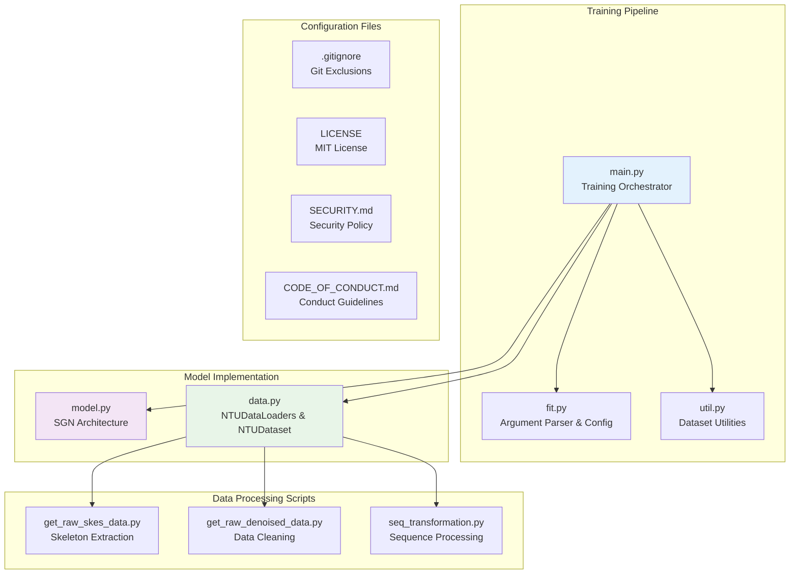
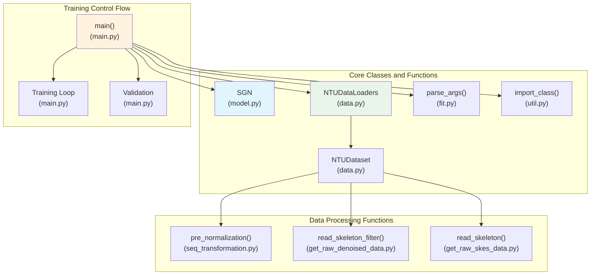
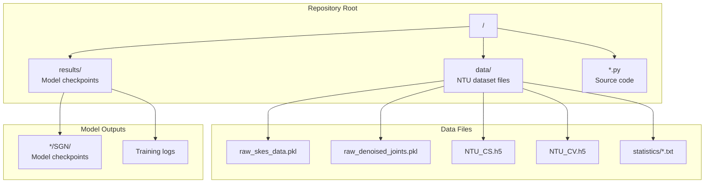
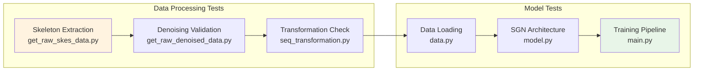

<!-- source: DeepWiki mcp.deepwiki.com · repo microsoft/SGN · page 8 Development and Contributing · fetched 2026-10-26 -->

# Development and Contributing

Relevant source files

The following files were used as context for generating this wiki page:

- [.gitignore](.gitignore)
- [CODE_OF_CONDUCT.md](CODE_OF_CONDUCT.md)
- [LICENSE](LICENSE)
- [SECURITY.md](SECURITY.md)

This document provides comprehensive guidelines for developers who want to contribute to the SGN (Semantics-Guided Neural Network) project. It covers project structure, development environment setup, contribution workflows, and coding standards.

For information about model architecture details, see [SGN Model Architecture](#2). For training and inference procedures, see [Training and Inference](#4). For data processing workflows, see [Data Pipeline](#3).

## Project Organization and Code Structure

The SGN repository follows a modular architecture with clear separation between data processing, model implementation, and training orchestration components.

### Core Module Organization

Sources: [main.py](), [fit.py](), [model.py](), [data.py](), [util.py](), [get_raw_skes_data.py](), [get_raw_denoised_data.py](), [seq_transformation.py]()

### Development Workflow and Code Dependencies

Sources: [main.py](), [model.py](), [data.py](), [fit.py](), [util.py](), [get_raw_skes_data.py](), [get_raw_denoised_data.py](), [seq_transformation.py]()

## Development Environment Setup

### Prerequisites

The SGN project requires the following core dependencies:

| Component | Purpose | Location |
|-----------|---------|----------|
| PyTorch | Deep learning framework | Model training and inference |
| NumPy | Numerical computations | Data processing pipelines |
| SciPy | Scientific computing | Statistical operations |
| HDF5 | Data storage format | Dataset serialization |
| Python 3.7+ | Runtime environment | All components |

### Directory Structure

Sources: [.gitignore:1-351]()

### Environment Configuration

1. **Python Environment**: Create isolated environment for dependency management
2. **Data Directory**: Ensure `data/` directory exists for NTU dataset storage
3. **Results Directory**: Configure `results/` for model checkpoint storage
4. **GPU Support**: Verify CUDA compatibility for PyTorch acceleration

## Contribution Workflow

### Code Standards and Style

The project follows these coding conventions:

| Aspect | Standard | Implementation |
|--------|----------|----------------|
| Class Names | PascalCase | `SGN`, `NTUDataset`, `NTUDataLoaders` |
| Function Names | snake_case | `parse_args()`, `import_class()`, `read_skeleton()` |
| Constants | UPPER_SNAKE_CASE | Configuration parameters |
| File Names | snake_case | `get_raw_skes_data.py`, `seq_transformation.py` |

### Module Integration Guidelines

When adding new functionality:

1. **Data Processing**: Extend functions in `get_raw_skes_data.py`, `get_raw_denoised_data.py`, or `seq_transformation.py`
2. **Model Architecture**: Modify the `SGN` class in `model.py`
3. **Data Loading**: Update `NTUDataLoaders` or `NTUDataset` classes in `data.py`
4. **Training Logic**: Enhance the main training loop in `main.py`
5. **Configuration**: Add parameters through `parse_args()` in `fit.py`

Sources: [main.py](), [model.py](), [data.py](), [fit.py](), [get_raw_skes_data.py](), [get_raw_denoised_data.py](), [seq_transformation.py]()

### Testing and Validation

#### Data Pipeline Validation

Sources: [get_raw_skes_data.py](), [get_raw_denoised_data.py](), [seq_transformation.py](), [model.py](), [data.py](), [main.py]()

#### Validation Checklist

- [ ] Data processing functions handle edge cases correctly
- [ ] Model architecture maintains expected tensor dimensions
- [ ] Training loop converges on sample data
- [ ] Configuration parameters are properly validated
- [ ] Memory usage remains within acceptable bounds

## Security and Conduct Policies

### Security Reporting

Microsoft takes security seriously across all repositories. Security vulnerabilities should be reported through proper channels, not public GitHub issues.

**Reporting Process:**
1. **Primary**: Submit reports to [Microsoft Security Response Center](https://msrc.microsoft.com/create-report)
2. **Alternative**: Email `secure@microsoft.com` with PGP encryption if possible
3. **Response Time**: Expect acknowledgment within 24 hours
4. **Follow-up**: Contact `microsoft.com/msrc` if no response received

**Required Information:**
- Issue type and technical details
- Affected source file paths with line numbers
- Reproduction steps and proof-of-concept code
- Impact assessment and potential exploit scenarios

Sources: [SECURITY.md:1-41]()

### Code of Conduct

The project adheres to the [Microsoft Open Source Code of Conduct](https://opensource.microsoft.com/codeofconduct). Key principles include:

- **Professional Communication**: Maintain respectful discourse in all interactions
- **Inclusive Environment**: Welcome contributions from diverse backgrounds
- **Constructive Feedback**: Provide helpful, actionable code review comments
- **Problem Resolution**: Contact `opencode@microsoft.com` for conduct concerns

Sources: [CODE_OF_CONDUCT.md:1-10]()

## Licensing and Legal Requirements

### MIT License Terms

The project uses MIT License, granting broad permissions for use, modification, and distribution.

**Key Requirements:**
- Include copyright notice in all distributions
- Include license text in all substantial portions
- Software provided "as-is" without warranties

**Permissions:**
- Commercial use, modification, distribution, private use
- Sublicensing and selling of software copies

Sources: [LICENSE:1-22]()

### File Exclusions

The project excludes specific file types and directories from version control:

| Category | Examples | Purpose |
|----------|----------|---------|
| Build Artifacts | `*.obj`, `*.pdb`, `/bin/`, `/obj/` | Compiled outputs |
| IDE Files | `.vs/`, `*.user`, `*.suo` | Development environment |
| Python Cache | `__pycache__/`, `*.pyc` | Runtime caches |
| Logs | `*.log`, `/logs/` | Runtime logging |

Sources: [.gitignore:1-351]()

## Integration Points and Extension Guidelines

### Adding New Data Processing Steps

Extend the data pipeline by implementing functions that follow existing patterns:

1. **Input Validation**: Check data format and dimensions
2. **Processing Logic**: Apply transformations with error handling  
3. **Output Generation**: Save results in compatible formats
4. **Integration**: Update `NTUDataLoaders` to use new processing steps

### Extending Model Architecture

Modify the `SGN` class in `model.py` following these guidelines:

1. **Layer Addition**: Maintain tensor dimension compatibility
2. **Parameter Initialization**: Use appropriate initialization schemes
3. **Forward Pass**: Ensure gradient flow through new components
4. **Configuration**: Add new parameters to `parse_args()` in `fit.py`

### Training Pipeline Enhancements

Enhance training functionality in `main.py`:

1. **Loss Functions**: Implement custom loss calculations
2. **Optimization**: Add new optimizer or learning rate schedules  
3. **Evaluation Metrics**: Include additional performance measures
4. **Checkpointing**: Extend model saving and loading functionality

Sources: [model.py](), [main.py](), [fit.py](), [data.py]()