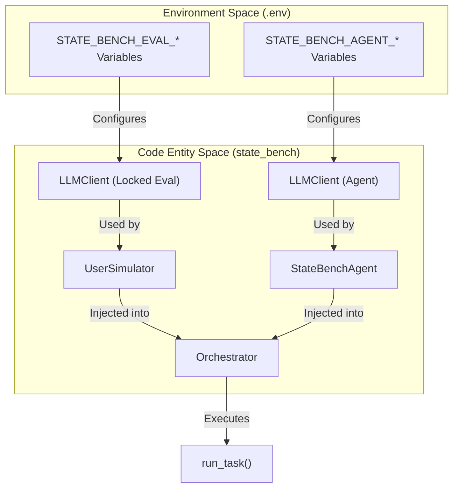
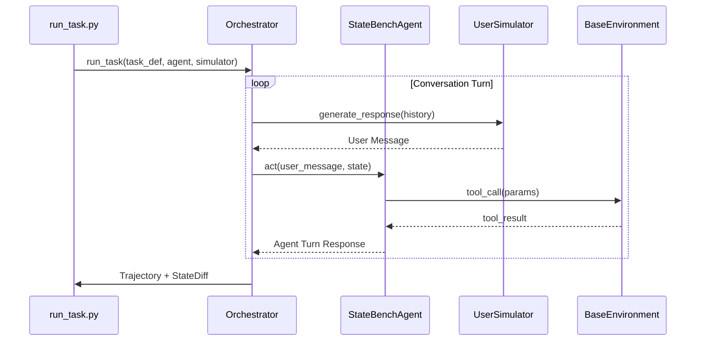

<!-- source: DeepWiki mcp.deepwiki.com · repo microsoft/STATE-Bench · page 1.1 Getting Started · fetched 2026-10-26 -->

# Getting Started

<details>
<summary>Relevant source files</summary>

The following files were used as context for generating this wiki page:

- [.env.example](.env.example)
- [.github/workflows/ci.yml](.github/workflows/ci.yml)
- [.pre-commit-config.yaml](.pre-commit-config.yaml)

</details>


This page provides a step-by-step guide for setting up the STATE-Bench environment, configuring the necessary LLM clients, and running your first benchmark task. STATE-Bench utilizes `uv` for dependency management and requires specific environment variables to interface with the locked evaluation protocol.

## 1. Installation

STATE-Bench is built for Python 3.12 and uses `uv` for fast, reproducible dependency resolution and virtual environment management.

### Prerequisites
- **Python 3.12**: Ensure Python 3.12 is installed on your system.
- **uv**: Install via `curl -LsSf https://astral-sh.uv.io/install.sh | sh` or your preferred package manager.

### Setup Steps
1. **Clone the repository**:
   ```bash
   git clone https://github.com/microsoft/STATE-Bench.git
   cd STATE-Bench
   ```
2. **Sync dependencies**:
   Run the following command to create a virtual environment and install all required packages (including development dependencies) using the lockfile:
   ```bash
   uv sync --dev --locked
   ```
   *Sources: [.github/workflows/ci.yml:22-33]()*

3. **Install pre-commit hooks**:
   STATE-Bench uses `pre-commit` to ensure code quality (Ruff, Gitleaks, etc.):
   ```bash
   uv run pre-commit install
   ```
   *Sources: [.pre-commit-config.yaml:1-28]()*

---

## 2. Environment Configuration

STATE-Bench requires two distinct LLM client configurations: one for the **Locked Evaluation Client** (the "Judge" and "User Simulator") and one for the **Agent Client** (the model being benchmarked).

Copy the template file to create your environment configuration:
```bash
cp .env.example .env
```

### 2.1. Locked Evaluation Client
The canonical evaluation protocol requires **GPT-5.4**. This client is used by the `UserSimulator` to interact with the agent and by the `Scoring` pipeline to evaluate task requirements.

| Variable | Description |
| :--- | :--- |
| `STATE_BENCH_EVAL_ENDPOINT` | The Azure OpenAI endpoint for the GPT-5.4 resource. |
| `STATE_BENCH_EVAL_DEPLOYMENTS` | The deployment name for GPT-5.4. |
| `STATE_BENCH_EVAL_API_KEY` | (Optional) API key. If omitted, the system attempts Azure CLI/Managed Identity token auth. |

*Sources: [.env.example:6-12]()*

### 2.2. Built-in StateBenchAgent Client
The default runner uses the `StateBenchAgent` class. You can configure this to point to any model you wish to evaluate (Azure OpenAI or OpenAI).

**For Azure OpenAI:**
- `STATE_BENCH_AGENT_ENDPOINT`
- `STATE_BENCH_AGENT_DEPLOYMENTS`
- `STATE_BENCH_AGENT_API_KEY`

**For OpenAI API:**
- `STATE_BENCH_AGENT_PROVIDER="openai"`
- `STATE_BENCH_AGENT_MODEL="gpt-4o"`
- `STATE_BENCH_AGENT_API_KEY`

*Sources: [.env.example:14-28]()*

---

## 3. System Data Flow

The following diagram illustrates the initialization process and the relationship between environment variables and the core code entities.

### Setup and Initialization Flow
"This diagram maps the `.env` configuration to the internal `LLMClient` instances used by the Orchestrator."


*Sources: [.env.example:1-29](), [state_bench/orchestrator.py:1-50]()*

---

## 4. Running Your First Benchmark

Once configured, you can execute a single task or a batch of tasks using the provided scripts.

### 4.1. Single Task Execution
To run a specific task (e.g., from the Travel domain), use `run_task.py`. This script initializes the environment, loads the `TaskDefinition`, and starts the interaction loop between the `UserSimulator` and the `BaseAgent`.

```bash
uv run python -m state_bench.scripts.run_task \
    --domain travel \
    --task-id travel_001 \
    --output-dir ./results/first_run
```

### 4.2. Batch Execution
To run the full benchmark suite for a specific track (e.g., the Main Track), use `run_batch.py`. This script manages parallel execution and aggregates trajectories.

```bash
uv run python -m state_bench.scripts.run_batch \
    --protocol gpt54 \
    --track main \
    --output-dir ./results/main_track_eval
```

### Component Interaction Diagram
"This diagram shows how the `run_task` script bridges the high-level task definition to the execution logic."


*Sources: [state_bench/orchestrator.py:1-100](), [state_bench/agents/state_bench.py:1-40]()*

---

## 5. Verification
After running a task, check the `output-dir`. You should see:
1. `trajectory.json`: The full conversation history and tool calls.
2. `state_diff.json`: The delta between the initial and final environment states.
3. `scores.json`: The output of the scoring pipeline (if evaluation was enabled).

To verify your installation and environment setup, run the test suite:
```bash
uv run pytest
```
*Sources: [.github/workflows/ci.yml:38-39]()*

---

