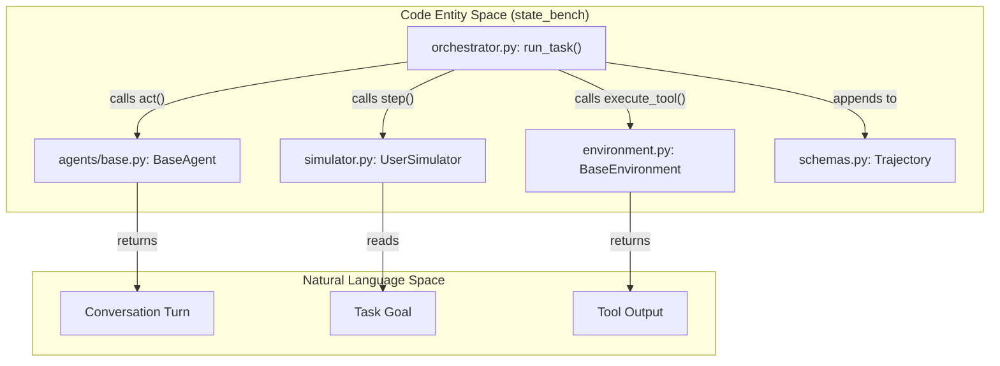
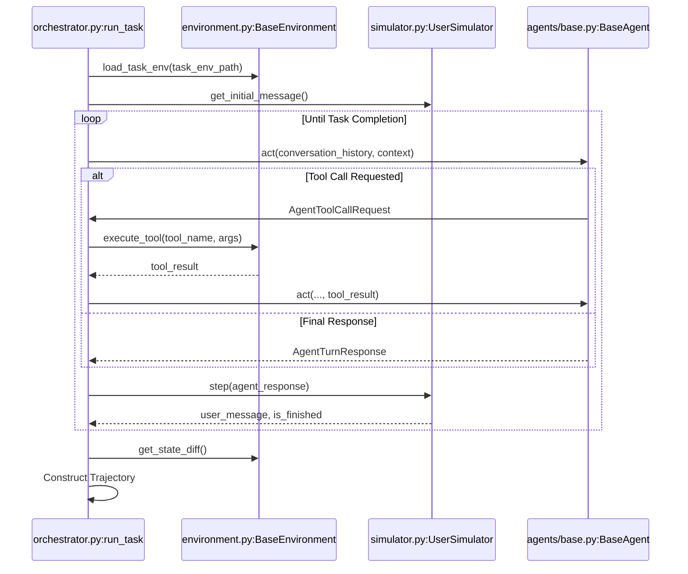

<!-- source: DeepWiki mcp.deepwiki.com · repo microsoft/STATE-Bench · page 2.1 Orchestrator and Task Execution · fetched 2026-10-26 -->

# Orchestrator and Task Execution

Relevant source files

The following files were used as context for generating this wiki page:

- [.env.example](.env.example)
- [CHANGELOG.md](CHANGELOG.md)

The orchestrator is the central engine of STATE-Bench, responsible for managing the lifecycle of a single benchmark task. It facilitates the multi-turn interaction between a **User Simulator**, an **Agent**, and a **Domain Environment**. The execution logic is encapsulated primarily within the `run_task()` function, which drives the conversation loop, manages state transitions, and records the resulting trajectory for evaluation.

## Execution Flow Overview

The execution of a task follows a strictly defined loop where the orchestrator acts as the mediator. It initializes the environment, prepares the agent and user simulator, and then iterates through turns until a termination condition is met (e.g., task completion, turn limit reached, or failure).

### The Agent-User-Tool Loop
The loop follows these logical steps:
1.  **User Turn**: The `UserSimulator` generates a message based on the current conversation history and its internal goal.
2.  **Agent Turn**: The `BaseAgent` receives the user message and decides whether to call a tool or respond to the user.
3.  **Tool Execution**: If the agent requests tool calls, the orchestrator executes them against the `BaseEnvironment` and returns the results to the agent.
4.  **Termination**: The loop ends when the `UserSimulator` signals the task is finished, the agent provides a final response that satisfies the user, or the `max_turns` limit is hit.

### Entity Relationship Diagram
This diagram maps the conceptual "Natural Language Space" of the conversation to the "Code Entity Space" within `state_bench/orchestrator.py`.

**Sources:** [state_bench/orchestrator.py:1-100](), [state_bench/agents/base.py:10-50](), [state_bench/simulator.py:5-40]()

---

## Core Implementation: `run_task()`

The `run_task()` function in `state_bench/orchestrator.py` is the primary entry point for executing a single benchmark instance. It handles the setup of the domain-specific environment and manages the stateful interaction.

### Key Responsibilities
-   **Environment Setup**: Loads the task-specific environment state using `BaseEnvironment.load_task_env()`.
-   **Context Management**: Creates an `AgentRuntimeContext` which provides the agent with access to tool schemas and the environment.
-   **Trajectory Recording**: Every interaction (user messages, agent reasoning, tool calls, and tool outputs) is appended to a `Trajectory` object.
-   **State Tracking**: Captures the "Before" and "After" state of the environment to compute the `StateDiff`.

### Data Flow Diagram
The following diagram illustrates how data flows through the `run_task` function during a single execution cycle.

**Sources:** [state_bench/orchestrator.py:45-120](), [state_bench/schemas.py:150-200]()

---

## CLI Entry Points

STATE-Bench provides two main scripts for triggering execution: `run_task.py` for single-task debugging and `run_batch.py` for large-scale benchmarking.

### `run_task.py`
Used to execute a single `TaskDefinition`. It is ideal for developers testing a specific agent's behavior on a difficult task.
-   **Input**: A path to a task JSON file.
-   **Output**: A directory containing `trajectory.json`, which includes the full conversation and final state.

### `run_batch.py`
The primary tool for generating benchmark results. It processes multiple tasks in parallel using a thread pool.
-   **Concurrency**: Uses `ThreadPoolExecutor` to run multiple tasks simultaneously across different agent instances.
-   **Resilience**: Implements error handling per task so that a single agent crash does not terminate the entire batch.
-   **Output**: Creates a structured output directory organized by `domain/task_id`.

| Script | Purpose | Key Arguments |
| :--- | :--- | :--- |
| `run_task.py` | Single task execution/debug | `--task-path`, `--agent-type`, `--output-dir` |
| `run_batch.py` | Full benchmark run | `--protocol-id`, `--split`, `--concurrency` |

**Sources:** [run_task.py:1-50](), [run_batch.py:1-80]()

---

## Trajectory Production and StateDiff

The ultimate output of the orchestrator is a `Trajectory` object (defined in `state_bench/schemas.py`). This object is a complete record of the execution, which is later used by the `Evaluation Pipeline`.

### Trajectory Components
1.  **Conversation**: A list of messages between the User, Agent, and System (tools).
2.  **StateDiff**: A record of how the environment entities (e.g., flight bookings, shopping carts) changed from the start to the end of the task.
3.  **Efficiency Metrics**: Captured during execution, including:
    *   `turn_count`: Total number of interaction turns.
    *   `token_usage`: Aggregated tokens from the `LLMClient`.
    *   `wall_time`: Total execution time.

### State Requirement Matching
During `run_task()`, the orchestrator captures the environment state before and after execution. The `StateDiff` is generated by comparing these two snapshots. This diff is critical for the `scoring.py` module to verify if the agent correctly modified the environment (e.g., "Was the flight actually cancelled in the database?").

**Sources:** [state_bench/schemas.py:210-250](), [state_bench/orchestrator.py:130-155]()

---

