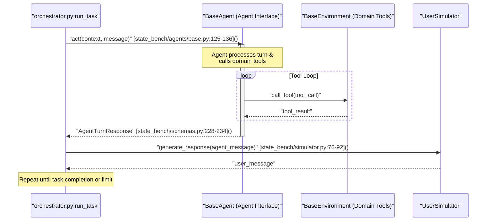
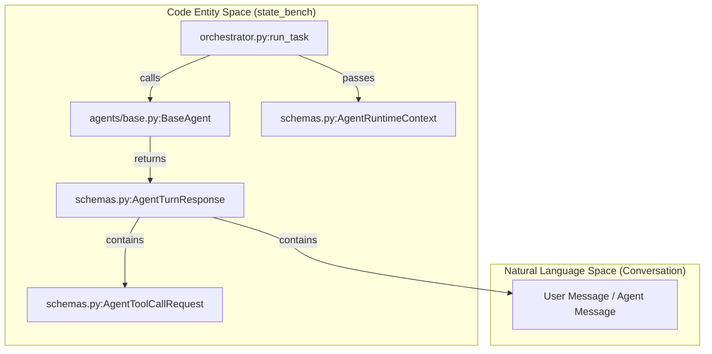

<!-- source: DeepWiki mcp.deepwiki.com · repo microsoft/STATE-Bench · page 3 Agent Interface · fetched 2026-10-26 -->

# Agent Interface

Relevant source files

The following files were used as context for generating this wiki page:

- [.env.example](.env.example)
- [README.md](README.md)

The **Agent Interface** defines the contract between the STATE-Bench benchmark harness and the AI agents being evaluated. This interface is designed to be provider-agnostic, allowing for the evaluation of diverse agent architectures—ranging from simple zero-shot models to complex systems with long-term memory and specialized tool-calling loops.

The benchmark orchestrator interacts with agents through a standardized lifecycle: initializing the agent with a `TaskDefinition`, invoking it for each turn in a conversation, and providing hooks for the agent to ingest trajectories or retrieve learned information.

### Agent-Orchestrator Interaction Flow
The following diagram illustrates how the `Orchestrator` in `state_bench/orchestrator.py` manages the interaction between the `UserSimulator` and the `BaseAgent` implementation.

**Orchestrator Execution Loop**

**Sources:** [state_bench/orchestrator.py:75-150](), [state_bench/agents/base.py:125-136](), [state_bench/schemas.py:228-234]()

---

### Key Components

The interface is structured around three primary pillars that allow the benchmark to remain decoupled from specific LLM providers or agent frameworks.

| Component | Code Entity | Role |
| :--- | :--- | :--- |
| **Abstract Base** | `BaseAgent` | Defines the required `act()` and `generate_next_turn()` methods. |
| **Runtime Context** | `AgentRuntimeContext` | Provides the agent with task metadata, available tools, and retrieval hooks. |
| **Response Schema** | `AgentTurnResponse` | Standardizes how agents return text and tool calls to the orchestrator. |

#### 1. BaseAgent Interface
The `BaseAgent` class in `state_bench/agents/base.py` is the foundation of the interface. It includes abstract methods for turn generation and optional hooks for the **Agent Learning Track**, such as `ingest_trajectory` and `prepare_conversation`. 

For details on the abstract methods and memory hooks, see **[BaseAgent Interface](#3.1)**.

#### 2. Built-in StateBenchAgent
STATE-Bench provides a reference implementation, `StateBenchAgent`, located in `state_bench/agents/state_bench.py`. This agent implements a robust tool-calling loop using the `Responses API` and integrates with the `PooledLLMClient` for high-throughput evaluation. It serves as the default agent for the **Main Track**.

For details on the built-in agent's logic and configuration, see **[Built-in StateBenchAgent](#3.2)**.

#### 3. Custom Agents and Clients
To evaluate third-party agents (e.g., those built with LangChain, AutoGen, or proprietary frameworks), developers can implement custom subclasses of `BaseAgent`. The `state_bench/agents/loader.py` utility dynamically loads these implementations at runtime based on CLI arguments.

For a guide on implementing your own agent or LLM client, see **[Custom Agents and Clients](#3.3)**.

---

### Data Flow: From Code Entities to Benchmark Space
This diagram maps the internal code entities to their functional roles within the benchmark's execution space.

**Entity Mapping**

**Sources:** [state_bench/orchestrator.py:75-150](), [state_bench/agents/base.py:20-150](), [state_bench/schemas.py:200-250]()

### Summary of Child Pages

*   **[BaseAgent Interface](#3.1)**: Deep dive into the abstract class, runtime context, and the lifecycle methods (`act`, `prepare_conversation`, `ingest_trajectory`).
*   **[Built-in StateBenchAgent](#3.2)**: Detailed breakdown of the default agent implementation, including its tool-calling loop and reasoning effort settings.
*   **[Custom Agents and Clients](#3.3)**: Instructions for extending the benchmark with new model providers or custom agentic architectures.

---

