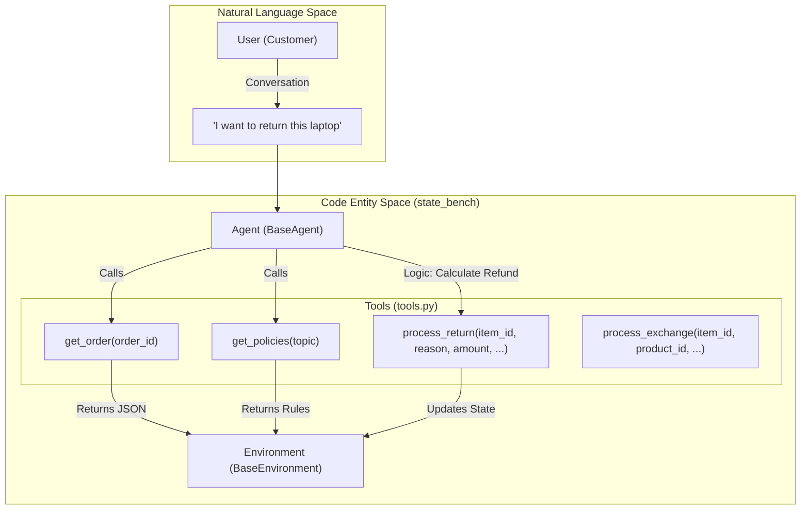
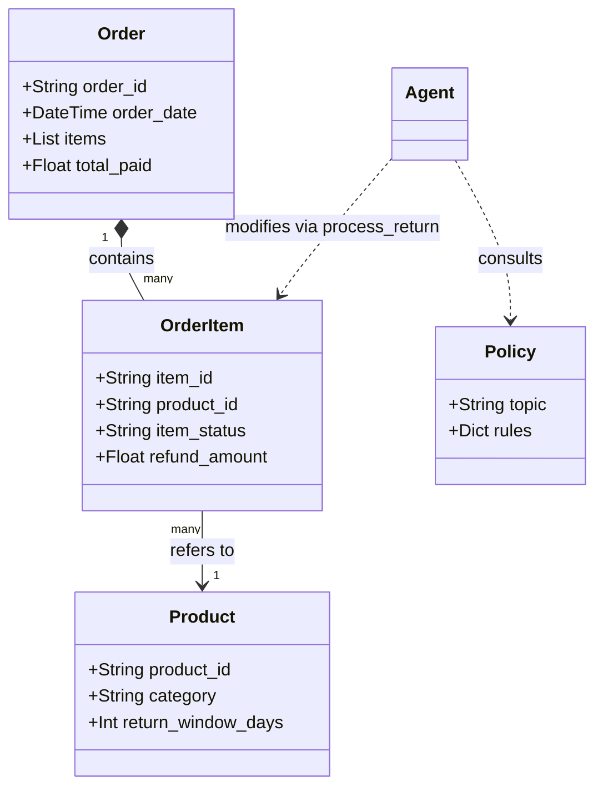

<!-- source: DeepWiki mcp.deepwiki.com · repo microsoft/STATE-Bench · page 5.3 Customer Support Domain · fetched 2026-10-26 -->

# Customer Support Domain

Relevant source files

The following files were used as context for generating this wiki page:

- [datasets/train_task_trajectories/customer_support/1-hard_false_defect_phone_battery_settings.json](datasets/train_task_trajectories/customer_support/1-hard_false_defect_phone_battery_settings.json)
- [datasets/train_task_trajectories/customer_support/10-return_full_order.json](datasets/train_task_trajectories/customer_support/10-return_full_order.json)
- [datasets/train_task_trajectories/customer_support/2-return_defective_electronics.json](datasets/train_task_trajectories/customer_support/2-return_defective_electronics.json)
- [datasets/train_task_trajectories/customer_support/6-return_wrong_item.json](datasets/train_task_trajectories/customer_support/6-return_wrong_item.json)

The Customer Support domain simulates a complex e-commerce service environment where agents must manage order lifecycles, handle logistics issues, and apply nuanced business policies. It tests an agent's ability to perform multi-step reasoning over structured data and deterministic policy sets.

## Domain Overview

The Customer Support domain is built upon a relational state model representing a retail backend. Agents interact with this environment through a set of specialized tools to resolve customer inquiries regarding returns, exchanges, shipping delays, and warranty claims.

### Key Entities

The environment state is composed of the following primary entities:
*   **Customers**: Profiles including membership tiers (Standard, Silver, Gold, Platinum) and Prime status, which influence policy eligibility [datasets/train_task_trajectories/customer_support/1-hard_false_defect_phone_battery_settings.json:83-92]().
*   **Orders**: Transactional records containing status, payment details, and shipping information [datasets/train_task_trajectories/customer_support/1-hard_false_defect_phone_battery_settings.json:21-42]().
*   **Order Items**: Specific products within an order, tracking their individual fulfillment and return status [datasets/train_task_trajectories/customer_support/1-hard_false_defect_phone_battery_settings.json:44-59]().
*   **Products**: Catalog items with category-specific return windows and warranty durations [datasets/train_task_trajectories/customer_support/1-hard_false_defect_phone_battery_settings.json:61-69]().
*   **Warranties**: Protection plans associated with specific items.

### Data Flow and Tool Interaction

The following diagram illustrates how the Agent interacts with the system tools to transition the environment state from an "Ordered" to a "Returned" or "Exchanged" status.

**Customer Support Tool Interaction Flow**

Sources: [datasets/train_task_trajectories/customer_support/1-hard_false_defect_phone_battery_settings.json:14-126](), [datasets/train_task_trajectories/customer_support/6-return_wrong_item.json:14-130]()

## Deterministic Policy Engine

A core challenge of this domain is the strict adherence to the **Deterministic Policy Engine**. Agents cannot simply "approve" a request; they must calculate exact values based on the rules returned by `get_policies`.

### Return and Refund Logic
The `process_return` tool requires the agent to submit a net `amount`. This amount must be calculated by the agent using a specific formula provided in the policy text:

**Refund Calculation Formula:**
`net_refund = base_item_price - restocking_fee + restocking_discount - shipping_clawback - bulk_clawback - repeat_surcharge - paid_return_shipping_fee`
[datasets/train_task_trajectories/customer_support/1-hard_false_defect_phone_battery_settings.json:82-82]()

### Key Policy Rules
| Category | Rule Summary |
| :--- | :--- |
| **Return Windows** | Electronics (15 days), Clothing/Kitchen/Accessories (30 days), Books (14 days) [datasets/train_task_trajectories/customer_support/1-hard_false_defect_phone_battery_settings.json:83-89](). |
| **Window Extensions** | Gold/Platinum members: +15 days. Prime members: +15 days. Seasonal (Nov/Dec): Through Jan 31 [datasets/train_task_trajectories/customer_support/1-hard_false_defect_phone_battery_settings.json:90-93](). |
| **Restocking Fees** | 15% for opened electronics (changed_mind). Fully waived for Platinum, 50% off for Gold [datasets/train_task_trajectories/customer_support/1-hard_false_defect_phone_battery_settings.json:101-107](). |
| **Shipping Fees** | Orders < $50 pay $8 return shipping. Free for orders >= $50 or defective items [datasets/train_task_trajectories/customer_support/1-hard_false_defect_phone_battery_settings.json:112-115](). |
| **Clawbacks** | Free shipping clawback ($8) applies if return drops subtotal below $100 [datasets/train_task_trajectories/customer_support/1-hard_false_defect_phone_battery_settings.json:123-125](). |

Sources: [datasets/train_task_trajectories/customer_support/1-hard_false_defect_phone_battery_settings.json:80-126]()

## Task Categories

Tasks in the Customer Support domain are categorized by the complexity of the policy reasoning required:

1.  **Return**: Standard returns requiring window verification and refund calculation.
2.  **Cancel**: Canceling orders before they are shipped.
3.  **Shipping**: Inquiries regarding late deliveries, tracking, or shipping compensation.
4.  **Warranty**: Claims for defective products within the warranty period.
5.  **Exchange**: Swapping items for different products, requiring price difference calculations [datasets/train_task_trajectories/customer_support/6-return_wrong_item.json:82-88]().
6.  **Compound**: Multi-intent tasks (e.g., "Return this item and check the status of my other order").

## Implementation Details

### State Requirements and Scoring
Evaluation in this domain often relies on `StateDiff` assertions. For a return task to be considered successful, the agent must call `process_return` with the **exact** calculated refund amount. If the agent forgets a single component (e.g., a membership restocking discount), the `refund_amount` in the final environment state will not match the expected value, resulting in a failure [datasets/train_task_trajectories/customer_support/1-hard_false_defect_phone_battery_settings.json:82-82]().

**Entity Mapping: Code to Logic**

Sources: [datasets/train_task_trajectories/customer_support/1-hard_false_defect_phone_battery_settings.json:21-72](), [datasets/train_task_trajectories/customer_support/10-return_full_order.json:21-126]()

---

