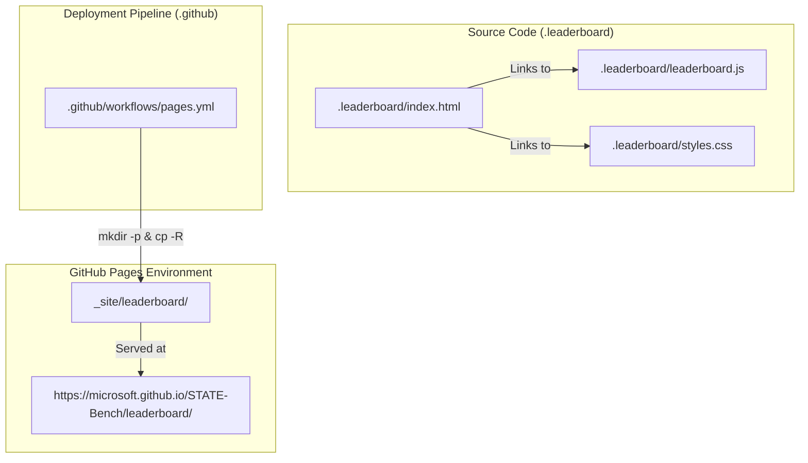
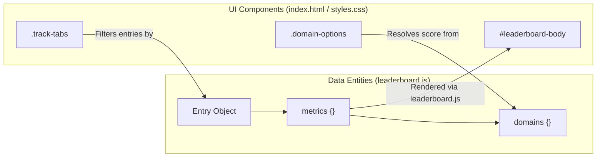

<!-- source: DeepWiki mcp.deepwiki.com · repo microsoft/STATE-Bench · page 7 Leaderboard · fetched 2026-10-26 -->

# Leaderboard

Relevant source files

The following files were used as context for generating this wiki page:

- [.github/workflows/pages.yml](.github/workflows/pages.yml)
- [.leaderboard/index.html](.leaderboard/index.html)
- [.leaderboard/leaderboard.js](.leaderboard/leaderboard.js)
- [.leaderboard/styles.css](.leaderboard/styles.css)

The STATE-Bench Leaderboard is a public-facing system designed to showcase and compare the performance of various agents and LLMs across the benchmark's tracks. It consists of a static web application hosted via GitHub Pages, driven by a structured data model and an automated deployment pipeline.

The leaderboard serves as the primary visualization tool for metrics computed by the evaluation pipeline, specifically highlighting results for the **Main Track** and the **Agent Learning Track** [ .leaderboard/index.html:33-38 ]().

### System Architecture Overview

The leaderboard system is decoupled from the core Python evaluation package. It utilizes a simple frontend stack (HTML/CSS/JS) and leverages GitHub Actions for Continuous Deployment (CD).

#### Leaderboard Component Interaction
The following diagram illustrates how the leaderboard assets relate to the deployment infrastructure.

**Diagram: Leaderboard Web Application and Deployment**

**Sources:** [ .github/workflows/pages.yml:34-37 ](), [ .leaderboard/index.html:7-92 ]()

---

### Static Web Application

The frontend is a lightweight, zero-dependency application located in the `.leaderboard/` directory.

*   **Shell Structure**: The `index.html` file defines a `leaderboard-shell` with a `compact-hero` navigation bar and a `leaderboard-panel` containing the results table [ .leaderboard/index.html:9-28 ]().
*   **Data Model**: Performance data is stored as a collection of `entries` in `leaderboard.js`. Each entry includes metadata (model, organization, version) and a `metrics` object containing scores for `overall` and specific `domains` (travel, customerSupport, shoppingAssistant) [ .leaderboard/leaderboard.js:1-23 ]().
*   **Metric Visualization**: The system displays key performance indicators including `pass@1`, `pass^5`, `meanUxScore`, and `costPerTask` [ .leaderboard/index.html:70-80 ]().

For details on the data structure and rendering logic, see [Leaderboard Frontend](#7.1).

**Sources:** [ .leaderboard/index.html:1-95 ](), [ .leaderboard/leaderboard.js:1-114 ]()

---

### Deployment and Submission

The leaderboard is automatically updated and deployed whenever changes are made to the site assets or the deployment workflow.

#### Deployment Pipeline (`pages.yml`)
The CD workflow is triggered on pushes to the `main` branch that affect the `.leaderboard/` path [ .github/workflows/pages.yml:4-9 ](). It prepares the site by creating a `_site/leaderboard` directory and uses the `actions/upload-pages-artifact` and `actions/deploy-pages` actions to publish the content [ .github/workflows/pages.yml:34-47 ]().

#### Submission Process
The leaderboard UI provides a direct link to the submission documentation [ .leaderboard/index.html:40-42 ](). Submissions typically involve:
1. Running the evaluation pipeline to generate a `metrics.json`.
2. Formatting the results into a new entry object in `leaderboard.js`.
3. Submitting a Pull Request to the repository.

For details on the CI/CD configuration and environment setup, see [Leaderboard Deployment](#7.2).

**Sources:** [ .github/workflows/pages.yml:1-47 ](), [ .leaderboard/index.html:41-41 ]()

---

### Metrics and Tracks

The leaderboard distinguishes between different evaluation contexts through "Tracks":

| Track | Description | Code Reference |
| :--- | :--- | :--- |
| **Main Track** | Zero-shot performance on the test split. | `data-track="main"` [ .leaderboard/index.html:33 ]() |
| **Agent Learning Track** | Performance of agents that have utilized the training trajectories. | `data-track="memory"` [ .leaderboard/index.html:36 ]() |

**Diagram: Data Flow from Metrics to UI**

**Sources:** [ .leaderboard/leaderboard.js:12-22 ](), [ .leaderboard/index.html:31-65 ]()

**Sources:**
- [ .github/workflows/pages.yml:1-47 ]()
- [ .leaderboard/index.html:1-95 ]()
- [ .leaderboard/leaderboard.js:1-114 ]()
- [ .leaderboard/styles.css:1-359 ]()

---

