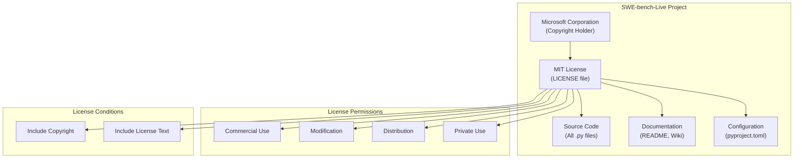
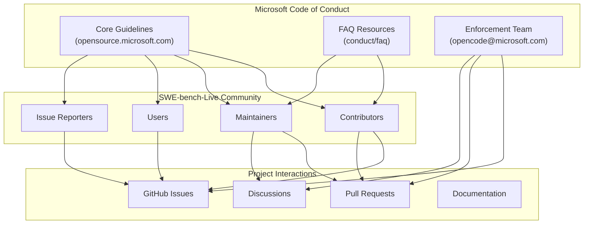

<!-- source: DeepWiki mcp.deepwiki.com · repo microsoft/SWE-bench-Live · page 6.3 License & Code of Conduct · fetched 2026-10-26 -->

# License & Code of Conduct

Relevant source files

The following files were used as context for generating this wiki page:

- [CODE_OF_CONDUCT.md](CODE_OF_CONDUCT.md)
- [LICENSE](LICENSE)

This document presents the legal framework and community guidelines governing the SWE-bench-Live project. It covers the MIT license terms under which the software is distributed and the code of conduct that applies to all project participants. For information about contributing to the project, see [Development & Contributing](#6).

## License Terms

SWE-bench-Live is released under the MIT License with Microsoft Corporation as the copyright holder. The license grants broad permissions for use, modification, and distribution of the software.

### MIT License Details

The software is licensed under the standard MIT License terms as defined in [LICENSE:1-21](). Key aspects include:

| Permission | Description |
|------------|-------------|
| **Use** | Free to use for any purpose |
| **Modify** | Right to modify the source code |
| **Distribute** | Right to distribute copies |
| **Sublicense** | Right to grant sublicenses |
| **Sell** | Right to sell copies |

### Copyright and Attribution

The copyright is held by Microsoft Corporation as specified in [LICENSE:3](). All copies or substantial portions of the software must include the copyright notice and permission notice from [LICENSE:12-13]().

### Warranty Disclaimer

The software is provided "AS IS" without warranty of any kind, as stated in [LICENSE:15-21](). This includes disclaimers for merchantability, fitness for purpose, and non-infringement.

**License Framework**

Sources: [LICENSE:1-21]()

## Code of Conduct

The project has adopted the Microsoft Open Source Code of Conduct as documented in [CODE_OF_CONDUCT.md:3](). This establishes community standards and behavioral expectations for all project participants.

### Adoption and Scope

The Microsoft Open Source Code of Conduct applies to all project spaces, including:
- GitHub repository interactions
- Issue and pull request discussions  
- Community forums and communications
- Project events and meetups

### Resources and Support

The code of conduct framework provides several resources for participants:

| Resource | Purpose | Reference |
|----------|---------|-----------|
| **Main Guidelines** | Core conduct principles | [Microsoft Open Source Code of Conduct](https://opensource.microsoft.com/codeofconduct) |
| **FAQ** | Common questions and clarifications | [Microsoft Code of Conduct FAQ](https://opensource.microsoft.com/codeofconduct/faq) |
| **Contact** | Report concerns or ask questions | opencode@microsoft.com |

### Reporting and Enforcement

Questions, concerns, or violations should be reported to [opencode@microsoft.com](mailto:opencode@microsoft.com) as specified in [CODE_OF_CONDUCT.md:9](). Microsoft's conduct team handles enforcement and resolution.

**Governance and Conduct Structure**

Sources: [CODE_OF_CONDUCT.md:1-9]()

## Legal Compliance

The combination of MIT licensing and Microsoft's code of conduct creates a framework that balances open source accessibility with professional community standards. This supports the project's goal of providing a continuously updated benchmark while maintaining a welcoming environment for contributors.

### Attribution Requirements

When using or distributing SWE-bench-Live, the following attribution elements must be preserved:
- Copyright notice: "Copyright (c) Microsoft Corporation" from [LICENSE:3]()
- Full license text from [LICENSE:5-21]()
- This applies to substantial portions of the software per [LICENSE:13]()

### Community Standards

All community interactions must align with Microsoft's open source principles, ensuring respectful and inclusive participation across the global software engineering research community.

Sources: [LICENSE:1-21](), [CODE_OF_CONDUCT.md:1-9]()