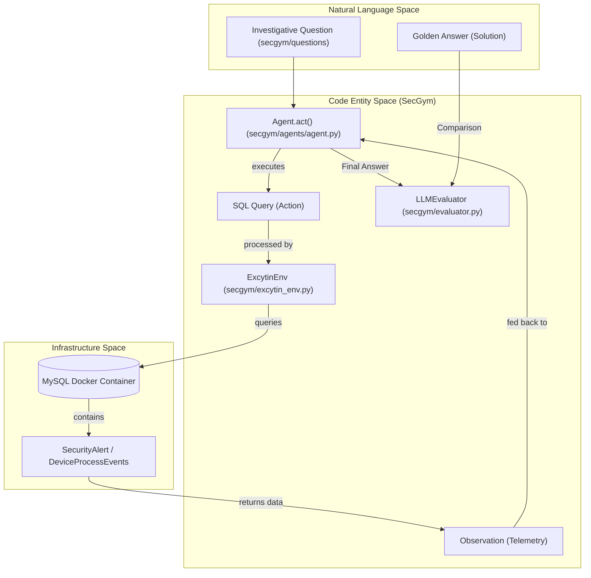
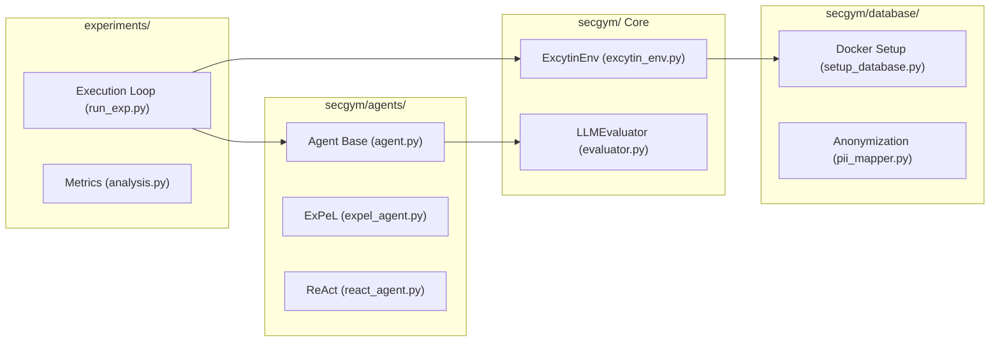

<!-- source: DeepWiki mcp.deepwiki.com · repo microsoft/SecRL · page 1 ExCyTIn-Bench Overview · fetched 2026-10-26 -->

# ExCyTIn-Bench Overview

Relevant source files

The following files were used as context for generating this wiki page:

- [CODE_OF_CONDUCT.md](CODE_OF_CONDUCT.md)
- [CONTRIBUTING.md](CONTRIBUTING.md)
- [ExCyTIn Transparency Note.docx](ExCyTIn Transparency Note.docx)
- [LICENSE](LICENSE)
- [README.md](README.md)
- [SECURITY.md](SECURITY.md)
- [TRANSPARENCY_DOC.md](TRANSPARENCY_DOC.md)
- [requirements.txt](requirements.txt)
- [secgym/assets/eval_results.png](secgym/assets/eval_results.png)
- [secgym/assets/overview.png](secgym/assets/overview.png)
- [secgym/assets/updated_eval_results_09_25.png](secgym/assets/updated_eval_results_09_25.png)
- [secgym/assets/updated_eval_results_10_25.png](secgym/assets/updated_eval_results_10_25.png)
- [secgym/assets/updated_eval_results_11_25.png](secgym/assets/updated_eval_results_11_25.png)
- [secgym/assets/updated_eval_results_12_25.png](secgym/assets/updated_eval_results_12_25.png)
- [secgym/database/README.md](secgym/database/README.md)

**ExCyTIn-Bench** (Evaluating LLM agents on Cyber Threat Investigation) is the first benchmark framework designed to evaluate Large Language Model (LLM) agents on their ability to perform autonomous cyber threat hunting. The framework provides a simulated environment where agents investigate security incidents by interacting with a structured database of security telemetry, answering complex investigative questions derived from real-world attack scenarios [README.md:1-20]().

The framework bridges the gap between static security knowledge and the dynamic reasoning required for end-to-end incident response.

### Core Architecture

The ExCyTIn-Bench ecosystem is composed of three primary layers that facilitate the interaction between the LLM agent and the investigative environment.

1.  **SecGym Environment**: A [Gymnasium](https://gymnasium.farama.org)-based interface that mediates all interactions. It handles the "Step-Query-Observation" loop, where agents submit SQL queries and receive filtered telemetry as observations [README.md:18-24]().
2.  **Incident Databases**: A backend consisting of 8 distinct MySQL databases (hosted in Docker containers), each containing telemetry for a specific security incident (e.g., Ransomware, BEC, Phishing). These databases store tables like `SecurityAlert`, `SigninLogs`, and `DeviceProcessEvents` [README.md:33-48]().
3.  **LLM Agents**: Autonomous entities (such as ReAct, Reflexion, or ExPeL agents) that utilize the environment to solve investigative tasks [README.md:89-93]().

#### System Interaction Diagram
This diagram illustrates how natural language questions are translated into technical actions within the codebase entities.

Sources: [README.md:18-24](), [secgym/excytin_env.py:1-50](), [secgym/evaluator.py:1-30]()

### Key Components

#### 1. The SecGym Environment
The core of the framework is the `ExcytinEnv` class. It manages the lifecycle of the investigation, including database connections and result truncation to fit LLM context windows. It supports different "telemetry layers" (e.g., `alert_only`, `log`) to control the difficulty of the task.
*   For details, see [SecGym Environment](#2).

#### 2. Incident Databases & PII Pipeline
The benchmark uses 20.4 GB of security logs [TRANSPARENCY_DOC.md:19](). These logs are processed via `process_logs.py` and anonymized through a PII (Personally Identifiable Information) pipeline to ensure privacy while maintaining investigative utility [secgym/database/README.md:14-18]().
*   For details, see [Database Layer: Setup, Schema & Data Pipeline](#2.2).

#### 3. LLM Agents & Learning Strategies
ExCyTIn-Bench supports multiple agent architectures:
*   **Baseline/ReAct**: Standard reasoning-action loops.
*   **Reflexion**: Agents that learn from failures within a single trial.
*   **ExPeL**: An "Experience-Based Learning" agent that extracts insights from successful trajectories and stores them in an `ExperiencePool` for future use.
*   For details, see [LLM Agents](#3).

#### 4. Question & Attack Graph Generation
Questions are not random; they are generated based on **Attack Graphs** constructed from `SecurityIncident` and `SecurityAlert` logs using `alert_graph.py`. These graphs map the movement of an attacker across entities (Users, IPs, Hosts), and questions are sampled from paths within these graphs [README.md:72-84]().
*   For details, see [Question & Attack Graph Generation](#4).

### Codebase Entity Mapping
This diagram maps high-level system functions to specific files and classes within the repository.

Sources: [README.md:65-88](), [requirements.txt:1-21]()

### Child Pages

Detailed documentation is organized into the following sub-pages:

*   **[Getting Started & Setup](#1.1)**: Installation, API configuration (`myconfig.py`), and Docker setup for the MySQL backend.
*   **[Repository Structure & Key Concepts](#1.2)**: A deep dive into the 8 security incidents, the directory layout, and the "Path Relevance Score" used for splitting training and testing data.

---
**Sources:**
*   [README.md:1-105]()
*   [TRANSPARENCY_DOC.md:1-40]()
*   [secgym/database/README.md:1-20]()
*   [requirements.txt:1-21]()

---

