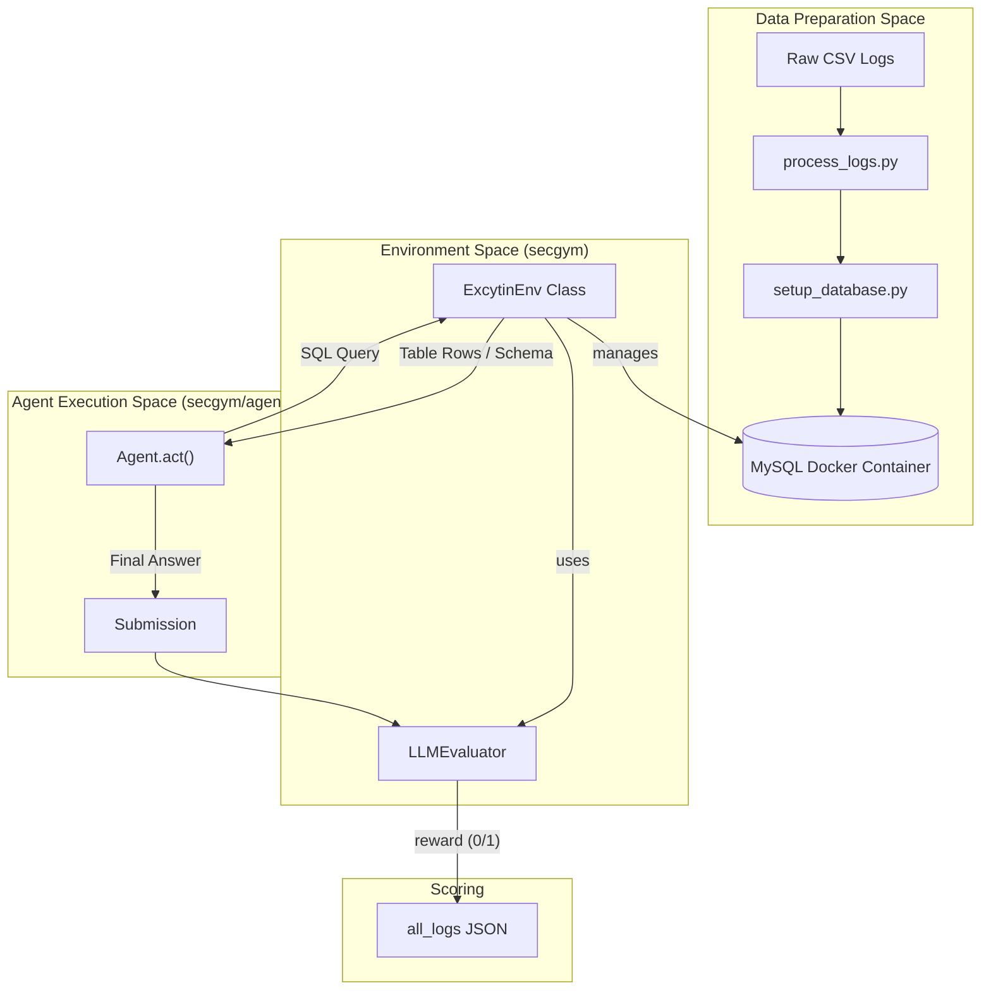

<!-- source: DeepWiki mcp.deepwiki.com · repo microsoft/SecRL · page 1.2 Repository Structure & Key Concepts · fetched 2026-10-26 -->

# Repository Structure & Key Concepts

<details>
<summary>Relevant source files</summary>

The following files were used as context for generating this wiki page:

- [.gitignore](.gitignore)
- [README.md](README.md)
- [requirements.txt](requirements.txt)
- [secgym/assets/updated_eval_results_09_25.png](secgym/assets/updated_eval_results_09_25.png)
- [secgym/assets/updated_eval_results_10_25.png](secgym/assets/updated_eval_results_10_25.png)
- [secgym/assets/updated_eval_results_11_25.png](secgym/assets/updated_eval_results_11_25.png)
- [secgym/assets/updated_eval_results_12_25.png](secgym/assets/updated_eval_results_12_25.png)
- [secgym/database/README.md](secgym/database/README.md)
- [secgym/database/process_logs.py](secgym/database/process_logs.py)
- [secgym/excytin_env.py](secgym/excytin_env.py)
- [secgym/myconfig.py](secgym/myconfig.py)

</details>


This page provides a technical map of the ExCyTIn-Bench repository, details the security incidents used for benchmarking, and defines the core architectural concepts that enable LLM agents to perform threat investigation.

## Repository Layout

The repository is organized into functional modules that separate the environment logic, the agent implementations, the data processing pipeline, and experiment execution.

| Directory | Purpose | Key Components |
| :--- | :--- | :--- |
| `secgym/` | Core framework logic. | `excytin_env.py`, `evaluator.py`, `myconfig.py` |
| `secgym/agents/` | LLM agent architectures. | `baseline_agent.py`, `react_agent.py`, `expel_agent.py` |
| `secgym/database/` | Data ingestion and DB setup. | `setup_database.py`, `process_logs.py`, `pii_anony/` |
| `secgym/questions/` | Benchmark task definitions. | `o1/`, `o3/` (JSON QA pairs) |
| `experiments/` | Execution and analysis. | `run_exp.py`, `run_qa_gen.py`, `result_analysis/` |
| `notebooks/` | Research & exploration. | `extract_construct_graph.ipynb`, `question_split.ipynb` |
| `latest_experiments/` | Official benchmark results. | Full trajectory logs for latest models |
| `incident_reports/` | Ground truth documentation. | LLM-generated summaries of the 8 incidents |

**Sources:** [README.md:18-24](), [README.md:65-68](), [README.md:89-93]()

## Core Terminology

### SecGym
The `SecGym` environment is a specialized [gymnasium](https://gymnasium.farama.org) interface implemented in `ExcytinEnv` [secgym/excytin_env.py:78-78](). It mediates interactions between an LLM agent and a MySQL database containing security telemetry. It manages the lifecycle of Docker containers for each incident [secgym/excytin_env.py:141-143]() and enforces observation limits like `max_entry_return` and `max_str_len` [secgym/excytin_env.py:97-98]().

### Telemetry Layers
The environment supports different "layers" of visibility, defined by the `--layer` argument in `run_exp.py` [secgym/excytin_env.py:93-94]():
*   **alert**: Access to high-level security alerts and raw telemetry logs.
*   **log**: Access to raw telemetry logs only (simulating proactive hunting).
*   **alert_only**: Access strictly to the alert tables to test initial triage capabilities [secgym/excytin_env.py:128-131]().

### Attack Graph
A directed graph representing the lifecycle of a security incident. Nodes represent entities (Users, IPs, Hosts) and edges represent observed activities (Logons, Process Executions, Network Connections). These graphs are constructed in `notebooks/extract_construct_graph.ipynb` [README.md:74-74]() and used to generate the benchmark questions.

### QA Pairs
The benchmark consists of Question-Answer pairs where the "Question" is a specific investigative prompt and the "Answer" is a set of entities or facts the agent must find. These are stored in `secgym/questions/` [secgym/excytin_env.py:137-138]().

## Security Incidents (The Benchmark)

The framework utilizes 8 specific security incidents derived from the Alpine Ski House dataset. Each incident is hosted in its own Docker container with a dedicated MySQL port.

### Incident Registry
The `ATTACKS` registry in `secgym/excytin_env.py` maps incident IDs to their respective data files and network configurations:

| Incident ID | Port | Container Name | Description |
| :--- | :--- | :--- | :--- |
| `incident_5` | 3306 | `incident_5` | Initial Access / Phishing |
| `incident_38` | 3307 | `incident_38` | Persistence / Credential Access |
| `incident_34` | 3308 | `incident_34` | Lateral Movement |
| `incident_39` | 3309 | `incident_39` | Exfiltration |
| `incident_55` | 3310 | `incident_55` | Command and Control (C2) |
| `incident_134` | 3311 | `incident_134` | Ransomware Deployment |
| `incident_166` | 3312 | `incident_166` | Data Destruction |
| `incident_322` | 3313 | `incident_322` | Privilege Escalation |

**Sources:** [secgym/excytin_env.py:17-58](), [README.md:38-42]()

## System Architecture: Data Flow

The following diagram bridges the high-level benchmark concepts to the specific code entities responsible for the data flow from raw logs to agent evaluation.

### Incident Lifecycle & Evaluation Flow

**Sources:** [secgym/excytin_env.py:144-156](), [secgym/database/process_logs.py:9-10](), [README.md:65-68]()

## Database Entity Mapping

The environment interacts with a multi-table schema representing various telemetry sources. Agents must navigate these tables to solve questions.

### Code-to-Schema Relationship
```mermaid
erDiagram
    "ExcytinEnv (cursor)" ||--o{ "SecurityIncident" : "queries"
    "ExcytinEnv (cursor)" ||--o{ "SecurityAlert" : "queries"
    "SecurityAlert" ||--o{ "AlertEvidence" : "links via AlertId"
    "SecurityAlert" ||--o{ "DeviceProcessEvents" : "correlates via DeviceId/Timestamp"
    "SecurityAlert" ||--o{ "SigninLogs" : "correlates via AccountUpn"

    class "ExcytinEnv" {
        mysql_connector connection
        mysql_cursor cursor
        string database_name
    }
```
**Sources:** [secgym/excytin_env.py:144-153](), [secgym/database/process_logs.py:28-30]()

### Key Data Processing Functions
*   `start_container(container_name)`: Uses the `docker` SDK to ensure the target incident's database is reachable [secgym/excytin_env.py:65-75]().
*   `process_csv(csv_folder)`: Handles data normalization, converting dynamic types and handling specific separators like `❖` [secgym/database/process_logs.py:9-42](), [secgym/database/process_logs.py:107-107]().
*   `ExcytinEnv.step(action)`: The primary interface for the agent to submit SQL queries and receive observations [secgym/excytin_env.py:78-78]().

**Sources:** [secgym/excytin_env.py:65-75](), [secgym/database/process_logs.py:107-107]()

---

