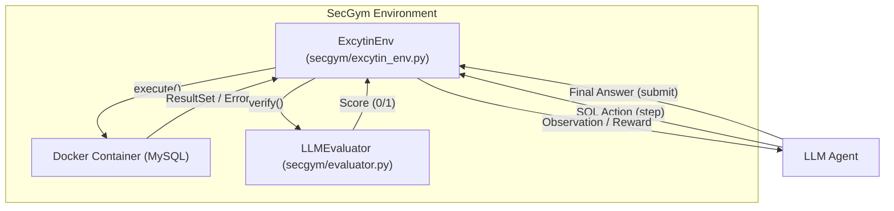

<!-- source: DeepWiki mcp.deepwiki.com · repo microsoft/SecRL · page 2 SecGym Environment · fetched 2026-10-26 -->

# SecGym Environment

Relevant source files

The following files were used as context for generating this wiki page:

- [secgym/database/__init__.py](secgym/database/__init__.py)
- [secgym/database/download_logs.py](secgym/database/download_logs.py)
- [secgym/database/pii_anony/pii_col_identify.py](secgym/database/pii_anony/pii_col_identify.py)
- [secgym/database/process_logs.py](secgym/database/process_logs.py)
- [secgym/excytin_env.py](secgym/excytin_env.py)

The **SecGym Environment** is a specialized [Gymnasium](https://gymnasium.farama.org)-based interface designed to facilitate autonomous cyber threat hunting. It acts as the intermediary between an LLM agent and a collection of Dockerized MySQL databases containing high-fidelity security telemetry from simulated corporate environments.

The environment manages the lifecycle of database containers, provides a standardized observation space for SQL-based querying, and integrates with an LLM-based evaluator to score agent performance against "golden" answers.

### Architecture Overview

The interaction loop follows the standard Reinforcement Learning (RL) paradigm where the agent issues SQL queries as actions and receives table results or error messages as observations.

**SecGym-to-Code Mapping**
The following diagram illustrates how the logical components of the SecGym environment map to specific entities and files in the codebase.

| Logic Space | Code Entity Space |
| :--- | :--- |
| **Environment Interface** | `ExcytinEnv` class in [secgym/excytin_env.py:78-94]() |
| **Database Registry** | `ATTACKS` dictionary in [secgym/excytin_env.py:17-58]() |
| **Telemetry Access** | `mysql.connector` in [secgym/excytin_env.py:144-155]() |
| **Evaluation Logic** | `LLMEvaluator` class in [secgym/evaluator.py]() |

**Agent-Environment Interaction Flow**

Sources: [secgym/excytin_env.py:78-155](), [secgym/evaluator.py]()

---

### Core Components

The SecGym ecosystem is divided into four primary functional areas, each covered in detail by a dedicated child page.

#### [2.1 ExcytinEnv: The Gymnasium Interface](#)
The `ExcytinEnv` class is the core of the framework. It handles the initialization of the specific security incident (attack) chosen for the trial. It manages the `step-query-observation` loop, truncates database results to fit within LLM context windows, and ensures that the agent stays within the defined telemetry "layer" (e.g., `alert`, `log`, or `alert_only`).
*   **Key File:** [secgym/excytin_env.py]()
*   **Key Function:** `step(action)` [secgym/excytin_env.py:213-250]() (logic for executing SQL and returning observations).

#### [2.2 Database Layer: Setup, Schema & Data Pipeline](#)
The backend consists of MySQL databases running in Docker containers. This layer includes the logic for downloading raw telemetry from Azure Log Analytics, processing CSVs with custom separators (`❖`), and building the multi-table schema (e.g., `SecurityAlert`, `DeviceProcessEvents`, `SigninLogs`).
*   **Key Files:** [secgym/database/download_logs.py](), [secgym/database/process_logs.py]()
*   **Database Config:** Port mapping and container names are defined in the `ATTACKS` registry [secgym/excytin_env.py:17-58]().

#### [2.3 PII Anonymization Pipeline](#)
Before raw logs are ingested into the SecGym environment, they pass through a PII (Personally Identifiable Information) anonymization pipeline. This ensures that sensitive data like IP addresses, usernames, and emails are consistently masked across the entire dataset while maintaining the relational integrity required for investigation.
*   **Key Files:** [secgym/database/pii_anony/pii_col_identify.py](), [secgym/database/pii_anony/pii_mapper.py]()
*   **Process:** Uses LLM-based identification [secgym/database/pii_anony/pii_col_identify.py:21-41]() followed by regex and mapping-based replacement.

#### [2.4 LLM Evaluator](#)
Since security questions often require free-text answers (e.g., "What was the initial entry point?"), a standard exact-match reward is insufficient. The `LLMEvaluator` uses a high-reasoning LLM to compare the agent's submitted answer against a "golden" reference answer to determine if the agent successfully solved the incident.
*   **Key File:** [secgym/evaluator.py]()
*   **Logic:** Scores answers as 0 or 1 based on semantic correctness [secgym/evaluator.py:30-50]().

---

### Environment Configuration

The environment is highly configurable via the `ExcytinEnv` constructor:

| Parameter | Type | Description |
| :--- | :--- | :--- |
| `attack` | `str/int` | The incident ID (e.g., `incident_5`). |
| `layer` | `str` | Filters available tables: `alert`, `log`, or `alert_only`. |
| `max_steps` | `int` | Max queries an agent can make before the episode ends. |
| `max_entry_return` | `int` | Limits the number of rows returned by a SQL query to prevent context overflow. |

Sources: [secgym/excytin_env.py:79-94]()

---

