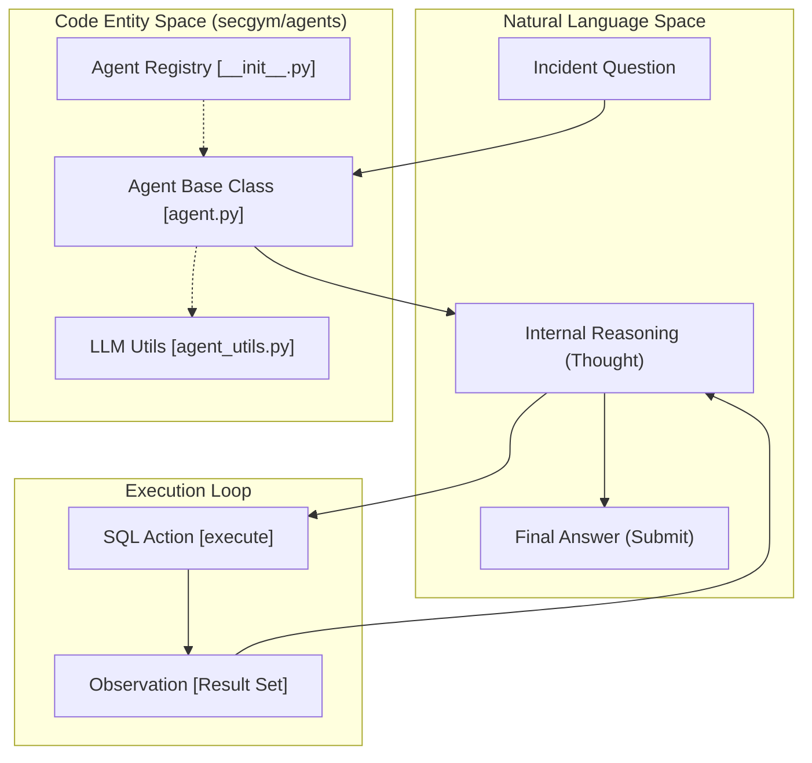

<!-- source: DeepWiki mcp.deepwiki.com · repo microsoft/SecRL · page 3 LLM Agents · fetched 2026-10-26 -->

# LLM Agents

<details>
<summary>Relevant source files</summary>

The following files were used as context for generating this wiki page:

- [secgym/agents/__init__.py](secgym/agents/__init__.py)
- [secgym/agents/agent.py](secgym/agents/agent.py)
- [secgym/agents/expel_train/README.md](secgym/agents/expel_train/README.md)
- [secgym/agents/expel_train/__init__.py](secgym/agents/expel_train/__init__.py)
- [secgym/agents/expel_train/experience_recall.py](secgym/agents/expel_train/experience_recall.py)
- [secgym/agents/react_examples/react_example_1.txt](secgym/agents/react_examples/react_example_1.txt)
- [secgym/agents/react_examples/react_example_2.txt](secgym/agents/react_examples/react_example_2.txt)
- [secgym/agents/react_examples/react_example_3.txt](secgym/agents/react_examples/react_example_3.txt)

</details>


This page provides a high-level overview of the agent framework within ExCyTIn-Bench. The framework is designed to support various autonomous reasoning strategies—ranging from simple zero-shot prompting to complex iterative reflection and experience-based learning—all operating within the SecGym environment.

The core of the framework is a unified `Agent` base class that defines the contract for the Thought-Action-Observation loop, ensuring that different agent architectures can be evaluated against the same security incidents and telemetry data.

### Agent Framework Architecture

The agent architecture bridges the gap between natural language reasoning and the SQL-based "Code Entity Space" of the security databases. Agents receive observations (SQL query results or error messages) and must generate valid SQL actions to progress their investigation.

**Agent-Environment Interaction Flow**


**Sources:** [secgym/agents/agent.py:8-48](), [secgym/agents/agent_utils.py:1-50](), [secgym/agents/__init__.py:4-21]()

---

### Core Components

#### 3.1 Agent Utilities & Base Classes
All agents inherit from the `Agent` class in `secgym/agents/agent.py`. This base class manages the `OpenAIWrapper` for LLM calls, maintains the conversation history in `self.messages`, and tracks token usage. Shared utilities in `agent_utils.py` provide critical functions like `sql_parser` for extracting executable code from LLM strings and `call_llm` for robust API interactions with exponential backoff.

For details, see [Agent Utilities & Base Classes](#3.1).
**Sources:** [secgym/agents/agent.py:8-41](), [secgym/agents/agent_utils.py:5-32]()

#### 3.2 Baseline & PromptSauce Agents
The `BaselineAgent` implements a straightforward loop where the model is prompted to solve the task in a single or multi-step fashion without specific few-shot trajectories. The `PromptSauceAgent` extends this by utilizing domain-specific security knowledge and specialized system prompts (e.g., `O1_PROMPT`, `R1_PROMPT`) tailored for advanced reasoning models like OpenAI's o1 or DeepSeek-R1.

For details, see [BaselineAgent & PromptSauceAgent](#3.2).
**Sources:** [secgym/agents/baseline_agent.py](), [secgym/agents/prompt_sauce_agent.py]()

#### 3.3 ReAct & Reflexion Agents
The `ReActAgent` implements the "Reason + Act" paradigm, using few-shot demonstrations (found in `secgym/agents/react_examples/`) to teach the model how to interleave thoughts and SQL actions. The `ReflexionAgent` variants add an iterative self-correction layer: after a failed trial, the agent calls a `reflect()` method to analyze its mistakes, which is then injected into the system prompt of the next trial.

For details, see [ReAct & Reflexion Agents](#3.3).
**Sources:** [secgym/agents/react_agent.py](), [secgym/agents/react_reflexion_agent.py](), [secgym/agents/react_examples/react_example_1.txt:1-55]()

#### 3.4 ExPeL Agent (Experience-Based Learning)
`ExpelAgent` is the most advanced agent family, implementing a cross-task learning mechanism. It utilizes an `ExperiencePool` to retrieve successful trajectories from previous investigations based on vector similarity (using `HuggingFaceEmbeddings` or `OpenAIEmbeddings`). It also incorporates "Insights"—optimized rules extracted during a training phase—to guide the agent's SQL generation and investigation strategy.

For details, see [ExPeL Agent: Experience-Based Learning](#3.4).
**Sources:** [secgym/agents/expel_agent.py](), [secgym/agents/expel_train/experience_recall.py:25-78]()

---

### Agent Family Comparison

| Agent Family | Strategy | Learning Type | Key Files |
| :--- | :--- | :--- | :--- |
| **Baseline** | Zero-shot / Simple Loop | None | `baseline_agent.py` |
| **PromptSauce** | Domain-specific System Prompts | None | `prompt_sauce_agent.py` |
| **ReAct** | Thought-Action-Observation | Few-shot (Static) | `react_agent.py` |
| **Reflexion** | Self-Correction Loop | Intra-task (Trial-to-Trial) | `react_reflexion_agent.py` |
| **ExPeL** | Experience Retrieval & Insights | Inter-task (Experience Pool) | `expel_agent.py` |

---

### Implementation Class Hierarchy

The following diagram maps the logical agent families to their specific Python class implementations and associated data files.

```mermaid
classDiagram
    class Agent {
        <<Abstract>>
        +config_list
        +messages
        +act(observation)
        +_call_llm(messages)
    }

    class BaselineAgent {
        +act()
    }

    class ReActAgent {
        +examples_path
        +stop_sequences
    }

    class ExpelAgent {
        +experience_pool: ExperiencePool
        +insights: List
    }

    class ExperiencePool {
        +vector_store
        +get_demonstrations(query)
    }

    Agent <|-- BaselineAgent
    Agent <|-- ReActAgent
    Agent <|-- ExpelAgent
    ExpelAgent --> ExperiencePool : uses
    
    style Agent font-style:italic
```
**Sources:** [secgym/agents/agent.py:8-48](), [secgym/agents/expel_train/experience_recall.py:25-52](), [secgym/agents/__init__.py:12-21]()

---

