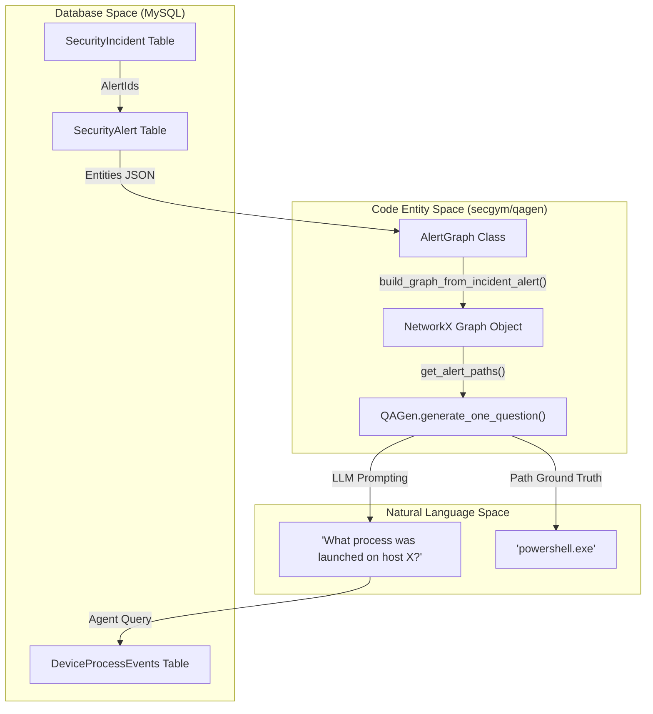
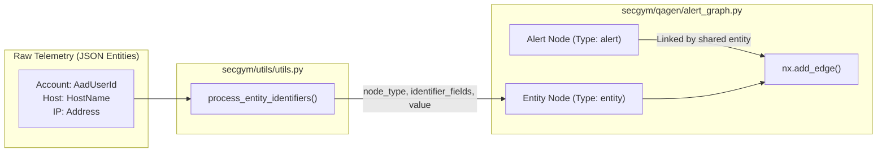

<!-- source: DeepWiki mcp.deepwiki.com · repo microsoft/SecRL · page 4 Question & Attack Graph Generation · fetched 2026-10-26 -->

# Question & Attack Graph Generation

Relevant source files

The following files were used as context for generating this wiki page:

- [notebooks/explore_graph_questions.ipynb](notebooks/explore_graph_questions.ipynb)
- [notebooks/extract_construct_graph.ipynb](notebooks/extract_construct_graph.ipynb)
- [notebooks/question_split.ipynb](notebooks/question_split.ipynb)
- [notebooks/react_example.ipynb](notebooks/react_example.ipynb)
- [secgym/qagen/alert_graph.py](secgym/qagen/alert_graph.py)
- [secgym/qagen/qa_gen.py](secgym/qagen/qa_gen.py)
- [secgym/qagen/qa_gen_prompts.py](secgym/qagen/qa_gen_prompts.py)
- [secgym/utils/graph_viz_utils.py](secgym/utils/graph_viz_utils.py)
- [secgym/utils/utils.py](secgym/utils/utils.py)

This page provides a high-level overview of the pipeline used to transform raw security incident telemetry into a structured benchmark. The process involves two primary stages: the construction of an **AlertGraph** to map attack propagation and the use of a multi-stage LLM pipeline (**QAGen**) to generate synthetic, verifiable question-answer pairs.

## Pipeline Overview

The generation pipeline ensures that benchmark tasks are grounded in real telemetry while maintaining a clear "ground truth" path for evaluation.

1.  **Graph Construction**: Raw incidents from the `SecurityIncident` and `SecurityAlert` tables are parsed to create a directed graph where nodes are alerts or entities (IPs, Hosts, Users) and edges represent shared attributes [secgym/qagen/alert_graph.py:29-59]().
2.  **Path Extraction**: The framework identifies significant attack paths by finding the farthest connected entities and alerts within the graph [secgym/qagen/alert_graph.py:214-230]().
3.  **QA Generation**: Using the extracted paths as "gold standard" evidence, an LLM generates a natural language question and a deterministic answer [secgym/qagen/qa_gen.py:145-165]().
4.  **Validation & Splitting**: Questions are validated for answer-leakage and split into training/testing sets based on path overlap scores [notebooks/question_split.ipynb:14-45]().

### Data Flow: From Telemetry to Benchmark

The following diagram illustrates how natural language questions are mapped to the underlying code entities and database structures.

**Attack Graph to Code Entity Mapping**

**Sources:** [secgym/qagen/alert_graph.py:29-54](), [secgym/qagen/qa_gen.py:48-59](), [secgym/qagen/qa_gen.py:145-160]().

---

## 4.1 AlertGraph: Incident Graph Construction

The `AlertGraph` class in `secgym/qagen/alert_graph.py` is responsible for modeling the "Attack Surface" of an incident. It uses `networkx` to build a graph where:
*   **Alert Nodes**: Represented by `SystemAlertId`, containing the alert name and description [secgym/qagen/alert_graph.py:48-54]().
*   **Entity Nodes**: Extracted from the `Entities` JSON field in alerts (e.g., Account, Host, IP, FileHash) [secgym/qagen/alert_graph.py:93-112]().
*   **Edges**: Created whenever an alert contains a specific entity, effectively linking different alerts that share the same user, machine, or file [secgym/qagen/alert_graph.py:119-120]().

The graph is pruned to its largest connected component to ensure that all generated questions are solvable through correlation [secgym/qagen/alert_graph.py:61-67]().

For details, see [AlertGraph: Incident Graph Construction](#4.1).

**Sources:** [secgym/qagen/alert_graph.py:14-128](), [secgym/utils/utils.py:48-77]().

---

## 4.2 QAGen: Synthetic Question Generation

The `QAGen` class in `secgym/qagen/qa_gen.py` manages the LLM-based task creation. It takes a path from the `AlertGraph` and uses the `QAGEN_PROMPT_WITH_ENTRY` to generate a JSON object containing a `context`, a `question`, and an `answer` [secgym/qagen/qa_gen.py:10-13](), [secgym/qagen/qa_gen.py:145-165]().

**The Multi-Stage Process:**
1.  **Initial Generation**: LLM creates a question based on a "Start Alert" and asks for an entity found in an "End Alert" [secgym/qagen/qa_gen_prompts.py:5-20]().
2.  **Answer Leakage Check**: The system validates that the answer is not explicitly mentioned in the question or context [secgym/qagen/qa_gen.py:140-143]().
3.  **Solution Generation**: A separate pass generates the "Gold Standard" SQL queries required to reach the answer, ensuring the task is actually solvable within the environment [secgym/qagen/qa_gen.py:22-42]().

For details, see [QAGen: Synthetic Question Generation](#4.2).

**Sources:** [secgym/qagen/qa_gen.py:13-53](), [secgym/qagen/qa_gen_prompts.py:5-46]().

---

## 4.3 Question Dataset & Train/Test Splits

Generated questions are organized in `secgym/questions/`. To prevent the model from simply memorizing incident patterns during training, the dataset is split based on **Path Relevance Scores**.

*   **Logic**: The script `notebooks/question_split.ipynb` calculates the edge overlap between different paths [notebooks/question_split.ipynb:14-45]().
*   **Split Types**: Users can choose between `low_score`, `median_score`, or `high_score` splits, which determine how much "leakage" or similarity exists between the training and testing trajectories [notebooks/question_split.ipynb:140-147]().

For details, see [Question Dataset & Train/Test Splits](#4.3).

**Sources:** [notebooks/question_split.ipynb:47-124]().

---

## Entity Relationship Diagram

This diagram shows how `process_entity_identifiers` maps raw data to the `AlertGraph` structure used for QA generation.

**Telemetry to Graph Entity Mapping**

**Sources:** [secgym/utils/utils.py:48-163](), [secgym/qagen/alert_graph.py:91-120]().

---

