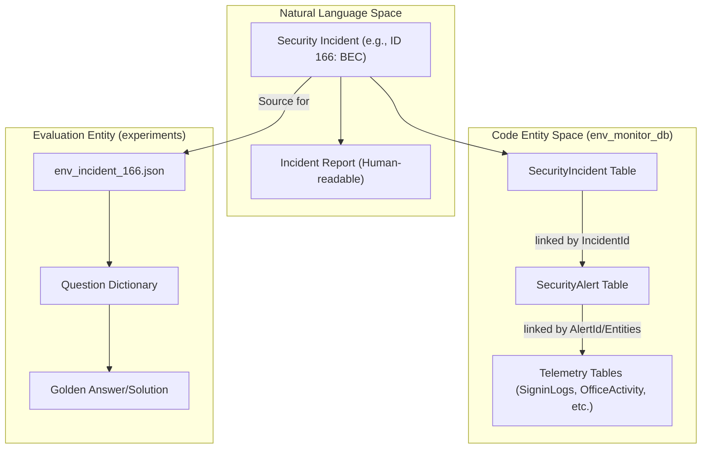
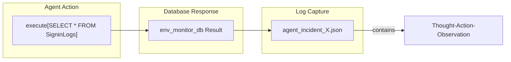

<!-- source: DeepWiki mcp.deepwiki.com · repo microsoft/SecRL · page 6 Security Incidents & Incident Reports · fetched 2026-10-26 -->

# Security Incidents & Incident Reports

Relevant source files

The following files were used as context for generating this wiki page:

- [latest_experiments/BaselineAgent_gpt-5_c121_alert_level_t0_s25_trial1/agent_incident_134.json](latest_experiments/BaselineAgent_gpt-5_c121_alert_level_t0_s25_trial1/agent_incident_134.json)
- [latest_experiments/BaselineAgent_gpt-5_c121_alert_level_t0_s25_trial1/agent_incident_166.json](latest_experiments/BaselineAgent_gpt-5_c121_alert_level_t0_s25_trial1/agent_incident_166.json)
- [latest_experiments/BaselineAgent_gpt-5_c121_alert_level_t0_s25_trial1/agent_incident_322.json](latest_experiments/BaselineAgent_gpt-5_c121_alert_level_t0_s25_trial1/agent_incident_322.json)
- [latest_experiments/BaselineAgent_o3_c106_alert_level_t0_s25_trial1/agent_incident_5.json](latest_experiments/BaselineAgent_o3_c106_alert_level_t0_s25_trial1/agent_incident_5.json)
- [latest_experiments/BaselineAgent_o3_c106_alert_level_t0_s25_trial1/agent_incident_55.json](latest_experiments/BaselineAgent_o3_c106_alert_level_t0_s25_trial1/agent_incident_55.json)
- [latest_experiments/BaselineAgent_o3_c106_alert_level_t0_s25_trial1/env_incident_134.json](latest_experiments/BaselineAgent_o3_c106_alert_level_t0_s25_trial1/env_incident_134.json)
- [latest_experiments/BaselineAgent_o3_c106_alert_level_t0_s25_trial1/env_incident_166.json](latest_experiments/BaselineAgent_o3_c106_alert_level_t0_s25_trial1/env_incident_166.json)

This page provides a high-level overview of the security incidents that form the core of the ExCyTIn-Bench evaluation framework. It details the nature of the benchmark incidents, the types of attacks they represent, and how these incidents are documented within the repository to support LLM agent training and testing.

ExCyTIn-Bench utilizes 8 specific security incidents (IDs: 5, 34, 38, 39, 55, 134, 166, 322) derived from real-world telemetry patterns. These incidents are stored in a MySQL database named `env_monitor_db`, which agents must query to reconstruct the attack timeline and answer investigative questions.

### Incident Mapping: Natural Language to Code Entities

The following diagram illustrates how a natural language security incident is represented within the codebase, specifically mapping the conceptual "Incident" to the database tables and JSON structures used by the `SecGym` environment.

**Incident Data Representation Architecture**

**Sources:** [latest_experiments/BaselineAgent_o3_c106_alert_level_t0_s25_trial1/env_incident_166.json:1-30](), [latest_experiments/BaselineAgent_o3_c106_alert_level_t0_s25_trial1/env_incident_5.json:1-29]()

---

### Benchmark Incidents & Attack Types

The benchmark covers a diverse range of cyberattack scenarios, ensuring that agents are tested on various forensic artifacts and telemetry sources. Key attack types include:

*   **Business Email Compromise (BEC):** Manipulation of inbox rules and suspicious sign-ins (e.g., Incident 166, 134).
*   **Command and Control (C2):** Detection of malware communicating with remote attackers (e.g., Incident 5).
*   **Phishing & Malicious URLs:** Users clicking on links later identified as malicious by ZAP or Defender (e.g., Incident 55, 322).
*   **Ransomware & Credential Dumping:** Lateral movement and unauthorized access to sensitive credentials.

For a detailed breakdown of each incident's narrative, affected entities (e.g., hostnames like `vnevado-win10r`), and the specific threat actors involved (e.g., **Manatee Tempest**), see [Incident Scenarios & Attack Types](#6.1).

**Sources:** [latest_experiments/BaselineAgent_o3_c106_alert_level_t0_s25_trial1/agent_incident_5.json:6-11](), [latest_experiments/BaselineAgent_o3_c106_alert_level_t0_s25_trial1/env_incident_134.json:9-15]()

---

### Incident Reports & Trajectories

Each incident is accompanied by an "Incident Report" located in the `incident_reports/` directory. These reports provide a ground-truth narrative that agents use to validate their findings. Furthermore, the `experiments/` directory stores the execution trajectories of agents as they investigate these incidents.

The following diagram shows the relationship between the investigation tools (SQL) and the resulting logs.

**Investigation Trajectory Flow**

**Sources:** [latest_experiments/BaselineAgent_o3_c106_alert_level_t0_s25_trial1/agent_incident_55.json:41-60](), [latest_experiments/BaselineAgent_gpt-5_c121_alert_level_t0_s25_trial1/agent_incident_322.json:44-65]()

---

### Database Schema for Investigation

To successfully investigate an incident, agents must navigate a complex MySQL schema. The `env_monitor_db` contains over 20 tables, including:
*   **High-level Alerting:** `SecurityIncident`, `SecurityAlert`, `AlertInfo`.
*   **Identity Telemetry:** `SigninLogs`, `AADUserRiskEvents`, `IdentityLogonEvents`.
*   **Endpoint/Office Telemetry:** `DeviceProcessEvents`, `OfficeActivity`, `EmailEvents`.

For a complete reference of all tables, columns, and how they correlate across different stages of an attack, see [Database Schema Reference](#6.2).

**Sources:** [latest_experiments/BaselineAgent_o3_c106_alert_level_t0_s25_trial1/env_incident_166.json:32-33](), [latest_experiments/BaselineAgent_gpt-5_c121_alert_level_t0_s25_trial1/agent_incident_322.json:63-64]()

---

### Summary of Investigation Metrics

When evaluating an agent's performance on these incidents, the framework tracks several key metrics:
1.  **Reward:** Binary (0 or 1) indicating if the submitted answer matches the `golden_answer`.
2.  **Steps:** The number of Thought-Action pairs taken.
3.  **Query Efficiency:** Count of successful vs. failed SQL queries.

| Incident ID | Primary Attack Type | Key Telemetry Source | Example Question |
| :--- | :--- | :--- | :--- |
| 5 | Command & Control | `DeviceProcessEvents` | Identify the IP associated with Manatee Tempest. |
| 134 | BEC / Inbox Rules | `OfficeActivity` | Identify the anonymous IP in the sign-in attempt. |
| 166 | BEC / Risky Session | `SigninLogs` | Identify the SID of the account creating inbox rules. |
| 322 | Phishing / Malicious URL | `UrlClickEvents` | Find the email of the recipient who clicked the URL. |

**Sources:** [latest_experiments/BaselineAgent_o3_c106_alert_level_t0_s25_trial1/agent_incident_5.json:4-11](), [latest_experiments/BaselineAgent_gpt-5_c121_alert_level_t0_s25_trial1/agent_incident_322.json:4-13]()

---

